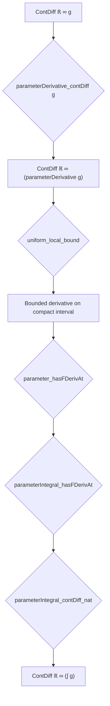
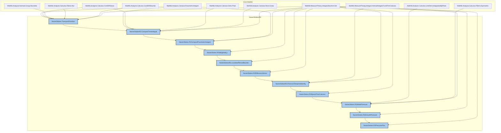

<!-- source: DeepWiki mcp.deepwiki.com · repo openai/NavierStokesAndEuler · page 7.4 R3 Whole-Space Analysis · fetched 2026-10-26 -->

# R3 Whole-Space Analysis

Relevant source files

The following files were used as context for generating this wiki page:

- [Euler/CompactParameterIntegral.lean](Euler/CompactParameterIntegral.lean)
- [NavierStokes/R3/CompactTimeIntegral.lean](NavierStokes/R3/CompactTimeIntegral.lean)
- [NavierStokes/R3/LocalizedTensorBounds.lean](NavierStokes/R3/LocalizedTensorBounds.lean)
- [NavierStokes/R3/PressureTemporalIdentity.lean](NavierStokes/R3/PressureTemporalIdentity.lean)
- [NavierStokes/R3CompactParametricIntegral.lean](NavierStokes/R3CompactParametricIntegral.lean)
- [NavierStokes/R3DifferenceStress.lean](NavierStokes/R3DifferenceStress.lean)
- [NavierStokes/R3PressureFlux.lean](NavierStokes/R3PressureFlux.lean)
- [NavierStokes/R3SmoothPressure.lean](NavierStokes/R3SmoothPressure.lean)
- [NavierStokes/R3SpaceTimeCalculus.lean](NavierStokes/R3SpaceTimeCalculus.lean)
- [NavierStokes/R3WeakPressure.lean](NavierStokes/R3WeakPressure.lean)
- [NavierStokes/R3WeightedLp.lean](NavierStokes/R3WeightedLp.lean)
- [NavierStokes/TransportPrimitive.lean](NavierStokes/TransportPrimitive.lean)

This page details the analytical tools and results specifically developed for the Navier-Stokes equations in $\mathbb{R}^3$. It covers estimates related to the heat kernel and Riesz operators, methods for pressure recovery, flux identities, and the application of weighted Sobolev and $L^p$ spaces. Key topics include localized energy limits and the establishment of whole-space uniqueness and comparison closure for solutions.

## Parameter Integrals and Smoothness

The `NavierStokes.TransportPrimitive` namespace [NavierStokes/TransportPrimitive.lean:22-104]() provides theorems for the smoothness of integrals with respect to a parameter. These are crucial for establishing regularity of solutions derived from integral representations.

The `parameterIntegral_contDiff` theorem [NavierStokes/TransportPrimitive.lean:100-103]() states that if an integrand `g` is `ContDiff ℝ ∞` (infinitely differentiable) with respect to its parameters, then its integral over a fixed finite interval `[a, b]` is also `ContDiff ℝ ∞` with respect to the parameter. This is a fundamental result for ensuring the smoothness of quantities like pressure or velocity fields that are often defined via integrals.

The proof relies on the `parameterIntegral_hasFDerivAt` theorem [NavierStokes/TransportPrimitive.lean:65-81](), which establishes the differentiability of the integral with respect to the parameter. This is achieved by applying the dominated convergence theorem for derivatives under the integral sign, using a uniform local bound for the integrand's derivative.

**Diagram 1: Smoothness of Parameter Integrals**

Sources:
* [NavierStokes/TransportPrimitive.lean:22-104]()

## Shifted Transport Primitives

The `NavierStokes.TransportPrimitive` namespace also defines "shifted transport primitives" [NavierStokes/TransportPrimitive.lean:107-128](). These are integrals where the integration variable `u` translates the spatial coordinate `z` along a fixed direction `v`, scaled by `M`.

* `shift M v z u`: Represents the translated point `z + (u, (M * u) • v)` [NavierStokes/TransportPrimitive.lean:113-114]().
* `pastIntegral M v f z`: Integrates a function `f` along the past half-line `u ∈ (-∞, 0]` using the `shift` operation [NavierStokes/TransportPrimitive.lean:117-118]().
* `totalIntegral M v f z`: Integrates `f` over the entire real line `u ∈ (-∞, ∞)` using `shift` [NavierStokes/TransportPrimitive.lean:121-122]().
* `compactIntegral χ M v f z`: A compactified version using a cutoff function `χ` [NavierStokes/TransportPrimitive.lean:125-128]().

These primitives are essential for constructing solutions that involve transport phenomena, where the influence of a source propagates along characteristic lines. The `shift_contDiff` theorem [NavierStokes/TransportPrimitive.lean:139-142]() ensures that the `shift` operation itself is infinitely differentiable, which is critical for maintaining the regularity of the integrated fields.

Sources:
* [NavierStokes/TransportPrimitive.lean:107-142]()

## Compact Time Integrals

The `NavierStokesR3.CompactTimeIntegral` namespace [NavierStokes/R3/CompactTimeIntegral.lean:20-110]() provides tools for handling time derivatives of spatial integrals, particularly when the integrand has uniform compact spatial support. This is a common scenario in analysis where test functions are used to localize quantities.

Key theorems include:
* `continuous_slice`: Ensures that if a function `F(t, x)` is jointly continuous on a time set `s` and all of `Space`, then each spatial slice `F(t, ·)` is continuous for `t ∈ s` [NavierStokes/R3/CompactTimeIntegral.lean:27-31]().
* `integrable_slice`: If a continuous spatial slice `F(t, ·)` is supported within a compact set `K`, then it is integrable [NavierStokes/R3/CompactTimeIntegral.lean:33-44]().
* `continuousOn_integral`: Shows that the spatial integral `∫ F(t, x) dx` is continuous with respect to `t` if `F` is jointly continuous and has uniform compact spatial support [NavierStokes/R3/CompactTimeIntegral.lean:48-55]().
* `hasDerivAt_integral`: This is a crucial result allowing differentiation under the integral sign. It states that if `F(t, x)` and its time derivative `G(t, x)` are continuous, and `F` has uniform compact spatial support, then the time derivative of the spatial integral of `F` is the spatial integral of `G` [NavierStokes/R3/CompactTimeIntegral.lean:71-110](). This theorem is vital for deriving evolution equations for integrated quantities.

The `hasDerivAt_integral` theorem relies on the dominated convergence theorem for derivatives, where the uniform compact support provides the necessary dominating function.

Sources:
* [NavierStokes/R3/CompactTimeIntegral.lean:20-110]()

## Compact Parametric Integrals

Similar to `CompactTimeIntegral`, the `NavierStokes.R3CompactParametricIntegral` namespace [NavierStokes/R3CompactParametricIntegral.lean:12-115]() focuses on differentiating spatial integrals with uniform compact support, but with a broader parametric context.

* `integral_continuousOn`: Establishes continuity of the integral `∫ F(t, x) dx` over a compact time interval `I` when `F` is continuous and has uniform compact spatial support `K` [NavierStokes/R3CompactParametricIntegral.lean:33-43]().
* `integral_hasDerivAt`: This theorem is a more general version of differentiation under the integral sign. It states that if `F(t, x)` is continuous, `G(t, x)` is its time derivative, and both have uniform compact spatial support, then the derivative of `∫ F(t, x) dx` with respect to `t` is `∫ G(t, x) dx` [NavierStokes/R3CompactParametricIntegral.lean:64-90]().
* `integral_hasDerivAt_of_contDiffOn`: A specialized version of the above, where the differentiability of `F` is given by `ContDiffOn ℝ 1` [NavierStokes/R3CompactParametricIntegral.lean:91-115]().

These theorems are fundamental for manipulating integral expressions that arise in the weak formulation of PDEs, especially when dealing with test functions that have compact support.

Sources:
* [NavierStokes/R3CompactParametricIntegral.lean:12-115]()

## Weighted $L^p$ Tools

The `NavierStokes.R3WeightedLp` namespace [NavierStokes/R3WeightedLp.lean:12-132]() introduces weighted $L^p$ spaces and associated inequalities, which are critical for handling the behavior of solutions at spatial infinity in $\mathbb{R}^3$. These tools are particularly useful for analyzing pressure and transport terms.

Key definitions and theorems:
* `lpNorm_mul_le`: A general Hölder inequality for $L^p$ norms of products of functions [NavierStokes/R3WeightedLp.lean:42-50]().
* `memLp_nonneg_rpow` and `lpNorm_nonneg_rpow`: Relate the $L^p$ membership and norm of `f^q` to `f` itself, for non-negative functions `f` [NavierStokes/R3WeightedLp.lean:52-67]().
* `fourthWeight` and `sixthQuadratic`: Define specific weighted functions `φ^4 * W` and `φ^6 * W^2` [NavierStokes/R3WeightedLp.lean:68-71](). These are used to analyze terms with specific polynomial growth or decay.
* `sixthQuadratic_memLp` and `sixthQuadratic_lpNorm`: Provide $L^p$ membership and norm bounds for `sixthQuadratic` based on the $L^p$ norms of `W` and `fourthWeight` [NavierStokes/R3WeightedLp.lean:77-106](). These are derived using Hölder's inequality and properties of powers.
* `cubic_lpNorm`: Provides an $L^1$ norm bound for `φ^7 * W^3`, which is a cubic cutoff transport error term, in terms of `fourthWeight` and `W` [NavierStokes/R3WeightedLp.lean:123-132](). This demonstrates how specific weighted norms can control error terms.

These weighted $L^p$ estimates are essential for establishing localized energy limits and proving uniqueness results in unbounded domains, where standard $L^p$ spaces might not be sufficient.

Sources:
* [NavierStokes/R3WeightedLp.lean:12-132]()

## Localized Tensor Bounds

The `NavierStokesR3.LocalizedTensorBounds` namespace [NavierStokes/R3/LocalizedTensorBounds.lean:17-148]() provides bounds for localized tensor differences, particularly relevant for pressure terms. These bounds are crucial for controlling the growth of error terms in comparison arguments.

* `scalar_product_bound`: A scalar version of Hölder's inequality for $L^p$ norms, providing both membership and a norm bound for the product of two functions [NavierStokes/R3/LocalizedTensorBounds.lean:31-44]().
* `cross_norm_bound`: Applies the scalar product bound to the product of magnitudes of two vector fields, showing that `‖u‖ * ‖w‖` belongs to $L^{6/5}$ if `u ∈ L^3` and `w ∈ L^2` [NavierStokes/R3/LocalizedTensorBounds.lean:46-56]().
* `quadratic_cutoff_bound`: Provides an endpoint interpolation bound for the quadratic weighted difference `‖φ x • w x‖^2`. This theorem is key for controlling terms involving a cutoff function `φ` and a velocity difference `w` [NavierStokes/R3/LocalizedTensorBounds.lean:58-95]().
* `tensorDiff_eq`: Defines the `tensorDiff` between two velocity fields `u` and `v` as `u_i u_j - v_i v_j` and provides an algebraic identity for it in terms of `u` and `u-v` [NavierStokes/R3/LocalizedTensorBounds.lean:96-107]().
* `norm_weighted_tensorDiff_le`: Provides a pointwise domination bound for the norm of a weighted `tensorDiff` term. This inequality is used to control the magnitude of the tensor difference in terms of the norms of `u` and `u-v` [NavierStokes/R3/LocalizedTensorBounds.lean:119-148]().

These localized bounds are instrumental in proving energy estimates and uniqueness results by carefully controlling terms that arise from the non-linear advection term in the Navier-Stokes equations.

Sources:
* [NavierStokes/R3/LocalizedTensorBounds.lean:17-148]()

## Difference Stress and Pressure Equation

The `NavierStokes.R3DifferenceStress` namespace [NavierStokes/R3DifferenceStress.lean:9-134]() defines the stress tensor for the difference of two velocity fields and relates its divergence to the momentum equation. This is a core component for deriving pressure recovery and comparison principles.

* `stress u v i j`: Defines the stress tensor component `u_i u_j - v_i v_j` [NavierStokes/R3DifferenceStress.lean:15-16]().
* `stress_smooth`: Shows that if `u` and `v` are smooth, then `stress u v` is also smooth [NavierStokes/R3DifferenceStress.lean:18-27]().
* `stress_norm`: Provides a bound for the norm of the stress tensor component in terms of `‖u‖` and `‖u-v‖` [NavierStokes/R3DifferenceStress.lean:29-51]().
* `tensor_divergence`: An identity for the divergence of a tensor product `u_i u_j` [NavierStokes/R3DifferenceStress.lean:53-66]().
* `stress_divergence`: Relates the divergence of the `stress` tensor to the difference of advection terms, assuming `u` and `v` are divergence-free [NavierStokes/R3DifferenceStress.lean:68-98](). This is a key identity for the pressure equation.
* `momentum_equation`: This theorem states that the difference in the momentum equation (Navier-Stokes residual) between two solutions `u, p` and `v, q` is precisely the gradient of the pressure difference `p-q`, provided `u` and `v` are divergence-free and satisfy the same residual [NavierStokes/R3DifferenceStress.lean:100-134](). This is fundamental for recovering the pressure gradient from the momentum equation.

These definitions and theorems are crucial for analyzing the difference between two potential solutions to the Navier-Stokes equations, leading to uniqueness and comparison results.

Sources:
* [NavierStokes/R3DifferenceStress.lean:9-134]()

## Pressure Temporal Identity

The `NavierStokesR3.PressureTemporalIdentity` namespace [NavierStokes/R3/PressureTemporalIdentity.lean:18-137]() provides identities related to the pressure gradient, particularly when integrated against time-dependent test functions. These identities are essential for deriving energy estimates and comparison principles.

* `continuous_cutoff_mul`: Shows that multiplying a continuous function by a compactly supported cutoff function results in a globally continuous product [NavierStokes/R3/PressureTemporalIdentity.lean:33-43]().
* `component_test_continuousOn`, `component_time_test_continuousOn`, `tensor_test_continuousOn`: These theorems establish the continuity of various integral expressions involving velocity components, their time derivatives, and tensor differences, when integrated against a compactly supported spatial test function `ψ` [NavierStokes/R3/PressureTemporalIdentity.lean:45-88]().
* `compact_time_integration_by_parts`: A standard integration by parts formula for time integrals, applicable when the temporal test function `a` has compact support within an open interval [NavierStokes/R3/PressureTemporalIdentity.lean:90-119](). This is used to transfer time derivatives between functions.
* `pressure_time_identity_interval`: This is a central identity that relates the time-integrated pressure gradient (paired with a spatial test function) to terms involving the velocity difference and the Laplacian of the test function [NavierStokes/R3/PressureTemporalIdentity.lean:121-137](). It effectively transfers spatial derivatives from the pressure to the test function and relates it to the velocity field.

These identities are used in the weak formulation of the Navier-Stokes equations to derive energy inequalities and establish uniqueness of solutions.

Sources:
* [NavierStokes/R3/PressureTemporalIdentity.lean:18-137]()

## R3 Space-Time Calculus

The `NavierStokes.R3SpaceTimeCalculus` namespace [NavierStokes/R3SpaceTimeCalculus.lean:12-138]() provides a framework for working with real-valued physical fields (velocity, pressure) within a complex-valued space-time domain, which is often used in Fourier analysis and tempered distribution theory. It defines how physical derivatives map to directional derivatives in this complex space.

* `unpack`: A continuous linear equivalence between the `Domain` (complex space-time) and `SpaceTime` (real space-time) [NavierStokes/R3SpaceTimeCalculus.lean:19-19]().
* `liftScalar` and `liftVelocity`: Functions to embed real-valued scalar and vector fields into complex-valued functions on the `Domain` [NavierStokes/R3SpaceTimeCalculus.lean:21-22]().
* `liftScalar_smooth` and `liftVelocity_smooth`: Show that if the original real fields are smooth, their lifted complex counterparts are also smooth [NavierStokes/R3SpaceTimeCalculus.lean:30-41]().
* `spatial_slice_derivative` and `temporal_slice_derivative`: These theorems connect the directional derivatives in the complex `Domain` to the standard spatial and temporal derivatives of the real-valued fields [NavierStokes/R3SpaceTimeCalculus.lean:54-71]().
* `lift_space_derivative`, `lift_laplacian`, `liftVelocity_laplacian`, `liftVelocity_time`, `liftVelocity_divergence`: These theorems explicitly show how spatial derivatives, Laplacians, time derivatives, and divergences of the real fields correspond to their counterparts in the complex `Domain` after lifting [NavierStokes/R3SpaceTimeCalculus.lean:78-138]().

This calculus provides the necessary bridge to apply powerful tools from complex analysis and functional analysis (like tempered distributions) to the real-valued Navier-Stokes equations.

Sources:
* [NavierStokes/R3SpaceTimeCalculus.lean:12-138]()

## Smooth Pressure Recovery

The `NavierStokes.R3WeakPressure` namespace [NavierStokes/R3WeakPressure.lean:12-145]() (which is also used for `NavierStokes.R3SmoothPressure`) deals with recovering the physical pressure gradient from the momentum equation, particularly in a weak sense using tempered distributions.

* `Represents T f`: A predicate stating that a tempered distribution `T` represents a function `f` if their action on compactly supported Schwartz functions `φ` is given by `∫ φ z * f z` [NavierStokes/R3WeakPressure.lean:21-23]().
* `Represents.ext`: Uniqueness theorem for `Represents`, stating that if two tempered distributions represent the same function, they are equal [NavierStokes/R3WeakPressure.lean:35-37]().
* `Represents.lineDeriv`: Shows that the line derivative of a tempered distribution `T` representing `f` represents the directional derivative of `f` [NavierStokes/R3WeakPressure.lean:63-68](). This is crucial for relating derivatives of distributions to derivatives of functions.
* `derivatives_commute`: Commutativity of directional derivatives for tempered distributions [NavierStokes/R3WeakPressure.lean:79-83]().
* `divergence`: Defines the divergence of a vector of tempered distributions [NavierStokes/R3WeakPressure.lean:85-86]().
* `momentumGradient`: Defines the momentum gradient as a tempered distribution, incorporating Laplacian, time derivative, and divergence of stress terms [NavierStokes/R3WeakPressure.lean:88-91]().
* `divergence_zero_of_smooth`: If a smooth vector field `U` has zero divergence pointwise, then its corresponding tempered distribution also has zero divergence [NavierStokes/R3WeakPressure.lean:100-106]().
* `smooth_pressure_gradient`: This theorem is central to pressure recovery. It states that if a smooth, divergence-free momentum equation holds (i.e., `functionMomentum` equals the pressure gradient), then the pressure gradient can be represented by a specific tempered distribution involving the stress tensor [NavierStokes/R3WeakPressure.lean:123-145](). This provides a way to define and analyze pressure even when it's not globally integrable.

This framework allows for the rigorous treatment of pressure in the context of weak solutions and tempered distributions, which is often necessary in $\mathbb{R}^3$ where pressure might not decay sufficiently fast at infinity.

Sources:
* [NavierStokes/R3WeakPressure.lean:12-145]()
* [NavierStokes/R3SmoothPressure.lean:12-145]()

## Pressure Flux Identities

The `NavierStokes.R3PressureFlux` namespace [NavierStokes/R3PressureFlux.lean:12-83]() provides flux bounds for physical Gaussian pressure approximations. These bounds are uniform with respect to regularization and pair the weighted pressure with square-integrable flux factors.

* `norm_integral_mul_le`: A Cauchy-Schwarz type inequality for the norm of an integral of a product of two $L^2$ functions [NavierStokes/R3PressureFlux.lean:18-31]().
* `actual_regularized_weighted`: This theorem states that the actual weighted regularized pressure term belongs to $L^2$, and provides a bound for its $L^2$ norm. This bound depends on the $L^2$ norm of the weighted original function and an error bound [NavierStokes/R3PressureFlux.lean:45-70](). This is crucial for controlling the behavior of regularized pressure terms.
* `regularized_flux_le`: Applies Cauchy-Schwarz to bound the integral of the product of a weighted regularized pressure term and a flux factor `h`. The bound is expressed in terms of the $L^2$ norms of the weighted regularized pressure and the flux factor [NavierStokes/R3PressureFlux.lean:74-83]().

These flux identities are essential for deriving energy estimates and proving uniqueness results for Navier-Stokes solutions, especially when dealing with regularized versions of the pressure.

Sources:
* [NavierStokes/R3PressureFlux.lean:12-83]()

## Code Entity Relationship Diagram

**Diagram 2: Dependencies of R3 Whole-Space Analysis Components**

Sources:
* [NavierStokes/TransportPrimitive.lean]()
* [NavierStokes/R3/CompactTimeIntegral.lean]()
* [NavierStokes/R3CompactParametricIntegral.lean]()
* [NavierStokes/R3WeightedLp.lean]()
* [NavierStokes/R3/LocalizedTensorBounds.lean]()
* [NavierStokes/R3DifferenceStress.lean]()
* [NavierStokes/R3/PressureTemporalIdentity.lean]()
* [NavierStokes/R3SpaceTimeCalculus.lean]()
* [NavierStokes/R3WeakPressure.lean]()
* [NavierStokes/R3SmoothPressure.lean]()
* [NavierStokes/R3PressureFlux.lean]()
* [Euler/CompactParameterIntegral.lean]()

## Natural Language to Code Entity Mapping

```mermaid
graph TD
    subgraph "Natural Language Concepts"
        NL1["Heat Kernel & Riesz Operator Estimates"]
        NL2["Pressure Recovery"]
        NL3["Flux Identities"]
        NL4["Weighted Sobolev/Lp Tools"]
        NL5["Localized Energy Limits"]
        NL6["Whole-Space Uniqueness & Comparison Closure"]
        NL7["Smoothness of Integrals"]
        NL8["Differentiation Under Integral Sign"]
        NL9["Stress Tensor Analysis"]
        NL10["Weak Formulation & Tempered Distributions"]
    end

    subgraph "Code Entities (NavierStokes/R3)"
        CE1["NavierStokes.TransportPrimitive.parameterIntegral_contDiff"]
        CE2["NavierStokes.R3/CompactTimeIntegral.hasDerivAt_integral"]
        CE3["NavierStokes.R3CompactParametricIntegral.integral_hasDerivAt"]
        CE4["NavierStokes.R3WeightedLp.lpNorm_mul_le"]
        CE5["NavierStokes.R3WeightedLp.sixthQuadratic_lpNorm"]
        CE6["NavierStokesR3.LocalizedTensorBounds.quadratic_cutoff_bound"]
        CE7["NavierStokes.R3DifferenceStress.momentum_equation"]
        CE8["NavierStokes.R3WeakPressure.smooth_pressure_gradient"]
        CE9["NavierStokes.R3PressureFlux.regularized_flux_le"]
        CE10["NavierStokesR3.PressureTemporalIdentity.pressure_time_identity_interval"]
        CE11["NavierStokes.R3SpaceTimeCalculus.lift_laplacian"]
        CE12["NavierStokes.R3WeakPressure.Represents"]
    end

    NL7 --> CE1;
    NL8 --> CE2;
    NL8 --> CE3;
    NL4 --> CE4;
    NL4 --> CE5;
    NL5 --> CE6;
    NL2 --> CE7;
    NL2 --> CE8;
    NL3 --> CE9;
    NL5 --> CE10;
    NL1 --> CE11;
    NL10 --> CE12;
    NL6 --> CE7;
    NL6 --> CE8;
    NL6 --> CE9;
    NL6 --> CE10;
```

**Diagram 3: Mapping Natural Language Concepts to Code Entities**

Sources:
* [NavierStokes/TransportPrimitive.lean:100-103]()
* [NavierStokes/R3/CompactTimeIntegral.lean:71-110]()
* [NavierStokes/R3CompactParametricIntegral.lean:64-90]()
* [NavierStokes/R3WeightedLp.lean:42-50]()
* [NavierStokes/R3WeightedLp.lean:90-106]()
* [NavierStokes/R3/LocalizedTensorBounds.lean:58-95]()
* [NavierStokes/R3DifferenceStress.lean:100-134]()
* [NavierStokes/R3WeakPressure.lean:123-145]()
* [NavierStokes/R3PressureFlux.lean:74-83]()
* [NavierStokes/R3/PressureTemporalIdentity.lean:121-137]()
* [NavierStokes/R3SpaceTimeCalculus.lean:86-101]()
* [NavierStokes/R3WeakPressure.lean:21-23]()

---

