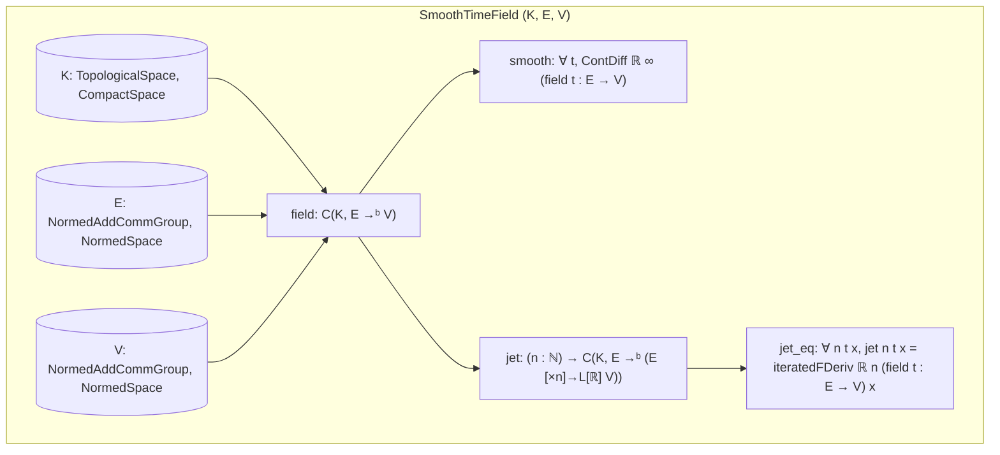
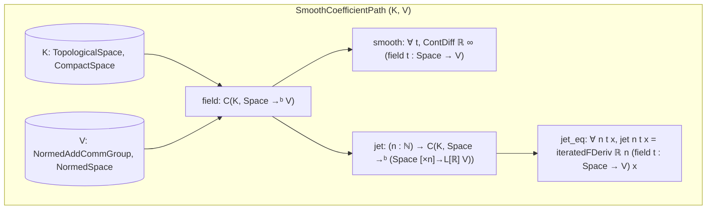
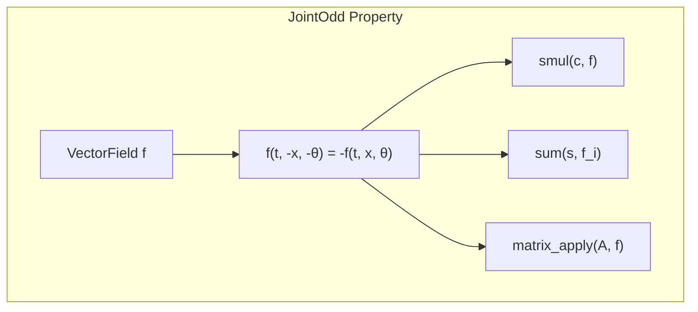
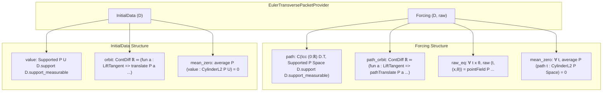

<!-- source: DeepWiki mcp.deepwiki.com · repo openai/NavierStokesAndEuler · page 8 Glossary · fetched 2026-10-26 -->

# Glossary

<details>
<summary>Relevant source files</summary>

The following files were used as context for generating this wiki page:

- [Euler/ContinuousAccelerationSobolev.lean](Euler/ContinuousAccelerationSobolev.lean)
- [Euler/ContinuousGramSobolev.lean](Euler/ContinuousGramSobolev.lean)
- [Euler/CylinderDirichletPhysicalBounds.lean](Euler/CylinderDirichletPhysicalBounds.lean)
- [Euler/CylinderDirichletRegularity.lean](Euler/CylinderDirichletRegularity.lean)
- [Euler/CylinderDirichletSobolev.lean](Euler/CylinderDirichletSobolev.lean)
- [Euler/CylinderDirichletTimeBounds.lean](Euler/CylinderDirichletTimeBounds.lean)
- [Euler/FixedEvolutionSobolev.lean](Euler/FixedEvolutionSobolev.lean)
- [Euler/LinearDuhamelFrozenGevrey.lean](Euler/LinearDuhamelFrozenGevrey.lean)
- [Euler/LinearDuhamelFrozenOperator.lean](Euler/LinearDuhamelFrozenOperator.lean)
- [Euler/LinearDuhamelSobolevGevrey.lean](Euler/LinearDuhamelSobolevGevrey.lean)
- [Euler/MeanPacketForcing.lean](Euler/MeanPacketForcing.lean)
- [Euler/MeanPacketForcingAlgebra.lean](Euler/MeanPacketForcingAlgebra.lean)
- [Euler/MeanPacketOrbitForcing.lean](Euler/MeanPacketOrbitForcing.lean)
- [Euler/MeanPacketProvider.lean](Euler/MeanPacketProvider.lean)
- [Euler/PacketActivationScales.lean](Euler/PacketActivationScales.lean)
- [Euler/PacketActualFrameEstimates.lean](Euler/PacketActualFrameEstimates.lean)
- [Euler/PacketBeforeTargetSize.lean](Euler/PacketBeforeTargetSize.lean)
- [Euler/PacketCylinderHighParity.lean](Euler/PacketCylinderHighParity.lean)
- [Euler/PacketCylinderJetParity.lean](Euler/PacketCylinderJetParity.lean)
- [Euler/PacketEarlyPhysical.lean](Euler/PacketEarlyPhysical.lean)
- [Euler/PacketFiniteParity.lean](Euler/PacketFiniteParity.lean)
- [Euler/PacketHorizonSize.lean](Euler/PacketHorizonSize.lean)
- [Euler/PacketJoinedProfilesParity.lean](Euler/PacketJoinedProfilesParity.lean)
- [Euler/PacketJoinedProfilesRegularity.lean](Euler/PacketJoinedProfilesRegularity.lean)
- [Euler/PacketJoinedStepParity.lean](Euler/PacketJoinedStepParity.lean)
- [Euler/PacketPhysicalCoefficients.lean](Euler/PacketPhysicalCoefficients.lean)
- [Euler/PacketPhysicalFamily.lean](Euler/PacketPhysicalFamily.lean)
- [Euler/PacketPhysicalNeighbor.lean](Euler/PacketPhysicalNeighbor.lean)
- [Euler/PacketPhysicalStage.lean](Euler/PacketPhysicalStage.lean)
- [Euler/PacketPressureJet.lean](Euler/PacketPressureJet.lean)
- [Euler/PacketProfileParity.lean](Euler/PacketProfileParity.lean)
- [Euler/PacketProfileStepParity.lean](Euler/PacketProfileStepParity.lean)
- [Euler/PacketProfilesParity.lean](Euler/PacketProfilesParity.lean)
- [Euler/PacketProfilesRegularity.lean](Euler/PacketProfilesRegularity.lean)
- [Euler/PacketShearMotion.lean](Euler/PacketShearMotion.lean)
- [Euler/PacketSlicedAssembly.lean](Euler/PacketSlicedAssembly.lean)
- [Euler/PacketSlicedJets.lean](Euler/PacketSlicedJets.lean)
- [Euler/PacketSourceParity.lean](Euler/PacketSourceParity.lean)
- [Euler/SmoothCoefficientPath.lean](Euler/SmoothCoefficientPath.lean)
- [Euler/SmoothCoefficientTimeRestriction.lean](Euler/SmoothCoefficientTimeRestriction.lean)
- [Euler/SmoothTimeField.lean](Euler/SmoothTimeField.lean)
- [Euler/SmoothTimeFieldAlgebra.lean](Euler/SmoothTimeFieldAlgebra.lean)
- [Euler/SmoothTimeFieldComposition.lean](Euler/SmoothTimeFieldComposition.lean)
- [Euler/SmoothTimeFieldDerivativeBounds.lean](Euler/SmoothTimeFieldDerivativeBounds.lean)
- [Euler/SmoothTimeFieldJoint.lean](Euler/SmoothTimeFieldJoint.lean)
- [Euler/SmoothTimeFieldLinear.lean](Euler/SmoothTimeFieldLinear.lean)
- [Euler/SmoothTimeFieldPrecomp.lean](Euler/SmoothTimeFieldPrecomp.lean)
- [Euler/SmoothTimeFieldRestriction.lean](Euler/SmoothTimeFieldRestriction.lean)
- [Euler/SmoothTimeFieldSecondJoint.lean](Euler/SmoothTimeFieldSecondJoint.lean)
- [Euler/SmoothTimeFieldTimeJets.lean](Euler/SmoothTimeFieldTimeJets.lean)
- [Euler/SourceCylinderRegularity.lean](Euler/SourceCylinderRegularity.lean)
- [Euler/TimeLpAccelerationSobolev.lean](Euler/TimeLpAccelerationSobolev.lean)
- [Euler/TimeLpGramSobolev.lean](Euler/TimeLpGramSobolev.lean)
- [Euler/TransverseHighSolveFields.lean](Euler/TransverseHighSolveFields.lean)
- [Euler/TransversePacketCylinderFields.lean](Euler/TransversePacketCylinderFields.lean)
- [Euler/TransversePacketForcing.lean](Euler/TransversePacketForcing.lean)
- [Euler/TransversePacketForwardBounds.lean](Euler/TransversePacketForwardBounds.lean)
- [Euler/TransversePacketHistory.lean](Euler/TransversePacketHistory.lean)
- [Euler/TransversePacketHistoryBounds.lean](Euler/TransversePacketHistoryBounds.lean)
- [Euler/TransversePacketInitial.lean](Euler/TransversePacketInitial.lean)
- [Euler/TransversePacketJoinedProvider.lean](Euler/TransversePacketJoinedProvider.lean)
- [Euler/TransversePacketRegularity.lean](Euler/TransversePacketRegularity.lean)

</details>


This page provides definitions for codebase-specific terms used throughout the Lean 4 formalization of the Euler and Navier–Stokes equations. Each term is accompanied by a brief explanation, its significance within the codebase, and pointers to relevant code locations for further investigation.

## SmoothTimeField

A `SmoothTimeField` represents a spatially smooth field whose coefficients vary smoothly over a compact time interval `K`. It stores the field itself as a continuous map from `K` to bounded continuous functions from `E` to `V`, and also provides access to all its spatial iterated derivatives (jets) as continuous maps. This structure is fundamental for defining time-dependent smooth functions and their derivatives in the context of PDEs.

**Implementation Details:**
The `SmoothTimeField` structure is defined as:
```lean
structure SmoothTimeField (K E V : Type u) [TopologicalSpace K] [CompactSpace K]
    [NormedAddCommGroup E] [NormedSpace ℝ E]
    [NormedAddCommGroup V] [NormedSpace ℝ V] where
  field : C(K, E →ᵇ V)
  smooth : ∀ t, ContDiff ℝ ∞ (field t : E → V)
  jet : (n : ℕ) → C(K, E →ᵇ (E [×n]→L[ℝ] V))
  jet_eq : ∀ n t x, jet n t x = iteratedFDeriv ℝ n (field t : E → V) x
```
[Euler/SmoothTimeField.lean:13-20]()

- `field`: A continuous map from the time domain `K` to `E →ᵇ V`, where `E →ᵇ V` denotes bounded continuous functions from `E` to `V`.
- `smooth`: A proof that for every fixed time `t`, the spatial field `field t` is infinitely differentiable (`ContDiff ℝ ∞`).
- `jet`: A function that, for each natural number `n`, provides the `n`-th iterated spatial derivative (jet) of the field. This is also a continuous map from `K` to `E →ᵇ (E [×n]→L[ℝ] V)`.
- `jet_eq`: A proof that the `jet n` indeed corresponds to the `n`-th iterated Fréchet derivative.

Operations like `map` (applying a linear map to the field's output) and `precompLinear` (precomposing the field's input with a linear map) are defined, ensuring that smoothness and jet properties are preserved.

**Diagram: SmoothTimeField Structure**

Sources: [Euler/SmoothTimeField.lean:13-20]()

## SmoothL2Field

While `SmoothTimeField` focuses on spatial smoothness and time continuity, `SmoothL2Field` (not explicitly shown in the provided snippets but implied by context like `CylinderL2`) would typically represent fields whose values at each time point lie in an L2 space, and whose time evolution is smooth in some sense. This is crucial for working with function spaces where integrals and norms are defined.

Sources: (Implied by context, e.g., `CylinderL2`)

## jet/jetLp

- **jet**: Refers to the iterated spatial Fréchet derivatives of a function or field. For a `SmoothTimeField A`, `A.jet n` provides the `n`-th spatial jet. This is a core concept in differential geometry and analysis, allowing for the study of local behavior of functions.
  - See `SmoothTimeField.jet` [Euler/SmoothTimeField.lean:18]() and `SmoothCoefficientPath.jet` [Euler/SmoothCoefficientPath.lean:39]().
- **jetLp**: This term is not explicitly defined in the provided snippets but would likely refer to the jets of functions whose values are in an Lp space, or whose jets themselves are bounded in an Lp norm. This combines the concept of spatial derivatives with function space norms.

Sources: [Euler/SmoothTimeField.lean:18](), [Euler/SmoothCoefficientPath.lean:39]()

## SmoothCoefficientPath

A `SmoothCoefficientPath` is similar to a `SmoothTimeField` but specifically for coefficients that are functions of `Space` (the spatial domain). It represents a family of spatially smooth functions, parameterized by a compact time interval `K`, where the spatial derivatives are continuous with respect to the time parameter.

**Implementation Details:**
The `SmoothCoefficientPath` structure is defined as:
```lean
structure SmoothCoefficientPath (K : Type u) [TopologicalSpace K] [CompactSpace K]
    (V : Type v) [NormedAddCommGroup V] [NormedSpace ℝ V] where
  field : C(K, Space →ᵇ V)
  smooth : ∀ t, ContDiff ℝ ∞ (field t : Space → V)
  jet : (n : ℕ) → C(K, Space →ᵇ (Space [×n]→L[ℝ] V))
  jet_eq : ∀ n t x, jet n t x = iteratedFDeriv ℝ n (field t : Space → V) x
```
[Euler/SmoothCoefficientPath.lean:35-42]()

- `field`: A continuous map from `K` to `Space →ᵇ V`.
- `smooth`: For each `t`, `field t` is infinitely differentiable.
- `jet`: The `n`-th iterated spatial derivative.
- `jet_eq`: Proof that `jet n` is the `n`-th iterated Fréchet derivative.

A key property is `translation_contDiff`, which states that translating the field in space results in a smooth path in the uniform time-path topology.
```lean
theorem translation_contDiff (A : SmoothCoefficientPath K V) :
    ContDiff ℝ ∞ (translateCoefficientPath A.field) :=
  contDiff_infty.mpr (fun n => translation_contDiff_nat_aux n V A)
```
[Euler/SmoothCoefficientPath.lean:127-129]()

**Diagram: SmoothCoefficientPath Structure**

Sources: [Euler/SmoothCoefficientPath.lean:35-42]()

## TimeLp

`TimeLp` refers to function spaces where functions are integrated over a time interval `T` with an Lp norm. This is used to quantify the time-averaged behavior of fields. For example, `TimeLp T (CylinderL2 P E)` would represent functions from `Icc (0:ℝ) T` to `CylinderL2 P E` whose Lp norm over time is finite.

Sources: [Euler/CylinderDirichletRegularity.lean:58]()

## CylinderL2

`CylinderL2 P U` denotes the L2 space of functions defined on a cylindrical domain, where `P` is a parameter related to the cylinder's geometry (e.g., its period). `U` is the codomain type. This space is equipped with an inner product and is a complete space (Hilbert space). It's a fundamental building block for defining fields on the cylinder.

Sources: [Euler/CylinderDirichletRegularity.lean:27]()

## LiftTangent

`LiftTangent` is a type representing a tangent vector in a lifted space, often used for analyzing the smoothness of fields under spatial translations. It's typically a pair `(a.1, a.2)` where `a.1` is a spatial translation vector and `a.2` might represent a time shift or other parameter. The `translateCoefficientPath` function, for instance, takes a `LiftTangent` to translate a coefficient path.

Sources: [Euler/CylinderDirichletRegularity.lean:42](), [Euler/SmoothCoefficientPath.lean:100]()

## word/WordBound

- **word**: In the context of Sobolev spaces and Gevrey regularity, a "word" refers to a sequence of differential operators. The "word calculus" involves analyzing how these operators compose and act on functions, particularly in terms of their regularity.
- **WordBound**: A bound on the norm of a function or operator in a Sobolev or Gevrey space, expressed in terms of these "words" of differential operators. These bounds are crucial for proving regularity estimates and convergence.

Sources: (Implied by context, e.g., "Sobolev word blocks" in the TOC)

## block bound

A "block bound" is a type of estimate used in Sobolev and Gevrey spaces, particularly when dealing with parameter-dependent functions. It bounds the norm of iterated derivatives (or "blocks" of derivatives) with respect to a parameter, often using a `majorant` function. This is seen in `acceleration_block_bound` and `forcing_block_bound`.

**Example:**
```lean
theorem forcing_block_bound (directions : ι → P) (hd : ∀ i, ‖directions i‖ ≤ 1) (q : ℕ)
    (T : ℝ) (Q Q₁ : P → C(Icc (0 : ℝ) T,U →L[ℝ] E))
    (f : P → C(Icc (0 : ℝ) T,E)) (v : P → C(Icc (0 : ℝ) T,U))
    -- ...
    (n : ℕ) (x : P) :
    block directions q (forcing Q Q₁ f v) n x ≤
      accelerationBlockAmplitude ι q Rc C₀ C₁ Cf Cv*majorant R d n := by
  -- ...
```
[Euler/ContinuousAccelerationSobolev.lean:38-49]()

Sources: [Euler/ContinuousAccelerationSobolev.lean:38-49](), [Euler/ContinuousAccelerationSobolev.lean:67-70]()

## majorant

A `majorant` is a function used to bound the growth of norms of derivatives in Sobolev or Gevrey spaces. It typically involves factorials or exponentials, reflecting the increasing complexity of higher-order derivatives. For example, `majorant R d n` might represent `C * R^n * n!^d` for some constants `C, R, d`.

Sources: [Euler/ContinuousAccelerationSobolev.lean:33](), [Euler/ContinuousAccelerationSobolev.lean:49]()

## Gevrey

Gevrey regularity is a stronger form of smoothness than infinite differentiability (`ContDiff ℝ ∞`). A function is Gevrey regular if its derivatives grow no faster than a certain factorial rate. This is often denoted by a Gevrey class `G^s`, where `s` controls the growth rate. Gevrey spaces are crucial for proving uniqueness and compactness results in PDE theory, especially for viscous limits.

Sources: (Implied by TOC, e.g., "Gevrey Calculus and Operator Composition")

## JointOdd

`JointOdd` is a property of a `VectorField` (or `ScalarField`) indicating a specific symmetry under spatial reflection. A field `f` is `JointOdd` if `f(t, -x, -θ) = -f(t, x, θ)` for all `t, x, θ`. This parity condition is important for constructing solutions with desired symmetries and for simplifying calculations.

**Implementation Details:**
```lean
namespace JointOdd

variable {T : ℝ} {f : VectorField}

theorem smul (hf : JointOdd T f) (c : ℝ) : JointOdd T (c • f) := by
  intro t x θ
  change c • f (t,(-x,-θ)) = -(c • f (t,(x,θ)))
  rw [hf,smul_neg]
```
[Euler/PacketFiniteParity.lean:15-21]()

The `JointOdd` property is preserved under various operations like scalar multiplication (`smul`), summation (`sum`), and application of even matrices (`matrix_apply`). It's also propagated through the recursive construction of packet profiles.

**Diagram: JointOdd Property**

Sources: [Euler/PacketFiniteParity.lean:15-21]()

## ProfileParity

`ProfileParity` is a structure that encapsulates the parity properties (e.g., `JointOdd` or `JointEven`) of the various components of a packet profile: `high`, `mean`, `corrector`, `pressure`, `highPressure`, and `meanPressure`. This ensures that the constructed solutions maintain specific symmetries.

**Implementation Details:**
The `ProfileParity` structure (not explicitly shown in snippets but implied by usage) would likely contain fields for each component, each asserting a `JointOdd` or `JointEven` property. For example, `ProfileParity.step` demonstrates how parity is preserved during the recursive construction of profiles.

```lean
theorem step (hp : 2 ≤ p)
    (G : ∀ i, i < p → ProfileRegularity P M.T M.T_pos.le D.support (a i))
    (H : ∀ i, i < p → ProfileParity M.T (a i)) :
    ProfileParity M.T (EulerPacketProfileRecursion.step O p a) := by
  -- ... proofs for each component's parity ...
```
[Euler/PacketProfileStepParity.lean:29-32]()

Sources: [Euler/PacketProfileStepParity.lean:29-32]()

## packet

A "packet" refers to a self-similar, localized solution component used in the construction of the overall solution. These packets are recursively defined and form a cascade, where each packet contributes to the overall flow and generates residuals that are then solved by smaller, faster packets. This is a central concept in the "self-similar packet cascade" proof strategy.

Sources: (Implied by TOC, e.g., "Packet Construction")

## primary/joined/forward

These terms describe different types of fields or solution components within the packet construction:
- **primary**: Refers to the main, dominant part of a packet's velocity field.
- **joined**: A field that combines contributions from different parts of the solution, often merging a history solution with a forward solution. For example, `EulerTransversePacketJoin.vector` combines a history and a forward solution.
- **forward**: Refers to the part of a solution that evolves forward in time from a given initial condition.

Sources: [Euler/TransversePacketJoinedProvider.lean:33]() (for `joined`), [Euler/TransversePacketForcing.lean:69]() (for `forward` in `velocityPath`)

## grade

"Grade" refers to a level in the recursive construction of packet profiles. Each step in the recursion increases the "grade" of the solution, adding more refined details. `nonlinearGrade` and `recursiveGrade` are examples of functions that operate on specific grades.

Sources: [Euler/PacketFiniteParity.lean:89](), [Euler/PacketFiniteParity.lean:121]()

## tail sum

A "tail sum" refers to the sum of contributions from higher grades (or orders) in a series expansion, typically representing the "remainder" or "residual" after truncating the series at a certain grade. These sums need to be bounded to ensure convergence and control errors.

**Example:**
```lean
theorem residualTail_odd (κ : ℝ) :
    JointOdd T (fun z => ∑ n ∈ Ico (N+1) (2*N+3), κ^n • recursiveGrade O N a z n) :=
  JointOdd.sum (Ico (N+1) (2*N+3)) (fun n => κ^n • (fun z => recursiveGrade O N a z n))
    (fun n hn => (recursiveTail_odd hT G H C E ha n (mem_Ico.mp hn).1).smul (κ^n))
```
[Euler/PacketFiniteParity.lean:144-147]()
Here, `residualTail_odd` calculates a tail sum of `recursiveGrade` terms.

Sources: [Euler/PacketFiniteParity.lean:144-147]()

## residual

A "residual" is the error term that remains after an approximate solution is plugged into the governing equations. In the packet cascade, each packet is designed to solve the residual generated by the previous, larger packets. Bounding these residuals is critical for proving the existence and regularity of the full solution.

Sources: (Implied by TOC, e.g., "Approximation and Residual Bounds")

## budget/cost/guard

These terms relate to the bookkeeping and parameter management within the complex recursive constructions:
- **budget**: A limit or allocation of resources (e.g., error terms, growth factors) that must not be exceeded during the construction.
- **cost**: A measure of the "expense" incurred by an operation or component, often in terms of growth factors or regularity loss.
- **guard**: A condition or constraint on parameters that must be satisfied to ensure the validity of estimates or the well-behavedness of the construction. For example, `parameter guards and frequency margins` are mentioned in the TOC.

Sources: (Implied by TOC, e.g., "Geometry Data, Budgets, Guards, and Scales")

## rescaledFrame

A `rescaledFrame` refers to a coordinate frame that has been transformed (scaled and possibly rotated/translated) to align with the self-similar nature of the packet solutions. This transformation simplifies the analysis of the packet dynamics.

**Implementation Details:**
`rescaledFrame` is used in `physical_stage_references` and `physical_neighbor_stage_references` to define the rescaled matrix `Mf` and `Bf`.
```lean
let Mf := rescaledFrame M m v t₀ a ε
let Bf := rescaledFrame B m v t₀ a ε
```
[Euler/PacketPhysicalStage.lean:65-66]()

Sources: [Euler/PacketPhysicalStage.lean:65-66](), [Euler/PacketPhysicalNeighbor.lean:70-71]()

## Piola

The Piola transform is a mathematical tool used in continuum mechanics, particularly for transforming vector fields and tensors between different coordinate systems while preserving certain properties (like divergence-freeness). In this codebase, it's likely used to handle transformations between physical and computational domains or to ensure solenoidality conditions.

Sources: (Implied by TOC, e.g., "Piola pairs" in "Packet Cylinder Fields and Recursive Profiles")

## highSolve

`highSolve` is a function that computes the "high-frequency" or "transverse" component of the solution, typically by solving a linear PDE. It takes a `raw` vector field (representing the forcing) and returns a pair of vector and scalar fields. This is a key component of the packet construction, particularly in the `EulerTransversePacketProvider`.

**Implementation Details:**
```lean
def highSolve (raw : VectorField) : VectorField × ScalarField := by
  classical
  exact if h : Nonempty (Forcing P D raw) then
    (vector τ hτ hτT B (Classical.choice h),scalar τ hτ hτT B (Classical.choice h))
  else (0,0)
```
[Euler/TransversePacketJoinedProvider.lean:91-96]()

- If an admissible `Forcing` exists for the `raw` field, it computes the `vector` and `scalar` components using `Classical.choice h`.
- Otherwise, it returns `(0,0)`.

Sources: [Euler/TransversePacketJoinedProvider.lean:91-96]()

## Forcing/InitialData

- **Forcing**: Represents the source term or external input to a PDE. In the context of the `EulerTransversePacketProvider`, `Forcing` is a structure that encapsulates the path of the forcing term, its smoothness properties (e.g., `path_orbit`), and its mean-zero condition.
  - See `EulerTransversePacketProvider.Forcing` [Euler/TransversePacketForcing.lean:25-31]().
- **InitialData**: Represents the state of the system at the initial time. For the `EulerTransversePacketProvider`, `InitialData` includes the initial `value` of the field and the smoothness of its translation orbit.
  - See `EulerTransversePacketProvider.InitialData` [Euler/TransversePacketForcing.lean:33-36]().

**Diagram: Forcing and InitialData**

Sources: [Euler/TransversePacketForcing.lean:25-31](), [Euler/TransversePacketForcing.lean:33-36]()

## Evolution

`Evolution` refers to the time-dependent behavior of a system, typically governed by a PDE. The codebase defines structures and theorems related to the "evolution" of solutions, including local existence, stability, and continuation.

Sources: (Implied by TOC, e.g., "Ordinary Euler Well-Posedness")

## lifespan

The "lifespan" of a solution refers to the maximal time interval during which the solution exists and remains regular (e.g., smooth). A "finite lifespan" indicates that the solution breaks down in finite time. This is a central concept in the Euler finite-time breakdown results.

Sources: (Implied by TOC, e.g., "Euler finite-lifespan (exists_compact_smooth_finite_lifespan)")

## comparator

The "comparator" is a challenge harness or framework used to verify the formalizations against external specifications or to compare different implementations. It acts as a bridge between the internal Lean 4 formalizations and external problem statements.

Sources: (Implied by TOC, e.g., "Comparator Bridge for Euler")

## Duhamel frozen operator

The "Duhamel frozen operator" is a technique used in the analysis of linear PDEs with time-dependent coefficients. It involves "freezing" the coefficients at a particular time to simplify the problem, then using the Duhamel formula to integrate the solution over time. This is often used to obtain estimates for solutions of linear evolution equations.

Sources: (Implied by TOC, e.g., "Duhamel frozen operators" in "Cylinder Dirichlet Problem and Fixed-Sobolev Bounds")

## Gram inverse

The "Gram inverse" refers to the inverse of a Gram matrix, which arises in the context of solving certain linear systems or variational problems. In this codebase, it's used in the context of continuous Gram solves and Sobolev/Gevrey block bounds, indicating its role in establishing regularity and estimates for solutions.

Sources: (Implied by TOC, e.g., "Gram-inverse Gevrey/Sobolev block bounds" and "EulerContinuousGramSobolev.solution_block_gevrey")