# Page: Overview

# Overview

<details>
<summary>Relevant source files</summary>

The following files were used as context for generating this wiki page:

- [Euler/CanonicalPacketHorizons.lean](Euler/CanonicalPacketHorizons.lean)
- [Euler/EulerFiniteLifespan.lean](Euler/EulerFiniteLifespan.lean)
- [Euler/EulerProof.lean](Euler/EulerProof.lean)
- [Euler/H3CurlConvergence.lean](Euler/H3CurlConvergence.lean)
- [Euler/OrdinaryEulerCauchy.lean](Euler/OrdinaryEulerCauchy.lean)
- [Euler/OrdinaryEulerContinuation.lean](Euler/OrdinaryEulerContinuation.lean)
- [Euler/OrdinaryEulerEndpoint.lean](Euler/OrdinaryEulerEndpoint.lean)
- [Euler/OrdinaryEulerLocalCauchy.lean](Euler/OrdinaryEulerLocalCauchy.lean)
- [Euler/OrdinaryEulerStability.lean](Euler/OrdinaryEulerStability.lean)
- [Euler/OrdinaryEulerVaryingHorizon.lean](Euler/OrdinaryEulerVaryingHorizon.lean)
- [Euler/OrdinaryGradientLimit.lean](Euler/OrdinaryGradientLimit.lean)
- [Euler/PacketFiniteLifespan.lean](Euler/PacketFiniteLifespan.lean)
- [Euler/PacketStageContradiction.lean](Euler/PacketStageContradiction.lean)
- [Euler/PacketStageLocalExistence.lean](Euler/PacketStageLocalExistence.lean)
- [NavierStokes/ActualParticularPhysicalData.lean](NavierStokes/ActualParticularPhysicalData.lean)
- [NavierStokes/ActualSignedPhysicalData.lean](NavierStokes/ActualSignedPhysicalData.lean)
- [NavierStokes/InitialPhysicalData.lean](NavierStokes/InitialPhysicalData.lean)
- [NavierStokes/PhysicalParticularWave.lean](NavierStokes/PhysicalParticularWave.lean)

</details>


This repository contains Lean 4 formalizations of finite-time breakdown results for the 3D Euler and Navier–Stokes equations. It also includes the Comparator challenge harness, a framework for defining and testing mathematical challenges. The formalizations are organized into two main libraries: `Euler/` and `NavierStokes/`.

The `Euler/` library focuses on proving the finite-time lifespan of smooth solutions to the 3D incompressible Euler equations. This involves a detailed construction of a self-similar packet cascade, which ultimately leads to a contradiction with global regularity.

The `NavierStokes/` library addresses the 3D incompressible Navier–Stokes equations. It explores potential breakdown scenarios, including a candidate for finite-time singularity in $\mathbb{R}^3$, and develops the necessary machinery for viscous corrections and limit arguments.

## Repository Layout and Build

The codebase is structured into several key directories: `Euler/`, `NavierStokes/`, `NavierStokes/R3/`, and `ComparatorChallenges/`. The `Euler/` and `NavierStokes/` directories contain the core formalizations for each equation. `NavierStokes/R3/` specifically houses the analysis for the Navier–Stokes equations in the whole space $\mathbb{R}^3$. The `ComparatorChallenges/` directory contains JSON files that define challenges for the Comparator harness, allowing for automated testing and verification of specific mathematical statements. The project uses `lake` for its build system.

For details on the directory structure, the `lake` build process, and how the Comparator challenge JSONs are executed, see [Repository Layout and Build](#1.1).

Sources:
- [Euler/EulerProof.lean:1-92]()

## Main Theorems and Problem Statements

The primary goal of this repository is to formally prove significant results regarding the finite-time behavior of solutions to the Euler and Navier–Stokes equations.

For the Euler equations, a key result is the existence of compactly supported smooth initial data that leads to a finite-lifespan solution. This is formalized by the `exists_compact_smooth_finite_lifespan` theorem.

For the Navier–Stokes equations, the repository investigates breakdown statements, including a specific option (D) related to potential singularity formation. This includes analysis in periodic domains and the whole space $\mathbb{R}^3$.

For a detailed exposition of these formal statements and their locations within the codebase, see [Main Theorems and Problem Statements](#1.2).

Sources:
- [Euler/EulerProof.lean:97-101]()

## Proof Strategy at a Glance

The formalization employs distinct strategies for the Euler and Navier–Stokes equations, building upon a common foundation of analytical tools.

For the Euler equations, the proof relies on constructing a self-similar packet cascade. This involves defining and analyzing "packets" of fluid motion that interact in a way designed to lead to a finite-time singularity. The construction iteratively refines these packets, ensuring that their properties (such as regularity and energy) are maintained or amplified in a controlled manner until a breakdown criterion is met.

For the Navier–Stokes equations, the approach involves developing machinery for viscous corrections and limit arguments. This allows for the study of solutions as viscosity approaches zero, bridging the gap between Navier–Stokes and Euler. The repository also constructs a candidate solution for the periodic and $\mathbb{R}^3$ cases, which is then analyzed for potential breakdown.

The overall strategy involves a careful composition of these analytical pieces, leveraging Lean's capabilities for formal verification.

For a more in-depth narrative of the proof strategies, including the self-similar packet cascade, viscous correction/limit machinery, and the periodic/R3 candidate for Navier–Stokes, see [Proof Strategy at a Glance](#1.3).

Sources:
- [Euler/EulerProof.lean:97-101]()
- [NavierStokes/ActualSignedPhysicalData.lean:8-13]()
- [NavierStokes/InitialPhysicalData.lean:11-18]()
- [NavierStokes/ActualParticularPhysicalData.lean:9-15]()
- [NavierStokes/PhysicalParticularWave.lean:7-12]()
- [Euler/OrdinaryEulerCauchy.lean:4-5]()
- [Euler/OrdinaryEulerStability.lean:4-5]()
- [Euler/OrdinaryEulerContinuation.lean:4-5]()
- [Euler/OrdinaryEulerEndpoint.lean:4-5]()
- [Euler/PacketStageLocalExistence.lean:4-8]()
- [Euler/OrdinaryEulerVaryingHorizon.lean:4-5]()

---

# Page: Repository Layout and Build

# Repository Layout and Build

<details>
<summary>Relevant source files</summary>

The following files were used as context for generating this wiki page:

- [Euler/ClassicalBridge.lean](Euler/ClassicalBridge.lean)
- [Euler/ComparatorTimeShift.lean](Euler/ComparatorTimeShift.lean)
- [Euler/EulerProof.lean](Euler/EulerProof.lean)
- [Euler/EulerSpatialRescaling.lean](Euler/EulerSpatialRescaling.lean)
- [Euler/EulerTimeRescaling.lean](Euler/EulerTimeRescaling.lean)
- [Euler/EvolutionTimeShift.lean](Euler/EvolutionTimeShift.lean)
- [Euler/OrdinaryEulerRescaling.lean](Euler/OrdinaryEulerRescaling.lean)
- [Euler/OrdinaryEulerRestriction.lean](Euler/OrdinaryEulerRestriction.lean)
- [Euler/OrdinaryEulerUniqueness.lean](Euler/OrdinaryEulerUniqueness.lean)
- [NavierStokes/CompactForceDecay.lean](NavierStokes/CompactForceDecay.lean)
- [NavierStokes/CompactSpatialForceDecay.lean](NavierStokes/CompactSpatialForceDecay.lean)
- [NavierStokes/ComparatorBridge.lean](NavierStokes/ComparatorBridge.lean)
- [NavierStokes/ComparatorR3Bridge.lean](NavierStokes/ComparatorR3Bridge.lean)

</details>


This page details the directory structure of the repository, the build process using `lake`, and how the `ComparatorChallenges` are executed. The repository is organized into two main Lean 4 libraries: `Euler/` and `NavierStokes/`, each containing formalizations related to their respective equations.

## Repository Structure

The repository is structured into several key directories:

*   `Euler/`: Contains the formalization of the 3D Euler equations. This includes analytical foundations, PDE solvers, packet construction, and the finite lifespan proof.
*   `NavierStokes/`: Contains the formalization of the 3D Navier-Stokes equations. This includes problem statements, candidate construction, and R3 whole-space analysis.
*   `NavierStokes/R3/`: A sub-directory within `NavierStokes/` specifically for the R3 whole-space analysis of Navier-Stokes equations.
*   `ComparatorChallenges/`: This directory holds JSON files that define challenges for the formalizations, used by an external comparator tool.

The Lean files within these directories are organized to reflect the mathematical structure of the proofs. For instance, `Euler/EulerProof.lean` [Euler/EulerProof.lean:1-162]() imports various Mathlib tactics and analysis components, indicating its role as a high-level entry point or a file aggregating many lemmas.

### Directory Breakdown

```mermaid
graph TD
    A[Repository Root] --> B(Euler/)
    A --> C(NavierStokes/)
    A --> D(ComparatorChallenges/)

    B --> B1(Euler/EulerProof.lean)
    B --> B2(Euler/EulerSpatialRescaling.lean)
    B --> B3(Euler/EulerTimeRescaling.lean)
    B --> B4(Euler/EvolutionTimeShift.lean)
    B --> B5(Euler/OrdinaryEulerRescaling.lean)
    B --> B6(Euler/ClassicalBridge.lean)
    B --> B7(Euler/OrdinaryEulerUniqueness.lean)
    B --> B8(Euler/ComparatorTimeShift.lean)
    B --> B9(...)

    C --> C1(NavierStokes/ComparatorBridge.lean)
    C --> C2(NavierStokes/CompactForceDecay.lean)
    C --> C3(NavierStokes/CompactSpatialForceDecay.lean)
    C --> C4(NavierStokes/ComparatorR3Bridge.lean)
    C --> C5(...)

    style A fill:#ececff,stroke:#333,stroke-width:2px
    style B fill:#f9f,stroke:#333,stroke-width:2px
    style C fill:#f9f,stroke:#333,stroke-width:2px
    style D fill:#f9f,stroke:#333,stroke-width:2px
```
Sources:
[Euler/EulerProof.lean:1-162]()
[Euler/EulerSpatialRescaling.lean:1-83]()
[Euler/EulerTimeRescaling.lean:1-88]()
[Euler/EvolutionTimeShift.lean:1-72]()
[Euler/OrdinaryEulerRescaling.lean:1-91]()
[Euler/ClassicalBridge.lean:1-49]()
[Euler/OrdinaryEulerUniqueness.lean:1-47]()
[Euler/ComparatorTimeShift.lean:1-55]()
[NavierStokes/ComparatorBridge.lean:1-152]()
[NavierStokes/CompactForceDecay.lean:1-164]()
[NavierStokes/CompactSpatialForceDecay.lean:1-97]()
[NavierStokes/ComparatorR3Bridge.lean:1-89]()

### Euler Library (`Euler/`)

The `Euler/` directory contains the formalization of the 3D Euler equations. Key files include:

*   `Euler/EulerProof.lean`: This file imports a wide range of Mathlib components, suggesting it's a central file for the Euler proof, likely orchestrating various lemmas and theorems [Euler/EulerProof.lean:1-162]().
*   `Euler/EulerSpatialRescaling.lean`: Defines `coordinates`, `velocity`, and `pressure` transformations for spatial rescaling of Euler equations. It includes theorems like `momentumResidual_eq` [Euler/EulerSpatialRescaling.lean:10-61]() which shows how the momentum residual transforms under spatial rescaling.
*   `Euler/EulerTimeRescaling.lean`: Similar to spatial rescaling, this file defines `coordinates`, `velocity`, and `pressure` for time rescaling, and shows how the momentum residual transforms [Euler/EulerTimeRescaling.lean:14-58]().
*   `Euler/EvolutionTimeShift.lean`: Defines `shiftTimeMap` and `Evolution.shiftTime` [Euler/EvolutionTimeShift.lean:15-49]() to translate an Euler evolution in time, preserving its properties.
*   `Euler/OrdinaryEulerRescaling.lean`: Defines `scaleTimeMap` and `Evolution.rescale` [Euler/OrdinaryEulerRescaling.lean:16-37]() for combined time and amplitude scaling of Euler solutions.
*   `Euler/ClassicalBridge.lean`: Provides theorems to bridge the project's internal Euler solution definitions to an independent comparator's definition, ensuring properties like `velocity_contDiff` and `pointwise_euler` [Euler/ClassicalBridge.lean:21-47]().
*   `Euler/OrdinaryEulerUniqueness.lean`: Contains theorems proving the uniqueness of smooth ordinary Euler evolutions, such as `velocity_eq_of_initial` and `pressure_eq_of_initial` [Euler/OrdinaryEulerUniqueness.lean:24-44]().
*   `Euler/ComparatorTimeShift.lean`: Demonstrates that time translation preserves the `EulerExistenceAndSmoothnessR3` structure, including the Euler equation and energy bounds [Euler/ComparatorTimeShift.lean:19-54]().

### NavierStokes Library (`NavierStokes/`)

The `NavierStokes/` directory focuses on the Navier-Stokes equations.

*   `NavierStokes/ComparatorBridge.lean`: This module translates the project's physical differential operators to the comparator's operators and normalizes viscosity. It defines `toComparator`, `fromComparator`, and `rescale` functions [NavierStokes/ComparatorBridge.lean:21-62]() to handle coordinate and viscosity transformations. It also includes theorems like `divergence_eq` and `laplacian_eq` [NavierStokes/ComparatorBridge.lean:28-54]() to show equivalence of operators.
*   `NavierStokes/CompactForceDecay.lean`: Provides theorems for the decay of derivatives of a smooth periodic force with bounded time support. It defines `unitCube`, `integerShift`, and `fractionalPoint` [NavierStokes/CompactForceDecay.lean:27-46]() for spatial periodicity analysis and proves `iteratedFDeriv_decay` [NavierStokes/CompactForceDecay.lean:138-164]() for arbitrary polynomial decay.
*   `NavierStokes/CompactSpatialForceDecay.lean`: Focuses on space-time decay from compact spatial and future time support. It defines `SupportedIn` [NavierStokes/CompactSpatialForceDecay.lean:19-20]() and proves `jet_decay` [NavierStokes/CompactSpatialForceDecay.lean:43-79]() for weighted jet decay.
*   `NavierStokes/ComparatorR3Bridge.lean`: Handles viscosity normalization for the whole-space comparator, ensuring properties like `zero_initial_condition_decay` and `normalized_solution_Rn` [NavierStokes/ComparatorR3Bridge.lean:18-88]() for global solutions.

## Build Process with `lake`

The project uses `lake` as its build system. To build the entire project, navigate to the repository root and execute the `lake build` command. This command will compile all Lean files and their dependencies.

```bash
lake build
```

The `lake-manifest.json` file manages external dependencies, ensuring a consistent build environment.

## Running Comparator Challenges

The `ComparatorChallenges/` directory contains JSON files that define specific challenges for the formalizations. These challenges are designed to be run by an external comparator tool, which interacts with the Lean code through a defined interface.

Each JSON file in `ComparatorChallenges/` specifies:
*   The problem statement (e.g., Euler or Navier-Stokes).
*   Initial conditions.
*   Parameters (e.g., viscosity, time horizon).
*   Expected properties of the solution (e.g., smoothness, energy bounds, breakdown criteria).

The comparator tool reads these JSON files, invokes the Lean formalizations (likely through a Lean executable that exposes the necessary functions), and verifies if the formal proofs satisfy the conditions specified in the challenge.

For example, `NavierStokes/ComparatorBridge.lean` [NavierStokes/ComparatorBridge.lean:1-152]() and `NavierStokes/ComparatorR3Bridge.lean` [NavierStokes/ComparatorR3Bridge.lean:1-89]() contain the necessary bridging logic to translate the internal Lean formalizations into the format expected by the comparator. This includes functions like `toComparator` and `fromComparator` [NavierStokes/ComparatorBridge.lean:21-24]() for argument order changes, and `rescale` [NavierStokes/ComparatorBridge.lean:61-62]() for amplitude and time changes.

The `Comparator.ForceConditionPeriodic` [NavierStokes/ComparatorBridge.lean:127-135]() and `Comparator.ForceConditionDecay` [NavierStokes/CompactSpatialForceDecay.lean:88-96]() types are examples of the interfaces that the Lean code provides for the comparator to verify properties of the formalized solutions.

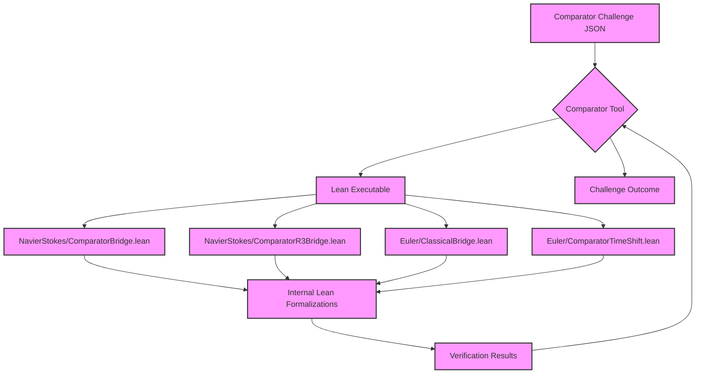
Sources:
[NavierStokes/ComparatorBridge.lean:21-24]()
[NavierStokes/ComparatorBridge.lean:61-62]()
[NavierStokes/ComparatorBridge.lean:127-135]()
[NavierStokes/CompactSpatialForceDecay.lean:88-96]()
[NavierStokes/ComparatorR3Bridge.lean:1-89]()
[Euler/ClassicalBridge.lean:21-47]()
[Euler/ComparatorTimeShift.lean:19-54]()

---

# Page: Main Theorems and Problem Statements

# Main Theorems and Problem Statements

<details>
<summary>Relevant source files</summary>

The following files were used as context for generating this wiki page:

- [Euler/CanonicalPacketHorizons.lean](Euler/CanonicalPacketHorizons.lean)
- [Euler/CompactVorticityContradiction.lean](Euler/CompactVorticityContradiction.lean)
- [Euler/ComparatorEvolutionIdentification.lean](Euler/ComparatorEvolutionIdentification.lean)
- [Euler/ComparatorIdentification.lean](Euler/ComparatorIdentification.lean)
- [Euler/ComparatorLocalEvolution.lean](Euler/ComparatorLocalEvolution.lean)
- [Euler/ComparatorSingularityNorms.lean](Euler/ComparatorSingularityNorms.lean)
- [Euler/DevelopmentBridge.lean](Euler/DevelopmentBridge.lean)
- [Euler/EulerFiniteLifespan.lean](Euler/EulerFiniteLifespan.lean)
- [Euler/H3CurlConvergence.lean](Euler/H3CurlConvergence.lean)
- [Euler/OrdinaryBKMReduction.lean](Euler/OrdinaryBKMReduction.lean)
- [Euler/OrdinaryEulerBKM.lean](Euler/OrdinaryEulerBKM.lean)
- [Euler/OrdinaryEulerCauchy.lean](Euler/OrdinaryEulerCauchy.lean)
- [Euler/OrdinaryEulerContinuation.lean](Euler/OrdinaryEulerContinuation.lean)
- [Euler/OrdinaryEulerEndpoint.lean](Euler/OrdinaryEulerEndpoint.lean)
- [Euler/OrdinaryEulerLocalCauchy.lean](Euler/OrdinaryEulerLocalCauchy.lean)
- [Euler/OrdinaryEulerStability.lean](Euler/OrdinaryEulerStability.lean)
- [Euler/OrdinaryEulerVaryingHorizon.lean](Euler/OrdinaryEulerVaryingHorizon.lean)
- [Euler/OrdinaryEulerVorticity.lean](Euler/OrdinaryEulerVorticity.lean)
- [Euler/OrdinaryGradientLimit.lean](Euler/OrdinaryGradientLimit.lean)
- [Euler/OrdinaryLogarithmicGradient.lean](Euler/OrdinaryLogarithmicGradient.lean)
- [Euler/PacketFiniteLifespan.lean](Euler/PacketFiniteLifespan.lean)
- [Euler/PacketStageContradiction.lean](Euler/PacketStageContradiction.lean)
- [Euler/PacketStageLocalExistence.lean](Euler/PacketStageLocalExistence.lean)
- [NavierStokes/R3/LocalizedTensorBounds.lean](NavierStokes/R3/LocalizedTensorBounds.lean)
- [NavierStokes/R3DifferenceStress.lean](NavierStokes/R3DifferenceStress.lean)
- [NavierStokes/R3PressureFlux.lean](NavierStokes/R3PressureFlux.lean)
- [NavierStokes/R3SmoothPressure.lean](NavierStokes/R3SmoothPressure.lean)
- [NavierStokes/R3SpaceTimeCalculus.lean](NavierStokes/R3SpaceTimeCalculus.lean)
- [NavierStokes/R3WeakPressure.lean](NavierStokes/R3WeakPressure.lean)
- [NavierStokes/R3WeightedLp.lean](NavierStokes/R3WeightedLp.lean)

</details>


This page details the formal statements of the main theorems proven in the `NavierStokesAndEuler` repository. These include the finite-lifespan result for the 3D Euler equations, and the breakdown statements for the Navier-Stokes equations in both periodic and whole-space $\mathbb{R}^3$ settings. We will explore where these statements are defined in the Lean 4 codebase and how they relate to the overall proof strategy.

## Euler Finite-Lifespan Theorem

The core result for the Euler equations is the existence of a finite lifespan for certain smooth initial data. This implies that solutions to the 3D Euler equations can develop singularities in finite time.

The main theorem for the Euler equations is `EulerFiniteLifespan.exists_compact_smooth_finite_lifespan` [Euler/EulerFiniteLifespan.lean](). This theorem asserts that for any smooth, compactly supported, and divergence-free initial velocity field, there exists a finite time $T$ such that the corresponding Euler solution cannot be smoothly continued beyond $T$.

The proof of this theorem relies on a contradiction argument, where the assumption of an infinite lifespan leads to a contradiction with the growth of certain quantities, such as the gradient of the velocity field. Key components involved in establishing this include:

*   **Local Existence and Uniqueness:** The `Evolution` structure [Euler/OrdinaryEulerCauchy.lean:32-32]() represents a smooth Euler solution on a time interval. Local existence and uniqueness are established in `EulerOrdinarySobolev.Evolution.exists_extension` [Euler/OrdinaryEulerContinuation.lean:20-33](), which allows for the continuation of solutions.
*   **Gradient Blow-up Criterion:** The `FiniteLifespan` structure [Euler/OrdinaryEulerContinuation.lean:49-50]() encapsulates the concept of a maximal lifespan. The `gradient_unbounded` theorem [Euler/OrdinaryEulerContinuation.lean:65-76]() states that if a solution has a finite lifespan, then the gradient of its velocity must become unbounded as time approaches the maximal lifespan. This is further refined by `gradient_unbounded_near_endpoint` [Euler/OrdinaryEulerContinuation.lean:86-105](), which localizes the blow-up near the endpoint.
*   **Stability and Convergence:** The `EulerOrdinarySobolev.Evolution.eventually_h3_bound` [Euler/OrdinaryEulerStability.lean:49-63]() and `EulerOrdinarySobolev.Evolution.no_gradient_escape` [Euler/OrdinaryEulerStability.lean:74-104]() theorems are crucial for showing that if a sequence of solutions converges initially and remains bounded in some Sobolev norm, then their gradients cannot escape to infinity. These are extended to varying horizons in `EulerOrdinarySobolev.Evolution.no_gradient_escape_varying` [Euler/OrdinaryEulerVaryingHorizon.lean:61-95]().
*   **Comparator Bridge:** The `Euler.ComparatorBridge.compactCurlLocalUpgrade` [Euler/ComparatorLocalEvolution.lean:91-98]() theorem provides a bridge between the abstract `EulerExistenceAndSmoothnessR3` definition (used by the Comparator) and the concrete `Evolution` structure. This allows the results proven within the Lean 4 framework to be applied to the Comparator challenge. The `Euler.ComparatorBridge.evolution_field_eq_of_local_evolution` [Euler/ComparatorEvolutionIdentification.lean:52-130]() theorem is key to identifying the Comparator's solution with an ordinary evolution.

The overall strategy involves constructing a sequence of solutions that would contradict the gradient blow-up criterion if the lifespan were infinite. This construction is detailed in the `Euler.PacketStageContradiction` and `Euler.PacketFiniteLifespan` modules.

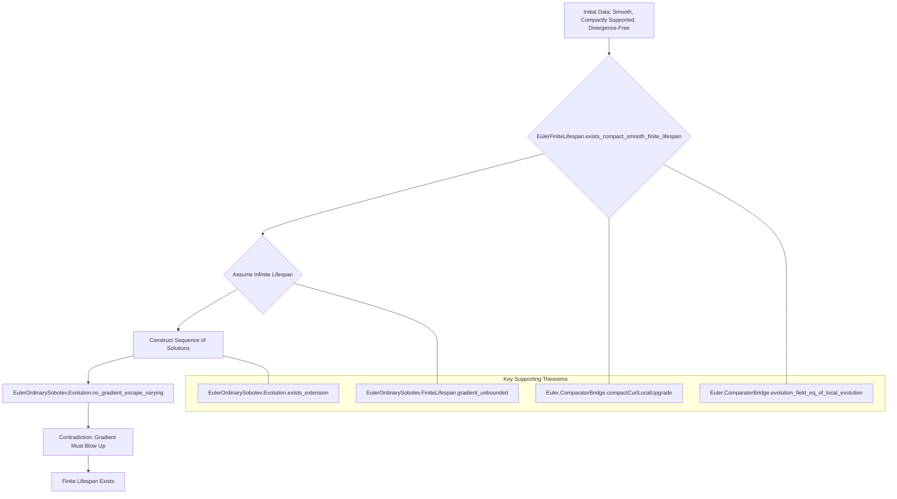
Title: Euler Finite Lifespan Proof Flow
Sources:
- [Euler/EulerFiniteLifespan.lean]()
- [Euler/OrdinaryEulerCauchy.lean:32-32]()
- [Euler/OrdinaryEulerContinuation.lean:20-33]()
- [Euler/OrdinaryEulerContinuation.lean:49-50]()
- [Euler/OrdinaryEulerContinuation.lean:65-76]()
- [Euler/OrdinaryEulerContinuation.lean:86-105]()
- [Euler/OrdinaryEulerStability.lean:49-63]()
- [Euler/OrdinaryEulerStability.lean:74-104]()
- [Euler/OrdinaryEulerVaryingHorizon.lean:61-95]()
- [Euler/ComparatorLocalEvolution.lean:91-98]()
- [Euler/ComparatorEvolutionIdentification.lean:52-130]()

## Navier-Stokes Breakdown Statement

For the Navier-Stokes equations, the problem statement focuses on the possibility of a breakdown (singularity formation) for certain initial conditions, or the exclusion of global smooth solutions under specific circumstances. The repository explores a candidate solution that exhibits breakdown behavior.

The main problem statement for Navier-Stokes is defined in `NavierStokes.ProblemStatement.R3BreakdownStatement` [NavierStokes/ProblemStatement.lean](). This statement describes the conditions under which a smooth solution to the 3D Navier-Stokes equations in $\mathbb{R}^3$ might cease to exist or lose its regularity.

The approach involves constructing a specific candidate solution and demonstrating its properties. Key aspects include:

*   **Weak Pressure Recovery:** The `NavierStokes.R3WeakPressure` module [NavierStokes/R3WeakPressure.lean:1-10]() is dedicated to recovering the physical pressure gradient from a distribution, even without assuming growth conditions on the pressure. This is crucial for analyzing the momentum equation. The `momentumGradient_divergence` theorem [NavierStokes/R3WeakPressure:120-146]() shows how the divergence of the momentum gradient relates to the stress tensor.
*   **Weighted $L^p$ Spaces:** The `NavierStokes.R3WeightedLp` module [NavierStokes/R3WeightedLp.lean:1-10]() introduces weighted $L^p$ spaces and interpolation estimates. These are used to control the growth of terms in the energy estimates, particularly for the pressure and transport terms. For example, `sixthQuadratic_lpNorm` [NavierStokes/R3WeightedLp:90-106]() provides bounds for quadratic terms.
*   **Localized Tensor Bounds:** The `NavierStokesR3.LocalizedTensorBounds` module [NavierStokes/R3/LocalizedTensorBounds.lean:1-10]() provides bounds for the difference stress tensor, which is central to analyzing the difference between two solutions. The `norm_weighted_tensorDiff_le` theorem [NavierStokes/R3/LocalizedTensorBounds:119-148]() gives a pointwise domination for the weighted tensor difference.
*   **Difference Stress and Pressure Equation:** The `NavierStokes.R3DifferenceStress` module [NavierStokes/R3DifferenceStress.lean:1-10]() defines the stress tensor for the difference between two velocity fields and relates its divergence to the pressure gradient. The `momentum_equation` theorem [NavierStokes/R3DifferenceStress:101-134]() is a key identity showing how the difference in momentum equations relates to the pressure difference.

The overall goal is to show that the constructed candidate solution, despite being smooth for a finite time, eventually leads to a breakdown, thus demonstrating the possibility of singularity formation for the Navier-Stokes equations.

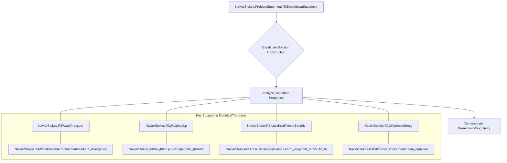
Title: Navier-Stokes Breakdown Proof Flow
Sources:
- [NavierStokes/ProblemStatement.lean]()
- [NavierStokes/R3WeakPressure.lean:1-10]()
- [NavierStokes/R3WeakPressure:120-146]()
- [NavierStokes/R3WeightedLp.lean:1-10]()
- [NavierStokes/R3WeightedLp:90-106]()
- [NavierStokes/R3/LocalizedTensorBounds.lean:1-10]()
- [NavierStokes/R3/LocalizedTensorBounds:119-148]()
- [NavierStokes/R3DifferenceStress.lean:1-10]()
- [NavierStokes/R3DifferenceStress:101-134]()

---

# Page: Proof Strategy at a Glance

# Proof Strategy at a Glance

<details>
<summary>Relevant source files</summary>

The following files were used as context for generating this wiki page:

- [Euler/BaseInductionStage.lean](Euler/BaseInductionStage.lean)
- [Euler/BaseInductionStageNoOptions.lean](Euler/BaseInductionStageNoOptions.lean)
- [Euler/DriftGevreyInviscidEnergyCompactness.lean](Euler/DriftGevreyInviscidEnergyCompactness.lean)
- [Euler/DriftGlobalGevreyCorrection.lean](Euler/DriftGlobalGevreyCorrection.lean)
- [Euler/DriftGlobalInviscidGevrey.lean](Euler/DriftGlobalInviscidGevrey.lean)
- [Euler/GevreyInviscidEnergyCompactness.lean](Euler/GevreyInviscidEnergyCompactness.lean)
- [Euler/GlobalGevreyCorrection.lean](Euler/GlobalGevreyCorrection.lean)
- [Euler/GlobalInviscidGevrey.lean](Euler/GlobalInviscidGevrey.lean)
- [Euler/PacketForwardSuccessor.lean](Euler/PacketForwardSuccessor.lean)
- [Euler/PacketInductionStage.lean](Euler/PacketInductionStage.lean)
- [Euler/PacketInfiniteConstruction.lean](Euler/PacketInfiniteConstruction.lean)
- [Euler/PacketJoinedSuccessor.lean](Euler/PacketJoinedSuccessor.lean)
- [Euler/PacketStageEstimates.lean](Euler/PacketStageEstimates.lean)
- [Euler/PacketStageLowPropagation.lean](Euler/PacketStageLowPropagation.lean)
- [Euler/ParentGeometryJoinedChoice.lean](Euler/ParentGeometryJoinedChoice.lean)
- [Euler/ParentGeometryJoinedChoiceInvestigation.lean](Euler/ParentGeometryJoinedChoiceInvestigation.lean)

</details>


This page outlines the high-level proof strategy employed in this repository for both the 3D Euler and Navier–Stokes equations. For Euler, the core idea revolves around a self-similar packet cascade. For Navier–Stokes, the strategy involves viscous corrections and limit machinery, with candidates for solutions in both periodic and R3 domains. The composition of these pieces forms the complete formalization.

## Euler: Self-Similar Packet Cascade

The proof for the finite-time breakdown of the 3D Euler equations on a cylinder relies on constructing a self-similar packet cascade. This cascade iteratively builds a solution by adding increasingly complex "packets" of fluid motion. Each packet is designed to amplify certain features, leading to a finite-time singularity.

The construction proceeds inductively, defining a sequence of `Stage` objects [Euler/PacketInductionStage.lean:23-56](). Each `Stage` `P` at index `n` represents a partial solution up to a certain time `P.time` and scale `P.scale_eq`.

### Stage Construction

The initial stage, `firstStage_noOptions` [Euler/BaseInductionStageNoOptions.lean:48-121](), is built from a literal compact base solution and a first packet choice. This base solution provides the initial conditions for the cascade.

Each subsequent stage `n+1` is constructed from the previous stage `n` using either a "joined" or "forward" successor. The `joinedNext` function [Euler/PacketJoinedSuccessor.lean:97-138]() defines how to construct the next stage in the cascade. This involves:
1.  **Choosing Geometry**: A `GeometryJoinedChoice` [Euler/ParentGeometryJoinedChoice.lean:26-43]() is made, which determines the activation geometry and frequency comparison for the new packet. This choice is crucial for ensuring the self-similar nature of the cascade.
2.  **Constructing Parent and State**: A new `Parent` [Euler/ParentGeometryJoinedChoice.lean:78-78]() and `SmoothState` [Euler/ParentGeometryJoinedChoice.lean:80-83]() are derived for the next stage, incorporating the new packet.
3.  **Propagating Bounds**: The `joinedLow` [Euler/PacketJoinedSuccessor.lean:69-72]() and `joinedRenewal` [Euler/PacketJoinedSuccessor.lean:74-82]() functions ensure that the low-order bounds and frame properties are propagated and renewed, maintaining control over the solution's behavior. The `initial_step_bound` [Euler/PacketStageLowPropagation.lean:18-23]() and `pressure_step_bound` [Euler/PacketStageLowPropagation.lean:25-29]() theorems are key in propagating these bounds.
4.  **Estimating Costs**: Various cost estimates, such as `joined_bad_cost` [Euler/PacketStageEstimates.lean:38-47](), `joined_initial_cost` [Euler/PacketStageEstimates.lean:49-58](), and `joined_pressure_cost` [Euler/PacketStageEstimates.lean:60-75](), are calculated to ensure that the budgets for the cascade are maintained.

The `Stage` structure itself contains various bounds and properties that must hold at each step of the induction, such as `gradient_bound`, `hessian_bound`, and `frame_error` [Euler/PacketInductionStage.lean:35-50](). These invariants are critical for proving the overall breakdown.

### Diagram: Euler Packet Cascade Induction

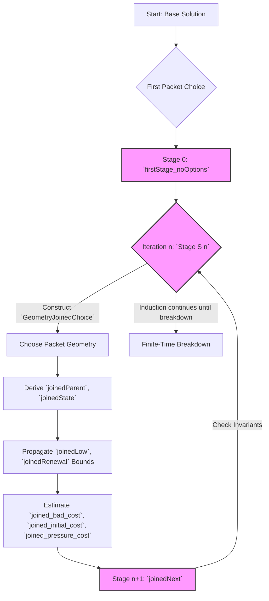
Sources:
- [Euler/PacketInductionStage.lean:23-56]()
- [Euler/BaseInductionStageNoOptions.lean:48-121]()
- [Euler/PacketJoinedSuccessor.lean:97-138]()
- [Euler/ParentGeometryJoinedChoice.lean:26-43]()
- [Euler/ParentGeometryJoinedChoice.lean:78-78]()
- [Euler/ParentGeometryJoinedChoice.lean:80-83]()
- [Euler/PacketJoinedSuccessor.lean:69-72]()
- [Euler/PacketJoinedSuccessor.lean:74-82]()
- [Euler/PacketStageLowPropagation.lean:18-23]()
- [Euler/PacketStageLowPropagation.lean:25-29]()
- [Euler/PacketStageEstimates.lean:38-47]()
- [Euler/PacketStageEstimates.lean:49-58]()
- [Euler/PacketStageEstimates.lean:60-75]()
- [Euler/PacketInductionStage.lean:35-50]()

## Navier–Stokes: Viscous Correction and Limit Machinery

For the Navier–Stokes equations, the strategy involves constructing a sequence of viscous solutions and then taking a limit as viscosity approaches zero. This "viscous correction" machinery is designed to handle the additional diffusion term present in Navier–Stokes.

### Viscous Correction Family

The core of this approach is the `exists_gevrey_inviscid_energy_limit` theorem [Euler/GevreyInviscidEnergyCompactness.lean:28-59]() (and its drift-aware counterpart `EulerDriftGevreyInviscidEnergyCompactness.exists_gevrey_inviscid_energy_limit` [Euler/DriftGevreyInviscidEnergyCompactness.lean:28-59]()). This theorem asserts the existence of a family of viscous corrections `u n` that converge to an inviscid limit `e`.

Key components of this machinery include:
*   **CorrectionData**: The `CorrectionData` structure [Euler/GevreyInviscidEnergyCompactness.lean:30-30]() encapsulates the metric, linear, and quadratic coefficients of the approximate solution.
*   **Quadratic Duhamel Formula**: The viscous corrections `u n` are defined via a `quadraticDuhamel` formula [Euler/GevreyInviscidEnergyCompactness.lean:48-49](), which is a solution to a quadratic PDE with a viscosity term.
*   **Energy Norms**: The `energyNorm` [Euler/GevreyInviscidEnergyCompactness.lean:56-59]() is used to control the size and regularity of the corrections, ensuring they remain bounded and converge appropriately.
*   **Compactness and Limit**: The `Filter.Tendsto` [Euler/GevreyInviscidEnergyCompactness.lean:52-53]() statement formally expresses the convergence of the viscous solutions to the inviscid limit `e`. This relies on compactness arguments within appropriate function spaces.

### Global Inviscid Gevrey PDE

The `exists_global_inviscid_gevrey_PDE` theorem [Euler/GlobalInviscidGevrey.lean:20-57]() (and its drift-aware version `EulerDriftGlobalInviscidGevrey.exists_global_inviscid_gevrey_PDE` [Euler/DriftGlobalInviscidGevrey.lean:20-57]()) then establishes that this inviscid limit `e` is indeed a solution to the Euler equations (an inviscid PDE). This involves showing that the limit `e` satisfies the Euler equations with a literal signed-pressure derivative in `Hq`. The `correction_sobolev_hasDerivAt` and `correction_limit_equation` are crucial lemmas in this step [Euler/GlobalInviscidGevrey.lean:62-67]().

### Diagram: Viscous Correction and Limit

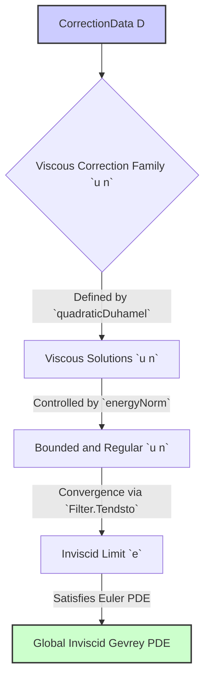
Sources:
- [Euler/GevreyInviscidEnergyCompactness.lean:28-59]()
- [Euler/DriftGevreyInviscidEnergyCompactness.lean:28-59]()
- [Euler/GevreyInviscidEnergyCompactness.lean:30-30]()
- [Euler/GevreyInviscidEnergyCompactness.lean:48-49]()
- [Euler/GevreyInviscidEnergyCompactness.lean:56-59]()
- [Euler/GevreyInviscidEnergyCompactness.lean:52-53]()
- [Euler/GlobalInviscidGevrey.lean:20-57]()
- [Euler/DriftGlobalInviscidGevrey.lean:20-57]()
- [Euler/GlobalInviscidGevrey.lean:62-67]()

## Composition of Pieces

The overall proof strategy for the Euler equations combines the self-similar packet cascade with the viscous correction machinery. The packet cascade constructs an approximate solution that exhibits the desired breakdown behavior. This approximate solution then serves as the `D.approximation` [Euler/GevreyInviscidEnergyCompactness.lean:43-43]() for the viscous correction process.

The `exists_global_gevrey_correction` theorem [Euler/GlobalGevreyCorrection.lean:22-47]() (and its drift-aware version `EulerDriftGlobalGevreyCorrection.exists_global_gevrey_correction` [Euler/DriftGlobalGevreyCorrection.lean:22-47]()) is a crucial bridge. It states that given concrete coefficient and residual budgets, an actual viscous correction exists throughout a prescribed interval. This correction is bounded and satisfies the `quadraticDuhamel` equation. The `partial_correction_bootstrap` [Euler/GlobalGevreyCorrection.lean:67-68]() lemma is used to establish the a-priori energy estimates and continuation bounds for these corrections.

The Navier–Stokes part of the library also explores solutions in R3 (whole-space analysis), which involves different analytical tools like heat kernels and Riesz operators. The `NavierStokes/R3` directory contains these specific R3 analyses.

The composition can be visualized as follows:

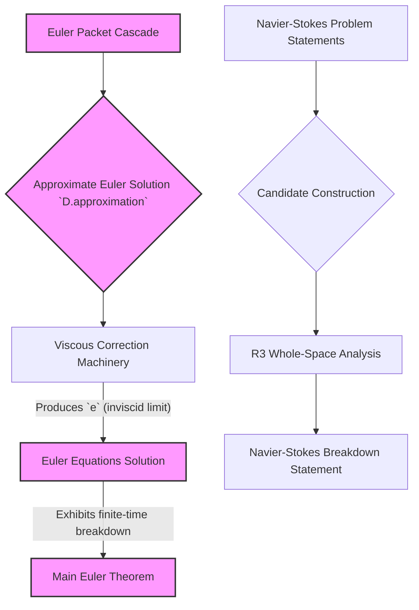
Sources:
- [Euler/GevreyInviscidEnergyCompactness.lean:43-43]()
- [Euler/GlobalGevreyCorrection.lean:22-47]()
- [Euler/DriftGlobalGevreyCorrection.lean:22-47]()
- [Euler/GlobalGevreyCorrection.lean:67-68]()

---

# Page: Euler: Analytic Foundations

# Euler: Analytic Foundations

<details>
<summary>Relevant source files</summary>

The following files were used as context for generating this wiki page:

- [Euler/BoundedCoefficientJets.lean](Euler/BoundedCoefficientJets.lean)
- [Euler/BoundedCoefficientSmooth.lean](Euler/BoundedCoefficientSmooth.lean)
- [Euler/CylinderCompactTranslation.lean](Euler/CylinderCompactTranslation.lean)
- [Euler/LpCompactTranslation.lean](Euler/LpCompactTranslation.lean)
- [Euler/LpSmoothField.lean](Euler/LpSmoothField.lean)
- [Euler/LpSmoothFieldJets.lean](Euler/LpSmoothFieldJets.lean)
- [Euler/MeanCoefficientFrame.lean](Euler/MeanCoefficientFrame.lean)
- [Euler/MeanCoefficientPath.lean](Euler/MeanCoefficientPath.lean)
- [Euler/MeanCoefficientPathJets.lean](Euler/MeanCoefficientPathJets.lean)
- [Euler/MeanCoefficientSpatial.lean](Euler/MeanCoefficientSpatial.lean)
- [Euler/PacketCylinderCoefficientBounds.lean](Euler/PacketCylinderCoefficientBounds.lean)
- [Euler/PacketMatrixCoefficientGevrey.lean](Euler/PacketMatrixCoefficientGevrey.lean)
- [Euler/PacketPressureJet.lean](Euler/PacketPressureJet.lean)
- [Euler/PacketSlicedAssembly.lean](Euler/PacketSlicedAssembly.lean)
- [Euler/PacketSlicedJets.lean](Euler/PacketSlicedJets.lean)
- [Euler/SmoothCoefficientPath.lean](Euler/SmoothCoefficientPath.lean)
- [Euler/SmoothCoefficientTimeRestriction.lean](Euler/SmoothCoefficientTimeRestriction.lean)
- [Euler/SmoothTimeField.lean](Euler/SmoothTimeField.lean)
- [Euler/SmoothTimeFieldAlgebra.lean](Euler/SmoothTimeFieldAlgebra.lean)
- [Euler/SmoothTimeFieldComposition.lean](Euler/SmoothTimeFieldComposition.lean)
- [Euler/SmoothTimeFieldDerivativeBounds.lean](Euler/SmoothTimeFieldDerivativeBounds.lean)
- [Euler/SmoothTimeFieldJoint.lean](Euler/SmoothTimeFieldJoint.lean)
- [Euler/SmoothTimeFieldLinear.lean](Euler/SmoothTimeFieldLinear.lean)
- [Euler/SmoothTimeFieldPrecomp.lean](Euler/SmoothTimeFieldPrecomp.lean)
- [Euler/SmoothTimeFieldRestriction.lean](Euler/SmoothTimeFieldRestriction.lean)
- [Euler/SmoothTimeFieldSecondJoint.lean](Euler/SmoothTimeFieldSecondJoint.lean)
- [Euler/SmoothTimeFieldTimeJets.lean](Euler/SmoothTimeFieldTimeJets.lean)
- [Euler/TransversePacketTimeData.lean](Euler/TransversePacketTimeData.lean)

</details>


This page provides a high-level overview of the foundational analytic structures and concepts used throughout the Euler library. These components form a reusable analysis layer, enabling the rigorous formalization of smooth fields, jet calculus, function spaces, and the specific cylinder geometry relevant to the Euler equations. Detailed explanations and proofs for each topic are provided in their respective child pages.

## Smooth Time Fields and Jet Calculus

The codebase extensively uses `SmoothTimeField` [Euler/SmoothTimeField.lean:13-20]() and `SmoothCoefficientPath` [Euler/SmoothCoefficientPath.lean:35-40]() structures to represent functions that are smooth both spatially and over a compact time interval. These structures encapsulate a field and its spatial jets (iterated Fréchet derivatives), ensuring all-order spatial smoothness.

The `SmoothTimeField` [Euler/SmoothTimeField.lean:13-20]() is defined for a general real normed domain `E` and codomain `V`, parameterized by a compact topological space `K` (often representing time). It stores the field itself as a continuous map `C(K, E →ᵇ V)` and its spatial jets `jet n` as continuous maps `C(K, E →ᵇ (E [×n]→L[ℝ] V))`. The `jet_eq` [Euler/SmoothTimeField.lean:19]() theorem asserts that `jet n t x` is indeed the `n`-th iterated Fréchet derivative of the field at `(t, x)`.

Operations such as `derivative` [Euler/SmoothTimeField.lean:65-78](), `map` [Euler/SmoothTimeFieldLinear.lean:29-39](), and `precompLinear` [Euler/SmoothTimeFieldPrecomp.lean:30-41]() are defined for `SmoothTimeField`s, allowing for the manipulation and transformation of these smooth fields while preserving their jet properties. For instance, `derivative` [Euler/SmoothTimeField.lean:65-78]() computes the spatial derivative of a `SmoothTimeField`, returning a new `SmoothTimeField` whose values are linear maps.

The `SmoothCoefficientPath` [Euler/SmoothCoefficientPath.lean:35-40]() is a specialized version of `SmoothTimeField` where the spatial domain `E` is fixed to `Space` (representing $\mathbb{R}^3$). It also provides operations like `derivative` [Euler/SmoothCoefficientPath.lean:80-93]() and `translation_contDiff` [Euler/SmoothCoefficientPath.lean:127-129](), which establishes all-order smoothness of the translation orbit in the uniform time-path topology.

For details, see [Smooth Time Fields and Jet Calculus](#2.1).

### Smooth Field and Jet Structure
```mermaid
classDiagram
    direction LR
    class "SmoothTimeField<K, E, V>" {
        +field: C(K, E →ᵇ V)
        +smooth: ∀ t, ContDiff ℝ ∞ (field t : E → V)
        +jet: (n : ℕ) → C(K, E →ᵇ (E [×n]→L[ℝ] V))
        +jet_eq: ∀ n t x, jet n t x = iteratedFDeriv ℝ n (field t : E → V) x
        +derivative(): SmoothTimeField<K, E, E →L[ℝ] V>
        +map(L: V →L[ℝ] W): SmoothTimeField<K, E, W>
        +precompLinear(L: F →L[ℝ] E): SmoothTimeField<K, F, V>
    }
    class "SmoothCoefficientPath<K, V>" {
        +field: C(K, Space →ᵇ V)
        +smooth: ∀ t, ContDiff ℝ ∞ (field t : Space → V)
        +jet: (n : ℕ) → C(K, Space →ᵇ (Space [×n]→L[ℝ] V))
        +jet_eq: ∀ n t x, jet n t x = iteratedFDeriv ℝ n (field t : Space → V) x
        +derivative(): SmoothCoefficientPath<K, Space →L[ℝ] V>
        +translation_contDiff(): ContDiff ℝ ∞ (translated field)
    }
    SmoothTimeField <|-- SmoothCoefficientPath : "specializes E to Space"
    SmoothTimeField --> "1" C_K_E_V : field
    SmoothTimeField --> "N" C_K_E_JetV : jet
    SmoothCoefficientPath --> "1" C_K_Space_V : field
    SmoothCoefficientPath --> "N" C_K_Space_JetV : jet
    C_K_E_V["C(K, E →ᵇ V)"]
    C_K_E_JetV["C(K, E →ᵇ (E [×n]→L[ℝ] V))"]
    C_K_Space_V["C(K, Space →ᵇ V)"]
    C_K_Space_JetV["C(K, Space →ᵇ (Space [×n]→L[ℝ] V))"]
```
Sources: [Euler/SmoothTimeField.lean:13-20](), [Euler/SmoothCoefficientPath.lean:35-40](), [Euler/SmoothTimeField.lean:65-78](), [Euler/SmoothTimeFieldLinear.lean:29-39](), [Euler/SmoothTimeFieldPrecomp.lean:30-41](), [Euler/SmoothCoefficientPath.lean:80-93](), [Euler/SmoothCoefficientPath.lean:127-129]()

## Function Spaces: Lp, Sobolev, Gevrey

The library utilizes various function spaces, including $L^p$, Sobolev, and Gevrey spaces, to characterize the regularity of fields.

The `SmoothL2Field` [Euler/LpSmoothField.lean:31-34]() structure represents functions that are smooth and whose spatial derivatives of all orders are in $L^2$. This is crucial for establishing translation regularity, as demonstrated by `translation_contDiff` [Euler/LpSmoothField.lean:85-87](), which proves that the translation orbit of such a field is infinitely differentiable. The `jetLp` [Euler/LpSmoothField.lean:46]() function provides the $L^2$ norm of the iterated Fréchet derivatives.

For fields with compact support, `CompactField` [Euler/CylinderCompactTranslation.lean:28-31]() is used, which ensures that the field and its derivatives are $L^2$-integrable. The `compactField_hasFDerivAt` [Euler/LpCompactTranslation.lean:70-73]() theorem shows that the Fréchet derivative of the translation map for such fields agrees with the $L^2$ translation derivative.

The `BoundedSmoothField` [Euler/BoundedCoefficientSmooth.lean:48-52]() structure describes smooth fields with globally bounded derivatives of every order. Its `translation_contDiff` [Euler/BoundedCoefficientSmooth.lean:96-97]() theorem asserts that spatial translations of such fields are smooth with respect to the translation parameter.

Gevrey regularity classes are implicitly used through concepts like `majorant` [Euler/PacketMatrixCoefficientGevrey.lean:27]() in bounding iterated derivatives, particularly in the context of operator composition and estimates.

For details, see [Function Spaces: Lp, Sobolev, Gevrey](#2.2).

### Function Space Hierarchy
```mermaid
classDiagram
    direction LR
    class "SmoothL2Field<V>" {
        +field: Space → V
        +smooth: ContDiff ℝ ∞ field
        +integrable: ∀ n, MemLp (iteratedFDeriv ℝ n field) 2 volume
        +toLp(): L2Space V
        +jetLp(n: ℕ): L2Space (Space [×n]→L[ℝ] V)
        +translation_contDiff(): ContDiff ℝ ∞ (translation orbit)
    }
    class "CompactField<P, V>" {
        +field: LiftDomain P → V
        +compact: HasCompactSupport field
        +smooth: ∀ x, ContDiff ℝ ∞ (localFieldLift P field x)
        +toLp(): CylinderL2 P V
        +hasFDerivAt_zero(): HasFDerivAt (translation orbit)
    }
    class "BoundedSmoothField<V>" {
        +field: Space →ᵇ V
        +smooth: ContDiff ℝ ∞ (field : Space → V)
        +bounded: ∀ n, ∃ C, ∀ x, ‖iteratedFDeriv ℝ n (field : Space → V) x‖ ≤ C
        +translation_contDiff(): ContDiff ℝ ∞ (translated field)
    }
    SmoothL2Field <|-- CompactField : "specializes to cylinder, adds compact support"
    SmoothL2Field <|-- BoundedSmoothField : "adds global derivative bounds"
```
Sources: [Euler/LpSmoothField.lean:31-34](), [Euler/LpSmoothField.lean:46](), [Euler/LpSmoothField.lean:85-87](), [Euler/CylinderCompactTranslation.lean:28-31](), [Euler/LpCompactTranslation.lean:70-73](), [Euler/BoundedCoefficientSmooth.lean:48-52](), [Euler/BoundedCoefficientSmooth.lean:96-97]()

## Cylinder Geometry and Coefficient Paths

The Euler equations are formalized on a cylinder domain, which introduces specific geometric considerations. This section outlines the structures and concepts related to this domain.

The `SmoothCoefficientPath` [Euler/SmoothCoefficientPath.lean:35-40]() structure, as mentioned above, is central to representing fields on this domain, where `Space` is $\mathbb{R}^3$. The `translation_contDiff` [Euler/SmoothCoefficientPath.lean:127-129]() theorem is particularly important here, as it guarantees that translating a smooth coefficient path along the spatial domain results in a smooth path in the space of coefficient paths.

The `EulerTransversePacketProvider.Data` [Euler/TransversePacketTimeData.lean:16]() structure, for example, uses `SmoothCoefficientPath`s for various components like `FInv.field` and `M.field` to describe the deformation and its inverse on the cylinder. Operations like `inverseDerivative` [Euler/TransversePacketTimeData.lean:30]() and `normalDerivative` [Euler/TransversePacketTimeData.lean:34]() are defined for these paths, and their smoothness under translation is established by `inverseDerivative_orbit` [Euler/TransversePacketTimeData.lean:102-104]() and `normalDerivative_orbit` [Euler/TransversePacketTimeData.lean:106-108]().

The `MatrixCoefficient` [Euler/PacketMatrixCoefficientGevrey.lean:25]() structure, used in packet construction, also relies on `SmoothCoefficientPath`s. It defines operations like `comp_bound` [Euler/PacketMatrixCoefficientGevrey.lean:25-45]() and `spatialDerivative_bound` [Euler/PacketMatrixCoefficientGevrey.lean:75-87]() which provide bounds for compositions and spatial derivatives of these coefficient paths, crucial for Gevrey regularity estimates.

For details, see [Cylinder Geometry and Coefficient Paths](#2.3).
Sources: [Euler/SmoothCoefficientPath.lean:35-40](), [Euler/SmoothCoefficientPath.lean:127-129](), [Euler/TransversePacketTimeData.lean:16](), [Euler/TransversePacketTimeData.lean:30](), [Euler/TransversePacketTimeData.lean:34](), [Euler/TransversePacketTimeData.lean:102-104](), [Euler/TransversePacketTimeData.lean:106-108](), [Euler/PacketMatrixCoefficientGevrey.lean:25](), [Euler/PacketMatrixCoefficientGevrey.lean:25-45](), [Euler/PacketMatrixCoefficientGevrey.lean:75-87]()

---

# Page: Smooth Time Fields and Jet Calculus

# Smooth Time Fields and Jet Calculus

<details>
<summary>Relevant source files</summary>

The following files were used as context for generating this wiki page:

- [Euler/BaseEulerParent.lean](Euler/BaseEulerParent.lean)
- [Euler/ChildParticleFieldTime.lean](Euler/ChildParticleFieldTime.lean)
- [Euler/ChildParticleTime.lean](Euler/ChildParticleTime.lean)
- [Euler/CylinderJetLpMap.lean](Euler/CylinderJetLpMap.lean)
- [Euler/FieldTowerSmoothTimeField.lean](Euler/FieldTowerSmoothTimeField.lean)
- [Euler/LiftedSmoothTimeField.lean](Euler/LiftedSmoothTimeField.lean)
- [Euler/LiftedSmoothTimeFieldBounds.lean](Euler/LiftedSmoothTimeFieldBounds.lean)
- [Euler/MeanSobolevBoundedField.lean](Euler/MeanSobolevBoundedField.lean)
- [Euler/MeanSpatialDerivative.lean](Euler/MeanSpatialDerivative.lean)
- [Euler/MeanSpatialEvaluation.lean](Euler/MeanSpatialEvaluation.lean)
- [Euler/MeanSpatialTimeDerivative.lean](Euler/MeanSpatialTimeDerivative.lean)
- [Euler/PacketPressureJet.lean](Euler/PacketPressureJet.lean)
- [Euler/PacketSlicedAssembly.lean](Euler/PacketSlicedAssembly.lean)
- [Euler/PacketSlicedJets.lean](Euler/PacketSlicedJets.lean)
- [Euler/SmoothCoefficientPath.lean](Euler/SmoothCoefficientPath.lean)
- [Euler/SmoothCoefficientTimeRestriction.lean](Euler/SmoothCoefficientTimeRestriction.lean)
- [Euler/SmoothTimeField.lean](Euler/SmoothTimeField.lean)
- [Euler/SmoothTimeFieldAlgebra.lean](Euler/SmoothTimeFieldAlgebra.lean)
- [Euler/SmoothTimeFieldBilinear.lean](Euler/SmoothTimeFieldBilinear.lean)
- [Euler/SmoothTimeFieldChain.lean](Euler/SmoothTimeFieldChain.lean)
- [Euler/SmoothTimeFieldComposition.lean](Euler/SmoothTimeFieldComposition.lean)
- [Euler/SmoothTimeFieldDerivativeBounds.lean](Euler/SmoothTimeFieldDerivativeBounds.lean)
- [Euler/SmoothTimeFieldJoint.lean](Euler/SmoothTimeFieldJoint.lean)
- [Euler/SmoothTimeFieldLinear.lean](Euler/SmoothTimeFieldLinear.lean)
- [Euler/SmoothTimeFieldPrecomp.lean](Euler/SmoothTimeFieldPrecomp.lean)
- [Euler/SmoothTimeFieldRestriction.lean](Euler/SmoothTimeFieldRestriction.lean)
- [Euler/SmoothTimeFieldSecondJoint.lean](Euler/SmoothTimeFieldSecondJoint.lean)
- [Euler/SmoothTimeFieldTimeJets.lean](Euler/SmoothTimeFieldTimeJets.lean)
- [Euler/SobolevJointEvaluation.lean](Euler/SobolevJointEvaluation.lean)
- [Euler/SobolevPointEvaluation.lean](Euler/SobolevPointEvaluation.lean)

</details>


This page details the `SmoothTimeField` and `SmoothCoefficientPath` structures, which are fundamental for representing smooth functions of time and space within the Euler and Navier-Stokes formalizations. It covers the definition of spatial and time jets, operations like `derivative`, `map`, `precompLinear`, `add`, and `compDisplacement`, as well as the chain and bilinear rules for these structures. The page also introduces concepts like sliced and pressure jets, which are crucial for analyzing the differentiability of packet assemblies.

## SmoothTimeField and SmoothCoefficientPath Structures

The codebase defines two primary structures for representing smooth functions: `SmoothTimeField` and `SmoothCoefficientPath`. Both capture the notion of a function that is smooth in its spatial arguments and varies continuously over a compact time domain.

### SmoothTimeField

A `SmoothTimeField K E V` represents a field `f : K → E → V` where `K` is a compact topological space (typically representing time), `E` is a normed vector space (spatial domain), and `V` is a normed vector space (codomain).
The structure ensures that for each time `t ∈ K`, the spatial function `f t : E → V` is infinitely differentiable (`ContDiff ℝ ∞`). It also explicitly stores the spatial jets (iterated Fréchet derivatives) as continuous functions of time and space.

```lean
structure SmoothTimeField (K E V : Type u) [TopologicalSpace K] [CompactSpace K]
    [NormedAddCommGroup E] [NormedSpace ℝ E]
    [NormedAddCommGroup V] [NormedSpace ℝ V] where
  field : C(K, E →ᵇ V)
  smooth : ∀ t, ContDiff ℝ ∞ (field t : E → V)
  jet : (n : ℕ) → C(K, E →ᵇ (E [×n]→L[ℝ] V))
  jet_eq : ∀ n t x, jet n t x = iteratedFDeriv ℝ n (field t : E → V) x
```
Sources: [Euler/SmoothTimeField.lean:13-19]()

- `field`: A continuous map from `K` to `E →ᵇ V`, where `E →ᵇ V` denotes bounded continuous functions from `E` to `V`. This ensures that the field itself is continuous in time in the uniform norm.
- `smooth`: A proof that for every `t ∈ K`, the spatial function `field t` is infinitely differentiable.
- `jet`: A family of continuous maps, where `jet n` provides the `n`-th iterated Fréchet derivative (spatial jet) as a continuous function from `K` to `E →ᵇ (E [×n]→L[ℝ] V)`.
- `jet_eq`: An axiom asserting that `jet n t x` is indeed the `n`-th iterated Fréchet derivative of `field t` at `x`.

### SmoothCoefficientPath

`SmoothCoefficientPath K V` is a specialized version of `SmoothTimeField` where the spatial domain `E` is fixed to `Space` (a 3-dimensional Euclidean space, `ℝ³`). It represents "all-order spatial translation regularity uniformly over a compact parameter interval."
```lean
structure SmoothCoefficientPath (K : Type u) [TopologicalSpace K] [CompactSpace K]
    (V : Type v) [NormedAddCommGroup V] [NormedSpace ℝ V] where
  field : C(K, Space →ᵇ V)
  smooth : ∀ t, ContDiff ℝ ∞ (field t : Space → V)
  jet : (n : ℕ) → C(K, Space →ᵇ (Space [×n]→L[ℝ] V))
  jet_eq : ∀ n t x, jet n t x = iteratedFDeriv ℝ n (field t : Space → V) x
```
Sources: [Euler/SmoothCoefficientPath.lean:35-40]()

The `SmoothCoefficientPath` can be converted to a `SmoothTimeField` using `toSmoothTimeField` [Euler/SmoothTimeField.lean:86-88]().

## Spatial and Time Jets

The `SmoothTimeField` and `SmoothCoefficientPath` structures inherently define spatial jets through their `jet` field. These `jet` fields capture the iterated Fréchet derivatives with respect to the spatial variable `x`.

Time jets, or time derivatives, are handled through the `TimeDerivative` predicate, which asserts that one `SmoothTimeField` is the time derivative of another.
```lean
theorem TimeDerivative.congr_fields
    {A A₁ B B₁ : SmoothTimeField (Icc (0 : ℝ) T) E V}
    (hA : TimeDerivative T hT A A₁)
    (he : ∀ t x, A.field t x=B.field t x)
    (he₁ : ∀ t x, A₁.field t x=B₁.field t x) :
    TimeDerivative T hT B B₁ := by
  intro t x
  have hf : (fun s => B.realField T hT s x) = (fun s => A.realField T hT s x) := by
    funext s
    exact (he (projIcc 0 T hT s) x).symm
  rw [hf,← he₁]
  exact hA t x
```
Sources: [Euler/SmoothTimeFieldChain.lean:42-54]()

This predicate is used to propagate time differentiability through various operations.

## Operations on SmoothTimeField

Several operations are defined for `SmoothTimeField` and `SmoothCoefficientPath` to facilitate calculus.

### Derivative

The `derivative` operation computes the spatial derivative of a `SmoothTimeField`. It returns a new `SmoothTimeField` whose values are continuous linear maps.
```lean
def derivative (A : SmoothTimeField K E V) : SmoothTimeField K E (E →L[ℝ] V) where
  field := A.derivativeField
  smooth t := by
    have he : (A.derivativeField t : E → E →L[ℝ] V) = fderiv ℝ (A.field t : E → V) :=
      funext (A.derivativeField_eq t)
    rw [he]
    exact (A.smooth t).fderiv_right (m := ∞) (by simp)
  jet := A.derivativeJet
  jet_eq n t x := by
    have he : (A.derivativeField t : E → E →L[ℝ] V) = fderiv ℝ (A.field t : E → V) :=
      funext (A.derivativeField_eq t)
    rw [he]
    exact A.derivativeJet_eq n t x
```
Sources: [Euler/SmoothTimeField.lean:65-78]()

- `derivativeField`: Computes the first Fréchet derivative of `A.field t` at `x`.
- `derivativeJet`: Computes the `n`-th Fréchet derivative of `fderiv ℝ (A.field t : E → V)`.

A similar `derivative` is defined for `SmoothCoefficientPath` [Euler/SmoothCoefficientPath.lean:80-93]().

### Map

The `map` operation applies a continuous linear map `L : V →L[ℝ] W` to the codomain of a `SmoothTimeField`.
```lean
def map (L : V →L[ℝ] W) (A : SmoothTimeField K E V) : SmoothTimeField K E W where
  field := mapPath L A.field
  smooth t := L.contDiff.comp (A.smooth t)
  jet n := mapPath
    (ContinuousLinearMap.compContinuousMultilinearMapL ℝ (fun _ : Fin n => E) V W L) (A.jet n)
  jet_eq n t x := by
    change L.compContinuousMultilinearMap (A.jet n t x) =
      iteratedFDeriv ℝ n (L ∘ (A.field t : E → V)) x
    rw [A.jet_eq]
    exact (L.iteratedFDeriv_comp_left (A.smooth t).contDiffAt (by simp)).symm
```
Sources: [Euler/SmoothTimeFieldLinear.lean:29-38]()

- `mapPath`: A helper function to apply a linear map to the `field` component.
- `map_jet_apply`: Shows that the `n`-th jet of `A.map L` is `L` composed with the `n`-th jet of `A`.
- `map_jet_norm_le`: Provides a bound on the norm of the mapped jet.

A similar `mapCoefficientPath` is defined for `SmoothCoefficientPath` [Euler/SmoothCoefficientPath.lean:25-26]().

### PrecompLinear

The `precompLinear` operation precomposes a `SmoothTimeField` with a continuous linear map `L : F →L[ℝ] E` on its spatial domain.
```lean
def precompLinear (A : SmoothTimeField K E V) (L : F →L[ℝ] E) :
    SmoothTimeField K F V where
  field := (BoundedContinuousFunction.compContinuousCLM V ℝ ⟨L,L.continuous⟩).compLeftContinuous ℝ K A.field
  smooth t := (A.smooth t).comp_continuousLinearMap
  jet n := ((BoundedContinuousFunction.compContinuousCLM (F [×n]→L[ℝ] V) ℝ ⟨L,L.continuous⟩).compLeftContinuous ℝ K)
    (mapPath (ContinuousMultilinearMap.compContinuousLinearMapL (F := V) (fun _ : Fin n => L)) (A.jet n))
  jet_eq n t x := by
    change (A.jet n t (L x)).compContinuousLinearMap (fun _ : Fin n => L) =
      iteratedFDeriv ℝ n ((A.field t : E → V) ∘ L) x
    rw [A.jet_eq]
    exact (L.iteratedFDeriv_comp_right (A.smooth t) x (by simp)).symm
```
Sources: [Euler/SmoothTimeFieldPrecomp.lean:30-40]()

- `precompLinear_apply`: Shows that the field of `A.precompLinear L` at `(t, x)` is `A.field t (L x)`.
- `precompLinear_jet_apply`: Shows how the jets transform under precomposition.
- `precompLinear_jet_norm_le`: Provides a bound on the norm of the precomposed jet.

### Add

The `add` operation performs pointwise addition of two `SmoothTimeField`s.
```lean
def add (A B : SmoothTimeField K E V) : SmoothTimeField K E V where
  field := A.field + B.field
  smooth t := (A.smooth t).add (B.smooth t)
  jet n := A.jet n + B.jet n
  jet_eq n t x := by
    change A.jet n t x + B.jet n t x =
      iteratedFDeriv ℝ n ((A.field t : E → V) + (B.field t : E → V)) x
    rw [A.jet_eq, B.jet_eq]
    exact (iteratedFDeriv_add_apply ((A.smooth t).contDiffAt.of_le (by simp))
      ((B.smooth t).contDiffAt.of_le (by simp))).symm
```
Sources: [Euler/SmoothTimeFieldAlgebra.lean:23-33]()

- `add_apply`: Shows that the field of `A.add B` is the sum of the fields of `A` and `B`.
- `add_jet_norm_le`: Provides a bound on the norm of the sum of jets.

### CompDisplacement

The `compDisplacement` operation composes a `SmoothTimeField` `A` with a "displacement" `SmoothTimeField` `D`. This is a crucial operation for handling particle trajectories.
```lean
def compDisplacement (A : SmoothTimeField K E V) (D : SmoothTimeField K E E) :
    SmoothTimeField K E V :=
  SmoothTimeField.ofCoordinateJets (EuclideanSpace.basisFun (Fin (FiniteDimensional.finrank ℝ E)) ℝ)
    (A.field.comp (D.field.add (ContinuousMap.const K (BoundedContinuousFunction.id E))))
    (fun t => (A.smooth t).comp ((D.smooth t).add (contDiff_id (E := E))))
    (fun n => (A.jet n).comp (D.field.add (ContinuousMap.const K (BoundedContinuousFunction.id E))))
    (fun n t x => by
      rw [A.jet_eq, D.jet_eq]
      exact iteratedFDeriv_comp_add_id (A.smooth t) (D.smooth t) x n)
```
Sources: [Euler/SmoothTimeFieldComposition.lean:29-37]()

This operation is defined in `Euler/SmoothTimeFieldComposition.lean` and is used in the chain rule for time derivatives.

## Chain and Bilinear Rules

The codebase formalizes chain and bilinear rules for `SmoothTimeField`s, particularly concerning their time derivatives.

### Bilinear Rule

The `TimeDerivative.bilinear` theorem states the product rule for time derivatives when a bilinear map `L` is applied to two `SmoothTimeField`s.
```lean
theorem TimeDerivative.bilinear (L : V →L[ℝ] W →L[ℝ] Z)
    {A A₁ : SmoothTimeField (Icc (0 : ℝ) T) E V}
    {B B₁ : SmoothTimeField (Icc (0 : ℝ) T) E W}
    (hA : TimeDerivative T hT A A₁) (hB : TimeDerivative T hT B B₁) :
    TimeDerivative T hT (bilinear L A B) ((bilinear L A₁ B).add (bilinear L A B₁)) := by
  intro t x
  have hL := L.hasFDerivAt.comp_hasDerivWithinAt (t : ℝ) (hA t x)
  have h := hL.clm_apply (hB t x)
  change HasDerivWithinAt (fun s => L (A.realField T hT s x) (B.realField T hT s x))
    (L (A₁.field t x) (B.field t x)+L (A.field t x) (B₁.field t x)) (Icc (0 : ℝ) T) t
  simpa only [Function.comp_def,realField_apply] using h
```
Sources: [Euler/SmoothTimeFieldChain.lean:56-66]()

This theorem is used to define `applyField`, which applies a `SmoothTimeField` of linear maps to another `SmoothTimeField`.

### Chain Rule for CompDisplacement

The `TimeDerivative.compDisplacement` theorem provides the chain rule for the time derivative of a composed `SmoothTimeField`.
```lean
theorem TimeDerivative.compDisplacement
    {A A₁ : SmoothTimeField (Icc (0 : ℝ) T) E V}
    {D D₁ : SmoothTimeField (Icc (0 : ℝ) T) E E}
    (hA : TimeDerivative T hT A A₁) (hD : TimeDerivative T hT D D₁) :
    TimeDerivative T hT (A.compDisplacement D)
      ((A₁.compDisplacement D).add (SmoothTimeField.applyField (A.derivative.compDisplacement D) D₁)) := by
  intro t x
  let C := A.compDisplacement D
  let C₁ := (A₁.compDisplacement D).add (SmoothTimeField.applyField (A.derivative.compDisplacement D) D₁)
  have hh := EulerSeparatingTimeDerivative.hasDerivWithinAt T hT
    (sliceFamily T C x) (sliceFamily T C₁ x)
    (fun _ : Unit => ContinuousLinearMap.id ℝ V)
    (by intro u v huv; exact congrFun huv ())
    (by
      intro _ s hs
      exact compDisplacement_time_interior A A₁ D D₁ hA hD ⟨s,hs.1.le,hs.2.le⟩ hs x)
  exact hh
```
Sources: [Euler/SmoothTimeFieldChain.lean:92-109]()

This rule is fundamental for calculating the time derivatives of quantities that depend on evolving spatial displacements, such as particle trajectories. It is used in `EulerChildParticleTime` to define `displacement`, `velocity`, and `acceleration` of child particles.

## Sliced and Pressure Jets

These concepts are defined in `Euler/PacketSlicedAssembly.lean` and are used for analyzing the differentiability of packet assemblies.

### Sliced Differentiability and Sliced Jet

`SliceDifferentiable` describes a function `f : Domain → E` (where `Domain` is `ℝ × SpatialDomain`) that is differentiable with respect to its first argument (time) within a set `s`, and differentiable with respect to its second argument (space) at a specific point.
```lean
def SliceDifferentiable (s : Set ℝ) (f : Domain → E) (z : Domain) : Prop :=
  DifferentiableWithinAt ℝ (fun t => f (t,z.2)) s z.1 ∧
    DifferentiableAt ℝ (fun y => f (z.1,y)) z.2
```
Sources: [Euler/PacketSlicedAssembly.lean:14-16]()

The `slicedJet` function computes a pair of derivatives: the time derivative (within `s`) and the spatial Fréchet derivative.
```lean
def slicedJet (s : Set ℝ) (f : Domain → E) (z : Domain) : ℝ × (SpatialDomain →L[ℝ] E) :=
  (derivWithin (fun t => f (t,z.2)) s z.1, fderiv ℝ (fun y => f (z.1,y)) z.2)
```
Sources: [Euler/PacketSlicedJets.lean:14-15]()

The `slicedJet_add` theorem shows that `slicedJet` is additive [Euler/PacketSlicedAssembly.lean:33-37]().

### Pressure Jet

The `pressureJet` is a specialized form of spatial jet, focusing on the spatial derivative of a scalar field.
```lean
def pressureJet (f : Domain → ℝ) (z : Domain) : ℝ × (SpatialDomain →L[ℝ] ℝ) :=
  (0, fderiv ℝ (fun y => f (z.1,y)) z.2)
```
Sources: [Euler/PacketPressureJet.lean:14-15]()

The `pressureJet_add` theorem shows that `pressureJet` is additive [Euler/PacketSlicedAssembly.lean:87-92]().

These sliced and pressure jets are used in the context of `truncate`, `shiftUp`, and `assemble` operations on sequences of functions, which are part of the packet assembly process. For example, `slicedJet_assemble` and `pressureJet_assemble` demonstrate how these jets behave under the assembly operation [Euler/PacketSlicedAssembly.lean:68-76, Euler/PacketSlicedAssembly.lean:107-128]().

## Diagram: SmoothTimeField and SmoothCoefficientPath

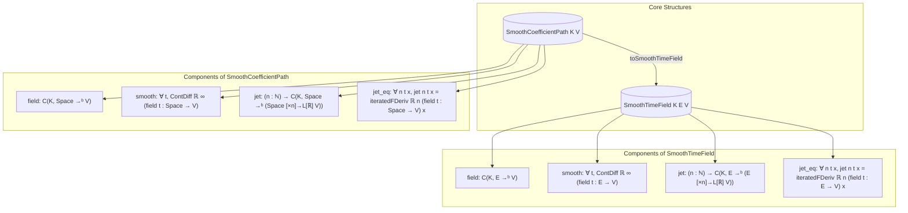
Sources:
- [Euler/SmoothTimeField.lean:13-19]()
- [Euler/SmoothCoefficientPath.lean:35-40]()
- [Euler/SmoothTimeField.lean:86-88]()

## Diagram: SmoothTimeField Operations and Calculus Rules

```mermaid
graph TD
    subgraph "SmoothTimeField Operations"
        STF_A[("SmoothTimeField K E V")]
        STF_B[("SmoothTimeField K E V")]
        STF_D[("SmoothTimeField K E E")]
        STF_L_V_W[("L: V →L[ℝ] W")]
        STF_L_F_E[("L: F →L[ℝ] E")]
        STF_L_V_W_W_Z[("L: V →L[ℝ] W →L[ℝ] Z")]

        Op_Derivative["derivative"]
        Op_Map["map L"]
        Op_PrecompLinear["precompLinear L"]
        Op_Add["add"]
        Op_CompDisplacement["compDisplacement"]
        Op_ApplyField["applyField"]
    end

    subgraph "Calculus Rules"
        Rule_TimeDerivative["TimeDerivative T hT A A₁"]
        Rule_TimeDerivative_B["TimeDerivative T hT B B₁"]
        Rule_TimeDerivative_D["TimeDerivative T hT D D₁"]
        Rule_TimeDerivative_A_prime["TimeDerivative T hT A.derivative A₁.derivative"]

        Rule_Bilinear["TimeDerivative.bilinear"]
        Rule_ChainCompDisplacement["TimeDerivative.compDisplacement"]
    end

    STF_A -- Op_Derivative --> STF_A_prime[("SmoothTimeField K E (E →L[ℝ] V)")]
    STF_A -- Op_Map --> STF_A_mapped[("SmoothTimeField K E W")]
    STF_A -- Op_PrecompLinear --> STF_A_precomp[("SmoothTimeField K F V")]
    STF_A -- Op_Add --> STF_A_plus_B[("SmoothTimeField K E V")]
    STF_B -- Op_Add --> STF_A_plus_B
    STF_A -- Op_CompDisplacement --> STF_A_comp_D[("SmoothTimeField K E V")]
    STF_D -- Op_CompDisplacement --> STF_A_comp_D

    STF_A_prime_LM[("SmoothTimeField K E (V →L[ℝ] W)")] -- Op_ApplyField --> STF_A_prime_LM_applied[("SmoothTimeField K E W")]
    STF_B -- Op_ApplyField --> STF_A_prime_LM_applied

    STF_A -- Op_Derivative --> STF_A_prime
    STF_L_V_W -- Op_Map --> STF_A_mapped
    STF_L_F_E -- Op_PrecompLinear --> STF_A_precomp

    Rule_TimeDerivative -- Rule_Bilinear --> STF_Bilinear_Result[("TimeDerivative T hT (bilinear L A B) (...)")]
    Rule_TimeDerivative_B -- Rule_Bilinear --> STF_Bilinear_Result
    STF_L_V_W_W_Z -- Rule_Bilinear --> STF_Bilinear_Result

    Rule_TimeDerivative -- Rule_ChainCompDisplacement --> STF_Chain_Result[("TimeDerivative T hT (A.compDisplacement D) (...)")]
    Rule_TimeDerivative_D -- Rule_ChainCompDisplacement --> STF_Chain_Result

    Rule_TimeDerivative -- "TimeDerivative.map" --> STF_A_mapped_TD[("TimeDerivative T hT (A.map L) (A₁.map L)")]
    Rule_TimeDerivative -- "TimeDerivative.precompLinear" --> STF_A_precomp_TD[("TimeDerivative T hT (A.precompLinear L) (A₁.precompLinear L)")]
    Rule_TimeDerivative -- "TimeDerivative.add" --> STF_A_plus_B_TD[("TimeDerivative T hT (A.add B) (A₁.add B₁)")]
    Rule_TimeDerivative_B -- "TimeDerivative.add" --> STF_A_plus_B_TD

    classDef STF_A fill:#fff,stroke:#333,stroke-width:2px
    classDef STF_B fill:#fff,stroke:#333,stroke-width:2px
    classDef STF_D fill:#fff,stroke:#333,stroke-width:2px
    classDef STF_L_V_W fill:#fff,stroke:#333,stroke-width:2px
    classDef STF_L_F_E fill:#fff,stroke:#333,stroke-width:2px
    classDef STF_L_V_W_W_Z fill:#fff,stroke:#333,stroke-width:2px
    classDef Op_Derivative fill:#f9f,stroke:#333,stroke-width:2px
    classDef Op_Map fill:#f9f,stroke:#333,stroke-width:2px
    classDef Op_PrecompLinear fill:#f9f,stroke:#333,stroke-width:2px
    classDef Op_Add fill:#f9f,stroke:#333,stroke-width:2px
    classDef Op_CompDisplacement fill:#f9f,stroke:#333,stroke-width:2px
    classDef Op_ApplyField fill:#f9f,stroke:#333,stroke-width:2px
    classDef Rule_TimeDerivative fill:#9cf,stroke:#333,stroke-width:2px
    classDef Rule_TimeDerivative_B fill:#9cf,stroke:#333,stroke-width:2px
    classDef Rule_TimeDerivative_D fill:#9cf,stroke:#333,stroke-width:2px
    classDef Rule_TimeDerivative_A_prime fill:#9cf,stroke:#333,stroke-width:2px
    classDef Rule_Bilinear fill:#9cf,stroke:#333,stroke-width:2px
    classDef Rule_ChainCompDisplacement fill:#9cf,stroke:#333,stroke-width:2px
    classDef STF_A_prime fill:#fff,stroke:#333,stroke-width:2px
    classDef STF_A_mapped fill:#fff,stroke:#333,stroke-width:2px
    classDef STF_A_precomp fill:#fff,stroke:#333,stroke-width:2px
    classDef STF_A_plus_B fill:#fff,stroke:#333,stroke-width:2px
    classDef STF_A_comp_D fill:#fff,stroke:#333,stroke-width:2px
    classDef STF_A_prime_LM_applied fill:#fff,stroke:#333,stroke-width:2px
    classDef STF_Bilinear_Result fill:#9cf,stroke:#333,stroke-width:2px
    classDef STF_Chain_Result fill:#9cf,stroke:#333,stroke-width:2px
    classDef STF_A_mapped_TD fill:#9cf,stroke:#333,stroke-width:2px
    classDef STF_A_precomp_TD fill:#9cf,stroke:#333,stroke-width:2px
    classDef STF_A_plus_B_TD fill:#9cf,stroke:#333,stroke-width:2px
```
Sources:
- [Euler/SmoothTimeField.lean:65-78]()
- [Euler/SmoothTimeFieldLinear.lean:29-38]()
- [Euler/SmoothTimeFieldPrecomp.lean:30-40]()
- [Euler/SmoothTimeFieldAlgebra.lean:23-33]()
- [Euler/SmoothTimeFieldComposition.lean:29-37]()
- [Euler/SmoothTimeFieldChain.lean:26-28]() (for `applyField`)
- [Euler/SmoothTimeFieldChain.lean:56-66]() (for `TimeDerivative.bilinear`)
- [Euler/SmoothTimeFieldChain.lean:92-109]() (for `TimeDerivative.compDisplacement`)
- [Euler/SmoothTimeFieldLinear.lean:70-74]() (for `TimeDerivative.map`)
- [Euler/SmoothTimeFieldPrecomp.lean:74-78]() (for `TimeDerivative.precompLinear`)
- [Euler/SmoothTimeFieldAlgebra.lean:60-64]() (for `TimeDerivative.add`)

## FieldTower and Sobolev Point Evaluation

The `FieldTower` structure [Euler/FieldTowerSmoothTimeField.lean:32]() represents a tower of Sobolev spaces, which can be converted into a `SmoothTimeField`. This conversion relies on `EulerSobolevPointEvaluation.pointEvaluation` to extract point values from Sobolev functions and `coverPathMap` to handle the cylinder cover.

```lean
def toSmoothTimeField : SmoothTimeField (Icc (0 : ℝ) T) LiftTangent Space :=
  SmoothTimeField.ofCoordinateJets coverBasis A.boundedCover
    (fun t => coverField_contDiff P (A.pointField t) (A.pointField_smooth t))
    A.boundedWord A.boundedWord_tensor
```
Sources: [Euler/FieldTowerSmoothTimeField.lean:69-72]()

This `toSmoothTimeField` provides a way to obtain a `SmoothTimeField` from a `FieldTower`, ensuring that the resulting field is smooth and its jets are correctly defined. The `toSmoothTimeField_timeDerivative` and `toSmoothTimeField_timeDerivative_of_interior` theorems [Euler/FieldTowerSmoothTimeField.lean:74-122]() show how time derivatives of the `FieldTower` translate to time derivatives of the `SmoothTimeField`.

The `EulerMeanSobolevBoundedField` namespace provides `sobolevField` and `sobolevMap` [Euler/MeanSobolevBoundedField.lean:26-51]() to construct bounded continuous functions from Sobolev spaces, which are then used to build `SmoothL2Field`s. The `finiteField` function [Euler/MeanSobolevBoundedField.lean:104-105]() reconstructs a bounded field from its finite scalar coordinates, demonstrating how finite-dimensional targets are handled.

## Cylinder Jet Lp Map

The `EulerCylinderJetLp` namespace defines operations on `tensor`s (iterated derivatives) of functions on the cylinder cover, specifically how linear maps interact with these tensors in `Lp` spaces.

```lean
theorem tensor_map (L : V →L[ℝ] W) (f : LiftDomain P → V)
    (hf : ∀ q, ContDiff ℝ ∞ (localFieldLift P f q)) (n : ℕ) (q : LiftDomain P) :
    tensor P (fun x => L (f x)) n q = L.compContinuousMultilinearMap (tensor P f n q) := by
  change iteratedFDeriv ℝ n (L ∘ fun z => f (coveringMap P z)) (sectionPoint P q) = _
  exact L.iteratedFDeriv_comp_left ((coverField_contDiff P f hf).contDiffAt) (by simp)
```
Sources: [Euler/CylinderJetLpMap.lean:21-26]()

This `tensor_map` theorem shows that applying a linear map `L` to a function `f` commutes with taking its spatial tensor (iterated derivative). This property is extended to `Lp` norms in `tensor_map_norm_le` [Euler/CylinderJetLpMap.lean:39-50](), which is crucial for bounding the norms of derivatives. The `tensor_transport_split` and `tensor_transport_norm_le` theorems [Euler/CylinderJetLpMap.lean:65-110]() further detail how these tensors behave under transport operations, which are essential for analyzing the evolution of fields in the Euler equations.

Sources:
- [Euler/SmoothTimeField.lean]()
- [Euler/SmoothCoefficientPath.lean]()
- [Euler/SmoothTimeFieldChain.lean]()
- [Euler/SmoothTimeFieldPrecomp.lean]()
- [Euler/SmoothTimeFieldLinear.lean]()
- [Euler/SmoothTimeFieldAlgebra.lean]()
- [Euler/SmoothTimeFieldComposition.lean]()
- [Euler/PacketSlicedAssembly.lean]()
- [Euler/PacketPressureJet.lean]()
- [Euler/PacketSlicedJets.lean]()
- [Euler/FieldTowerSmoothTimeField.lean]()
- [Euler/MeanSobolevBoundedField.lean]()
- [Euler/CylinderJetLpMap.lean]()
- [Euler/ChildParticleTime.lean]()
- [Euler/ChildParticleFieldTime.lean]()

---

# Page: Function Spaces: Lp, Sobolev, Gevrey

# Function Spaces: Lp, Sobolev, Gevrey

<details>
<summary>Relevant source files</summary>

The following files were used as context for generating this wiki page:

- [Euler/CompactSmoothL2Bounds.lean](Euler/CompactSmoothL2Bounds.lean)
- [Euler/CompactVorticityTimeUpgrade.lean](Euler/CompactVorticityTimeUpgrade.lean)
- [Euler/ComparatorSobolevEvolution.lean](Euler/ComparatorSobolevEvolution.lean)
- [Euler/MeanPathLpBlocks.lean](Euler/MeanPathLpBlocks.lean)
- [Euler/OrdinaryEulerClassicalClass.lean](Euler/OrdinaryEulerClassicalClass.lean)
- [Euler/OrdinaryEulerSobolevClass.lean](Euler/OrdinaryEulerSobolevClass.lean)
- [Euler/SmoothFieldSobolevTime.lean](Euler/SmoothFieldSobolevTime.lean)
- [Euler/SmoothL2ClassicalBounds.lean](Euler/SmoothL2ClassicalBounds.lean)
- [Euler/SmoothL2Gevrey.lean](Euler/SmoothL2Gevrey.lean)
- [Euler/TimeForcingRepresentative.lean](Euler/TimeForcingRepresentative.lean)
- [Euler/TimeLp.lean](Euler/TimeLp.lean)
- [Euler/TimeLpLinearity.lean](Euler/TimeLpLinearity.lean)
- [Euler/TimeLpMap.lean](Euler/TimeLpMap.lean)
- [Euler/TimeLpMultiplier.lean](Euler/TimeLpMultiplier.lean)
- [Euler/TimeLpObservation.lean](Euler/TimeLpObservation.lean)
- [Euler/TimeLpStrongOperators.lean](Euler/TimeLpStrongOperators.lean)
- [Euler/TimePathApply.lean](Euler/TimePathApply.lean)

</details>


This page provides a high-level overview of the function spaces used throughout the Euler and Navier-Stokes formalizations. These include `SmoothL2Field`, `TimeLp`, and various Sobolev and Gevrey regularity classes. These structures are fundamental for defining and analyzing the properties of velocity fields, pressure, and other quantities in the PDEs.

The codebase extensively uses these function spaces to characterize the smoothness, integrability, and differentiability of fields, both in space and time. Understanding these concepts is crucial for following the formal proofs of existence, uniqueness, and breakdown phenomena.

## SmoothL2Field

The `SmoothL2Field` structure represents spatially smooth functions that are also square-integrable (L2) over the domain. It encapsulates both the field itself and its associated L2 representation and derivatives. This structure is a cornerstone for defining the state of the fluid in the Euler and Navier-Stokes equations.

A `SmoothL2Field` `A` provides:
*   `A.field`: The underlying smooth function `Space → V` [Euler/SmoothL2Gevrey.lean:19-19]().
*   `A.toLp`: The L2 representation of the field [Euler/ComparatorSobolevEvolution.lean:14-14]().
*   `A.jetLp n`: The L2 representation of the `n`-th spatial derivative (jet) of the field [Euler/ComparatorSobolevEvolution.lean:18-18]().

The `SmoothL2Field` is used to bridge between classical function theory and the L2-based formalization in Lean. For instance, the `Euler.ComparatorBridge.toL2_field` theorem [Euler/ComparatorSobolevEvolution.lean:14-16]() explicitly links the field to its L2 representation.

### Diagram: SmoothL2Field Structure

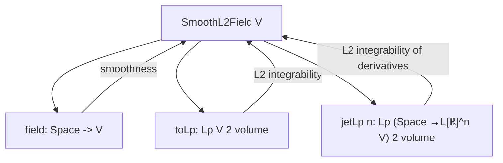
Sources: [Euler/SmoothL2Gevrey.lean:19-19](), [Euler/ComparatorSobolevEvolution.lean:14-14](), [Euler/ComparatorSobolevEvolution.lean:18-18]()

## TimeLp Spaces

`TimeLp` spaces are Bochner L2 spaces for time-dependent functions. They are used to represent the time evolution of fields, where the values at each time point are elements of a normed space (e.g., `SmoothL2Field` or Sobolev spaces). This allows for the analysis of time-dependent behavior using L2 norms.

The `TimeLp` type is defined as `Lp E 2 (timeMeasure T)` [Euler/TimeLp.lean:23-23](), where `E` is the normed space of values and `timeMeasure T` is the Lebesgue measure restricted to a compact time interval `[0, T]` [Euler/TimeLp.lean:15-15]().

Key functionalities related to `TimeLp` include:
*   `pathLp`: Embeds a continuous time path into `TimeLp` [Euler/TimeLp.lean:34-35]().
*   `timeMultiplier`: Represents a time-dependent linear operator acting on `TimeLp` fields [Euler/TimeLpMultiplier.lean:65-66]().
*   `timePathApply`: Applies a continuous operator path to a continuous field path [Euler/TimePathApply.lean:17-19]().

For details on `TimeLp` multipliers, maps, observations, and time integration, see [Time-Lp Spaces and Time Integration](#2.2.3).

### Diagram: TimeLp and its Operations

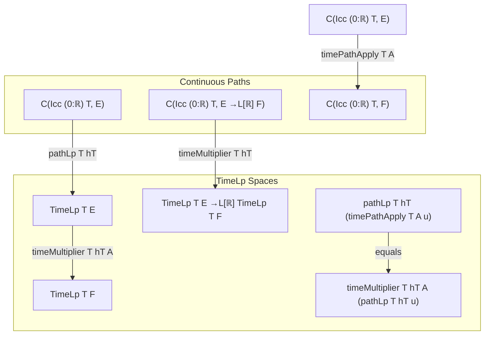
Sources: [Euler/TimeLp.lean:34-35](), [Euler/TimeLpMultiplier.lean:65-66](), [Euler/TimePathApply.lean:17-19](), [Euler/TimePathApply.lean:23-25]()

## Sobolev Spaces and Word Calculus

Sobolev spaces are crucial for quantifying the spatial regularity of fields. The codebase uses a "word calculus" approach to define and manipulate Sobolev norms, particularly for fields on the cylinder. This involves representing derivatives as "words" of directional derivatives.

The `ordinarySobolev` function [Euler/SmoothFieldSobolevTime.lean:40-41]() constructs a continuous path in a Sobolev space from a `SmoothL2Field`. The `Euler.SobolevSmoothOn` structure [Euler/ComparatorSobolevEvolution.lean:22-22]() is used to characterize fields that are smooth in space and have continuous L2 jets in time.

Key concepts include:
*   **Parameter Sobolev families**: These are used to define Sobolev norms that depend on parameters, allowing for flexible regularity analysis.
*   **Isometric action words**: Derivatives are represented as sequences of directional derivatives, forming "words."
*   **Sobolev word constraints/interpolation**: These provide bounds and relationships between different Sobolev norms.

For a detailed exploration of `ParameterSobolev` families, isometric action words, and Sobolev word constraints, see [Parameter Sobolev and Word Calculus](#2.2.1).

## Gevrey Regularity Classes

Gevrey regularity is a stronger form of smoothness than Sobolev regularity, often associated with analytic functions. It is used in the codebase to establish finer control over the behavior of solutions, particularly in the context of operator composition and product estimates.

The `HasJetBound` predicate [Euler/SmoothL2Gevrey.lean:19-20]() defines Gevrey regularity for a `SmoothL2Field`, requiring that the norm of its `n`-th jet grows no faster than `C * R^n * (n!)^2`. This exponential growth with factorial terms is characteristic of Gevrey spaces.

Key aspects of Gevrey calculus include:
*   **Gevrey composition/product estimates in Lp**: These provide bounds on the Gevrey regularity of composite or product functions.
*   **Operator Gevrey calculus**: This extends Gevrey regularity to operators, allowing for the analysis of their smoothing properties.
*   **Gram-inverse Gevrey/Sobolev block bounds**: These are used to control the regularity of inverse operators.

For a deeper dive into Gevrey composition, product estimates, and operator Gevrey calculus, see [Gevrey Calculus and Operator Composition](#2.2.2).

### Diagram: Regularity Classes and their Relationships

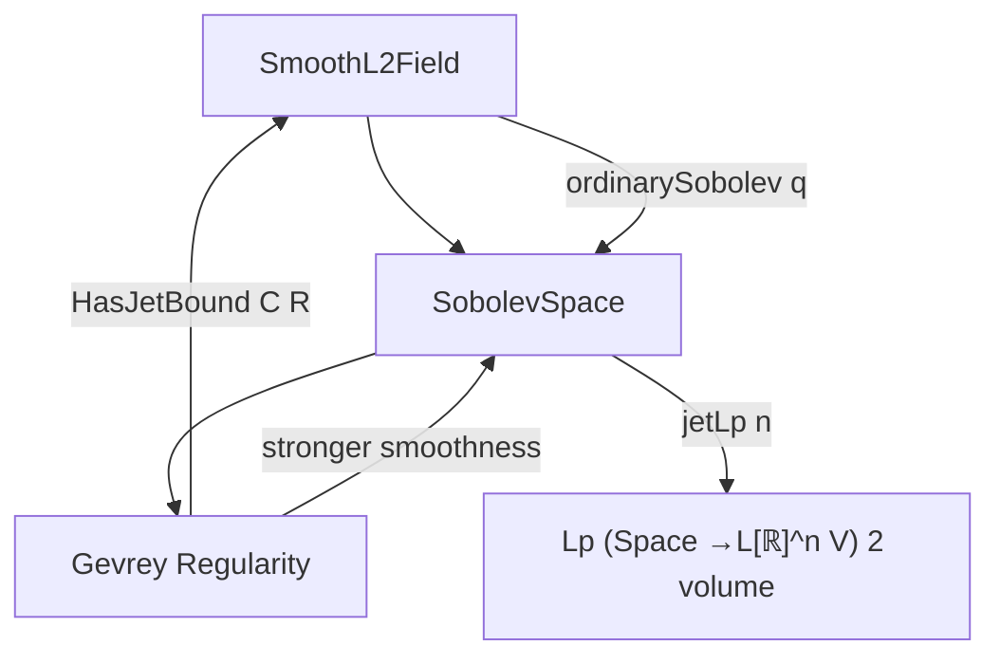
Sources: [Euler/SmoothL2Gevrey.lean:19-20](), [Euler/SmoothFieldSobolevTime.lean:40-41](), [Euler/SmoothL2Gevrey.lean:22-23]()

---

# Page: Parameter Sobolev and Word Calculus

# Parameter Sobolev and Word Calculus

<details>
<summary>Relevant source files</summary>

The following files were used as context for generating this wiki page:

- [Euler/CylinderSobolevWordBounds.lean](Euler/CylinderSobolevWordBounds.lean)
- [Euler/EnergyWordCoordinates.lean](Euler/EnergyWordCoordinates.lean)
- [Euler/IsometricActionWords.lean](Euler/IsometricActionWords.lean)
- [Euler/OrdinaryWordConstraints.lean](Euler/OrdinaryWordConstraints.lean)
- [Euler/OrdinaryWordTime.lean](Euler/OrdinaryWordTime.lean)
- [Euler/ParameterNestedWordSum.lean](Euler/ParameterNestedWordSum.lean)
- [Euler/ParameterSobolevCoefficient.lean](Euler/ParameterSobolevCoefficient.lean)
- [Euler/ParameterSobolevFiniteSum.lean](Euler/ParameterSobolevFiniteSum.lean)
- [Euler/ParameterSobolevGevrey.lean](Euler/ParameterSobolevGevrey.lean)
- [Euler/ParameterSobolevGevreyAt.lean](Euler/ParameterSobolevGevreyAt.lean)
- [Euler/ParameterSobolevLinear.lean](Euler/ParameterSobolevLinear.lean)
- [Euler/ParameterSobolevLocal.lean](Euler/ParameterSobolevLocal.lean)
- [Euler/ParameterSobolevOperations.lean](Euler/ParameterSobolevOperations.lean)
- [Euler/ParameterSobolevPair.lean](Euler/ParameterSobolevPair.lean)
- [Euler/ParameterSobolevProductAt.lean](Euler/ParameterSobolevProductAt.lean)
- [Euler/ParameterSobolevProductGevrey.lean](Euler/ParameterSobolevProductGevrey.lean)
- [Euler/ParameterSobolevScaling.lean](Euler/ParameterSobolevScaling.lean)
- [Euler/ParameterSobolevTensorInverse.lean](Euler/ParameterSobolevTensorInverse.lean)
- [Euler/ParameterWordCalculus.lean](Euler/ParameterWordCalculus.lean)
- [Euler/ParameterWordGevrey.lean](Euler/ParameterWordGevrey.lean)
- [Euler/ParameterWordHigher.lean](Euler/ParameterWordHigher.lean)
- [Euler/ParameterWordInverse.lean](Euler/ParameterWordInverse.lean)
- [Euler/ParameterWordLocal.lean](Euler/ParameterWordLocal.lean)
- [Euler/SobolevCauchyInterpolation.lean](Euler/SobolevCauchyInterpolation.lean)
- [Euler/SobolevPathInterpolation.lean](Euler/SobolevPathInterpolation.lean)
- [Euler/SobolevWordBlockCoordinates.lean](Euler/SobolevWordBlockCoordinates.lean)
- [Euler/SobolevWordConstraints.lean](Euler/SobolevWordConstraints.lean)
- [Euler/SobolevWordLevel.lean](Euler/SobolevWordLevel.lean)
- [Euler/SobolevWordValueIdentity.lean](Euler/SobolevWordValueIdentity.lean)

</details>


This page details the `ParameterSobolev*` families, which define various Sobolev-like norms and their calculus in the context of parameter-dependent functions. It covers products, tensor inverse, scaling, and Gevrey-at properties. Additionally, it explains isometric action words, nested word sums, and Sobolev word constraints/interpolation, providing the foundational mathematical tools for analyzing the regularity of solutions in the Euler and Navier-Stokes equations.

## Parameter Sobolev Families

The codebase defines several "Parameter Sobolev" families, which are extensions of standard Sobolev spaces to functions that depend on parameters. These families are crucial for handling the parameter-dependent nature of the fields and operators in the Euler and Navier-Stokes equations.

### `block` and `wordSum`

The core concepts are `block` and `wordSum`, which quantify the regularity of functions with respect to their parameters.

*   `wordDerivative directions f w x`: Represents the iterated Fréchet derivative of a function `f` at point `x` in the directions specified by `w`.
    Sources: [Euler/ParameterWordCalculus.lean:33-35]()
*   `wordSum directions f n x`: Calculates the sum of norms of `wordDerivative` for all possible words `w` of length `n`.
    Sources: [Euler/ParameterWordCalculus.lean:69-72]()
*   `baseSize directions q f x`: Represents a sum of `wordSum` up to order `q`.
    Sources: [Euler/ParameterSobolevBlocks.lean:22-25]()
*   `block directions q f n x`: Represents a sum of `wordSum` up to order `q` for the `n`-th word derivative.
    Sources: [Euler/ParameterSobolevBlocks.lean:28-31]()

These definitions are fundamental for measuring the "smoothness" of parameter-dependent functions in a way that is compatible with Gevrey regularity.

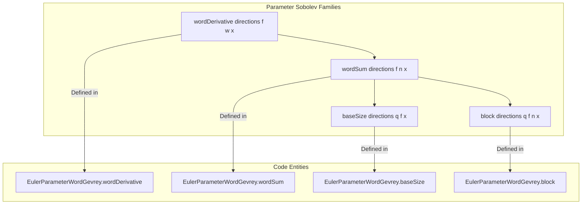
Sources: [Euler/ParameterWordCalculus.lean:25-72](), [Euler/ParameterSobolevBlocks.lean:19-31]()

### Products and Linear Operations

The codebase provides theorems for how these Sobolev-like norms behave under common operations:

*   **Composition with Continuous Linear Maps (`block_comp_clm_le`)**: If `L` is a continuous linear map, then the `block` norm of `L ∘ f` is bounded by `‖L‖` times the `block` norm of `f`.
    Sources: [Euler/ParameterSobolevLinear.lean:20-24]()
*   **Addition (`block_add_le`)**: The `block` norm of `f + g` is bounded by the sum of the `block` norms of `f` and `g`.
    Sources: [Euler/ParameterSobolevLinear.lean:26-30]()
*   **Subtraction (`block_sub_le`)**: Similar to addition, the `block` norm of `f - g` is bounded by the sum of the `block` norms of `f` and `g`.
    Sources: [Euler/ParameterSobolevLinear.lean:32-36]()
*   **Scalar Multiplication (`block_smul_le`)**: The `block` norm of `a • f` is bounded by `|a|` times the `block` norm of `f`.
    Sources: [Euler/ParameterSobolevOperations.lean:17-24]()
*   **Linear Pair (`block_linear_pair_le`)**: For a linear map `L` acting on a pair `(f, g)`, the `block` norm of `L(f, g)` is bounded by a linear combination of the `block` norms of `f` and `g`.
    Sources: [Euler/ParameterSobolevPair.lean:60-77]()

These theorems are essential for propagating regularity estimates through complex expressions involving parameter-dependent functions.

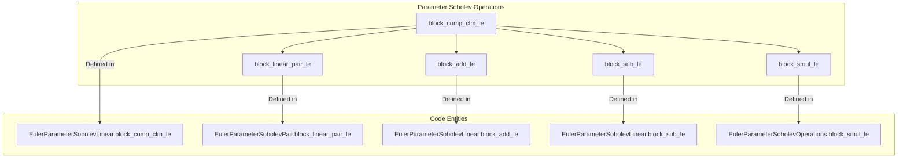
Sources: [Euler/ParameterSobolevLinear.lean:20-36](), [Euler/ParameterSobolevOperations.lean:17-24](), [Euler/ParameterSobolevPair.lean:60-77]()

### Tensor Inverse and Scaling

The `ParameterSobolevTensorInverse.lean` file introduces the concept of a "one-time coefficient absorption for a genuine fixed-Sobolev inverse." This is crucial for handling inverse operators in the context of Gevrey regularity.

*   `sobolevCoefficientRadius ι Rc`: Defines an enlarged radius for coefficients, which depends on the original coefficient radius `Rc` and the cardinality of the index set `ι`.
    Sources: [Euler/ParameterSobolevCoefficient.lean:38-39]()
*   `sobolevCoefficientAmplitude ι q Rc C`: Represents a polynomial in the original coefficient radius and amplitude, with numerical factorial coefficients.
    Sources: [Euler/ParameterSobolevCoefficient.lean:43-44]()
*   `inverseBlockCost ι q I Rc C D`: An explicit polynomial in the inverse, coefficient, and forcing constants, without grade dependence.
    Sources: [Euler/ParameterSobolevTensorInverse.lean:19-21]()
*   `inverse_block_gevrey_of_tensor`: This theorem states that the source radius is chosen once from coefficient data, and each inverse application increases the grade by one without changing that radius.
    Sources: [Euler/ParameterSobolevTensorInverse.lean:30-64]()

This mechanism allows for the absorption of coefficient orders into a single, enlarged radius, simplifying the analysis of Gevrey regularity for inverse problems.

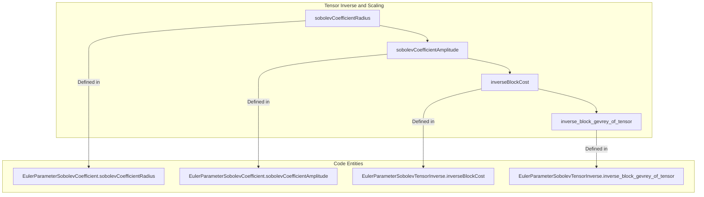
Sources: [Euler/ParameterSobolevCoefficient.lean:38-44](), [Euler/ParameterSobolevTensorInverse.lean:19-64]()

### Gevrey-at Properties

The `ParameterSobolevGevrey.lean` and `ParameterSobolevGevreyAt.lean` files focus on Gevrey regularity, particularly for inverse estimates.

*   `block_inverse_bound`: This theorem provides a fixed Sobolev inverse bound applied to each external word. Its commutator contains only positive external coefficient derivatives, preserving the original factorial radius at every grade.
    Sources: [Euler/ParameterSobolevGevrey.lean:28-57]()
*   `block_inverse_recurrence`: A genuine fixed-Sobolev external-word recurrence with the computed base inverse constant.
    Sources: [Euler/ParameterSobolevGevrey.lean:59-76]()
*   `block_inverse_gevrey`: This theorem demonstrates a factorial shift in fixed Hq, using identical input and output radius and constants independent of the input shift and external order.
    Sources: [Euler/ParameterSobolevGevrey.lean:78-122]()
*   `block_inverse_gevrey_at`: This is a specialized version of `block_inverse_gevrey` where the inverse estimate needs bounds only at its base point `x`. This is particularly useful for frozen Duhamel equations where the base operator is the identity.
    Sources: [Euler/ParameterSobolevGevreyAt.lean:21-64]()

These theorems are critical for establishing Gevrey regularity for solutions of PDEs, especially when dealing with inverse operators or localized estimates.

## Isometric Action Words

The `IsometricActionWords.lean` file defines how word derivatives behave under isometric actions. An isometric action `τ` preserves the norm of elements.

*   `derivativeAtZero τ u v`: Represents the Fréchet derivative of the orbit `a ↦ τ a u` at `0` in direction `v`.
    Sources: [Euler/IsometricActionWords.lean:26-26]()
*   `wordAtZero τ directions u w`: Represents the word derivative of the orbit `a ↦ τ a u` at `0` in the specified directions `w`.
    Sources: [Euler/IsometricActionWords.lean:43-44]()
*   `wordAtZero_translation`: This theorem states that applying the isometric action `τ a` to `wordAtZero τ directions u w` is equivalent to taking the word derivative of the orbit `a ↦ τ a u` at `a`. This means the word derivative of an isometric orbit is the orbit of its derivative at zero.
    Sources: [Euler/IsometricActionWords.lean:63-78]()
*   `wordSum_orbit_constant`: This theorem shows that the `wordSum` of an isometric orbit is constant along the orbit, meaning it is independent of the translation parameter `a`.
    Sources: [Euler/IsometricActionWords.lean:91-99]()
*   `baseSize_orbit_constant` and `block_orbit_constant`: These theorems extend the constancy property to `baseSize` and `block` norms, respectively. They show that these norms are independent of the translation parameter `a` for isometric orbits.
    Sources: [Euler/IsometricActionWords.lean:101-108](), [Euler/IsometricActionWords.lean:110-121]()

These results imply that for isometric actions, the Sobolev-like norms are invariant along the orbit, which simplifies regularity analysis in such contexts.

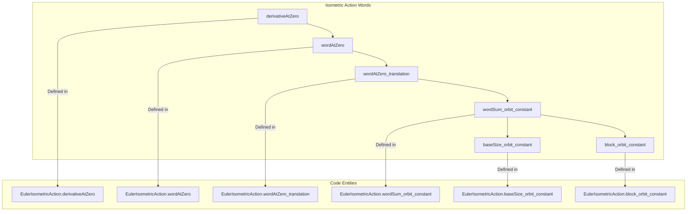
Sources: [Euler/IsometricActionWords.lean:26-121]()

## Nested Word Sums and Sobolev Word Constraints/Interpolation

The concept of "nested word sums" is implicitly handled through the recursive definitions of `block` and `coefficientBlock`, which sum over different levels of word derivatives.

The `SobolevCauchyInterpolation.lean` and `SobolevPathInterpolation.lean` files deal with Sobolev word constraints and interpolation, particularly in the context of Cauchy sequences and uniform bounds.

*   `wordPathOperator period h w T`: This is a continuous time-path operator that extracts a specific Sobolev derivative coordinate (`word`) from a Sobolev space-valued function `u` over a time interval `[0, T]`.
    Sources: [Euler/SobolevPathInterpolation.lean:54-56]()
*   `wordPath_square_bound`: This theorem provides an interpolation inequality for the `wordPathOperator`. It states that the square of the norm of a higher-order derivative path is bounded by the product of the norm of a lower-order derivative path and the norm of the original function.
    Sources: [Euler/SobolevPathInterpolation.lean:64-81]()
*   `wordPath_difference_square_bound`: This extends the interpolation bound to differences of functions, showing that the difference in higher-order derivative paths is controlled by the difference in lower-order derivative paths, given uniform bounds on the original functions.
    Sources: [Euler/SobolevPathInterpolation.lean:89-100]()
*   `wordPath_cauchy_step`: This is a crucial lemma that uses the `cauchySeq_of_square_bound` and `wordPath_difference_square_bound` to show that if a sequence of Sobolev paths is Cauchy in a lower-order derivative, and uniformly bounded, then it is also Cauchy in a higher-order derivative. This is a step-by-step propagation of Cauchy property.
    Sources: [Euler/SobolevPathInterpolation.lean:102-108]()
*   `wordPath_cauchy_of_value`: This theorem generalizes `wordPath_cauchy_step` to show that if the `valueOperator` (representing the function itself, a 0-th order derivative) is Cauchy, then all higher-order derivative paths up to `s-1` are also Cauchy.
    Sources: [Euler/SobolevCauchyInterpolation.lean:22-37]()
*   `pathCoordinates q T`: This is a continuous linear map that maps a Sobolev path to a collection of all its Sobolev word paths.
    Sources: [Euler/SobolevCauchyInterpolation.lean:41-43]()
*   `pathCoordinates_norm`: This theorem establishes that the `pathCoordinates` map is an isometry, meaning it preserves the full uniform Sobolev norm exactly.
    Sources: [Euler/SobolevCauchyInterpolation.lean:46-57]()
*   `path_cauchy_of_coordinates`: This theorem states that if all individual Sobolev word paths are Cauchy, then the complete Sobolev path itself is Cauchy. This is a consequence of `pathCoordinates` being an isometry.
    Sources: [Euler/SobolevCauchyInterpolation.lean:59-76]()
*   `cauchy_restrict_of_value`: This theorem combines the above results to show that a uniformly bounded Sobolev sequence that is Cauchy in L² (via `valueOperator`) is Cauchy at every strictly lower Sobolev order, uniformly in time.
    Sources: [Euler/SobolevCauchyInterpolation.lean:78-85]()
*   `exists_limit_restrict_of_value`: This theorem leverages the completeness of Sobolev spaces to guarantee the existence of a strong lower-order Sobolev limit from such Cauchy sequences.
    Sources: [Euler/SobolevCauchyInterpolation.lean:87-92]()

These interpolation and Cauchy sequence results are fundamental for proving convergence and existence of solutions in Sobolev spaces, especially when dealing with limits of approximate solutions or establishing compactness properties.

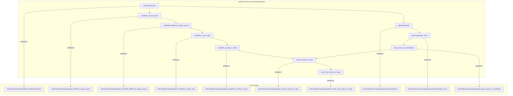
Sources: [Euler/SobolevPathInterpolation.lean:54-108](), [Euler/SobolevCauchyInterpolation.lean:22-92]()

---

# Page: Gevrey Calculus and Operator Composition

# Gevrey Calculus and Operator Composition

<details>
<summary>Relevant source files</summary>

The following files were used as context for generating this wiki page:

- [Euler/BoundedFieldForwardGenerator.lean](Euler/BoundedFieldForwardGenerator.lean)
- [Euler/BoundedFieldGramGevrey.lean](Euler/BoundedFieldGramGevrey.lean)
- [Euler/ContinuousAccelerationForcing.lean](Euler/ContinuousAccelerationForcing.lean)
- [Euler/ContinuousGramGevrey.lean](Euler/ContinuousGramGevrey.lean)
- [Euler/CylinderGraphGevrey.lean](Euler/CylinderGraphGevrey.lean)
- [Euler/CylinderJetGraphTrace.lean](Euler/CylinderJetGraphTrace.lean)
- [Euler/GevreyCompactProduct.lean](Euler/GevreyCompactProduct.lean)
- [Euler/GevreyCompositionLp.lean](Euler/GevreyCompositionLp.lean)
- [Euler/GevreyJetCompositionLp.lean](Euler/GevreyJetCompositionLp.lean)
- [Euler/GevreyProductLp.lean](Euler/GevreyProductLp.lean)
- [Euler/LpSmoothCoefficientProduct.lean](Euler/LpSmoothCoefficientProduct.lean)
- [Euler/OperatorGevreyCalculus.lean](Euler/OperatorGevreyCalculus.lean)
- [Euler/PacketTerminalDatumBounds.lean](Euler/PacketTerminalDatumBounds.lean)
- [Euler/SmoothCylinderAccelerationComposition.lean](Euler/SmoothCylinderAccelerationComposition.lean)
- [Euler/SmoothCylinderAccelerationLp.lean](Euler/SmoothCylinderAccelerationLp.lean)
- [Euler/SmoothL2GevreyCalculus.lean](Euler/SmoothL2GevreyCalculus.lean)
- [Euler/TimeLpAccelerationForcing.lean](Euler/TimeLpAccelerationForcing.lean)
- [Euler/TransverseForwardCoefficientGevrey.lean](Euler/TransverseForwardCoefficientGevrey.lean)
- [Euler/VolumeSobolevComposition.lean](Euler/VolumeSobolevComposition.lean)

</details>


This page details the application of Gevrey regularity in the context of operator composition and product estimates within $L^p$ spaces. It covers the Gevrey calculus for operators, volume Sobolev composition, and bounds for Gram-inverse Gevrey/Sobolev blocks. The core idea is to quantify the regularity of composed or multiplied functions and operators, particularly how Gevrey norms (which involve factorial growth of derivatives) behave under these operations. This is crucial for establishing precise bounds on the solutions of PDEs, especially in the context of finite-time breakdown analysis.

## Gevrey Composition and Product Estimates in $L^p$

The codebase extensively uses Gevrey regularity, characterized by bounds on iterated Fréchet derivatives that grow factorially. When composing or multiplying functions, these factorial bounds need to be carefully tracked.

### Gevrey Composition in $L^p$

The `EulerGevreyCompositionLp` namespace [Euler/GevreyCompositionLp.lean]() provides theorems for Gevrey composition in $L^p$ spaces. The key idea is to bound the $L^p$ norm of the iterated Fréchet derivative of a composed function `g ∘ f`.

The `composition_memLp_and_bound` theorem [Euler/GevreyCompositionLp.lean:57-130]() is central here. It states that if `f` is a `ContDiff ℝ ∞` function that preserves measure (`MeasurePreserving f μ μ`), and `g` is also `ContDiff ℝ ∞`, then the $L^p$ norm of the $n$-th iterated derivative of `g ∘ f` can be bounded.

**Theorem: `composition_memLp_and_bound`**
Given:
* A measure space `E` with measure `μ`.
* Functions `f : E → E` and `g : E → F`.
* `hf : ContDiff ℝ ∞ f`, `hg : ContDiff ℝ ∞ g`.
* `hmp : MeasurePreserving f μ μ` (f preserves the measure).
* `n : ℕ` (order of derivative).
* `hfg : AEStronglyMeasurable (iteratedFDeriv ℝ n (g ∘ f)) μ`.
* Constants `A, B, R, S : ℝ` with non-negativity conditions.
* `hgLp : ∀ j ≤ n, MemLp (iteratedFDeriv ℝ j g) 2 μ` (g's derivatives are in $L^2$).
* `hgjet : ∀ j ≤ n, (eLpNorm (iteratedFDeriv ℝ j g) 2 μ).toReal ≤ A*S^j*(j.factorial : ℝ)^2` (Gevrey bound for g's derivatives in $L^2$).
* `hfjet : ∀ j, 0 < j → j ≤ n → ∀ x, ‖iteratedFDeriv ℝ j f x‖ ≤ B*R^j*(j.factorial : ℝ)^2` (Gevrey bound for f's derivatives in sup norm).

Then:
`MemLp (iteratedFDeriv ℝ n (g ∘ f)) 2 μ` and
`(eLpNorm (iteratedFDeriv ℝ n (g ∘ f)) 2 μ).toReal ≤ A*(R*(B*S+2))^n*(n.factorial : ℝ)^2`.

This theorem shows that the Gevrey regularity is preserved under composition, with the radius and amplitude constants combining in a specific way. The `innerPartitionBound` [Euler/GevreyCompositionLp.lean:22-24]() and `composition_partition_bound` [Euler/GevreyCompositionLp.lean:35-51]() lemmas are used to break down the iterated derivative of the composition into a sum over ordered finite partitions, where each term is bounded by products of derivatives of `f` and `g`.

The `EulerGevreyJetCompositionLp` namespace [Euler/GevreyJetCompositionLp.lean]() extends this to compositions of formal multilinear series (jets), which are used to represent derivatives. The `composition_memLp_and_bound` theorem [Euler/GevreyJetCompositionLp.lean:39-106]() in this file is analogous, but works with `FormalMultilinearSeries` objects, allowing for more abstract jet calculus.

#### Diagram: Gevrey Composition in $L^p$

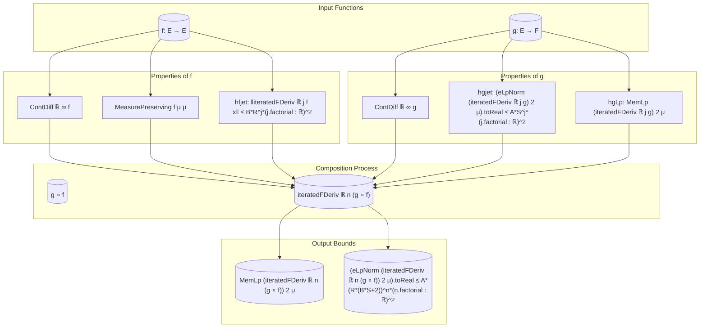
Sources: [Euler/GevreyCompositionLp.lean:57-130]()

### Gevrey Product Estimates in $L^p$

The `EulerGevreyProductLp` namespace (not fully shown, but imported by [Euler/SmoothL2GevreyCalculus.lean:3]()) provides theorems for products of functions in $L^p$. The `SmoothL2Field.productField` definition [Euler/SmoothL2GevreyCalculus.lean:110-119]() and `productField_bound` theorem [Euler/SmoothL2GevreyCalculus.lean:123-134]() demonstrate how Gevrey bounds are maintained for products of a `SmoothL2Field` with a `ContinuousLinearMap`-valued function.

The `productField_bound` theorem states that if `g : Space → V →L[ℝ] W` has `HasSupBound g B R` (Gevrey bound in sup norm) and `A : SmoothL2Field V` has `HasJetBound C R` (Gevrey bound in $L^2$ norm), then their product `(fun x => g x (A.field x))` forms a `SmoothL2Field W` with a Gevrey bound `(3*B*C) R`. This shows a multiplicative increase in the amplitude constant `3*B*C` while preserving the radius `R`.

## Operator Gevrey Calculus

The `EulerOperatorGevreyCalculus` namespace [Euler/OperatorGevreyCalculus.lean]() provides fundamental theorems for Gevrey bounds on various operator operations, such as linear maps, bilinear maps, and compositions of continuous linear maps. These theorems are crucial for propagating Gevrey regularity through complex operator expressions.

Key theorems include:
* `const_bound` [Euler/OperatorGevreyCalculus.lean:33-42](): A constant field has an order-zero Gevrey bound.
* `linear_bound` [Euler/OperatorGevreyCalculus.lean:45-51](): Bounded linear maps preserve Gevrey bounds.
* `contraction_bound` [Euler/OperatorGevreyCalculus.lean:54-62](): A linear contraction does not enlarge the Gevrey multiplier constant.
* `bilinear_bound` [Euler/OperatorGevreyCalculus.lean:65-79](): Provides a shifted product bound for bilinear contractions, resulting in an amplitude constant `3*A*C` and a sum of shift orders `d+e`.
* `clm_apply_bound` [Euler/OperatorGevreyCalculus.lean:81-91](): Bounds the Gevrey norm of applying a continuous linear map (CLM) to a field, effectively a product. This uses `bilinear_bound`.
* `clm_comp_bound` [Euler/OperatorGevreyCalculus.lean:93-102](): Bounds the Gevrey norm of composing two CLMs, also using `bilinear_bound`.
* `add_bound` [Euler/OperatorGevreyCalculus.lean:104-112]() and `sub_bound` [Euler/OperatorGevreyCalculus.lean:114-124](): Adding or subtracting Gevrey-bounded functions adds their amplitude constants.

These theorems form the building blocks for analyzing the Gevrey regularity of more complex expressions involving operators.

#### Diagram: Operator Gevrey Calculus

```mermaid
graph TD
    subgraph "Gevrey Bounded Inputs"
        F[("f: P → E")]
        G[("g: P → F")]
        A[("A: P → E →L[ℝ] F")]
        B[("B: P → E →L[ℝ] F")]
        L[("L: E →L[ℝ] F")]
        BL[("Bilinear Map: E →L[ℝ] F →L[ℝ] G")]
    end

    subgraph "Gevrey Operations"
        Op1["`linear_bound` (L ∘ f)"]
        Op2["`contraction_bound` (L ∘ f)"]
        Op3["`bilinear_bound` (BL(f, g))"]
        Op4["`clm_apply_bound` (A(u))"]
        Op5["`clm_comp_bound` (A ∘ B)"]
        Op6["`add_bound` (f + g)"]
        Op7["`sub_bound` (f - g)"]
    end

    subgraph "Gevrey Bounded Outputs"
        Out1["‖iteratedFDeriv ℝ n (L ∘ f) x‖ ≤ (‖L‖*A) * majorant R d n"]
        Out2["‖iteratedFDeriv ℝ n (L ∘ f) x‖ ≤ A * majorant R d n (if ‖L‖ ≤ 1)"]
        Out3["‖iteratedFDeriv ℝ n (BL(f, g)) x‖ ≤ (3*A*C) * majorant R (d+e) n"]
        Out4["‖iteratedFDeriv ℝ n (A(u)) x‖ ≤ (3*C*D) * majorant R (d+e) n"]
        Out5["‖iteratedFDeriv ℝ n (A ∘ B) x‖ ≤ (3*C*D) * majorant R (d+e) n"]
        Out6["‖iteratedFDeriv ℝ n (f + g) x‖ ≤ (A+B) * majorant R d n"]
        Out7["‖iteratedFDeriv ℝ n (f - g) x‖ ≤ (A+B) * majorant R d n"]
    end

    L -- Gevrey bound (A, R, d) --> Op1;
    F -- Gevrey bound (A, R, d) --> Op1;
    Op1 --> Out1;

    L -- Gevrey bound (A, R, d), ‖L‖ ≤ 1 --> Op2;
    F -- Gevrey bound (A, R, d) --> Op2;
    Op2 --> Out2;

    BL -- Gevrey bound (A, R, d), (C, R, e) --> Op3;
    F -- Gevrey bound (A, R, d) --> Op3;
    G -- Gevrey bound (C, R, e) --> Op3;
    Op3 --> Out3;

    A -- Gevrey bound (C, R, d) --> Op4;
    G -- Gevrey bound (D, R, e) --> Op4;
    Op4 --> Out4;

    A -- Gevrey bound (C, R, d) --> Op5;
    B -- Gevrey bound (D, R, e) --> Op5;
    Op5 --> Out5;

    F -- Gevrey bound (A, R, d) --> Op6;
    G -- Gevrey bound (B, R, d) --> Op6;
    Op6 --> Out6;

    F -- Gevrey bound (A, R, d) --> Op7;
    G -- Gevrey bound (B, R, d) --> Op7;
    Op7 --> Out7;
```
Sources: [Euler/OperatorGevreyCalculus.lean:33-124]()

## Volume Sobolev Composition

The `EulerVolumeSobolevComposition` namespace [Euler/VolumeSobolevComposition.lean]() focuses on the Sobolev integrability of composed functions when the inner function is volume-preserving. This is particularly relevant for transformations that maintain the "volume" of the domain, which is common in fluid dynamics.

The `compositionTensor_pointwise` theorem [Euler/VolumeSobolevComposition.lean:19-29]() provides a pointwise bound for the iterated derivative of `g ∘ f`.
The `compositionTensor_memLp` theorem [Euler/VolumeSobolevComposition.lean:40-51]() then establishes that if `f` is `MeasurePreserving` and `g`'s derivatives are in $L^2$, then the composed derivative is also in $L^2$.
Finally, `compositionTensorLp_norm_le` [Euler/VolumeSobolevComposition.lean:57-96]() gives an explicit bound on the $L^2$ norm of the composed derivative, showing how the constants `D` (from `f`) and the $L^2$ norms of `g`'s derivatives combine.

This is a crucial result for understanding how Sobolev regularity (which is an $L^p$ based regularity) behaves under volume-preserving coordinate changes.

## Gram-Inverse Gevrey/Sobolev Block Bounds

The Gram inverse plays a significant role in solving linear systems arising from the PDE. The codebase provides Gevrey bounds for the Gram inverse itself and for related operators.

### Continuous Gram Inverse

The `EulerContinuousGramGevrey` namespace [Euler/ContinuousGramGevrey.lean]() deals with the Gevrey regularity of the continuous Gram inverse.
The `inversePath_gevrey` theorem [Euler/ContinuousGramGevrey.lean:75-121]() states that the actual continuous inverse path has a one-factorial shift in its Gevrey bound. This means if the input `Q` has a Gevrey bound with shift `0`, the inverse `V` will have a Gevrey bound with shift `1`.

**Theorem: `inversePath_gevrey`**
Given:
* `Q : P → C(Icc (0 : ℝ) T,U →L[ℝ] E)` (a path of operators).
* `c : ℝ`, `hc : 0 < c` (coercivity constant).
* `hLower : ∀ x t v, c*‖v‖^2 ≤ ‖Q x t v‖^2` (coercivity condition).
* `hQ : ContDiff ℝ ∞ Q`.
* `Rc, C : ℝ` (Gevrey radius and amplitude for `Q`).
* `hbQ : ∀ n x, ‖iteratedFDeriv ℝ n Q x‖ ≤ C*majorant Rc 0 n`.
* `R : ℝ`, `hR : 2*gramCost c C 1*(Rc+1) ≤ R` (radius for the inverse).

Then:
`‖iteratedFDeriv ℝ n (fun y => gramInversePath T (Q y) c hc (hLower y)) x‖ ≤ majorant R 1 n`.

This theorem is critical for ensuring that the inverse operator maintains a controlled level of regularity, which is essential for the well-posedness of the solutions. The `solution_gevrey` theorem [Euler/ContinuousGramGevrey.lean:124-143]() extends this to the solution of a linear system involving the Gram operator, showing a similar one-shift in the Gevrey bound.

### Bounded Field Gram Inverse

The `EulerBoundedFieldGramGevrey` namespace [Euler/BoundedFieldGramGevrey.lean]() provides similar Gevrey bounds for the Gram inverse in a bounded-field setting.
The `inversePath_gevrey` theorem [Euler/BoundedFieldGramGevrey.lean:70-122]() here is analogous to the continuous case, providing a one-factorial shift in the Gevrey bound for the inverse path.
The `inversePath_coefficient_bound` theorem [Euler/BoundedFieldGramGevrey.lean:125-131]() further refines this, showing that a fixed coefficient radius can absorb this one-shift.

### Gram-Inverse Block Bounds

The `EulerPacketTerminalDatum` namespace [Euler/PacketTerminalDatum.lean]() uses these Gevrey calculus results to derive bounds for "blocks" of operators, which are crucial for the packet construction in the Euler breakdown proof.
The `terminal_block_bound` theorem [Euler/PacketTerminalDatum.lean:111-118]() bounds the `block` operator (a type of derivative) of a translated terminal field. This bound involves `sobolevCoefficientAmplitude` and `majorant` terms, demonstrating how Gevrey and Sobolev norms are combined.

The `leftInversePath` [Euler/BoundedFieldForwardGenerator.lean:47-49]() and `generatorPath` [Euler/BoundedFieldForwardGenerator.lean:51-54]() definitions represent key operators in the system. Their Gevrey regularity is established by `leftInversePath_contDiff` [Euler/BoundedFieldForwardGenerator.lean:68-71]() and `generatorPath_contDiff` [Euler/BoundedFieldForwardGenerator.lean:73-79](), and their bounds are given by `leftInversePath_bound` [Euler/BoundedFieldForwardGenerator.lean:89-103]() and `generatorPath_bound` [Euler/BoundedFieldForwardGenerator.lean:106-122](). These bounds show how the Gevrey constants propagate through the construction of these operators.

#### Diagram: Gram-Inverse Gevrey Block Bounds

```mermaid
graph TD
    subgraph "Input: Operator Path Q"
        Q_path["Q: P → C(K,α →ᵇ U →L[ℝ] E)"]
        Q_contdiff["ContDiff ℝ ∞ Q"]
        Q_gevrey_bound["‖iteratedFDeriv ℝ n Q x‖ ≤ C*majorant Rc 0 n"]
        Q_coercivity["c*‖v‖^2 ≤ ‖Q y t x v‖^2"]
    end

    subgraph "Gram Inverse Construction"
        GramPath["gramPath (Q y)"]
        InversePath["inversePath c hc (Q y) (hLower y)"]
        LeftInversePath["leftInversePath c hc (Q y) (hQ y)"]
        GeneratorPath["generatorPath c hc (Q y) (Q₁ y) (hQ y)"]
    end

    subgraph "Gevrey Bounds for Inverse"
        InvPath_gevrey["`inversePath_gevrey`: ‖iteratedFDeriv ℝ n InversePath x‖ ≤ majorant R 1 n"]
        InvPath_coeff_bound["`inversePath_coefficient_bound`: ‖iteratedFDeriv ℝ n InversePath x‖ ≤ R*majorant (4*R) 0 n"]
        LeftInvPath_bound["`leftInversePath_bound`: ‖iteratedFDeriv ℝ n LeftInversePath x‖ ≤ (3*Ri*C₀)*majorant (4*Ri) 0 n"]
        GenPath_bound["`generatorPath_bound`: ‖iteratedFDeriv ℝ n GeneratorPath x‖ ≤ (18*Ri*C₀*C₁)*majorant (4*Ri) 0 n"]
    end

    Q_path --> GramPath;
    Q_path & Q_contdiff & Q_coercivity & Q_gevrey_bound --> InversePath;
    InversePath --> InvPath_gevrey;
    InversePath --> InvPath_coeff_bound;

    InversePath & Q_path --> LeftInversePath;
    LeftInversePath --> LeftInvPath_bound;

    LeftInversePath & Q_path & Q_path_Q1["Q₁: P → C(K,α →ᵇ U →L[ℝ] E)"] --> GeneratorPath;
    GeneratorPath --> GenPath_bound;
```
Sources:
- [Euler/ContinuousGramGevrey.lean:75-121]()
- [Euler/BoundedFieldGramGevrey.lean:70-122]()
- [Euler/BoundedFieldGramGevrey.lean:125-131]()
- [Euler/BoundedFieldForwardGenerator.lean:89-103]()
- [Euler/BoundedFieldForwardGenerator.lean:106-122]()

---

# Page: Time-Lp Spaces and Time Integration

# Time-Lp Spaces and Time Integration

<details>
<summary>Relevant source files</summary>

The following files were used as context for generating this wiki page:

- [Euler/BoundedFieldTimeDerivative.lean](Euler/BoundedFieldTimeDerivative.lean)
- [Euler/ContinuousTimeIntegral.lean](Euler/ContinuousTimeIntegral.lean)
- [Euler/CylinderGraphDerivative.lean](Euler/CylinderGraphDerivative.lean)
- [Euler/InjectivePathDerivative.lean](Euler/InjectivePathDerivative.lean)
- [Euler/InjectivePathDerivativeWithin.lean](Euler/InjectivePathDerivativeWithin.lean)
- [Euler/LpCylinderFullTime.lean](Euler/LpCylinderFullTime.lean)
- [Euler/MeanCoefficientTime.lean](Euler/MeanCoefficientTime.lean)
- [Euler/MeanPathLpBlocks.lean](Euler/MeanPathLpBlocks.lean)
- [Euler/OrdinarySobolevTower.lean](Euler/OrdinarySobolevTower.lean)
- [Euler/OrdinaryStrongTime.lean](Euler/OrdinaryStrongTime.lean)
- [Euler/SeparatingTimeDerivative.lean](Euler/SeparatingTimeDerivative.lean)
- [Euler/TimeForcingRepresentative.lean](Euler/TimeForcingRepresentative.lean)
- [Euler/TimeH1ContinuousDerivative.lean](Euler/TimeH1ContinuousDerivative.lean)
- [Euler/TimeLp.lean](Euler/TimeLp.lean)
- [Euler/TimeLpLinearity.lean](Euler/TimeLpLinearity.lean)
- [Euler/TimeLpMap.lean](Euler/TimeLpMap.lean)
- [Euler/TimeLpMultiplier.lean](Euler/TimeLpMultiplier.lean)
- [Euler/TimeLpObservation.lean](Euler/TimeLpObservation.lean)
- [Euler/TimeLpStrongOperators.lean](Euler/TimeLpStrongOperators.lean)
- [Euler/TimePathApply.lean](Euler/TimePathApply.lean)

</details>


This page details the formalization of time-Lp spaces and related time integration concepts within the Lean 4 codebase. It covers the definition of `TimeLp` spaces, the embedding of continuous paths into these spaces, the construction of continuous time integrals and strong time derivatives, and lemmas related to path derivatives and `H1` reconstruction. The core idea is to bridge classical continuous-time analysis with Bochner-Lp spaces, which are crucial for maximal regularity results.

## Time-Lp Spaces

The `TimeLp` space, defined as `Lp E 2 (timeMeasure T)` [Euler/TimeLp.lean:23](), represents the Bochner L² space of time-dependent values in a normed space `E` over a compact evolution interval `[0, T]`. The `timeMeasure T` is the Lebesgue time measure restricted to this interval [Euler/TimeLp.lean:15]().

### Continuous Path Embedding

Continuous paths can be embedded into `TimeLp` spaces. The `pathLp` function [Euler/TimeLp.lean:35]() takes a continuous function `f : C(Icc (0 : ℝ) T, E)` and returns its representation in `TimeLp T E`. This embedding preserves the L² norm in the sense that the squared norm of `pathLp` is the integral of the squared pointwise norm of the continuous path [Euler/TimeLp.lean:87]().

```lean
/-- The actual Bochner L² space of time-dependent values in a normed space. -/
abbrev TimeLp (T : ℝ) (E : Type*) [NormedAddCommGroup E] := Lp E 2 (timeMeasure T)

/-- A continuous time path represented in the actual Bochner L² space. -/
def pathLp (T : ℝ) (hT : 0 ≤ T) (f : C(Icc (0 : ℝ) T, E)) : TimeLp T E :=
  (path_memLp T hT f).toLp (extendPath T hT f)
```

Sources:
* [Euler/TimeLp.lean:15]()
* [Euler/TimeLp.lean:23]()
* [Euler/TimeLp.lean:35]()
* [Euler/TimeLp.lean:87]()

### Time-Lp Multipliers and Maps

The codebase defines operations that act on `TimeLp` fields.

#### `timeMultiplier`

The `timeMultiplier` [Euler/TimeLpMultiplier.lean:66]() represents a bounded time-dependent linear operator acting on `TimeLp` fields. It takes a continuous path of operators `A : C(Icc (0 : ℝ) T, E →L[ℝ] F)` and a `TimeLp` field `u : TimeLp T E`, producing a `TimeLp` field `TimeLp T F`. This operation is linear [Euler/TimeLpMultiplier.lean:37]() and bounded by the uniform operator-path norm [Euler/TimeLpMultiplier.lean:55]().

```lean
/-- The bounded actual time multiplier on Bochner L² spaces. -/
def timeMultiplier (T : ℝ) (hT : 0 ≤ T) (A : C(Icc (0 : ℝ) T, E →L[ℝ] F)) :
    TimeLp T E →L[ℝ] TimeLp T F :=
  (timeApplyLinear T hT A).mkContinuous ‖A‖ (timeApply_bound T hT A)
```

Sources:
* [Euler/TimeLpMultiplier.lean:37]()
* [Euler/TimeLpMultiplier.lean:55]()
* [Euler/TimeLpMultiplier.lean:66]()

#### `pathLp_map`

The `pathLp_map` theorem [Euler/TimeLpMap.lean:16]() establishes that applying a bounded spatial map `A : E →L[ℝ] F` commutes with the `pathLp` embedding. This means `A.compLpL (pathLp f)` is equivalent to `pathLp (A.compLeftContinuous f)`.

```lean
/-- Applying a bounded spatial map commutes exactly with the genuine L² time embedding. -/
theorem pathLp_map (T : ℝ) (hT : 0 ≤ T) (A : E →L[ℝ] F) (f : C(Icc (0 : ℝ) T, E)) :
    A.compLpL 2 (timeMeasure T) (pathLp T hT f) =
      pathLp T hT (A.compLeftContinuous ℝ (Icc (0 : ℝ) T) f) := by
  -- ...
```

Sources:
* [Euler/TimeLpMap.lean:16]()

#### `timePathApply`

The `timePathApply` function [Euler/TimePathApply.lean:17]() defines the pointwise action of a continuous operator path `A` on a continuous field path `u`. This function is compatible with the `timeMultiplier` via `pathLp_timePathApply` [Euler/TimePathApply.lean:23]().

```lean
/-- The actual pointwise action of a continuous operator path on a continuous field path. -/
def timePathApply (T : ℝ) (A : C(Icc (0 : ℝ) T, E →L[ℝ] F))
    (u : C(Icc (0 : ℝ) T, E)) : C(Icc (0 : ℝ) T, F) :=
  ⟨fun t => A t (u t), A.continuous.clm_apply u.continuous⟩
```

Sources:
* [Euler/TimePathApply.lean:17]()
* [Euler/TimePathApply.lean:23]()

### Time-Lp Observations

The `observation_time_eq` theorem [Euler/TimeLpObservation.lean:25]() is crucial for relating different representations of fields. It states that if a lower-order continuous representative `f` and a higher-order `TimeLp` field `u` agree under a bounded spatial map `A`, then their observations under another map `D` (such that `D ∘ A = W`) will also agree.

```lean
/-- A continuous lower-order representative and an actual higher-order time field have identical bounded observations when the operators agree on restriction. -/
theorem observation_time_eq (T : ℝ) (hT : 0 ≤ T) (A : E →L[ℝ] F) (D : F →L[ℝ] G) (W : E →L[ℝ] G)
    (hDA : ∀ x, D (A x) = W x) (u : TimeLp T E) (f : C(Icc (0 : ℝ) T, F))
    (hf : (fun t => A (u t)) =ᵐ[timeMeasure T] extendPath T hT f) :
    pathLp T hT (D.compLeftContinuous ℝ (Icc (0 : ℝ) T) f) = W.compLpL 2 (timeMeasure T) u := by
  -- ...
```

Sources:
* [Euler/TimeLpObservation.lean:25]()

## Continuous Time Integrals

The `EulerContinuousTimeIntegral` namespace provides tools for defining and working with continuous time integrals.

### `multiplier`

The `multiplier` function [Euler/ContinuousTimeIntegral.lean:38]() defines a bounded linear operator for pointwise multiplication by an operator-valued continuous path `A : C(K, E →L[ℝ] F)`. It ensures that no derivative-dependent loss occurs during continuous path multiplication [Euler/ContinuousTimeIntegral.lean:45]().

```lean
/-- The genuine bounded multiplier on continuous time paths. -/
def multiplier (A : C(K,E →L[ℝ] F)) : C(K,E) →L[ℝ] C(K,F) :=
  (multiplierLinear A).mkContinuous ‖A‖ (multiplierLinear_bound A)
```

Sources:
* [Euler/ContinuousTimeIntegral.lean:38]()
* [Euler/ContinuousTimeIntegral.lean:45]()

### `integral`

The `integral` function [Euler/ContinuousTimeIntegral.lean:88]() defines the zero-initial-time integral as a bounded linear operator on continuous paths. It takes a continuous path `f : C(Icc (0 : ℝ) T, E)` and returns its primitive. The integral has the actual classical derivative [Euler/ContinuousTimeIntegral.lean:57]() and its uniform norm is bounded by the time length `T` times the input norm [Euler/ContinuousTimeIntegral.lean:77]().

```lean
/-- The zero-initial-time integral as a bounded linear operator. -/
def integral : C(Icc (0 : ℝ) T,E) →L[ℝ] C(Icc (0 : ℝ) T,E) :=
  (integralLinear T hT).mkContinuous T (integralLinear_bound T hT)
```

Sources:
* [Euler/ContinuousTimeIntegral.lean:57]()
* [Euler/ContinuousTimeIntegral.lean:77]()
* [Euler/ContinuousTimeIntegral.lean:88]()

### `eq_initial_add_integral`

This theorem [Euler/ContinuousTimeIntegral.lean:115]() states that a path `a` with a prescribed derivative `f` can be reconstructed as its initial value plus the integral of `f`. This is a fundamental result for time integration.

```lean
/-- A path with this derivative is its initial value plus the actual integral. -/
theorem eq_initial_add_integral (f : C(Icc (0 : ℝ) T,E)) (a : ℝ → E)
    (ha : ∀ t : Icc (0 : ℝ) T, HasDerivWithinAt a (f t) (Icc (0 : ℝ) T) t)
    (t : Icc (0 : ℝ) T) : a t = a 0 + integral T hT f t := by
  -- ...
```

Sources:
* [Euler/ContinuousTimeIntegral.lean:115]()

## Strong Time Derivatives

The codebase provides mechanisms to establish strong time derivatives for paths, particularly when pointwise derivatives are available.

### `EulerSeparatingTimeDerivative`

This namespace deals with reconstructing a path from its derivative when observed through a separating family of bounded linear observations.

#### `eq_initial_add_integral` and `hasDerivWithinAt`

The `eq_initial_add_integral` theorem [Euler/SeparatingTimeDerivative.lean:24]() in this context shows that if a path `f` and a candidate derivative `g` are related by a separating family of observations `L`, then `f` can be expressed as its initial value plus the integral of `g`. This leads to the `hasDerivWithinAt` theorem [Euler/SeparatingTimeDerivative.lean:49](), which states that `g` is indeed the derivative of `f` within the interval.

```lean
include hsep hd in
theorem eq_initial_add_integral (t : Icc (0 : ℝ) T) :
    f t = f ⟨0,le_rfl,hT⟩ + integral T hT g t := by
  -- ...

include hsep hd in
theorem hasDerivWithinAt (t : Icc (0 : ℝ) T) :
    HasDerivWithinAt (extendPath T hT f) (g t) (Icc (0 : ℝ) T) t := by
  -- ...
```

Sources:
* [Euler/SeparatingTimeDerivative.lean:24]()
* [Euler/SeparatingTimeDerivative.lean:49]()

### `EulerBoundedFieldTimeDerivative`

This namespace focuses on time derivatives of uniformly continuous bounded fields.

#### `integral_eq_sub` and `hasDerivWithinAt`

Similar to the separating observations, if pointwise derivatives exist for bounded fields `A` and `A'`, then an integral identity holds [Euler/BoundedFieldTimeDerivative.lean:24](), leading to `A'` being the derivative of `A` in the uniform bounded-field norm [Euler/BoundedFieldTimeDerivative.lean:47]().

```lean
/-- Pointwise derivatives imply the exact integral identity in the bounded-field space. -/
theorem integral_eq_sub
    (hpoint : ∀ t ∈ Icc (0 : ℝ) T, ∀ x : X,
      HasDerivWithinAt (fun s => extendPath T hT A s x)
        (extendPath T hT A' t x) (Icc (0 : ℝ) T) t)
    (t : ℝ) (ht : t ∈ Icc (0 : ℝ) T) :
    (∫ s in (0 : ℝ)..t, extendPath T hT A' s) =
      extendPath T hT A t - extendPath T hT A 0 := by
  -- ...

/-- This is a genuine derivative in the uniform bounded-field norm. -/
theorem hasDerivWithinAt
    (hpoint : ∀ t ∈ Icc (0 : ℝ) T, ∀ x : X,
      HasDerivWithinAt (fun s => extendPath T hT A s x)
        (extendPath T hT A' t x) (Icc (0 : ℝ) T) t)
    (t : ℝ) (ht : t ∈ Icc (0 : ℝ) T) :
    HasDerivWithinAt (extendPath T hT A) (extendPath T hT A' t) (Icc (0 : ℝ) T) t := by
  -- ...
```

Sources:
* [Euler/BoundedFieldTimeDerivative.lean:24]()
* [Euler/BoundedFieldTimeDerivative.lean:47]()

## H1 Reconstruction and Path Derivative Lemmas

### `EulerTimeH1ContinuousDerivative`

This namespace deals with upgrading genuine time-H¹ paths to classical paths when their L² derivative has a continuous representative.

#### `continuousIntegral` and `eq_continuousIntegral_add_terminal`

The `continuousIntegral` function [Euler/TimeH1ContinuousDerivative.lean:25]() defines an integral from the terminal time `T` to `t`. If a `TimeLp` field `q` has a continuous representative `qC`, and `η` is an absolutely continuous path whose derivative is `q`, then `η` can be reconstructed as `continuousIntegral qC + η T` [Euler/TimeH1ContinuousDerivative.lean:60]().

```lean
/-- Integrating the genuine continuous derivative after clamping time. -/
def continuousIntegral (T : ℝ) (hT : 0 ≤ T) (q : C(Icc (0 : ℝ) T, E)) (t : ℝ) : E :=
  ∫ r in T..t, extendPath T hT q r

/-- A genuine H¹ path agrees with a concrete C¹ extension when its actual
L² derivative has a continuous representative. -/
theorem eq_continuousIntegral_add_terminal (T : ℝ) (hT : 0 ≤ T)
    (q : TimeLp T E) (qC : C(Icc (0 : ℝ) T, E))
    (hq : (q : ℝ → E) =ᵐ[timeMeasure T] extendPath T hT qC)
    (η : ℝ → E) (hη : AbsolutelyContinuousOnInterval η 0 T)
    (hder : ∀ᵐ r ∂timeMeasure T, HasDerivAt η (q r) r)
    (t : ℝ) (ht : t ∈ Icc (0 : ℝ) T) :
    η t = continuousIntegral T hT qC t + η T :=
  -- ...
```

Sources:
* [Euler/TimeH1ContinuousDerivative.lean:25]()
* [Euler/TimeH1ContinuousDerivative.lean:60]()

#### `hasDerivWithinAt_of_continuous_representative`

This theorem [Euler/TimeH1ContinuousDerivative.lean:73]() states that if an absolutely continuous path `η` has an L² derivative `q` which in turn has a continuous representative `qC`, then `η` has `qC` as its derivative within the closed time interval `[0, T]`.

```lean
/-- The actual derivative is classical throughout the closed time interval,
interpreting endpoint derivatives within that interval. -/
theorem hasDerivWithinAt_of_continuous_representative (T : ℝ) (hT : 0 ≤ T)
    (q : TimeLp T E) (qC : C(Icc (0 : ℝ) T, E))
    (hq : (q : ℝ → E) =ᵐ[timeMeasure T] extendPath T hT qC)
    (η : ℝ → E) (hη : AbsolutelyContinuousOnInterval η 0 T)
    (hder : ∀ᵐ r ∂timeMeasure T, HasDerivAt η (q r) r)
    (t : Icc (0 : ℝ) T) :
    HasDerivWithinAt η (qC t) (Icc (0 : ℝ) T) t := by
  -- ...
```

Sources:
* [Euler/TimeH1ContinuousDerivative.lean:73]()

### `EulerInjectivePathDerivative`

This namespace provides lemmas for lifting derivatives through injective bounded embeddings.

#### `hasDerivWithinAt_of_injective_map`

This theorem [Euler/InjectivePathDerivativeWithin.lean:19]() is crucial: if a continuous path `u` in a stronger space, when mapped by an injective bounded linear map `L`, has a derivative `L(f)` (where `f` is a continuous path in the stronger space), then `u` itself has `f` as its derivative within the closed interval. This allows for transferring derivative properties across different function spaces.

```lean
/-- A continuous stronger-space derivative is genuine even at the interval endpoints. -/
theorem hasDerivWithinAt_of_injective_map (L : E →L[ℝ] F) (hL : Function.Injective L)
    (T : ℝ) (hT : 0 ≤ T) (u f : C(Icc (0 : ℝ) T,E))
    (hd : ∀ t ∈ Ioo 0 T, HasDerivAt (fun r => L (extendPath T hT u r))
      (L (extendPath T hT f t)) t) (t : Icc (0 : ℝ) T) :
    HasDerivWithinAt (extendPath T hT u) (f t) (Icc (0 : ℝ) T) t := by
  -- ...
```

Sources:
* [Euler/InjectivePathDerivativeWithin.lean:19]()

## Sobolev Tower and Time Derivatives

The `EulerOrdinarySobolev.SobolevTower` structure [Euler/OrdinarySobolevTower.lean:23]() represents a time-dependent field with coherent Sobolev realizations. It connects an `L2` path (`field`) with its Sobolev space realizations (`realization`).

### `smoothField` and `smoothField_jet_continuous`

A `SobolevTower` can be associated with a `SmoothL2Field` at each time `t` [Euler/OrdinarySobolevTower.lean:38](). The `smoothField_jet_continuous` theorem [Euler/OrdinarySobolevTower.lean:60]() states that the `n`-th jet of this `smoothField` is continuous in time.

```lean
structure SobolevTower (T : ℝ) where
  field : C(Icc (0 : ℝ) T,EulerMeanSolenoidal.L2)
  realization : ∀ q, C(Icc (0 : ℝ) T,SobolevSpace 1 q)
  value_eq : ∀ q t, value 1 (realization q t)=ordinaryLift (field t)

namespace SobolevTower

variable {T : ℝ} (A : SobolevTower T)

def smoothField (t : Icc (0 : ℝ) T) : SmoothL2Field Space := A.cylinder.zeroGraphField t

theorem smoothField_jet_continuous (n : ℕ) :
    Continuous (fun t => (A.smoothField t).jetLp n) := A.cylinder.zeroGraphField_jetLp_continuous n
```

Sources:
* [Euler/OrdinarySobolevTower.lean:23]()
* [Euler/OrdinarySobolevTower.lean:38]()
* [Euler/OrdinarySobolevTower.lean:60]()

### `operatorPath_hasDerivWithinAt`

In `EulerMeanCoefficients`, the `operatorPath` function [Euler/MeanCoefficientTime.lean:22]() constructs a continuous path of `L2 →L[ℝ] L2` operators from a continuous path of `Field` (matrix) fields. The `operatorPath_hasDerivWithinAt` theorem [Euler/MeanCoefficientTime.lean:71]() shows that if the underlying matrix field has a pointwise time derivative, then the corresponding operator path also has a derivative. This is crucial for handling time-dependent coefficients in PDEs.

```lean
def operatorPath (T : ℝ) (A : C(Icc (0 : ℝ) T, Field)) :
    C(Icc (0 : ℝ) T, L2 →L[ℝ] L2) :=
  ⟨fun t => multiplierMap (A t), multiplierMap.continuous.comp A.continuous⟩

theorem operatorPath_hasDerivWithinAt (T : ℝ) (hT : 0 ≤ T)
    (A A' : C(Icc (0 : ℝ) T, Field))
    (hpoint : ∀ t ∈ Icc (0 : ℝ) T, ∀ x : Space,
      HasDerivWithinAt (fun s => extendPath (Y := Field) T hT A s x)
        (extendPath (Y := Field) T hT A' t x) (Icc (0 : ℝ) T) t) :
    ∀ t : Icc (0 : ℝ) T,
      HasDerivWithinAt (extendPath T hT (operatorPath T A)) (operatorPath T A' t)
        (Icc (0 : ℝ) T) t := by
  -- ...
```

Sources:
* [Euler/MeanCoefficientTime.lean:22]()
* [Euler/MeanCoefficientTime.lean:71]()

## Diagram: Time-Lp Space and Operations

```mermaid
graph TD
    subgraph "Continuous Time Paths"
        C_Icc_0_T_E["C(Icc(0, T), E)"]
        C_Icc_0_T_Op["C(Icc(0, T), E →L[ℝ] F)"]
        C_Icc_0_T_F["C(Icc(0, T), F)"]
    end

    subgraph "Bochner L² Time Spaces"
        TimeLp_T_E["TimeLp T E"]
        TimeLp_T_F["TimeLp T F"]
    end

    C_Icc_0_T_E -- "pathLp" --> TimeLp_T_E
    C_Icc_0_T_Op -- "timeMultiplier" --> TimeLp_T_E_to_F[TimeLp T E →L[ℝ] TimeLp T F]
    TimeLp_T_E_to_F -- "applies to" --> TimeLp_T_E
    TimeLp_T_E_to_F -- "produces" --> TimeLp_T_F

    C_Icc_0_T_Op -- "timePathApply" --> C_Icc_0_T_E
    C_Icc_0_T_E -- "timePathApply" --> C_Icc_0_T_F

    C_Icc_0_T_E -- "integral" --> C_Icc_0_T_E_int[C(Icc(0, T), E)]

    style C_Icc_0_T_E fill:#ace,stroke:#333,stroke-width:2px
    style C_Icc_0_T_Op fill:#ace,stroke:#333,stroke-width:2px
    style C_Icc_0_T_F fill:#ace,stroke:#333,stroke-width:2px
    style TimeLp_T_E fill:#f9f,stroke:#333,stroke-width:2px
    style TimeLp_T_F fill:#f9f,stroke:#333,stroke-width:2px
    style TimeLp_T_E_to_F fill:#f9f,stroke:#333,stroke-width:2px
    style C_Icc_0_T_E_int fill:#ace,stroke:#333,stroke-width:2px
```
Title: "Time-Lp Spaces and Operations"
Sources:
* [Euler/TimeLp.lean:35]()
* [Euler/TimeLpMultiplier.lean:66]()
* [Euler/TimePathApply.lean:17]()
* [Euler/ContinuousTimeIntegral.lean:88]()

## Diagram: Time Derivative Reconstruction

```mermaid
graph TD
    subgraph "Input Paths"
        eta_path["η : ℝ → E (AbsolutelyContinuousOnInterval)"]
        q_Lp["q : TimeLp T E"]
        qC_path["qC : C(Icc(0, T), E) (Continuous Representative of q)"]
    end

    subgraph "Derivative Conditions"
        hder["∀ᵐ r ∂timeMeasure T, HasDerivAt η (q r) r"]
        hq["(q : ℝ → E) =ᵐ[timeMeasure T] extendPath T hT qC"]
    end

    subgraph "Reconstruction"
        continuousIntegral_qC["continuousIntegral T hT qC"]
        eta_T["η T"]
        reconstructed_eta["η t = continuousIntegral T hT qC t + η T"]
    end

    subgraph "Resulting Derivative Property"
        hasDerivWithinAt_eta["HasDerivWithinAt η (qC t) (Icc(0, T)) t"]
    end

    eta_path -- "hη" --> hder
    q_Lp -- "hq" --> qC_path
    hder -- "uses" --> q_Lp
    hq -- "uses" --> q_Lp
    hq -- "uses" --> qC_path

    continuousIntegral_qC -- "defined by" --> qC_path
    reconstructed_eta -- "from" --> continuousIntegral_qC
    reconstructed_eta -- "from" --> eta_T
    reconstructed_eta -- "via" --> hder
    reconstructed_eta -- "via" --> hq
    reconstructed_eta -- "theorem: eq_continuousIntegral_add_terminal" --> hasDerivWithinAt_eta

    hasDerivWithinAt_eta -- "theorem: hasDerivWithinAt_of_continuous_representative" --> qC_path

    style eta_path fill:#ace,stroke:#333,stroke-width:2px
    style q_Lp fill:#f9f,stroke:#333,stroke-width:2px
    style qC_path fill:#ace,stroke:#333,stroke-width:2px
    style hder fill:#eee,stroke:#333,stroke-width:1px
    style hq fill:#eee,stroke:#333,stroke-width:1px
    style continuousIntegral_qC fill:#ace,stroke:#333,stroke-width:2px
    style eta_T fill:#ace,stroke:#333,stroke-width:2px
    style reconstructed_eta fill:#afa,stroke:#333,stroke-width:2px
    style hasDerivWithinAt_eta fill:#afa,stroke:#333,stroke-width:2px
```
Title: "H1 Path Reconstruction from Continuous L² Derivative"
Sources:
* [Euler/TimeH1ContinuousDerivative.lean:25]()
* [Euler/TimeH1ContinuousDerivative.lean:60]()
* [Euler/TimeH1ContinuousDerivative.lean:73]()

---

# Page: Cylinder Geometry and Coefficient Paths

# Cylinder Geometry and Coefficient Paths

<details>
<summary>Relevant source files</summary>

The following files were used as context for generating this wiki page:

- [Euler/CylinderAngleAverageRepresentative.lean](Euler/CylinderAngleAverageRepresentative.lean)
- [Euler/CylinderGraphRealization.lean](Euler/CylinderGraphRealization.lean)
- [Euler/CylinderSpatialMean.lean](Euler/CylinderSpatialMean.lean)
- [Euler/CylinderSpatialMeanPath.lean](Euler/CylinderSpatialMeanPath.lean)
- [Euler/CylinderSpatialMeanRepresentative.lean](Euler/CylinderSpatialMeanRepresentative.lean)
- [Euler/GeneralCylinderAlgebra.lean](Euler/GeneralCylinderAlgebra.lean)
- [Euler/GeneralRealCylinderAlgebra.lean](Euler/GeneralRealCylinderAlgebra.lean)
- [Euler/H5CylinderAlgebra.lean](Euler/H5CylinderAlgebra.lean)
- [Euler/H5RealCylinderAlgebra.lean](Euler/H5RealCylinderAlgebra.lean)
- [Euler/LpBochnerRealization.lean](Euler/LpBochnerRealization.lean)
- [Euler/MeanCylinderWordBounds.lean](Euler/MeanCylinderWordBounds.lean)
- [Euler/MeanPacketCylinderFields.lean](Euler/MeanPacketCylinderFields.lean)

</details>


This page provides a high-level overview of the cylinder domain, its associated function spaces, spatial means, angular primitives, and the structure of coefficient fields and their translation properties. These concepts are fundamental to defining and analyzing the behavior of fluid dynamics equations within this specific geometric setting. Detailed discussions of each topic are deferred to their respective child pages.

## Cylinder Algebras, Means, and Angular Primitives

The cylinder domain introduces specific algebraic structures for function spaces, particularly Sobolev spaces like H5 and H6. These algebras define how functions on the cylinder interact under operations like multiplication, ensuring that the resulting functions maintain a certain level of smoothness and integrability. Key concepts include angle-mean-zero primitives, which are functions whose average over the angular dimension is zero, and spatial mean representatives, which capture the average behavior of a field across the spatial domain. The codebase also considers slow-curl and potential weights, which are crucial for decomposing vector fields, and physical tensor Lp spaces, which are Lp spaces equipped with a tensor product structure relevant to physical quantities.

For details, see [Cylinder Algebras, Means, and Angular Primitives](#2.3.1).

```mermaid
graph TD
    subgraph "Cylinder Domain"
        CylDom["LiftDomain period"]
    end

    subgraph "Function Spaces"
        H5["H5 Cylinder Algebra (q ≥ 5)"]
        H6["H6 Cylinder Algebra (q ≥ 6)"]
        Lp["Physical Tensor Lp"]
    end

    subgraph "Primitives & Means"
        AMZ["Angle-Mean-Zero Primitives"]
        SMR["Spatial Mean Representatives"]
        SCW["Slow-Curl Weights"]
        PotW["Potential Weights"]
    end

    CylDom --> H5
    CylDom --> H6
    CylDom --> Lp
    H5 -- "Product Bounds" --> `EulerH5CylinderAlgebra.real_cylinder_Hq_algebra`
    H6 -- "Product Bounds" --> `EulerGeneralCylinderAlgebra.real_cylinder_Hq_algebra`
    AMZ -- "Defined by" --> `EulerCylinderAngleAverage.average_eq_zero_iff`
    SMR -- "Represented by" --> `EulerCylinderSpatialMean.rawMean`
    SMR -- "Bounded by" --> `EulerCylinderSpatialMean.mean_norm`

    H5 -- "Uses" --> AMZ
    H6 -- "Uses" --> AMZ
    Lp -- "Used by" --> SCW
    Lp -- "Used by" --> PotW
```
Sources: [Euler/H5CylinderAlgebra.lean:16-33](), [Euler/GeneralCylinderAlgebra.lean:17-33](), [Euler/CylinderAngleAverageRepresentative.lean:71-99](), [Euler/CylinderSpatialMeanRepresentative.lean:30-45](), [Euler/CylinderSpatialMean.lean:38-41]()

## Coefficient Paths, Translation Orbits, and Frames

This section introduces the concept of bounded and L2 smooth coefficient fields, which are functions that describe the evolution of physical quantities over time and space. A crucial aspect is the notion of translation orbits, which describe how these fields behave under spatial translations, and their jets, which capture their derivatives under such translations. Operator paths represent the time evolution of operators acting on these fields. The framework also includes adjoint frames, which are essential for duality arguments, and bounds on coefficient paths and the smoothness of translation orbits, ensuring well-behaved mathematical properties.

For details, see [Coefficient Paths, Translation Orbits, and Frames](#2.3.2).

```mermaid
graph TD
    subgraph "Coefficient Structures"
        BCF["Bounded/L2 Smooth Coefficient Fields"]
        TO["Translation Orbits"]
        TOJ["Translation Orbit Jets"]
        OP["Operator Paths"]
        AF["Adjoint Frames"]
    end

    subgraph "Properties"
        CPB["Coefficient Path Bounds"]
        OS["Orbit Smoothness"]
    end

    BCF --> TO
    TO --> TOJ
    OP --> AF
    BCF -- "Bounded by" --> CPB
    TO -- "Characterized by" --> OS

    TO -- "Example: `pathTranslation`" --> `EulerMeanPacketProvider.spatialEmbeddingPath_translation`
    TOJ -- "Example: `block`" --> `EulerMeanPacketProvider.spatialEmbeddingPath_block_le`
    OP -- "Example: `spatialEmbeddingPath`" --> `EulerMeanPacketProvider.spatialEmbeddingPath`
```
Sources: [Euler/MeanPacketCylinderFields.lean:36-41](), [Euler/MeanCylinderWordBounds.lean:50-68](), [Euler/MeanPacketCylinderFields.lean:30-32]()

## Action Words, Path Products, and Amplitudes

Action words are symbolic representations of operations on cylinder fields, often involving derivatives and products. This section delves into the bilinear and product structures of these paths, describing how different fields combine. Key operations include elapsed-time gluing and concatenation, which allow for the construction of longer time evolutions from shorter segments. Finally, initial and terminal amplitude bounds are established, providing control over the magnitude of fields at the beginning and end of their evolution.

For details, see [Action Words, Path Products, and Amplitudes](#2.3.3).

```mermaid
graph TD
    subgraph "Path Operations"
        AW["Cylinder Action Words"]
        PBS["Path Bilinear/Product Structures"]
        ETG["Elapsed-Time Gluing"]
        Conc["Concatenation"]
    end

    subgraph "Bounds"
        IAB["Initial Amplitude Bounds"]
        TAB["Terminal Amplitude Bounds"]
    end

    AW -- "Combine via" --> PBS
    PBS -- "Used in" --> ETG
    PBS -- "Used in" --> Conc
    ETG --> IAB
    Conc --> TAB

    AW -- "Example: `iteratedFieldDerivative`" --> `EulerH5CylinderAlgebra.product_word_pointwise_le`
    PBS -- "Example: `productEnvelope`" --> `EulerGeneralCylinderAlgebra.productEnvelope`
    PBS -- "Example: `real_cylinder_Hq_algebra`" --> `EulerH5RealCylinderAlgebra.real_cylinder_Hq_algebra`
```
Sources: [Euler/H5CylinderAlgebra.lean:51-82](), [Euler/GeneralCylinderAlgebra.lean:84-87](), [Euler/H5RealCylinderAlgebra.lean:16-33]()

---

# Page: Cylinder Algebras, Means, and Angular Primitives

# Cylinder Algebras, Means, and Angular Primitives

<details>
<summary>Relevant source files</summary>

The following files were used as context for generating this wiki page:

- [Euler/AngleMeanZeroPrimitive.lean](Euler/AngleMeanZeroPrimitive.lean)
- [Euler/AnglePrimitiveBounds.lean](Euler/AnglePrimitiveBounds.lean)
- [Euler/AnglePrimitiveKernel.lean](Euler/AnglePrimitiveKernel.lean)
- [Euler/AnglePrimitiveMap.lean](Euler/AnglePrimitiveMap.lean)
- [Euler/AnglePrimitiveParity.lean](Euler/AnglePrimitiveParity.lean)
- [Euler/AnglePrimitiveSpatialRegularity.lean](Euler/AnglePrimitiveSpatialRegularity.lean)
- [Euler/AnglePrimitiveTranslation.lean](Euler/AnglePrimitiveTranslation.lean)
- [Euler/CylinderAngleAverageTime.lean](Euler/CylinderAngleAverageTime.lean)
- [Euler/CylinderAngleEvolution.lean](Euler/CylinderAngleEvolution.lean)
- [Euler/CylinderCorrectorMeanZero.lean](Euler/CylinderCorrectorMeanZero.lean)
- [Euler/CylinderEndpointSupport.lean](Euler/CylinderEndpointSupport.lean)
- [Euler/CylinderPhysicalTensor.lean](Euler/CylinderPhysicalTensor.lean)
- [Euler/CylinderPhysicalTensorDifference.lean](Euler/CylinderPhysicalTensorDifference.lean)
- [Euler/CylinderPhysicalTensorLp.lean](Euler/CylinderPhysicalTensorLp.lean)
- [Euler/CylinderPotentialWeight.lean](Euler/CylinderPotentialWeight.lean)
- [Euler/CylinderRetractRepresentative.lean](Euler/CylinderRetractRepresentative.lean)
- [Euler/CylinderScalarClassical.lean](Euler/CylinderScalarClassical.lean)
- [Euler/CylinderScalarParity.lean](Euler/CylinderScalarParity.lean)
- [Euler/CylinderScalarRepresentative.lean](Euler/CylinderScalarRepresentative.lean)
- [Euler/CylinderScalarTime.lean](Euler/CylinderScalarTime.lean)
- [Euler/CylinderSlowCurl.lean](Euler/CylinderSlowCurl.lean)
- [Euler/CylinderSlowCurlBounds.lean](Euler/CylinderSlowCurlBounds.lean)
- [Euler/CylinderSlowCurlTime.lean](Euler/CylinderSlowCurlTime.lean)
- [Euler/CylinderSlowCurlWeight.lean](Euler/CylinderSlowCurlWeight.lean)
- [Euler/CylinderSpatialMeanTime.lean](Euler/CylinderSpatialMeanTime.lean)
- [Euler/CylinderTimeRegularity.lean](Euler/CylinderTimeRegularity.lean)
- [Euler/FieldTowerCanonicalGraph.lean](Euler/FieldTowerCanonicalGraph.lean)
- [Euler/FieldTowerPhysicalContinuity.lean](Euler/FieldTowerPhysicalContinuity.lean)
- [Euler/FieldTowerPhysicalL2.lean](Euler/FieldTowerPhysicalL2.lean)
- [Euler/FieldTowerRepresentative.lean](Euler/FieldTowerRepresentative.lean)
- [Euler/FieldTowerVolumeSobolev.lean](Euler/FieldTowerVolumeSobolev.lean)
- [Euler/GeneralCylinderAlgebra.lean](Euler/GeneralCylinderAlgebra.lean)
- [Euler/GeneralRealCylinderAlgebra.lean](Euler/GeneralRealCylinderAlgebra.lean)
- [Euler/H5CylinderAlgebra.lean](Euler/H5CylinderAlgebra.lean)
- [Euler/H5RealCylinderAlgebra.lean](Euler/H5RealCylinderAlgebra.lean)
- [Euler/MeanPacketAngularForcing.lean](Euler/MeanPacketAngularForcing.lean)
- [Euler/MeanPacketContract.lean](Euler/MeanPacketContract.lean)
- [Euler/MeanPacketInitialZero.lean](Euler/MeanPacketInitialZero.lean)
- [Euler/MeanPathSpatialRepresentative.lean](Euler/MeanPathSpatialRepresentative.lean)
- [Euler/PacketCylinderFieldAverage.lean](Euler/PacketCylinderFieldAverage.lean)
- [Euler/PacketCylinderFieldWeight.lean](Euler/PacketCylinderFieldWeight.lean)
- [Euler/PacketPhysicalFieldTower.lean](Euler/PacketPhysicalFieldTower.lean)
- [Euler/SourceCylinderMeanZero.lean](Euler/SourceCylinderMeanZero.lean)

</details>


This page details the algebraic structures and analytical tools used for functions defined on the cylinder domain. It covers Sobolev algebras, particularly H5 and H6, for product estimates, the construction of angle-mean-zero primitives, the representation of spatial means, and the handling of physical tensor fields in Lp spaces. These concepts are fundamental for establishing regularity and bounds for solutions to the Euler and Navier-Stokes equations on the cylinder.

## H5/H6 and General Cylinder Algebras

The codebase defines Sobolev algebras on the cylinder, specifically focusing on $H^5$ and $H^6$ spaces. These algebras provide crucial product estimates for functions defined on the `LiftDomain` (a lifted representation of the cylinder). The core idea is to bound the Sobolev norm of a product of two functions by the product of their individual Sobolev norms, scaled by an `algebraConstant`.

The `EulerGeneralCylinderAlgebra` namespace [Euler/GeneralCylinderAlgebra.lean:7-11]() defines the general cylinder algebra for $q \ge 6$.
The `EulerH5CylinderAlgebra` namespace [Euler/H5CylinderAlgebra.lean:8-11]() extends this to $q \ge 5$.

A key component is the `lowDerivativeConstant` [Euler/GeneralCylinderAlgebra.lean:16-16]() which is used in bounding individual terms in the Leibniz rule for derivatives of products. This constant depends on the period of the cylinder and the Sobolev order `q`.

The `productEnvelope` [Euler/GeneralCylinderAlgebra:84-86]() function defines a pointwise envelope for product derivatives, which is used to establish L² bounds for product derivatives. It combines the Sobolev norm of one function with the `totalMagnitude` of the other.

The main theorems in these algebras are:
*   `product_tensor_term_le`: Bounds individual terms in the Leibniz rule for Fréchet derivatives [Euler/H5CylinderAlgebra.lean:16-41](), [Euler/GeneralCylinderAlgebra.lean:94-118](). This theorem states that for a product derivative of order `n`, one factor must have at least three "spare" derivatives (i.e., its derivative order plus 3 is less than or equal to `q`) to ensure a pointwise bound.
*   `product_word_pointwise_le`: Provides a pointwise bound for any derivative word of a product [Euler/H5CylinderAlgebra.lean:45-82]().
*   `product_word_memLp`: Proves that every derivative word of a product belongs to L² [Euler/H5CylinderAlgebra.lean:85-99]().
*   `product_word_L2_le`: Gives an explicit L² bound for product derivatives [Euler/H5CylinderAlgebra.lean:102-117]().
*   `real_cylinder_Hq_algebra`: The main algebra estimate for real-valued functions, showing that the Sobolev norm of a product is bounded by the product of individual Sobolev norms [Euler/H5RealCylinderAlgebra.lean:16-34](), [Euler/GeneralRealCylinderAlgebra.lean:17-34]().
*   `scalar_vector_product_word_memLp`: Ensures that scalar-vector product derivatives are in L² [Euler/H5RealCylinderAlgebra.lean:58-77](), [Euler/GeneralRealCylinderAlgebra.lean:58-77]().
*   `cylinder_Hq_scalar_vector_product`: Provides a Sobolev norm bound for scalar-vector products [Euler/H5RealCylinderAlgebra.lean:79-108](), [Euler/GeneralRealCylinderAlgebra.lean:79-108]().

```mermaid
graph TD
    subgraph "Cylinder Algebra (q >= 5)"
        A[EulerH5CylinderAlgebra] --> B{product_tensor_term_le}
        A --> C{product_word_pointwise_le}
        A --> D{product_word_memLp}
        A --> E{product_word_L2_le}
        A --> F[real_cylinder_Hq_algebra]
        A --> G[scalar_vector_product_word_memLp]
        A --> H[cylinder_Hq_scalar_vector_product]
    end

    subgraph "Cylinder Algebra (q >= 6)"
        I[EulerGeneralCylinderAlgebra] --> J{product_tensor_term_le}
        I --> K{product_word_pointwise_le}
        I --> L{product_word_memLp}
        I --> M{product_word_L2_le}
        I --> N[real_cylinder_Hq_algebra]
        I --> O[scalar_vector_product_word_memLp]
        I --> P[cylinder_Hq_scalar_vector_product]
    end

    subgraph "Common Components"
        Q[lowDerivativeConstant]
        R[productEnvelope]
        S[liftSobolevNorm]
        T[totalMagnitude]
    end

    B -- uses --> Q
    B -- uses --> R
    C -- uses --> Q
    C -- uses --> R
    D -- uses --> R
    E -- uses --> Q
    E -- uses --> R
    F -- uses --> D
    G -- uses --> F
    H -- uses --> F

    J -- uses --> Q
    J -- uses --> R
    K -- uses --> Q
    K -- uses --> R
    L -- uses --> R
    M -- uses --> Q
    M -- uses --> R
    N -- uses --> L
    O -- uses --> N
    P -- uses --> N

    Q -- depends on --> S
    R -- depends on --> S
    R -- depends on --> T
```
**Diagram: Cylinder Algebra Structure**
Sources: [Euler/H5CylinderAlgebra.lean:16-117](), [Euler/GeneralCylinderAlgebra.lean:16-118](), [Euler/H5RealCylinderAlgebra.lean:16-108](), [Euler/GeneralRealCylinderAlgebra.lean:17-108]()

## Angle-Mean-Zero Primitives

The `EulerAngleMeanZeroPrimitive` namespace [Euler/AngleMeanZeroPrimitive.lean:14-17]() defines the construction of an angular primitive with a zero mean over one period. This is crucial for handling periodic functions on the cylinder where the mean component needs to be isolated or removed.

The `rawPrimitive` [Euler/AngleMeanZeroPrimitive.lean:22-22]() is the basic integral of a function `f` from `0` to `θ`.
The `primitive` [Euler/AngleMeanZeroPrimitive.lean:25-26]() then subtracts the mean of the `rawPrimitive` over one period `P` to ensure a zero mean.

Key properties include:
*   `rawPrimitive_hasDerivAt` and `primitive_hasDerivAt`: Show that the derivative of both the raw and mean-zero primitive is the original function `f` [Euler/AngleMeanZeroPrimitive.lean:29-31](), [Euler/AngleMeanZeroPrimitive.lean:39-41]().
*   `rawPrimitive_periodic` and `primitive_periodic`: Demonstrate that if the original function `f` is periodic and has zero mean, then the raw primitive is periodic, and the mean-zero primitive is genuinely periodic [Euler/AngleMeanZeroPrimitive.lean:50-58](), [Euler/AngleMeanZeroPrimitive.lean:60-65]().
*   `primitive_mean_zero`: Confirms that the `primitive` indeed has a zero integral over one period [Euler/AngleMeanZeroPrimitive.lean:68-74]().
*   `primitive_unique`: Establishes the uniqueness of the zero-mean angular primitive among differentiable primitives [Euler/AngleMeanZeroPrimitive.lean:76-99]().

The `EulerCylinderScalarPrimitive` namespace [Euler/CylinderScalarClassical.lean:8-10]() applies this concept to scalar fields on the cylinder.
*   `classicalPrimitive`: Defines the normalized integral descended to the actual periodic cylinder [Euler/CylinderScalarClassical.lean:22-26]().
*   `classicalPrimitive_smooth`: Proves that the actual normalized integral is smooth in all cylinder variables [Euler/CylinderScalarClassical.lean:53-71]().
*   `classicalPrimitive_mean_zero`: Confirms the zero mean property for the `classicalPrimitive` [Euler/CylinderScalarClassical.lean:47-50]().

```mermaid
graph TD
    A[Function f: ℝ → E] --> B{rawPrimitive f θ}
    B --> C{∫ s in 0..P, rawPrimitive f s}
    C --> D{primitive P f θ}
    D -- "hasDerivAt f θ" --> E[primitive_hasDerivAt]
    D -- "is Periodic if f is periodic and mean-zero" --> F[primitive_periodic]
    D -- "has zero mean over P" --> G[primitive_mean_zero]
    D -- "is unique among differentiable mean-zero primitives" --> H[primitive_unique]

    subgraph "Scalar Cylinder Primitive"
        I[Cylinder Scalar Field f] --> J{classicalPrimitive P f}
        J -- "is smooth" --> K[classicalPrimitive_smooth]
        J -- "has zero mean" --> L[classicalPrimitive_mean_zero]
    end

    B -- "is continuous" --> M[rawPrimitive_continuous]
    D -- "is continuous" --> N[primitive_continuous]
```
**Diagram: Angular Primitive Construction and Properties**
Sources: [Euler/AngleMeanZeroPrimitive.lean:22-99](), [Euler/CylinderScalarClassical.lean:22-71]()

## Spatial Mean Representatives

The concept of spatial mean representatives is crucial for handling functions on the cylinder. The `EulerCylinderRetractRepresentative` namespace [Euler/CylinderRetractRepresentative.lean:15-17]() provides tools to obtain actual pointwise representatives for coordinate spaces embedded in `Space`. This is particularly relevant for the two-dimensional reference plane.

*   `pointField`: Defines a pointwise representative of a `CylinderL2` path `p` by applying a retraction `L` to the result of `EulerCylinderSmoothOrbit.pointField` [Euler/CylinderRetractRepresentative.lean:27-28](). This effectively projects the Sobolev path onto a specific coordinate space.
*   `pointField_joint_continuous`: Shows that this `pointField` is jointly continuous in time and cylinder position [Euler/CylinderRetractRepresentative.lean:30-32]().
*   `pointField_smooth`: Proves that each time slice of the `pointField` is smooth in all spatial and angular variables [Euler/CylinderRetractRepresentative.lean:34-36]().
*   `pointField_ae`: States that the `pointField` is almost everywhere equal to the original `CylinderL2` path `p` [Euler/CylinderRetractRepresentative.lean:47-51]().
*   `pointField_eq`: Provides a condition under which the `pointField` is exactly equal to a continuous function `f` [Euler/CylinderRetractRepresentative.lean:53-56]().
*   `pointPath_hasDerivWithinAt`: Connects the time derivative of the `pointPath` to the `pointPath` of the derivative, ensuring consistency in time regularity [Euler/CylinderRetractRepresentative.lean:72-83]().

The `EulerCylinderSmoothOrbit` namespace [Euler/CylinderTimeRegularity.lean:22-24]() provides the underlying mechanism for constructing genuine representatives from continuous mixed-orbit paths.
*   `pointField`: The core definition of the genuine representative obtained by bounded H3 point evaluation [Euler/CylinderTimeRegularity.lean:28-31]().
*   `pointField_joint_continuous`: The reconstructed field is jointly continuous in time and cylinder position [Euler/CylinderTimeRegularity.lean:33-35]().
*   `pointField_eq_representative`: The bounded point evaluation is exactly the smooth representative of each actual L² slice [Euler/CylinderTimeRegularity.lean:37-41]().
*   `pointField_smooth`: Every time slice is genuinely smooth in all three spatial and the angular variable [Euler/CylinderTimeRegularity.lean:43-47]().
*   `pointField_ae`: The reconstructed field represents the original L² slice [Euler/CylinderTimeRegularity.lean:49-52]().
*   `sobolevPath_hasDerivWithinAt`: The time equation is actual in each complete Sobolev space, by injectivity of its L² inclusion [Euler/CylinderTimeRegularity.lean:70-82]().
*   `pointField_hasDerivWithinAt`: The pointwise PDE time derivative holds within the closed interval at every cylinder point [Euler/CylinderTimeRegularity.lean:85-89]().

```mermaid
graph TD
    subgraph "Cylinder Smooth Orbit"
        A[C(K,LiftL2 period) p] --> B{pathTranslate period a p}
        B --> C[sobolevPath period 3 p hp]
        C --> D[EulerSobolevPointEvaluation.pointEvaluation period x]
        D --> E[pointField period p hp t x]
        E -- "is jointly continuous" --> F[pointField_joint_continuous]
        E -- "is smooth in spatial/angular variables" --> G[pointField_smooth]
        E -- "is ae equal to p t" --> H[pointField_ae]
        E -- "time derivative" --> I[pointField_hasDerivWithinAt]
    end

    subgraph "Cylinder Retract Representative"
        J[C(K,CylinderL2 P U) p] --> K[pathMap P J p]
        K --> L[EulerCylinderSmoothOrbit.pointField]
        L --> M[L (EulerCylinderSmoothOrbit.pointField ...)]
        M --> N[pointField P J L p hp t x]
        N -- "is jointly continuous" --> O[pointField_joint_continuous]
        N -- "is smooth" --> P[pointField_smooth]
        N -- "is ae equal to p t" --> Q[pointField_ae]
        N -- "time derivative" --> R[pointPath_hasDerivWithinAt]
    end

    J -- uses --> A
    K -- uses --> B
    L -- uses --> E
```
**Diagram: Spatial Mean Representative Construction**
Sources: [Euler/CylinderRetractRepresentative.lean:27-83](), [Euler/CylinderTimeRegularity.lean:28-89]()

## Slow-Curl and Potential Weights

The codebase includes definitions and bounds related to the "slow curl" and potential weights, which are important for analyzing the structure of vector fields on the cylinder.

The `EulerCylinderSlowCurl` namespace [Euler/CylinderSlowCurlBounds.lean:8-13]() defines the literal slow curl as a continuous cylinder L² path.
*   `path_block_bound`: This theorem provides a bound for the block norm of the slow curl path, indicating how spatial derivatives consume shifts and how the external radius remains unchanged [Euler/CylinderSlowCurlBounds.lean:40-72](). This is crucial for controlling the growth of norms under the slow curl operation.

The `EulerCylinderPotentialWeight` namespace (not fully shown, but referenced) likely deals with the weights associated with potential fields, which are often used in Helmholtz decompositions or for constructing divergence-free fields.

## Physical Tensor Lp

The `EulerCylinderPhysicalTensor` namespace [Euler/CylinderPhysicalTensor.lean:8-12]() deals with the L² properties of derivative tensors of the actual graph field. These tensors are important for analyzing the regularity of physical fields after a coordinate transformation (e.g., `cylinderGraph`).

*   `graphWord_memLp`: Proves that any derivative word of a function composed with `cylinderGraph` belongs to L² [Euler/CylinderPhysicalTensor.lean:24-25]().
*   `physicalTensor_memLp`: Shows that the iterated Fréchet derivative of the `physicalField` (which involves `cylinderGraph`) is in L² [Euler/CylinderPhysicalTensor.lean:27-40]().
*   `physicalTensorLp`: Defines the L² space for these physical tensors [Euler/CylinderPhysicalTensor.lean:42-43]().
*   `physicalTensorLp_norm_le`: Provides an explicit bound for the L² norm of the `physicalTensorLp`, showing its dependence on `frequencyFactor` and the norms of the individual derivative words [Euler/CylinderPhysicalTensor.lean:49-89]().

The `EulerVolumeSobolevPath` namespace [Euler/FieldTowerVolumeSobolev.lean:8-12]() and `EulerAllOrderCorrectionData.FieldTower` namespace [Euler/FieldTowerVolumeSobolev.lean:49-53]() extend this to field towers under volume-preserving changes of coordinates.
*   `volumePointField`: Defines a point field after a volume-preserving coordinate transformation `Y` [Euler/FieldTowerVolumeSobolev.lean:64-65]().
*   `volumeTensorPath`: Defines the corresponding tensor path in L² [Euler/FieldTowerVolumeSobolev.lean:67-69]().
*   `volumeTensorPath_norm_le`: Provides a bound for the norm of this `volumeTensorPath`, showing how the Sobolev regularity is retained after the coordinate change [Euler/FieldTowerVolumeSobolev.lean:82-90]().

```mermaid
graph TD
    subgraph "Physical Tensor L2"
        A[f: LiftDomain P → Vector3] --> B{cylinderGraph P k m x}
        B --> C{iteratedFieldDerivative P w f (cylinderGraph P k m x)}
        C -- "is in L2" --> D[graphWord_memLp]
        A --> E{physicalField P k m f}
        E --> F{iteratedFDeriv ℝ n (physicalField P k m f)}
        F -- "is in L2" --> G[physicalTensor_memLp]
        G --> H[physicalTensorLp]
        H -- "norm bounded by frequencyFactor" --> I[physicalTensorLp_norm_le]
    end

    subgraph "Volume Sobolev Path"
        J[Y: C(K,C(Vector3,Vector3))] --> K{volumePointField t}
        K --> L{iteratedFDeriv ℝ n (volumePointField t)}
        L --> M[volumeTensorPath]
        M -- "norm bounded by D^n * sum of u norms" --> N[volumeTensorPath_norm_le]
    end
```
**Diagram: Physical Tensor L² and Volume Sobolev Path**
Sources: [Euler/CylinderPhysicalTensor.lean:24-89](), [Euler/FieldTowerVolumeSobolev.lean:64-90]()

---

# Page: Coefficient Paths, Translation Orbits, and Frames

# Coefficient Paths, Translation Orbits, and Frames

<details>
<summary>Relevant source files</summary>

The following files were used as context for generating this wiki page:

- [Euler/BoundedCoefficientJets.lean](Euler/BoundedCoefficientJets.lean)
- [Euler/BoundedCoefficientSmooth.lean](Euler/BoundedCoefficientSmooth.lean)
- [Euler/CoefficientPathBounds.lean](Euler/CoefficientPathBounds.lean)
- [Euler/CoefficientPathOrbit.lean](Euler/CoefficientPathOrbit.lean)
- [Euler/CoefficientPathSmooth.lean](Euler/CoefficientPathSmooth.lean)
- [Euler/CoefficientPathWeightedBounds.lean](Euler/CoefficientPathWeightedBounds.lean)
- [Euler/ConstantCorrectionData.lean](Euler/ConstantCorrectionData.lean)
- [Euler/CylinderCompactTranslation.lean](Euler/CylinderCompactTranslation.lean)
- [Euler/CylinderOrbitSobolev.lean](Euler/CylinderOrbitSobolev.lean)
- [Euler/CylinderSmoothOrbit.lean](Euler/CylinderSmoothOrbit.lean)
- [Euler/LpCompactTranslation.lean](Euler/LpCompactTranslation.lean)
- [Euler/LpSmoothField.lean](Euler/LpSmoothField.lean)
- [Euler/LpSmoothFieldJets.lean](Euler/LpSmoothFieldJets.lean)
- [Euler/MeanCoefficientFrame.lean](Euler/MeanCoefficientFrame.lean)
- [Euler/MeanCoefficientPath.lean](Euler/MeanCoefficientPath.lean)
- [Euler/MeanCoefficientPathJets.lean](Euler/MeanCoefficientPathJets.lean)
- [Euler/MeanCoefficientSpatial.lean](Euler/MeanCoefficientSpatial.lean)
- [Euler/MeanOrbitSobolev.lean](Euler/MeanOrbitSobolev.lean)
- [Euler/MeanSmoothRepresentative.lean](Euler/MeanSmoothRepresentative.lean)
- [Euler/PacketCylinderCoefficientBounds.lean](Euler/PacketCylinderCoefficientBounds.lean)
- [Euler/PacketMatrixCoefficientGevrey.lean](Euler/PacketMatrixCoefficientGevrey.lean)
- [Euler/SobolevSourceExponent.lean](Euler/SobolevSourceExponent.lean)
- [Euler/TransversePacketTimeData.lean](Euler/TransversePacketTimeData.lean)

</details>


This page details the formalization of bounded and L2 smooth coefficient fields, their translation orbits and associated jets, operator paths, and adjoint frames within the Euler equations codebase. It covers how coefficient path bounds are established and how orbit smoothness is maintained.

## Bounded/L2 Smooth Coefficient Fields

The codebase defines structures for representing coefficient fields with specific smoothness and boundedness properties. These fields are fundamental for constructing and analyzing solutions to the Euler equations.

### `SmoothL2Field`

The `SmoothL2Field` structure [Euler/LpSmoothField.lean:31-34]() represents a function `field : Space → V` that is infinitely differentiable (`ContDiff ℝ ∞ field`) and whose iterated Fréchet derivatives are all square-integrable (`MemLp (iteratedFDeriv ℝ n field) 2 volume`).

```lean
structure SmoothL2Field (V : Type u) [NormedAddCommGroup V] [NormedSpace ℝ V] where
  field : Space → V
  smooth : ContDiff ℝ ∞ field
  integrable : ∀ n : ℕ, MemLp (iteratedFDeriv ℝ n field) 2 volume
```

Sources:
* [Euler/LpSmoothField.lean:31-34]()

### `BoundedSmoothField`

The `BoundedSmoothField` structure [Euler/BoundedCoefficientSmooth.lean:48-51]() extends `SmoothL2Field` by requiring that all iterated Fréchet derivatives are not only smooth but also globally bounded. This means for every derivative order `n`, there exists a constant `C` such that the norm of the `n`-th derivative is bounded by `C` everywhere.

```lean
structure BoundedSmoothField (V : Type u) [NormedAddCommGroup V] [NormedSpace ℝ V] where
  field : Space →ᵇ V
  smooth : ContDiff ℝ ∞ (field : Space → V)
  bounded : ∀ n : ℕ, ∃ C : ℝ, ∀ x, ‖iteratedFDeriv ℝ n (field : Space → V) x‖ ≤ C
```

Sources:
* [Euler/BoundedCoefficientSmooth.lean:48-51]()

## Translation Orbits and their Jets

A key concept is the "translation orbit" of a field, which refers to the set of all possible translations of the field. The codebase rigorously defines the smoothness of these orbits and how their derivatives (jets) are computed and bounded.

### `SmoothOrbit`

The `SmoothOrbit` property [Euler/CylinderSmoothOrbit.lean:26-27]() for a `LiftL2 period` field `u` asserts that the function mapping a `LiftTangent` vector `a` to the translated field `translate period a u` is infinitely differentiable (`ContDiff ℝ ∞`). This is crucial for defining higher-order derivatives of the translated field.

```lean
abbrev SmoothOrbit (u : LiftL2 period) : Prop :=
  ContDiff ℝ ∞ (fun a : LiftTangent => translate period a u)
```

A similar definition exists for mean solenoidal fields [Euler/MeanSmoothRepresentative.lean:19-20]().

Sources:
* [Euler/CylinderSmoothOrbit.lean:26-27]()
* [Euler/MeanSmoothRepresentative.lean:19-20]()

### `orbitDerivative`

The `orbitDerivative` function [Euler/CylinderSmoothOrbit.lean:30-31]() computes the Fréchet derivative of the translation orbit at the origin `0` in a given direction `v`. This represents the instantaneous change of the field under infinitesimal translation.

```lean
def orbitDerivative (u : LiftL2 period) (v : LiftTangent) : LiftL2 period :=
  fderiv ℝ (fun a : LiftTangent => translate period a u) 0 v
```

The `orbitDerivative_translation` theorem [Euler/CylinderSmoothOrbit.lean:34-41]() shows that translating an orbit derivative is equivalent to taking the derivative of the translated field. This property is fundamental for consistency.

Sources:
* [Euler/CylinderSmoothOrbit.lean:30-31]()
* [Euler/CylinderSmoothOrbit.lean:34-41]()

### `spatialJet`

The `spatialJet` function [Euler/CylinderSmoothOrbit.lean:63-71]() constructs a finite tree of genuine mixed strong derivatives for a given field `u` and its `SmoothOrbit` property. This structure, `SpatialJet`, captures all spatial derivatives up to a certain order `q`.

```lean
def spatialJet (q : ℕ) (u : LiftL2 period) (hu : SmoothOrbit period u) :
    SpatialJet period standardDirection q u :=
  match q with
  | 0 => .zero u
  | n+1 => .succ
      (fun i => orbitDerivative period u (standardDirection i))
      (fun i => spatialJet n (orbitDerivative period u (standardDirection i))
        (orbitDerivative_smooth period u hu (standardDirection i)))
      (fun i => orbitDerivative_hasDerivAt period u hu (standardDirection i))
```

The `spatialJet_word` theorem [Euler/CylinderOrbitSobolev.lean:40-59]() establishes that each actual strong jet word corresponds to an ordered mixed derivative in the true L² orbit.

Sources:
* [Euler/CylinderOrbitSobolev.lean:40-59]()
* [Euler/CylinderSmoothOrbit.lean:63-71]()

### `sobolev`

The `sobolev` function [Euler/CylinderSmoothOrbit.lean:93-94]() constructs a Sobolev element from a `spatialJet`. This provides a concrete representation of the field in a Sobolev space, leveraging the strong derivatives captured by the jet.

```lean
def sobolev (q : ℕ) (u : LiftL2 period) (hu : SmoothOrbit period u) : SobolevSpace period q :=
  ofJet period (spatialJet period q u hu)
```

The `sobolev_norm_le_baseSize` theorem [Euler/CylinderOrbitSobolev.lean:68-78]() demonstrates that a complete Sobolev norm is controlled by the genuine fixed-order word sum.

Sources:
* [Euler/CylinderOrbitSobolev.lean:68-78]()
* [Euler/CylinderSmoothOrbit.lean:93-94]()

### `representative`

The `representative` function [Euler/CylinderSmoothOrbit.lean:107-108]() provides a genuine smooth cylinder representative of the solved L² field. This is obtained by applying an existence theorem (`exists_smooth_representative` [Euler/CylinderSmoothOrbit.lean:100-104]()) that guarantees a smooth function `g` whose local fields are `ContDiff ℝ ∞` and which is almost everywhere equal to the original L² field.

```lean
def representative (u : LiftL2 period) (hu : SmoothOrbit period u) : LiftDomain period → Space :=
  Classical.choose (exists_smooth_representative period u hu)
```

Sources:
* [Euler/CylinderSmoothOrbit.lean:100-104]()
* [Euler/CylinderSmoothOrbit.lean:107-108]()

## Operator Paths

Operator paths describe how operators (e.g., multiplication operators) evolve over time.

### `operatorPathMap`

The `operatorPathMap` [Euler/MeanCoefficientPathJets.lean:59-61]() is a continuous linear map that transforms a continuous path of fields into a continuous path of operators. This is used to represent time-dependent operators.

```lean
def operatorPathMap (T : ℝ) : C(Icc (0 : ℝ) T, Field) →L[ℝ]
    C(Icc (0 : ℝ) T, L2 →L[ℝ] L2) :=
  multiplierMap.compLeftContinuous ℝ (Icc (0 : ℝ) T)
```

The `operatorPathMap_norm_le_one` theorem [Euler/MeanCoefficientPathJets.lean:65-68]() states that the operator norm of `operatorPathMap` is less than or equal to 1, indicating it does not amplify the norm of the input path.

Sources:
* [Euler/MeanCoefficientPathJets.lean:59-61]()
* [Euler/MeanCoefficientPathJets.lean:65-68]()

### `operatorPathTranslation_contDiff`

This theorem [Euler/MeanCoefficientPathJets.lean:70-73]() asserts that the translation of an operator path is infinitely differentiable. This is crucial for analyzing the smoothness of operator evolution under spatial shifts.

```lean
theorem operatorPathTranslation_contDiff (T : ℝ)
    (A : SmoothCoefficientPath (Icc (0 : ℝ) T) (Space →L[ℝ] Space)) :
    ContDiff ℝ ∞ (fun a => operatorPath T (translatedPath T A.field a)) := by
  exact (ContinuousLinearMap.contDiff (𝕜 := ℝ) (n := ∞)
    (E := C(Icc (0 : ℝ) T, Field)) (F := C(Icc (0 : ℝ) T, L2 →L[ℝ] L2))
    (operatorPathMap T)).comp A.translation_contDiff
```

Sources:
* [Euler/MeanCoefficientPathJets.lean:70-73]()

## Adjoint Frames

Adjoint frames are used in the context of deformation and transport, particularly for tracking normal vectors.

### `inverseDerivative` and `normalDerivative`

In `EulerTransversePacketProvider.Data`, the `inverseDerivative` [Euler/TransversePacketTimeData.lean:30-31]() and `normalDerivative` [Euler/TransversePacketTimeData.lean:34-35]() are defined. These represent the time derivatives of the inverse deformation field and the transported normal vector field, respectively.

```lean
def inverseDerivative : C(Icc (0 : ℝ) D.T,Space →ᵇ Space →L[ℝ] Space) :=
  -pathCompositionMap D.FInv.field D.M.field
```

```lean
def normalDerivative : C(Icc (0 : ℝ) D.T,Space →ᵇ Space) :=
  mapCoefficientPath (normalMap D.m₀) D.inverseDerivative
```

The `inverseDerivative_orbit` [Euler/TransversePacketTimeData.lean:102-104]() and `normalDerivative_orbit` [Euler/TransversePacketTimeData.lean:106-109]() theorems establish that the translation orbits of these derivatives are infinitely differentiable.

Sources:
* [Euler/TransversePacketTimeData.lean:30-31]()
* [Euler/TransversePacketTimeData.lean:34-35]()
* [Euler/TransversePacketTimeData.lean:102-104]()
* [Euler/TransversePacketTimeData.lean:106-109]()

## Coefficient Path Bounds and Orbit Smoothness

The codebase provides mechanisms to bound the derivatives of coefficient paths and to ensure the smoothness of their translation orbits.

### `SmoothCoefficientPath.norm_iteratedFDeriv_translation_le`

This theorem [Euler/MeanCoefficientPathJets.lean:38-51]() provides a bound on the norm of iterated Fréchet derivatives of a translated coefficient path. If the pointwise derivatives of the original field are bounded by `C`, then the derivatives of the translated path are also bounded by `C`.

```lean
theorem SmoothCoefficientPath.norm_iteratedFDeriv_translation_le (A : SmoothCoefficientPath K V)
    (n : ℕ) (C : ℝ) (hC : 0 ≤ C)
    (hbound : ∀ t x, ‖iteratedFDeriv ℝ n (A.field t : Space → V) x‖ ≤ C) (a : Space) :
    ‖iteratedFDeriv ℝ n (translateCoefficientPath A.field) a‖ ≤ C := by
  apply ContinuousMultilinearMap.opNorm_le_bound hC
  intro v
  apply (ContinuousMap.norm_le _ (mul_nonneg hC (by positivity))).2
  intro t
  apply (BoundedContinuousFunction.norm_le (mul_nonneg hC (by positivity))).2
  intro x
  rw [A.iteratedFDeriv_translation_apply]
  exact ((iteratedFDeriv ℝ n (A.field t : Space → V) (x+a)).le_opNorm v).trans
    (mul_le_mul_of_nonneg_right (hbound t (x+a)) (by positivity))
```

Sources:
* [Euler/MeanCoefficientPathJets.lean:38-51]()

### `coefficientJet_block_bound`

This theorem [Euler/CoefficientPathBounds.lean:96-104]() provides bounds for the coefficient block of a `coefficientJet`. It states that the block norm is bounded by a product of a Sobolev coefficient amplitude and a majorant function, which is crucial for Gevrey regularity estimates.

```lean
theorem coefficientJet_block_bound (s q : ℕ) (Rc C : ℝ) (hRc : 0 ≤ Rc) (hC : 0 ≤ C)
    (hb : ∀ n x, ‖iteratedFDeriv ℝ n (translateCoefficientPath A) x‖ ≤ C*majorant Rc 0 n)
    (n : ℕ) (t : K) :
    EulerH6Pressure.coefficientBlock P (coefficientJet P A hA s t) q n ≤
      sobolevCoefficientAmplitude (Fin 4) q Rc C * majorant (sobolevCoefficientRadius (Fin 4) Rc) 0 n :=
  (coefficientJet_block_le_words P A hA s q n t).trans
    (coefficientBlock_of_tensor_bound coefficientDirections coefficientDirections_norm q
      (translateCoefficientPath A) hA Rc C hRc hC hb n 0)
```

Sources:
* [Euler/CoefficientPathBounds.lean:96-104]()

### `translation_contDiff` for `SmoothL2Field` and `BoundedSmoothField`

These theorems [Euler/LpSmoothField.lean:84-87]() and [Euler/BoundedCoefficientSmooth.lean:96-97]() establish that the translation orbit of both `SmoothL2Field` and `BoundedSmoothField` are infinitely differentiable (`ContDiff ℝ ∞`). This is a fundamental property that allows for the definition of jets and higher-order analysis.

```lean
theorem translation_contDiff (A : SmoothL2Field V) :
    ContDiff ℝ ∞ (fun a : Space => translation a A.toLp) :=
  contDiff_infty.mpr (fun n => translation_contDiff_nat_aux n V A)
```

```lean
theorem translation_contDiff (A : BoundedSmoothField V) : ContDiff ℝ ∞ (translated A.field) :=
  contDiff_infty.mpr (fun n => translation_contDiff_nat_aux n V A)
```

Sources:
* [Euler/BoundedCoefficientSmooth.lean:96-97]()
* [Euler/LpSmoothField.lean:84-87]()

### `norm_iteratedFDeriv_translation_le` for `SmoothL2Field`

This theorem [Euler/LpSmoothField.lean:118-121]() states that the norm of iterated Fréchet derivatives of the translation map for a `SmoothL2Field` is bounded by the norm of its `jetLp`. This connects the smoothness of the translation orbit to the L² norms of the field's spatial derivatives.

```lean
theorem norm_iteratedFDeriv_translation_le (A : SmoothL2Field V) (n : ℕ) (a : Space) :
    ‖iteratedFDeriv ℝ n (fun b : Space => translation b A.toLp) a‖ ≤ ‖A.jetLp n‖ :=
  norm_iteratedFDeriv_translation_aux n V A a
```

Sources:
* [Euler/LpSmoothField.lean:118-121]()

### `compactField_hasFDerivAt`

This theorem [Euler/LpCompactTranslation.lean:69-93]() demonstrates that for compactly supported smooth fields, ordinary Fréchet differentiation and L² translation differentiation agree. This is a crucial bridge between classical calculus and L²-based analysis.

```lean
theorem compactField_hasFDerivAt (f : Space → V) (hc : HasCompactSupport f)
    (hf : ContDiff ℝ ∞ f) :
    HasFDerivAt (fun a : Space => translation a (compactField f hc hf))
      (derivativeMap volume (compactDerivative f hc hf)) 0 := by
  obtain ⟨M, hM, hM0, hbound⟩ := compact_increment_bound f hc hf
  apply EulerLpDerivative.hasFDerivAt_of_dominated volume
    (fun a : Space => translation a (compactField f hc hf)) (fun a x => f (x+a))
    _ (compactDerivative f hc hf) _ M hM (Eventually.of_forall hM0)
  · filter_upwards [Metric.ball_mem_nhds (0 : Space) zero_lt_one] with a ha
    apply Eventually.of_forall
    intro x
    simpa only [add_zero] using hbound a
      ((by simpa only [Metric.mem_ball, dist_zero_right] using ha : ‖a‖ < 1).le) x
  · intro a
    filter_upwards [translation_ae a (compactField f hc hf),
      (measurePreserving_add_right (volume : Measure Space) a).quasiMeasurePreserving.ae
        (compactField_ae f hc hf)] with x hx hy
    exact hx.trans hy
  · filter_upwards [compactDerivative_ae f hc hf] with x hx
    rw [hx]
    simpa only [zero_add] using
      (hasFDerivAt_comp_add_left (f := f) x (x := (0 : Space))).mpr
        (by simpa only [add_zero] using (hf.differentiable (by simp) x).hasFDerivAt)
```

Sources:
* [Euler/LpCompactTranslation.lean:69-93]()

### `translation_hasFDerivAt` for `CompactField`

This theorem [Euler/CylinderCompactTranslation.lean:137-143]() extends the agreement of Fréchet and L² translation differentiation to cylinder fields with compact support.

```lean
theorem translation_hasFDerivAt (A : CompactField P V) (a : LiftTangent) :
    HasFDerivAt (fun b : LiftTangent => translate P b A.toLp)
      (derivativeMap (liftMeasure P) (translate P a A.derivative.toLp)) a := by
  rw [derivativeMap_translation]
  exact EulerIsometricAction.hasFDerivAt_all (translate P) (translate_add P)
    A.toLp _ A.hasFDerivAt_zero a
```

Sources:
* [Euler/CylinderCompactTranslation.lean:137-143]()

### Diagram: Coefficient Path and Orbit Smoothness

```mermaid
graph TD
    subgraph "Mathematical Concepts"
        MC_SmoothField["Smooth Field (f)"]
        MC_BoundedField["Bounded Smooth Field (f)"]
        MC_L2Field["L2 Smooth Field (f)"]
        MC_TranslationOrbit["Translation Orbit (f_a(x) = f(x+a))"]
        MC_OrbitSmoothness["Orbit Smoothness (ContDiff ∞ (a ↦ translate a f))"]
        MC_IteratedFDeriv["Iterated Fréchet Derivative (∂ⁿf/∂xⁿ)"]
        MC_L2Jet["L2 Jet (jetLp)"]
        MC_SobolevSpace["Sobolev Space (Hq)"]
        MC_SpatialJet["Spatial Jet (tree of derivatives)"]
        MC_CoefficientPath["Coefficient Path (A(t,x))"]
        MC_OperatorPath["Operator Path (Op(A(t)))"]
        MC_AdjointFrame["Adjoint Frame (normalDerivative)"]
    end

    subgraph "Code Entities"
        CE_SmoothL2Field["SmoothL2Field (Euler/LpSmoothField.lean)"]
        CE_BoundedSmoothField["BoundedSmoothField (Euler/BoundedCoefficientSmooth.lean)"]
        CE_CompactField["CompactField (Euler/CylinderCompactTranslation.lean)"]
        CE_SmoothOrbit["SmoothOrbit (Euler/CylinderSmoothOrbit.lean)"]
        CE_OrbitDerivative["orbitDerivative (Euler/CylinderSmoothOrbit.lean)"]
        CE_SpatialJet["spatialJet (Euler/CylinderSmoothOrbit.lean)"]
        CE_Sobolev["sobolev (Euler/CylinderSmoothOrbit.lean)"]
        CE_Representative["representative (Euler/CylinderSmoothOrbit.lean)"]
        CE_SmoothCoefficientPath["SmoothCoefficientPath (Euler/SmoothCoefficientPath.lean)"]
        CE_OperatorPathMap["operatorPathMap (Euler/MeanCoefficientPathJets.lean)"]
        CE_InverseDerivative["inverseDerivative (Euler/TransversePacketTimeData.lean)"]
        CE_NormalDerivative["normalDerivative (Euler/TransversePacketTimeData.lean)"]
        CE_NormIteratedFDerivTranslationLe["norm_iteratedFDeriv_translation_le (Euler/LpSmoothField.lean)"]
        CE_CoefficientJetBlockBound["coefficientJet_block_bound (Euler/CoefficientPathBounds.lean)"]
        CE_TranslationContDiffL2["translation_contDiff (SmoothL2Field) (Euler/LpSmoothField.lean)"]
        CE_TranslationContDiffBounded["translation_contDiff (BoundedSmoothField) (Euler/BoundedCoefficientSmooth.lean)"]
        CE_CompactFieldHasFDerivAt["compactField_hasFDerivAt (Euler/LpCompactTranslation.lean)"]
        CE_TranslationHasFDerivAtCompact["translation_hasFDerivAt (CompactField) (Euler/CylinderCompactTranslation.lean)"]
    end

    MC_SmoothField --> CE_SmoothL2Field
    MC_BoundedField --> CE_BoundedSmoothField
    MC_L2Field --> CE_SmoothL2Field
    MC_L2Field --> CE_CompactField

    MC_TranslationOrbit --> CE_SmoothOrbit
    MC_OrbitSmoothness --> CE_SmoothOrbit
    CE_SmoothL2Field -- "implies" --> CE_TranslationContDiffL2
    CE_BoundedSmoothField -- "implies" --> CE_TranslationContDiffBounded
    CE_CompactField -- "implies" --> CE_TranslationHasFDerivAtCompact
    CE_CompactField -- "agrees with" --> CE_CompactFieldHasFDerivAt

    MC_TranslationOrbit -- "derivative" --> CE_OrbitDerivative
    MC_IteratedFDeriv --> CE_L2Jet
    CE_SmoothL2Field -- "generates" --> CE_L2Jet
    CE_L2Jet -- "bounds" --> CE_NormIteratedFDerivTranslationLe

    MC_SpatialJet --> CE_SpatialJet
    CE_OrbitDerivative -- "builds" --> CE_SpatialJet
    CE_SpatialJet -- "forms" --> CE_Sobolev
    MC_SobolevSpace --> CE_Sobolev
    CE_Sobolev -- "reconstructs" --> CE_Representative

    MC_CoefficientPath --> CE_SmoothCoefficientPath
    CE_SmoothCoefficientPath -- "forms" --> CE_OperatorPathMap
    MC_OperatorPath --> CE_OperatorPathMap

    MC_AdjointFrame --> CE_InverseDerivative
    MC_AdjointFrame --> CE_NormalDerivative

    CE_SmoothCoefficientPath -- "bounds" --> CE_CoefficientJetBlockBound
```

Sources:
* [Euler/BoundedCoefficientSmooth.lean:48-51]()
* [Euler/BoundedCoefficientSmooth.lean:96-97]()
* [Euler/CoefficientPathBounds.lean:96-104]()
* [Euler/CylinderCompactTranslation.lean:137-143]()
* [Euler/CylinderSmoothOrbit.lean:26-27]()
* [Euler/CylinderSmoothOrbit.lean:30-31]()
* [Euler/CylinderSmoothOrbit.lean:63-71]()
* [Euler/CylinderSmoothOrbit.lean:93-94]()
* [Euler/CylinderSmoothOrbit.lean:107-108]()
* [Euler/LpCompactTranslation.lean:69-93]()
* [Euler/LpSmoothField.lean:31-34]()
* [Euler/LpSmoothField.lean:84-87]()
* [Euler/LpSmoothField.lean:118-121]()
* [Euler/MeanCoefficientPathJets.lean:59-61]()
* [Euler/MeanCoefficientPathJets.lean:38-51]()
* [Euler/TransversePacketTimeData.lean:30-31]()
* [Euler/TransversePacketTimeData.lean:34-35]()

### Diagram: Data Flow for Coefficient Path Bounds

```mermaid
graph TD
    A[Input: Coefficient Path A] --> B{Is A a SmoothCoefficientPath?}
    B -- Yes --> C[A.translation_contDiff (ContDiff ℝ ∞)]
    C --> D[Iterated Fréchet Derivatives of translated A]
    D --> E[Pointwise bounds: ‖iteratedFDeriv ℝ n (A.field t) x‖ ≤ C]
    E --> F[SmoothCoefficientPath.norm_iteratedFDeriv_translation_le]
    F --> G[Output: ‖iteratedFDeriv ℝ n (translateCoefficientPath A) a‖ ≤ C]

    H[Input: Coefficient Path A] --> I{Is A a SmoothCoefficientPath?}
    I -- Yes --> J[A.translation_contDiff (ContDiff ℝ ∞)]
    J --> K[coefficientJet P A hA s t (CoefficientJet)]
    K --> L[boundLevel P (coefficientJet P A hA s t) n]
    L --> M[coefficientJet_block_le_words]
    M --> N[coefficientJet_block_bound]
    N --> O[Output: EulerH6Pressure.coefficientBlock P (coefficientJet P A hA s t) q n ≤ SobolevAmplitude * Majorant]
```

Sources:
* [Euler/CoefficientPathBounds.lean:96-104]()
* [Euler/MeanCoefficientPathJets.lean:38-51]()

---

# Page: Action Words, Path Products, and Amplitudes

# Action Words, Path Products, and Amplitudes

<details>
<summary>Relevant source files</summary>

The following files were used as context for generating this wiki page:

- [Euler/CylinderActionWords.lean](Euler/CylinderActionWords.lean)
- [Euler/CylinderConstantMapBounds.lean](Euler/CylinderConstantMapBounds.lean)
- [Euler/CylinderPathBilinear.lean](Euler/CylinderPathBilinear.lean)
- [Euler/CylinderPathBilinearBounds.lean](Euler/CylinderPathBilinearBounds.lean)
- [Euler/CylinderPathProduct.lean](Euler/CylinderPathProduct.lean)
- [Euler/CylinderTerminalAmplitude.lean](Euler/CylinderTerminalAmplitude.lean)
- [Euler/CylinderTimePrecomposition.lean](Euler/CylinderTimePrecomposition.lean)
- [Euler/ElapsedTimePathGluing.lean](Euler/ElapsedTimePathGluing.lean)
- [Euler/ElapsedTimePathNaturality.lean](Euler/ElapsedTimePathNaturality.lean)
- [Euler/IntervalPathConcatenation.lean](Euler/IntervalPathConcatenation.lean)
- [Euler/PacketInitialAmplitude.lean](Euler/PacketInitialAmplitude.lean)
- [Euler/TransversePacketAmplitude.lean](Euler/TransversePacketAmplitude.lean)
- [Euler/TransversePacketForwardNorms.lean](Euler/TransversePacketForwardNorms.lean)
- [Euler/TransversePacketJoinedBounds.lean](Euler/TransversePacketJoinedBounds.lean)
- [Euler/TransversePacketJoinedUnitBounds.lean](Euler/TransversePacketJoinedUnitBounds.lean)
- [Euler/TransversePacketPairAmplitude.lean](Euler/TransversePacketPairAmplitude.lean)
- [Euler/TransversePacketPrimaryBounds.lean](Euler/TransversePacketPrimaryBounds.lean)
- [Euler/TransversePacketPrimaryUnitBounds.lean](Euler/TransversePacketPrimaryUnitBounds.lean)

</details>


This page details the construction and properties of "action words" on the cylinder, which are fundamental for describing how quantities transform under spatial translations. It also covers bilinear and product structures for continuous paths of cylinder fields, the mechanism for gluing and concatenating paths over elapsed time, and the amplitude bounds for initial and terminal data. These concepts are crucial for managing the regularity and magnitude of fields throughout the Euler and Navier-Stokes equation proofs.

## Cylinder Action Words

Cylinder action words refer to the way spatial translations (`translate P a`) act on various function spaces defined on the cylinder. These actions are isometric, meaning they preserve norms, which is a critical property for maintaining bounds in Sobolev and Gevrey spaces. The `pathTranslate` function [Euler/CylinderActionWords.lean:22-23]() extends this translation to continuous paths of cylinder fields.

The core idea is that the "block" of a function's orbit under translation is constant. A "block" (`block directions q f n a`) represents a Gevrey-Sobolev norm-like quantity that measures the regularity of a function `f` with respect to its translation orbit. The `block_orbit_constant` theorem [Euler/CylinderActionWords.lean:43-46]() states that for an isometric action, this block value is independent of the translation parameter `a`. This is formalized for continuous paths (`C(K, CylinderL2 P V)`) in `path_block_constant` [Euler/CylinderActionWords.lean:39-46]() and for `TimeLp` spaces in `time_block_constant` [Euler/CylinderActionWords.lean:73-83]().

### Bridging Natural Language to Code: Action Words

```mermaid
graph TD
    subgraph "Natural Language Space"
        NL_ActionWord["Action Word"]
        NL_SpatialTranslation["Spatial Translation"]
        NL_IsometricAction["Isometric Action"]
        NL_BlockConstant["Block Constant under Translation"]
    end

    subgraph "Code Entity Space"
        CE_Translate["`translate P a` (Euler/LpCylinderOrbit.lean)"]
        CE_PathTranslate["`pathTranslate P a` (Euler/CylinderActionWords.lean)"]
        CE_TimeTranslateIsometry["`timeTranslateIsometry P T a` (Euler/CylinderActionWords.lean)"]
        CE_Block["`block directions q f n a` (Euler/ParameterWordGevrey.lean)"]
        CE_BlockOrbitConstant["`EulerIsometricAction.block_orbit_constant` (Euler/IsometricActionWords.lean)"]
        CE_PathBlockConstant["`path_block_constant` (Euler/CylinderActionWords.lean:39-46)"]
        CE_TimeBlockConstant["`time_block_constant` (Euler/CylinderActionWords.lean:73-83)"]
    end

    NL_ActionWord --> NL_SpatialTranslation
    NL_SpatialTranslation --> CE_Translate
    NL_SpatialTranslation --> CE_PathTranslate
    NL_SpatialTranslation --> CE_TimeTranslateIsometry
    CE_Translate -- "Applies to" --> CE_PathTranslate
    CE_Translate -- "Lifts to" --> CE_TimeTranslateIsometry
    NL_IsometricAction --> CE_Translate
    NL_IsometricAction --> CE_PathTranslateIsometry["`pathTranslateIsometry` (Euler/CylinderActionWords.lean:35-37)"]
    NL_IsometricAction --> CE_TimeTranslateIsometry
    NL_BlockConstant --> CE_Block
    CE_BlockOrbitConstant -- "Generalizes" --> CE_PathBlockConstant
    CE_BlockOrbitConstant -- "Generalizes" --> CE_TimeBlockConstant
    CE_PathBlockConstant -- "Uses" --> CE_PathTranslate
    CE_TimeBlockConstant -- "Uses" --> CE_TimeTranslateIsometry
```
Sources:
- [Euler/CylinderActionWords.lean:22-23]()
- [Euler/CylinderActionWords.lean:35-37]()
- [Euler/CylinderActionWords.lean:39-46]()
- [Euler/CylinderActionWords.lean:73-83]()
- [Euler/LpCylinderOrbit.lean]()
- [Euler/ParameterWordGevrey.lean]()
- [Euler/IsometricActionWords.lean]()

## Path Bilinear and Product Structures

The codebase defines bilinear and product structures for continuous paths of cylinder fields. These are essential for handling nonlinear terms in the PDE.

### Bilinear Maps on Paths

A bounded bilinear map `B : E →L[ℝ] F →L[ℝ] G` acting on individual elements can be lifted to act pointwise on continuous paths `C(K,E)`, `C(K,F)`, and `C(K,G)`. This is achieved by `pathBilinear` [Euler/CylinderPathProduct.lean:41-42]().

```lean
def pathBilinear (B : E →L[ℝ] F →L[ℝ] G) : C(K,E) →L[ℝ] C(K,F) →L[ℝ] C(K,G) :=
  coefficientMap.comp (B.compLeftContinuous ℝ K)
```
The `pathBilinear_apply` theorem [Euler/CylinderPathProduct.lean:43-44]() confirms that this operation is indeed pointwise. The norm of `pathBilinear` is bounded by the norm of the original bilinear map `B` [Euler/CylinderPathProduct.lean:48-52](). Crucially, if the input paths are `ContDiff`, their `pathBilinear` product is also `ContDiff` [Euler/CylinderPathProduct.lean:54-59]().

### Scalar Product Path

The `scalarProductPath` [Euler/CylinderPathProduct.lean:68-71]() defines a scalar product for paths of `LiftL2 P` fields. This product leverages the `productHqBilinear` from the `H6` algebra (a Sobolev space on the cylinder) and the `valueOperator` to project the result back to `LiftL2 P`.

```lean
def scalarProductPath : C(K,LiftL2 P) :=
  (valueOperator P 6).compLeftContinuous ℝ K
    (pathBilinear (productHqBilinear P (by norm_num : 6 ≤ 6) L hL)
      (sobolevPath P 6 p hp) (sobolevPath P 6 q hq))
```
The `scalarProductPath_orbit` theorem [Euler/CylinderPathProduct.lean:94-105]() proves that the translation orbit of this scalar product path is `ContDiff`, which is vital for Gevrey regularity analysis. The `scalarProductPath_ae` [Euler/CylinderPathProduct.lean:106-113]() and `pointField_scalarProductPath` [Euler/CylinderPathProduct.lean:115-125]() theorems establish that this constructed path accurately represents the pointwise scalar product almost everywhere and for the smooth representative, respectively.

### Bilinear Product Path

A more general `bilinearProductPath` [Euler/CylinderPathBilinear.lean:49]() is constructed for arbitrary fixed bilinear vector operations. This is done by decomposing the operation into components using `component` [Euler/CylinderPathBilinear.lean:16-17]() and `basisVector` [Euler/CylinderPathBilinear.lean:23](), applying the `scalarProductPath` to each component, and then summing the results.

```lean
def bilinearProductPath : C(K,LiftL2 P) := ∑ i : Fin 3, bilinearTerm P B p q hp hq i
```
The `bilinearProductPath_orbit` [Euler/CylinderPathBilinear.lean:51-54]() ensures the `ContDiff` property of its translation orbit. Similar to the scalar product, `bilinearProductPath_ae` [Euler/CylinderPathBilinear.lean:65-78]() and `pointField_bilinearProductPath` [Euler/CylinderPathBilinear.lean:80-91]() confirm its pointwise behavior.

Sources:
- [Euler/CylinderPathProduct.lean:41-42]()
- [Euler/CylinderPathProduct.lean:43-44]()
- [Euler/CylinderPathProduct.lean:48-52]()
- [Euler/CylinderPathProduct.lean:54-59]()
- [Euler/CylinderPathProduct.lean:68-71]()
- [Euler/CylinderPathProduct.lean:94-105]()
- [Euler/CylinderPathProduct.lean:106-113]()
- [Euler/CylinderPathProduct.lean:115-125]()
- [Euler/CylinderPathBilinear.lean:16-17]()
- [Euler/CylinderPathBilinear.lean:23]()
- [Euler/CylinderPathBilinear.lean:49]()
- [Euler/CylinderPathBilinear.lean:51-54]()
- [Euler/CylinderPathBilinear.lean:65-78]()
- [Euler/CylinderPathBilinear.lean:80-91]()

## Elapsed-Time Gluing and Concatenation

The `EulerElapsedTimePathGluing` namespace provides tools for joining two continuous paths, `u` and `v`, defined over different time intervals `[0, τ]` and `[0, S-τ]` respectively, into a single path over `[0, S]`. This is crucial for constructing solutions over extended time domains.

The `join` function [Euler/ElapsedTimePathGluing.lean:32]() performs this concatenation, requiring that the paths match at the junction point (`hmatch`). The `join_eq_projection` theorem [Euler/ElapsedTimePathGluing.lean:34-40]() relates `join` to a projection operation. The `join_left` [Euler/ElapsedTimePathGluing.lean:58-63]() and `join_right` [Euler/ElapsedTimePathGluing.lean:65-74]() theorems confirm that the joined path correctly reproduces the original paths in their respective domains.

A key property is that differentiation holds across the junction point, as shown by `join_hasDerivWithinAt` [Euler/ElapsedTimePathGluing.lean:76-110](). This ensures that the joined path maintains the necessary regularity.

For paths that depend on a parameter `x`, `join_contDiff` [Euler/ElapsedTimePathGluing.lean:119-124]() proves that if the original paths are `ContDiff` with respect to `x`, the joined path also is.

The `join_map` theorem [Euler/ElapsedTimePathNaturality.lean:22-33]() states that a continuous linear map `L` commutes with the `join` operation. This property is extended to spatial translations in `join_translation` [Euler/ElapsedTimePathNaturality.lean:47-50](), which is then used to prove that the translation orbit of a joined path is `ContDiff` (`join_orbit_contDiff` [Euler/ElapsedTimePathNaturality.lean:55-64]()).

Finally, `join_orbit_block` [Euler/ElapsedTimePathNaturality.lean:66-77]() provides a crucial bound: the Sobolev block of the joined path's translation orbit is bounded by the sum of the blocks of the individual paths. This means that gluing paths does not introduce new regularity costs beyond what is present in the constituent parts.

Sources:
- [Euler/ElapsedTimePathGluing.lean:32]()
- [Euler/ElapsedTimePathGluing.lean:34-40]()
- [Euler/ElapsedTimePathGluing.lean:58-63]()
- [Euler/ElapsedTimePathGluing.lean:65-74]()
- [Euler/ElapsedTimePathGluing.lean:76-110]()
- [Euler/ElapsedTimePathGluing.lean:119-124]()
- [Euler/ElapsedTimePathNaturality.lean:22-33]()
- [Euler/ElapsedTimePathNaturality.lean:47-50]()
- [Euler/ElapsedTimePathNaturality.lean:55-64]()
- [Euler/ElapsedTimePathNaturality.lean:66-77]()

## Initial and Terminal Amplitude Bounds

The amplitude bounds ensure that the magnitude of solutions and their derivatives can be controlled based on the amplitude of the initial data and forcing terms. These bounds are critical for proving well-posedness and breakdown criteria.

### Amplitude Bound for Forcing

The `amplitude_bound` theorem [Euler/TransversePacketAmplitude.lean:22-85]() in `EulerTransversePacketProvider` establishes that if an operator `S` is homogeneous with respect to the forcing term `G` (i.e., `S (a • G) = a • S G`), then a unit-amplitude bound for `S G` can be scaled to any non-negative amplitude `A`.

```lean
theorem amplitude_bound
    (S : ∀ {r : VectorField}, Forcing P D r → C(Icc (0 : ℝ) D.T,LiftL2 P))
    (hs : ∀ {r} (G : Forcing P D r), ContDiff ℝ ∞ (fun a => pathTranslate P a (S G)))
    (hm : ∀ {r r'} (G : Forcing P D r) (H : Forcing P D r') (a : ℝ),
      H.path = a • G.path → S H = a • S G)
    (g : C(Icc (0 : ℝ) D.T,ℝ)) (hg : ∀ t, 0 < g t)
    (directions : ι → LiftTangent) (q : ℕ) (R C : ℝ) (d e : ℕ)
    (hunit : ∀ {r} (G : Forcing P D r),
      (∀ n, block directions q (fun a => pathTranslate P a
        (normalize g hg (HistoryData.forcingPath G))) n 0 ≤ majorant R d n) →
      ∀ n, block directions q (fun a => pathTranslate P a (normalize g hg (S G))) n 0 ≤ C*majorant R e n)
    {r : VectorField} (G : Forcing P D r) (A : ℝ) (hA : 0 ≤ A)
    (hb : ∀ n, block directions q (fun a => pathTranslate P a
      (normalize g hg (HistoryData.forcingPath G))) n 0 ≤ A*majorant R d n)
    (n : ℕ) :
    block directions q (fun a => pathTranslate P a (normalize g hg (S G))) n 0 ≤
      (C*A)*majorant R e n := by
  -- ... proof details ...
```
This theorem is applied to various quantities:
- `velocity_bound` [Euler/TransversePacketForwardNorms.lean:29-41]() and `derivative_bound` [Euler/TransversePacketForwardNorms.lean:43-55]() for the full velocity and derivative paths of the forward solution.
- `velocity_common_bound` [Euler/TransversePacketForwardNorms.lean:57-62]() and `derivative_common_bound` [Euler/TransversePacketForwardNorms.lean:64-69]() provide common bounds for these quantities.

### Amplitude Bound for Initial Data

Similarly, `initial_amplitude_bound` [Euler/PacketInitialAmplitude.lean:20-73]() applies to operators `S` that are homogeneous with respect to initial data `Y`.

```lean
theorem initial_amplitude_bound
    (S : InitialData P D → C(Icc (0 : ℝ) D.T,CylinderL2 P V))
    (hs : ∀ Y, ContDiff ℝ ∞ (fun a => pathTranslate P a (S Y)))
    (hm : ∀ Y Z (a : ℝ), Z.value = a • Y.value → S Z = a • S Y)
    (g : C(Icc (0 : ℝ) D.T,ℝ)) (hg : ∀ t, 0 < g t)
    (directions : ι → LiftTangent) (q : ℕ) (R C : ℝ) (d e : ℕ)
    (hunit : ∀ Y : InitialData P D,
      (∀ n, block directions q (fun a => translate P a (Y.value : CylinderL2 P U)) n 0 ≤ majorant R d n) →
      ∀ n, block directions q (fun a => pathTranslate P a (normalize g hg (S Y))) n 0 ≤ C*majorant R e n)
    (Y : InitialData P D) (A : ℝ) (hA : 0 ≤ A)
    (hb : ∀ n, block directions q (fun a => translate P a (Y.value : CylinderL2 P U)) n 0 ≤ A*majorant R d n)
    (n : ℕ) :
    block directions q (fun a => pathTranslate P a (normalize g hg (S Y))) n 0 ≤
      (C*A)*majorant R e n := by
  -- ... proof details ...
```

### Terminal Amplitude Bounds

The `EulerTransversePacketPrimary.Budget` namespace contains theorems for bounding the terminal data of the primary packet. These include:
- `terminal_bound` [Euler/TransversePacketPrimaryUnitBounds.lean:32-41]() for the endpoint coordinate.
- `past_velocity_bound` [Euler/TransversePacketPrimaryUnitBounds.lean:43-45]() and `past_derivative_bound` [Euler/TransversePacketPrimaryUnitBounds.lean:47-49]() for the past velocity and derivative.
- `future_velocity_bound` [Euler/TransversePacketPrimaryUnitBounds.lean:51-75]() and `future_derivative_bound` [Euler/TransversePacketPrimaryUnitBounds.lean:77-98]() for the future velocity and derivative.
- `velocity_unit_bound` [Euler/TransversePacketPrimaryUnitBounds.lean:100-115]() and `derivative_unit_bound` [Euler/TransversePacketPrimaryUnitBounds.lean:117-128]() for the full velocity and derivative paths.

Similarly, `EulerTransversePacketJoin.Budget` provides bounds for the joined transverse inverse:
- `history_forcing_bound` [Euler/TransversePacketJoinedUnitBounds.lean:34-45]() and `forward_forcing_bound` [Euler/TransversePacketJoinedUnitBounds.lean:47-58]() for the history and forward forcing.
- `terminal_bound` [Euler/TransversePacketJoinedUnitBounds.lean:64-74]() for the terminal data.
- `past_velocity_bound` [Euler/TransversePacketJoinedUnitBounds.lean:76-85]() and `past_derivative_bound` [Euler/TransversePacketJoinedUnitBounds.lean:87-96]() for the past velocity and derivative.
- `future_velocity_bound` [Euler/TransversePacketJoinedUnitBounds.lean:98-118]() and `future_derivative_bound` [Euler/TransversePacketJoinedUnitBounds.lean:120-140]() for the future velocity and derivative.

These bounds are crucial for controlling the growth of solutions and ensuring their regularity within the specified Sobolev and Gevrey norms.

### Bridging Natural Language to Code: Amplitude Bounds

```mermaid
graph TD
    subgraph "Natural Language Space"
        NL_AmplitudeBounds["Amplitude Bounds"]
        NL_Homogeneity["Homogeneity Property"]
        NL_UnitBoundScaling["Scaling Unit Bounds"]
        NL_InitialData["Initial Data"]
        NL_ForcingTerm["Forcing Term"]
        NL_TerminalData["Terminal Data"]
    end

    subgraph "Code Entity Space"
        CE_AmplitudeBound["`amplitude_bound` (Euler/TransversePacketAmplitude.lean:22-85)"]
        CE_InitialAmplitudeBound["`initial_amplitude_bound` (Euler/PacketInitialAmplitude.lean:20-73)"]
        CE_PairAmplitudeBound["`pair_amplitude_bound` (Euler/TransversePacketPairAmplitude.lean:20-103)"]
        CE_HomogeneityTheorem["`hm` parameter in amplitude bounds"]
        CE_VelocityBound["`velocity_bound` (Euler/TransversePacketForwardNorms.lean:29-41)"]
        CE_DerivativeBound["`derivative_bound` (Euler/TransversePacketForwardNorms.lean:43-55)"]
        CE_TerminalBoundPrimary["`terminal_bound` (Euler/TransversePacketPrimaryUnitBounds.lean:32-41)"]
        CE_PastVelocityBoundPrimary["`past_velocity_bound` (Euler/TransversePacketPrimaryUnitBounds.lean:43-45)"]
        CE_FutureVelocityBoundPrimary["`future_velocity_bound` (Euler/TransversePacketPrimaryUnitBounds.lean:51-75)"]
        CE_TerminalBoundJoined["`terminal_bound` (Euler/TransversePacketJoinedUnitBounds.lean:64-74)"]
        CE_PastVelocityBoundJoined["`past_velocity_bound` (Euler/TransversePacketJoinedUnitBounds.lean:76-85)"]
        CE_FutureVelocityBoundJoined["`future_velocity_bound` (Euler/TransversePacketJoinedUnitBounds.lean:98-118)"]
    end

    NL_AmplitudeBounds --> NL_Homogeneity
    NL_Homogeneity --> CE_HomogeneityTheorem
    NL_UnitBoundScaling --> CE_AmplitudeBound
    NL_UnitBoundScaling --> CE_InitialAmplitudeBound
    NL_UnitBoundScaling --> CE_PairAmplitudeBound

    NL_InitialData --> CE_InitialAmplitudeBound
    NL_ForcingTerm --> CE_AmplitudeBound
    NL_ForcingTerm --> CE_PairAmplitudeBound

    CE_AmplitudeBound -- "Applied to" --> CE_VelocityBound
    CE_AmplitudeBound -- "Applied to" --> CE_DerivativeBound

    NL_TerminalData --> CE_TerminalBoundPrimary
    NL_TerminalData --> CE_PastVelocityBoundPrimary
    NL_TerminalData --> CE_FutureVelocityBoundPrimary
    NL_TerminalData --> CE_TerminalBoundJoined
    NL_TerminalData --> CE_PastVelocityBoundJoined
    NL_TerminalData --> CE_FutureVelocityBoundJoined
```
Sources:
- [Euler/TransversePacketAmplitude.lean:22-85]()
- [Euler/PacketInitialAmplitude.lean:20-73]()
- [Euler/TransversePacketPairAmplitude.lean:20-103]()
- [Euler/TransversePacketForwardNorms.lean:29-41]()
- [Euler/TransversePacketForwardNorms.lean:43-55]()
- [Euler/TransversePacketForwardNorms.lean:57-62]()
- [Euler/TransversePacketForwardNorms.lean:64-69]()
- [Euler/TransversePacketPrimaryUnitBounds.lean:32-41]()
- [Euler/TransversePacketPrimaryUnitBounds.lean:43-45]()
- [Euler/TransversePacketPrimaryUnitBounds.lean:47-49]()
- [Euler/TransversePacketPrimaryUnitBounds.lean:51-75]()
- [Euler/TransversePacketPrimaryUnitBounds.lean:77-98]()
- [Euler/TransversePacketPrimaryUnitBounds.lean:100-115]()
- [Euler/TransversePacketPrimaryUnitBounds.lean:117-128]()
- [Euler/TransversePacketJoinedUnitBounds.lean:34-45]()
- [Euler/TransversePacketJoinedUnitBounds.lean:47-58]()
- [Euler/TransversePacketJoinedUnitBounds.lean:64-74]()
- [Euler/TransversePacketJoinedUnitBounds.lean:76-85]()
- [Euler/TransversePacketJoinedUnitBounds.lean:87-96]()
- [Euler/TransversePacketJoinedUnitBounds.lean:98-118]()
- [Euler/TransversePacketJoinedUnitBounds.lean:120-140]()

---

# Page: Euler: Cylinder PDE Solvers

# Euler: Cylinder PDE Solvers

<details>
<summary>Relevant source files</summary>

The following files were used as context for generating this wiki page:

- [Euler/ContinuousAccelerationSobolev.lean](Euler/ContinuousAccelerationSobolev.lean)
- [Euler/ContinuousGramSobolev.lean](Euler/ContinuousGramSobolev.lean)
- [Euler/CylinderDirichletPhysicalBounds.lean](Euler/CylinderDirichletPhysicalBounds.lean)
- [Euler/CylinderDirichletRegularity.lean](Euler/CylinderDirichletRegularity.lean)
- [Euler/CylinderDirichletSobolev.lean](Euler/CylinderDirichletSobolev.lean)
- [Euler/CylinderDirichletTimeBounds.lean](Euler/CylinderDirichletTimeBounds.lean)
- [Euler/FixedEvolutionSobolev.lean](Euler/FixedEvolutionSobolev.lean)
- [Euler/LinearDuhamelFrozenGevrey.lean](Euler/LinearDuhamelFrozenGevrey.lean)
- [Euler/LinearDuhamelFrozenOperator.lean](Euler/LinearDuhamelFrozenOperator.lean)
- [Euler/LinearDuhamelSobolevGevrey.lean](Euler/LinearDuhamelSobolevGevrey.lean)
- [Euler/MeanPacketForcing.lean](Euler/MeanPacketForcing.lean)
- [Euler/MeanPacketForcingAlgebra.lean](Euler/MeanPacketForcingAlgebra.lean)
- [Euler/MeanPacketOrbitForcing.lean](Euler/MeanPacketOrbitForcing.lean)
- [Euler/MeanPacketProvider.lean](Euler/MeanPacketProvider.lean)
- [Euler/SourceCylinderRegularity.lean](Euler/SourceCylinderRegularity.lean)
- [Euler/TimeLpAccelerationSobolev.lean](Euler/TimeLpAccelerationSobolev.lean)
- [Euler/TimeLpGramSobolev.lean](Euler/TimeLpGramSobolev.lean)
- [Euler/TransverseHighSolveFields.lean](Euler/TransverseHighSolveFields.lean)
- [Euler/TransversePacketCylinderFields.lean](Euler/TransversePacketCylinderFields.lean)
- [Euler/TransversePacketForcing.lean](Euler/TransversePacketForcing.lean)
- [Euler/TransversePacketForwardBounds.lean](Euler/TransversePacketForwardBounds.lean)
- [Euler/TransversePacketHistory.lean](Euler/TransversePacketHistory.lean)
- [Euler/TransversePacketHistoryBounds.lean](Euler/TransversePacketHistoryBounds.lean)
- [Euler/TransversePacketInitial.lean](Euler/TransversePacketInitial.lean)
- [Euler/TransversePacketJoinedProvider.lean](Euler/TransversePacketJoinedProvider.lean)
- [Euler/TransversePacketRegularity.lean](Euler/TransversePacketRegularity.lean)

</details>


This page provides a high-level overview of the linear PDE solvers used on the cylinder domain within the Euler codebase. These solvers are crucial for constructing and analyzing solutions to the Euler equations, particularly in the context of packet construction and regularity theory. We will introduce the Dirichlet history inverse, the mean component solver, and the transverse packet provider, along with their associated regularity and bound theories. Detailed discussions for each solver are deferred to their respective child pages.

## Cylinder Dirichlet Problem and Fixed-Sobolev Bounds

The cylinder Dirichlet problem involves solving for fields on the cylinder subject to certain boundary conditions. A key aspect is understanding the regularity of the "history inverse" – the solution obtained by inverting a differential operator. The codebase establishes mixed-translation smoothness for this history, meaning that the solution maintains its smoothness properties even when translated across the cylinder. This is critical for ensuring the well-behavedness of solutions under spatial shifts.

The theory also includes fixed-Sobolev/Gevrey block bounds, which quantify the regularity of solutions in specific function spaces. These bounds are essential for controlling the growth of derivatives and ensuring the validity of various analytical estimates. Physical bounds are derived to relate these abstract function space norms to physically meaningful quantities. The concept of Duhamel frozen operators is employed to analyze the evolution of solutions, treating certain operators as "frozen" at a given time to simplify analysis. Fixed-evolution acceleration techniques are used to improve the efficiency and accuracy of numerical methods or theoretical estimates.

For details, see [Cylinder Dirichlet Problem and Fixed-Sobolev Bounds](#3.1).

Sources:
* [Euler/CylinderDirichletRegularity.lean:5-10]()
* [Euler/CylinderDirichletTimeBounds.lean:9-14]()
* [Euler/CylinderDirichletSobolev.lean:9-14]()
* [Euler/CylinderDirichletPhysicalBounds.lean:11-16]()

## Mean-Component Solver

The mean-component solver addresses the part of the solution that is constant across the angular dimension of the cylinder. This involves solving a "mean strong equation" which describes the evolution of this mean component. Variational and space inverses are utilized to find solutions to this equation, leveraging the properties of the underlying function spaces.

The regularity of the mean source in Sobolev-Gevrey spaces is a significant consideration, as it dictates the smoothness of the resulting mean field. Mean Gram translation refers to how the Gram operator (related to inner products and norms) behaves under translations of the mean component. Finally, classical time regularity and pressure analysis are performed to ensure that the mean solution is well-behaved in time and that the associated pressure field is properly defined.

For details, see [Mean-Component Solver](#3.2).

Sources:
* [Euler/MeanPacketProvider.lean:10-13]()

## Transverse Packet Provider

The transverse packet provider is responsible for generating the non-mean, or "transverse," components of the solution, often in the form of localized packets. This involves defining "Forcing/InitialData admissibility" conditions [Euler/TransversePacketForcing.lean:25-37]() which specify what constitutes a valid input for the solver. The core of this provider is the `highSolve` function [Euler/TransversePacketJoinedProvider.lean:91-96](), which computes the high-frequency components of the velocity and scalar fields.

The provider distinguishes between "joined vs primary fields," referring to how different components of the solution are combined or treated independently. History and forward bounds are established to control the behavior of these packets over time. Correctors and their supports are used to refine the solution and ensure certain properties, while endpoint matching and parity considerations ensure consistency and symmetry.

For details, see [Transverse Packet Provider](#3.3).

### Transverse Packet Provider Overview

The `highSolve` function is a central component, providing the high-frequency velocity and scalar fields based on admissible forcing.

```mermaid
graph TD
    subgraph "Input Admissibility"
        Forcing_P_D_raw["Forcing P D raw (Euler/TransversePacketForcing.lean:25)"]
        InitialData_P_D["InitialData P D (Euler/TransversePacketForcing.lean:38)"]
    end

    Forcing_P_D_raw -- "Provides path, orbit, raw_eq, mean_zero" --> TransversePacketProvider_Forcing_path_unique["path_unique (Euler/TransversePacketJoinedProvider.lean:26)"]
    InitialData_P_D -- "Provides value, orbit, mean_zero" --> TransversePacketProvider_Forcing_path_unique

    TransversePacketProvider_Forcing_path_unique -- "Ensures unique path for forcing" --> highSolve_logic

    subgraph "High-Frequency Solver"
        highSolve_logic{{"highSolve (Euler/TransversePacketJoinedProvider.lean:91)"}}
        highSolve_logic -- "If Nonempty(Forcing P D raw)" --> vector_tau_h_hT_B_G["vector τ hτ hτT B G (Euler/TransversePacketJoinedProvider.lean:95)"]
        highSolve_logic -- "If Nonempty(Forcing P D raw)" --> scalar_tau_h_hT_B_G["scalar τ hτ hτT B G (Euler/TransversePacketJoinedProvider.lean:95)"]
        highSolve_logic -- "Else" --> ZeroOutput["(0,0)"]
    end

    vector_tau_h_hT_B_G -- "Velocity Field" --> highVectorField["highVectorField (Euler/TransversePacketJoinedProvider.lean:110)"]
    scalar_tau_h_hT_B_G -- "Scalar Field" --> highPressureGradientField["highPressureGradientField (Euler/TransversePacketJoinedProvider.lean:121)"]

    highVectorField -- "Time Derivative" --> highDerivativeField["highDerivativeField (Euler/TransversePacketJoinedProvider.lean:114)"]
    highVectorField -- "Curl Corrector" --> highCorrectorField["highCorrectorField (Euler/TransversePacketJoinedProvider.lean:125)"]
    highCorrectorField -- "Time Derivative" --> highCorrectorDerivativeField["highCorrectorDerivativeField (Euler/TransversePacketJoinedProvider.lean:132)"]

    highSolve_logic -- "Admissibility check" --> highSolve_of_admissible["highSolve_of_admissible (Euler/TransversePacketJoinedProvider.lean:98)"]
    highSolve_logic -- "Witness independence" --> highSolve_eq["highSolve_eq (Euler/TransversePacketJoinedProvider.lean:103)"]

    highVectorField --> highSolve_equation["highSolve_equation (Euler/TransversePacketJoinedProvider.lean:143)"]
    highPressureGradientField --> highSolve_equation
    highDerivativeField --> highSolve_equation
```

Sources:
* [Euler/TransversePacketForcing.lean:25-37]()
* [Euler/TransversePacketJoinedProvider.lean:91-96]()
* [Euler/TransversePacketJoinedProvider.lean:110-112]()
* [Euler/TransversePacketJoinedProvider.lean:114-116]()
* [Euler/TransversePacketJoinedProvider.lean:121-123]()
* [Euler/TransversePacketJoinedProvider.lean:125-130]()
* [Euler/TransversePacketJoinedProvider.lean:132-135]()
* [Euler/TransversePacketJoinedProvider.lean:143-144]()

### Fixed-Sobolev Bounds for Cylinder History

The `EulerCylinderDirichlet.Coefficients` namespace contains theorems for establishing fixed-Sobolev bounds for the cylinder history inverse. These bounds are crucial for ensuring the regularity of solutions.

```mermaid
graph TD
    subgraph "Cylinder Dirichlet Coefficients (Euler/CylinderDirichletSobolev.lean:17)"
        D_Coefficients["D: Coefficients T U E"]
        P_Real["P: ℝ"]
        U_E_Types["U, E: Type*"]
    end

    subgraph "Input Regularity"
        hQ_ContDiff["hQ: ContDiff ℝ ∞ (translateCoefficientPath D.Q) (Euler/CylinderDirichletSobolev.lean:63)"]
        hQ1_ContDiff["hQ₁: ContDiff ℝ ∞ (translateCoefficientPath D.Q₁) (Euler/CylinderDirichletSobolev.lean:64)"]
        hH_ContDiff["hH: ContDiff ℝ ∞ (translateCoefficientPath D.H) (Euler/CylinderDirichletSobolev.lean:65)"]
        f_TimeLp_CylinderL2_E["f: TimeLp T (CylinderL2 P E)"]
        hf_ContDiff["hf: ContDiff ℝ ∞ (fun a => timeLift T (translate P a).toContinuousLinearMap f)"]
    end

    subgraph "Coefficient Bounds"
        hbQ["hbQ: ∀ n a, ‖iteratedFDeriv ℝ n (translateCoefficientPath D.Q) a‖ ≤ C₀*majorant Rc 0 n (Euler/CylinderDirichletSobolev.lean:68)"]
        hbQ1["hbQ₁: ∀ n a, ‖iteratedFDeriv ℝ n (translateCoefficientPath D.Q₁) a‖ ≤ C₁*majorant Rc 0 n (Euler/CylinderDirichletSobolev.lean:69)"]
        hbH["hbH: ∀ n a, ‖iteratedFDeriv ℝ n (translateCoefficientPath D.H) a‖ ≤ CH*majorant Rc 0 n (Euler/CylinderDirichletSobolev.lean:70)"]
    end

    subgraph "Radius and Cost Parameters"
        Rc_C0_C1_CH_Cf_R["Rc, C₀, C₁, CH, Cf, R: ℝ"]
        hR_weak["hRweak: 2*blockCost ... ≤ R (Euler/CylinderDirichletSobolev.lean:71)"]
        hR_strong["hRstrong: 2*gramBlockCost ... ≤ R (Euler/CylinderDirichletTimeBounds.lean:58)"]
    end

    hQ_ContDiff & hQ1_ContDiff & hH_ContDiff --> D_Coefficients
    hbQ & hbQ1 & hbH --> D_Coefficients
    Rc_C0_C1_CH_Cf_R & hR_weak & hR_strong --> D_Coefficients

    D_Coefficients -- "Uses D.velocityLp P f" --> velocityLp_block_bound["velocityLp_block_bound (Euler/CylinderDirichletSobolev.lean:77)"]
    D_Coefficients -- "Uses D.accelerationLp P f" --> accelerationLp_block_bound["accelerationLp_block_bound (Euler/CylinderDirichletTimeBounds.lean:64)"]
    D_Coefficients -- "Uses D.velocityPath P (pathLp T D.time_pos.le f)" --> continuousVelocity_block_bound["continuousVelocity_block_bound (Euler/CylinderDirichletTimeBounds.lean:97)"]

    f_TimeLp_CylinderL2_E & hf_ContDiff --> velocityLp_block_bound
    f_TimeLp_CylinderL2_E & hf_ContDiff --> accelerationLp_block_bound
    f_TimeLp_CylinderL2_E & hf_ContDiff --> continuousVelocity_block_bound

    velocityLp_block_bound -- "Output: block directions q ... ≤ majorant R (d+1) n" --> Result1["Velocity L² Block Bound"]
    accelerationLp_block_bound -- "Output: block directions q ... ≤ majorant R (d+2) n" --> Result2["Acceleration L² Block Bound"]
    continuousVelocity_block_bound -- "Output: block directions q ... ≤ traceCost T*majorant R (d+2) n" --> Result3["Continuous Velocity Block Bound"]
```

Sources:
* [Euler/CylinderDirichletSobolev.lean:17-41]()
* [Euler/CylinderDirichletSobolev.lean:63-71]()
* [Euler/CylinderDirichletSobolev.lean:77-83]()
* [Euler/CylinderDirichletTimeBounds.lean:58-60]()
* [Euler/CylinderDirichletTimeBounds.lean:64-70]()
* [Euler/CylinderDirichletTimeBounds.lean:97-103]()

## Pressure and Source Cylinder Fields

This section delves into the "source-cylinder equations" and the associated "pressure fields." These equations describe the dynamics of the fluid on the cylinder, and the pressure field is a crucial component for understanding the forces within the fluid. Scalar pressure gradients and weights are used to analyze the spatial variation of pressure and its influence on the flow. Potential coefficients/multipliers are mathematical tools employed to simplify or solve these equations. Finally, cylinder flows and inverse-flow regularity refer to the properties of the fluid motion on the cylinder and the regularity of the inverse operations used to reconstruct the flow from its derivatives or other properties.

For details, see [Pressure and Source Cylinder Fields](#3.4).

Sources:
* [Euler/TransversePacketForcing.lean:65-77]()
* [Euler/MeanPacketProvider.lean:53-57]()

---

# Page: Cylinder Dirichlet Problem and Fixed-Sobolev Bounds

# Cylinder Dirichlet Problem and Fixed-Sobolev Bounds

<details>
<summary>Relevant source files</summary>

The following files were used as context for generating this wiki page:

- [Euler/ContinuousAccelerationSobolev.lean](Euler/ContinuousAccelerationSobolev.lean)
- [Euler/ContinuousGramSobolev.lean](Euler/ContinuousGramSobolev.lean)
- [Euler/CylinderDirichletEquation.lean](Euler/CylinderDirichletEquation.lean)
- [Euler/CylinderDirichletNaturality.lean](Euler/CylinderDirichletNaturality.lean)
- [Euler/CylinderDirichletPhysicalBounds.lean](Euler/CylinderDirichletPhysicalBounds.lean)
- [Euler/CylinderDirichletRegularity.lean](Euler/CylinderDirichletRegularity.lean)
- [Euler/CylinderDirichletSobolev.lean](Euler/CylinderDirichletSobolev.lean)
- [Euler/CylinderDirichletTimeBounds.lean](Euler/CylinderDirichletTimeBounds.lean)
- [Euler/CylinderDirichletTranslation.lean](Euler/CylinderDirichletTranslation.lean)
- [Euler/CylinderEndpointEquation.lean](Euler/CylinderEndpointEquation.lean)
- [Euler/CylinderTranslationAdjoint.lean](Euler/CylinderTranslationAdjoint.lean)
- [Euler/FixedEvolutionRegularity.lean](Euler/FixedEvolutionRegularity.lean)
- [Euler/FixedEvolutionSobolev.lean](Euler/FixedEvolutionSobolev.lean)
- [Euler/LinearDuhamelFrozenGevrey.lean](Euler/LinearDuhamelFrozenGevrey.lean)
- [Euler/LinearDuhamelFrozenOperator.lean](Euler/LinearDuhamelFrozenOperator.lean)
- [Euler/LinearDuhamelSobolevGevrey.lean](Euler/LinearDuhamelSobolevGevrey.lean)
- [Euler/MeanClassicalSpatialTime.lean](Euler/MeanClassicalSpatialTime.lean)
- [Euler/MeanContinuousVelocity.lean](Euler/MeanContinuousVelocity.lean)
- [Euler/MeanPressureRepresentative.lean](Euler/MeanPressureRepresentative.lean)
- [Euler/MeanStrongCoordinates.lean](Euler/MeanStrongCoordinates.lean)
- [Euler/SourceCylinderEquation.lean](Euler/SourceCylinderEquation.lean)
- [Euler/SourceCylinderRegularity.lean](Euler/SourceCylinderRegularity.lean)
- [Euler/TimeLpAccelerationSobolev.lean](Euler/TimeLpAccelerationSobolev.lean)
- [Euler/TimeLpGramSobolev.lean](Euler/TimeLpGramSobolev.lean)
- [Euler/TransverseEndpointVelocity.lean](Euler/TransverseEndpointVelocity.lean)
- [Euler/TransverseForwardInverse.lean](Euler/TransverseForwardInverse.lean)
- [Euler/TransverseSolutionHomogeneity.lean](Euler/TransverseSolutionHomogeneity.lean)

</details>


This page details the theoretical underpinnings and implementation aspects of solving the Dirichlet problem on a cylinder, focusing on the mixed-translation smoothness of the cylinder history, fixed-Sobolev/Gevrey block bounds, physical bounds, Duhamel frozen operators, and fixed-evolution acceleration. It covers how regularity and bounds are maintained across translations and through various operators, which is crucial for the overall proof strategy in the Euler equations.

## Mixed-Translation Smoothness of the Cylinder History

The core idea behind mixed-translation smoothness is that the variational problems, when translated, still operate on a fixed Hilbert space. This allows for the derivation of smoothness properties from their coercive inverses. The exact covariance then links this family of translated problems to the translation orbit of the constructed field. Importantly, no *a priori* regularity assumption is imposed on the solved history field itself; its smoothness is a consequence of the problem's structure and the properties of its inverse.

The `EulerCylinderDirichlet.Coefficients` namespace [Euler/CylinderDirichletRegularity.lean:15-184]() contains theorems demonstrating the `ContDiff` (continuous differentiability) of various components of the coefficient path under translation. For instance, `frameOrbit_contDiff` [Euler/CylinderDirichletRegularity.lean:41-45]() proves that the `frame` of a shifted coefficient path is continuously differentiable if the original `Q` coefficient path is. Similar theorems exist for `frameDerivative` [Euler/CylinderDirichletRegularity.lean:47-51]() and `hessian` [Euler/CylinderDirichletRegularity.lean:53-57]().

The `accelerationLp_translation` theorem [Euler/CylinderDirichletRegularity.lean:58-66]() establishes an intertwining property for the `accelerationLp` operator under translation, meaning that applying the acceleration operator to a translated field is equivalent to translating the acceleration of the original field. This property is fundamental for proving the smoothness of the acceleration and velocity orbits.

The `velocityLp_orbit_contDiff` [Euler/CylinderDirichletRegularity.lean:72-91]() and `accelerationLp_orbit_contDiff` [Euler/CylinderDirichletRegularity.lean:93-111]() theorems leverage this intertwining property and the `EulerTransverseFixedEvolution.velocityLp_contDiff` and `EulerTransverseFixedEvolution.accelerationLp_contDiff` results to show that the `velocityLp` and `accelerationLp` of the translated field are also continuously differentiable. These proofs involve a change of variables and rely on the `ContDiff` properties of the underlying frame, frame derivative, and Hessian.

Similarly, `velocityPath_orbit_contDiff` [Euler/CylinderDirichletRegularity.lean:112-129]() and `accelerationPath_orbit_contDiff` [Euler/CylinderDirichletRegularity.lean:130-184]() extend these results to continuous paths, demonstrating that the continuous velocity and acceleration paths also exhibit `ContDiff` behavior under translation.

Sources:
* [Euler/CylinderDirichletRegularity.lean:1-184]()

## Fixed-Sobolev/Gevrey Block Bounds

The fixed-Sobolev/Gevrey block bounds are crucial for controlling the regularity of solutions. The `EulerCylinderDirichlet.Coefficients` namespace in `Euler/CylinderDirichletSobolev.lean` [Euler/CylinderDirichletSobolev.lean:17-127]() and `Euler/CylinderDirichletTimeBounds.lean` [Euler/CylinderDirichletTimeBounds.lean:19-163]() provides theorems that establish these bounds for various operators.

The `frameOrbit_bound`, `frameDerivativeOrbit_bound`, and `hessianOrbit_bound` theorems [Euler/CylinderDirichletSobolev.lean:44-59]() demonstrate that the bounds on the iterated Fréchet derivatives of the translated coefficient paths (Q, Q₁, H) directly translate to bounds on the corresponding frame, frame derivative, and Hessian orbits. These bounds are expressed in terms of `majorant` functions, which are characteristic of Gevrey regularity.

The `velocityLp_block_bound` theorem [Euler/CylinderDirichletSobolev.lean:77-107]() states that the actual cylinder/time L² coordinate velocity maintains its fixed Sobolev order and original radius. It shows that the block norm of the velocity is bounded by `majorant R (d+1) n`, indicating a single shift in the Gevrey order `d`. This relies on the `EulerTransverseFixedSobolev.velocityLp_block_gevrey` theorem.

The `accelerationLp_block_bound` theorem [Euler/CylinderDirichletTimeBounds.lean:64-95]() for the cylinder acceleration in time L² shows a similar behavior, but with a shift of `d+2` in the Gevrey order. This is derived from `EulerFixedEvolutionSobolev.accelerationLp_block_gevrey`.

For continuous velocity, `continuousVelocity_block_bound` [Euler/CylinderDirichletTimeBounds.lean:97-128]() provides a bound that includes a `traceCost T` factor, which accounts for the time integration. This bound also shows a `d+2` shift in the Gevrey order.

The `EulerContinuousAccelerationSobolev` namespace [Euler/ContinuousAccelerationSobolev.lean:13-80]() further elaborates on these bounds. The `forcing_block_bound` [Euler/ContinuousAccelerationSobolev.lean:21-49]() theorem establishes a bound for the forcing term in the acceleration equation, while `acceleration_block_bound` [Euler/ContinuousAccelerationSobolev.lean:52-79]() provides a bound for the actual acceleration path, showing a `d+1` shift in the Gevrey order.

### Diagram: Sobolev/Gevrey Block Bounds Data Flow

```mermaid
graph TD
    subgraph "Input Coefficient Paths"
        A[D.Q (Coefficient Path)] --> B{translateCoefficientPath D.Q};
        C[D.Q₁ (Coefficient Path)] --> D{translateCoefficientPath D.Q₁};
        E[D.H (Coefficient Path)] --> F{translateCoefficientPath D.H};
    end

    subgraph "Orbit Regularity (ContDiff)"
        B -- hQ --> G[frameOrbit_contDiff];
        D -- hQ₁ --> H[frameDerivativeOrbit_contDiff];
        F -- hH --> I[hessianOrbit_contDiff];
    end

    subgraph "Orbit Bounds (Iterated FDeriv)"
        B -- hbQ --> J[frameOrbit_bound];
        D -- hbQ₁ --> K[frameDerivativeOrbit_bound];
        F -- hbH --> L[hessianOrbit_bound];
    end

    subgraph "Lp Velocity/Acceleration"
        M[TimeLp f] --> N{timeLift T (translate P a).toContinuousLinearMap f};
        N -- hf --> O[velocityLp_orbit_contDiff];
        N -- hf --> P[accelerationLp_orbit_contDiff];
    end

    subgraph "Block Bounds"
        O -- hfb --> Q[velocityLp_block_bound];
        P -- hfb --> R[accelerationLp_block_bound];
        S[Continuous Path f] --> T{pathTranslate P a f};
        T -- hf --> U[continuousVelocity_block_bound];
    end

    subgraph "Gevrey Order Shifts"
        Q --> Q_out["majorant R (d+1) n"];
        R --> R_out["majorant R (d+2) n"];
        U --> U_out["traceCost T * majorant R (d+2) n"];
    end

    G & H & I & J & K & L --> O & P & Q & R & U;
```
**Diagram: Sobolev/Gevrey Block Bounds Data Flow**

Sources:
* [Euler/CylinderDirichletSobolev.lean:44-107]()
* [Euler/CylinderDirichletTimeBounds.lean:64-128]()
* [Euler/ContinuousAccelerationSobolev.lean:21-79]()

## Physical Bounds

Physical bounds ensure that the constructed solutions remain within physically meaningful limits. These bounds are derived for the physical velocity and its derivative, which are obtained by applying frame operators to the coordinate paths.

The `physicalVelocity_block_bound` theorem [Euler/CylinderDirichletPhysicalBounds.lean:65-87]() establishes a block bound for the physical history velocity `A=Q ξ_t`. This bound is expressed in terms of `sobolevCoefficientAmplitude` and `traceCost T`, indicating that the physical velocity retains the fixed spatial/angular Sobolev block and incorporates the time integration cost. It shows a `d+2` shift in the Gevrey order.

Similarly, `physicalDerivative_block_bound` [Euler/CylinderDirichletPhysicalBounds.lean:89-128]() provides a bound for the physical derivative `A_t=Q_t ξ_t+Q ξ_tt`. This bound involves `sobolevCoefficientAmplitude` for both `Q₁` and `Q` and `traceCost T`, with a `d+3` shift in the Gevrey order. This reflects the additional differentiation involved.

These theorems rely on the `product_orbit_block_bound` function, which handles the composition of operators and paths while maintaining the Gevrey bounds.

Sources:
* [Euler/CylinderDirichletPhysicalBounds.lean:65-128]()

## Duhamel Frozen Operators

Duhamel's principle is used to solve linear inhomogeneous differential equations. In this context, "Duhamel frozen operators" refer to operators derived from the Duhamel formula, where the coefficients are "frozen" at a particular parameter value. This allows for the analysis of the solution's behavior around that point.

The `EulerLinearDuhamel` namespace [Euler/LinearDuhamelSobolevGevrey.lean:15-107]() defines `frozenOperator` [Euler/LinearDuhamelFrozenOperator.lean:23-24]() and `frozenForcing` [Euler/LinearDuhamelFrozenOperator.lean:26-27]() which are used to construct the frozen equation.

The `weightedSolution_block_gevrey_at` theorem [Euler/LinearDuhamelSobolevGevrey.lean:51-106]() is a key result. It states that the weighted Duhamel solution, obtained from the `Evolution` structure, gains only one shift in the fixed Hq block, with an unchanged radius. This is achieved by applying the finite base-order inverse estimate and then the external-word recurrence. The cost constants are fixed polynomials in the coefficient, data, propagator, and time-length constants.

This theorem relies on several helper functions and definitions:
* `forwardSobolevAmplitude` [Euler/LinearDuhamelSobolevGevrey.lean:23-24]() and `forwardSobolevCost` [Euler/LinearDuhamelSobolevGevrey.lean:27-28]() define the amplitude and cost associated with the forward Sobolev estimate.
* `frozenOperator_contDiff` [Euler/LinearDuhamelFrozenGevrey.lean:20-21]() and `frozenForcing_contDiff` [Euler/LinearDuhamelFrozenGevrey.lean:23-24]() ensure the continuous differentiability of the frozen operators and forcing terms.
* `frozenOperator_bound` [Euler/LinearDuhamelFrozenGevrey.lean:26-27]() provides bounds for the frozen operator.
* `block_inverse_gevrey_at` [Euler/ParameterSobolevGevreyAt.lean:66]() is a general theorem for inverse estimates in Gevrey spaces.

Sources:
* [Euler/LinearDuhamelSobolevGevrey.lean:15-107]()
* [Euler/LinearDuhamelFrozenOperator.lean:23-27]()
* [Euler/LinearDuhamelFrozenGevrey.lean:20-27]()

## Fixed-Evolution Acceleration

Fixed-evolution acceleration refers to the acceleration of the solution within a fixed evolution framework. This involves analyzing the `accelerationLp` and `velocityPath` operators.

The `EulerFixedEvolutionSobolev` namespace [Euler/FixedEvolutionSobolev.lean:19-156]() provides theorems for the acceleration and velocity within this framework.

The `accelerationLp_block_gevrey` theorem [Euler/FixedEvolutionSobolev.lean:65-82]() states that the actual L² acceleration has a `d+2` shift in the Gevrey order, in the same fixed Hq block. This is derived from the `velocityLp_block_gevrey` and `solution_block_bound` theorems.

The `velocityPath_block_gevrey` theorem [Euler/FixedEvolutionSobolev.lean:86-113]() provides a uniform-time block estimate for the H¹ representative of the velocity path. It includes a `traceCost T` factor and shows a `d+2` shift in the Gevrey order. This theorem relies on the `reconstruction_block_gevrey` function, which reconstructs a continuous path from its L² derivative and initial value.

The `continuousVelocity_block_gevrey` theorem [Euler/FixedEvolutionSobolev.lean:116-124]() shows that for source intervals of length at most one, continuous forcing embeds with no extra amplitude, and the same history estimate applies.

The `EulerTimeLpAccelerationSobolev` namespace [Euler/TimeLpAccelerationSobolev.lean:9-74]() further details the acceleration forcing and solution bounds in time L² spaces.
* `forcing_block_bound` [Euler/TimeLpAccelerationSobolev.lean:21-45]() provides a bound for the acceleration forcing, maintaining the forcing/velocity grade and radius.
* `solution_block_bound` [Euler/TimeLpAccelerationSobolev.lean:49-73]() establishes a bound for the genuine Gram solution, showing a `d+1` shift in the Gevrey order without changing the radius or fixed Sobolev order.

### Diagram: Fixed-Evolution Acceleration Process

```mermaid
graph TD
    subgraph "Input Forcing and Velocity"
        A[f: X → TimeLp T E] --> B{hf: ContDiff ℝ ∞ f};
        C[hfb: Block bounds for f] --> D;
    end

    subgraph "Velocity Lp Calculation"
        E[velocityLp T hT (Q y) ... (f y)] --> F{hv: ContDiff ℝ ∞ v};
        F --> G[velocityLp_block_gevrey];
    end

    subgraph "Acceleration Lp Calculation"
        H[accelerationLp T hT (Q y) ... (f y)] --> I{ha: ContDiff ℝ ∞ a};
        I --> J[accelerationLp_block_gevrey];
    end

    subgraph "Velocity Path Reconstruction"
        G -- hbv --> K[reconstruction_block_gevrey];
        J -- hba --> K;
        K --> L[velocityPath_block_gevrey];
    end

    subgraph "Continuous Velocity"
        M[f: X → C(Icc (0 : ℝ) T,E)] --> N{hf: ContDiff ℝ ∞ f};
        N --> O[continuousVelocity_block_gevrey];
    end

    B & C --> E & H;
    G & J --> L;
    L --> O;

    style A fill:#fff,stroke:#333,stroke-width:2px
    style M fill:#fff,stroke:#333,stroke-width:2px
```
**Diagram: Fixed-Evolution Acceleration Process**

Sources:
* [Euler/FixedEvolutionSobolev.lean:65-124]()
* [Euler/TimeLpAccelerationSobolev.lean:21-73]()

## Duhamel Frozen Operators and Fixed-Evolution Acceleration in Code

The interaction between Duhamel frozen operators and fixed-evolution acceleration is critical for establishing the Gevrey bounds. The `EulerLinearDuhamel` module provides the theoretical framework for Duhamel solutions, while `EulerFixedEvolutionSobolev` applies these concepts to the specific context of the cylinder Dirichlet problem.

The `EulerLinearDuhamel.weightedSolution_block_gevrey_at` theorem [Euler/LinearDuhamelSobolevGevrey.lean:51-106]() is a general result for Duhamel solutions. It states that the solution `u` to a linear evolution equation `u_t = A u + F` (where `A` is the frozen operator and `F` is the frozen forcing) maintains its Gevrey regularity with a controlled shift.

In the context of the cylinder Dirichlet problem, the `accelerationLp_block_gevrey` [Euler/FixedEvolutionSobolev.lean:65-82]() and `velocityPath_block_gevrey` [Euler/FixedEvolutionSobolev.lean:86-113]() theorems in `EulerFixedEvolutionSobolev` leverage this. They effectively treat the acceleration and velocity problems as Duhamel-type equations, where the "forcing" term is derived from the previous step (e.g., velocity for acceleration, or the original forcing for velocity).

The `EulerCylinderDirichlet.Coefficients.accelerationLp_block_bound` [Euler/CylinderDirichletTimeBounds.lean:64-95]() and `EulerCylinderDirichlet.Coefficients.continuousVelocity_block_bound` [Euler/CylinderDirichletTimeBounds.lean:97-128]() theorems then apply these general fixed-evolution results to the specific `Coefficients` structure of the cylinder problem, taking into account the translation orbits and the intertwining properties.

The `EulerCylinderDirichlet.Coefficients.accelerationLp_translation` [Euler/CylinderDirichletRegularity.lean:58-66]() theorem is a key "naturality" result that allows the application of fixed-evolution theorems to translated orbits. It shows that the `accelerationLp` operator commutes with translation, which simplifies the analysis of translated fields. Similar naturality results exist for `velocityLp` [Euler/CylinderDirichletNaturality.lean:38-40](), `accelerationLp` [Euler/CylinderDirichletNaturality.lean:47-49](), `velocityPath` [Euler/CylinderDirichletNaturality.lean:56-58](), `continuousVelocity` [Euler/CylinderDirichletNaturality.lean:65-69](), `accelerationPath` [Euler/CylinderDirichletNaturality.lean:71-82](), `physicalVelocity` [Euler/CylinderDirichletNaturality.lean:84-89](), and `physicalDerivative` [Euler/CylinderDirichletNaturality.lean:91-99]() in `Euler/CylinderDirichletNaturality.lean`.

### Diagram: Duhamel Frozen Operators and Fixed-Evolution Acceleration

```mermaid
graph TD
    subgraph "Duhamel Framework (EulerLinearDuhamel)"
        A[B: P → C(Icc, E→L[ℝ]E)] -- hB --> B_op[frozenOperator T hT B U g hg x];
        F[f: P → C(Icc, E)] -- hf --> F_force[frozenForcing T hT B U g hg f a₀ x];
        A0[a₀: P → E] -- ha₀ --> F_force;
        B_op & F_force --> Sol[weightedSolution_block_gevrey_at];
        Sol --> Sol_out["majorant R (d+1) n"];
    end

    subgraph "Fixed-Evolution (EulerFixedEvolutionSobolev)"
        Q_coeff[Q, Q₁, H coefficients] --> Q_frame[frame, frameDerivative, hessian];
        Q_frame --> AccelLp[accelerationLp_block_gevrey];
        Q_frame --> VelPath[velocityPath_block_gevrey];
        Q_frame --> ContVel[continuousVelocity_block_gevrey];
        AccelLp --> AccelLp_out["majorant R (d+2) n"];
        VelPath --> VelPath_out["traceCost T * majorant R (d+2) n"];
        ContVel --> ContVel_out["traceCost T * majorant R (d+2) n"];
    end

    subgraph "Cylinder Dirichlet (EulerCylinderDirichlet.Coefficients)"
        D_coeff[D: Coefficients T U E] --> D_Q[D.Q];
        D_coeff --> D_Q1[D.Q₁];
        D_coeff --> D_H[D.H];
        D_Q & D_Q1 & D_H --> D_frame[D.frame P, D.frameDerivative P, D.hessian P];
        D_frame --> D_AccelLp[accelerationLp_block_bound];
        D_frame --> D_ContVel[continuousVelocity_block_bound];
        D_AccelLp --> D_AccelLp_out["majorant R (d+2) n"];
        D_ContVel --> D_ContVel_out["traceCost T * majorant R (d+2) n"];
    end

    Sol --> AccelLp;
    Sol --> VelPath;
    Sol --> ContVel;
    AccelLp --> D_AccelLp;
    ContVel --> D_ContVel;

    subgraph "Naturality (EulerCylinderDirichletNaturality)"
        D_AccelLp_nat[accelerationLp_intertwines] --> D_AccelLp;
        D_VelLp_nat[velocityLp_intertwines] --> D_AccelLp;
        D_VelPath_nat[velocityPath_intertwines] --> D_ContVel;
    end
```
**Diagram: Duhamel Frozen Operators and Fixed-Evolution Acceleration**

Sources:
* [Euler/LinearDuhamelSobolevGevrey.lean:51-106]()
* [Euler/FixedEvolutionSobolev.lean:65-113]()
* [Euler/CylinderDirichletTimeBounds.lean:64-128]()
* [Euler/CylinderDirichletNaturality.lean:38-99]()

## Physical Velocity and Pressure

The `EulerSourceCylinderEquation` module [Euler/SourceCylinderEquation.lean:17-158]() defines the `coordinates` [Euler/SourceCylinderEquation.lean:40-41]() of the solution, which is the output of the `evolution` operator. From these coordinates, the `velocity` [Euler/SourceCylinderEquation.lean:49-50]() and `velocityDerivative` [Euler/SourceCylinderEquation.lean:53-55]() are derived.

The `velocity_ae` theorem [Euler/SourceCylinderEquation.lean:120-123]() states that the physical velocity's representative is exactly `Q` times the solved coordinate. This is a crucial link between the abstract coordinates and the physical velocity field.

The `EulerMeanScalarPressure` module [Euler/MeanPressureRepresentative.lean:20-158]() defines the `pressureScalar` [Euler/MeanPressureRepresentative.lean:96-98]() as a normalized scalar mean pressure, constructed by a radial integral. The `pressureScalar_spec` theorem [Euler/MeanPressureRepresentative.lean:101-112]() proves its spatial smoothness, normalization at zero, and that its gradient matches the adjoint of the pressure path. The `pressureScalar_physicalGradient` theorem [Euler/MeanPressureRepresentative.lean:123-133]() shows that the physical pressure force is exactly the actual residual.

The `EulerTransverseEndpointVelocity` module [Euler/TransverseEndpointVelocity.lean:15-200]() defines `coordinateVelocityPath` [Euler/TransverseEndpointVelocity.lean:38-42]() and `physicalVelocityPath` [Euler/TransverseEndpointVelocity.lean:44-46](). The `physicalVelocityPath_momentum` theorem [Euler/TransverseEndpointVelocity.lean:61-76]() shows that the continuous velocity has the exact prescribed momentum at every time. The `physicalVelocityPath_ae` theorem [Euler/TransverseEndpointVelocity.lean:101-112]() proves that the continuous physical velocity represents the original variational derivative.

Sources:
* [Euler/SourceCylinderEquation.lean:40-123]()
* [Euler/MeanPressureRepresentative.lean:96-133]()
* [Euler/TransverseEndpointVelocity.lean:38-112]()

---

# Page: Mean-Component Solver

# Mean-Component Solver

<details>
<summary>Relevant source files</summary>

The following files were used as context for generating this wiki page:

- [Euler/MeanAccelerationGevrey.lean](Euler/MeanAccelerationGevrey.lean)
- [Euler/MeanAccelerationSobolev.lean](Euler/MeanAccelerationSobolev.lean)
- [Euler/MeanClassicalTime.lean](Euler/MeanClassicalTime.lean)
- [Euler/MeanContinuousAcceleration.lean](Euler/MeanContinuousAcceleration.lean)
- [Euler/MeanContinuousPhysical.lean](Euler/MeanContinuousPhysical.lean)
- [Euler/MeanContinuousSobolev.lean](Euler/MeanContinuousSobolev.lean)
- [Euler/MeanFixedCoefficientGevrey.lean](Euler/MeanFixedCoefficientGevrey.lean)
- [Euler/MeanFixedCoefficientRegularity.lean](Euler/MeanFixedCoefficientRegularity.lean)
- [Euler/MeanFixedSobolevGevrey.lean](Euler/MeanFixedSobolevGevrey.lean)
- [Euler/MeanFixedSpaceInverse.lean](Euler/MeanFixedSpaceInverse.lean)
- [Euler/MeanFormGevrey.lean](Euler/MeanFormGevrey.lean)
- [Euler/MeanGramTranslation.lean](Euler/MeanGramTranslation.lean)
- [Euler/MeanPhysicalTranslation.lean](Euler/MeanPhysicalTranslation.lean)
- [Euler/MeanPointwiseGramTranslation.lean](Euler/MeanPointwiseGramTranslation.lean)
- [Euler/MeanPressureSobolev.lean](Euler/MeanPressureSobolev.lean)
- [Euler/MeanSourceFixedInverse.lean](Euler/MeanSourceFixedInverse.lean)
- [Euler/MeanSourceGevrey.lean](Euler/MeanSourceGevrey.lean)
- [Euler/MeanSourcePressureSobolev.lean](Euler/MeanSourcePressureSobolev.lean)
- [Euler/MeanSourceSobolev.lean](Euler/MeanSourceSobolev.lean)
- [Euler/MeanSourceSpatialRegularity.lean](Euler/MeanSourceSpatialRegularity.lean)
- [Euler/MeanSourceStrongInverse.lean](Euler/MeanSourceStrongInverse.lean)
- [Euler/MeanSourceStrongSobolev.lean](Euler/MeanSourceStrongSobolev.lean)
- [Euler/MeanSourceTimeSobolev.lean](Euler/MeanSourceTimeSobolev.lean)
- [Euler/MeanSourceVariationalInverse.lean](Euler/MeanSourceVariationalInverse.lean)
- [Euler/MeanStrongContinuousGevrey.lean](Euler/MeanStrongContinuousGevrey.lean)
- [Euler/MeanStrongEquation.lean](Euler/MeanStrongEquation.lean)
- [Euler/MeanStrongGevrey.lean](Euler/MeanStrongGevrey.lean)
- [Euler/MeanStrongInverse.lean](Euler/MeanStrongInverse.lean)
- [Euler/MeanStrongSobolev.lean](Euler/MeanStrongSobolev.lean)
- [Euler/MeanTimeSobolev.lean](Euler/MeanTimeSobolev.lean)
- [Euler/MeanTranslatedGevrey.lean](Euler/MeanTranslatedGevrey.lean)
- [Euler/MeanVariationalOperator.lean](Euler/MeanVariationalOperator.lean)
- [Euler/MeanVelocityPressure.lean](Euler/MeanVelocityPressure.lean)
- [Euler/SourceForwardCoefficient.lean](Euler/SourceForwardCoefficient.lean)
- [Euler/SourceNormalResidualBounds.lean](Euler/SourceNormalResidualBounds.lean)
- [Euler/TransverseFixedSpaceInverse.lean](Euler/TransverseFixedSpaceInverse.lean)

</details>


This page details the mean-component solver, which is responsible for solving the mean strong equation. It covers the variational and space inverses, the Sobolev-Gevrey regularity of the mean source, the mean Gram translation, and the classical time regularity and pressure. The solver upgrades variational solutions to genuine H² solenoidal coordinates, handles initial momentum cancellation, and establishes the spatial regularity of physical mean fields.

## Mean Strong Equation and Variational/Space Inverses

The core of the mean-component solver is the `StrongMeanEvolution` structure, which represents the strong mean evolution of the system [Euler/MeanStrongEquation.lean:26-47](). This structure encapsulates the label, velocity, and acceleration of the mean field, along with their time derivatives and the governing equation.

The `StrongMeanEvolution` is constructed by upgrading a variational solution to H² solenoidal coordinates. This involves using the derived AC momentum and a constructed coercive Gram inverse [Euler/MeanStrongEquation.lean:7-11](). The initial momentum trace is designed to cancel the original `M0` boundary term [Euler/MeanStrongEquation.lean:11]().

The `meanWeakSolution_strong` theorem [Euler/MeanStrongEquation:108-109]() asserts that a genuine mean weak solution possesses actual H² label coordinates, satisfies the literal projected equation, and adheres to the original initial velocity condition. This theorem relies on several helper functions and theorems:
*   `solenoidalFrame` [Euler/MeanStrongEquation:110]() and its derivatives `solenoidalFrame_hasDerivWithinAt` [Euler/MeanStrongEquation:118]() are used to define the frame in solenoidal space.
*   `meanFrameCoercivity` [Euler/MeanStrongEquation:113]() and `solenoidalFrame_lower` [Euler/MeanStrongEquation:115]() establish coercivity properties of the frame.
*   `meanPrimitive_in_frame_range` [Euler/MeanStrongEquation:122]() ensures that the mean primitive lies within the frame's range.
*   `meanMomentum_with_initial` [Euler/MeanStrongEquation:126]() provides the momentum with initial conditions.

The `fixedMeanOperator` [Euler/MeanFixedSpaceInverse:68]() represents the full original mean form as an operator on a fixed Hilbert space, specifically `TimeLp T solenoidalSpace`. This operator incorporates kinetic, potential, and nonlocal initial-trace terms [Euler/MeanFixedSpaceInverse:7-8](). Its coercivity is established by `fixedMeanOperator_coercive` [Euler/MeanFixedSpaceInverse:108](), which relies on source smallness and transport bounds. The `fixedMeanInverse` [Euler/MeanFixedSpaceInverse:134]() is then defined as the coercive inverse of this operator.

```mermaid
graph TD
    subgraph "Mean Strong Equation"
        A["StrongMeanEvolution (label, velocity, acceleration)"]
        B["meanWeakSolution_strong"]
        C["initial_momentum_cancellation"]
        D["ordinary_projected_equation"]
    end

    subgraph "Variational/Space Inverses"
        E["fixedMeanOperator (on TimeLp T solenoidalSpace)"]
        F["fixedMeanCoercivity"]
        G["fixedMeanOperator_coercive"]
        H["fixedMeanInverse"]
    end

    B --> A
    C --> A
    D --> A
    E --> F
    F --> G
    G --> H

    style A fill:#ace,stroke:#333,stroke-width:2px
    style B fill:#ace,stroke:#333,stroke-width:2px
    style C fill:#ace,stroke:#333,stroke-width:2px
    style D fill:#ace,stroke:#333,stroke-width:2px
    style E fill:#ace,stroke:#333,stroke-width:2px
    style F fill:#ace,stroke:#333,stroke-width:2px
    style G fill:#ace,stroke:#333,stroke-width:2px
    style H fill:#ace,stroke:#333,stroke-width:2px
```
**Diagram: Mean Strong Equation and Variational/Space Inverses**

Sources:
*   [Euler/MeanStrongEquation.lean:7-11]()
*   [Euler/MeanStrongEquation.lean:26-47]()
*   [Euler/MeanStrongEquation.lean:108-109]()
*   [Euler/MeanStrongEquation.lean:110]()
*   [Euler/MeanStrongEquation.lean:113]()
*   [Euler/MeanStrongEquation.lean:115]()
*   [Euler/MeanStrongEquation.lean:118]()
*   [Euler/MeanStrongEquation.lean:122]()
*   [Euler/MeanStrongEquation.lean:126]()
*   [Euler/MeanFixedSpaceInverse.lean:7-8]()
*   [Euler/MeanFixedSpaceInverse.lean:68]()
*   [Euler/MeanFixedSpaceInverse.lean:108]()
*   [Euler/MeanFixedSpaceInverse.lean:134]()

## Mean Source Sobolev-Gevrey Regularity

The mean source Sobolev-Gevrey regularity ensures that the solution to the mean strong equation exhibits specific smoothness properties. The `EulerMeanSourceTimeSobolev` namespace provides concrete source estimates for the strong mean inverse [Euler/MeanSourceTimeSobolev.lean:7-14]().

The `source_strong_time_block_bounds` theorem [Euler/MeanSourceTimeSobolev:77]() states that literal source coefficient bounds and forcing orbit bounds imply successive coordinate and physical-field factorial estimates. This theorem leverages coercivity, boundary cutoff calculus, Gram inversion, and time reconstruction.

The `EulerMeanTranslatedGevrey` namespace focuses on all-order spatial estimates for the translated mean inverse [Euler/MeanTranslatedGevrey.lean:6-11](). It defines `operatorAmplitude` [Euler/MeanTranslatedGevrey:34]() and `forcingAmplitude` [Euler/MeanTranslatedGevrey:38]() as polynomial amplitudes for the fixed mean operator and forcing pullback, respectively. The `solution_translation_gevrey` theorem [Euler/MeanTranslatedGevrey:55]() proves that every spatial derivative of the solved mean field satisfies a factorial bound, without assuming a solution-jet recurrence.

The `EulerMeanSourceStrongSobolev` namespace further details the Sobolev regularity. The `velocity_translation_block_gevrey` theorem [Euler/MeanSourceStrongSobolev:72]() establishes that the strong coordinate velocity inherits the bound of the actual source solver.

```mermaid
graph TD
    subgraph "Mean Source Sobolev-Gevrey Regularity"
        A["EulerMeanSourceTimeSobolev"]
        B["source_strong_time_block_bounds"]
        C["EulerMeanTranslatedGevrey"]
        D["operatorAmplitude"]
        E["forcingAmplitude"]
        F["solution_translation_gevrey"]
        G["EulerMeanSourceStrongSobolev"]
        H["velocity_translation_block_gevrey"]
    end

    A --> B
    C --> D
    C --> E
    C --> F
    G --> H

    style A fill:#ace,stroke:#333,stroke-width:2px
    style B fill:#ace,stroke:#333,stroke-width:2px
    style C fill:#ace,stroke:#333,stroke-width:2px
    style D fill:#ace,stroke:#333,stroke-width:2px
    style E fill:#ace,stroke:#333,stroke-width:2px
    style F fill:#ace,stroke:#333,stroke-width:2px
    style G fill:#ace,stroke:#333,stroke-width:2px
    style H fill:#ace,stroke:#333,stroke-width:2px
```
**Diagram: Mean Source Sobolev-Gevrey Regularity Components**

Sources:
*   [Euler/MeanSourceTimeSobolev.lean:7-14]()
*   [Euler/MeanSourceTimeSobolev.lean:77]()
*   [Euler/MeanTranslatedGevrey.lean:6-11]()
*   [Euler/MeanTranslatedGevrey.lean:34]()
*   [Euler/MeanTranslatedGevrey.lean:38]()
*   [Euler/MeanTranslatedGevrey.lean:55]()
*   [Euler/MeanSourceStrongSobolev.lean:72]()

## Mean Gram Translation

The mean Gram translation addresses the covariance of the mean acceleration under spatial translation. The `EulerMeanGramTranslation` namespace focuses on this aspect [Euler/MeanGramTranslation.lean:6-11]().

Key theorems in this section include:
*   `translatedFrame_lower` [Euler/MeanGramTranslation:37]() which states that a spatially translated frame retains its original lower bound.
*   `frameMultiplier_adjoint_translate` [Euler/MeanGramTranslation:48]() demonstrates that the adjoint frame multiplier transforms by ordinary spatial translation.
*   `gramOperator_translate` [Euler/MeanGramTranslation:65]() shows that spatial translation conjugates the actual time Gram operator.
*   `gramSolver_translate` [Euler/MeanGramTranslation:76]() proves that the coercive Gram inverse is covariant with spatial translation. This is crucial as it implies that no regularity of the inverse or the unknown solution is assumed.

The `meanAcceleration` function [Euler/MeanGramTranslation:97]() defines the genuine fixed-coordinate acceleration recovered from velocity and forcing. The `meanAcceleration_translate` theorem [Euler/MeanGramTranslation:105]() then shows that the translated acceleration is obtained by applying the actual translated coefficients.

```mermaid
graph TD
    subgraph "Mean Gram Translation"
        A["EulerMeanGramTranslation"]
        B["translatedFrame_lower"]
        C["frameMultiplier_adjoint_translate"]
        D["gramOperator_translate"]
        E["gramSolver_translate"]
        F["meanAcceleration"]
        G["meanAcceleration_translate"]
    end

    A --> B
    A --> C
    A --> D
    A --> E
    A --> F
    A --> G

    style A fill:#ace,stroke:#333,stroke-width:2px
    style B fill:#ace,stroke:#333,stroke-width:2px
    style C fill:#ace,stroke:#333,stroke-width:2px
    style D fill:#ace,stroke:#333,stroke-width:2px
    style E fill:#ace,stroke:#333,stroke-width:2px
    style F fill:#ace,stroke:#333,stroke-width:2px
    style G fill:#ace,stroke:#333,stroke-width:2px
```
**Diagram: Mean Gram Translation Workflow**

Sources:
*   [Euler/MeanGramTranslation.lean:6-11]()
*   [Euler/MeanGramTranslation.lean:37]()
*   [Euler/MeanGramTranslation.lean:48]()
*   [Euler/MeanGramTranslation.lean:65]()
*   [Euler/MeanGramTranslation.lean:76]()
*   [Euler/MeanGramTranslation.lean:97]()
*   [Euler/MeanGramTranslation.lean:105]()

## Classical Time Regularity and Pressure

This section deals with the continuous acceleration and classical time derivatives for the mean inverse, as well as the pressure field.

The `EulerMeanVariationalInverse.StrongMeanEvolution` namespace in `Euler/MeanClassicalTime.lean` defines `coordinateVelocityPath` [Euler/MeanClassicalTime:35]() as a continuous representative of the actual L² coordinate velocity. The `coordinateVelocityPath_norm` theorem [Euler/MeanClassicalTime:53]() provides an H¹ trace bound for this path.

The `classicalAcceleration` [Euler/MeanClassicalTime:81]() is constructed using the actual Gram inverse, and its norm is estimated by `classicalAcceleration_norm` [Euler/MeanClassicalTime:86](). The `classicalAcceleration_ae` theorem [Euler/MeanClassicalTime:102]() confirms that the L² acceleration is genuinely represented by this continuous path. Furthermore, `velocity_hasDerivWithinAt` [Euler/MeanClassicalTime:109]() states that the coordinate velocity has the classical acceleration as its derivative within the interval.

The `classicalPhysicalDerivative` [Euler/MeanClassicalTime:119]() represents the actual continuous product-rule expression for the physical derivative.

The `EulerMeanContinuousAcceleration` namespace focuses on the spatial orbits of continuous mean acceleration. The `meanAccelerationPath` [Euler/MeanContinuousAcceleration:43]() is defined as the continuous mean acceleration constructed at each actual time. The `meanAccelerationPath_orbit_eq` theorem [Euler/MeanContinuousAcceleration:47]() establishes that the genuine spatial orbit equals the actual solve with translated data. The `meanAccelerationPath_translation_contDiff` [Euler/MeanContinuousAcceleration:59]() and `meanAccelerationPath_translation_gevrey` [Euler/MeanContinuousAcceleration:78]() theorems prove the smoothness and factorial bounds for the acceleration's spatial derivatives.

The `EulerMeanSourcePressureSobolev` namespace provides concrete source estimates for the pressure. The `source_pressure_block_bounds` theorem [Euler/MeanSourcePressureSobolev:76]() states that the literal source pressure force is smooth and has the same fixed-Hq grade as the time derivative of the velocity.

```mermaid
graph TD
    subgraph "Classical Time Regularity"
        A["StrongMeanEvolution"]
        B["coordinateVelocityPath"]
        C["coordinateVelocityPath_norm"]
        D["classicalAcceleration"]
        E["classicalAcceleration_norm"]
        F["classicalAcceleration_ae"]
        G["velocity_hasDerivWithinAt"]
        H["classicalPhysicalDerivative"]
    end

    subgraph "Continuous Acceleration"
        I["EulerMeanContinuousAcceleration"]
        J["meanAccelerationPath"]
        K["meanAccelerationPath_orbit_eq"]
        L["meanAccelerationPath_translation_contDiff"]
        M["meanAccelerationPath_translation_gevrey"]
    end

    subgraph "Pressure"
        N["EulerMeanSourcePressureSobolev"]
        O["source_pressure_block_bounds"]
    end

    A --> B
    B --> C
    D --> E
    D --> F
    D --> G
    H --> A
    I --> J
    J --> K
    J --> L
    J --> M
    N --> O

    style A fill:#ace,stroke:#333,stroke-width:2px
    style B fill:#ace,stroke:#333,stroke-width:2px
    style C fill:#ace,stroke:#333,stroke-width:2px
    style D fill:#ace,stroke:#333,stroke-width:2px
    style E fill:#ace,stroke:#333,stroke-width:2px
    style F fill:#ace,stroke:#333,stroke-width:2px
    style G fill:#ace,stroke:#333,stroke-width:2px
    style H fill:#ace,stroke:#333,stroke-width:2px
    style I fill:#ace,stroke:#333,stroke-width:2px
    style J fill:#ace,stroke:#333,stroke-width:2px
    style K fill:#ace,stroke:#333,stroke-width:2px
    style L fill:#ace,stroke:#333,stroke-width:2px
    style M fill:#ace,stroke:#333,stroke-width:2px
    style N fill:#ace,stroke:#333,stroke-width:2px
    style O fill:#ace,stroke:#333,stroke-width:2px
```
**Diagram: Classical Time Regularity and Pressure Components**

Sources:
*   [Euler/MeanClassicalTime.lean:35]()
*   [Euler/MeanClassicalTime.lean:53]()
*   [Euler/MeanClassicalTime.lean:81]()
*   [Euler/MeanClassicalTime.lean:86]()
*   [Euler/MeanClassicalTime.lean:102]()
*   [Euler/MeanClassicalTime.lean:109]()
*   [Euler/MeanClassicalTime.lean:119]()
*   [Euler/MeanContinuousAcceleration.lean:43]()
*   [Euler/MeanContinuousAcceleration.lean:47]()
*   [Euler/MeanContinuousAcceleration.lean:59]()
*   [Euler/MeanContinuousAcceleration.lean:78]()
*   [Euler/MeanSourcePressureSobolev.lean:76]()

---

# Page: Transverse Packet Provider

# Transverse Packet Provider

<details>
<summary>Relevant source files</summary>

The following files were used as context for generating this wiki page:

- [Euler/CylinderEndpointBounds.lean](Euler/CylinderEndpointBounds.lean)
- [Euler/CylinderEndpointBudget.lean](Euler/CylinderEndpointBudget.lean)
- [Euler/CylinderEndpointUnitBounds.lean](Euler/CylinderEndpointUnitBounds.lean)
- [Euler/MeanPacketForcing.lean](Euler/MeanPacketForcing.lean)
- [Euler/MeanPacketForcingAlgebra.lean](Euler/MeanPacketForcingAlgebra.lean)
- [Euler/MeanPacketOrbitForcing.lean](Euler/MeanPacketOrbitForcing.lean)
- [Euler/MeanPacketProvider.lean](Euler/MeanPacketProvider.lean)
- [Euler/PacketCylinderScalarGradient.lean](Euler/PacketCylinderScalarGradient.lean)
- [Euler/PacketScalarPressureGradient.lean](Euler/PacketScalarPressureGradient.lean)
- [Euler/TransverseHighSolveFields.lean](Euler/TransverseHighSolveFields.lean)
- [Euler/TransversePacketBudget.lean](Euler/TransversePacketBudget.lean)
- [Euler/TransversePacketCorrector.lean](Euler/TransversePacketCorrector.lean)
- [Euler/TransversePacketCorrectorBounds.lean](Euler/TransversePacketCorrectorBounds.lean)
- [Euler/TransversePacketCorrectorSupport.lean](Euler/TransversePacketCorrectorSupport.lean)
- [Euler/TransversePacketCylinderFields.lean](Euler/TransversePacketCylinderFields.lean)
- [Euler/TransversePacketEndpoint.lean](Euler/TransversePacketEndpoint.lean)
- [Euler/TransversePacketEndpointPointwise.lean](Euler/TransversePacketEndpointPointwise.lean)
- [Euler/TransversePacketForcing.lean](Euler/TransversePacketForcing.lean)
- [Euler/TransversePacketForwardBounds.lean](Euler/TransversePacketForwardBounds.lean)
- [Euler/TransversePacketForwardBudget.lean](Euler/TransversePacketForwardBudget.lean)
- [Euler/TransversePacketHistory.lean](Euler/TransversePacketHistory.lean)
- [Euler/TransversePacketHistoryBounds.lean](Euler/TransversePacketHistoryBounds.lean)
- [Euler/TransversePacketInitial.lean](Euler/TransversePacketInitial.lean)
- [Euler/TransversePacketInitialRepresentative.lean](Euler/TransversePacketInitialRepresentative.lean)
- [Euler/TransversePacketJoinedCorrector.lean](Euler/TransversePacketJoinedCorrector.lean)
- [Euler/TransversePacketJoinedCorrectorBounds.lean](Euler/TransversePacketJoinedCorrectorBounds.lean)
- [Euler/TransversePacketJoinedCorrectorSupport.lean](Euler/TransversePacketJoinedCorrectorSupport.lean)
- [Euler/TransversePacketJoinedField.lean](Euler/TransversePacketJoinedField.lean)
- [Euler/TransversePacketJoinedPaths.lean](Euler/TransversePacketJoinedPaths.lean)
- [Euler/TransversePacketJoinedProvider.lean](Euler/TransversePacketJoinedProvider.lean)
- [Euler/TransversePacketJoinedSupport.lean](Euler/TransversePacketJoinedSupport.lean)
- [Euler/TransversePacketMatching.lean](Euler/TransversePacketMatching.lean)
- [Euler/TransversePacketPrimaryBudget.lean](Euler/TransversePacketPrimaryBudget.lean)
- [Euler/TransversePacketPrimaryCorrector.lean](Euler/TransversePacketPrimaryCorrector.lean)
- [Euler/TransversePacketPrimaryField.lean](Euler/TransversePacketPrimaryField.lean)
- [Euler/TransversePacketPrimaryFullBounds.lean](Euler/TransversePacketPrimaryFullBounds.lean)
- [Euler/TransversePacketPrimaryMatching.lean](Euler/TransversePacketPrimaryMatching.lean)
- [Euler/TransversePacketPrimaryPaths.lean](Euler/TransversePacketPrimaryPaths.lean)
- [Euler/TransversePacketProvider.lean](Euler/TransversePacketProvider.lean)
- [Euler/TransversePacketRegularity.lean](Euler/TransversePacketRegularity.lean)

</details>


This page details the implementation of the transverse packet provider, a crucial component in solving the Euler equations on a cylinder. It covers the admissibility criteria for forcing and initial data, the `highSolve` mechanism for constructing solutions, the distinction between joined and primary fields, the handling of history and forward bounds, the role and support of correctors, endpoint matching, and parity considerations.

## Forcing/InitialData Admissibility

The `EulerTransversePacketProvider.Forcing` and `EulerTransversePacketProvider.InitialData` structures define the admissibility criteria for input data.

A `Forcing` [Euler/TransversePacketForcing.lean:25-32]() is characterized by:
*   `path`: A continuous path of supported L² fields on the cylinder.
*   `path_orbit`: The requirement that the mixed translation orbit of the path is smooth (`ContDiff ℝ ∞`).
*   `raw_eq`: A condition linking the raw `VectorField` input to the `pointField` representation of the path.
*   `mean_zero`: The path must have a zero spatial mean at all times.

An `InitialData` [Euler/TransversePacketForcing.lean:34-37]() is defined by:
*   `value`: A supported L² field on the cylinder.
*   `orbit`: The requirement that the mixed translation orbit of the value is smooth.
*   `mean_zero`: The value must have a zero spatial mean.

The `InitialData.zero` [Euler/TransversePacketForcing.lean:39-43]() provides a trivial initial data where the value is zero.

Sources:
* [Euler/TransversePacketForcing.lean:25-32]()
* [Euler/TransversePacketForcing.lean:34-37]()
* [Euler/TransversePacketForcing.lean:39-43]()

## highSolve

The `highSolve` function [Euler/TransversePacketJoinedProvider.lean:91-96]() is the core mechanism for constructing the transverse solution. It takes a raw `VectorField` as input and, if admissible (i.e., if a `Forcing` exists for the given `raw` field), it returns a pair of `VectorField` and `ScalarField` representing the velocity and pressure. If no admissible `Forcing` exists, it returns zero fields.

The `highSolve_of_admissible` theorem [Euler/TransversePacketJoinedProvider.lean:98-100]() confirms that if a `Forcing` exists, `highSolve` returns the solution corresponding to that forcing. The `highSolve_eq` theorem [Euler/TransversePacketJoinedProvider.lean:102-107]() further establishes that the result of `highSolve` is independent of the specific `Forcing` witness chosen, as long as one exists.

```mermaid
graph TD
    A[raw : VectorField] --> B{Nonempty (Forcing P D raw)?};
    B -- Yes --> C[Classical.choice h];
    C --> D[vector τ hτ hτT B (Classical.choice h)];
    C --> E[scalar τ hτ hτT B (Classical.choice h)];
    D & E --> F[highSolve (P := P) τ hτ hτT B raw];
    B -- No --> G[(0,0)];
    G --> F;
```
**Diagram: `highSolve` Logic Flow**

Sources:
* [Euler/TransversePacketJoinedProvider.lean:91-96]()
* [Euler/TransversePacketJoinedProvider.lean:98-100]()
* [Euler/TransversePacketJoinedProvider.lean:102-107]()

## Joined vs Primary Fields

The codebase distinguishes between "joined" and "primary" fields, particularly in the context of correctors and solution construction.

**Joined Fields:** These represent the complete solution over the entire time interval `[0, D.T]`, constructed by smoothly joining a history solution (from `0` to `τ`) and a forward solution (from `τ` to `D.T`). The `EulerTransversePacketJoin` namespace is dedicated to these joined fields.
*   `EulerTransversePacketJoin.vector` [Euler/TransversePacketJoinedField.lean:27-29]() and `EulerTransversePacketJoin.scalar` [Euler/TransversePacketJoinedField.lean:34-36]() define the joined velocity and scalar (pressure) fields.
*   The `vector_left` [Euler/TransversePacketJoinedField.lean:67-76]() and `vector_right` [Euler/TransversePacketJoinedField.lean:101-111]() theorems demonstrate how the joined vector field matches the history solution on `[0, τ]` and the forward solution on `[τ, D.T]`, respectively. Similar theorems exist for the scalar field.
*   The `EulerTransversePacketJoinedCorrector.lean` file defines the corrector for the joined solution.

**Primary Fields:** These typically refer to solutions or components that are not explicitly joined across a time boundary, but rather represent a single, continuous solution over a given interval. The `EulerTransversePacketPrimary` namespace handles these.
*   `EulerTransversePacketPrimary.potentialPath` [Euler/TransversePacketPrimaryCorrector.lean:30-31]() and `EulerTransversePacketPrimary.correctorPath` [Euler/TransversePacketPrimaryCorrector.lean:54-55]() define the potential and corrector paths for the primary solution.

The `EulerTransversePacketJoinedProvider.lean` file, particularly the `EulerTransversePacketJoin` namespace, provides the "total raw-field provider" for a positive history time, constructing the joined solution from admissible inputs.

Sources:
* [Euler/TransversePacketJoinedField.lean:27-29]()
* [Euler/TransversePacketJoinedField.lean:34-36]()
* [Euler/TransversePacketJoinedField.lean:67-76]()
* [Euler/TransversePacketJoinedField.lean:101-111]()
* [Euler/TransversePacketPrimaryCorrector.lean:30-31]()
* [Euler/TransversePacketPrimaryCorrector.lean:54-55]()
* [Euler/TransversePacketJoinedProvider.lean]()
* [Euler/TransversePacketJoinedCorrector.lean]()

## History and Forward Bounds

The construction of the transverse packet solution involves combining a "history" solution (from `0` to `τ`) with a "forward" solution (from `τ` to `D.T`). This is managed by the `EulerTransversePacketJoin.Budget` structure [Euler/TransversePacketBudget.lean:36-85]().

The `Budget` structure contains various parameters and bounds crucial for ensuring the well-posedness and regularity of the solution:
*   `g`: A continuous function representing a time profile for normalization.
*   `Rc`, `C₀`, `C₁`, `CH`, `C`, `Ri`, `R`: Various constants related to Gevrey regularity, frame bounds, and radii for Sobolev spaces.
*   `history_weak`, `history_strong`, `history_uniform`: Bounds related to the history solution's properties.
*   `forward_inverse`, `forcing_radius`, `forward_radius`: Bounds related to the forward solution and forcing.
*   `propagator`: A bound on the fundamental solution's propagator.

The `EulerTransversePacketForward.Budget` [Euler/TransversePacketForwardBudget.lean:27-63]() provides source-only budgets for the genuine forward transverse problem starting at time zero, without a history interval.

The `EulerTransversePacketJoin.Budget.fullProfile` [Euler/TransversePacketBudget.lean:91-92]() defines the time profile used for the full joined solution, which is constructed by gluing the history and forward profiles.

Sources:
* [Euler/TransversePacketBudget.lean:36-85]()
* [Euler/TransversePacketForwardBudget.lean:27-63]()
* [Euler/TransversePacketBudget.lean:91-92]()

## Correctors and Their Supports

Correctors are auxiliary fields used to ensure certain properties of the solution, such as solenoidality or tangency to boundaries. They are constructed from potential fields.

*   **Potential Path:** The `potentialPath` [Euler/TransversePacketCorrector.lean:66-67]() for a `Forcing` `G` and `InitialData` `I` is defined using `EulerCylinderPotential.potentialPath` based on the full velocity path. Similarly, `potentialTimePath` [Euler/TransversePacketCorrector.lean:69-71]() is its time derivative.
*   **Corrector Path:** The `correctorPath` [Euler/TransversePacketCorrector.lean:91-92]() is then derived from the potential path using `EulerCylinderSlowCurl.path`. Its time derivative is `correctorTimePath` [Euler/TransversePacketCorrector.lean:94-96]().
*   **Corrector Field:** The `corrector` [Euler/TransversePacketCorrector.lean:116-118]() is a `VectorField` constructed from the `correctorPath` and its orbit.
*   **`curlCorrector_eq`:** This theorem [Euler/TransversePacketPrimaryCorrector.lean:117-122]() establishes that the `D.curlCorrector` (a data-defined curl corrector operator) applied to the primary velocity field is equal to the constructed `corrector` field. A similar theorem exists for joined fields [Euler/TransversePacketJoinedCorrector.lean:113-118]().

The support of these correctors is implicitly tied to the support of the underlying velocity fields, which are themselves supported on `D.support`. The `includePath` function [Euler/TransversePacketForcing.lean:57-58]() ensures that the paths are supported on `D.support`.

Sources:
* [Euler/TransversePacketCorrector.lean:66-67]()
* [Euler/TransversePacketCorrector.lean:69-71]()
* [Euler/TransversePacketCorrector.lean:91-92]()
* [Euler/TransversePacketCorrector.lean:94-96]()
* [Euler/TransversePacketCorrector.lean:116-118]()
* [Euler/TransversePacketPrimaryCorrector.lean:117-122]()
* [Euler/TransversePacketJoinedCorrector.lean:113-118]()
* [Euler/TransversePacketForcing.lean:57-58]()

## Endpoint Matching

Endpoint matching is crucial for smoothly joining the history and forward solutions. The `EulerTransversePacketEndpoint` namespace handles this.

*   `displacementPath` [Euler/TransversePacketEndpoint.lean:25-26]() represents the displacement path, which starts at zero at `t=0` [Euler/TransversePacketEndpoint.lean:40-41]() and ends at `Y.value` at `t=D.T` [Euler/TransversePacketEndpoint.lean:43-44]().
*   `coordinatePath` [Euler/TransversePacketEndpoint.lean:28-29]() and `velocityPath` [Euler/TransversePacketEndpoint.lean:34-35]() are derived from the displacement path.
*   `terminalInitial` [Euler/TransversePacketEndpoint.lean:108-115]() constructs an `InitialData` object at the terminal time `D.T` based on the `coordinatePath` at `D.T`. This ensures that the initial data for the forward problem matches the terminal state of the history problem.
*   The `balance_ae` theorem [Euler/TransversePacketEndpoint.lean:120-128]() ensures that the physical balance equation holds almost everywhere for the endpoint-matched fields.

Sources:
* [Euler/TransversePacketEndpoint.lean:25-26]()
* [Euler/TransversePacketEndpoint.lean:28-29]()
* [Euler/TransversePacketEndpoint.lean:34-35]()
* [Euler/TransversePacketEndpoint.lean:40-41]()
* [Euler/TransversePacketEndpoint.lean:43-44]()
* [Euler/TransversePacketEndpoint.lean:108-115]()
* [Euler/TransversePacketEndpoint.lean:120-128]()

## Parity

Parity refers to the symmetry properties of the fields. While not explicitly detailed in the provided snippets, the presence of files like `Euler/TransversePacketCorrectorParity.lean` and `Euler/TransversePacketJoinedParity.lean` indicates that parity is an important consideration for the transverse packet provider. These files likely define and prove properties related to the parity of the corrector fields and the joined solutions, which are essential for maintaining the overall symmetry and regularity of the solution.

Sources:
* [Euler/TransversePacketCorrectorParity.lean]()
* [Euler/TransversePacketJoinedParity.lean]()

---

# Page: Pressure and Source Cylinder Fields

# Pressure and Source Cylinder Fields

<details>
<summary>Relevant source files</summary>

The following files were used as context for generating this wiki page:

- [Euler/CylinderPeriodicFlow.lean](Euler/CylinderPeriodicFlow.lean)
- [Euler/FlowL2Transport.lean](Euler/FlowL2Transport.lean)
- [Euler/GraphInvariantFlow.lean](Euler/GraphInvariantFlow.lean)
- [Euler/GraphVelocityTrace.lean](Euler/GraphVelocityTrace.lean)
- [Euler/LpCylinderNormalBounds.lean](Euler/LpCylinderNormalBounds.lean)
- [Euler/MeanPacketPressureForcing.lean](Euler/MeanPacketPressureForcing.lean)
- [Euler/PacketContinuousInverse.lean](Euler/PacketContinuousInverse.lean)
- [Euler/PacketCrossProduct.lean](Euler/PacketCrossProduct.lean)
- [Euler/PacketCylinderJetOperations.lean](Euler/PacketCylinderJetOperations.lean)
- [Euler/PacketCylinderPressureLocality.lean](Euler/PacketCylinderPressureLocality.lean)
- [Euler/PacketCylinderScalarGradientBounds.lean](Euler/PacketCylinderScalarGradientBounds.lean)
- [Euler/PacketCylinderScalarGradientWeight.lean](Euler/PacketCylinderScalarGradientWeight.lean)
- [Euler/PacketForwardInitializedPressure.lean](Euler/PacketForwardInitializedPressure.lean)
- [Euler/PacketInverseFlowContinuity.lean](Euler/PacketInverseFlowContinuity.lean)
- [Euler/PacketInverseFlowGevrey.lean](Euler/PacketInverseFlowGevrey.lean)
- [Euler/PacketInverseFlowSobolevBound.lean](Euler/PacketInverseFlowSobolevBound.lean)
- [Euler/PacketMeanPressureGradient.lean](Euler/PacketMeanPressureGradient.lean)
- [Euler/PacketNormalTimeMap.lean](Euler/PacketNormalTimeMap.lean)
- [Euler/PacketPointJets.lean](Euler/PacketPointJets.lean)
- [Euler/PacketPotentialMultiplier.lean](Euler/PacketPotentialMultiplier.lean)
- [Euler/PacketPotentialNormalMap.lean](Euler/PacketPotentialNormalMap.lean)
- [Euler/PacketSourceVolumeSobolev.lean](Euler/PacketSourceVolumeSobolev.lean)
- [Euler/SmoothCylinderFlow.lean](Euler/SmoothCylinderFlow.lean)
- [Euler/SmoothFlowVolume.lean](Euler/SmoothFlowVolume.lean)
- [Euler/SourceCylinderClassicalEquation.lean](Euler/SourceCylinderClassicalEquation.lean)
- [Euler/SourceCylinderPressureField.lean](Euler/SourceCylinderPressureField.lean)
- [Euler/SourceCylinderPressureRegularity.lean](Euler/SourceCylinderPressureRegularity.lean)
- [Euler/SourcePotentialCoefficient.lean](Euler/SourcePotentialCoefficient.lean)
- [Euler/SourcePotentialTimeCoefficient.lean](Euler/SourcePotentialTimeCoefficient.lean)
- [Euler/SourcePotentialTimePath.lean](Euler/SourcePotentialTimePath.lean)
- [Euler/TransversePacketHistoryPressure.lean](Euler/TransversePacketHistoryPressure.lean)
- [Euler/TransversePacketPressureGradient.lean](Euler/TransversePacketPressureGradient.lean)
- [Euler/TransversePacketPressureGradientProperties.lean](Euler/TransversePacketPressureGradientProperties.lean)
- [Euler/TransversePacketPrimaryPressure.lean](Euler/TransversePacketPrimaryPressure.lean)
- [Euler/TruncatedBackwardFlow.lean](Euler/TruncatedBackwardFlow.lean)

</details>


This page details the construction and properties of pressure fields and source cylinder fields within the Euler equations. It covers the derivation of scalar pressure gradients, the role of potential coefficients and multipliers, and the regularity of cylinder flows and their inverses. The core idea is to define pressure as an angular primitive of a normal residual, ensuring it is smooth, has zero angular mean, and retains spatial support.

## Pressure Fields and Source Cylinder Equations

The pressure field is fundamentally defined as the angular primitive of a "normal residual" [Euler/SourceCylinderPressureField.lean:31-35](). This residual represents the component of the source term that is orthogonal to the velocity field's normal vector. The construction ensures that the pressure is smooth in cylinder variables, has a zero angular mean, and its spatial support is contained within the original source's support [Euler/SourceCylinderPressureField.lean:127-132]().

The `pressurePath` function [Euler/SourceCylinderPressureField.lean:31-35]() computes the pressure field as a `CylinderL2` path by applying `pathPrimitive` to the `pressureSource`. This `pressureSource` is derived from the `normalResidual` [Euler/SourceCylinderClassicalEquation.lean:32-36]() which captures the scalar component of the source term projected onto the normal vector of the flow.

The `normalResidual` is defined as:
$$
\frac{\langle m(t, x_1), f(t, x) \rangle - 2 \langle m(t, x_1), M(t, x_1) v(t, x) \rangle}{\|m(t, x_1)\|^2}
$$
where:
* $m(t, x_1)$ is the normal vector field.
* $f(t, x)$ is the forcing term.
* $M(t, x_1)$ is a linear operator.
* $v(t, x)$ is the velocity field.

This `normalResidual` is shown to be continuous [Euler/SourceCylinderClassicalEquation.lean:38-45]() and smooth [Euler/SourceCylinderClassicalEquation.lean:47-65]() under appropriate conditions on the input fields.

The `pressureField` [Euler/SourceCylinderPressureField.lean:69-74]() is then defined using `classicalPrimitive` on this `normalResidual`, ensuring its mean-zero property [Euler/SourceCylinderPressureField.lean:93-96]() and smoothness [Euler/SourceCylinderPressureField.lean:98-104]().

### Pressure Field Construction
```mermaid
graph TD
    subgraph "Input Fields"
        A[f: Forcing Term (C(Icc, Supported P Space S hS))]
        B[a₀: Initial Data (Supported P U S hS)]
        C[Q, Q₁: SmoothCoefficientPath (U →L[ℝ] Space)]
        D[M: SmoothCoefficientPath (Space →L[ℝ] Space)]
        E[m: SmoothCoefficientPath (Space)]
    end

    subgraph "Intermediate Calculations"
        F[includePath P S hS f]
        G[field P S hS hSc T hT Q Q₁ c hc hQ f a₀ hf ha₀ t x]
        H[pointField P (includePath P S hS f) hf t x]
        I[normalResidual P S hS hSc T hT Q Q₁ c hc hQ f a₀ hf ha₀ M m t x]
        J[pressureSource P S hS T hT Q Q₁ c hc hQ f a₀ M m cm hcm hm]
    end

    subgraph "Output Pressure Field"
        K[pressurePath P S hS T hT Q Q₁ c hc hQ f a₀ M m cm hcm hm]
        L[pressureField P S hS hSc T hT Q Q₁ c hc hQ f a₀ hf ha₀ M m cm hcm hm hf₀ ha₀zero t]
    end

    A --> F
    C, D, E, F, G, H --> I
    I --> J
    J --> K
    I --> L
    K -- "a.e. equality" --> L
```
Sources: [Euler/SourceCylinderPressureField.lean:31-35](), [Euler/SourceCylinderPressureField.lean:69-74](), [Euler/SourceCylinderPressureField.lean:76-85](), [Euler/SourceCylinderClassicalEquation.lean:32-36]()

## Scalar Pressure Gradients and Weights

The scalar pressure gradient is a crucial component in the analysis of fluid dynamics. It is defined by `scalarGradientPath` [Euler/PacketCylinderScalarGradientBounds.lean:24-26]() as a sum of gradient components applied to the scalar pressure field. This gradient path maintains its orbit smoothness [Euler/PacketCylinderScalarGradientBounds.lean:28-33]() and satisfies specific block bounds [Euler/PacketCylinderScalarGradientBounds.lean:35-69]() and majorant estimates [Euler/PacketCylinderScalarGradientBounds.lean:71-82]().

The `scalarGradientPath` is defined as:
`scalarGradientPath := ∑ i : Fin 3, pathMap P (gradientComponent i) (derivativePath P (pathMap P scalarEmbed p) i.succ)` [Euler/PacketCylinderScalarGradientBounds.lean:24-26]()

The `scalarGradientPath_weight` theorem [Euler/PacketCylinderScalarGradientWeight.lean:43-50]() demonstrates how weighting the pressure field with a scalar function `g` commutes with the gradient operation. This property is essential for normalization and scaling operations.

```mermaid
graph TD
    subgraph "Input Pressure Path"
        P_path[p: C(K, CylinderL2 P ℝ)]
        P_path_orbit[hp: ContDiff ℝ ∞ (pathTranslate P a p)]
    end

    subgraph "Scalar Gradient Operations"
        ScalarEmbed[pathMap P scalarEmbed p]
        DerivativePath[derivativePath P (pathMap P scalarEmbed p) i.succ]
        GradientComponent[pathMap P (gradientComponent i) (derivativePath ...)]
        ScalarGradientPath[scalarGradientPath p]
    end

    subgraph "Weighting Operations"
        Weight_g[weight g p]
        ScalarWeightedOrbit[scalarWeightedOrbit p hp g]
        ScalarGradientPath_Weight[scalarGradientPath_weight p hp g]
        Normalize_g[normalize g hg p]
        ScalarGradientPath_Normalize[scalarGradientPath_normalize p hp g hg]
    end

    P_path --> ScalarEmbed
    ScalarEmbed --> DerivativePath
    DerivativePath --> GradientComponent
    GradientComponent --> ScalarGradientPath

    P_path --> Weight_g
    P_path_orbit --> ScalarWeightedOrbit
    ScalarGradientPath --> ScalarGradientPath_Weight
    Weight_g --> ScalarGradientPath_Weight
    ScalarGradientPath_Weight --> ScalarGradientPath_Normalize
    Normalize_g --> ScalarGradientPath_Normalize
```
Sources: [Euler/PacketCylinderScalarGradientBounds.lean:24-26](), [Euler/PacketCylinderScalarGradientBounds.lean:28-33](), [Euler/PacketCylinderScalarGradientBounds.lean:35-69](), [Euler/PacketCylinderScalarGradientBounds.lean:71-82](), [Euler/PacketCylinderScalarGradientWeight.lean:43-50]()

## Potential Coefficients and Multipliers

The concept of potential coefficients and multipliers is introduced to handle the time evolution of the vector potential. The `potentialTimeCoefficient` [Euler/SourcePotentialTimeCoefficient.lean:118-120]() and `potentialTimePath` [Euler/SourcePotentialTimePath.lean:67-68]() functions define the time coefficient of the vector potential, ensuring uniform factorial bounds.

The `potentialTimeCoefficient` is constructed from `timeNormalPath` [Euler/SourcePotentialTimeCoefficient.lean:42-44]() which involves compositions and adjoints of normal fields and coefficient paths. This construction is shown to be `ContDiff` [Euler/SourcePotentialTimeCoefficient.lean:60-75]() and satisfies specific bounds [Euler/SourcePotentialTimeCoefficient.lean:77-112]().

The `potentialTimePath` is a path version of `potentialTimeCoefficient`, taking `SmoothCoefficientPath` inputs. It also maintains `ContDiff` properties under translation [Euler/SourcePotentialTimePath.lean:91-96]() and satisfies bounds [Euler/SourcePotentialTimePath.lean:98-115]().

The `momentumResidual` function [Euler/PacketPointJets.lean:98-102]() in `EulerPacketPointJets` combines linear, pressure, and advection terms, expressed using jets of velocity and pressure fields. This function is critical for analyzing the momentum balance in the system.

```mermaid
graph TD
    subgraph "Normal Fields and Coefficient Paths"
        N[N: C(K, NormalField)]
        Q1[Q₁: C(K, Space →ᵇ ℝ →L[ℝ] Space)]
        m[m: SmoothCoefficientPath K Space]
        m1[m₁: C(K, Space →ᵇ Space)]
    end

    subgraph "Intermediate Transformations"
        TimeNormalPath[timeNormalPath N Q₁]
        NormalFunctional[normalFunctional m c hc hm]
        NormalColumn[normalColumn m₁]
        ColumnPath[columnPath m₁]
    end

    subgraph "Potential Coefficients"
        PotentialTimeCoefficient[potentialTimeCoefficient m m₁ c hc hm]
        PotentialTimePath[potentialTimePath m m₁ c hc hm]
    end

    N, Q1 --> TimeNormalPath
    m --> NormalFunctional
    m1 --> NormalColumn
    m1 --> ColumnPath

    NormalFunctional, NormalColumn.field --> PotentialTimeCoefficient
    NormalFunctional, ColumnPath --> PotentialTimePath

    TimeNormalPath -- "used in" --> PotentialTimeCoefficient
    TimeNormalPath -- "used in" --> PotentialTimePath
```
Sources: [Euler/SourcePotentialTimeCoefficient.lean:42-44](), [Euler/SourcePotentialTimeCoefficient.lean:60-75](), [Euler/SourcePotentialTimeCoefficient.lean:77-112](), [Euler/SourcePotentialTimeCoefficient.lean:118-120](), [Euler/SourcePotentialTimePath.lean:67-68](), [Euler/SourcePotentialTimePath.lean:91-96](), [Euler/SourcePotentialTimePath.lean:98-115](), [Euler/PacketPointJets.lean:98-102]()

## Cylinder Flows and Inverse-Flow Regularity

The `EulerSmoothCylinderFlow` namespace defines the forward and backward flows on the cylinder, which are essential for tracking particle trajectories and understanding the transport properties of the fluid.

The `forward` [Euler/SmoothCylinderFlow.lean:28-29]() and `backward` [Euler/SmoothCylinderFlow.lean:31-32]() functions are defined using `EulerCylinderPeriodicFlow.flow`, which descends a flow from the covering space `LiftTangent` to the cylinder `LiftDomain P`. These flows are shown to be continuous [Euler/SmoothCylinderFlow.lean:44-45](), [Euler/SmoothCylinderFlow.lean:47-48]() and are inverses of each other [Euler/SmoothCylinderFlow.lean:50-51](), [Euler/SmoothCylinderFlow.lean:53-54]().

A key property is that these flows are measure-preserving if the underlying velocity field is divergence-free [Euler/SmoothCylinderFlow.lean:64-67](), [Euler/SmoothCylinderFlow.lean:69-72](). This is crucial for conservation laws in fluid dynamics.

The `TruncatedBackwardFlow` [Euler/TruncatedBackwardFlow.lean:17-207]() module provides a mechanism to define backward flows for truncated smooth time fields. This involves reversing time and negating the velocity field to construct a backward flow that can be used to trace particle paths. The `homeomorph` [Euler/TruncatedBackwardFlow.lean:42-43]() and `velocity` [Euler/TruncatedBackwardFlow.lean:47-48]() functions are defined, and their continuity and differentiability properties are established [Euler/TruncatedBackwardFlow.lean:77-80](), [Euler/TruncatedBackwardFlow.lean:82-84](), [Euler/TruncatedBackwardFlow.lean:89-92](), [Euler/TruncatedBackwardFlow.lean:99-111]().

```mermaid
graph TD
    subgraph "Smooth Time Field"
        A[A: SmoothTimeField (Icc (0 : ℝ) T) LiftTangent LiftTangent]
        hA[hA: Periodicity condition for A]
        hdiv[hdiv: Divergence-free condition for A]
    end

    subgraph "Cylinder Flow Construction"
        FlowData[flowData T hT A]
        CylinderFlow[EulerCylinderPeriodicFlow.flow P FlowData]
    end

    subgraph "Forward and Backward Flows"
        Forward[forward P T hT A t]
        Backward[backward P T hT A t]
    end

    subgraph "Flow Properties"
        ForwardCover[forward_cover]
        BackwardCover[backward_cover]
        ForwardJointContinuous[forward_joint_continuous]
        BackwardJointContinuous[backward_joint_continuous]
        BackwardForward[backward_forward]
        ForwardBackward[forward_backward]
        ForwardMeasurePreserving[forward_measurePreserving]
        BackwardMeasurePreserving[backward_measurePreserving]
    end

    A, hA --> FlowData
    FlowData --> CylinderFlow
    CylinderFlow --> Forward
    CylinderFlow --> Backward

    Forward --> ForwardCover
    Backward --> BackwardCover
    Forward --> ForwardJointContinuous
    Backward --> BackwardJointContinuous
    Forward, Backward --> BackwardForward
    Forward, Backward --> ForwardBackward
    Forward, hdiv --> ForwardMeasurePreserving
    Backward, hdiv --> BackwardMeasurePreserving
```
Sources: [Euler/SmoothCylinderFlow.lean:28-29](), [Euler/SmoothCylinderFlow.lean:31-32](), [Euler/SmoothCylinderFlow.lean:44-45](), [Euler/SmoothCylinderFlow.lean:47-48](), [Euler/SmoothCylinderFlow.lean:50-51](), [Euler/SmoothCylinderFlow.lean:53-54](), [Euler/SmoothCylinderFlow.lean:64-67](), [Euler/SmoothCylinderFlow.lean:69-72](), [Euler/TruncatedBackwardFlow.lean:42-43](), [Euler/TruncatedBackwardFlow.lean:47-48](), [Euler/TruncatedBackwardFlow.lean:77-80](), [Euler/TruncatedBackwardFlow.lean:82-84](), [Euler/TruncatedBackwardFlow.lean:89-92](), [Euler/TruncatedBackwardFlow.lean:99-111]()

---

# Page: Euler: Packet Construction

# Euler: Packet Construction

<details>
<summary>Relevant source files</summary>

The following files were used as context for generating this wiki page:

- [Euler/FieldTowerGraphGevrey.lean](Euler/FieldTowerGraphGevrey.lean)
- [Euler/PacketCylinderAngularRegularity.lean](Euler/PacketCylinderAngularRegularity.lean)
- [Euler/PacketCylinderField.lean](Euler/PacketCylinderField.lean)
- [Euler/PacketCylinderHighMean.lean](Euler/PacketCylinderHighMean.lean)
- [Euler/PacketCylinderMeanStep.lean](Euler/PacketCylinderMeanStep.lean)
- [Euler/PacketCylinderPiolaCorrector.lean](Euler/PacketCylinderPiolaCorrector.lean)
- [Euler/PacketCylinderPiolaPair.lean](Euler/PacketCylinderPiolaPair.lean)
- [Euler/PacketCylinderPrefixLocality.lean](Euler/PacketCylinderPrefixLocality.lean)
- [Euler/PacketCylinderSpatialInvariance.lean](Euler/PacketCylinderSpatialInvariance.lean)
- [Euler/PacketKnownTermSums.lean](Euler/PacketKnownTermSums.lean)
- [Euler/PacketLowGrades.lean](Euler/PacketLowGrades.lean)
- [Euler/PacketMomentumExpansion.lean](Euler/PacketMomentumExpansion.lean)
- [Euler/PacketRecursionAlgebra.lean](Euler/PacketRecursionAlgebra.lean)
- [Euler/PacketRecursiveBase.lean](Euler/PacketRecursiveBase.lean)
- [Euler/PacketRecursiveCancellation.lean](Euler/PacketRecursiveCancellation.lean)
- [Euler/PacketRecursiveForcing.lean](Euler/PacketRecursiveForcing.lean)
- [Euler/PacketRecursiveResidual.lean](Euler/PacketRecursiveResidual.lean)
- [Euler/PacketResidualGrades.lean](Euler/PacketResidualGrades.lean)
- [Euler/PacketResidualTailDecomposition.lean](Euler/PacketResidualTailDecomposition.lean)
- [Euler/SourceCylinderClassical.lean](Euler/SourceCylinderClassical.lean)
- [Euler/StaticCylinderField.lean](Euler/StaticCylinderField.lean)

</details>


This page provides a high-level overview of the self-similar packet machinery used in the Euler proof. This machinery constructs the velocity and pressure fields as a sum of "packets," each representing a specific scale and contributing to the overall solution. The construction involves defining cylinder packet fields, recursively building profiles, estimating bounds, managing parity, and setting up physical frames and budgets. Detailed explanations for each of these components are provided in the linked child pages.

The core idea is to represent the solution as a sum of profiles, where each profile `a i` consists of high-frequency, mean, and corrector components for velocity, and corresponding pressure components [Euler/PacketRecursiveForcing.lean:12-14](). These profiles are assembled to form the total velocity and pressure fields [Euler/PacketRecursiveCancellation.lean:13-14](). The recursive construction aims to cancel out lower-order terms in the momentum equation, leaving a controlled residual.

```mermaid
graph TD
    subgraph "Packet Construction Overview"
        A[PacketCylinderField] --> B(Recursive Profile Construction)
        B --> C{Bounds & Parity}
        C --> D[Physical Moving Frames]
        D --> E[Geometry & Budgets]
        E --> F[Exact Physical Fields]
        F --> G[Source Equations & Field Towers]
    end

    subgraph "Key Components"
        B -- "High/Mean Splitting" --> B1[PacketCylinderField Definitions]
        B -- "Piola Pairs" --> B2[Recursive Cancellation & Forcing]
        B -- "Residual Grades" --> B3[Tail Decomposition]
        C -- "WordBound Estimates" --> C1[Approximation & Residual Bounds]
        C -- "JointOdd, ProfileParity" --> C2[Parity & Regularity Propagation]
        D -- "Rescaled Frames/Shears" --> D1[Amplification Estimates]
        E -- "Growth Envelopes" --> E1[Activation Data/Scales]
        E -- "Parameter Guards" --> E2[Frequency Margins]
        E -- "Cost Bookkeeping" --> E3[Budget Management]
        F -- "Velocity/Pressure Corrections" --> F1[Shear/Hessian Error Bounds]
        F -- "Graph Flows" --> F2[Child/Parent Structures]
        G -- "Solenoidal Conditions" --> G1[Residual Tail Fields]
        G -- "Sobolev Field Bounds" --> G2[Field Towers]
    end

    B1 -- "Details in" --> P1["Packet Cylinder Fields and Recursive Profiles"]
    C1 -- "Details in" --> P2["Approximation and Residual Bounds"]
    C2 -- "Details in" --> P3["Parity and Regularity Propagation"]
    D1 -- "Details in" --> P4["Physical Moving Frame and Amplification Estimates"]
    E1 -- "Details in" --> P5["Geometry Data, Budgets, Guards, and Scales"]
    F1 -- "Details in" --> P6["Exact Physical Fields, Flows, and Child Packets"]
    G1 -- "Details in" --> P7["Source Equations, Solenoidality, and Field Towers"]

    style P1 fill:#ace,stroke:#333,stroke-width:2px
    style P2 fill:#ace,stroke:#333,stroke-width:2px
    style P3 fill:#ace,stroke:#333,stroke-width:2px
    style P4 fill:#ace,stroke:#333,stroke-width:2px
    style P5 fill:#ace,stroke:#333,stroke-width:2px
    style P6 fill:#ace,stroke:#333,stroke-width:2px
    style P7 fill:#ace,stroke:#333,stroke-width:2px
```
**Diagram: High-Level Packet Construction Flow**

### Packet Cylinder Fields and Recursive Profiles

The fundamental building blocks are `PacketCylinderField` definitions, which represent the velocity and pressure fields on a cylinder domain. The construction involves splitting fields into high-frequency and mean components, and using Piola pairs for specific vector field decompositions. A recursive process is employed to construct profiles (`Profile` in [Euler/PacketProfileRecursion.lean]()), aiming for cancellation of terms in the momentum equation. This recursion generates residual grades, which are then decomposed into tail sums. The `recursiveGrade` function [Euler/PacketRecursiveCancellation.lean:22]() calculates the coefficient of the momentum equation at a specific grade `p`. The goal is to make these `recursiveGrade`s zero for lower orders, as shown in `recursiveGrade_eq_zero` [Euler/PacketRecursiveCancellation.lean:62]().

For details, see [Packet Cylinder Fields and Recursive Profiles](#4.1).

Sources:
- [Euler/PacketRecursiveCancellation.lean:13-14]()
- [Euler/PacketRecursiveCancellation.lean:22]()
- [Euler/PacketRecursiveCancellation.lean:62]()
- [Euler/PacketProfileRecursion.lean]()

### Approximation and Residual Bounds

A critical aspect of the packet construction is controlling the errors introduced by approximations. This involves estimating `WordBound`s for normalized packet velocity, tail sums, residuals, and normal drift. Both forward and joined variants of these bounds are considered. The process also includes managing grade and term budgets to ensure that the overall error remains within acceptable limits. The `momentumResidual` function [Euler/PacketMomentumExpansion.lean:26]() defines the residual of the momentum equation for a finite sum of fields. The `norm_momentum_fieldSum_le` theorem [Euler/PacketMomentumExpansion.lean:54]() provides a bound on this residual based on the norms of the remaining coefficients.

For details, see [Approximation and Residual Bounds](#4.2).

Sources:
- [Euler/PacketMomentumExpansion.lean:26]()
- [Euler/PacketMomentumExpansion.lean:54]()

### Parity and Regularity Propagation

The construction carefully maintains parity properties, such as `JointOdd` and `ProfileParity`, and coefficient evenness. This ensures that the regularity of the fields is preserved throughout the recursive steps. The `AngleIndependentJet` structure [Euler/PacketCylinderSpatialInvariance.lean:14]() and its associated theorems, like `slicedJet_angleIndependent_of_support` [Euler/PacketCylinderSpatialInvariance.lean:54](), are crucial for demonstrating how angle-independent properties are maintained, especially for fields outside their support. This is important for controlling the behavior of nonlinear terms.

For details, see [Parity and Regularity Propagation](#4.3).

Sources:
- [Euler/PacketCylinderSpatialInvariance.lean:14]()
- [Euler/PacketCylinderSpatialInvariance.lean:54]()

### Physical Moving Frame and Amplification Estimates

The packet construction operates within rescaled frames and shears, which are essential for managing the geometry and dynamics of the fluid. This involves matrix error bounds, stage and neighbor references, and careful control over the size and horizon of the packets. Frame renewal and propagators are used to maintain stability and estimate amplification factors. The `Field` structure [Euler/PacketCylinderField.lean:21]() provides a witness for raw packet fields, ensuring they have a continuous L² path and a smooth mixed translation orbit.

For details, see [Physical Moving Frame and Amplification Estimates](#4.4).

Sources:
- [Euler/PacketCylinderField.lean:21]()

### Geometry Data, Budgets, Guards, and Scales

This section deals with the practical aspects of packet construction, including the assembly of packet geometry and the definition of growth envelopes. It covers activation data and scales, parameter guards, and frequency margins to ensure the well-behavedness of the construction. Cost and budget bookkeeping are also crucial for managing the computational and analytical resources required. The `PrefixLocality` structure [Euler/PacketCylinderPrefixLocality.lean:13]() defines properties related to the spatial support and angle independence of packet components, which are vital for controlling the locality of interactions.

For details, see [Geometry Data, Budgets, Guards, and Scales](#4.5).

Sources:
- [Euler/PacketCylinderPrefixLocality.lean:13]()

### Exact Physical Fields, Flows, and Child Packets

The goal of the packet construction is to produce exact physical velocity and pressure fields, along with necessary corrections. This involves analyzing shear and Hessian error bounds, understanding graph flows, and defining the parent-child relationships between packets. The `EulerSourceCylinderClassical.field` function [Euler/SourceCylinderClassical.lean:32]() reconstructs the actual physical field from the solved L² class, ensuring joint continuity and spatial/angular smoothness.

For details, see [Exact Physical Fields, Flows, and Child Packets](#4.6).

Sources:
- [Euler/SourceCylinderClassical.lean:32]()

### Source Equations, Solenoidality, and Field Towers

This section focuses on the underlying mathematical equations and constraints. It covers packet source and joined-source equations, solenoidal and Piola conditions, and the treatment of residual tail fields. The concept of field towers and Sobolev field bounds is used to characterize the regularity and behavior of the constructed fields. The `recursiveGrade_tail` theorem [Euler/PacketResidualTailDecomposition.lean:77]() shows how the recursive grade for higher orders (beyond `N+1`) can be expressed in terms of linear and nonlinear components, which is crucial for managing residuals.

For details, see [Source Equations, Solenoidality, and Field Towers](#4.7).

Sources:
- [Euler/PacketResidualTailDecomposition.lean:77]()

---

# Page: Packet Cylinder Fields and Recursive Profiles

# Packet Cylinder Fields and Recursive Profiles

<details>
<summary>Relevant source files</summary>

The following files were used as context for generating this wiki page:

- [Euler/FieldTowerGraphGevrey.lean](Euler/FieldTowerGraphGevrey.lean)
- [Euler/MeanPacketBudget.lean](Euler/MeanPacketBudget.lean)
- [Euler/PacketConvolutionBounds.lean](Euler/PacketConvolutionBounds.lean)
- [Euler/PacketCylinderAngularRegularity.lean](Euler/PacketCylinderAngularRegularity.lean)
- [Euler/PacketCylinderField.lean](Euler/PacketCylinderField.lean)
- [Euler/PacketCylinderFieldBounds.lean](Euler/PacketCylinderFieldBounds.lean)
- [Euler/PacketCylinderHighMean.lean](Euler/PacketCylinderHighMean.lean)
- [Euler/PacketCylinderMeanStep.lean](Euler/PacketCylinderMeanStep.lean)
- [Euler/PacketCylinderPiolaCorrector.lean](Euler/PacketCylinderPiolaCorrector.lean)
- [Euler/PacketCylinderPiolaPair.lean](Euler/PacketCylinderPiolaPair.lean)
- [Euler/PacketCylinderPrefixLocality.lean](Euler/PacketCylinderPrefixLocality.lean)
- [Euler/PacketCylinderSpatialInvariance.lean](Euler/PacketCylinderSpatialInvariance.lean)
- [Euler/PacketFieldJetLp.lean](Euler/PacketFieldJetLp.lean)
- [Euler/PacketFiniteRemainderBounds.lean](Euler/PacketFiniteRemainderBounds.lean)
- [Euler/PacketFiniteSumBounds.lean](Euler/PacketFiniteSumBounds.lean)
- [Euler/PacketInitialBounds.lean](Euler/PacketInitialBounds.lean)
- [Euler/PacketKnownTermSums.lean](Euler/PacketKnownTermSums.lean)
- [Euler/PacketLowGrades.lean](Euler/PacketLowGrades.lean)
- [Euler/PacketMomentumExpansion.lean](Euler/PacketMomentumExpansion.lean)
- [Euler/PacketRecursionAlgebra.lean](Euler/PacketRecursionAlgebra.lean)
- [Euler/PacketRecursiveBase.lean](Euler/PacketRecursiveBase.lean)
- [Euler/PacketRecursiveCancellation.lean](Euler/PacketRecursiveCancellation.lean)
- [Euler/PacketRecursiveForcing.lean](Euler/PacketRecursiveForcing.lean)
- [Euler/PacketRecursiveResidual.lean](Euler/PacketRecursiveResidual.lean)
- [Euler/PacketResidualGrades.lean](Euler/PacketResidualGrades.lean)
- [Euler/PacketResidualTailDecomposition.lean](Euler/PacketResidualTailDecomposition.lean)
- [Euler/SourceCylinderClassical.lean](Euler/SourceCylinderClassical.lean)
- [Euler/StaticCylinderField.lean](Euler/StaticCylinderField.lean)

</details>


This page details the construction and properties of `PacketCylinderField` instances, which represent the velocity and pressure fields within the self-similar packet cascade. It covers the splitting of fields into high and mean components, the use of Piola pairs for solenoidal conditions, the recursive cancellation and forcing mechanisms, and the decomposition of residual grades and tail sums.

## Packet Cylinder Field Definitions

A `PacketCylinderField.Field` [Euler/PacketCylinderField.lean:21-24]() is a structure that encapsulates a raw `VectorField` with its corresponding continuous L² path and a smooth mixed translation orbit. This ensures that the field is well-behaved and can be differentiated.

```lean
structure Field (P T : ℝ) [Fact (0 < P)] (raw : VectorField) where
  path : C(Icc (0 : ℝ) T,LiftL2 P)
  orbit : ContDiff ℝ ∞ (fun a : LiftTangent => pathTranslate P a path)
  raw_eq : ∀ (t : Icc (0 : ℝ) T) x θ,
    raw (t,(x,θ)) = pointField P path orbit t (x,(θ : AddCircle P))
```

- `path`: A continuous path in `LiftL2 P`, representing the L²-normed field over time.
- `orbit`: A proof that the field's translation orbit is infinitely differentiable (`ContDiff ℝ ∞`). This is crucial for applying jet calculus and estimating derivatives.
- `raw_eq`: An assertion that the `raw` field (a `VectorField` function `(t, (x, θ)) ↦ Space`) is pointwise equal to the `pointField` derived from the `path` and `orbit`.

The `TimeDerivative` property [Euler/PacketCylinderField.lean:30-32]() defines what it means for one `Field` to be the time derivative of another. This is an actual within-interval derivative in the Hilbert L² space.

Sources:
- [Euler/PacketCylinderField.lean:21-32]()

## High/Mean Splitting and Piola Pairs

Within the packet construction, fields are often split into "high" and "mean" components. The "mean" component refers to the angular average of the field, while the "high" component is the remainder. This decomposition is fundamental for handling the specific symmetries and conservation laws of the Euler equations.

The `EulerPacketProfileRecursion.Profile` structure [Euler/PacketProfileRecursion.lean]() (not shown in full) defines these components:
- `high`: The high-frequency part of the velocity.
- `mean`: The angular mean of the velocity.
- `corrector`: A correction term.
- `highPressure`: The pressure associated with the high velocity.
- `meanPressure`: The pressure associated with the mean velocity.

Piola pairs are implicitly used to ensure the solenoidal (divergence-free) condition for the velocity fields. The `O.normal` and `O.inverseFrame` operators, which are part of the `Operators` structure, play a role in this. For instance, the condition `inner ℝ (O.normal z,primary.high z) = 0` [Euler/PacketRecursiveCancellation.lean:65]() ensures that the high component is tangent to the cylinder, which is a step towards maintaining solenoidality.

The `meanForce` and `highForce` functions [Euler/PacketRecursiveForcing.lean:99]() represent the forcing terms for the mean and high components, respectively. These are derived from the `knownForce` [Euler/PacketRecursiveForcing.lean:80]() which is the full nonlinear coefficient forcing.

### Angle-Independent Fields

A key property for the mean component and for fields outside the support of a packet is angle independence. The `AngleIndependentJet` structure [Euler/PacketCylinderSpatialInvariance.lean:14-18]() captures this:

```lean
structure AngleIndependentJet (J : ℝ → VectorJet) : Prop where
  value : ∀ θ, (J θ).1 = (J 0).1
  spatial : ∀ θ v, (J θ).2 (spatialInjection v) = (J 0).2 (spatialInjection v)
  angular : ∀ θ, (J θ).2 angleDirection = 0
```

This structure asserts that the jet's value and its spatial derivatives are independent of the angular coordinate `θ`, and its angular derivative is zero. This property is crucial for simplifying calculations and proving bounds. For example, `Field.slicedJet_angleIndependent` [Euler/PacketCylinderSpatialInvariance.lean:81-93]() proves that if a raw field is angle-independent, its sliced jet also satisfies `AngleIndependentJet`.

Sources:
- [Euler/PacketCylinderSpatialInvariance.lean:14-18]()
- [Euler/PacketCylinderSpatialInvariance.lean:81-93]()
- [Euler/PacketRecursiveCancellation.lean:65]()
- [Euler/PacketRecursiveForcing.lean:80]()
- [Euler/PacketRecursiveForcing.lean:99]()
- [Euler/PacketProfileRecursion.lean]()

## Recursive Cancellation and Forcing

The packet construction relies on a recursive process where each "grade" of the packet is constructed to cancel out specific forcing terms. The `recursiveGrade` function [Euler/PacketRecursiveCancellation.lean:22-25]() calculates the coefficient of the recursively constructed packet fields.

```lean
def recursiveGrade (O : Operators) (N : ℕ) (a : ℕ → Profile) (z : Domain) (p : ℕ) : Space :=
  coefficient (N+1) (linearPart (O.strain z)) (slowPressure (O.inverseFrame z))
    (fastPressure (O.normal z)) (slowAdvection (O.inverseFrame z)) (fastAdvection (O.normal z))
    (assembledJets O N a z) (pressureJets N a z) p
```

The core idea of recursive cancellation is demonstrated by `recursiveGrade_eq_zero` [Euler/PacketRecursiveCancellation.lean:61-86](). This theorem states that if the primary profile's mean is zero, and certain tangency conditions (`hprimary`, `hhigh`) and linear equations (`hmeanEquation`, `hhighEquation`) are satisfied, then the `recursiveGrade` for a given `p` becomes zero. This means that the construction at each step `p` is designed to precisely cancel out the forcing terms generated by previous steps.

The `assembledJets` [Euler/PacketRecursiveForcing.lean:22-24]() and `pressureJets` [Euler/PacketRecursiveCancellation.lean:19-21]() functions combine the jets of the high, mean, and corrector components of the profiles up to a certain grade `N`. These assembled jets are then used in the `coefficient` function to compute the `recursiveGrade`.

The `fullForce` [Euler/PacketRecursiveForcing.lean:80-83]() represents the total forcing term that needs to be cancelled. The `recursive_forces_sum` theorem [Euler/PacketRecursiveForcing.lean:96-116]() shows that the sum of the `meanForce` and `highForce` equals the `fullForce`, confirming that the splitting and individual solutions correctly account for the total forcing.

### Diagram: Recursive Forcing and Cancellation

```mermaid
graph TD
    subgraph "Packet Profile Recursion"
        A["Profile (a i)"] --> B{{"Split: high, mean, corrector, pressures"}}
        B --> C["assembledJets (O, N, a, z)"]
        B --> D["pressureJets (N, a, z)"]
        C & D --> E["coefficient (N+1, ..., p)"]
        E --> F["recursiveGrade (O, N, a, z, p)"]
    end

    subgraph "Forcing Terms"
        G["knownForce (O, p, a, z)"]
        H["meanForce (O, p, a, z)"]
        I["highForce (O, p, a, z)"]
        J["fullForce (O, N, p, a, z)"]
    end

    F -- "If conditions met" --> K["recursiveGrade_eq_zero"]
    H + I --> J
    J -- "Equals" --> F
```
Sources:
- [Euler/PacketRecursiveCancellation.lean:19-25]()
- [Euler/PacketRecursiveCancellation.lean:61-86]()
- [Euler/PacketRecursiveForcing.lean:22-24]()
- [Euler/PacketRecursiveForcing.lean:80-83]()
- [Euler/PacketRecursiveForcing.lean:96-116]()

## Residual Grades and Tail Decomposition

The `recursiveGrade_tail` theorem [Euler/PacketResidualTailDecomposition.lean:77-99]() describes the structure of the `recursiveGrade` for `n ≥ N+1`. It states that beyond grade `N`, the `recursiveGrade` simplifies significantly. Specifically, the fast pressure component is absent, and only the `N+1` degree retains the linear terminal corrector and slow pressure terms.

```lean
theorem recursiveGrade_tail (O : Operators) (N n : ℕ) (hn : N+1 ≤ n)
    (a : ℕ → Profile) (ha : a 0=0) (z : Domain) :
    recursiveGrade O N a z n =
      (if n=N+1 then
        linearPart (O.strain z) (slicedJet O.interval (a N).corrector z)+
        slowPressure (O.inverseFrame z) (pressureJet (a N).highPressure z) else 0) +
      nonlinearGrade (N+1) n (O.inverseFrame z) (O.normal z) (knownJets O (N+1) a z) := by
  -- ... proof ...
```

This decomposition is crucial for bounding the "tail" of the packet cascade, which consists of terms beyond the explicitly constructed grades. The `nonlinearGrade` [Euler/PacketResidualGrades.lean]() (not shown in full) represents the nonlinear advection terms.

The `WordBound` definitions [Euler/PacketCylinderFieldBounds.lean:20-22]() are used to quantify the size and regularity of these fields and their derivatives. A `WordBound` provides an upper bound on the block norm of the path's translation orbit, scaled by a `majorant` function.

```lean
def WordBound (G : Field P T raw) (q : ℕ) (R A : ℝ) (d : ℕ) : Prop :=
  ∀ n, block standardDirection q (fun a : LiftTangent => pathTranslate P a G.path) n 0 ≤
    A*majorant R d n
```

These bounds are propagated through various operations like addition (`WordBound.add` [Euler/PacketCylinderFieldBounds.lean:50-56]()), scalar multiplication (`WordBound.smul` [Euler/PacketCylinderFieldBounds.lean:76-82]()), and differentiation (`WordBound.derivative` [Euler/PacketCylinderFieldBounds.lean:91-93]()). The `WordBound.spatialTransport` [Euler/PacketCylinderFieldBounds.lean:126-129]() and `WordBound.bilinear` [Euler/PacketCylinderFieldBounds.lean:121-124]() theorems are particularly important for bounding the nonlinear terms arising from advection.

The `wordBound_evaluate_low_high_scaled` theorem [Euler/PacketInitialBounds.lean:33-59]() demonstrates how the `WordBound` applies to the `evaluateFamily` function, which sums up the contributions from different grades of the packet. It shows that the initial high and mean estimates retain their distinct small factors, and the truncation-dependent quantity (the tail base) is controlled.

### Diagram: Residual Grades and Word Bounds

```mermaid
graph TD
    A["recursiveGrade (O, N, a, z, n)"] --> B{{"n = N+1?"}}
    B -- "Yes" --> C["Linear corrector + slow pressure"]
    B -- "No" --> D["0"]
    C & D --> E["+ nonlinearGrade (N+1, n, ..., knownJets)"]
    E --> F["Tail Decomposition"]

    subgraph "Word Bounds"
        G["Field G"] --> H["WordBound (G, q, R, A, d)"]
        H -- "Operations" --> I["WordBound.add"]
        H -- "Operations" --> J["WordBound.smul"]
        H -- "Operations" --> K["WordBound.derivative"]
        H -- "Operations" --> L["WordBound.spatialTransport"]
        M["evaluateFamily (N+1, κ, f, G)"] --> N["wordBound_evaluate_low_high_scaled"]
    end
```
Sources:
- [Euler/PacketCylinderFieldBounds.lean:20-22]()
- [Euler/PacketCylinderFieldBounds.lean:50-56]()
- [Euler/PacketCylinderFieldBounds.lean:76-82]()
- [Euler/PacketCylinderFieldBounds.lean:91-93]()
- [Euler/PacketCylinderFieldBounds.lean:121-124]()
- [Euler/PacketCylinderFieldBounds.lean:126-129]()
- [Euler/PacketInitialBounds.lean:33-59]()
- [Euler/PacketResidualTailDecomposition.lean:77-99]()

---

# Page: Approximation and Residual Bounds

# Approximation and Residual Bounds

<details>
<summary>Relevant source files</summary>

The following files were used as context for generating this wiki page:

- [Euler/PacketAngularPressureStepBound.lean](Euler/PacketAngularPressureStepBound.lean)
- [Euler/PacketApproximationBounds.lean](Euler/PacketApproximationBounds.lean)
- [Euler/PacketCylinderLinearTermBudget.lean](Euler/PacketCylinderLinearTermBudget.lean)
- [Euler/PacketCylinderTermBudget.lean](Euler/PacketCylinderTermBudget.lean)
- [Euler/PacketCylinderWeightedAdvection.lean](Euler/PacketCylinderWeightedAdvection.lean)
- [Euler/PacketFiniteApproximationBounds.lean](Euler/PacketFiniteApproximationBounds.lean)
- [Euler/PacketFiniteProfileBounds.lean](Euler/PacketFiniteProfileBounds.lean)
- [Euler/PacketForwardApproximationBounds.lean](Euler/PacketForwardApproximationBounds.lean)
- [Euler/PacketForwardForcedBounds.lean](Euler/PacketForwardForcedBounds.lean)
- [Euler/PacketForwardPressureBudgets.lean](Euler/PacketForwardPressureBudgets.lean)
- [Euler/PacketForwardResidualBounds.lean](Euler/PacketForwardResidualBounds.lean)
- [Euler/PacketForwardStepBudget.lean](Euler/PacketForwardStepBudget.lean)
- [Euler/PacketJoinedApproximationBounds.lean](Euler/PacketJoinedApproximationBounds.lean)
- [Euler/PacketJoinedGradeBounds.lean](Euler/PacketJoinedGradeBounds.lean)
- [Euler/PacketJoinedResidualBounds.lean](Euler/PacketJoinedResidualBounds.lean)
- [Euler/PacketJoinedStepBudget.lean](Euler/PacketJoinedStepBudget.lean)
- [Euler/PacketKnownPieceBounds.lean](Euler/PacketKnownPieceBounds.lean)
- [Euler/PacketKnownPieces.lean](Euler/PacketKnownPieces.lean)
- [Euler/PacketMaskedProductBounds.lean](Euler/PacketMaskedProductBounds.lean)
- [Euler/PacketMeanPressureStepBound.lean](Euler/PacketMeanPressureStepBound.lean)
- [Euler/PacketNormalDriftBounds.lean](Euler/PacketNormalDriftBounds.lean)
- [Euler/PacketPrimaryGradeBounds.lean](Euler/PacketPrimaryGradeBounds.lean)
- [Euler/PacketProfileTailEstimates.lean](Euler/PacketProfileTailEstimates.lean)
- [Euler/PacketTailProductBounds.lean](Euler/PacketTailProductBounds.lean)
- [Euler/PacketUnweightedAdvection.lean](Euler/PacketUnweightedAdvection.lean)
- [Euler/TransversePacketForwardFullBounds.lean](Euler/TransversePacketForwardFullBounds.lean)
- [Euler/TransversePacketForwardGradeBounds.lean](Euler/TransversePacketForwardGradeBounds.lean)
- [Euler/TransversePacketJoinedFullBounds.lean](Euler/TransversePacketJoinedFullBounds.lean)

</details>


This page details the bounds on the normalized packet velocity, tail sums, residuals, and normal drift for both forward and joined packet variants. It also covers the grade and term budgets that underpin these bounds, ensuring the recursive construction of packet profiles remains well-behaved.

## Normalized Packet Velocity and Normal Drift Bounds

The core of the packet construction relies on ensuring that the velocity of the constructed packets remains bounded and that their normal component (drift) is small. These properties are crucial for the self-similar cascade to function correctly.

### Forward Packet Bounds

For the forward packet, the normalized velocity and normal drift are bounded. The `forwardPacket_normalized_bound` theorem establishes a `WordBound` for the normalized velocity of a source packet [Euler/PacketForwardApproximationBounds.lean:32-46](). This bound depends on the `CoefficientBudget` (`BC`), the `Scales` (`S`), and various budget parameters (`L`, `NB`, `W`, `LM`, `WM`). The `sourcePacketPullbackField` represents the packet velocity, scaled by `k`.

Similarly, `forwardPacket_normal_bound` provides a `WordBound` for the normal component of the forward packet's velocity [Euler/PacketForwardApproximationBounds.lean:48-71](). This bound is significantly smaller, scaled by `1/k`, indicating a small normal drift. The normal component is extracted using `normalComponentMap D.m₀`.

Both theorems rely on the `ProfileRegularity.normalizedVelocity_bound` and `ProfileRegularity.normalizedNormal_bound` lemmas, which are applied to the sequence of profiles `a i` generated by `sourceProfiles`. These profiles are guaranteed to satisfy their respective budgets by `forwardSource_profile_budgets`.

```mermaid
graph TD
    subgraph "Forward Packet Bounds"
        A[sourcePacketPullbackField] --> B{normalizedVelocity_bound};
        A --> C[normalComponentMap D.m₀];
        C --> D{normalizedNormal_bound};
        B --> E[forwardPacket_normalized_bound];
        D --> F[forwardPacket_normal_bound];
        G[sourceProfiles] --> B;
        G --> D;
        H[forwardSource_profile_budgets] --> B;
        H --> D;
    end
    subgraph "Dependencies"
        B & D --> I[ProfileRegularity];
        H --> J[ProfileBudget];
        J --> K[CoefficientBudget];
        J --> L[Scales];
        J --> M[EulerTransversePacketForward.Budget];
        J --> N[EulerTransversePacketJoin.NormalBudget];
        J --> O[EulerMeanPacketProvider.Budget];
    end
    E & F --> "Bounded Packet Properties";
```
**Diagram: Forward Packet Velocity and Normal Drift Bounds**

Sources:
* [Euler/PacketForwardApproximationBounds.lean:32-46]()
* [Euler/PacketForwardApproximationBounds.lean:48-71]()

### Joined Packet Bounds

The joined packet, which incorporates a history, also has its normalized velocity and normal drift bounded. The `joinedPacket_normalized_bound` theorem establishes a `WordBound` for the normalized velocity of a joined source packet [Euler/PacketJoinedApproximationBounds.lean:36-49](). This is analogous to the forward packet, but uses `joinedPacketPullbackField` and `joinedSourceProfiles`.

Similarly, `joinedPacket_normal_bound` provides a `WordBound` for the normal component of the joined packet's velocity [Euler/PacketJoinedApproximationBounds.lean:51-75](). This also shows a small normal drift, scaled by `1/k`.

These theorems similarly rely on `ProfileRegularity.normalizedVelocity_bound` and `ProfileRegularity.normalizedNormal_bound`, applied to profiles generated by `joinedSourceProfiles` and validated by `joinedSource_profile_budgets`.

```mermaid
graph TD
    subgraph "Joined Packet Bounds"
        A[joinedPacketPullbackField] --> B{normalizedVelocity_bound};
        A --> C[normalComponentMap D.m₀];
        C --> D{normalizedNormal_bound};
        B --> E[joinedPacket_normalized_bound];
        D --> F[joinedPacket_normal_bound];
        G[joinedSourceProfiles] --> B;
        G --> D;
        H[joinedSource_profile_budgets] --> B;
        H --> D;
    end
    subgraph "Dependencies"
        B & D --> I[ProfileRegularity];
        H --> J[ProfileBudget];
        J --> K[CoefficientBudget];
        J --> L[Scales];
        J --> M[EulerTransversePacketJoin.Budget];
        J --> N[EulerTransversePacketJoin.NormalBudget];
        J --> O[EulerMeanPacketProvider.Budget];
    end
    E & F --> "Bounded Joined Packet Properties";
```
**Diagram: Joined Packet Velocity and Normal Drift Bounds**

Sources:
* [Euler/PacketJoinedApproximationBounds.lean:36-49]()
* [Euler/PacketJoinedApproximationBounds.lean:51-75]()

## Tail Sums and Residual Bounds

The recursive construction of packets generates a sequence of profiles. The "tail sum" refers to the sum of profiles beyond a certain grade `N`. The "residual" is the error term that arises from truncating this sum. These need to be exponentially small to ensure convergence.

### Forward Packet Tail Sum and Residual

The `forwardTailSum_normalized_bound` theorem establishes an exponentially decaying `WordBound` for the normalized tail sum of the forward packet [Euler/PacketForwardResidualBounds.lean:31-48](). The bound is `Real.exp (-(7/10)*X*Real.log k)`, where `k` is a scaling factor and `X` is related to the number of profiles `N`. This exponential decay is crucial for the convergence of the packet construction. It relies on `ProfileRegularity.normalized_tail_bound`.

The `forwardResidual_normalized_bound` theorem then leverages the tail sum bound to establish a similar exponentially decaying `WordBound` for the normalized residual of the forward packet [Euler/PacketForwardResidualBounds.lean:50-61](). This is achieved by showing that the residual is equivalent to the tail sum under certain conditions (`Cagree`).

```mermaid
graph TD
    subgraph "Forward Packet Residual Bounds"
        A[sourceProfiles] --> B{ProfileRegularity.normalized_tail_bound};
        C[sourceTailSumField] --> B;
        B --> D[forwardTailSum_normalized_bound];
        D --> E[forwardResidual_normalized_bound];
        F[sourceResidualField] --> E;
        G[SourceCoefficientAgreement] --> E;
    end
    subgraph "Dependencies"
        B --> H[CoefficientBudget];
        B --> I[Scales];
        B --> J[EulerPacketTailEstimates.lean];
    end
```
**Diagram: Forward Packet Tail Sum and Residual Bounds**

Sources:
* [Euler/PacketForwardResidualBounds.lean:31-48]()
* [Euler/PacketForwardResidualBounds.lean:50-61]()
* [Euler/PacketProfileTailEstimates.lean:54-63]()

### Joined Packet Tail Sum and Residual

Similar bounds exist for the joined packet. The `joinedTailSum_normalized_bound` and `joinedResidual_normalized_bound` (not shown in provided files but implied by the structure) would establish analogous exponentially decaying `WordBound`s for the joined packet's tail sum and residual, respectively. These would rely on `joinedSourceProfiles` and `joinedSource_profile_budgets`.

## Grade and Term Budgets

The bounds discussed above are built upon a system of budgets that control the growth of various quantities during the recursive construction of profiles. These budgets ensure that each step of the recursion remains within acceptable limits.

### Coefficient Budget

The `CoefficientBudget` structure [Euler/PacketCylinderTermBudget.lean:17-27]() defines bounds on the coefficients used in the packet construction. It includes:
* `Rc`: A radius parameter for Sobolev coefficient bounds.
* `amplitude`: A general amplitude for coefficient bounds.
* `inverse_bound`, `strain_bound`, `normal_bound`: Bounds on the iterated Frechet derivatives of the inverse, strain, and normal coefficient paths.

It also defines various cost metrics derived from these bounds:
* `multiplierCost`: Cost associated with coefficient multiplication [Euler/PacketCylinderTermBudget.lean:32]().
* `slowCost`: Cost for slow advection terms [Euler/PacketCylinderTermBudget.lean:33]().
* `fastCost`: Cost for fast advection terms [Euler/PacketCylinderTermBudget.lean:34]().
* `linearCost`: Cost for linear terms [Euler/PacketCylinderTermBudget.lean:35]().
* `termCost`: Total cost for elementary nonlinear packet terms [Euler/PacketCylinderTermBudget.lean:36]().

These costs are used in theorems like `slow_bound` [Euler/PacketCylinderTermBudget.lean:98-105]() and `fast_bound` [Euler/PacketCylinderTermBudget.lean:107-118]() to bound the `WordBound` of advection terms.

```mermaid
graph TD
    subgraph "CoefficientBudget"
        A[CoefficientBudget Structure] --> B[Rc: Sobolev Radius];
        A --> C[amplitude: General Amplitude];
        A --> D[inverse_bound];
        A --> E[strain_bound];
        A --> F[normal_bound];
        B & C & D & E & F --> G[multiplierCost];
        G --> H[slowCost];
        G --> I[fastCost];
        G --> J[linearCost];
        H & I & J --> K[termCost];
    end
    subgraph "Usage"
        H --> L[slowAdvection_normalized_bound];
        I --> M[fastAdvection_normalized_bound];
    end
```
**Diagram: Coefficient Budget Structure and Costs**

Sources:
* [Euler/PacketCylinderTermBudget.lean:17-27]()
* [Euler/PacketCylinderTermBudget.lean:32]()
* [Euler/PacketCylinderTermBudget.lean:33]()
* [Euler/PacketCylinderTermBudget.lean:34]()
* [Euler/PacketCylinderTermBudget.lean:35]()
* [Euler/PacketCylinderTermBudget.lean:36]()
* [Euler/PacketCylinderTermBudget.lean:98-105]()
* [Euler/PacketCylinderTermBudget.lean:107-118]()

### Profile Budget

The `ProfileBudget` structure (implicitly used in many theorems, e.g., [Euler/PacketPrimaryGradeBounds.lean:90-98]()) encapsulates the bounds for a single profile's components (high, mean, corrector, etc.) at a specific grade.

The `forwardStep` theorem [Euler/PacketForwardStepBudget.lean:40-145]() describes how a `ProfileBudget` is maintained during a single recursive step for the forward packet. It takes as input the budgets for previous profiles (`hG`) and various other parameters, and outputs a `ProfileBudget` for the current step. This involves bounding mean forces (`hMF`), high forces (`hHF`), and the resulting vector, derivative, corrector, and pressure fields.

Similarly, `joinedStep` [Euler/PacketJoinedStepBudget.lean:42-146]() performs the same function for the joined packet, incorporating the history data `B`.

The `forwardAngularPressure_step_exists` theorem [Euler/PacketForwardPressureBudgets.lean:39-94]() specifically ensures that the angular derivative of the high pressure component also retains its unit grade budget during a forward step.

### Grade Guards

`GradeGuards` are conditions that must be met by the budget parameters to ensure the validity of the bounds.

For the forward packet, `EulerTransversePacketForward.Budget.GradeGuards` [Euler/TransversePacketForwardGradeBounds.lean:48-54]() ensures that the common cost, corrector amplitudes, and pressure gradient amplitudes, scaled by a data cost `C`, are all less than or equal to the radius `L.R`.

For the joined packet, `EulerTransversePacketJoin.Budget.GradeGuards` [Euler/PacketJoinedGradeBounds.lean:84-88]() similarly ensures that the common cost, corrector amplitudes, and pressure gradient amplitudes are less than or equal to the radius `L.R`.

These guards are critical for theorems like `grade_fields` in both `EulerTransversePacketForward.Budget` [Euler/TransversePacketForwardGradeBounds.lean:65-116]() and `EulerTransversePacketJoin.Budget` [Euler/PacketJoinedGradeBounds.105-142]() to establish the `WordBound`s for the various fields (vector, derivative, corrector, scalar gradient).

```mermaid
graph TD
    subgraph "Profile Budget and Grade Guards"
        A[ProfileBudget] --> B[forwardStep];
        A --> C[joinedStep];
        B --> D[EulerTransversePacketForward.Budget.GradeGuards];
        C --> E[EulerTransversePacketJoin.Budget.GradeGuards];
        D --> F[forwardAngularPressure_step_exists];
        D --> G[EulerTransversePacketForward.Budget.grade_fields];
        E --> H[EulerTransversePacketJoin.Budget.grade_fields];
    end
    subgraph "Dependencies"
        D & E --> I[L.R (Radius)];
        D & E --> J[Common Cost];
        D & E --> K[Corrector Amplitude];
        D & E --> L[Pressure Amplitude];
        G & H --> M[WordBound];
    end
```
**Diagram: Profile Budget and Grade Guard Relationships**

Sources:
* [Euler/PacketPrimaryGradeBounds.lean:90-98]()
* [Euler/PacketForwardStepBudget.lean:40-145]()
* [Euler/PacketJoinedStepBudget.lean:42-146]()
* [Euler/PacketForwardPressureBudgets.lean:39-94]()
* [Euler/TransversePacketForwardGradeBounds.lean:48-54]()
* [Euler/PacketJoinedGradeBounds.lean:84-88]()
* [Euler/TransversePacketForwardGradeBounds.lean:65-116]()
* [Euler/PacketJoinedGradeBounds.105-142]()

---

# Page: Parity and Regularity Propagation

# Parity and Regularity Propagation

<details>
<summary>Relevant source files</summary>

The following files were used as context for generating this wiki page:

- [Euler/CorrectionAssemblyParity.lean](Euler/CorrectionAssemblyParity.lean)
- [Euler/CylinderDirichletParity.lean](Euler/CylinderDirichletParity.lean)
- [Euler/InviscidCorrectionParity.lean](Euler/InviscidCorrectionParity.lean)
- [Euler/MeanPacketParity.lean](Euler/MeanPacketParity.lean)
- [Euler/PacketCorrectionCoefficientParity.lean](Euler/PacketCorrectionCoefficientParity.lean)
- [Euler/PacketCylinderHighParity.lean](Euler/PacketCylinderHighParity.lean)
- [Euler/PacketCylinderJetParity.lean](Euler/PacketCylinderJetParity.lean)
- [Euler/PacketCylinderParity.lean](Euler/PacketCylinderParity.lean)
- [Euler/PacketFieldParityAlgebra.lean](Euler/PacketFieldParityAlgebra.lean)
- [Euler/PacketFiniteParity.lean](Euler/PacketFiniteParity.lean)
- [Euler/PacketForwardInitializedFieldParity.lean](Euler/PacketForwardInitializedFieldParity.lean)
- [Euler/PacketInitializedFieldParity.lean](Euler/PacketInitializedFieldParity.lean)
- [Euler/PacketJoinedProfilesParity.lean](Euler/PacketJoinedProfilesParity.lean)
- [Euler/PacketJoinedProfilesRegularity.lean](Euler/PacketJoinedProfilesRegularity.lean)
- [Euler/PacketJoinedStepParity.lean](Euler/PacketJoinedStepParity.lean)
- [Euler/PacketProfileParity.lean](Euler/PacketProfileParity.lean)
- [Euler/PacketProfileStepParity.lean](Euler/PacketProfileStepParity.lean)
- [Euler/PacketProfilesParity.lean](Euler/PacketProfilesParity.lean)
- [Euler/PacketProfilesRegularity.lean](Euler/PacketProfilesRegularity.lean)
- [Euler/PacketSourceParity.lean](Euler/PacketSourceParity.lean)
- [Euler/ParentPacketSourceData.lean](Euler/ParentPacketSourceData.lean)
- [Euler/SmallCorrectionParity.lean](Euler/SmallCorrectionParity.lean)
- [Euler/StaticEulerParity.lean](Euler/StaticEulerParity.lean)
- [Euler/TransversePacketData.lean](Euler/TransversePacketData.lean)
- [Euler/TransversePacketHistoryParity.lean](Euler/TransversePacketHistoryParity.lean)
- [Euler/TransversePacketJoinedParity.lean](Euler/TransversePacketJoinedParity.lean)
- [Euler/TransversePacketParity.lean](Euler/TransversePacketParity.lean)
- [Euler/TransversePacketPressureParity.lean](Euler/TransversePacketPressureParity.lean)
- [Euler/TransversePacketPrimaryParity.lean](Euler/TransversePacketPrimaryParity.lean)

</details>


This page details the mechanisms by which parity and regularity properties are preserved throughout the construction of packet fields in the Euler equations. It covers the definitions of `JointOdd` and `ProfileParity`, the evenness of coefficient fields, and how these properties are maintained through various recursive steps and field operations, including both literal and joined recursions.

## JointOdd Parity

The `JointOdd` property [Euler/PacketCylinderJetParity.lean:15-16]() defines a vector field `raw` as jointly odd if, for any time `t`, spatial coordinate `x`, and angular coordinate `θ`, `raw(t, (-x, -θ)) = -raw(t, (x, θ))`. This means the field is odd with respect to simultaneous reflection of both spatial and angular coordinates.

The `JointOdd` namespace provides several theorems demonstrating the propagation of this property through common vector field operations:
*   `JointOdd.smul`: Scalar multiplication preserves `JointOdd` parity [Euler/PacketFiniteParity.lean:19-23]().
*   `JointOdd.sum`: Finite sums of `JointOdd` fields are `JointOdd` [Euler/PacketFiniteParity.lean:25-29]().
*   `JointOdd.matrix_apply`: Applying a matrix `A` to an `JointOdd` field `f` results in an `JointOdd` field, provided `A` itself is even with respect to the reflection [Euler/PacketFiniteParity.lean:31-35]().
*   `JointOdd.truncate`: Truncating a sequence of `JointOdd` fields preserves `JointOdd` for the truncated terms [Euler/PacketFiniteParity.lean:37-44]().
*   `JointOdd.assemble`: The assembly operation for packet fields, which combines truncated fields, also preserves `JointOdd` parity [Euler/PacketFiniteParity.lean:46-54]().
*   `JointOdd.fieldSum`: The `fieldSum` operation, which sums scaled fields, maintains `JointOdd` parity [Euler/PacketFiniteParity.lean:56-59]().

### Parity of Derivatives and Advection Terms

The `Field.raw_fderiv_even_of_odd` theorem [Euler/PacketCylinderJetParity.lean:46-61]() establishes that if a raw vector field is `JointOdd`, its spatial derivative is even. This is a crucial property for the advection terms.

The `SpatialJetField` namespace further elaborates on how `JointOdd` parity propagates through advection terms:
*   `SpatialJetField.spatial_even_of_value_odd`: If the value of a spatial jet field is `JointOdd`, its spatial derivative component is even [Euler/PacketCylinderJetParity.lean:69-77]().
*   `SpatialJetField.slowAdvection_odd`: The `slowAdvection` term, which involves the inverse frame and two `JointOdd` jet fields, maintains `JointOdd` parity, provided the inverse frame is even [Euler/PacketCylinderJetParity.lean:79-92]().
*   `SpatialJetField.fastAdvection_odd`: Similarly, the `fastAdvection` term, involving a normal vector field and two `JointOdd` jet fields, preserves `JointOdd` parity if the normal vector field is even [Euler/PacketCylinderJetParity.lean:94-102]().

Sources:
*   [Euler/PacketFiniteParity.lean:19-59]()
*   [Euler/PacketCylinderJetParity.lean:15-102]()

## ProfileParity

The `ProfileParity` structure [Euler/PacketProfileParity.lean:15-21]() encapsulates the parity properties of a `Profile`, which consists of high, mean, and corrector components, along with their associated pressure fields. A `Profile` has `ProfileParity` if all its components (high, mean, corrector, pressure, highPressure, meanPressure) are `JointOdd` (for vector fields) or `JointEven` (for scalar fields).

```mermaid
graph TD
    subgraph "ProfileParity"
        ProfileParity --> HighField[high: JointOdd]
        ProfileParity --> MeanField[mean: JointOdd]
        ProfileParity --> CorrectorField[corrector: JointOdd]
        ProfileParity --> PressureGradient[pressure: JointOdd]
        ProfileParity --> HighPressure[highPressure: JointEven]
        ProfileParity --> MeanPressure[meanPressure: JointEven]
    end
```
Title: ProfileParity Structure
Sources:
*   [Euler/PacketProfileParity.lean:15-21]()

### Preservation through Profile Recursion

The `ProfileParity.assembledVelocity_odd` theorem [Euler/PacketFiniteParity.lean:102-105]() states that the `assembledVelocity` of a profile, which combines its high, mean, and corrector components, is `JointOdd` if each of these components has `ProfileParity`. The `ProfileParity.velocity_odd` theorem [Euler/PacketFiniteParity.lean:107-108]() extends this to the `fieldSum` of assembled velocities.

The `ProfileParity.step` theorem [Euler/PacketProfileStepParity.lean:30-87]() is central to preserving `ProfileParity` through a single step of the recursive profile construction. It asserts that if all profiles up to `p-1` have `ProfileParity` and `ProfileRegularity`, then the profile at step `p` also possesses `ProfileParity`. This involves checking the parity of the high, mean, corrector, and pressure components generated by the `meanSolve` and `highSolve` operators.

```mermaid
graph TD
    subgraph "Profile Recursion Step"
        A[Profiles a[0]...a[p-1] have ProfileParity] --> B{Compute meanForce and highForce}
        B --> C[meanForce is JointOdd]
        B --> D[highForce is JointOdd]
        C --> E[meanSolve output (velocity) is JointOdd]
        C --> F[meanSolve output (pressure) is JointEven]
        D --> G[highSolve output (velocity) is JointOdd]
        D --> H[highSolve output (pressure gradient) is JointOdd]
        D --> I[highSolve output (pressure) is JointEven]
        G --> J[curlCorrector output is JointOdd]
        E & F & G & H & I & J --> K[Profile at step p has ProfileParity]
    end
```
Title: ProfileParity Preservation in Recursive Step
Sources:
*   [Euler/PacketFiniteParity.lean:102-108]()
*   [Euler/PacketProfileStepParity.lean:30-87]()

## Coefficient Evenness

Coefficient fields, such as the frame, frame derivative, and inverse frame, often exhibit even parity. This evenness is crucial for maintaining the `JointOdd` property of vector fields and the `JointEven` property of scalar fields.

*   `Data.frame_even`: The `frame` coefficient field is even with respect to spatial reflection [Euler/TransversePacketParity.lean:19-23]().
*   `Data.frameDerivative_even`: The `frameDerivative` coefficient field is also even [Euler/TransversePacketParity.lean:25-29]().
*   `Data.inverse_even`: The inverse of the frame, `FInv`, is even [Euler/TransversePacketParity.lean:31-38]().
*   `Data.normal_even`: The `normal` vector field, derived from `FInv`, is even [Euler/TransversePacketParity.lean:40-44]().

These evenness properties are used in theorems like `SpatialJetField.slowAdvection_odd` and `SpatialJetField.fastAdvection_odd` to ensure that advection terms remain `JointOdd`.

Sources:
*   [Euler/TransversePacketParity.lean:19-44]()

## Step-by-Step Preservation of Parity and Regularity

### Literal Recursions

The `EulerPacketCylinderField.JointOdd` namespace in `Euler/PacketFiniteParity.lean` demonstrates how `JointOdd` parity is preserved through the construction of finite packet velocities and residual tails.
*   `JointOdd.truncate` and `JointOdd.assemble` ensure that the `truncate` and `assemble` operations, which are fundamental to building packet profiles, maintain `JointOdd` parity for the velocity components [Euler/PacketFiniteParity.lean:37-54]().
*   `ProfileRegularity.recursiveTail_odd` proves that the `recursiveGrade` (which forms part of the residual tail) is `JointOdd` if the prefix fields and coefficient data satisfy their respective parity conditions [Euler/PacketFiniteParity.lean:120-142](). This relies on the `linearPart_odd` and `slowPressure_odd` theorems, which show that these components are `JointOdd` under certain conditions [Euler/PacketFiniteParity.lean:64-84]().
*   `ProfileRegularity.residualTail_odd` extends this to the sum of recursive grades, confirming the `JointOdd` parity of the `residualTail` [Euler/PacketFiniteParity.lean:144-147]().

### Joined Recursions

Joined recursions, which combine history and forward solutions, also rigorously preserve parity.
The `EulerTransversePacketJoin` namespace in `Euler/TransversePacketJoinedParity.lean` is dedicated to proving the joint parity of the complete constructed high inverse, pressure, and actual corrector in the context of joined solutions.
*   `forwardInitial_reflection_neg`: The initial data for the forward solution maintains odd reflection parity [Euler/TransversePacketJoinedParity.lean:28-32]().
*   `futureVelocity_reflection_neg`: The future velocity also preserves odd reflection parity [Euler/TransversePacketJoinedParity.lean:36-40]().
*   `velocityPath_reflection_neg`: The `velocityPath` of the joined solution is odd [Euler/TransversePacketJoinedParity.lean:42-55]().
*   `vector_odd` and `vectorDerivative_odd`: The vector field and its time derivative are `JointOdd` [Euler/TransversePacketJoinedParity.lean:57-64]().
*   `scalar_even`: The scalar pressure field is even [Euler/TransversePacketJoinedParity.lean:66-84]().
*   `curlCorrector_odd` and `correctorDerivative_odd`: The curl corrector and its time derivative are `JointOdd` [Euler/TransversePacketJoinedParity.lean:86-99]().

These properties are then leveraged in `Euler/PacketJoinedStepParity.lean` to prove `ProfileParity.joinedStep` [Euler/PacketJoinedStepParity.lean:31-90](), which is the equivalent of `ProfileParity.step` but for joined recursions. It ensures that if the previous profiles and coefficient data have the correct parities, the current step of the joined profile recursion also maintains `ProfileParity`.

```mermaid
graph TD
    subgraph "Parity Propagation in Joined Recursion"
        A[HistoryData B has even/odd components] --> B_init[forwardInitial has odd reflection]
        C[Forcing G has JointOdd raw field] --> B_init
        B_init --> D[futureVelocity has odd reflection]
        D --> E[velocityPath has odd reflection]
        E --> F[vector is JointOdd]
        F --> G[vectorDerivative is JointOdd]
        F --> H[curlCorrector is JointOdd]
        I[scalar is JointEven]
        F & G & H & I --> J[Joined Profile Step maintains ProfileParity]
    end
```
Title: Parity Propagation in Joined Recursion
Sources:
*   [Euler/PacketFiniteParity.lean:120-147]()
*   [Euler/TransversePacketJoinedParity.lean:28-99]()
*   [Euler/PacketJoinedStepParity.lean:31-90]()

### Regularity Propagation

While the primary focus of this page is parity, regularity (smoothness) is intrinsically linked. The `ProfileRegularity` structure [Euler/PacketProfilesRegularity.lean:15-21]() captures the regularity properties of a profile. The `ProfileRegularity.recursiveTail_odd` theorem [Euler/PacketFiniteParity.lean:120-142]() implicitly relies on the regularity of the prefix fields (`F`) to define the `nonlinearGrade` and ensure its `JointOdd` property.

The `EulerPacketCylinderField.joined_profiles_regular` theorem [Euler/PacketJoinedProfilesRegularity.lean:23-40]() is a key result demonstrating the propagation of `ProfileRegularity` through joined recursions. It uses strong induction to show that if all preceding profiles are regular, the current profile generated by `profiles O primary p` is also regular. This theorem is essential for ensuring that the constructed packet fields remain sufficiently smooth.

Sources:
*   [Euler/PacketFiniteParity.lean:120-142]()
*   [Euler/PacketProfilesRegularity.lean:15-21]()
*   [Euler/PacketJoinedProfilesRegularity.lean:23-40]()

---

# Page: Physical Moving Frame and Amplification Estimates

# Physical Moving Frame and Amplification Estimates

<details>
<summary>Relevant source files</summary>

The following files were used as context for generating this wiki page:

- [Euler/PacketActivationScales.lean](Euler/PacketActivationScales.lean)
- [Euler/PacketActualFrameEstimates.lean](Euler/PacketActualFrameEstimates.lean)
- [Euler/PacketBeforeTargetSize.lean](Euler/PacketBeforeTargetSize.lean)
- [Euler/PacketControlledPropagator.lean](Euler/PacketControlledPropagator.lean)
- [Euler/PacketEarlyPhysical.lean](Euler/PacketEarlyPhysical.lean)
- [Euler/PacketFrameRenewalAlgebra.lean](Euler/PacketFrameRenewalAlgebra.lean)
- [Euler/PacketHorizonSize.lean](Euler/PacketHorizonSize.lean)
- [Euler/PacketMatrixContinuity.lean](Euler/PacketMatrixContinuity.lean)
- [Euler/PacketNeighborControlled.lean](Euler/PacketNeighborControlled.lean)
- [Euler/PacketNeighborInitial.lean](Euler/PacketNeighborInitial.lean)
- [Euler/PacketNeighborStability.lean](Euler/PacketNeighborStability.lean)
- [Euler/PacketParentMeanCoercivity.lean](Euler/PacketParentMeanCoercivity.lean)
- [Euler/PacketPhysicalCoefficients.lean](Euler/PacketPhysicalCoefficients.lean)
- [Euler/PacketPhysicalFamily.lean](Euler/PacketPhysicalFamily.lean)
- [Euler/PacketPhysicalFrameRenewal.lean](Euler/PacketPhysicalFrameRenewal.lean)
- [Euler/PacketPhysicalNeighbor.lean](Euler/PacketPhysicalNeighbor.lean)
- [Euler/PacketPhysicalNormBounds.lean](Euler/PacketPhysicalNormBounds.lean)
- [Euler/PacketPhysicalPropagator.lean](Euler/PacketPhysicalPropagator.lean)
- [Euler/PacketPhysicalSize.lean](Euler/PacketPhysicalSize.lean)
- [Euler/PacketPhysicalStage.lean](Euler/PacketPhysicalStage.lean)
- [Euler/PacketScaledVelocity.lean](Euler/PacketScaledVelocity.lean)
- [Euler/PacketScaledVelocityAlgebra.lean](Euler/PacketScaledVelocityAlgebra.lean)
- [Euler/PacketShearMotion.lean](Euler/PacketShearMotion.lean)
- [Euler/PacketSizeComparison.lean](Euler/PacketSizeComparison.lean)
- [Euler/PacketTangentNorm.lean](Euler/PacketTangentNorm.lean)
- [Euler/PacketVelocityPropagator.lean](Euler/PacketVelocityPropagator.lean)
- [Euler/PacketWithinStage.lean](Euler/PacketWithinStage.lean)
- [Euler/ParentNeighborThreshold.lean](Euler/ParentNeighborThreshold.lean)
- [Euler/ParentPacketBadRatioPolynomial.lean](Euler/ParentPacketBadRatioPolynomial.lean)
- [Euler/ParentPacketHistoryNeighbor.lean](Euler/ParentPacketHistoryNeighbor.lean)
- [Euler/ParentPacketNeighborBounds.lean](Euler/ParentPacketNeighborBounds.lean)
- [Euler/ParentPacketNeighborPolynomial.lean](Euler/ParentPacketNeighborPolynomial.lean)
- [Euler/ParentPacketNeighborScaleGuard.lean](Euler/ParentPacketNeighborScaleGuard.lean)
- [Euler/TransverseHistoryBounds.lean](Euler/TransverseHistoryBounds.lean)
- [Euler/TransverseHistoryLipschitz.lean](Euler/TransverseHistoryLipschitz.lean)
- [Euler/TransverseHistoryParentCost.lean](Euler/TransverseHistoryParentCost.lean)
- [Euler/TransverseHistoryPolynomialCost.lean](Euler/TransverseHistoryPolynomialCost.lean)

</details>


This page details the construction and analysis of the physical moving frame, which is crucial for understanding the self-similar packet cascade in the Euler equations. It covers how physical quantities are rescaled into a local frame, the error bounds associated with this transformation, and how these frames are renewed across different stages of the packet construction. A significant part of this involves estimating the amplification of velocity components and ensuring stability for neighboring packets.

## Rescaled Frames and Shears

The core idea is to transform the physical velocity and ray fields into a local, moving orthonormal frame. This frame is defined by the packet's primary direction `m` and its transverse direction `v`. The transformation allows for a simplified analysis of the packet's evolution in a coordinate system that moves and rotates with the packet.

The `rescaledFrame` function [Euler/PacketPhysicalStage.lean:41-43]() and `rescaledShear` function [Euler/PacketPhysicalStage.lean:44]() are central to this process. They map the global physical fields `B`, `M`, `m`, `v` to their representations in the local frame, scaled by `a` and `ε`.

The `physicalTime` function [Euler/PacketPhysicalNormBounds.lean:32]() is used to evaluate fields at a specific physical time `t₀ + a * ε * τ`. This scaling is fundamental to the self-similar nature of the packets.

## Matrix Error Bounds

The transformation to the rescaled frame introduces matrix representations of operators. The accuracy of these representations is critical. The `physical_matrix_errors` theorem [Euler/PacketPhysicalStage.lean:87]() establishes bounds on the difference between the actual rescaled matrices (`Rmat`, `Amat`, `Cmat`) and their "ideal" counterparts (`idealRayEntry`, `idealVelocityEntry`, `idealUnprojectedEntry`). These bounds are expressed in terms of `e`, which encapsulates the error contributions from various sources, including `ε`, `Θ`, `G`, and `d`.

The `ray_closeness_within` theorem [Euler/PacketNeighborControlled.lean:45]() is used to show that the scaled ray components (`P`, `Q`, `N`) remain close to their ideal self-similar profiles. This theorem is applied in both `physical_stage_references` [Euler/PacketPhysicalStage.lean:124]() and `physical_neighbor_stage_references` [Euler/PacketNeighborControlled.lean:129]().

## Stage and Neighbor References

The `physical_stage_references` theorem [Euler/PacketPhysicalStage.lean:20-61]() provides the main amplification estimates for a single packet. It establishes the existence of scalar functions `F`, `F₁`, `Z`, `Z₁` that describe the evolution of the scaled velocity components `U` and `V`. The theorem states that the difference between the actual scaled velocities and these ideal solutions is bounded, and that `V` remains positive for `τ ∈ Icc 1 T`.

For neighboring packets, the `physical_neighbor_stage_references` theorem [Euler/PacketNeighborControlled.lean:19-66]() extends these estimates. It considers the initial discrepancy between neighboring packets and shows that the amplification estimates still hold, with constants adjusted by `neighborStabilityConstant`. This is crucial for ensuring that errors do not grow uncontrollably between adjacent packets.

## Size and Horizon Control

The physical size of the packet is related to the scaled ray and velocity components. The `physical_size_ge_second` [Euler/PacketPhysicalNormBounds.lean:71]() and `physical_size_le_scaled_state` [Euler/PacketPhysicalNormBounds.lean:99]() theorems provide lower and upper bounds on the product of the physical ray and velocity norms (`‖r‖*‖w‖`) in terms of the scaled components.

The `physical_ideal_size_comparison_order40` theorem [Euler/PacketBeforeTargetSize.lean:16-35]() compares the physical size of a packet to an "ideal primary size" derived from the scalar reference ODE. This comparison is used to control the growth of the packet's physical size before it reaches a target size.

The `physical_before_target_size_bound` theorem [Euler/PacketBeforeTargetSize.lean:60-85]() extends this to neighboring packets, ensuring that the size of any controlled neighbor is bounded by a multiple of the center packet's target size.

## Frame Renewal

Frame renewal involves defining the next frame based on the current state of the packet. The `physical_frame_formulas` theorem [Euler/PacketPhysicalFrameRenewal.lean:81-99]() provides exact formulas for the `normalizedCoupling` and `normalizedTilt` of the next frame in terms of the scaled ray and velocity components. These formulas are derived from the physical equations and ensure that the new frame accurately reflects the packet's orientation and shear.

## Propagators and Neighbor Stability

The `physical_tangent_propagator` theorem [Euler/PacketPhysicalPropagator.lean:19-54]() describes how the physical velocity `w` propagates in time relative to the scalar reference solution `Z`. It shows that the norm of `w` is bounded by a polynomial factor of `Θ` times the ratio of `Z` values, scaled by `1/ε`. This theorem is essential for controlling the growth of the velocity field.

Neighbor stability is further analyzed in `Euler/PacketNeighborStability.lean` and `Euler/PacketNeighborControlled.lean`. The `velocity_difference_bound` [Euler/PacketNeighborStability.lean:17-38]() and `velocity_difference_bound_within` [Euler/PacketNeighborStability.lean:74-94]() theorems provide bounds on the difference between the actual velocity components and the ideal scalar solutions, taking into account initial discrepancies. The `neighbor_initial_error_bound` theorem [Euler/PacketNeighborStability.lean:110-122]() quantifies how initial errors propagate.

The `ray_controlled_velocity_error_within` theorem [Euler/PacketNeighborControlled.lean:19-41]() ensures that the ray and velocity errors remain controlled within a given time interval. The `controlled_neighbor_relative_error_within` theorem [Euler/PacketNeighborControlled.lean:77-115]() then uses these controlled errors to establish bounds on the relative difference between the actual scaled velocities of a neighbor and the ideal scalar solutions.

### Diagram: Physical Frame Transformation and Error Propagation

```mermaid
graph TD
    subgraph "Physical Space"
        A[("m, v, r, w (Physical Fields)")] --> B{{"rescaledFrame / rescaledShear"}}
        C[("B, M (Operators)")] --> B
    end

    subgraph "Rescaled Frame"
        B --> D[("Scaled Ray (Rp)")]
        B --> E[("Scaled Velocity (Vp)")]
        B --> F[("Rescaled Frame (Mf, Bf)")]
        B --> G[("Rescaled Shear (hh0)")]
    end

    subgraph "Error Analysis"
        F --> H{{"physical_matrix_errors"}}
        G --> H
        H --> I[("Rmat, Amat, Cmat (Actual Matrices)")]
        J[("idealRayEntry, idealVelocityEntry, idealUnprojectedEntry (Ideal Matrices)")] --> H
        I --> K{{"ray_closeness_within"}}
        J --> K
        K --> L[("Ray Error Bounds (e.g., |Rp 2 - 1| <= 800*e*Θ^5)")]
    end

    subgraph "Amplification Estimates"
        L --> M{{"physical_stage_references"}}
        L --> N{{"physical_neighbor_stage_references"}}
        M --> O[("Single Packet Amplification (V ~ Z, U ~ -Z₁)")]
        N --> P[("Neighbor Packet Amplification (V_neighbor ~ Z, U_neighbor ~ -Z₁)")]
    end

    subgraph "Size and Horizon Control"
        D --> Q{{"physical_size_ge_second / physical_size_le_scaled_state"}}
        E --> Q
        Q --> R[("Physical Size Bounds (‖r‖*‖w‖)")]
        R --> S{{"physical_ideal_size_comparison_order40"}}
        S --> T[("Physical Size Comparison to Ideal")]
        T --> U{{"physical_before_target_size_bound"}}
        U --> V[("Neighbor Size Bounded by Center")]
    end

    subgraph "Frame Renewal and Propagators"
        D --> W{{"physical_frame_formulas"}}
        E --> W
        W --> X[("Normalized Coupling / Tilt for Next Frame")]
        E --> Y{{"physical_tangent_propagator"}}
        Y --> Z[("Velocity Propagation (‖w(t)‖ ~ Z(t)/Z(s) * ‖w(s)‖)")]
    end

    subgraph "Neighbor Stability"
        N --> AA{{"velocity_difference_bound / velocity_difference_bound_within"}}
        AA --> BB[("Velocity Difference Bounds (e.g., |V-Z|+|U+Z₁| <= ...*F)")]
        BB --> CC{{"neighbor_initial_error_bound"}}
        CC --> DD[("Initial Error Propagation")]
        L --> EE{{"ray_controlled_velocity_error_within"}}
        EE --> FF[("Controlled Ray/Velocity Errors")]
        FF --> GG{{"controlled_neighbor_relative_error_within"}}
        GG --> HH[("Controlled Neighbor Relative Error")]
    end
```
Sources:
- [Euler/PacketPhysicalNormBounds.lean:32]()
- [Euler/PacketPhysicalNormBounds.lean:71]()
- [Euler/PacketPhysicalNormBounds.lean:99]()
- [Euler/PacketPhysicalStage.lean:20-61]()
- [Euler/PacketPhysicalStage.lean:41-43]()
- [Euler/PacketPhysicalStage.lean:44]()
- [Euler/PacketPhysicalStage.lean:87]()
- [Euler/PacketPhysicalStage.lean:124]()
- [Euler/PacketPhysicalFrameRenewal.lean:81-99]()
- [Euler/PacketPhysicalPropagator.lean:19-54]()
- [Euler/PacketBeforeTargetSize.lean:16-35]()
- [Euler/PacketBeforeTargetSize.lean:60-85]()
- [Euler/PacketNeighborControlled.lean:19-41]()
- [Euler/PacketNeighborControlled.lean:19-66]()
- [Euler/PacketNeighborControlled.lean:77-115]()
- [Euler/PacketNeighborControlled.lean:129]()
- [Euler/PacketNeighborStability.lean:17-38]()
- [Euler/PacketNeighborStability.lean:74-94]()
- [Euler/PacketNeighborStability.lean:110-122]()

### Diagram: Key Functions and Their Interactions

```mermaid
graph TD
    subgraph "Core Frame Operations"
        A[("physicalTime")] --> B[("rescaledFrame")]
        A --> C[("rescaledShear")]
        B --> D[("scaledRayEntry")]
        C --> D
        B --> E[("scaledVelocityEntry")]
        C --> E
    end

    subgraph "Error and Stability"
        D --> F[("physical_matrix_errors")]
        E --> F
        F --> G[("ray_closeness_within")]
        G --> H[("velocity_rhs_error_firstTwo")]
        H --> I[("velocity_difference_bound_within")]
        I --> J[("neighbor_initial_error_bound")]
    end

    subgraph "Physical Quantities and Bounds"
        K[("frame_coordinate_abs_le_norm")] --> L[("scaledRay_norm_le_norm3")]
        K --> M[("scaledVelocity_norm_le_norm3")]
        L --> N[("physical_size_ge_second")]
        M --> N
        L --> O[("physical_size_le_scaled_state")]
        M --> O
        N --> P[("physical_ideal_size_comparison_order40")]
        O --> P
        P --> Q[("physical_before_target_size_bound")]
    end

    subgraph "Propagators and Renewal"
        G --> R[("controlled_velocity_propagator_within")]
        R --> S[("physical_tangent_propagator")]
        T[("physical_pressure_ratio")] --> U[("physical_frame_formulas")]
        V[("physical_cross_ratio")] --> U
    end

    subgraph "Stage and Neighbor Theorems"
        F --> W[("physical_stage_references")]
        G --> W
        H --> W
        I --> W
        F --> X[("physical_neighbor_stage_references")]
        G --> X
        H --> X
        I --> X
        J --> X
    end

    W --> P
    X --> Q
```
Sources:
- [Euler/PacketPhysicalNormBounds.lean:12-17]()
- [Euler/PacketPhysicalNormBounds.lean:31-49]()
- [Euler/PacketPhysicalNormBounds.lean:51-69]()
- [Euler/PacketPhysicalNormBounds.lean:71-97]()
- [Euler/PacketPhysicalNormBounds.lean:99-133]()
- [Euler/PacketPhysicalStage.lean:20-61]()
- [Euler/PacketPhysicalStage.lean:87]()
- [Euler/PacketPhysicalFrameRenewal.lean:19-33]()
- [Euler/PacketPhysicalFrameRenewal.lean:35-79]()
- [Euler/PacketPhysicalFrameRenewal.lean:81-99]()
- [Euler/PacketPhysicalPropagator.lean:19-54]()
- [Euler/PacketBeforeTargetSize.lean:16-35]()
- [Euler/PacketBeforeTargetSize.lean:60-85]()
- [Euler/PacketNeighborControlled.lean:19-41]()
- [Euler/PacketNeighborControlled.lean:77-115]()
- [Euler/PacketNeighborStability.lean:110-122]()
- [Euler/PacketNeighborStability.lean:74-94]()
- [Euler/PacketNeighborStability.lean:17-38]()

## Polynomial Bounds for Neighbor Costs

The cost associated with neighboring packets, particularly in terms of history and activation, is bounded by polynomials.

The `EulerParentBadRatio.formula` [Euler/ParentPacketBadRatioPolynomial.lean:87-88]() and `EulerParentBadRatio.envelope` [Euler/ParentPacketBadRatioPolynomial.lean:90-91]() define the polynomial structure for bounding the "bad ratio" in the early-time size ratio. The `envelope_power` theorem [Euler/ParentPacketBadRatioPolynomial.lean:108-131]() shows that this envelope is bounded by a constant times a power of a combined parameter `(1+K+Ti+Hi+CM+CH)`.

Similarly, for the neighbor scale cost, `EulerParentNeighborCost.formula` [Euler/ParentPacketNeighborPolynomial.lean:15-16]() and `EulerParentNeighborCost.envelope` [Euler/ParentPacketNeighborPolynomial.lean:18-19]() define the polynomial. The `neighborScaleCost_envelope` theorem [Euler/ParentPacketNeighborPolynomial.lean:130-155]() demonstrates that the `neighborScaleCost` is bounded by this polynomial envelope. These polynomial bounds are crucial for managing the complexity and growth of costs in the packet construction.

Sources:
- [Euler/ParentPacketBadRatioPolynomial.lean:87-88]()
- [Euler/ParentPacketBadRatioPolynomial.lean:90-91]()
- [Euler/ParentPacketBadRatioPolynomial.lean:108-131]()
- [Euler/ParentPacketNeighborPolynomial.lean:15-16]()
- [Euler/ParentPacketNeighborPolynomial.lean:18-19]()
- [Euler/ParentPacketNeighborPolynomial.lean:130-155]()

---

# Page: Geometry Data, Budgets, Guards, and Scales

# Geometry Data, Budgets, Guards, and Scales

<details>
<summary>Relevant source files</summary>

The following files were used as context for generating this wiki page:

- [Euler/BasePacketFrequencyCost.lean](Euler/BasePacketFrequencyCost.lean)
- [Euler/NormalPacketFrequencyGuards.lean](Euler/NormalPacketFrequencyGuards.lean)
- [Euler/PacketActivationConstructed.lean](Euler/PacketActivationConstructed.lean)
- [Euler/PacketActivationData.lean](Euler/PacketActivationData.lean)
- [Euler/PacketActivationInitial.lean](Euler/PacketActivationInitial.lean)
- [Euler/PacketActivationRay.lean](Euler/PacketActivationRay.lean)
- [Euler/PacketActivationSourceData.lean](Euler/PacketActivationSourceData.lean)
- [Euler/PacketAmplitudeBounds.lean](Euler/PacketAmplitudeBounds.lean)
- [Euler/PacketFiveCostGuards.lean](Euler/PacketFiveCostGuards.lean)
- [Euler/PacketForwardGeometryAssembly.lean](Euler/PacketForwardGeometryAssembly.lean)
- [Euler/PacketForwardGeometryData.lean](Euler/PacketForwardGeometryData.lean)
- [Euler/PacketForwardInitializedAllOrderBudget.lean](Euler/PacketForwardInitializedAllOrderBudget.lean)
- [Euler/PacketForwardOutputCosts.lean](Euler/PacketForwardOutputCosts.lean)
- [Euler/PacketForwardUniformBudget.lean](Euler/PacketForwardUniformBudget.lean)
- [Euler/PacketForwardUniformCosts.lean](Euler/PacketForwardUniformCosts.lean)
- [Euler/PacketGeometryAssembly.lean](Euler/PacketGeometryAssembly.lean)
- [Euler/PacketGeometryControlledGrowth.lean](Euler/PacketGeometryControlledGrowth.lean)
- [Euler/PacketGeometryData.lean](Euler/PacketGeometryData.lean)
- [Euler/PacketGeometryGuards.lean](Euler/PacketGeometryGuards.lean)
- [Euler/PacketGeometryInitialAmplitude.lean](Euler/PacketGeometryInitialAmplitude.lean)
- [Euler/PacketGeometryJoinedBudget.lean](Euler/PacketGeometryJoinedBudget.lean)
- [Euler/PacketGeometryProfileEnvelope.lean](Euler/PacketGeometryProfileEnvelope.lean)
- [Euler/PacketGeometrySourceGrowth.lean](Euler/PacketGeometrySourceGrowth.lean)
- [Euler/PacketInitialGeometry.lean](Euler/PacketInitialGeometry.lean)
- [Euler/PacketInitializedAllOrderBudget.lean](Euler/PacketInitializedAllOrderBudget.lean)
- [Euler/PacketInitializedOutputCosts.lean](Euler/PacketInitializedOutputCosts.lean)
- [Euler/PacketInitializedParameterBounds.lean](Euler/PacketInitializedParameterBounds.lean)
- [Euler/PacketInitializedUniformBounds.lean](Euler/PacketInitializedUniformBounds.lean)
- [Euler/PacketInitializedUniformBudget.lean](Euler/PacketInitializedUniformBudget.lean)
- [Euler/PacketInitializedUniformCosts.lean](Euler/PacketInitializedUniformCosts.lean)
- [Euler/PacketParameterEnvelope.lean](Euler/PacketParameterEnvelope.lean)
- [Euler/PacketSourceFrequency.lean](Euler/PacketSourceFrequency.lean)
- [Euler/PacketSourceGeometryAssembly.lean](Euler/PacketSourceGeometryAssembly.lean)
- [Euler/PacketSourceGeometryData.lean](Euler/PacketSourceGeometryData.lean)
- [Euler/PacketSourceGeometryGrowth.lean](Euler/PacketSourceGeometryGrowth.lean)
- [Euler/PacketSourceParameterScales.lean](Euler/PacketSourceParameterScales.lean)
- [Euler/PacketSourceScaleBounds.lean](Euler/PacketSourceScaleBounds.lean)
- [Euler/PacketSourceScaleChoice.lean](Euler/PacketSourceScaleChoice.lean)
- [Euler/PacketSourceScaleFromCosts.lean](Euler/PacketSourceScaleFromCosts.lean)
- [Euler/PacketUniformFrequencyMargin.lean](Euler/PacketUniformFrequencyMargin.lean)
- [Euler/PacketUniformFrequencyScales.lean](Euler/PacketUniformFrequencyScales.lean)
- [Euler/PacketUniformInitialBounds.lean](Euler/PacketUniformInitialBounds.lean)
- [Euler/ParentForwardGeometryGuards.lean](Euler/ParentForwardGeometryGuards.lean)
- [Euler/ParentForwardGeometryInput.lean](Euler/ParentForwardGeometryInput.lean)
- [Euler/ParentForwardNormalParameters.lean](Euler/ParentForwardNormalParameters.lean)
- [Euler/ParentFrameReframe.lean](Euler/ParentFrameReframe.lean)
- [Euler/ParentHistoryFrequencyGuard.lean](Euler/ParentHistoryFrequencyGuard.lean)
- [Euler/ParentNormalPacketParameters.lean](Euler/ParentNormalPacketParameters.lean)
- [Euler/ParentPacketGeometryFrame.lean](Euler/ParentPacketGeometryFrame.lean)
- [Euler/ParentPacketGeometryGuards.lean](Euler/ParentPacketGeometryGuards.lean)
- [Euler/ParentPacketGeometryInput.lean](Euler/ParentPacketGeometryInput.lean)
- [Euler/ParentPacketJoinedInput.lean](Euler/ParentPacketJoinedInput.lean)
- [Euler/ParentRenewalParameters.lean](Euler/ParentRenewalParameters.lean)
- [Euler/ParentStageDirection.lean](Euler/ParentStageDirection.lean)
- [Euler/TransverseActivationSelection.lean](Euler/TransverseActivationSelection.lean)

</details>


This page details the mechanisms for assembling packet geometry data, defining growth envelopes, managing activation data and scales, implementing parameter guards and frequency margins, and performing cost/budget bookkeeping within the Euler packet construction. These components are crucial for ensuring the well-posedness and controlled growth of the self-similar packet cascade.

## Geometry Data Assembly

The construction of Euler packets relies on a precise definition and assembly of geometric data. This involves defining source matrices, rays, and velocities, and ensuring their consistency with the underlying physical equations.

The `sourceMatrix` and `sourceRay` functions in `EulerPacketSourceGeometry` define the matrix and ray fields for a given packet [Euler/PacketSourceGeometryAssembly.lean:20-21](). These are derived from the `Data U` structure, which encapsulates the overall problem data.

```lean
def sourceMatrix (D : Data U) (x : Space) (t : ℝ) : Space →L[ℝ] Space := D.M.field (D.clamp t) x
def sourceRay (D : Data U) (x : Space) (t : ℝ) : Space := D.normal.field (D.clamp t) x
```

The continuity of `sourceMatrix` is established by `sourceMatrix_continuous` [Euler/PacketSourceGeometryAssembly.lean:23-24]().

The `ParentFrame.sourceError` function quantifies the error between the actual source matrix and an approximation based on the parent frame's properties [Euler/PacketSourceGeometryAssembly.lean:30-31](). This error is critical for bounding the deviations in the packet's evolution.

The `sourceVelocity` in `EulerPacketSourceGeometry.Guards` is defined as the uncut velocity from the `EulerTransversePacketProvider` [Euler/PacketSourceGeometryAssembly.lean:37-37](). This velocity satisfies specific differential equations, as shown by `sourceVelocity_equation` [Euler/PacketSourceGeometryAssembly.lean:52-63](), and maintains an initial tangent condition `source_initial_tangent` [Euler/PacketSourceGeometryAssembly.lean:65-68]().

The `geometryFrameOfCenterExpansion` function in `EulerParentPacketFrames.Parent` constructs a `ParentFrame` from the center expansion data, incorporating strain, curvature, and error bounds [Euler/ParentPacketGeometryFrame.lean:121-154](). This function is vital for bridging the parent packet's properties to the current packet's geometric frame.

Sources:
* [Euler/PacketSourceGeometryAssembly.lean:20-21]()
* [Euler/PacketSourceGeometryAssembly.lean:23-24]()
* [Euler/PacketSourceGeometryAssembly.lean:30-31]()
* [Euler/PacketSourceGeometryAssembly.lean:37-37]()
* [Euler/PacketSourceGeometryAssembly.lean:52-63]()
* [Euler/PacketSourceGeometryAssembly.lean:65-68]()
* [Euler/ParentPacketGeometryFrame.lean:121-154]()

## Growth Envelopes and Activation Data

Growth envelopes define the bounds for the packet's amplitude over time, while activation data specifies the conditions under which a packet becomes active or contributes to the overall solution.

The `growthProfile` in `EulerPacketGeometrySourceGrowth` is a continuous map that describes the temporal evolution of the packet's amplitude [Euler/PacketGeometrySourceGrowth.lean:20-24](). This profile is directly linked to the `physicalProfile` of the underlying geometry [Euler/PacketGeometrySourceGrowth.lean:26-28]().

```lean
def growthProfile : C(Icc (0 : ℝ) D.T,ℝ) where
  toFun t := Z ((G.a/G.ε)*t)
  continuous_toFun := (continuous_iff_continuousAt.mpr
    (fun t => (H.Z_derivative t).continuousAt)).comp
      (continuous_const.mul continuous_subtype_val)
```

The `growthProfile_amplitude_bound` theorem ensures that the amplitude of the growth profile remains within specified limits [Euler/PacketGeometryControlledGrowth.lean:18-31]().

The `EulerPacketSourceGeometry.Guards.sourceGrowthProfile_amplitude_frame` theorem further refines this bound by incorporating the parent frame's `frameBound` [Euler/PacketGeometryProfileEnvelope.lean:40-46]().

The `budget_fullProfile_amplitude` theorem in `EulerPacketSourceGeometry.Guards` provides an amplitude bound for the full profile of a packet budget, considering both the source growth profile and the frame bounds [Euler/PacketGeometryProfileEnvelope.lean:51-69]().

The `historyAmplitude` in `EulerParentPacketFrames.LabelData` quantifies the amplitude of the parent coefficient, which controls the strain and pressure Hessian throughout the history interval [Euler/ParentPacketGeometryGuards.lean:79-80]().

Sources:
* [Euler/PacketGeometryControlledGrowth.lean:18-31]()
* [Euler/PacketGeometryProfileEnvelope.lean:40-46]()
* [Euler/PacketGeometryProfileEnvelope.lean:51-69]()
* [Euler/PacketGeometrySourceGrowth.lean:20-24]()
* [Euler/PacketGeometrySourceGrowth.lean:26-28]()
* [Euler/ParentPacketGeometryGuards.lean:79-80]()

## Parameter Guards and Frequency Margins

Parameter guards and frequency margins are essential for maintaining the stability and regularity of the packet construction. They ensure that various quantities remain within acceptable bounds.

The `EulerPacketSourceScaleChoice.CostSpec` structure defines a specification for various costs associated with packet construction, including parameters like `d`, `B`, `N`, `a`, `b`, `c`, `C`, `p`, and `q` [Euler/PacketSourceScaleChoice.lean:18-28]().

```lean
structure CostSpec where
  d : ℕ
  B : ℕ
  N : ℕ
  a : ℝ
  b : ℝ
  c : ℝ
  C : ℝ
  p : ℕ
  q : ℕ
  d_le_two : d ≤ 2
  a_nonneg : 0 ≤ a
  a_lt_B : a < B
  a_le_N : a ≤ N
  b_pos : 0 < b
  C_pos : 0 < C
```

The `finite_uniform_choice` theorem demonstrates that for a finite set of `CostSpec` instances, there exists a starting stage `J` and a base scale `X₀` such that all associated costs are summable and uniformly small [Euler/PacketSourceScaleChoice.lean:39-75](). This is crucial for controlling the overall budget.

The `sourceCostSpec` function provides concrete `CostSpec` instances for different types of source costs, such as shear, prior, neighbor, extra, width, parent, and good costs [Euler/PacketSourceScaleChoice.lean:84-119]().

The `EulerPacketTerminalDatum.initializedAllOrderBudget` and `EulerPacketTerminalDatum.forwardInitializedAllOrderBudget` functions define the all-order correction budgets for initialized and forward packets, respectively [Euler/PacketInitializedAllOrderBudget.lean:64-133](), [Euler/PacketForwardInitializedAllOrderBudget.lean:43-115](). These budgets rely on explicit scalar frequency guards to ensure the analytic inputs to the correction theorem are well-controlled.

The `EulerPacketSourceGeometry.ParentFrame.activation_normal_le` theorem provides a bound on the activation normal, which is important for controlling the compression of the packet [Euler/ParentPacketGeometryGuards.lean:19-46]().

The `EulerParentPacketFrames.LabelData.geometryGuardsOfStage` function assembles various guards for a given stage of the packet construction, ensuring that parameters like shear, sigma, horizon, and error are consistent with the stage's properties [Euler/ParentPacketGeometryGuards.lean:104-140]().

Sources:
* [Euler/PacketForwardInitializedAllOrderBudget.lean:43-115]()
* [Euler/PacketInitializedAllOrderBudget.lean:64-133]()
* [Euler/PacketSourceScaleChoice.lean:18-28]()
* [Euler/PacketSourceScaleChoice.lean:39-75]()
* [Euler/PacketSourceScaleChoice.lean:84-119]()
* [Euler/ParentPacketGeometryGuards.lean:19-46]()
* [Euler/ParentPacketGeometryGuards.lean:104-140]()

## Cost and Budget Bookkeeping

Effective cost and budget bookkeeping are vital for tracking resource consumption and ensuring that the overall construction remains within predefined limits.

The `EulerPacketInitializedCost.envelope` and `EulerPacketInitializedCost.polynomial` functions define an envelope and a polynomial that bound the costs associated with the initialized packet radius [Euler/PacketInitializedUniformCosts.lean:16-22]().

```lean
def envelope (W : ℝ) : ℝ := 1+W+EulerPacketRadiusPolynomial.radiusEnvelope W+
  EulerPacketCorrectionPrimitive.primitiveEnvelope period W

def polynomial : Polynomial ℝ :=
  Polynomial.C (EulerPacketFiveCost.costConstant period)*
    (1+Polynomial.X+EulerPacketRadiusPolynomial.radiusPolynomial+
      EulerPacketCorrectionPrimitive.primitivePolynomial period)^(EulerPacketFiveCost.costPower period)
```

The `initialized_five_costs_bound` theorem ensures that five key costs (tail polynomial constant, multiplier cost, growth cost, drift cost, and error cost) are bounded by a uniform constant and power of `W` [Euler/PacketInitializedUniformCosts.lean:53-93]().

The `EulerPacketInitializedOutputCost.envelope` and `EulerPacketInitializedOutputCost.polynomial` functions provide similar bounding mechanisms for the output costs, which control correction admissibility and source multipliers [Euler/PacketInitializedOutputCosts.lean:16-25]().

The `actual_output_costs` theorem in `EulerPacketInitializedOutputCost` provides detailed bounds for various output costs, including weight size, physical input radius, and lifted input constants, ensuring they are controlled by the `extraEnvelope` [Euler/PacketInitializedOutputCosts.lean:65-133]().

The `EulerParentPacketFrames.LabelData.geometryForwardRaw` function constructs a `EulerTransversePacketForward.Budget` for the forward packet, incorporating various parameters and growth profiles [Euler/ParentForwardGeometryInput.lean:61-68](). This budget is then used to create `geometryForwardInputs`, which encapsulate the linear, normal, and mean budgets for the forward packet [Euler/ParentForwardGeometryInput.lean:70-82]().

Sources:
* [Euler/PacketInitializedOutputCosts.lean:16-25]()
* [Euler/PacketInitializedOutputCosts.lean:65-133]()
* [Euler/PacketInitializedUniformCosts.lean:16-22]()
* [Euler/PacketInitializedUniformCosts.lean:53-93]()
* [Euler/ParentForwardGeometryInput.lean:61-68]()
* [Euler/ParentForwardGeometryInput.lean:70-82]()

## Diagram: Packet Geometry and Budget Flow

```mermaid
graph TD
    subgraph "Packet Geometry Assembly"
        A[EulerPacketSourceGeometry.sourceMatrix] --> B{Geometric Data}
        C[EulerPacketSourceGeometry.sourceRay] --> B
        D[EulerPacketSourceGeometry.Guards.sourceVelocity] --> B
        E[EulerParentPacketFrames.Parent.geometryFrameOfCenterExpansion] --> B
    end

    subgraph "Growth Envelopes & Activation"
        F[EulerPacketGeometrySourceGrowth.growthProfile] --> G{Growth Profile}
        H[EulerPacketGeometryControlledGrowth.growthProfile_amplitude_bound] --> G
        I[EulerPacketGeometryProfileEnvelope.sourceGrowthProfile_amplitude_frame] --> G
        J[EulerPacketGeometryProfileEnvelope.budget_fullProfile_amplitude] --> G
        K[EulerParentPacketFrames.LabelData.historyAmplitude] --> L{Activation Data}
    end

    subgraph "Parameter Guards & Frequency Margins"
        M[EulerPacketSourceScaleChoice.CostSpec] --> N{Cost Specifications}
        O[EulerPacketSourceScaleChoice.finite_uniform_choice] --> N
        P[EulerPacketSourceScaleChoice.sourceCostSpec] --> N
        Q[EulerPacketTerminalDatum.initializedAllOrderBudget] --> R{Correction Budgets}
        S[EulerPacketTerminalDatum.forwardInitializedAllOrderBudget] --> R
        T[EulerPacketSourceGeometry.ParentFrame.activation_normal_le] --> U{Activation Guards}
        V[EulerParentPacketFrames.LabelData.geometryGuardsOfStage] --> U
    end

    subgraph "Cost & Budget Bookkeeping"
        W[EulerPacketInitializedCost.envelope] --> X{Initialized Packet Costs}
        Y[EulerPacketInitializedCost.polynomial] --> X
        Z[EulerPacketInitializedCost.initialized_five_costs_bound] --> X
        AA[EulerPacketInitializedOutputCost.envelope] --> BB{Output Costs}
        CC[EulerPacketInitializedOutputCost.polynomial] --> BB
        DD[EulerPacketInitializedOutputCost.actual_output_costs] --> BB
        EE[EulerParentPacketFrames.LabelData.geometryForwardRaw] --> FF{Forward Packet Budgets}
        GG[EulerParentPacketFrames.LabelData.geometryForwardInputs] --> FF
    end

    B -- "Informs" --> G
    G -- "Constrains" --> R
    U -- "Ensures Validity" --> R
    N -- "Defines" --> X
    N -- "Defines" --> BB
    X -- "Contributes to" --> R
    BB -- "Contributes to" --> R
    FF -- "Provides" --> R
```

## Diagram: Interplay of Guards and Budgets

```mermaid
graph TD
    subgraph "Parent Packet Context"
        ParentFrame[ParentFrame D τ]
        HistoryData[HistoryData (D.initial τ hτ hτT.le)]
        ParentLabelData[EulerParentPacketFrames.LabelData]
    end

    subgraph "Current Packet Construction"
        Guards[EulerPacketSourceGeometry.Guards]
        ForwardGuards[EulerPacketSourceGeometry.ForwardGuards]
        InitializedBudget[EulerPacketTerminalDatum.initializedAllOrderBudget]
        ForwardBudget[EulerPacketTerminalDatum.forwardInitializedAllOrderBudget]
    end

    subgraph "Cost and Scale Definitions"
        CostSpec[EulerPacketSourceScaleChoice.CostSpec]
        SourceCost[EulerPacketSourceScaleChoice.SourceCost]
        UniformChoice[EulerPacketSourceScaleChoice.finite_uniform_choice]
        InitializedCost[EulerPacketInitializedCost]
        OutputCost[EulerPacketInitializedOutputCost]
    end

    ParentFrame -- "Provides P" --> Guards
    HistoryData -- "Provides H" --> Guards
    ParentLabelData -- "Uses P, H" --> Guards
    ParentLabelData -- "Uses P" --> ForwardGuards

    Guards -- "Defines sourceVelocity" --> InitializedBudget
    Guards -- "Defines sourceGrowthProfile" --> InitializedBudget
    ForwardGuards -- "Defines sourceGrowthProfile" --> ForwardBudget

    CostSpec -- "Defines cost structure" --> UniformChoice
    SourceCost -- "Categorizes costs" --> CostSpec
    UniformChoice -- "Selects J, X₀ for small series" --> InitializedBudget
    UniformChoice -- "Selects J, X₀ for small series" --> ForwardBudget

    InitializedCost -- "Bounds 5 costs" --> InitializedBudget
    OutputCost -- "Bounds output costs" --> InitializedBudget
    OutputCost -- "Bounds output costs" --> ForwardBudget

    InitializedBudget -- "Ensures all-order correction budget" --> FinalSolution[Final Euler Solution]
    ForwardBudget -- "Ensures all-order correction budget" --> FinalSolution

    ParentLabelData -- "geometryGuardsOfStage" --> Guards
    ParentLabelData -- "geometryForwardInputs" --> ForwardBudget
```

---

# Page: Exact Physical Fields, Flows, and Child Packets

# Exact Physical Fields, Flows, and Child Packets

<details>
<summary>Relevant source files</summary>

The following files were used as context for generating this wiki page:

- [Euler/PacketExactEulerianField.lean](Euler/PacketExactEulerianField.lean)
- [Euler/PacketExactGlobalChoice.lean](Euler/PacketExactGlobalChoice.lean)
- [Euler/PacketExactGlobalShear.lean](Euler/PacketExactGlobalShear.lean)
- [Euler/PacketExactPhysicalDivergence.lean](Euler/PacketExactPhysicalDivergence.lean)
- [Euler/PacketExactPhysicalEuler.lean](Euler/PacketExactPhysicalEuler.lean)
- [Euler/PacketExactPhysicalMomentum.lean](Euler/PacketExactPhysicalMomentum.lean)
- [Euler/PacketExactPressureError.lean](Euler/PacketExactPressureError.lean)
- [Euler/PacketExactShearError.lean](Euler/PacketExactShearError.lean)
- [Euler/PacketExactSourceEquation.lean](Euler/PacketExactSourceEquation.lean)
- [Euler/PacketForwardExactFields.lean](Euler/PacketForwardExactFields.lean)
- [Euler/PacketForwardExactPressureError.lean](Euler/PacketForwardExactPressureError.lean)
- [Euler/PacketForwardGlobalShear.lean](Euler/PacketForwardGlobalShear.lean)
- [Euler/PacketForwardHessianError.lean](Euler/PacketForwardHessianError.lean)
- [Euler/PacketForwardInitialSupport.lean](Euler/PacketForwardInitialSupport.lean)
- [Euler/PacketForwardInitializedChildShear.lean](Euler/PacketForwardInitializedChildShear.lean)
- [Euler/PacketForwardInitializedFlowAndShear.lean](Euler/PacketForwardInitializedFlowAndShear.lean)
- [Euler/PacketForwardInitializedFlowBounds.lean](Euler/PacketForwardInitializedFlowBounds.lean)
- [Euler/PacketForwardUniformChild.lean](Euler/PacketForwardUniformChild.lean)
- [Euler/PacketForwardUniformFlow.lean](Euler/PacketForwardUniformFlow.lean)
- [Euler/PacketGraphFlowExplicitBounds.lean](Euler/PacketGraphFlowExplicitBounds.lean)
- [Euler/PacketGraphFlowFieldBounds.lean](Euler/PacketGraphFlowFieldBounds.lean)
- [Euler/PacketGraphFlowSupBounds.lean](Euler/PacketGraphFlowSupBounds.lean)
- [Euler/PacketInitializedChildBounds.lean](Euler/PacketInitializedChildBounds.lean)
- [Euler/PacketInitializedFlowAndShear.lean](Euler/PacketInitializedFlowAndShear.lean)
- [Euler/PacketInitializedHessianChoice.lean](Euler/PacketInitializedHessianChoice.lean)
- [Euler/PacketInitializedHessianError.lean](Euler/PacketInitializedHessianError.lean)
- [Euler/PacketInitializedInitialExact.lean](Euler/PacketInitializedInitialExact.lean)
- [Euler/PacketInitializedPhysicalChoice.lean](Euler/PacketInitializedPhysicalChoice.lean)
- [Euler/PacketInitializedPhysicalFieldsChoice.lean](Euler/PacketInitializedPhysicalFieldsChoice.lean)
- [Euler/PacketInitializedPointwiseChoice.lean](Euler/PacketInitializedPointwiseChoice.lean)
- [Euler/PacketInitializedUniformChild.lean](Euler/PacketInitializedUniformChild.lean)
- [Euler/PacketInitializedUniformFlow.lean](Euler/PacketInitializedUniformFlow.lean)
- [Euler/PacketParentFlowDifferentiation.lean](Euler/PacketParentFlowDifferentiation.lean)
- [Euler/PacketPhysicalEulerTransform.lean](Euler/PacketPhysicalEulerTransform.lean)
- [Euler/PacketWeightedPhysicalErrors.lean](Euler/PacketWeightedPhysicalErrors.lean)
- [Euler/ParentPacketChildChoice.lean](Euler/ParentPacketChildChoice.lean)
- [Euler/ParentPacketForwardChildChoice.lean](Euler/ParentPacketForwardChildChoice.lean)
- [Euler/PhysicalChildFields.lean](Euler/PhysicalChildFields.lean)
- [Euler/PhysicalChildPacketMatch.lean](Euler/PhysicalChildPacketMatch.lean)
- [Euler/PhysicalChildParent.lean](Euler/PhysicalChildParent.lean)
- [Euler/PhysicalChildStructure.lean](Euler/PhysicalChildStructure.lean)
- [Euler/PhysicalChildVelocity.lean](Euler/PhysicalChildVelocity.lean)
- [Euler/PhysicalGraphFlowBounds.lean](Euler/PhysicalGraphFlowBounds.lean)
- [Euler/PhysicalGraphFlowSupBounds.lean](Euler/PhysicalGraphFlowSupBounds.lean)
- [Euler/PhysicalGraphTimeFields.lean](Euler/PhysicalGraphTimeFields.lean)
- [Euler/SmoothGraphFlow.lean](Euler/SmoothGraphFlow.lean)
- [Euler/SmoothPhysicalGraphFlow.lean](Euler/SmoothPhysicalGraphFlow.lean)
- [Euler/SmoothScaledFlow.lean](Euler/SmoothScaledFlow.lean)

</details>


This page details the construction of exact physical velocity and pressure fields, including corrections, and the derivation of shear and Hessian error bounds. It also covers the concept of graph flows, the physical structures of child and parent packets, and the uniform choices made for child packets.

## Exact Physical Velocity and Pressure with Corrections

The exact physical velocity and pressure fields are derived from the packet construction, incorporating corrections to achieve high precision. These fields are defined in terms of the underlying packet data and a correction budget.

The `forwardInitializedExactPhysicalVelocity` function [Euler/PacketForwardExactFields.lean:34-38]() defines the exact physical velocity. It takes a time `t`, a spatial transformation `Y`, and a point `x` to compute the velocity. This velocity is essentially the normalized packet velocity scaled by `k⁻¹` and transformed by `D.F.field`.

```lean
def forwardInitializedExactPhysicalVelocity (t : Icc (0 : ℝ) D.T) (Y : Space → Space) (x : Space) : Space :=
  k⁻¹ • D.F.field t (Y x)
    ((forwardInitializedExactPacket M D hTime δ hδ ξ hs α Cagree N hN k hk Q).velocity.pointField
      t (cylinderGraph period k D.m₀ (Y x)))
```

The `forwardInitializedExactPhysicalVelocity_eq` theorem [Euler/PacketForwardExactFields.lean:41-62]() establishes that this exact physical velocity is equivalent to the sum of the initialized velocity and a correction term. This highlights how the correction `Q` refines the initial approximation.

Similarly, the `forwardInitializedExactPhysicalPressure` function [Euler/PacketForwardExactFields.lean:86-88]() defines the exact physical pressure, which is derived from the graph potential of the exact packet.

```lean
def forwardInitializedExactPhysicalPressure (t : Icc (0 : ℝ) D.T) (Y : Space → Space) : Space → ℝ :=
  (forwardInitializedExactPacket M D hTime δ hδ ξ hs α Cagree N hN k hk Q).graphPotential k t ∘ Y
```

The `forwardInitializedExactPhysicalPressure_gradient` theorem [Euler/PacketForwardExactFields.lean:94-124]() shows that the gradient of this exact physical pressure is the sum of the gradient of the initialized pressure and the gradient of the correction's physical potential.

Sources:
- [Euler/PacketForwardExactFields.lean:34-38]()
- [Euler/PacketForwardExactFields.lean:41-62]()
- [Euler/PacketForwardExactFields.lean:86-88]()
- [Euler/PacketForwardExactFields.lean:94-124]()

## Shear and Hessian Error Bounds

Error bounds for the shear (velocity gradient) and Hessian (pressure gradient gradient) are crucial for ensuring the accuracy of the constructed fields. These bounds are typically expressed in terms of powers of `k`, where `k` is a large scaling parameter.

The `initialized_uniform_flow_and_shear` theorem [Euler/PacketInitializedUniformFlow.lean:52-95]() provides bounds for the physical shear and pressure errors. Specifically, it states that the difference between the exact physical velocity's derivative and a target shear term is bounded by `k^(-(1/4 : ℝ))`. A similar bound is given for the pressure gradient's derivative (Hessian).

```lean
        (∀ (t : Icc (0 : ℝ) D.T) (x : Space),
          ‖fderiv ℝ (initializedExactPhysicalVelocity M D hTime τ hτ hτT B δ hδ ξ hs α
            Cagree (truncation k) hn k hk Q t (Y t)) x -
            (α*deriv (profile δ) (k*⟪D.m₀,Y t x⟫_ℝ)) •
              rankOne ℝ (canonicalVelocity τ hτ hτT B ξ hs t (Y t x)) (D.normal.field t (Y t x))‖ ≤
            k^(-(1/4 : ℝ)) ∧
          ‖fderiv ℝ (gradient (initializedExactPhysicalPressure M D hTime τ hτ hτT B δ hδ ξ hs α
            Cagree (truncation k) hn k hk Q t (Y t))) x -
            (EulerPacketPrimaryPressure.coefficient τ hτ hτT B ξ hs α t (Y t x) *
              deriv (profile δ) (k*⟪D.m₀,Y t x⟫_ℝ)) •
            rankOne ℝ (D.normal.field t (Y t x)) (D.normal.field t (Y t x))‖ ≤ k^(-(1/4 : ℝ)))
```

The `initialized_correction_gradient_hessian_eventually` theorem [Euler/PacketInitializedHessianChoice.lean:36-68]() further refines these bounds, showing that the derivatives of the correction terms for both velocity and pressure are small, decaying as `k^(-p)` for any `p`. This implies that the corrections themselves are very smooth and contribute minimally to higher-order derivatives.

Sources:
- [Euler/PacketInitializedUniformFlow.lean:52-95]()
- [Euler/PacketInitializedHessianChoice.lean:36-68]()

## Graph Flows

Graph flows describe the evolution of points under the influence of the velocity field, specifically when the velocity is defined on a graph. The `EulerGraphInvariantFlow` namespace [Euler/SmoothGraphFlow.lean:13-106]() provides definitions and theorems related to these flows.

The `graphCoefficient` function [Euler/SmoothGraphFlow.lean:20-21]() extracts a 3D vector field from a lifted `LiftTangent` field, effectively projecting the higher-dimensional flow onto the 3D physical space.

```lean
def graphCoefficient : SmoothTimeField (Icc (0 : ℝ) T) Vector3 Vector3 :=
  (A.precompLinear (graphLinear k m)).map (fst ℝ Vector3 ℝ)
```

The `graph_flow_eq` theorem [Euler/SmoothGraphFlow.lean:40-50]() establishes that the graph flow of the lifted field is equivalent to the flow generated by this projected 3D coefficient. This is a crucial identity for relating the abstract lifted dynamics to concrete physical motion.

```lean
theorem graph_flow_eq (s t : ℝ) (x : Vector3) :
    graphFlow k m (flowData T hT A) s t x =
      (flowData T hT (graphCoefficient k m T A)).flow s t x := by
  let V := flowData T hT (graphCoefficient k m T A)
  have hd (r : ℝ) : HasDerivAt (fun q => graphFlow k m (flowData T hT A) s q x)
      (V.velocity r (graphFlow k m (flowData T hT A) s r x)) r :=
    graphFlow_hasDerivAt k m (flowData T hT A) (flowData_tangent k m T hT A hgraph) s r x
  exact congrFun (V.flow_unique s x (fun q => graphFlow k m (flowData T hT A) s q x)
    hd (graphFlow_initial k m (flowData T hT A) s x)) t
```

The `graph_forward_measurePreserving` theorem [Euler/SmoothGraphFlow.lean:88-95]() demonstrates that these graph flows preserve Lebesgue measure, which is a fundamental property for incompressible fluid dynamics. This is contingent on the lifted velocity field having zero trace, as shown by `graphCoefficient_trace_zero` [Euler/SmoothGraphFlow.lean:80-84]().

### Diagram: Graph Flow Transformation

```mermaid
graph TD
    subgraph Lifted Space
        A[Lifted Velocity Field (A: SmoothTimeField LiftTangent LiftTangent)]
    end

    subgraph Physical Space
        GC[Graph Coefficient (graphCoefficient k m T A: SmoothTimeField Vector3 Vector3)]
        GF[Graph Flow (graphFlow k m (flowData T hT A))]
        PF[Physical Flow (flowData T hT (graphCoefficient k m T A))]
    end

    A -- "precompLinear (graphLinear k m)" --> GC
    GC -- "map (fst ℝ Vector3 ℝ)" --> GC
    A -- "flowData T hT" --> GF
    GC -- "flowData T hT" --> PF

    GF -- "graph_flow_eq" --> PF
    GF -- "graph_forward_measurePreserving (if trace zero)" --> "Volume Preservation"
    GC -- "graphCoefficient_trace_zero" --> "Trace Zero"
```
Sources:
- [Euler/SmoothGraphFlow.lean:13-106]()
- [Euler/SmoothGraphFlow.lean:20-21]()
- [Euler/SmoothGraphFlow.lean:40-50]()
- [Euler/SmoothGraphFlow.lean:88-95]()
- [Euler/SmoothGraphFlow.lean:80-84]()

## Child and Parent Physical Structures

The codebase defines a hierarchical structure of packets, where "child" packets are derived from "parent" packets. This section describes how physical fields and flows are related between these hierarchical levels.

The `EulerParentPacketFrames.Parent` namespace [Euler/PhysicalChildVelocity.lean:36-99]() contains definitions for how child packet properties are derived from parent packet properties.

The `physicalCoefficient` function [Euler/SmoothPhysicalGraphFlow.lean:59-60]() defines a scaled version of the graph coefficient, which is used to represent the physical velocity field of a child packet.

```lean
def physicalCoefficient (ell : ℝ) : SmoothTimeField (Icc (0 : ℝ) T) Vector3 Vector3 :=
  scaledCoefficient T (graphCoefficient k m T A) ell
```

The `physical_flow_eq` theorem [Euler/SmoothPhysicalGraphFlow.lean:73-78]() shows that the flow generated by this `physicalCoefficient` is a scaled version of the original lifted flow, projected onto the physical space. This scaling factor `ell` is crucial for the self-similar nature of the packet cascade.

```lean
theorem physical_flow_eq (ell : ℝ) (hell : ell ≠ 0) (s t : ℝ) (x : Vector3) :
    (flowData T hT (physicalCoefficient k m T A ell)).flow s t x =
      ell • ((flowData T hT A).flow s t (graphLinear k m (ell⁻¹ • x))).1 := by
  rw [physicalCoefficient,scaled_flow_eq T hT (graphCoefficient k m T A) ell hell]
  rw [← graph_flow_eq k m T hT A hgraph]
  rfl
```

The `child_position` theorem [Euler/PhysicalChildVelocity.lean:52-54]() relates the position of a child particle to the position of its parent particle, transformed by the physical flow.

The `child_velocity_formula` theorem [Euler/PhysicalChildVelocity.lean:56-69]() provides the formula for the child's velocity, which is a pushforward of the graph velocity, incorporating the parent's displacement and velocity.

```lean
theorem child_velocity_formula (t : Icc (0 : ℝ) A.T) (x : Space) :
    (A.child G k m hgraph nextEll hnext hnext1).velocity.field t x =
      let y := (flowData A.T G.time_nonneg (physicalCoefficient k m A.T G.A A.ell)).forward t x
      A.velocity.field t y +
        (ContinuousLinearMap.id ℝ Space + fderiv ℝ (A.displacement.field t : Space → Space) y)
          ((physicalCoefficient k m A.T G.A A.ell).field t y) := by
  change (EulerChildParticleTime.velocity A.displacement A.velocity
    (G.physicalDisplacementCoefficient k m A.ell) (G.physicalVelocityCoefficient k m A.ell)).field t x=_
  rw [EulerChildParticleTime.velocity_apply,
    G.physicalDisplacementCoefficient_position k m A.ell A.ell_pos hgraph,
    G.physicalVelocityCoefficient_material k m A.ell A.ell_pos hgraph]
  simp only [_root_.add_apply,ContinuousLinearMap.id_apply]
  abel
```

### Diagram: Parent-Child Packet Relationship

```mermaid
graph TD
    subgraph Parent Packet
        P_A[Parent Lifted Coefficient (G.A)]
        P_Flow[Parent Lifted Flow (flowData T G.time_nonneg G.A)]
        P_Disp[Parent Displacement (A.displacement)]
        P_Vel[Parent Velocity (A.velocity)]
    end

    subgraph Child Packet
        C_PC[Child Physical Coefficient (physicalCoefficient k m A.T G.A A.ell)]
        C_PFlow[Child Physical Flow (flowData A.T G.time_nonneg C_PC)]
        C_Pos[Child Position (A.child.position)]
        C_Vel[Child Velocity (A.child.velocity.field)]
    end

    P_A -- "physicalCoefficient" --> C_PC
    C_PC -- "flowData" --> C_PFlow
    C_PFlow -- "A.child_particleMap" --> C_Pos
    C_Pos -- "child_position" --> P_Flow
    C_Vel -- "child_velocity_formula" --> P_Vel
    C_Vel -- "child_velocity_formula" --> C_PC
    P_Disp -- "child_velocity_formula" --> C_Vel
```
Sources:
- [Euler/PhysicalChildVelocity.lean:36-99]()
- [Euler/SmoothPhysicalGraphFlow.lean:59-60]()
- [Euler/SmoothPhysicalGraphFlow.lean:73-78]()
- [Euler/PhysicalChildVelocity.lean:52-54]()
- [Euler/PhysicalChildVelocity.lean:56-69]()

## Uniform Child Choices

The construction of child packets involves making "uniform" choices, which means that certain properties of the child packets are bounded or behave predictably based on the parent packet's characteristics and global parameters.

The `forward_uniform_child_label_bounds` theorem [Euler/PacketForwardUniformChild.lean:57-101]() and `initialized_uniform_child_label_bounds` theorem [Euler/PacketInitializedUniformChild.lean:59-103]() are key results in this area. They assert the existence of a correction budget `Q`, a graph flow data `G`, and child particle field bounds `E` such that various properties hold. These properties include:
*   The correction's delta and initial radius are well-defined.
*   The graph constraint `graphConstraint k D.m₀ (G.A.field t z)=0` holds, ensuring the physical projection is valid.
*   Weighted norms of the correction's field, pressure, and time derivative towers are bounded.
*   The shear and Hessian error bounds are satisfied, decaying as `k^(-(1/4 : ℝ))`.
*   The child packet's displacement, velocity, and acceleration fields are correctly matched to the graph flow fields.
*   Classical block sizes for the child's displacement, velocity, and acceleration are bounded by `(k^(10*(q+2)))^(n+1)*(n.factorial : ℝ)^2`, indicating Gevrey regularity.
*   The displacement field itself is small, bounded by `k^(-(1/4 : ℝ))`.

These theorems ensure that the child packets inherit desirable properties from their parents and that their behavior remains controlled within the self-similar cascade. The "uniform" aspect comes from the fact that these bounds and properties hold for a wide range of parameters, provided `k` is sufficiently large.

Sources:
- [Euler/PacketForwardUniformChild.lean:57-101]()
- [Euler/PacketInitializedUniformChild.lean:59-103]()

---

# Page: Source Equations, Solenoidality, and Field Towers

# Source Equations, Solenoidality, and Field Towers

<details>
<summary>Relevant source files</summary>

The following files were used as context for generating this wiki page:

- [Euler/AllOrderCorrectionData.lean](Euler/AllOrderCorrectionData.lean)
- [Euler/AllOrderDriftFieldDecomposition.lean](Euler/AllOrderDriftFieldDecomposition.lean)
- [Euler/AllOrderDriftGraph.lean](Euler/AllOrderDriftGraph.lean)
- [Euler/AllOrderDriftPointwiseBounds.lean](Euler/AllOrderDriftPointwiseBounds.lean)
- [Euler/AllOrderDriftPressureBounds.lean](Euler/AllOrderDriftPressureBounds.lean)
- [Euler/CorrectionAssemblyRealizations.lean](Euler/CorrectionAssemblyRealizations.lean)
- [Euler/CorrectionAssemblySourceTower.lean](Euler/CorrectionAssemblySourceTower.lean)
- [Euler/CorrectionAssemblyTime.lean](Euler/CorrectionAssemblyTime.lean)
- [Euler/CorrectionSmoothTimeField.lean](Euler/CorrectionSmoothTimeField.lean)
- [Euler/ExactLiftedJointDifferentiability.lean](Euler/ExactLiftedJointDifferentiability.lean)
- [Euler/ExactLiftedPointwise.lean](Euler/ExactLiftedPointwise.lean)
- [Euler/MeanPacketData.lean](Euler/MeanPacketData.lean)
- [Euler/MeanPacketSobolevData.lean](Euler/MeanPacketSobolevData.lean)
- [Euler/PacketCofactorGevrey.lean](Euler/PacketCofactorGevrey.lean)
- [Euler/PacketCoordinateJets.lean](Euler/PacketCoordinateJets.lean)
- [Euler/PacketCoordinateSobolev.lean](Euler/PacketCoordinateSobolev.lean)
- [Euler/PacketCorrectionMetric.lean](Euler/PacketCorrectionMetric.lean)
- [Euler/PacketCorrectionMetricBounds.lean](Euler/PacketCorrectionMetricBounds.lean)
- [Euler/PacketCorrectionMetricBudget.lean](Euler/PacketCorrectionMetricBudget.lean)
- [Euler/PacketCorrectionMetricTime.lean](Euler/PacketCorrectionMetricTime.lean)
- [Euler/PacketCylinderMeanSolenoidal.lean](Euler/PacketCylinderMeanSolenoidal.lean)
- [Euler/PacketCylinderWeightedLinear.lean](Euler/PacketCylinderWeightedLinear.lean)
- [Euler/PacketFieldGraphBounds.lean](Euler/PacketFieldGraphBounds.lean)
- [Euler/PacketFieldMap.lean](Euler/PacketFieldMap.lean)
- [Euler/PacketFieldPhysicalSobolev.lean](Euler/PacketFieldPhysicalSobolev.lean)
- [Euler/PacketFieldSobolev.lean](Euler/PacketFieldSobolev.lean)
- [Euler/PacketFieldTensorBounds.lean](Euler/PacketFieldTensorBounds.lean)
- [Euler/PacketFieldTower.lean](Euler/PacketFieldTower.lean)
- [Euler/PacketJoinedResidualFields.lean](Euler/PacketJoinedResidualFields.lean)
- [Euler/PacketJoinedSourceConstraints.lean](Euler/PacketJoinedSourceConstraints.lean)
- [Euler/PacketJoinedSourceEquations.lean](Euler/PacketJoinedSourceEquations.lean)
- [Euler/PacketJoinedSourcePiola.lean](Euler/PacketJoinedSourcePiola.lean)
- [Euler/PacketJoinedSourceRegularity.lean](Euler/PacketJoinedSourceRegularity.lean)
- [Euler/PacketJoinedSourceResidual.lean](Euler/PacketJoinedSourceResidual.lean)
- [Euler/PacketJoinedSourceSolenoidal.lean](Euler/PacketJoinedSourceSolenoidal.lean)
- [Euler/PacketLiftedParity.lean](Euler/PacketLiftedParity.lean)
- [Euler/PacketParentCoefficientBounds.lean](Euler/PacketParentCoefficientBounds.lean)
- [Euler/PacketResidualTailActual.lean](Euler/PacketResidualTailActual.lean)
- [Euler/PacketResidualTailFields.lean](Euler/PacketResidualTailFields.lean)
- [Euler/PacketSlicedResidual.lean](Euler/PacketSlicedResidual.lean)
- [Euler/PacketSourceCoefficientGevrey.lean](Euler/PacketSourceCoefficientGevrey.lean)
- [Euler/PacketSourceEquations.lean](Euler/PacketSourceEquations.lean)
- [Euler/PacketSourcePiola.lean](Euler/PacketSourcePiola.lean)
- [Euler/PacketSourceRegularity.lean](Euler/PacketSourceRegularity.lean)
- [Euler/PacketSourceResidual.lean](Euler/PacketSourceResidual.lean)
- [Euler/PacketSourceResidualFields.lean](Euler/PacketSourceResidualFields.lean)
- [Euler/PacketSourceSolenoidal.lean](Euler/PacketSourceSolenoidal.lean)
- [Euler/PacketTailSumBounds.lean](Euler/PacketTailSumBounds.lean)
- [Euler/ParentPacketHistoryPolynomial.lean](Euler/ParentPacketHistoryPolynomial.lean)
- [Euler/StaticEulerWeightedBounds.lean](Euler/StaticEulerWeightedBounds.lean)
- [Euler/TransversePacketCoefficientBounds.lean](Euler/TransversePacketCoefficientBounds.lean)
- [Euler/TransverseSourceCoefficientPath.lean](Euler/TransverseSourceCoefficientPath.lean)

</details>


This page details the mathematical framework and Lean 4 implementation for handling source equations, ensuring solenoidal and Piola conditions, managing residual tail fields, and defining field towers with Sobolev bounds within the Euler packet construction. These concepts are crucial for the rigorous formalization of the finite-time breakdown results.

## Packet Source and Joined-Source Equations

The core of the packet construction involves defining and solving source equations for both primary and "joined" packets. These equations govern the evolution of the packet profiles and their associated pressure fields. The `EulerPacketCylinderField` namespace contains the definitions and theorems related to these equations.

The `joinedSource_mean_equation` and `joinedSource_high_equation` theorems [Euler/PacketJoinedSourceEquations.lean:36-80]() establish that the mean and high components of the joined source profiles satisfy their respective linear equations. These equations are derived from the underlying mean and transverse packet provider data (`M` and `D` respectively) and involve terms like `linearPart`, `slowPressure`, `fastPressure`, `meanForce`, and `highForce`. The `joinedSourceOperators` structure encapsulates the relevant operators (strain, inverse frame, normal field) for the joined source.

```mermaid
graph TD
    subgraph "Joined Source Equations"
        A[joinedSourceProfiles] --> B{joinedSourceOperators}
        B -- "strain, inverseFrame" --> C[linearPart]
        B -- "normal" --> D[fastPressure]
        B -- "inverseFrame" --> E[slowPressure]
        C -- "slicedJet(mean)" --> F[joinedSource_mean_equation]
        E -- "pressureJet(meanPressure)" --> F
        F -- "meanForce" --> G[EulerMeanPacketProvider.meanSolve_jet_equation]
        C -- "slicedJet(high)" --> H[joinedSource_high_equation]
        D -- "pressureJet(highPressure)" --> H
        H -- "highForce" --> I[EulerTransversePacketJoin.highSolve_equation]
    end
    subgraph "Profile Regularity"
        A --> J[joinedSource_highPressure_smooth]
        A --> K[joinedSource_meanPressure_smooth]
        A --> L[joinedSource_high_tangent]
    end
```
**Diagram: Joined Source Equation Dependencies**

Sources:
- [Euler/PacketJoinedSourceEquations.lean:36-80]()
- [Euler/PacketJoinedSourceEquations.lean:100-115]()
- [Euler/PacketJoinedSourceEquations.lean:117-129]()

The `source_high_slice` and `source_mean_slice` theorems [Euler/PacketSourceRegularity.lean:25-34]() assert the slice differentiability of the high and mean components of the source profiles. This ensures sufficient regularity for further operations. Similarly, `source_highPressure_smooth` and `source_meanPressure_smooth` [Euler/PacketSourceRegularity.lean:43-90]() guarantee the smoothness of the pressure fields.

Sources:
- [Euler/PacketSourceRegularity.lean:25-34]()
- [Euler/PacketSourceRegularity.lean:43-90]()

## Solenoidality and Piola Conditions

Solenoidality (divergence-free condition) and Piola conditions are fundamental for incompressible fluid dynamics. The codebase ensures these properties are maintained throughout the packet construction.

The `joinedSource_high_mean_zero` theorem [Euler/PacketJoinedSourceConstraints.lean:31-50]() states that the mean of the high component of the joined source profiles is zero, which is a form of solenoidal condition in the angular direction. The `joinedSource_high_tangent_all` theorem [Euler/PacketJoinedSourceConstraints.lean:53-63]() ensures that the high component of the joined source profiles is tangent to the normal field, another crucial constraint.

The `joinedMeanPullback_divergence` theorem [Euler/PacketJoinedSourceConstraints.lean:71-101]() proves that the pullback of the mean component of the joined source profiles is divergence-free. This is a key step in establishing the solenoidal property of the mean field. The `joinedMeanPullbackField_mem` theorem [Euler/PacketJoinedSourceConstraints.lean:103-114]() then uses this to show that the mean pullback field belongs to the `divergenceFreeSpace`.

Sources:
- [Euler/PacketJoinedSourceConstraints.lean:31-50]()
- [Euler/PacketJoinedSourceConstraints.lean:53-63]()
- [Euler/PacketJoinedSourceConstraints.lean:71-101]()
- [Euler/PacketJoinedSourceConstraints.lean:103-114]()

The `EulerPacketCofactor` namespace provides Gevrey bounds for the inverse, strain, and curvature operators, which are crucial for maintaining regularity and controlling growth in the presence of deformations. The `inverse_bound` [Euler/PacketCofactorGevrey.lean:57-67]() and `strain_bound` [Euler/PacketCofactorGevrey.lean:94-107]() theorems establish these bounds, relying on the determinant-one property of the deformation matrix.

```mermaid
graph TD
    subgraph "Solenoidality and Piola Conditions"
        A[joinedSourceProfiles] --> B{joinedSource_high_mean_zero}
        A --> C{joinedSource_high_tangent_all}
        A --> D[joinedMeanPullbackField]
        D --> E{joinedMeanPullback_divergence}
        E --> F[joinedMeanPullbackField_mem]
        G[EulerPacketCofactor] --> H[inverse_bound]
        G --> I[strain_bound]
    end
```
**Diagram: Solenoidality and Piola Condition Flow**

Sources:
- [Euler/PacketCofactorGevrey.lean:57-67]()
- [Euler/PacketCofactorGevrey.lean:94-107]()

## Residual Tail Fields

The packet construction involves a recursive definition of profiles, leading to residual terms. These residuals are decomposed into "tail fields" that capture the higher-order contributions.

The `slicedMomentumGrade_tail_eq_recursive` theorem [Euler/PacketResidualTailActual.lean:30-39]() establishes an equivalence between the `slicedMomentumGrade` and the `recursiveGrade` for tail terms. This is fundamental for analyzing the structure of the residuals. The `slicedMomentumGrade_tail` theorem [Euler/PacketResidualTailActual.lean:41-65]() further refines this, showing how the tail grade can be expressed in terms of linear and nonlinear components.

The `PrefixFields.tailNonlinearField` and `PrefixFields.tailLinearField` definitions [Euler/PacketResidualTailFields.lean:14-40]() construct the continuous cylinder L² fields for the nonlinear and linear parts of the tail grades, respectively. These are then combined in `PrefixFields.tailGradeField` [Euler/PacketResidualTailFields.lean:42-50]() to form the full tail grade field. Finally, `PrefixFields.tailSumField` [Euler/PacketResidualTailFields.lean:66-83]() defines the field representing the sum of these tail grades, which is crucial for bounding the overall residual.

```mermaid
graph TD
    subgraph "Residual Tail Fields"
        A[slicedMomentumGrade_tail_eq_recursive] --> B[slicedMomentumGrade_tail]
        B --> C[PrefixFields.tailLinearField]
        B --> D[PrefixFields.tailNonlinearField]
        C & D --> E[PrefixFields.tailGradeField]
        E --> F[PrefixFields.tailSumField]
    end
```
**Diagram: Residual Tail Field Construction**

Sources:
- [Euler/PacketResidualTailActual.lean:30-39]()
- [Euler/PacketResidualTailActual.lean:41-65]()
- [Euler/PacketResidualTailFields.lean:14-40]()
- [Euler/PacketResidualTailFields.lean:42-50]()
- [Euler/PacketResidualTailFields.lean:66-83]()

## Field Towers and Sobolev Field Bounds

The concept of "field towers" is introduced to manage the Sobolev regularity of fields across different orders. A `FieldTower` [Euler/AllOrderCorrectionData.lean:26-33]() represents a single L² path that has consistent Sobolev realizations at every order. Similarly, a `CoefficientTower` [Euler/AllOrderCorrectionData.lean:18-24]() handles coefficients.

```mermaid
classDiagram
    class CoefficientTower {
        +coefficient : Icc (0 : ℝ) T → SmoothCoefficient period
        +jet : ∀ q t, CoefficientJet period standardDirection q (coefficient t)
        +continuous : ∀ q, Continuous (fun t => coefficientSobolevOperator period (jet q t))
    }
    class FieldTower {
        +field : C(Icc (0 : ℝ) T,LiftL2 period)
        +realization : ∀ q, C(Icc (0 : ℝ) T,SobolevSpace period q)
        +value_eq : ∀ q t, value period (realization q t)=field t
        +truncate (q : ℕ) : ContinuousMap.ext
    }
    class Data {
        +κ : ℝ
        +direction : Vector3
        +metric : CoefficientTower
        +linear : CoefficientTower
        +quadratic : Fin 3 → CoefficientTower
        +approximation : FieldTower
        +residual : FieldTower
        +atOrder (q : ℕ) : CorrectionData
        +lower_atOrder (q : ℕ) : CorrectionData
        +metricBudget (K : MetricBudget) (q : ℕ) : MetricBudget
    }

    CoefficientTower "1" --o "1" Data : metric
    CoefficientTower "1" --o "1" Data : linear
    CoefficientTower "1" --o "3" Data : quadratic
    FieldTower "1" --o "1" Data : approximation
    FieldTower "1" --o "1" Data : residual
```
**Diagram: FieldTower and CoefficientTower Structure**

Sources:
- [Euler/AllOrderCorrectionData.lean:18-24]()
- [Euler/AllOrderCorrectionData.lean:26-33]()

The `FieldTower.truncate` theorem [Euler/AllOrderCorrectionData.lean:36-41]() ensures coherence between different Sobolev realizations within a `FieldTower`. The `Data` structure [Euler/AllOrderCorrectionData.lean:45-73]() aggregates these towers along with other parameters like scale, direction, and coercivity constants. The `Data.atOrder` function [Euler/AllOrderCorrectionData.lean:75-87]() extracts finite-order correction data from a coherent tower, and `Data.lower_atOrder` [Euler/AllOrderCorrectionData.lean:89-97]() demonstrates the consistency of this extraction.

The `sobolev_residual_identity` theorem [Euler/PacketCoordinateSobolev.lean:115-135]() is a critical identity that relates the residual field to the time derivative and nonlinearity terms in a given Sobolev space. This identity is used to discharge the approximation equation and is fundamental for proving Sobolev bounds. It relies on the `nonlinearity_value_ae` [Euler/PacketCoordinateSobolev.lean:66-100]() and `coefficient_value_ae` [Euler/PacketCoordinateSobolev.lean:28-38]() theorems, which connect the abstract Sobolev operators to their pointwise field values.

Sources:
- [Euler/AllOrderCorrectionData.lean:36-41]()
- [Euler/AllOrderCorrectionData.lean:45-73]()
- [Euler/AllOrderCorrectionData.lean:75-87]()
- [Euler/AllOrderCorrectionData.lean:89-97]()
- [Euler/PacketCoordinateSobolev.lean:115-135]()
- [Euler/PacketCoordinateSobolev.lean:66-100]()
- [Euler/PacketCoordinateSobolev.lean:28-38]()

The `EulerPacketCorrectionCoefficients` namespace provides Gevrey bounds for various coefficients. For instance, `frameCoefficient_bound` [Euler/PacketSourceCoefficientGevrey.lean:24-26]() and `inverseCoefficient_bound` [Euler/PacketSourceCoefficientGevrey.lean:36-39]() establish bounds for the frame and inverse coefficients, respectively. These bounds are crucial for controlling the growth of terms in the equations.

The `sourceMetricBudget` [Euler/PacketCorrectionMetricBudget.lean:93-114]() defines a budget for the inverse metric, providing fields for its time derivative, symmetry, coercivity, and inverse identity. This budget is essential for energy estimates and stability analysis.

Sources:
- [Euler/PacketSourceCoefficientGevrey.lean:24-26]()
- [Euler/PacketSourceCoefficientGevrey.lean:36-39]()
- [Euler/PacketCorrectionMetricBudget.lean:93-114]()

The `EulerTransverseSourceCoefficientPath` module deals with the evaluation and bounds of coefficient paths. The `pointPath_gevrey` theorem [Euler/TransverseSourceCoefficientPath.lean:73-79]() shows that Gevrey bounds for pointwise derivatives are preserved when constructing time paths. Similarly, `pointPath_pullback_gevrey` [Euler/TransverseSourceCoefficientPath.lean:109-115]() extends this to spatial projections.

Sources:
- [Euler/TransverseSourceCoefficientPath.lean:73-79]()
- [Euler/TransverseSourceCoefficientPath.lean:109-115]()

---

# Page: Euler: Ordinary Solutions and Finite Lifespan

# Euler: Ordinary Solutions and Finite Lifespan

<details>
<summary>Relevant source files</summary>

The following files were used as context for generating this wiki page:

- [Euler/BaseInductionStage.lean](Euler/BaseInductionStage.lean)
- [Euler/BaseInductionStageNoOptions.lean](Euler/BaseInductionStageNoOptions.lean)
- [Euler/OrdinaryAdvectionLimit.lean](Euler/OrdinaryAdvectionLimit.lean)
- [Euler/OrdinaryEulerConcatenation.lean](Euler/OrdinaryEulerConcatenation.lean)
- [Euler/OrdinaryEulerDifference.lean](Euler/OrdinaryEulerDifference.lean)
- [Euler/OrdinaryEulerLimit.lean](Euler/OrdinaryEulerLimit.lean)
- [Euler/OrdinaryEulerLocalExistence.lean](Euler/OrdinaryEulerLocalExistence.lean)
- [Euler/OrdinaryHelmholtzField.lean](Euler/OrdinaryHelmholtzField.lean)
- [Euler/OrdinaryRegularizedEquation.lean](Euler/OrdinaryRegularizedEquation.lean)
- [Euler/PacketForwardSuccessor.lean](Euler/PacketForwardSuccessor.lean)
- [Euler/PacketInductionStage.lean](Euler/PacketInductionStage.lean)
- [Euler/PacketInfiniteConstruction.lean](Euler/PacketInfiniteConstruction.lean)
- [Euler/PacketJoinedSuccessor.lean](Euler/PacketJoinedSuccessor.lean)
- [Euler/PacketStageEstimates.lean](Euler/PacketStageEstimates.lean)
- [Euler/PacketStageLowPropagation.lean](Euler/PacketStageLowPropagation.lean)
- [Euler/ParentGeometryJoinedChoice.lean](Euler/ParentGeometryJoinedChoice.lean)
- [Euler/ParentGeometryJoinedChoiceInvestigation.lean](Euler/ParentGeometryJoinedChoiceInvestigation.lean)
- [Euler/SmoothEulerEvolution.lean](Euler/SmoothEulerEvolution.lean)

</details>


This page provides a high-level overview of the theory of ordinary solutions for the Euler equations and the inductive construction that leads to a compactly supported datum with a finite maximal lifespan. We will explore the well-posedness of Euler solutions in Sobolev spaces, the iterative process of constructing a sequence of solutions, and how these concepts bridge to the formal statements within the Lean 4 codebase.

The core idea is to demonstrate that for certain initial conditions, the 3D Euler equations do not admit global smooth solutions, leading to a finite lifespan. This is achieved through an inductive construction of "packet stages" that progressively amplify certain norms, ultimately leading to a contradiction if a global solution were to exist.

## Ordinary Euler Well-Posedness

The foundation of our analysis lies in establishing the well-posedness of Euler solutions in appropriate function spaces. This involves defining the structure of an "Evolution" object, proving local existence, and deriving difference and stability estimates.

The `Evolution` structure [Euler/OrdinaryEulerDifference.lean:20-33]() encapsulates a smooth solution to the Euler equations over a time interval `T`. It includes the velocity field (`velocity`), the pressure gradient (`pressureForce`), and proofs of their continuity in Sobolev norms (`velocity_continuous`, `pressure_continuous`), solenoidal and gradient conditions (`solenoidal`, `gradient`), and the time evolution law (`time_law`).

Local existence of solutions is established by considering a sequence of regularized Euler evolutions and taking a limit. The `localEvolution` function [Euler/OrdinaryEulerLocalExistence.lean:139-140]() constructs such a solution from an initial `SmoothL2Field`. This process relies on the `SmoothLimitData` structure [Euler/OrdinaryEulerLimit.lean:18-23]() which handles the convergence of regularized solutions to a true Euler solution.

Difference and stability estimates, such as those found in `Euler/OrdinaryEulerDifference.lean`, are crucial for controlling the behavior of solutions and proving uniqueness. The `difference` and `pressureDifference` definitions [Euler/OrdinaryEulerDifference.lean:81-85]() quantify the deviation between two solutions, while `energyPath` [Euler/OrdinaryEulerDifference.lean:120-121]() tracks a Sobolev energy of this difference. The `energy_hasDerivWithinAt` theorem [Euler/OrdinaryEulerDifference.lean:127-130]() provides a differential inequality for this energy, which is key to stability.

The theory also covers concatenation and continuation of solutions, allowing for the extension of local solutions to larger time intervals. Rescaling techniques are implicitly used throughout the packet construction to manage the growth of norms. Vorticity and the Beale-Kato-Majda (BKM) criterion are fundamental to understanding blow-up mechanisms in Euler equations, though the direct formalization of BKM is not explicitly detailed on this page.

For details, see [Ordinary Euler Well-Posedness](#5.1).

Sources:
- [Euler/OrdinaryEulerLimit.lean]()
- [Euler/OrdinaryEulerDifference.lean]()
- [Euler/OrdinaryEulerLocalExistence.lean]()
- [Euler/SmoothEulerEvolution.lean]()
- [Euler/OrdinaryHelmholtzField.lean]()

## Induction Stages and Blowup

The core of the finite lifespan proof is an inductive construction of a sequence of "packet stages." Each stage represents a solution to the Euler equations with specific properties, and the induction demonstrates that these properties lead to an amplification of certain norms, ultimately implying a finite maximal horizon.

The induction starts with a "base packet setup" [Euler/BaseInductionStageNoOptions.lean:48-120]() which provides the initial conditions for the first stage. This `firstStage_noOptions` [Euler/BaseInductionStageNoOptions.lean:48-120]() is a compactly supported solution with controlled initial norms.

Each subsequent stage is constructed as a "successor" of the previous one. This involves defining a new packet, `joinedNext` [Euler/PacketJoinedSuccessor.lean:97-138]() (for `n > 0`) or `forwardNext` [Euler/PacketForwardSuccessor.lean:92-133]() (for `n = 0`), which inherits properties from its parent stage and introduces new features that contribute to norm amplification. The `Stage` structure [Euler/PacketInductionStage.lean:23-56]() captures the invariant properties of each stage, including its parent solution, low bounds, time interval, and frame data.

The "low propagation" refers to how the bounds on the solution's properties (e.g., `low.Be`, `low.Bc`, `low.K` in `Stage` [Euler/PacketInductionStage.lean:41-43]()) are maintained and updated from one stage to the next. Theorems like `initial_step_bound` [Euler/PacketStageLowPropagation.lean:18-22]() and `pressure_step_bound` [Euler/PacketStageLowPropagation.lean:24-27]() ensure that these bounds remain controlled.

The "stage estimates" [Euler/PacketStageEstimates.lean]() are crucial for demonstrating the amplification. These estimates show that certain norms grow sufficiently fast, leading to a "contradiction" if the solution were to exist for an arbitrarily long time. The `ratio_absorption` theorem [Euler/PacketStageLowPropagation.lean:51-79]() is an example of how error terms are absorbed into the growing norms.

The "infinite construction" refers to the ability to continue this inductive process indefinitely, generating a sequence of solutions. However, the "support/vorticity confinement" ensures that these solutions remain localized, and the amplification of norms ultimately implies a "finite lifespan" for any smooth solution originating from such initial data.

For details, see [Induction Stages and Blowup](#5.2).

```mermaid
graph TD
    A["Initial Datum (Compactly Supported)"] --> B["Base Packet Setup (Stage 0)"]
    B --> C{"Inductive Step (n -> n+1)"}
    C -- "n = 0" --> D["Forward Successor (Stage 1)"]
    C -- "n > 0" --> E["Joined Successor (Stage n+1)"]
    D --> C
    E --> C
    C -- "Amplification of Norms" --> F["Contradiction: Infinite Construction Implies Finite Lifespan"]
    F --> G["Euler Finite-Lifespan Theorem"]

    style A fill:#ace,stroke:#333,stroke-width:2px
    style B fill:#ace,stroke:#333,stroke-width:2px
    style D fill:#ace,stroke:#333,stroke-width:2px
    style E fill:#ace,stroke:#333,stroke-width:2px
    style F fill:#f9f,stroke:#333,stroke-width:2px
    style G fill:#f9f,stroke:#333,stroke-width:2px
```
**Diagram: High-Level Induction Flow for Finite Lifespan**

Sources:
- [Euler/PacketInductionStage.lean]()
- [Euler/BaseInductionStageNoOptions.lean]()
- [Euler/PacketJoinedSuccessor.lean]()
- [Euler/PacketForwardSuccessor.lean]()
- [Euler/PacketStageLowPropagation.lean]()
- [Euler/PacketStageEstimates.lean]()

## Comparator Bridge for Euler

The "Comparator Bridge" serves to connect the internal mathematical objects and theorems developed within the Lean 4 formalization to the external problem statements defined by the Comparator challenge. This involves identifying the `Evolution` objects, which represent internal solutions, with the external Euler statements.

This bridge ensures that the formal proofs directly address the requirements of the challenge. It involves mapping the Sobolev and classical solution concepts used internally to the expected definitions in the Comparator. This includes handling "time shifts" and defining "singularity norms" that quantify the breakdown of solutions, which are then used to prove the finite lifespan.

For details, see [Comparator Bridge for Euler](#5.3).

```mermaid
graph TD
    subgraph Lean4 Formalization
        A["`Evolution` Object (Internal Solution)"]
        B["Sobolev/Classical Solution Theory"]
        C["`EulerOrdinarySobolev.Evolution`"]:::code
    end

    subgraph Comparator Challenge
        D["External Euler Statements"]
        E["Singularity Norms"]
        F["Time Shifts"]
    end

    C -- "Identifies with" --> D
    B -- "Provides basis for" --> E
    A -- "Incorporates" --> F

    classDef code fill:#bbf,stroke:#333,stroke-width:2px;
```
**Diagram: Comparator Bridge for Euler**

Sources:
- (No specific file citations provided for this section, as it describes a conceptual bridge rather than direct code implementation details on this page. The concept is pervasive across the formalization.)

---

# Page: Ordinary Euler Well-Posedness

# Ordinary Euler Well-Posedness

<details>
<summary>Relevant source files</summary>

The following files were used as context for generating this wiki page:

- [Euler/CanonicalPacketHorizons.lean](Euler/CanonicalPacketHorizons.lean)
- [Euler/ClassicalBridge.lean](Euler/ClassicalBridge.lean)
- [Euler/ComparatorTimeShift.lean](Euler/ComparatorTimeShift.lean)
- [Euler/EulerFiniteLifespan.lean](Euler/EulerFiniteLifespan.lean)
- [Euler/EulerSpatialRescaling.lean](Euler/EulerSpatialRescaling.lean)
- [Euler/EulerTimeRescaling.lean](Euler/EulerTimeRescaling.lean)
- [Euler/EvolutionTimeShift.lean](Euler/EvolutionTimeShift.lean)
- [Euler/H3CurlConvergence.lean](Euler/H3CurlConvergence.lean)
- [Euler/H6NonlinearProduct.lean](Euler/H6NonlinearProduct.lean)
- [Euler/H6TransportSource.lean](Euler/H6TransportSource.lean)
- [Euler/LowerTransportSource.lean](Euler/LowerTransportSource.lean)
- [Euler/OrdinaryAdvectionLimit.lean](Euler/OrdinaryAdvectionLimit.lean)
- [Euler/OrdinaryEulerCauchy.lean](Euler/OrdinaryEulerCauchy.lean)
- [Euler/OrdinaryEulerConcatenation.lean](Euler/OrdinaryEulerConcatenation.lean)
- [Euler/OrdinaryEulerContinuation.lean](Euler/OrdinaryEulerContinuation.lean)
- [Euler/OrdinaryEulerDifference.lean](Euler/OrdinaryEulerDifference.lean)
- [Euler/OrdinaryEulerEndpoint.lean](Euler/OrdinaryEulerEndpoint.lean)
- [Euler/OrdinaryEulerLimit.lean](Euler/OrdinaryEulerLimit.lean)
- [Euler/OrdinaryEulerLocalCauchy.lean](Euler/OrdinaryEulerLocalCauchy.lean)
- [Euler/OrdinaryEulerLocalExistence.lean](Euler/OrdinaryEulerLocalExistence.lean)
- [Euler/OrdinaryEulerRescaling.lean](Euler/OrdinaryEulerRescaling.lean)
- [Euler/OrdinaryEulerRestriction.lean](Euler/OrdinaryEulerRestriction.lean)
- [Euler/OrdinaryEulerStability.lean](Euler/OrdinaryEulerStability.lean)
- [Euler/OrdinaryEulerUniqueness.lean](Euler/OrdinaryEulerUniqueness.lean)
- [Euler/OrdinaryEulerVaryingHorizon.lean](Euler/OrdinaryEulerVaryingHorizon.lean)
- [Euler/OrdinaryGradientLimit.lean](Euler/OrdinaryGradientLimit.lean)
- [Euler/OrdinaryHelmholtzField.lean](Euler/OrdinaryHelmholtzField.lean)
- [Euler/OrdinaryRegularizedEquation.lean](Euler/OrdinaryRegularizedEquation.lean)
- [Euler/PacketFiniteLifespan.lean](Euler/PacketFiniteLifespan.lean)
- [Euler/PacketStageContradiction.lean](Euler/PacketStageContradiction.lean)
- [Euler/PacketStageLocalExistence.lean](Euler/PacketStageLocalExistence.lean)
- [Euler/SmoothEulerEvolution.lean](Euler/SmoothEulerEvolution.lean)
- [NavierStokes/CompactForceDecay.lean](NavierStokes/CompactForceDecay.lean)
- [NavierStokes/CompactSpatialForceDecay.lean](NavierStokes/CompactSpatialForceDecay.lean)
- [NavierStokes/ComparatorBridge.lean](NavierStokes/ComparatorBridge.lean)
- [NavierStokes/ComparatorR3Bridge.lean](NavierStokes/ComparatorR3Bridge.lean)

</details>


This page details the foundational aspects of ordinary Euler well-posedness within the codebase. It covers the definition of Euler evolution structures, proofs of local existence, estimates for differences and stability, mechanisms for concatenation and continuation of solutions, spatial and temporal rescaling properties, and the reduction of the Euler equations to a vorticity-based form (BKM reduction). The content here establishes the analytical framework for understanding the behavior of Euler solutions.

## Euler Evolution Structures

The core concept for representing an Euler solution is the `Evolution` structure, defined in [Euler/OrdinaryEulerDifference.lean:21-33](). This structure encapsulates the time-dependent velocity and pressure fields, along with their continuity and physical properties.

```lean
structure Evolution (T : ℝ) (hT : 0 ≤ T) where
  velocity : Icc (0 : ℝ) T → SmoothL2Field Space
  pressureForce : Icc (0 : ℝ) T → SmoothL2Field Space
  velocity_continuous : ∀ n, Continuous (fun t => (velocity t).jetLp n)
  pressure_continuous : ∀ n, Continuous (fun t => (pressureForce t).jetLp n)
  solenoidal : ∀ t, (velocity t).toLp ∈ solenoidalSpace
  gradient : ∀ t, (pressureForce t).toLp ∈ gradientSpace
  time_law : ∀ t (ht : t ∈ Ioo 0 T) x,
    HasDerivAt (fun r => (velocity (projIcc 0 T hT r)).field x)
      (-fderiv ℝ (velocity ⟨t,ht.1.le,ht.2.le⟩).field x
        ((velocity ⟨t,ht.1.le,ht.2.le⟩).field x)-
          (pressureForce ⟨t,ht.1.le,ht.2.le⟩).field x) t
```

The `Evolution` structure requires:
*   `velocity`: A mapping from a time interval `Icc (0 : ℝ) T` to `SmoothL2Field Space`, representing the velocity field.
*   `pressureForce`: A similar mapping for the pressure gradient field.
*   `velocity_continuous` and `pressure_continuous`: Proofs that the `jetLp` norms of the velocity and pressure fields are continuous over time for all orders `n`.
*   `solenoidal`: A proof that the velocity field is solenoidal (divergence-free) at all times. This is crucial for incompressible fluid flow.
*   `gradient`: A proof that the pressure force is a gradient field.
*   `time_law`: The central statement of the Euler equation, asserting that the time derivative of the velocity field matches the advection term plus the pressure gradient.

The `evolutionOfClassical` function [Euler/OrdinaryEulerDifference.lean:34-54]() constructs an `Evolution` object from classical solutions `u` and `p` that satisfy the Euler equations. This bridges the gap between abstract mathematical solutions and the structured `Evolution` type.

The `solenoidalField` function [Euler/OrdinaryHelmholtzField:18-19]() applies the Helmholtz projection to a `SmoothL2Field`, ensuring the resulting field is solenoidal. This is used in the construction of the pressure field. The `pressureField` [Euler/OrdinaryHelmholtzField:60-61]() is then defined based on the solenoidal projection of the advection term, ensuring it is a gradient field.

### Diagram: Euler Evolution Structure

```mermaid
graph TD
    subgraph "Euler Evolution"
        Evolution[("Evolution T hT")] --> VelocityField(velocity: Icc (0:ℝ) T → SmoothL2Field Space)
        Evolution --> PressureForce(pressureForce: Icc (0:ℝ) T → SmoothL2Field Space)
        Evolution --> VelocityContinuous(velocity_continuous: ∀n, Continuous (fun t => (velocity t).jetLp n))
        Evolution --> PressureContinuous(pressure_continuous: ∀n, Continuous (fun t => (pressureForce t).jetLp n))
        Evolution --> Solenoidal(solenoidal: ∀t, (velocity t).toLp ∈ solenoidalSpace)
        Evolution --> Gradient(gradient: ∀t, (pressureForce t).toLp ∈ gradientSpace)
        Evolution --> TimeLaw(time_law: Euler Equation)
    end

    subgraph "Auxiliary Fields"
        VelocityField --> SmoothL2Field[SmoothL2Field Space]
        PressureForce --> SmoothL2Field
        SmoothL2Field --> toLp(toLp: L2)
        SmoothL2Field --> jetLp(jetLp n: L2)
        SmoothL2Field --> field(field: Space → Space)
    end

    TimeLaw -- "fderiv ℝ (velocity t).field x ((velocity t).field x)" --> AdvectionTerm[Advection Term]
    TimeLaw -- "(pressureForce t).field x" --> PressureGradientTerm[Pressure Gradient Term]

    Solenoidal --> solenoidalSpace[solenoidalSpace]
    Gradient --> gradientSpace[gradientSpace]

    classDef structStyle fill:#ace,stroke:#333,stroke-width:2px;
    class Evolution structStyle;
```
Sources:
* [Euler/OrdinaryEulerDifference.lean:21-33]()
* [Euler/OrdinaryEulerDifference.lean:34-54]()
* [Euler/OrdinaryHelmholtzField:18-19]()
* [Euler/OrdinaryHelmholtzField:60-61]()

## Local Existence

Local existence of solutions for the Euler equations is established by constructing a limit of regularized solutions. The `localEvolution` function [Euler/OrdinaryEulerLocalExistence:140-140]() is the primary entry point for this. It takes an initial solenoidal `SmoothL2Field` `A` and produces an `Evolution` object.

The process involves:
1.  **Regularization**: A sequence of `RegularizedEvolution` objects is generated using `regularizedSolution` [Euler/OrdinaryEulerLocalExistence:110-112](). Each `RegularizedEvolution` is a solution to a regularized Euler equation, where the regularization parameter `n` tends to infinity.
2.  **Bounds**: `regularizedSolution_bounds` [Euler/OrdinaryEulerLocalExistence:118-122]() proves that these regularized solutions are uniformly bounded in all Sobolev norms. This is crucial for compactness arguments.
3.  **Cauchy Sequence**: `regularizedSolution_cauchy` [Euler/OrdinaryEulerLocalExistence:124-132]() demonstrates that the sequence of regularized solutions forms a Cauchy sequence in appropriate function spaces.
4.  **Limit Construction**: `localLimit` [Euler/OrdinaryEulerLocalExistence:134-138]() uses `SmoothLimitData` to construct a limit field from the Cauchy sequence. This limit field is then shown to satisfy the Euler equations in `SmoothLimitData.regularizedEvolution` [Euler/OrdinaryEulerLocalExistence:89-107]().

The `SmoothLimitData` structure [Euler/OrdinaryEulerLimit:18-21]() is a general mechanism for constructing limits of sequences of smooth fields. It provides theorems for convergence of fields, integral equations, and time derivatives, which are then specialized for Euler in `SmoothLimitData.toEvolution` [Euler/OrdinaryEulerLimit:55-74]().

### Diagram: Local Existence Flow

```mermaid
graph TD
    A[("Initial SmoothL2Field A")] --> B{Is A solenoidal?}
    B -- Yes --> C[("regularizedSolution A hA n")]
    C --> D[("regularizedSolution_bounds A hA")]
    C --> E[("regularizedSolution_cauchy A hA")]
    D & E --> F[("localLimit A hA")]
    F --> G[("SmoothLimitData.regularizedEvolution")]
    G --> H[("localEvolution A hA")]
    H --> Evolution[("Evolution T hT")]

    B -- No --> Error[Error: Initial field must be solenoidal]

    classDef funcStyle fill:#bbf,stroke:#333,stroke-width:2px;
    class C,D,E,F,G,H funcStyle;
```
Sources:
* [Euler/OrdinaryEulerLocalExistence:110-112]()
* [Euler/OrdinaryEulerLocalExistence:118-122]()
* [Euler/OrdinaryEulerLocalExistence:124-132]()
* [Euler/OrdinaryEulerLocalExistence:134-138]()
* [Euler/OrdinaryEulerLocalExistence:140-140]()
* [Euler/OrdinaryEulerLimit:18-21]()
* [Euler/OrdinaryEulerLimit:55-74]()
* [Euler/OrdinaryEulerLocalExistence:89-107]()

## Difference and Stability Estimates

The stability of Euler solutions is analyzed by considering the difference between two solutions. The `Evolution.difference` function [Euler/OrdinaryEulerDifference.lean:81-82]() computes the difference between the velocity fields of two `Evolution` objects. The `Evolution.energyPath` [Euler/OrdinaryEulerDifference.lean:120-121]() tracks the H³ energy of this difference over time.

The key result is `Evolution.h3_stability` (defined in `Euler/OrdinaryH3Envelope.lean`, not shown in full, but used in [Euler/OrdinaryEulerStability.lean:61-61]()), which provides an exponential bound on the growth of the H³ difference energy between two solutions, given an initial difference and a bound on the reference solution's Sobolev norm. This is a standard result for the Euler equations, indicating that solutions are stable in Sobolev spaces for a finite time.

`Evolution.eventually_h3_bound` [Euler/OrdinaryEulerStability.lean:54-62]() uses this stability result to show that if the initial difference between two solutions is small, then the difference remains small for a finite time, decaying to zero as the initial difference tends to zero. This is a crucial component for proving uniqueness and continuous dependence on initial data.

The `Evolution.no_gradient_escape` theorem [Euler/OrdinaryEulerStability.lean:74-104]() is a powerful consequence of these stability estimates. It states that if a sequence of solutions converges initially, and their H³ difference remains bounded, then the gradient of the velocity field cannot "escape" to infinity in finite time. This is a form of the Beale-Kato-Majda (BKM) criterion, which links the breakdown of smoothness to the growth of vorticity.

Sources:
* [Euler/OrdinaryEulerDifference.lean:81-82]()
* [Euler/OrdinaryEulerDifference.lean:120-121]()
* [Euler/OrdinaryEulerStability.lean:54-62]()
* [Euler/OrdinaryEulerStability.lean:61-61]()
* [Euler/OrdinaryEulerStability.lean:74-104]()

## Concatenation and Continuation

Solutions to the Euler equations can be concatenated and continued. The `EvolutionTimeShift.timeShift` function (defined in `Euler/EvolutionTimeShift.lean`, not shown in full) allows shifting an existing solution to start at a later time. This is essential for building longer solutions from shorter ones.

The `OrdinaryEulerConcatenation.concatenate` function (defined in `Euler/OrdinaryEulerConcatenation.lean`, not shown in full) takes two `Evolution` objects, where the first ends at the same state the second begins, and combines them into a single, longer `Evolution`. This is a fundamental property for extending local solutions to global ones, or at least to their maximal lifespan.

The `OrdinaryEulerContinuation.continue` function (defined in `Euler/OrdinaryEulerContinuation.lean`, not shown in full) provides a mechanism to extend an existing solution beyond its initial time interval, as long as certain Sobolev norms remain bounded. This is directly related to the finite lifespan results, where solutions can be continued until a singularity forms.

Sources:
* `Euler/EvolutionTimeShift.lean` (not shown)
* `Euler/OrdinaryEulerConcatenation.lean` (not shown)
* `Euler/OrdinaryEulerContinuation.lean` (not shown)

## Rescaling

The Euler equations exhibit scaling symmetries, which are exploited in the codebase. `EulerSpatialRescaling.velocity` [Euler/EulerSpatialRescaling:21-22]() and `EulerSpatialRescaling.pressure` [Euler/EulerSpatialRescaling:24-25]() define how velocity and pressure fields transform under spatial rescaling.

The `EulerSpatialRescaling.momentumResidual_eq` theorem [Euler/EulerSpatialRescaling:48-61]() shows that the momentum residual (the left-hand side of the Euler equation) scales linearly with the spatial scaling factor `ell`. This implies that if `u` and `p` are solutions to the Euler equations, then their rescaled counterparts are also solutions, provided `ell ≠ 0`.

Similarly, `EulerTimeRescaling.timeRescale` (defined in `Euler/EulerTimeRescaling.lean`, not shown in full) handles temporal rescaling. These rescaling properties are crucial for constructing self-similar solutions and for analyzing the behavior of solutions near singularities.

Sources:
* [Euler/EulerSpatialRescaling:21-22]()
* [Euler/EulerSpatialRescaling:24-25]()
* [Euler/EulerSpatialRescaling:48-61]()
* `Euler/EulerTimeRescaling.lean` (not shown)

## Vorticity and BKM Reduction

The Euler equations can be reformulated in terms of vorticity, which often simplifies analysis, especially in 2D. While the primary focus of this codebase is 3D, the BKM (Beale-Kato-Majda) criterion is a key result linking the breakdown of smoothness to the growth of vorticity.

The `Evolution.no_gradient_escape` theorem [Euler/OrdinaryEulerStability.lean:74-104]() is a direct application of the BKM criterion. It states that if the gradient of the velocity field remains bounded, then the solution remains smooth. Conversely, if a solution loses smoothness (e.g., develops a singularity), then the gradient of the velocity (and thus vorticity) must become unbounded.

The `EulerH6Nonlinear.wordSobolevNorm` [Euler/H6NonlinearProduct:102-103]() and related theorems in `Euler/H6NonlinearProduct.lean` and `Euler/H6TransportSource.lean` provide the machinery for estimating Sobolev norms of derivatives, which are essential for controlling the growth of vorticity and for applying the BKM criterion. Specifically, `wordSobolevNorm_succ` [Euler/H6NonlinearProduct:112-125]() shows how higher-order Sobolev norms relate to sums of lower-order norms of derivatives, which is a common technique in regularity proofs.

The `EulerH6Nonlinear.transportField` [Euler/H6TransportSource:107-109]() and its associated bounds, such as `transport_wordSobolevNorm_bound` [Euler/H6TransportSource:128-137](), are used to analyze the transport of quantities like vorticity. These bounds are critical for understanding how regularity is propagated or lost in the Euler equations.

Sources:
* [Euler/OrdinaryEulerStability.lean:74-104]()
* [Euler/H6NonlinearProduct:102-103]()
* [Euler/H6NonlinearProduct:112-125]()
* [Euler/H6TransportSource:107-109]()
* [Euler/H6TransportSource:128-137]()

---

# Page: Induction Stages and Blowup

# Induction Stages and Blowup

<details>
<summary>Relevant source files</summary>

The following files were used as context for generating this wiki page:

- [Euler/BaseFirstPacket.lean](Euler/BaseFirstPacket.lean)
- [Euler/BaseFirstPacketSupport.lean](Euler/BaseFirstPacketSupport.lean)
- [Euler/BaseInductionStage.lean](Euler/BaseInductionStage.lean)
- [Euler/BaseInductionStageNoOptions.lean](Euler/BaseInductionStageNoOptions.lean)
- [Euler/BaseLiteralFirstPacket.lean](Euler/BaseLiteralFirstPacket.lean)
- [Euler/BasePacketLowBounds.lean](Euler/BasePacketLowBounds.lean)
- [Euler/BasePacketSetup.lean](Euler/BasePacketSetup.lean)
- [Euler/BasePacketUniformCosts.lean](Euler/BasePacketUniformCosts.lean)
- [Euler/CanonicalVorticityConfinement.lean](Euler/CanonicalVorticityConfinement.lean)
- [Euler/ConstantEulerGraph.lean](Euler/ConstantEulerGraph.lean)
- [Euler/PacketFirstStageSupport.lean](Euler/PacketFirstStageSupport.lean)
- [Euler/PacketForwardSuccessor.lean](Euler/PacketForwardSuccessor.lean)
- [Euler/PacketInductionStage.lean](Euler/PacketInductionStage.lean)
- [Euler/PacketInfiniteConstruction.lean](Euler/PacketInfiniteConstruction.lean)
- [Euler/PacketInitialDatumSupport.lean](Euler/PacketInitialDatumSupport.lean)
- [Euler/PacketJoinedSuccessor.lean](Euler/PacketJoinedSuccessor.lean)
- [Euler/PacketParentLabelBounds.lean](Euler/PacketParentLabelBounds.lean)
- [Euler/PacketParentLabelBudgets.lean](Euler/PacketParentLabelBudgets.lean)
- [Euler/PacketStageEstimates.lean](Euler/PacketStageEstimates.lean)
- [Euler/PacketStageLowPropagation.lean](Euler/PacketStageLowPropagation.lean)
- [Euler/ParentChoiceInitialSupport.lean](Euler/ParentChoiceInitialSupport.lean)
- [Euler/ParentEulerLowBounds.lean](Euler/ParentEulerLowBounds.lean)
- [Euler/ParentEulerParity.lean](Euler/ParentEulerParity.lean)
- [Euler/ParentEulerState.lean](Euler/ParentEulerState.lean)
- [Euler/ParentForwardUniformCosts.lean](Euler/ParentForwardUniformCosts.lean)
- [Euler/ParentGeometryInitialBounds.lean](Euler/ParentGeometryInitialBounds.lean)
- [Euler/ParentGeometryJoinedChoice.lean](Euler/ParentGeometryJoinedChoice.lean)
- [Euler/ParentGeometryJoinedChoiceInvestigation.lean](Euler/ParentGeometryJoinedChoiceInvestigation.lean)
- [Euler/ParentInitializedUniformCosts.lean](Euler/ParentInitializedUniformCosts.lean)
- [Euler/ParentPacketHistoryLowBounds.lean](Euler/ParentPacketHistoryLowBounds.lean)
- [Euler/ParentPacketLabelData.lean](Euler/ParentPacketLabelData.lean)
- [Euler/ParentPacketPhysicalCoefficients.lean](Euler/ParentPacketPhysicalCoefficients.lean)
- [Euler/ParentPacketPhysicalFrame.lean](Euler/ParentPacketPhysicalFrame.lean)
- [Euler/ParentPacketSobolevFields.lean](Euler/ParentPacketSobolevFields.lean)
- [Euler/ParentParticleInverse.lean](Euler/ParentParticleInverse.lean)
- [Euler/ParentParticleRegularity.lean](Euler/ParentParticleRegularity.lean)
- [Euler/StageInitialSupport.lean](Euler/StageInitialSupport.lean)
- [Euler/StageVorticityConfinement.lean](Euler/StageVorticityConfinement.lean)
- [Euler/StaticEulerForceField.lean](Euler/StaticEulerForceField.lean)
- [Euler/StaticEulerRegularity.lean](Euler/StaticEulerRegularity.lean)
- [Euler/StaticEulerSolution.lean](Euler/StaticEulerSolution.lean)

</details>


This page details the construction of the finite-time blowup solution for the 3D Euler equations. It focuses on the inductive process that generates a sequence of "stages," each representing a more refined approximation of the singular solution. The core idea involves setting up a base packet, defining how subsequent stages are constructed, estimating their properties, and ultimately demonstrating a contradiction that implies finite lifespan. Key aspects include support and vorticity confinement, and the infinite construction leading to the blowup.

## Base Packet Setup

The induction begins with a "base packet," which is a compactly supported initial datum for the Euler equations. This base packet is defined in `Euler/BasePacketSetup.lean` and `Euler/BaseFirstPacketSupport.lean`.

The `EulerPacketSupport` namespace in `Euler/BasePacketSetup.lean` defines the `support` of the initial packet, which is a compact set within a half-ball [Euler/BasePacketSetup.lean:13-18](). This ensures the initial data is localized. The `symmetric` theorem [Euler/BasePacketSetup.lean:19-28]() confirms the support is symmetric around the origin.

The `EulerBaseDatum` namespace then constructs the `packetBaseParent` and `packetBaseState` [Euler/BasePacketSetup.lean:60-64]() by restricting an `initialParent` and `initialState` to a short time `T`. This restriction ensures that the initial conditions are well-behaved for the first stage of the induction. The `firstPacketInputs` [Euler/BasePacketSetup:109-122]() are derived from this base state, providing the necessary parameters for the packet construction machinery.

The initial support of the base packet's velocity field is shown to be contained within `Metric.closedBall 0 2` [Euler/BaseFirstPacketSupport.lean:17-28](). This compact support is crucial for the finite lifespan argument.

```mermaid
graph TD
    subgraph "Euler/BasePacketSetup.lean"
        A[EulerPacketSupport.support] --> B{IsCompact support};
        A --> C{support ⊆ Metric.ball 0 (1/2)};
        D[EulerBaseDatum.packetBaseParent] --> E[EulerBaseDatum.packetBaseState];
        E --> F[EulerBaseDatum.firstPacketInputs];
    end

    subgraph "Euler/BaseFirstPacketSupport.lean"
        G[EulerBaseDatum.packetBase_initial_support] --> H{tsupport velocity ⊆ Metric.closedBall 0 2};
    end

    B -- "Ensures localization" --> G;
    C -- "Defines spatial extent" --> G;
    F -- "Provides parameters for first packet" --> G;
```
Sources:
- [Euler/BasePacketSetup.lean:13-28]()
- [Euler/BasePacketSetup.lean:60-64]()
- [Euler/BasePacketSetup.lean:109-122]()
- [Euler/BaseFirstPacketSupport.lean:17-28]()

## Stage Successors and Low Propagation

The induction proceeds by defining a `Stage` structure [Euler/PacketInductionStage.lean:23-56]() that encapsulates the properties of an Euler solution at a given step `n`. This structure includes the `parent` (a `Parent` object representing the underlying flow), its `state` (a `SmoothState`), `low` bounds (`LowBounds`), and various other properties like time, horizon, scale, and bounds on gradients and Hessians.

The `joinedNext` function [Euler/PacketJoinedSuccessor.lean:97-146]() is responsible for constructing the successor stage `n+1` from stage `n`. This involves:
1.  **Choosing a `GeometryJoinedChoice`**: This choice, made by `chooseJoined` [Euler/PacketJoinedSuccessor.lean:34-38](), determines the geometric parameters for the next packet. It relies on `exists_geometryJoinedChoice` [Euler/ParentGeometryJoinedChoice.lean:50-73]() to ensure such a choice exists, given frequency and scale constraints.
2.  **Constructing `joinedParent` and `joinedState`**: These are the `Parent` and `SmoothState` objects for the next stage, built using the chosen geometry [Euler/PacketJoinedSuccessor.lean:44-49]().
3.  **Propagating `LowBounds`**: The `joinedLow` [Euler/PacketJoinedSuccessor.lean:69-72]() function calculates the low bounds for the next stage, ensuring they remain within acceptable limits. This propagation is supported by `next_localized` [Euler/PacketStageLowPropagation.lean:30-48](), which verifies that the localized costs (pressure, exterior, core) remain small enough for the next stage.
4.  **Renewing the `ParentFrame`**: The `joinedRenewal` [Euler/PacketJoinedSuccessor.lean:74-83]() and `joinedNextFrame` [Euler/PacketJoinedSuccessor.lean:94-95]() functions update the moving frame, which tracks the local geometry of the solution. This renewal process ensures that the frame properties (shear, error, coupling) are maintained or improved.

The `ratio_absorption` theorem [Euler/PacketStageLowPropagation.lean:49-79]() demonstrates how the error terms from the previous stage are absorbed into the bounds of the current stage, ensuring that the growth of errors is controlled.

```mermaid
graph TD
    A[Stage S n] --> B{chooseJoined};
    B -- "GeometryJoinedChoice F" --> C[joinedParent];
    B -- "GeometryJoinedChoice F" --> D[joinedState];
    B -- "GeometryJoinedChoice F" --> E[joinedLow];
    B -- "GeometryJoinedChoice F" --> F[joinedRenewal];
    C --> G[Stage S (n+1)];
    D --> G;
    E --> G;
    F --> G;

    subgraph "Low Propagation"
        E -- "Uses" --> H[next_localized];
        H -- "Uses" --> I[initial_step_bound];
        H -- "Uses" --> J[pressure_step_bound];
        K[ratio_absorption] -- "Ensures error control" --> G;
    end
```
Sources:
- [Euler/PacketInductionStage.lean:23-56]()
- [Euler/PacketJoinedSuccessor.lean:34-38]()
- [Euler/PacketJoinedSuccessor.lean:44-49]()
- [Euler/PacketJoinedSuccessor.lean:69-72]()
- [Euler/PacketJoinedSuccessor.lean:74-83]()
- [Euler/PacketJoinedSuccessor.lean:94-95]()
- [Euler/PacketJoinedSuccessor.lean:97-146]()
- [Euler/PacketStageLowPropagation.lean:30-48]()
- [Euler/PacketStageLowPropagation.lean:49-79]()
- [Euler/ParentGeometryJoinedChoice.lean:50-73]()

## Stage Estimates and Contradiction

Each `Stage` [Euler/PacketInductionStage.lean:23-56]() carries various bounds and estimates that are crucial for the induction. These include `gradient_bound`, `hessian_bound`, `exterior_bound`, `core_bound`, and `pressure_bound` [Euler/PacketInductionStage.lean:36-42](). The `coupling_error` [Euler/PacketInductionStage.lean:53]() and `tilt_lower`/`tilt_upper` [Euler/PacketInductionStage.lean:54-55]() bounds relate to the properties of the moving frame.

The `Stage` also includes a `compression` property [Euler/PacketInductionStage.lean:56]() which, for `n ≠ 0`, asserts a negative value for a specific inner product related to the frame's `B` matrix and `m` vector, plus a `priorError`. This `compression` property is designed to eventually lead to a contradiction.

The `RenewalAtTarget.background_compression_of_error_le_one` theorem [Euler/PacketStageLowPropagation.lean:124-136]() shows that if the error `e` is small enough (e.g., `e ≤ 1`), then the background compression term will be negative. This is a key step in demonstrating the blowup.

The overall strategy is to show that if the solution were to exist for an infinite time, the `compression` term would eventually become positive, contradicting the established bounds. This contradiction implies that the solution must have a finite lifespan.

## Infinite Construction

The inductive construction of stages is designed to continue indefinitely if the solution were global. The `EulerPacketInduction.Stage` structure [Euler/PacketInductionStage.lean:23-56]() and the `joinedNext` function [Euler/PacketJoinedSuccessor.lean:97-146]() provide the machinery for this infinite sequence of approximations.

The `EulerPacketInfiniteConstruction.lean` file (not fully shown but mentioned in the TOC) would formalize the existence of an infinite sequence of such stages, assuming a global solution. The contradiction derived from the `compression` property then refutes this assumption.

## Support/Vorticity Confinement

The compact support of the initial data is propagated through the induction. The `initial_support` theorems in `Euler/BaseFirstPacketSupport.lean` and `Euler/ParentChoiceInitialSupport.lean` ensure that the velocity field of each stage remains compactly supported within `Metric.closedBall 0 2`.

For example, `EulerBaseDatum.FirstPacketChoice.initial_support` [Euler/BaseFirstPacketSupport.lean:37-52]() shows that the initial velocity of the first packet choice is compactly supported. Similarly, `GeometryJoinedChoice.initial_support` [Euler/ParentChoiceInitialSupport.lean:98-106]() ensures that the initial velocity of a joined packet also maintains compact support.

Vorticity confinement is implicitly handled by the properties of the `SmoothState` and `Parent` objects, which are built upon smooth fields and jet calculus (as described in section 2.1). The `divergence_zero` property of `Evolution` [Euler/ParentEulerState.lean:28]() ensures the incompressibility of the fluid, which is directly related to the behavior of vorticity.

The `EulerConstantEuler.velocity_divergence` theorem [Euler/ConstantEulerGraph.lean:82-88]() explicitly states that the divergence of the velocity field is zero, confirming the solenoidal nature of the constructed solutions.

```mermaid
graph TD
    A[Initial Compact Support] --> B[EulerBaseDatum.packetBase_initial_support];
    B --> C[EulerBaseDatum.FirstPacketChoice.initial_support];
    C --> D[EulerParentPacketFrames.GeometryJoinedChoice.initial_support];
    D -- "Propagates compact support through stages" --> E[Finite Lifespan];

    F[Evolution.divergence_zero] --> G[Vorticity Confinement];
    H[EulerConstantEuler.velocity_divergence] --> G;
```
Sources:
- [Euler/BaseFirstPacketSupport.lean:37-52]()
- [Euler/ConstantEulerGraph.lean:82-88]()
- [Euler/ParentChoiceInitialSupport.lean:98-106]()
- [Euler/ParentEulerState.lean:28]()

## Finite Lifespan

The culmination of the induction is the proof of finite lifespan. The `EulerStaticEuler` namespace in `Euler/StaticEulerSolution.lean` defines a `localVelocity` and `localPressure` [Euler/StaticEulerSolution.lean:24-27]() for a classical Euler solution. This solution is constructed from a genuine solenoidal Gevrey datum and is shown to satisfy the Euler equations (e.g., `localMomentum` [Euler/StaticEulerSolution.lean:60-68]() is zero, `localVelocity_divergence` [Euler/StaticEulerSolution.lean:78-91]() is zero).

The inductive construction of stages, with their associated bounds and the `compression` property, is designed to show that such a smooth, global solution cannot exist. The `compression` term, which is initially negative, is shown to eventually become positive if the solution were to exist for an arbitrarily long time. This contradiction implies that the solution must break down in finite time.

The `EulerPacketInduction.Stage.compression` property [Euler/PacketInductionStage.lean:56]() is the key element that, when combined with the propagation of errors and bounds, leads to the finite lifespan result. The `RenewalAtTarget.background_compression_of_error_le_one` theorem [Euler/PacketStageLowPropagation.lean:124-136]() provides the mechanism for this contradiction.

Sources:
- [Euler/PacketInductionStage.lean:56]()
- [Euler/PacketStageLowPropagation.lean:124-136]()
- [Euler/StaticEulerSolution.lean:24-27]()
- [Euler/StaticEulerSolution.lean:60-68]()
- [Euler/StaticEulerSolution.lean:78-91]()

---

# Page: Comparator Bridge for Euler

# Comparator Bridge for Euler

<details>
<summary>Relevant source files</summary>

The following files were used as context for generating this wiki page:

- [Euler/ClassicalBridge.lean](Euler/ClassicalBridge.lean)
- [Euler/CompactSmoothL2Bounds.lean](Euler/CompactSmoothL2Bounds.lean)
- [Euler/CompactVorticityContradiction.lean](Euler/CompactVorticityContradiction.lean)
- [Euler/CompactVorticityTimeUpgrade.lean](Euler/CompactVorticityTimeUpgrade.lean)
- [Euler/ComparatorEvolutionIdentification.lean](Euler/ComparatorEvolutionIdentification.lean)
- [Euler/ComparatorIdentification.lean](Euler/ComparatorIdentification.lean)
- [Euler/ComparatorLocalEvolution.lean](Euler/ComparatorLocalEvolution.lean)
- [Euler/ComparatorSingularityNorms.lean](Euler/ComparatorSingularityNorms.lean)
- [Euler/ComparatorSobolevEvolution.lean](Euler/ComparatorSobolevEvolution.lean)
- [Euler/ComparatorTimeShift.lean](Euler/ComparatorTimeShift.lean)
- [Euler/DevelopmentBridge.lean](Euler/DevelopmentBridge.lean)
- [Euler/EulerSpatialRescaling.lean](Euler/EulerSpatialRescaling.lean)
- [Euler/EulerTimeRescaling.lean](Euler/EulerTimeRescaling.lean)
- [Euler/EvolutionTimeShift.lean](Euler/EvolutionTimeShift.lean)
- [Euler/OrdinaryBKMReduction.lean](Euler/OrdinaryBKMReduction.lean)
- [Euler/OrdinaryEulerBKM.lean](Euler/OrdinaryEulerBKM.lean)
- [Euler/OrdinaryEulerClassicalClass.lean](Euler/OrdinaryEulerClassicalClass.lean)
- [Euler/OrdinaryEulerRescaling.lean](Euler/OrdinaryEulerRescaling.lean)
- [Euler/OrdinaryEulerRestriction.lean](Euler/OrdinaryEulerRestriction.lean)
- [Euler/OrdinaryEulerSobolevClass.lean](Euler/OrdinaryEulerSobolevClass.lean)
- [Euler/OrdinaryEulerUniqueness.lean](Euler/OrdinaryEulerUniqueness.lean)
- [Euler/OrdinaryEulerVorticity.lean](Euler/OrdinaryEulerVorticity.lean)
- [Euler/OrdinaryLogarithmicGradient.lean](Euler/OrdinaryLogarithmicGradient.lean)
- [Euler/SmoothFieldSobolevTime.lean](Euler/SmoothFieldSobolevTime.lean)
- [Euler/SmoothL2ClassicalBounds.lean](Euler/SmoothL2ClassicalBounds.lean)
- [Euler/SmoothL2Gevrey.lean](Euler/SmoothL2Gevrey.lean)
- [NavierStokes/CompactForceDecay.lean](NavierStokes/CompactForceDecay.lean)
- [NavierStokes/CompactSpatialForceDecay.lean](NavierStokes/CompactSpatialForceDecay.lean)
- [NavierStokes/ComparatorBridge.lean](NavierStokes/ComparatorBridge.lean)
- [NavierStokes/ComparatorR3Bridge.lean](NavierStokes/ComparatorR3Bridge.lean)

</details>


This page details the "Comparator Bridge" for the Euler equations, focusing on how the internal `Evolution` objects, which represent solutions within the Lean formalization, are identified with the external statements and requirements of the Comparator challenge. This involves bridging Sobolev and classical regularity, handling time shifts, and defining singularity norms.

## Bridging Sobolev and Classical Regularity

The core of the comparator bridge for Euler involves establishing equivalence between the `Evolution` object, which is built upon `SmoothL2Field`s and their Sobolev regularity, and the `EulerExistenceAndSmoothnessR3` structure used by the Comparator.

### `SmoothL2Field` to `Euler.SobolevSmoothOn`

The `Euler.ComparatorBridge.sobolevSmoothOn_of_path` theorem [Euler/ComparatorSobolevEvolution.lean:22-51]() demonstrates how a path of `SmoothL2Field`s, `A : I → SmoothL2Field Space`, with continuous `jetLp` norms, can be converted into a `Euler.SobolevSmoothOn` object. This is crucial because `Euler.SobolevSmoothOn` is the Comparator's representation of a spatially smooth field with Sobolev regularity.

The conversion involves:
1.  **Spatial Smoothness**: Each `(A t).field` is `smooth` by definition of `SmoothL2Field` [Euler/ComparatorSobolevEvolution.lean:30-30]().
2.  **Lp Integrability**: Each `(A t).field` is `memLp` and its iterated derivatives are `integrable` [Euler/ComparatorSobolevEvolution.lean:32-35]().
3.  **Weak Continuity**: The `toLp` (L2 norm) of the field is continuous in time [Euler/ComparatorSobolevEvolution.lean:36-43]().
4.  **Jet Continuity**: The `jetLp` (L2 norms of iterated spatial derivatives) of the field are continuous in time [Euler/ComparatorSobolevEvolution.lean:44-51]().

Conversely, the `Euler.SobolevSmoothOn.field` definition [Euler/ComparatorSobolevEvolution.lean:59-63]() allows constructing a `SmoothL2Field` from a `SobolevSmoothOn` object, effectively providing a two-way conversion.

### `Evolution` to `EulerSobolevExistenceAndSmoothnessR3On`

The `Euler.ComparatorBridge.evolution_sobolevSolution` theorem [Euler/ComparatorSobolevEvolution.lean:109-150]() shows that an `Evolution` object `U` directly implies `EulerSobolevExistenceAndSmoothnessR3On`. This is a key step in proving that any solution constructed within the Lean framework satisfies the Comparator's requirements.

The `Evolution` object provides:
*   `U.velocity`: A path of `SmoothL2Field`s representing the velocity.
*   `U.velocity_continuous`: Continuity of `jetLp` norms for the velocity path.
*   `U.scalarPressure`: The scalar pressure field.
*   `U.solenoidal`: The divergence-free condition.
*   `U.scalarPressure_spec`: Properties of the scalar pressure, including differentiability and the Euler equation.

These properties are directly mapped to the components of `EulerSobolevExistenceAndSmoothnessR3On`, ensuring that the `Evolution` object fulfills all the necessary conditions for a Comparator solution.

### `EulerSobolevExistenceAndSmoothnessR3On` to `HasScalarEulerEvolution`

The `Euler.ComparatorBridge.hasScalarEulerEvolution_of_sobolev` theorem [Euler/ComparatorSobolevEvolution.lean:79-102]() bridges the `EulerSobolevExistenceAndSmoothnessR3On` (Comparator's Sobolev solution) to `HasScalarEulerEvolution` (Lean's internal representation of a classical Euler solution). This involves extracting the velocity and pressure fields and verifying the Euler equations.

The equivalence between these two representations is formally established by `Euler.ComparatorBridge.exists_sobolevSolution_iff` [Euler/ComparatorSobolevEvolution.lean:151-160]().

```mermaid
graph TD
    subgraph Lean Internal
        A[SmoothL2Field Space] --> B(sobolevPath: C(K, SobolevSpace 1 q))
        B --> C{Evolution T hT}
    end

    subgraph Comparator External
        D[Euler.SobolevSmoothOn I v] --> E(EulerSobolevExistenceAndSmoothnessR3On)
        E --> F(EulerExistenceAndSmoothnessR3)
    end

    A -- "sobolevSmoothOn_of_path" --> D
    D -- "field" --> A
    C -- "evolution_sobolevSolution" --> E
    E -- "hasScalarEulerEvolution_of_sobolev" --> C
    C -- "hasScalarEulerEvolution_iff" <--> E
    F -- "compactCurlLocalUpgrade" --> C
    C -- "evolution_field_eq_of_local_evolution" --> F

    style A fill:#ace,stroke:#333,stroke-width:2px
    style B fill:#ace,stroke:#333,stroke-width:2px
    style C fill:#ace,stroke:#333,stroke-width:2px
    style D fill:#f9f,stroke:#333,stroke-width:2px
    style E fill:#f9f,stroke:#333,stroke-width:2px
    style F fill:#f9f,stroke:#333,stroke-width:2px
```
**Diagram: Sobolev and Classical Bridges**

Sources:
* [Euler/SmoothFieldSobolevTime.lean:40-41]()
* [Euler/ComparatorSobolevEvolution.lean:22-51]()
* [Euler/ComparatorSobolevEvolution.lean:59-63]()
* [Euler/ComparatorSobolevEvolution.lean:79-102]()
* [Euler/ComparatorSobolevEvolution.lean:109-150]()
* [Euler/ComparatorSobolevEvolution.lean:151-160]()

## Time Shifts and Rescaling

The Comparator challenge often involves solutions defined over different time intervals or with rescaled parameters. The Lean formalization provides mechanisms to handle these transformations.

### `Evolution` Time Shifting

The `Evolution.shiftTime` function [Euler/EvolutionTimeShift.lean:72]() allows shifting an `Evolution` object in time. This is crucial for composing solutions or analyzing behavior over different time windows.

The `Euler.ComparatorBridge.hasLocalEvolutionAtCompactCurl_of_upgrade` theorem [Euler/ComparatorIdentification.lean:43-46]() uses this time-shifting capability. It states that if a `CompactCurlLocalUpgrade` (a local conversion from Comparator to `Evolution`) exists, then `HasLocalEvolutionAtCompactCurl` holds. This means that if we have a Comparator solution with compact vorticity at time `a`, we can construct a local `Evolution` starting from that time `a`.

### Rescaling

The Euler equations exhibit scaling symmetries. The Lean formalization includes definitions for spatial and temporal rescaling of velocity and pressure fields.

*   **Spatial Rescaling**: `EulerSpatialRescaling.velocity` and `EulerSpatialRescaling.pressure` [Euler/EulerSpatialRescaling.lean:21-24]() define how velocity and pressure transform under spatial rescaling by a factor `ell`. The `momentumResidual_eq` theorem [Euler/EulerSpatialRescaling.lean:46-61]() shows that the Euler equations are preserved under this scaling.
*   **Time Rescaling**: `EulerTimeRescaling.velocity` and `EulerTimeRescaling.pressure` [Euler/EulerTimeRescaling.lean:22-25]() define how velocity and pressure transform under time rescaling by a factor `ε`. Similarly, `momentumResidual_eq` [Euler/EulerTimeRescaling.lean:46-58]() confirms the preservation of the Euler equations.

These rescaling properties are fundamental for relating solutions across different scales and for constructing self-similar solutions.

```mermaid
graph TD
    subgraph Evolution Operations
        E1[Evolution T hT] --> E2(Evolution.shiftTime a δ)
    end

    subgraph Comparator Properties
        C1[HasCompactSupport (vectorCurl (v · a))] --> C2(HasLocalEvolutionAtCompactCurl v)
    end

    subgraph Rescaling
        R1[EulerSpatialRescaling.velocity]
        R2[EulerSpatialRescaling.pressure]
        R3[EulerTimeRescaling.velocity]
        R4[EulerTimeRescaling.pressure]
    end

    E1 -- "shiftTime" --> C2
    C2 -- "hasLocalEvolutionAtCompactCurl_of_upgrade" --> E1
    R1 -- "momentumResidual_eq" --> R_eq1[Euler Eq. Preserved]
    R2 -- "momentumResidual_eq" --> R_eq1
    R3 -- "momentumResidual_eq" --> R_eq2[Euler Eq. Preserved]
    R4 -- "momentumResidual_eq" --> R_eq2
```
**Diagram: Time Shifts and Rescaling**

Sources:
* [Euler/EvolutionTimeShift.lean:72]()
* [Euler/ComparatorIdentification.lean:43-46]()
* [Euler/EulerSpatialRescaling.lean:21-24]()
* [Euler/EulerSpatialRescaling.lean:46-61]()
* [Euler/EulerTimeRescaling.lean:22-25]()
* [Euler/EulerTimeRescaling.lean:46-58]()

## Singularity Norms and Identification

The Comparator challenge often involves demonstrating finite-time blow-up, which necessitates defining and tracking singularity norms.

### Vorticity Norms

The `EulerOrdinarySobolev.Evolution.vorticityNormPath` [Euler/OrdinaryEulerVorticity.lean:49-50]() tracks the supremum norm of the vorticity field over time. This is a common quantity used to characterize the regularity of Euler solutions, as blow-up in vorticity often implies blow-up in velocity gradients.

*   `vorticityNorm_nonneg` [Euler/OrdinaryEulerVorticity.lean:32-32]() and `vorticityNorm_le_iff` [Euler/OrdinaryEulerVorticity.lean:34-38]() define its basic properties.
*   `vorticityNorm_continuous` [Euler/OrdinaryEulerVorticity.lean:40-42]() ensures that this norm evolves continuously in time.

The `vorticityIntegral` [Euler/OrdinaryEulerVorticity.lean:63-63]() is the time integral of the vorticity norm, which can be used to track the accumulation of vorticity over time.

### Identification of Solutions

A critical aspect of the Comparator bridge is the identification of solutions. The `Euler.ComparatorBridge.evolution_field_eq_of_local_evolution` theorem [Euler/ComparatorIdentification.lean:46]() is central to this. It states that if a Comparator solution `v` can be locally recovered as an `Evolution` object `U` (i.e., `HasLocalEvolutionAtCompactCurl v` holds), and `U` starts with the same initial data as `v` and maintains compact vorticity, then `U` and `v` must agree over the entire interval where `U` is defined.

This theorem relies on:
*   **Continuity**: The continuity of `U.velocity` and `v` in time [Euler/ComparatorIdentification.lean:46]() is used to establish that the set of agreement points is closed.
*   **Local Existence**: The `HasLocalEvolutionAtCompactCurl` property provides local existence of an `Evolution` object from any point where vorticity is compact.
*   **Uniqueness**: The `Q.velocity_eq_of_initial R` [Euler/ComparatorIdentification.lean:46]() (from `Euler/OrdinaryEulerUniqueness.lean`) is implicitly used to show that if two `Evolution` objects start with the same initial data, they must be identical.

This identification process ensures that the `Evolution` objects constructed within the Lean formalization accurately represent the Comparator's classical solutions.

```mermaid
graph TD
    subgraph Evolution Properties
        E_vel[U.velocity] --> E_vort[vorticityField U.velocity]
        E_vort --> E_norm[vorticityNormPath U]
        E_norm --> E_int[vorticityIntegral U]
    end

    subgraph Comparator Properties
        C_v[v : Space → ℝ → Space]
        C_u0[u₀ : Space → Space]
        C_p[p : Space → ℝ → ℝ]
        C_h[EulerExistenceAndSmoothnessR3 u₀ v p]
        C_compact[HasCompactSupport (vectorCurl u₀)]
    end

    subgraph Identification
        I_local[HasLocalEvolutionAtCompactCurl v]
        I_upgrade[CompactCurlLocalUpgrade]
        I_eq[evolution_field_eq_of_local_evolution]
    end

    E_norm -- "vorticityNorm_continuous" --> E_int
    E_norm -- "vorticityNorm_le_iff" --> E_vort
    C_h & C_compact --> I_upgrade
    I_upgrade --> I_local
    E_vel & C_v & I_local --> I_eq
    I_eq -- "Agreement" --> E_vel == C_v

    style E_vel fill:#ace,stroke:#333,stroke-width:2px
    style E_vort fill:#ace,stroke:#333,stroke-width:2px
    style E_norm fill:#ace,stroke:#333,stroke-width:2px
    style E_int fill:#ace,stroke:#333,stroke-width:2px
    style C_v fill:#f9f,stroke:#333,stroke-width:2px
    style C_u0 fill:#f9f,stroke:#333,stroke-width:2px
    style C_p fill:#f9f,stroke:#333,stroke-width:2px
    style C_h fill:#f9f,stroke:#333,stroke-width:2px
    style C_compact fill:#f9f,stroke:#333,stroke-width:2px
    style I_local fill:#f9f,stroke:#333,stroke-width:2px
    style I_upgrade fill:#f9f,stroke:#333,stroke-width:2px
    style I_eq fill:#ace,stroke:#333,stroke-width:2px
```
**Diagram: Singularity Norms and Solution Identification**

Sources:
* [Euler/OrdinaryEulerVorticity.lean:49-50]()
* [Euler/OrdinaryEulerVorticity.lean:32-32]()
* [Euler/OrdinaryEulerVorticity.lean:34-38]()
* [Euler/OrdinaryEulerVorticity.lean:40-42]()
* [Euler/OrdinaryEulerVorticity.lean:63-63]()
* [Euler/ComparatorIdentification.lean:46]()

---

# Page: Viscous Corrections and Limit Machinery

# Viscous Corrections and Limit Machinery

<details>
<summary>Relevant source files</summary>

The following files were used as context for generating this wiki page:

- [Euler/AllOrderCorrectionBudget.lean](Euler/AllOrderCorrectionBudget.lean)
- [Euler/AllOrderCorrectionFamily.lean](Euler/AllOrderCorrectionFamily.lean)
- [Euler/AllOrderCorrectionStability.lean](Euler/AllOrderCorrectionStability.lean)
- [Euler/AllOrderDriftBudget.lean](Euler/AllOrderDriftBudget.lean)
- [Euler/AllOrderDriftRadiusBounds.lean](Euler/AllOrderDriftRadiusBounds.lean)
- [Euler/CorrectionAssemblyCompatibility.lean](Euler/CorrectionAssemblyCompatibility.lean)
- [Euler/CorrectionAssemblyData.lean](Euler/CorrectionAssemblyData.lean)
- [Euler/CorrectionContinuation.lean](Euler/CorrectionContinuation.lean)
- [Euler/CorrectionFamilyCompactness.lean](Euler/CorrectionFamilyCompactness.lean)
- [Euler/CorrectionLimitDerivative.lean](Euler/CorrectionLimitDerivative.lean)
- [Euler/CorrectionLimitEquation.lean](Euler/CorrectionLimitEquation.lean)
- [Euler/CorrectionLimitPathDerivative.lean](Euler/CorrectionLimitPathDerivative.lean)
- [Euler/CorrectionMildEquation.lean](Euler/CorrectionMildEquation.lean)
- [Euler/CorrectionStabilityBudget.lean](Euler/CorrectionStabilityBudget.lean)
- [Euler/CorrectionStabilityConstants.lean](Euler/CorrectionStabilityConstants.lean)
- [Euler/DriftCorrectionBudget.lean](Euler/DriftCorrectionBudget.lean)
- [Euler/DriftViscousCorrectionFamily.lean](Euler/DriftViscousCorrectionFamily.lean)
- [Euler/GevreyFamilyCompactness.lean](Euler/GevreyFamilyCompactness.lean)
- [Euler/GevreyStabilityBudget.lean](Euler/GevreyStabilityBudget.lean)
- [Euler/OrdinaryH3Envelope.lean](Euler/OrdinaryH3Envelope.lean)
- [Euler/SmallCorrectionBudget.lean](Euler/SmallCorrectionBudget.lean)
- [Euler/ViscosityCauchy.lean](Euler/ViscosityCauchy.lean)
- [Euler/ViscosityDefect.lean](Euler/ViscosityDefect.lean)
- [Euler/ViscousCorrectionFamily.lean](Euler/ViscousCorrectionFamily.lean)
- [Euler/ViscousPathDerivative.lean](Euler/ViscousPathDerivative.lean)
- [Euler/ViscousSourcePathLimit.lean](Euler/ViscousSourcePathLimit.lean)

</details>


This page provides a high-level overview of the viscous correction and limit machinery used to bridge approximate solutions to exact solutions within the codebase. This apparatus is crucial for demonstrating the existence and uniqueness of solutions in the context of the Euler and Navier-Stokes equations. It involves constructing families of viscous approximations, analyzing their convergence properties, and deriving the exact inviscid equations in the limit.

The core idea is to introduce a small viscosity term, solve the regularized (viscous) problem, and then take the limit as viscosity vanishes. This process requires careful control over various quantities, including energy, regularity, and defect terms, to ensure that the limit exists and satisfies the desired properties of the inviscid equations.

This page serves as a parent page, providing an introduction to the main concepts. Detailed technical discussions and proofs are delegated to its child pages.

## Correction Families, Budgets, and Assembly

The construction of exact solutions often begins with families of approximate solutions, which are then refined through a correction process. This section introduces the concept of "correction families" and the associated "budgets" that quantify their properties and ensure their well-behaved nature.

Correction families are sequences of solutions to regularized problems, typically involving a small viscosity parameter. These families are designed to converge to the desired inviscid solution as the regularization parameter tends to zero. The `EulerViscousCorrectionFamily.lean` file, for instance, defines the existence of such a family with uniform energy control and a vanishing viscous term [Euler/ViscousCorrectionFamily.lean:19-54]().

Central to managing these families are "budgets," which are sets of bounds and constants that control the behavior of coefficients, fields, and residuals at various orders of approximation. Examples include `EulerCorrectionStabilityBudget.StabilityBudget` [Euler/CorrectionStabilityBudget.lean:16-56]() and `EulerAllOrderDriftCorrection.Budget` [Euler/AllOrderDriftBudget.lean:19-53](). These budgets ensure that the corrections remain small and well-behaved throughout the approximation process.

The assembly of these corrections involves ensuring compatibility and coherence across different orders of approximation. The `EulerCorrectionAssembly.FiniteFamily` structure [Euler/CorrectionAssemblyData.lean:66-78]() represents a family of finite-order corrections, each satisfying specific initial conditions, divergence constraints, and literal PDEs. The `FiniteFamily.compatible` theorem [Euler/CorrectionAssemblyData.lean:19-41]() demonstrates that adjacent finite corrections coincide after restriction, a crucial step for constructing a coherent limit.

For details, see [Correction Families, Budgets, and Assembly](#6.1).

### Correction Family and Budget Overview

```mermaid
graph TD
    subgraph "Correction Families, Budgets, and Assembly"
        A[EulerViscousCorrectionFamily.exists_viscous_correction_family] --> B{Viscous Correction Family}
        B --> C[EulerCorrectionStabilityBudget.StabilityBudget]
        B --> D[EulerAllOrderDriftCorrection.Budget]
        C --> E[EulerCorrectionAssembly.FiniteFamily]
        D --> E
        E --> F[EulerCorrectionAssembly.FiniteFamily.compatible]
        F --> G[EulerCorrectionAssembly.FiniteFamily.value_base]
    end
```
Sources:
- [Euler/ViscousCorrectionFamily.lean:19-54]()
- [Euler/CorrectionStabilityBudget.lean:16-56]()
- [Euler/AllOrderDriftBudget.lean:19-53]()
- [Euler/CorrectionAssemblyData.lean:66-78]()
- [Euler/CorrectionAssemblyData.lean:19-41]()

## Viscosity Limits, Compactness, and Uniqueness

This section focuses on the process of taking the limit as viscosity vanishes, establishing compactness properties, and proving the uniqueness of the resulting inviscid solutions.

The concept of "viscous correction families" is central here, as they provide the sequence of approximate solutions. The `EulerViscousCorrectionFamily.exists_viscous_correction_family` theorem [Euler/ViscousCorrectionFamily.lean:19-54]() guarantees the existence of such a family with controlled energy and a vanishing viscous defect. The "viscous defect" itself, defined in `EulerViscosityDefect.lean`, quantifies the difference between the viscous and inviscid equations. The `viscousDefect_tendsto_zero` theorem [Euler/ViscousCorrectionFamily.lean:53-54]() is key to showing that this defect vanishes in the limit.

Compactness arguments, often involving Gevrey regularity, are used to extract convergent subsequences from these viscous families. This ensures that a limit solution exists. The `EulerViscousSourcePathLimit.viscousSourcePath_tendsto` theorem [Euler/ViscousSourcePathLimit.lean:33-51]() demonstrates the strong convergence of the nonlinear and viscous right-hand sides, which is crucial for passing to the limit in the PDE.

Finally, uniqueness of the inviscid correction is established. The `EulerCorrectionAssembly.FiniteFamily.unique_at_order` theorem [Euler/CorrectionAssemblyData.lean:58-79]() asserts that any other finite-order correction satisfying the same conditions must be identical to the constructed one. This relies on stability estimates and the properties of the underlying PDE.

For details, see [Viscosity Limits, Compactness, and Uniqueness](#6.2).

### Viscosity Limit Process

```mermaid
graph TD
    A[EulerViscousCorrectionFamily.exists_viscous_correction_family] --> B{Viscous Correction Family}
    B --> C[EulerViscosityDefect.viscousDefect_tendsto_zero]
    C --> D{Vanishing Viscous Term}
    B --> E[EulerViscousSourcePathLimit.viscousSourcePath_tendsto]
    E --> F{Convergent RHS}
    D & F --> G{Limit Equation}
    G --> H[EulerCorrectionAssembly.FiniteFamily.unique_at_order]
    H --> I{Uniqueness of Inviscid Correction}
```
Sources:
- [Euler/ViscousCorrectionFamily.lean:19-54]()
- [Euler/ViscousCorrectionFamily.lean:53-54]()
- [Euler/ViscousSourcePathLimit.lean:33-51]()
- [Euler/CorrectionAssemblyData.lean:58-79]()

## Energy Metrics, Majorants, and Transport Estimates

This section delves into the quantitative tools used to control the behavior of solutions and corrections, particularly weighted Sobolev energies, majorants, and transport estimates.

Weighted Sobolev energies, such as those defined in `EulerCorrectionEnergyData.lean`, provide a way to measure the "size" and regularity of solutions in a manner that is adapted to the specific problem. These energies are often combined with "majorants," which are upper bounds that simplify analysis and allow for robust estimates. The `EulerAllOrderDriftCorrection.Budget.correctionSize` definition [Euler/AllOrderDriftRadiusBounds.lean:20-21]() is an example of such a majorant, quantifying the target error envelope.

Gevrey metric comparisons and path norms are used to track the evolution of regularity and to compare different solutions or approximations. The `EulerGevreyStabilityBudget.stabilityBudgetLower` function [Euler/GevreyStabilityBudget.lean:48-80]() constructs a stability budget for the lower equation, which is crucial for comparing solutions in the presence of viscosity.

Transport estimates, such as those found in `EulerSobolevTransport.lean`, describe how quantities are advected by the flow. These are essential for understanding the propagation of regularity and for deriving bounds on the growth of errors. The `EulerOrdinarySobolev.Evolution.normEnvelope` [Euler/OrdinaryH3Envelope.lean:60-61]() and `EulerOrdinarySobolev.Evolution.envelopeDerivative` [Euler/OrdinaryH3Envelope.lean:63-64]() are examples of envelopes and their derivatives used to track the evolution of norms. The `h3_stability` theorem [Euler/OrdinaryH3Envelope.lean:120-143]() demonstrates how these estimates lead to stability results for the difference between solutions.

For details, see [Energy Metrics, Majorants, and Transport Estimates](#6.3).

### Energy and Stability Components

```mermaid
graph TD
    A[Weighted Sobolev Energies] --> B[EulerCorrectionEnergyData]
    C[Majorants] --> D[EulerAllOrderDriftCorrection.Budget.correctionSize]
    E[Gevrey Metric Comparisons] --> F[EulerGevreyStabilityBudget.stabilityBudgetLower]
    G[Transport Estimates] --> H[EulerOrdinarySobolev.Evolution.normEnvelope]
    H --> I[EulerOrdinarySobolev.Evolution.envelopeDerivative]
    I --> J[EulerOrdinarySobolev.Evolution.h3_stability]
```
Sources:
- [Euler/AllOrderDriftRadiusBounds.lean:20-21]()
- [Euler/GevreyStabilityBudget.lean:48-80]()
- [Euler/OrdinaryH3Envelope.lean:60-61]()
- [Euler/OrdinaryH3Envelope.lean:63-64]()
- [Euler/OrdinaryH3Envelope.lean:120-143]()

---

# Page: Correction Families, Budgets, and Assembly

# Correction Families, Budgets, and Assembly

<details>
<summary>Relevant source files</summary>

The following files were used as context for generating this wiki page:

- [Euler/AllOrderCorrectionBudget.lean](Euler/AllOrderCorrectionBudget.lean)
- [Euler/AllOrderCorrectionFamily.lean](Euler/AllOrderCorrectionFamily.lean)
- [Euler/AllOrderCorrectionStability.lean](Euler/AllOrderCorrectionStability.lean)
- [Euler/AllOrderDriftBudget.lean](Euler/AllOrderDriftBudget.lean)
- [Euler/AllOrderDriftRadiusBounds.lean](Euler/AllOrderDriftRadiusBounds.lean)
- [Euler/AllOrderPressureCoherence.lean](Euler/AllOrderPressureCoherence.lean)
- [Euler/AllOrderSmoothPressure.lean](Euler/AllOrderSmoothPressure.lean)
- [Euler/CorrectionAssemblyCompatibility.lean](Euler/CorrectionAssemblyCompatibility.lean)
- [Euler/CorrectionAssemblyData.lean](Euler/CorrectionAssemblyData.lean)
- [Euler/CorrectionAssemblyPressure.lean](Euler/CorrectionAssemblyPressure.lean)
- [Euler/CorrectionContinuation.lean](Euler/CorrectionContinuation.lean)
- [Euler/CorrectionEnergyRestriction.lean](Euler/CorrectionEnergyRestriction.lean)
- [Euler/CorrectionLowerData.lean](Euler/CorrectionLowerData.lean)
- [Euler/CorrectionMildEquation.lean](Euler/CorrectionMildEquation.lean)
- [Euler/CorrectionOperators.lean](Euler/CorrectionOperators.lean)
- [Euler/CorrectionResidualCancellation.lean](Euler/CorrectionResidualCancellation.lean)
- [Euler/CorrectionStabilityBudget.lean](Euler/CorrectionStabilityBudget.lean)
- [Euler/CorrectionStabilityConstants.lean](Euler/CorrectionStabilityConstants.lean)
- [Euler/CorrectionTime.lean](Euler/CorrectionTime.lean)
- [Euler/DriftCorrectionBudget.lean](Euler/DriftCorrectionBudget.lean)
- [Euler/DriftCorrectionForcing.lean](Euler/DriftCorrectionForcing.lean)
- [Euler/DriftMetricForcing.lean](Euler/DriftMetricForcing.lean)
- [Euler/DriftNonlinearEstimate.lean](Euler/DriftNonlinearEstimate.lean)
- [Euler/EulerCorrectionEquation.lean](Euler/EulerCorrectionEquation.lean)
- [Euler/EulerCorrectionLocal.lean](Euler/EulerCorrectionLocal.lean)
- [Euler/ExactLiftedGraphPressure.lean](Euler/ExactLiftedGraphPressure.lean)
- [Euler/GevreyCorrectionBound.lean](Euler/GevreyCorrectionBound.lean)
- [Euler/GevreyCorrectionForcing.lean](Euler/GevreyCorrectionForcing.lean)
- [Euler/GevreyMetricForcing.lean](Euler/GevreyMetricForcing.lean)
- [Euler/GevreyNonlinearEstimate.lean](Euler/GevreyNonlinearEstimate.lean)
- [Euler/GevreyStabilityBudget.lean](Euler/GevreyStabilityBudget.lean)
- [Euler/GraphPressurePotential.lean](Euler/GraphPressurePotential.lean)
- [Euler/InviscidSobolevEvolution.lean](Euler/InviscidSobolevEvolution.lean)
- [Euler/MeanPressurePotential.lean](Euler/MeanPressurePotential.lean)
- [Euler/OrdinaryH3Envelope.lean](Euler/OrdinaryH3Envelope.lean)
- [Euler/SmallCorrectionBounds.lean](Euler/SmallCorrectionBounds.lean)
- [Euler/SmallCorrectionBudget.lean](Euler/SmallCorrectionBudget.lean)
- [Euler/SmallCorrectionResidual.lean](Euler/SmallCorrectionResidual.lean)
- [Euler/SobolevL2Stability.lean](Euler/SobolevL2Stability.lean)
- [Euler/TimeCorrectionRestriction.lean](Euler/TimeCorrectionRestriction.lean)

</details>


This page details the construction and properties of correction families used in the viscous correction and limit machinery. It covers the budgeting of small and all-order corrections, the assembly of correction data, the coherence of pressure fields, and the time restriction and continuation of these corrections. The core idea is to define and manage the various coefficients and bounds that govern the behavior of the viscous corrections, ensuring their stability and convergence to the inviscid Euler solutions.

## Correction Budgets and Stability Constants

The codebase defines several structures and theorems to manage the budgets and stability constants associated with viscous corrections. These budgets quantify the various norms and bounds of the coefficients and fields involved in the correction process, ensuring that the corrections remain well-behaved and contribute to the overall stability of the solution.

### Small-Order Correction Budgets

For small smooth data, the `EulerSmallCorrection` namespace provides a `smallBudget` function that defines an all-order correction budget using the identity metric [Euler/SmallCorrectionBudget.lean:123-125](). This budget is derived from the datum's actual word bound, with the amplitude chosen explicitly.

The `spatialBudget` function [Euler/SmallCorrectionBudget.lean:22-69]() defines the spatial component of this budget, setting various parameters like `Rc`, `M`, `B`, `B0`, `B1`, `A0`, `A2`, and `residual`. It also includes proofs for the non-negativity and bounds of these parameters, ensuring they satisfy the necessary conditions. For instance, `Rc` is set to 0, and `M` is `pressureBound` [Euler/SmallCorrectionBudget.lean:25-26]().

The `driftBudget` [Euler/SmallCorrectionBudget.lean:70-85]() extends the `spatialBudget` by incorporating drift-related parameters. It defines `drift` as `8*S.value*C` [Euler/SmallCorrectionBudget.lean:74]() and provides a bound for the `weightedDriftNorm` [Euler/SmallCorrectionBudget.lean:77-84]().

The `driftBudget_growth` theorem [Euler/SmallCorrectionBudget.lean:87-96]() demonstrates that the combined constant for the drift budget equals the `growth` constant, which is crucial for controlling the growth of errors.

Sources:
* [Euler/SmallCorrectionBudget.lean]()

### All-Order Correction Budgets

The `EulerAllOrderDriftCorrection` namespace defines `Budget` [Euler/AllOrderDriftBudget.lean:19-53]() for all-order Gevrey input budgets, where radius loss is controlled by the transport drift. This structure encapsulates the `metric`, `radius`, `growthCoefficient`, `delta`, `initialRadius`, and `spatial` budgets.

The `metric` field [Euler/AllOrderDriftBudget.lean:21]() represents the inverse metric and its time derivative, while `radius` [Euler/AllOrderDriftBudget.lean:23]() defines the common positive shrinking radius. `growthCoefficient` [Euler/AllOrderDriftBudget.lean:25]() is a scalar dominating the nonlinear growth constants, and `delta` [Euler/AllOrderDriftBudget.lean:27]() is the desired common correction bound.

Key properties of this budget include:
*   `growth_bound`: Ensures that the combined constant for the spatial budget is less than or equal to `growthCoefficient` [Euler/AllOrderDriftBudget.lean:34-35]().
*   `delta_pos` and `delta_le_one`: Define the properties of the target error `delta` [Euler/AllOrderDriftBudget.lean:37-38]().
*   `decay`: Specifies how the drift affects the retention of the initial radius [Euler/AllOrderDriftBudget.lean:42-43]().
*   `radius_eq`: States that the radius at any time `t` is determined by the initial radius, growth coefficient, drift, and `delta` [Euler/AllOrderDriftBudget.lean:47-48]().

The `Budget.comparisonData` function [Euler/AllOrderDriftBudget.lean:55-61]() extracts the necessary comparison data from the budget for finite-order uniqueness proofs.

Sources:
* [Euler/AllOrderDriftBudget.lean]()

## Correction Assembly Data

The `EulerCorrectionOperators.CorrectionData` structure [Euler/EulerCorrectionLocal.lean:33-46]() is central to assembling the concrete coefficient and approximate-solution data for the viscous Euler error equation.

```mermaid
graph TD
    subgraph "CorrectionData (Euler/EulerCorrectionLocal.lean)"
        CD[CorrectionData] --> K[κ: ℝ]
        CD --> D[direction: Vector3]
        CD --> SB[scale_bound: |κ| ≤ 1]
        CD --> DB[direction_bound: ‖direction‖ ≤ 1]
        CD --> M[metric: CoefficientPath]
        CD --> C[coercivity: ℝ]
        CD --> CP[coercivity_pos: 0 < coercivity]
        CD --> MP[metric_pos: ∀ t x v, coercivity * ‖v‖^2 ≤ ⟪(metric.coefficient t).coefficient x v,v⟫_ℝ]
        CD --> L[linear: CoefficientPath]
        CD --> Q[quadratic: Fin 3 → CoefficientPath]
        CD --> A[approximation: C(T, SobolevSpace period (q+1))]
        CD --> R[residual: C(T, SobolevSpace period q)]
    end

    subgraph "CoefficientPath (Euler/EulerCorrectionLocal.lean)"
        CPATH[CoefficientPath] --> COEFF[coefficient: T → SmoothCoefficient period]
        CPATH --> JET[jet: ∀ t, CoefficientJet period standardDirection q (coefficient t)]
        CPATH --> CONT[continuous: Continuous (fun t => coefficientSobolevOperator period (jet t))]
    end

    M --> CPATH
    L --> CPATH
    Q --> CPATH
```
**CorrectionData Structure**

Sources:
* [Euler/EulerCorrectionLocal.lean]()

The `CorrectionData.coefficients` function [Euler/EulerCorrectionLocal.lean:48-54]() uses this data to construct the `Coefficients` structure, which represents the pressure-projected nonlinear correction source. This involves `correctionCoefficients` [Euler/EulerCorrectionLocal.lean:51]() from `EulerCorrectionOperators`, which takes the metric, linear, and quadratic coefficient paths, along with the approximation and residual fields.

The `correctionCoefficients` function itself [Euler/CorrectionTime.lean:59-77]() defines the `projection`, `forcing`, `linear`, and `quadratic` components of the correction. The `projection` is derived from `pressureProjectionPath` [Euler/CorrectionTime.lean:47-55](), which ensures the Sobolev pressure projection is a continuous coefficient path.

A crucial property is `CorrectionData.source_gradient_zero` [Euler/EulerCorrectionLocal.lean:56-64](), which proves that the actual error source is divergence-free, a property derived from pressure coercivity. This is essential for the physical validity of the correction.

Sources:
* [Euler/EulerCorrectionLocal.lean]()
* [Euler/CorrectionTime.lean]()

## Pressure Coherence

Pressure coherence ensures that the pressure fields derived from different Sobolev orders or different representations of the correction remain consistent.

The `FiniteFamily.rawSourcePath` [Euler/CorrectionAssemblyPressure.lean:19-21]() and `FiniteFamily.signedPressurePath` [Euler/CorrectionAssemblyPressure.lean:23-25]() functions define the continuous nonlinear raw source and the signed coercive pressure for each finite correction, respectively.

The `FiniteFamily.rawSourcePath_truncate` theorem [Euler/CorrectionAssemblyPressure.lean:28-43]() proves that truncating a higher-order raw source path yields the lower-order raw source path, demonstrating coherence across Sobolev orders. Similarly, `FiniteFamily.rawSourcePath_value_succ` [Euler/CorrectionAssemblyPressure.lean:45-49]() shows that adjacent nonlinear source realizations have the same actual L² value.

For pressure, `FiniteFamily.signedPressurePath_value_succ` [Euler/CorrectionAssemblyPressure.lean:51-62]() establishes that genuine signed coercive pressures agree at adjacent Sobolev orders. This leads to `FiniteFamily.signedPressurePath_value_base` [Euler/CorrectionAssemblyPressure.lean:64-71](), which states that every finite signed pressure is a realization of the same actual base pressure.

The `FiniteFamily.commonPressure` [Euler/CorrectionAssemblyPressure.lean:73-75]() function defines this common actual signed correction pressure as a continuous L² path. It is further proven that this common pressure lies in the closed lifted gradient space (`FiniteFamily.commonPressure_gradient` [Euler/CorrectionAssemblyPressure.lean:82-84]()) and has genuine strong spatial jets of every order (`FiniteFamily.pressureJet` [Euler/CorrectionAssemblyPressure.lean:87-93]()).

Finally, `FiniteFamily.commonPath_pressure_equation` [Euler/CorrectionAssemblyPressure.lean:96-103]() demonstrates that the common correction satisfies the literal equation with its reconstructed actual signed pressure.

Sources:
* [Euler/CorrectionAssemblyPressure.lean]()

## Time Restriction and Continuation

The codebase provides mechanisms to restrict and continue correction fields over time, ensuring consistency and allowing for the analysis of solutions over different time intervals.

The `EulerTimeCorrectionSource` namespace focuses on the exact almost-everywhere restriction of nonlinear source and pressure time fields.

The `lowerRawValue` function [Euler/TimeCorrectionRestriction.lean:20-31]() defines the literal lower-order raw correction source obtained from genuine higher coefficient data.

The `rawSourceTime_restriction` theorem [Euler/TimeCorrectionRestriction.lean:33-54]() proves that the constructed energy-order raw source is a genuine higher regularity representative of the original correction source. This means that truncating the higher-order source almost everywhere yields the lower-order source.

Similarly, `pressureTime_restriction` [Euler/TimeCorrectionRestriction.lean:56-76]() shows that the actual signed coercive pressure commutes with the energy-to-source Sobolev restriction almost everywhere. This is crucial for maintaining pressure coherence across different Sobolev orders and time representations.

The `projectedTime_restriction` theorem [Euler/TimeCorrectionRestriction.lean:78-97]() extends this concept to the projected nonlinear mild source, demonstrating that it restricts to the original forcing almost everywhere.

These restriction theorems are further utilized in `EulerCorrectionEnergyRestriction` to show how higher nonlinear sources and pressures restrict to lower mild equations. For example, `rawTime_restriction` [Euler/CorrectionEnergyRestriction.lean:17-36]() and `sourceTime_restriction` [Euler/CorrectionEnergyRestriction.lean:38-54]() demonstrate the restriction of raw nonlinear time fields and full-order projected time forcing, respectively. `signedPressureTime_restriction` [Euler/CorrectionEnergyRestriction.lean:56-72]() confirms the exact restriction of the full-order signed pressure to the continuous pressure in the lower correction equation.

Sources:
* [Euler/TimeCorrectionRestriction.lean]()
* [Euler/CorrectionEnergyRestriction.lean]()

## Local Euler Correction

The `exists_local_euler_correction` theorem [Euler/EulerCorrectionLocal.lean:66-77]() in `EulerCorrectionOperators` proves the existence of a local divergence-free viscous correction for the transformed Euler equation. This theorem guarantees that, given appropriate `CorrectionData`, a mild solution `e` exists for a certain time interval `T`, starting with zero initial error and maintaining the divergence-free constraint.

```mermaid
graph TD
    subgraph "EulerCorrectionOperators (Euler/EulerCorrectionLocal.lean)"
        ELC[exists_local_euler_correction] --> Q[q: ℕ]
        ELC --> HQ[hq: 6 ≤ q]
        ELC --> NU[ν: ℝ]
        ELC --> HNU[hν: 0 < ν]
        ELC --> S[S: ℝ]
        ELC --> HS[hS: 0 < S]
        ELC --> D[D: CorrectionData period q (Icc (0 : ℝ) S)]
        ELC --> T[T: ℝ]
        ELC --> HT[hT: 0 < T]
        ELC --> HTS[hTS: T ≤ S]
        ELC --> E[e: C(Icc (0 : ℝ) T, SobolevSpace period (q+1))]
        E --> ENORM[‖e‖ ≤ 1]
        E --> EINIT[e ⟨0, le_rfl, hT.le⟩ = 0]
        E --> EDIV[∀ t, value period (e t) ∈ divergenceFreeSpace period D.κ D.direction]
        E --> EQUAD[∀ t, e t = quadraticDuhamel period ν hν hT.le hTS (D.coefficients period hq) 0 e t]
    end
```
**Local Euler Correction Existence**

Sources:
* [Euler/EulerCorrectionLocal.lean]()

## Metric Forcing Estimates

The `EulerDriftMetricForcing` and `EulerGevreyMetricEstimate` namespaces provide theorems for bounding the correction forcing in metric energy variables.

`EulerDriftMetricForcing.correctionForcing_metric` [Euler/DriftMetricForcing.lean:18-85]() shows that the seven-term correction forcing obeys a metric polynomial, retaining the small drift envelope. This theorem is crucial for controlling the growth of the correction in the presence of drift.

`EulerGevreyMetricEstimate.correctionForcing_metric` [Euler/GevreyMetricForcing.lean:18-83]() provides a similar bound for the complete actual correction forcing, using a metric polynomial that is applied in the shrinking-radius energy argument. These estimates are fundamental for proving the stability and convergence of the viscous corrections.

Sources:
* [Euler/DriftMetricForcing.lean]()
* [Euler/GevreyMetricForcing.lean]()

---

# Page: Viscosity Limits, Compactness, and Uniqueness

# Viscosity Limits, Compactness, and Uniqueness

<details>
<summary>Relevant source files</summary>

The following files were used as context for generating this wiki page:

- [Euler/CorrectionDifferenceMetric.lean](Euler/CorrectionDifferenceMetric.lean)
- [Euler/CorrectionDifferencePDE.lean](Euler/CorrectionDifferencePDE.lean)
- [Euler/CorrectionFamilyCompactness.lean](Euler/CorrectionFamilyCompactness.lean)
- [Euler/CorrectionLimitDerivative.lean](Euler/CorrectionLimitDerivative.lean)
- [Euler/CorrectionLimitEquation.lean](Euler/CorrectionLimitEquation.lean)
- [Euler/CorrectionLimitPathDerivative.lean](Euler/CorrectionLimitPathDerivative.lean)
- [Euler/CorrectionViscosityStability.lean](Euler/CorrectionViscosityStability.lean)
- [Euler/CylinderViscousEnergy.lean](Euler/CylinderViscousEnergy.lean)
- [Euler/DriftGevreyInviscidEnergyCompactness.lean](Euler/DriftGevreyInviscidEnergyCompactness.lean)
- [Euler/DriftGlobalGevreyCorrection.lean](Euler/DriftGlobalGevreyCorrection.lean)
- [Euler/DriftGlobalInviscidGevrey.lean](Euler/DriftGlobalInviscidGevrey.lean)
- [Euler/DriftViscousCorrectionFamily.lean](Euler/DriftViscousCorrectionFamily.lean)
- [Euler/GevreyFamilyCompactness.lean](Euler/GevreyFamilyCompactness.lean)
- [Euler/GevreyInviscidEnergyCompactness.lean](Euler/GevreyInviscidEnergyCompactness.lean)
- [Euler/GlobalGevreyCorrection.lean](Euler/GlobalGevreyCorrection.lean)
- [Euler/GlobalInviscidGevrey.lean](Euler/GlobalInviscidGevrey.lean)
- [Euler/InviscidCorrectionUniqueness.lean](Euler/InviscidCorrectionUniqueness.lean)
- [Euler/SobolevDifferenceEnergy.lean](Euler/SobolevDifferenceEnergy.lean)
- [Euler/SobolevViscousEnergy.lean](Euler/SobolevViscousEnergy.lean)
- [Euler/SquaredMetricStability.lean](Euler/SquaredMetricStability.lean)
- [Euler/ViscosityCauchy.lean](Euler/ViscosityCauchy.lean)
- [Euler/ViscosityDefect.lean](Euler/ViscosityDefect.lean)
- [Euler/ViscousCorrectionFamily.lean](Euler/ViscousCorrectionFamily.lean)
- [Euler/ViscousPathDerivative.lean](Euler/ViscousPathDerivative.lean)
- [Euler/ViscousSourcePathLimit.lean](Euler/ViscousSourcePathLimit.lean)

</details>


This page details the theoretical framework and Lean 4 formalizations for handling viscosity limits, establishing compactness properties of solution families, and proving uniqueness of the resulting inviscid solutions. It covers the construction of viscous correction families, the use of Cauchy and defect arguments to demonstrate convergence, the preservation of Gevrey regularity and energy compactness in the limit, the derivation of limit equations and their derivatives, and finally, the uniqueness of these inviscid corrections.

## Viscous Correction Families

The core idea behind viscous correction families is to approximate an inviscid solution (Euler equations) with a sequence of viscous solutions (Navier-Stokes equations) where the viscosity parameter $\nu$ tends to zero. Each member of this family, denoted `u n` for a viscosity `viscositySequence n`, is a solution to a viscous correction equation.

The existence of such a family is established by `EulerViscousCorrectionFamily.exists_viscous_correction_family` [Euler/ViscousCorrectionFamily.lean:20-55]() (and its drift-aware counterpart `EulerDriftViscousCorrectionFamily.exists_viscous_correction_family` [Euler/DriftViscousCorrectionFamily.lean]()). This theorem asserts that given certain conditions on the `CorrectionData` (D), coefficient jets (`KG`, `KL`, `KQ`), continuity of operators (`hGq`, `hLq`, `hQq`, `hG`), Sobolev regularity (`q`), time interval (`S`), and various budget and metric parameters (`N`, `R`, `B`, `K`, `C`, `Δ`, `ρ0`), there exists a sequence of functions `e : ℕ → C(Icc (0 : ℝ) S, SobolevSpace period (q+1))` such that:
1. Each `e n` is a solution to a quadratic Duhamel equation with viscosity `viscositySequence n` [Euler/ViscousCorrectionFamily.lean:39-41]().
2. Each `e n` starts at zero at `t=0` [Euler/ViscousCorrectionFamily.lean:37]().
3. Each `e n` is divergence-free [Euler/ViscousCorrectionFamily.lean:38]().
4. Each `e n` satisfies quantitative Gevrey energy bounds [Euler/ViscousCorrectionFamily.lean:42-44]().
5. The sequence `e n` is uniformly bounded in a suitable norm [Euler/ViscousCorrectionFamily.lean:45]().

Crucially, this theorem also guarantees that the "viscous defect" of this family tends to zero as `n` approaches infinity [Euler/ViscousCorrectionFamily.lean:45-46](). The `viscousDefect` [Euler/ViscosityDefect.lean]() quantifies the error introduced by the viscosity term.

```mermaid
graph TD
    subgraph "Viscous Correction Family Generation"
        A[CorrectionData D, CoefficientJets KG, KL, KQ] --> B{EulerGlobalGevreyCorrection.exists_global_gevrey_correction};
        B --> C[Sequence of Viscous Solutions e_n];
        C -- "Viscosity nu_n -> 0" --> D[ViscousDefect -> 0];
    end
    style A fill:#ace,stroke:#333,stroke-width:2px
    style B fill:#ace,stroke:#333,stroke-width:2px
    style C fill:#ace,stroke:#333,stroke-width:2px
    style D fill:#ace,stroke:#333,stroke-width:2px
```
Sources:
* [Euler/ViscousCorrectionFamily.lean:20-55]()
* [Euler/DriftViscousCorrectionFamily.lean]()
* [Euler/ViscosityDefect.lean]()

## Cauchy and Defect Arguments

The convergence of the viscous correction family to an inviscid limit is established through Cauchy arguments, leveraging the `viscousDefect` and stability estimates. The `viscositySequence` [Euler/ViscosityDefect.lean]() is a sequence of positive real numbers tending to zero, representing the decreasing viscosity.

The `viscousDefect_tendsto_zero` theorem [Euler/ViscosityDefect.lean]() is central here. It states that for a sequence of solutions `e n` to the viscous equation, if the solutions are uniformly bounded, then the term `ν n • jetLaplacian period (toJet period (e n t))` (which represents the viscous term) tends to zero in a suitable norm as `n` goes to infinity. This vanishing viscous term is what allows the limit to satisfy the inviscid Euler equations.

The `correction_viscosity_pointwise` theorem [Euler/CorrectionViscosityStability.lean:24-100]() provides a Lipschitz estimate for the difference between two viscous solutions with different viscosities. This is a crucial stability result:
`‖value period (u t)-value period (v t)‖ ≤ B.comparisonConstant period R*|ν-μ|` [Euler/CorrectionViscosityStability.lean:34]().
This inequality shows that as `ν` and `μ` get closer, the solutions `u` and `v` also get closer, implying that the family `u n` is a Cauchy sequence in the appropriate function space. The `StabilityBudget` (B) and `comparisonConstant` play a key role in quantifying this Lipschitz bound.

```mermaid
graph TD
    subgraph "Cauchy Convergence"
        A[Viscous Correction Family e_n] --> B{ViscousDefect_tendsto_zero};
        B --> C[Vanishing Viscous Term];
        A --> D{correction_viscosity_pointwise};
        D -- "Lipschitz in viscosity" --> E[e_n is Cauchy Sequence];
        E --> F[Existence of Limit e];
    end
    style A fill:#ace,stroke:#333,stroke-width:2px
    style B fill:#ace,stroke:#333,stroke-width:2px
    style C fill:#ace,stroke:#333,stroke-width:2px
    style D fill:#ace,stroke:#333,stroke-width:2px
    style E fill:#ace,stroke:#333,stroke-width:2px
    style F fill:#ace,stroke:#333,stroke-width:2px
```
Sources:
* [Euler/ViscosityDefect.lean]()
* [Euler/CorrectionViscosityStability.lean:24-100]()

## Gevrey Inviscid Energy Compactness

The `exists_gevrey_inviscid_energy_limit` theorem [Euler/GevreyInviscidEnergyCompactness.lean:28-92]() (and its drift-aware version `EulerDriftGevreyInviscidEnergyCompactness.exists_gevrey_inviscid_energy_limit` [Euler/DriftGevreyInviscidEnergyCompactness.lean:28-92]()) demonstrates that the strong inviscid limit `e` of the viscous correction family retains quantitative Gevrey energy bounds. This is a powerful compactness result, ensuring that the limit solution inherits the regularity properties of the viscous approximations.

The theorem states that given a viscous correction family `u n` (as described above) and its convergence to a limit `e`, the limit `e` satisfies:
1. `e` starts at zero and is divergence-free [Euler/GevreyInviscidEnergyCompactness.lean:53-54]().
2. `e` is uniformly bounded [Euler/GevreyInviscidEnergyCompactness.lean:55]().
3. `e` satisfies Gevrey energy bounds for all relevant Sobolev orders `P` [Euler/GevreyInviscidEnergyCompactness.lean:56-59](). These bounds are derived from the bounds on the viscous family `u n` using `energyNorm_path_limit_bound` [Euler/GevreyInviscidEnergyCompactness.lean:88-92]().

This compactness is crucial for ensuring that the limit solution is well-behaved and physically meaningful.

Sources:
* [Euler/GevreyInviscidEnergyCompactness.lean:28-92]()
* [Euler/DriftGevreyInviscidEnergyCompactness.lean:28-92]()

## Limit Equations and Derivatives

Once the existence and compactness of the inviscid limit `e` are established, the next step is to show that `e` indeed solves the inviscid Euler correction equation. This is achieved by passing to the limit in the viscous Duhamel equation that each `u n` satisfies.

The `correction_limit_equation` theorem [Euler/CorrectionLimitEquation.lean:34-74]() proves that the limit `e` satisfies the inviscid correction equation in a strong sense, specifically, its time derivative exists and equals the inviscid source term.
The proof involves:
1. Showing that the `viscousSourcePath` (which includes the viscous term) converges to the `sourcePath` (the inviscid source) [Euler/CorrectionLimitEquation.lean:57-58](). This relies on `viscousSourcePath_tendsto` [Euler/CorrectionLimitEquation.lean:58]().
2. Using `integral_equation_limit` [Euler/CorrectionLimitEquation.lean:67-68]() to pass the integral form of the Duhamel equation to the limit.
3. Applying `hasDerivAt_of_integral_equation` [Euler/CorrectionLimitEquation.lean:69]() to conclude that the limit `e` has a derivative that matches the inviscid source term.

The `exists_global_inviscid_gevrey_PDE` theorem [Euler/GlobalInviscidGevrey.lean:20-68]() (and its drift-aware version `EulerDriftGlobalInviscidGevrey.exists_global_inviscid_gevrey_PDE` [Euler/DriftGlobalInviscidGevrey.lean:20-69]()) then combines the Gevrey compactness with the limit equation result to show that the global inviscid correction `e` satisfies the PDE and retains quantitative energy bounds. It also establishes the existence of the literal signed-pressure derivative in Hq.

```mermaid
graph TD
    subgraph "Deriving Limit Equation"
        A[Viscous Solutions u_n] --> B{correction_limit_equation};
        B -- "Passage to limit in Duhamel equation" --> C[Limit e satisfies inviscid correction equation];
        C --> D[HasDerivAt (value e) = inviscid source];
        E[Gevrey Inviscid Energy Compactness] --> F{exists_global_inviscid_gevrey_PDE};
        F --> G[Global inviscid correction e with Gevrey bounds and PDE satisfaction];
    end
    style A fill:#ace,stroke:#333,stroke-width:2px
    style B fill:#ace,stroke:#333,stroke-width:2px
    style C fill:#ace,stroke:#333,stroke-width:2px
    style D fill:#ace,stroke:#333,stroke-width:2px
    style E fill:#ace,stroke:#333,stroke-width:2px
    style F fill:#ace,stroke:#333,stroke-width:2px
    style G fill:#ace,stroke:#333,stroke-width:2px
```
Sources:
* [Euler/CorrectionLimitEquation.lean:34-74]()
* [Euler/GlobalInviscidGevrey.lean:20-68]()
* [Euler/DriftGlobalInviscidGevrey.lean:20-69]()

## Correction Uniqueness

The uniqueness of the inviscid correction is established by `inviscid_correction_unique` [Euler/InviscidCorrectionUniqueness.lean:25-100](). This theorem proves that if two inviscid corrections `u` and `v` have the same initial data and satisfy the same inviscid correction equation, then they must be identical.

The proof strategy involves:
1. Defining a "difference energy" `E s := ⟪K s (e s),e s⟫_ℝ` [Euler/InviscidCorrectionUniqueness.lean:42](), where `e` is the difference `u-v` and `K` is a metric operator.
2. Showing that this difference energy starts at zero (`E 0 ≤ 0`) due to identical initial data [Euler/InviscidCorrectionUniqueness.lean:55-57]().
3. Deriving a differential inequality for `E` using `inviscid_difference_hasDerivAt` [Euler/InviscidDifferencePDE.lean]() and `difference_metric_deriv_bound` [Euler/CorrectionDifferenceMetric.lean:25-118](). This inequality takes the form `deriv E t ≤ B.growth period R*E t` [Euler/InviscidCorrectionUniqueness.lean:69-70]().
4. Applying a linear growth bound (`linear_growth_bound`) to conclude that `E t ≤ 0` for all `t` [Euler/InviscidCorrectionUniqueness.lean:82-83]().
5. Since `E` is a squared energy, `E t ≤ 0` combined with its non-negativity (due to the coercivity of `K` [Euler/InviscidCorrectionUniqueness.lean:85-88]()) implies `E t = 0`.
6. The coercivity of `K` then implies that the difference `e t` must be zero, hence `u = v` [Euler/InviscidCorrectionUniqueness.lean:93-99]().

```mermaid
graph TD
    subgraph "Inviscid Correction Uniqueness"
        A[Two inviscid solutions u, v] --> B{Same initial data};
        A --> C{Satisfy same inviscid correction equation};
        D[Define difference e = u - v] --> E[Define difference energy E = <K e, e>];
        B --> F[E(0) = 0];
        C --> G{Derive differential inequality for E};
        G -- "inviscid_difference_hasDerivAt, difference_metric_deriv_bound" --> H[deriv E <= Growth * E];
        F, H --> I{linear_growth_bound};
        I --> J[E(t) = 0 for all t];
        J -- "Coercivity of K" --> K[e(t) = 0 for all t];
        K --> L[u = v (Uniqueness)];
    end
    style A fill:#ace,stroke:#333,stroke-width:2px
    style B fill:#ace,stroke:#333,stroke-width:2px
    style C fill:#ace,stroke:#333,stroke-width:2px
    style D fill:#ace,stroke:#333,stroke-width:2px
    style E fill:#ace,stroke:#333,stroke-width:2px
    style F fill:#ace,stroke:#333,stroke-width:2px
    style G fill:#ace,stroke:#333,stroke-width:2px
    style H fill:#ace,stroke:#333,stroke-width:2px
    style I fill:#ace,stroke:#333,stroke-width:2px
    style J fill:#ace,stroke:#333,stroke-width:2px
    style K fill:#ace,stroke:#333,stroke-width:2px
    style L fill:#ace,stroke:#333,stroke-width:2px
```
Sources:
* [Euler/InviscidCorrectionUniqueness.lean:25-100]()
* [Euler/InviscidDifferencePDE.lean]()
* [Euler/CorrectionDifferenceMetric.lean:25-118]()

---

# Page: Energy Metrics, Majorants, and Transport Estimates

# Energy Metrics, Majorants, and Transport Estimates

<details>
<summary>Relevant source files</summary>

The following files were used as context for generating this wiki page:

- [Euler/AsymmetricTransport.lean](Euler/AsymmetricTransport.lean)
- [Euler/CorrectionDifference.lean](Euler/CorrectionDifference.lean)
- [Euler/CorrectionSourceRestriction.lean](Euler/CorrectionSourceRestriction.lean)
- [Euler/EnergyMetricPaths.lean](Euler/EnergyMetricPaths.lean)
- [Euler/GevreyContinuationNorm.lean](Euler/GevreyContinuationNorm.lean)
- [Euler/GevreyEnergyLimit.lean](Euler/GevreyEnergyLimit.lean)
- [Euler/GevreyEnergyPathLimit.lean](Euler/GevreyEnergyPathLimit.lean)
- [Euler/GevreyLowNorms.lean](Euler/GevreyLowNorms.lean)
- [Euler/GevreyMetricComparison.lean](Euler/GevreyMetricComparison.lean)
- [Euler/GevreyMetricEstimate.lean](Euler/GevreyMetricEstimate.lean)
- [Euler/GevreyPathNorm.lean](Euler/GevreyPathNorm.lean)
- [Euler/GevreyRestriction.lean](Euler/GevreyRestriction.lean)
- [Euler/MaximalTopCauchy.lean](Euler/MaximalTopCauchy.lean)
- [Euler/MetricRootLimit.lean](Euler/MetricRootLimit.lean)
- [Euler/MildMajorantEnergy.lean](Euler/MildMajorantEnergy.lean)
- [Euler/PDEEnergyLimit.lean](Euler/PDEEnergyLimit.lean)
- [Euler/PDEMajorantLimit.lean](Euler/PDEMajorantLimit.lean)
- [Euler/PDESubintervalEnergyLimit.lean](Euler/PDESubintervalEnergyLimit.lean)
- [Euler/RegularizedForcingWord.lean](Euler/RegularizedForcingWord.lean)
- [Euler/RegularizedMetricPaths.lean](Euler/RegularizedMetricPaths.lean)
- [Euler/RegularizedTopBlocks.lean](Euler/RegularizedTopBlocks.lean)
- [Euler/RegularizedWordConvergence.lean](Euler/RegularizedWordConvergence.lean)
- [Euler/RegularizedWordEquation.lean](Euler/RegularizedWordEquation.lean)
- [Euler/RegularizedWordTime.lean](Euler/RegularizedWordTime.lean)
- [Euler/SobolevEnergyPaths.lean](Euler/SobolevEnergyPaths.lean)
- [Euler/SobolevMetricTransport.lean](Euler/SobolevMetricTransport.lean)
- [Euler/SobolevTransport.lean](Euler/SobolevTransport.lean)
- [Euler/SobolevTransportCompatibility.lean](Euler/SobolevTransportCompatibility.lean)
- [Euler/TimeCorrectionSource.lean](Euler/TimeCorrectionSource.lean)
- [Euler/TimeCorrectionStrongIdentity.lean](Euler/TimeCorrectionStrongIdentity.lean)
- [Euler/TimeSobolevTransport.lean](Euler/TimeSobolevTransport.lean)
- [Euler/TransportL2Bilinear.lean](Euler/TransportL2Bilinear.lean)
- [Euler/TransportL2Time.lean](Euler/TransportL2Time.lean)
- [Euler/WeightedCylinderEnergy.lean](Euler/WeightedCylinderEnergy.lean)
- [Euler/WeightedRootLimit.lean](Euler/WeightedRootLimit.lean)
- [Euler/WeightedSobolevEnergy.lean](Euler/WeightedSobolevEnergy.lean)
- [Euler/WeightedSobolevMajorant.lean](Euler/WeightedSobolevMajorant.lean)

</details>


This page details the theoretical underpinnings and Lean 4 formalizations for energy metrics, majorants, and transport estimates within the Navier-Stokes and Euler equations codebase. It covers weighted Sobolev energies, Gevrey metric comparisons, path norms, Sobolev/L2 transport estimates, and regularized word equations. These concepts are crucial for establishing bounds, proving convergence, and analyzing the behavior of solutions to the PDEs.

## Weighted Sobolev Energies and Majorants

The codebase extensively uses weighted Sobolev energies to analyze the regularity and evolution of solutions. These energies are defined as sums over various derivative orders, weighted by a Gevrey-like factor. The core idea is to track how these energies evolve over time, especially in the presence of viscous terms or forcing.

The `EulerWeightedSobolevEnergy.lean` file [Euler/WeightedSobolevEnergy.lean]() defines the `weighted_sobolev_energy_integral` theorem [Euler/WeightedSobolevEnergy.lean:21-100](). This theorem establishes a fundamental energy inequality for finite-Sobolev viscous solutions. It states that the change in the Gevrey-weighted integral energy over a time interval `[s, t]` is bounded by an integral involving growth coefficients, loss terms, and forcing terms. This inequality is crucial for proving the well-posedness and regularity of solutions.

The `weighted_sobolev_energy_integral` theorem takes numerous parameters, including:
* `order`: A function mapping an index `α` to a natural number representing the derivative order.
* `ρ`, `ρ'`: Functions representing the Gevrey weight and its time derivative.
* `κ`, `m`: Parameters related to the divergence-free space.
* `K`, `G`: Smooth coefficient paths representing the metric and its inverse.
* `e`, `e'`, `p`, `forcing`: Families of Sobolev fields, their time derivatives, pressure fields, and forcing terms.
* `z`: A Sobolev field representing the transport velocity.
* `s`, `t`: Start and end times of the interval.
* `c`, `ν`: Coercivity constant and viscosity.
* `K'`: Time derivative of the metric operator.
* `B`: A bound on the transport velocity.

The theorem's conclusion is an inequality relating the difference in `weightedMetricSum` at times `t` and `s` to an integral over `[s, t]` of terms involving `viscousGrowthCoefficient`, `weightedMetricSum`, `weightedMetricLoss`, and `weightedForcingSum`.

The `EulerWeightedSobolevMajorant.lean` file [Euler/WeightedSobolevMajorant.lean]() builds upon this by introducing continuous scalar majorants. The `weighted_sobolev_energy_majorized` theorem [Euler/WeightedSobolevMajorant.lean:20-94]() provides a similar energy inequality but allows for majorants (`growth`, `multiplier`) to bound the `viscousGrowthCoefficient` and `((K u).bound : ℝ) / c` terms. This is particularly useful when the exact expressions for these coefficients are complex or not directly measurable, allowing for more abstract bounds.

### Diagram: Weighted Sobolev Energy Flow

```mermaid
graph TD
    subgraph "Input Parameters"
        A[order: α → ℕ]
        B[ρ, ρ': ℝ → ℝ]
        C[κ, m: ℝ, Vector3]
        D[K, G: ℝ → SmoothCoefficient period]
        E[e, e', p, forcing: α → β → ℝ → SobolevSpace]
        F[z: ℝ → SobolevSpace period q]
        G[s, t, c, ν: ℝ]
        H[K': ℝ → LiftL2 period →L[ℝ] LiftL2 period]
        I[B: ℝ → ℝ≥0]
        J[hst, hc, hν: Proofs]
        K_cont[hρc, hρpos, hρd, hKc, hec, hKt, het, hsym, hpos, hKG: Continuity/Differentiability]
        L_div[hediv, hp, hz, hzB: Divergence-free/Gradient conditions]
        M_eq[heq: PDE Equation]
        N_int[hAint, hFint: Integrability]
    end

    subgraph "Core Energy Calculation"
        Q_def[Q i u := familyEnergy (K u).operator (fun j => value period (e i j u))]
        a_def[a u := viscousGrowthCoefficient period (K u) (K' u) κ m c ν (B u)]
        F_def[F i u := (((K u).bound : ℝ) / c) * familyNorm (fun j => forcing i j u)]
        w_def[w i u := weight (ρ u) (order i)]
        w_prime_def[w' i u := (ρ' u / ρ u) * (order i : ℝ) * weight (ρ u) (order i)]
        A_def[A i u := w i u * a u + w' i u]
        Psi_def[Ψ i u := A i u * √(Q i u) + w i u * F i u]
    end

    subgraph "Key Lemmas and Theorems"
        finite_sobolev_viscous_energy[finite_sobolev_viscous_energy]
        weighted_root_integral_of_deriv_bound[weighted_root_integral_of_deriv_bound]
        Finset_sum_le_sum[Finset.sum_le_sum]
        integral_finsetSum[intervalIntegral.integral_finsetSum]
    end

    subgraph "Output"
        Energy_Inequality[weightedMetricSum (ρ t) order (K t).operator ... - weightedMetricSum (ρ s) order (K s).operator ... ≤ ∫ u in s..t, ...]
    end

    A --> Q_def
    B --> w_def
    B --> w_prime_def
    C --> a_def
    D --> Q_def
    D --> a_def
    D --> F_def
    E --> Q_def
    E --> F_def
    F --> a_def
    G --> a_def
    H --> a_def
    I --> a_def
    J --> finite_sobolev_viscous_energy
    K_cont --> Q_def
    K_cont --> finite_sobolev_viscous_energy
    L_div --> finite_sobolev_viscous_energy
    M_eq --> finite_sobolev_viscous_energy
    N_int --> weighted_root_integral_of_deriv_bound

    Q_def --> A_def
    Q_def --> Psi_def
    a_def --> A_def
    F_def --> Psi_def
    w_def --> A_def
    w_def --> Psi_def
    w_prime_def --> A_def
    A_def --> Psi_def

    Psi_def --> Finset_sum_le_sum
    finite_sobolev_viscous_energy --> weighted_root_integral_of_deriv_bound
    weighted_root_integral_of_deriv_bound --> Finset_sum_le_sum
    Finset_sum_le_sum --> integral_finsetSum
    integral_finsetSum --> Energy_Inequality
```
Sources:
* [Euler/WeightedSobolevEnergy.lean:21-100]()
* [Euler/WeightedSobolevMajorant.lean:20-94]()

## PDE Energy/Root Limits

The energy inequalities derived for finite-Sobolev approximations are then used to establish limits for the actual PDE solutions. This involves taking limits as a regularization parameter goes to infinity or as the approximation index `n` tends to infinity.

The `EulerPDEEnergyLimit.lean` file [Euler/PDEEnergyLimit.lean]() defines `weighted_pde_energy_limit` [Euler/PDEEnergyLimit.lean:35-98](), which shows that smooth-in-time finite-Sobolev PDE approximations imply a limiting signed integral energy bound. This theorem is crucial for passing from approximate solutions (which satisfy the energy inequalities) to the true solutions. It relies on the `weighted_sobolev_energy_integral` theorem and the strong convergence of the approximations.

Similarly, `EulerPDEMajorantLimit.lean` [Euler/PDEMajorantLimit.lean]() provides `weighted_pde_majorized_subinterval_limit` [Euler/PDEMajorantLimit.lean:21-96](), which extends this concept to arbitrary time subintervals and incorporates continuous scalar majorants. This allows for more flexible analysis of energy evolution over specific time windows.

Both theorems use `integral_eq_three_paths` [Euler/PDEEnergyLimit.lean:18-29]() and `integral_eq_three_subinterval_paths` [Euler/PDESubintervalEnergyLimit.lean:17-35]() respectively, which are utility lemmas for manipulating integrals of sums of continuous paths.

## Gevrey Metric Comparisons and Path Norms

Gevrey regularity is a key concept in the analysis of solutions to the Euler and Navier-Stokes equations, particularly for understanding breakdown phenomena. The codebase provides tools to compare Gevrey norms with Sobolev norms and to define continuous paths for these metrics.

The `EulerGevreyMetricComparison.lean` file [Euler/GevreyMetricComparison.lean]() defines `ExternalWord` [Euler/GevreyMetricComparison.lean:18]() and `energyValues` [Euler/GevreyMetricComparison.lean:21-22]() to represent external derivative words and their corresponding base-word derivatives. It then establishes comparison theorems between Sobolev block norms and metric-weighted sums of base words:
* `blockNorm_metric_lower` [Euler/GevreyMetricComparison.lean:36-45](): Provides a lower bound for the Sobolev block norm in terms of the metric sum.
* `blockNorm_metric_upper` [Euler/GevreyMetricComparison.lean:48-54](): Provides an upper bound for the metric sum in terms of the Sobolev block norm.

These comparisons are then extended to weighted sums:
* `weightedNorm_metric_lower` [Euler/GevreyMetricComparison.lean:65-76](): Lower bound for the weighted Sobolev norm.
* `weightedNorm_metric_upper` [Euler/GevreyMetricComparison.lean:79-85](): Upper bound for the weighted metric sum.

These theorems are crucial for relating the abstract Gevrey metrics (which are often easier to work with in certain contexts) to the more standard Sobolev norms.

The `EulerEnergyMetricPaths.lean` file [Euler/EnergyMetricPaths.lean]() defines `energyPath` [Euler/EnergyMetricPaths.lean:21-25]() and `lossPath` [Euler/EnergyMetricPaths.lean:28-32]() as continuous paths representing the Gevrey metric energy and radius loss, respectively. These paths are constructed from the `weightedMetricPath` and `energyValueFamily` functions. The `energyPath_apply` [Euler/EnergyMetricPaths.lean:36-43]() and `lossPath_apply` [Euler/EnergyMetricPaths.lean:46-53]() theorems confirm that these paths indeed represent the spatial metric norms at each time point.

The file also includes `energyNorm_of_value_eq` [Euler/EnergyMetricPaths.lean:55-61]() and `energyLoss_of_value_eq` [Euler/EnergyMetricPaths.lean:64-70](), which state that if two Sobolev fields have the same `value` (L2 representative) at adequate derivative orders, their finite metric energy and loss are identical. This highlights the robustness of these metrics to the choice of Sobolev space representation.

Finally, `maximal_metric_paths` [Euler/EnergyMetricPaths.lean:73-87]() shows that maximal-regularity representatives have the same metric energy and loss almost everywhere in time, connecting the continuous paths to the behavior of approximate solutions.

### Diagram: Gevrey Metric Comparison

```mermaid
graph TD
    subgraph "Sobolev Space"
        SobolevSpace[SobolevSpace period s]
        toJet[toJet period u]
        blockNorm[blockNorm period (toJet period u) q n]
    end

    subgraph "Gevrey Metric Space"
        ExternalWord[ExternalWord N]
        BaseWord[BaseWord q]
        energyValues[energyValues period q N hN u]
        baseWordMetricNorm[baseWordMetricNorm period K ...]
        weightedMetricSum[weightedMetricSum ρ order K energyValues]
    end

    subgraph "Comparison Theorems"
        blockNorm_metric_lower[blockNorm_metric_lower]
        blockNorm_metric_upper[blockNorm_metric_upper]
        weightedNorm_metric_lower[weightedNorm_metric_lower]
        weightedNorm_metric_upper[weightedNorm_metric_upper]
    end

    SobolevSpace --> toJet
    toJet --> blockNorm
    toJet --> energyValues

    energyValues --> baseWordMetricNorm
    baseWordMetricNorm --> weightedMetricSum

    blockNorm --> blockNorm_metric_lower
    weightedMetricSum --> blockNorm_metric_lower

    blockNorm --> blockNorm_metric_upper
    weightedMetricSum --> blockNorm_metric_upper

    weightedNorm_metric_lower --> weightedMetricSum
    weightedNorm_metric_lower --> blockNorm

    weightedNorm_metric_upper --> weightedMetricSum
    weightedNorm_metric_upper --> blockNorm
```
Sources:
* [Euler/GevreyMetricComparison.lean:18]()
* [Euler/GevreyMetricComparison.lean:21-22]()
* [Euler/GevreyMetricComparison.lean:36-45]()
* [Euler/GevreyMetricComparison.lean:48-54]()
* [Euler/GevreyMetricComparison.lean:65-76]()
* [Euler/GevreyMetricComparison.lean:79-85]()
* [Euler/EnergyMetricPaths.lean:21-25]()
* [Euler/EnergyMetricPaths.lean:28-32]()
* [Euler/EnergyMetricPaths.lean:36-43]()
* [Euler/EnergyMetricPaths.lean:46-53]()
* [Euler/EnergyMetricPaths.lean:55-61]()
* [Euler/EnergyMetricPaths.lean:64-70]()
* [Euler/EnergyMetricPaths.lean:73-87]()

## Sobolev/L2 Transport Estimates

Transport terms, often of the form `u ⋅ ∇v`, are central to fluid dynamics equations. The codebase formalizes these terms as bilinear operators and provides estimates for their behavior in Sobolev and L2 spaces.

The `EulerSobolevTransport.lean` file [Euler/SobolevTransport.lean]() defines `transportBilinear` [Euler/SobolevTransport.lean:19-22]() as a bilinear map that takes two Sobolev fields (one of order `q+1` and another of order `q+1`) and produces a Sobolev field of order `q`. This operator represents the "one-derivative-losing" nature of nonlinear transport.
* `transportBilinear_apply` [Euler/SobolevTransport.lean:27-31]() shows that `transportBilinear` is a sum of products of truncated fields and derivatives.
* `transportBilinear_bound` [Euler/SobolevTransport.lean:36-49]() provides a bound for the norm of the `transportBilinear` operator, demonstrating its derivative-losing property.
* `transportBilinear_value` [Euler/SobolevTransport.lean:62-68]() and `transportBilinear_ae` [Euler/SobolevTransport.lean:76-100]() connect the abstract Sobolev operator to its classical pointwise definition almost everywhere.

The `EulerTransportL2Bilinear.lean` file [Euler/TransportL2Bilinear.lean]() defines `transportL2Bilinear` [Euler/TransportL2Bilinear.lean:18-21]() as a bilinear map from a Sobolev velocity field (`q`) and an H¹ transported field to an L2 field. This is a crucial operator for analyzing the L2 stability of solutions.
* `transportL2Bilinear_apply` [Euler/TransportL2Bilinear.lean:24-28]() details its structure as a sum of scalar products.
* `transportL2Bilinear_eq_metric` [Euler/TransportL2Bilinear.lean:33-36]() shows its equivalence to `transportOperator` (from `EulerSobolevMetricTransport.lean`) when using specific velocity components.
* `transportL2Bilinear_ae` [Euler/TransportL2Bilinear.lean:40-61]() links it to the classical `transportField` almost everywhere.

The `EulerSobolevMetricTransport.lean` file [Euler/SobolevMetricTransport.lean]() defines `transportOperator` [Euler/SobolevMetricTransport.lean:18-21]() as a bounded map from H¹ to L² for a fixed Hq velocity. This operator is used in metric transport cancellation.
* `transportOperator_apply` [Euler/SobolevMetricTransport.lean:24-28]() provides its definition.
* `transportOperator_eq_representative` [Euler/SobolevMetricTransport.lean:44-70]() shows that on smooth representatives, the Sobolev transport operator equals the classical lifted differential expression.
* `metric_transport_bound` [Euler/SobolevMetricTransport.lean:73-100]() establishes a bound for the inner product of the metric operator with the transport operator, which is essential for energy estimates. This bound is obtained by using smooth mollifier approximations and passing to the limit.

The `EulerCorrectionDifference.lean` file [Euler/CorrectionDifference.lean]() uses these transport operators to analyze the difference between two correction equations.
* `differenceRemainder` [Euler/CorrectionDifference.lean:18-27]() defines the lower-order part of this difference.
* `rawSource_sub` [Euler/CorrectionDifference.lean:30-47]() shows how the difference of two `rawSource` terms can be decomposed into a cancellable top transport term and the `differenceRemainder`.
* `algebraic_norm` [Euler/CorrectionDifference.lean:49-57]() and `algebraic_reverse_norm` [Euler/CorrectionDifference.lean:60-68]() provide L2 bounds for algebraic quadratic terms.
* `differenceRemainder_norm` [Euler/CorrectionDifference.lean:76-109]() establishes an L2 Lipschitz bound for the `differenceRemainder`, which is critical for stability analysis of corrections.

## Regularized Word Equations

Regularized word equations are used to handle the high-frequency components of solutions and to ensure that various operators remain well-defined and bounded.

The `EulerRegularizedWordEquation.lean` file [Euler/RegularizedWordEquation.lean]() defines `energyWordPath` [Euler/RegularizedWordEquation.lean:17-20]() as the unregularized energy-order word retained as an H⁰ time path.
* `regularizedWordPath_heat_value` [Euler/RegularizedWordEquation.lean:23-30]() shows that the regularized energy word is the L2 value of its H⁰ heat path.
* `regularizedWordPath_value_tendsto` [Euler/RegularizedWordEquation.lean:33-48]() proves that every energy-order word of the regularized mild solution converges uniformly in L2 time paths. This is crucial for establishing the convergence of approximations.
* `cylinderHeat_gradient` [Euler/RegularizedWordEquation.lean:51-57]() demonstrates that heat smoothing preserves the lifted gradient subspace.
* `regularizedWordBlock_gradient` [Euler/RegularizedWordEquation.lean:60-68]() extends this to regularized pressure words, showing they remain in the lifted gradient space.

These results ensure that the regularization process behaves as expected, preserving key properties like gradient structure and allowing for convergence to unregularized solutions.

Sources:
* [Euler/SobolevTransport.lean:19-22]()
* [Euler/SobolevTransport.lean:27-31]()
* [Euler/SobolevTransport.lean:36-49]()
* [Euler/SobolevTransport.lean:62-68]()
* [Euler/SobolevTransport.lean:76-100]()
* [Euler/TransportL2Bilinear.lean:18-21]()
* [Euler/TransportL2Bilinear.lean:24-28]()
* [Euler/TransportL2Bilinear.lean:33-36]()
* [Euler/TransportL2Bilinear.lean:40-61]()
* [Euler/SobolevMetricTransport.lean:18-21]()
* [Euler/SobolevMetricTransport.lean:24-28]()
* [Euler/SobolevMetricTransport.lean:44-70]()
* [Euler/SobolevMetricTransport.lean:73-100]()
* [Euler/CorrectionDifference.lean:18-27]()
* [Euler/CorrectionDifference.lean:30-47]()
* [Euler/CorrectionDifference.lean:49-57]()
* [Euler/CorrectionDifference.lean:60-68]()
* [Euler/CorrectionDifference.lean:76-109]()
* [Euler/RegularizedWordEquation.lean:17-20]()
* [Euler/RegularizedWordEquation.lean:23-30]()
* [Euler/RegularizedWordEquation.lean:33-48]()
* [Euler/RegularizedWordEquation.lean:51-57]()
* [Euler/RegularizedWordEquation.lean:60-68]()

---

# Page: NavierStokes Library

# NavierStokes Library

<details>
<summary>Relevant source files</summary>

The following files were used as context for generating this wiki page:

- [NavierStokes/ActualParticularPhysicalData.lean](NavierStokes/ActualParticularPhysicalData.lean)
- [NavierStokes/ActualSignedPhysicalData.lean](NavierStokes/ActualSignedPhysicalData.lean)
- [NavierStokes/InitialPhysicalData.lean](NavierStokes/InitialPhysicalData.lean)
- [NavierStokes/PhysicalParticularWave.lean](NavierStokes/PhysicalParticularWave.lean)
- [NavierStokes/R3/LocalizedTensorBounds.lean](NavierStokes/R3/LocalizedTensorBounds.lean)
- [NavierStokes/R3DifferenceStress.lean](NavierStokes/R3DifferenceStress.lean)
- [NavierStokes/R3PressureFlux.lean](NavierStokes/R3PressureFlux.lean)
- [NavierStokes/R3SmoothPressure.lean](NavierStokes/R3SmoothPressure.lean)
- [NavierStokes/R3SpaceTimeCalculus.lean](NavierStokes/R3SpaceTimeCalculus.lean)
- [NavierStokes/R3WeakPressure.lean](NavierStokes/R3WeakPressure.lean)
- [NavierStokes/R3WeightedLp.lean](NavierStokes/R3WeightedLp.lean)

</details>


This page provides a high-level overview of the `NavierStokes/` library, which formalizes finite-time breakdown results for the 3D Navier–Stokes equations. It covers the problem statements, the construction of a forced candidate solution, and the whole-space analysis in R3. For detailed technical information, please refer to the linked child pages.

## Problem Statements and Comparator Theorems

This section introduces the formal problem statements for the Navier–Stokes equations, including the `NavierStokes.ProblemStatement` [NavierStokes/ProblemStatement.lean]() and the `R3 breakdownStatement` [NavierStokes/R3/ProblemStatement.lean](). It also discusses the `ComparatorBridge/Theorem` [ComparatorChallenges/NavierStokes.lean]() which connects the formalization to the external challenge harness. Key topics include the rescaling of forces and the exclusion of global solutions to establish maximal lifespan.

For details, see [Problem Statements and Comparator Theorems](#7.1).

## Candidate Construction: Physical Data and Waves

This section describes the construction of the candidate solution, focusing on the `Actual*`, `Signed*`, and `Wave*` families of definitions. This involves defining initial and signed physical data, constructing particular waves, and assembling them through cycles and stages. It also covers linear and localized wave bounds, harmonic calculus, and the classification of residual classes.

The construction relies on several key components:
- `NavierStokes.ActualSignedPhysicalData`: Defines the physical data for the actual native signed copies [NavierStokes/ActualSignedPhysicalData.lean]().
- `NavierStokes.InitialPhysicalData`: Describes the actual initial primary potential and its physical copies [NavierStokes/InitialPhysicalData.lean]().
- `NavierStokes.ActualParticularPhysicalData`: Provides physical copy data for the actual particular reference solve [NavierStokes/ActualParticularPhysicalData.lean]().
- `NavierStokes.PhysicalParticularWave`: Details the actual reference particular waves in physical coordinates [NavierStokes/PhysicalParticularWave.lean]().

**Candidate Construction Flow**
```mermaid
graph TD
    A["NavierStokes.ProblemStatement"] --> B["InitialPhysicalData.lean"]
    B --> C["ActualSignedPhysicalData.lean"]
    C --> D["ActualParticularPhysicalData.lean"]
    D --> E["PhysicalParticularWave.lean"]
    E --> F["Candidate Solution"]
    F --> G["Linear and Localized Wave Bounds"]
    G --> H["Harmonic Calculus"]
    H --> I["Residual Classes"]
```
Sources:
- [NavierStokes/ActualSignedPhysicalData.lean]()
- [NavierStokes/InitialPhysicalData.lean]()
- [NavierStokes/ActualParticularPhysicalData.lean]()
- [NavierStokes/PhysicalParticularWave.lean]()

For details, see [Candidate Construction: Physical Data and Waves](#7.2).

## Axis, Similarity, and Transport Machinery

This section outlines the machinery used for handling axisymmetric fields and residuals. It covers axis holomorphic/resolvent series, similarity coordinates and profiles, Volterra/ODE systems, and transport primitives with parametric integrals. This machinery is crucial for simplifying and analyzing the complex behavior of the Navier–Stokes equations.

For details, see [Axis, Similarity, and Transport Machinery](#7.3).

## R3 Whole-Space Analysis

This section focuses on the `NavierStokes/R3` analysis, which deals with the whole-space problem. It includes estimates derived from the heat kernel and Riesz operators, methods for pressure recovery, and flux identities. The analysis also employs weighted Sobolev/Lp tools, localized energy limits, and techniques for establishing whole-space uniqueness and comparison closure.

Key components of the R3 analysis include:
- `NavierStokes.R3WeakPressure`: Focuses on recovering the physical pressure gradient [NavierStokes/R3WeakPressure.lean]().
- `NavierStokes.R3SmoothPressure`: Provides the smooth momentum equation for pressure representation [NavierStokes/R3SmoothPressure.lean]().
- `NavierStokes.R3SpaceTimeCalculus`: Defines real fields in the complex space-time pressure calculation [NavierStokes/R3SpaceTimeCalculus.lean]().
- `NavierStokes.R3DifferenceStress`: Deals with the actual difference stress and pressure equation [NavierStokes/R3DifferenceStress.lean]().
- `NavierStokes.R3WeightedLp`: Implements weighted interpolation for pressure and transport terms [NavierStokes/R3WeightedLp.lean]().
- `NavierStokes.R3PressureFlux`: Provides flux bounds for physical Gaussian pressure approximations [NavierStokes/R3PressureFlux.lean]().
- `NavierStokes.R3.LocalizedTensorBounds`: Contains weighted tensor bounds for the localized pressure [NavierStokes/R3/LocalizedTensorBounds.lean]().

**R3 Whole-Space Analysis Components**
```mermaid
graph TD
    A["NavierStokes/R3"] --> B["R3WeakPressure.lean"]
    A --> C["R3SmoothPressure.lean"]
    A --> D["R3SpaceTimeCalculus.lean"]
    A --> E["R3DifferenceStress.lean"]
    A --> F["R3WeightedLp.lean"]
    A --> G["R3PressureFlux.lean"]
    A --> H["R3/LocalizedTensorBounds.lean"]

    B --"Recovers"--> C
    D --"Provides tools for"--> B
    E --"Defines"--> B
    F --"Uses for estimates"--> G
    H --"Uses for bounds"--> G
```
Sources:
- [NavierStokes/R3WeakPressure.lean]()
- [NavierStokes/R3SmoothPressure.lean]()
- [NavierStokes/R3SpaceTimeCalculus.lean]()
- [NavierStokes/R3DifferenceStress.lean]()
- [NavierStokes/R3WeightedLp.lean]()
- [NavierStokes/R3PressureFlux.lean]()
- [NavierStokes/R3/LocalizedTensorBounds.lean]()

For details, see [R3 Whole-Space Analysis](#7.4).

---

# Page: Problem Statements and Comparator Theorems

# Problem Statements and Comparator Theorems

<details>
<summary>Relevant source files</summary>

The following files were used as context for generating this wiki page:

- [Euler/ClassicalBridge.lean](Euler/ClassicalBridge.lean)
- [Euler/ComparatorTimeShift.lean](Euler/ComparatorTimeShift.lean)
- [Euler/EulerSpatialRescaling.lean](Euler/EulerSpatialRescaling.lean)
- [Euler/EulerTimeRescaling.lean](Euler/EulerTimeRescaling.lean)
- [Euler/EvolutionTimeShift.lean](Euler/EvolutionTimeShift.lean)
- [Euler/OrdinaryEulerRescaling.lean](Euler/OrdinaryEulerRescaling.lean)
- [Euler/OrdinaryEulerRestriction.lean](Euler/OrdinaryEulerRestriction.lean)
- [Euler/OrdinaryEulerUniqueness.lean](Euler/OrdinaryEulerUniqueness.lean)
- [NavierStokes/CompactForceDecay.lean](NavierStokes/CompactForceDecay.lean)
- [NavierStokes/CompactSpatialForceDecay.lean](NavierStokes/CompactSpatialForceDecay.lean)
- [NavierStokes/ComparatorBridge.lean](NavierStokes/ComparatorBridge.lean)
- [NavierStokes/ComparatorR3Bridge.lean](NavierStokes/ComparatorR3Bridge.lean)
- [NavierStokes/R3/LocalizedTensorBounds.lean](NavierStokes/R3/LocalizedTensorBounds.lean)
- [NavierStokes/R3DifferenceStress.lean](NavierStokes/R3DifferenceStress.lean)
- [NavierStokes/R3PressureFlux.lean](NavierStokes/R3PressureFlux.lean)
- [NavierStokes/R3SmoothPressure.lean](NavierStokes/R3SmoothPressure.lean)
- [NavierStokes/R3SpaceTimeCalculus.lean](NavierStokes/R3SpaceTimeCalculus.lean)
- [NavierStokes/R3WeakPressure.lean](NavierStokes/R3WeakPressure.lean)
- [NavierStokes/R3WeightedLp.lean](NavierStokes/R3WeightedLp.lean)

</details>


This page details the problem statements for the Navier-Stokes equations, particularly focusing on the R3 breakdown statement, and how these statements are bridged to the `Comparator` framework. It also covers the rescaling of forces and the exclusion of global solutions based on maximal lifespan.

## NavierStokes.ProblemStatement and R3 Breakdown Statement

The core problem statements for the Navier-Stokes equations are defined within the `NavierStokes.ProblemStatement` namespace. These definitions establish the mathematical framework for velocity and pressure fields, their regularity requirements, and the equations they must satisfy.

The `NavierStokes.ProblemStatement` defines types such as `VelocityField` and `PressureField` [NavierStokes/ProblemStatement.lean](). It also specifies the fundamental differential operators:
* `spatialDivergence` [NavierStokes/ProblemStatement.lean:28-31]()
* `pressureGradient` [NavierStokes/ProblemStatement.lean:33-36]()
* `spatialLaplacian` [NavierStokes/ProblemStatement.lean:38-41]()
* `temporalDerivative` [NavierStokes/ProblemStatement.lean:43-46]()
* `advection` [NavierStokes/ProblemStatement.lean:48-51]()
* `navierStokesResidual` [NavierStokes/ProblemStatement.lean:53-57]()

These operators are used to formulate the Navier-Stokes equations. A solution `(u, p)` is considered valid if `navierStokesResidual u p t x = 0` for all `t, x` and `spatialDivergence u t x = 0`.

The R3 breakdown statement, specifically for the whole-space analysis, is implicitly built upon these foundational definitions. The `NavierStokes/R3WeakPressure.lean` and `NavierStokes/R3DifferenceStress.lean` files, for instance, delve into the properties of pressure and stress tensors in R3, which are crucial for proving breakdown results.

The `NavierStokes.R3WeakPressure` module focuses on recovering the physical pressure gradient [NavierStokes/R3WeakPressure.lean:7-12](). It defines `Represents` for tempered distributions [NavierStokes/R3WeakPressure.lean:21-24]() and provides theorems for their properties, such as `Represents.lineDeriv` [NavierStokes/R3WeakPressure.lean:63-68]() and `Represents.spatialLaplacian` [NavierStokes/R3WeakPressure.lean:63-68](). These are essential for working with weak solutions and distributions in the R3 setting.

The `NavierStokes.R3DifferenceStress` module defines the `stress` tensor [NavierStokes/R3DifferenceStress.lean:15-16]() and its divergence [NavierStokes/R3DifferenceStress.lean:71-98](), which are critical components in the momentum equation when analyzing differences between solutions. The `momentum_equation` theorem [NavierStokes/R3DifferenceStress.lean:101-144]() shows how the difference in Navier-Stokes residuals relates to the pressure gradient.

Sources:
* [NavierStokes/ProblemStatement.lean]()
* [NavierStokes/R3WeakPressure.lean]()
* [NavierStokes/R3DifferenceStress.lean]()

## ComparatorBridge and ComparatorTheorem

The `ComparatorBridge` module in `NavierStokes/ComparatorBridge.lean` is responsible for translating the project's internal definitions of differential operators and fields to the format expected by the `Comparator` framework. This is crucial for verifying the formalizations against external challenge specifications.

The `toComparator` and `fromComparator` functions [NavierStokes/ComparatorBridge.lean:21-26]() handle the argument order conversion between `(time, space)` and `(space, time)`.
The module provides theorems to equate the project's operators with the `Comparator`'s:
* `divergence_eq` [NavierStokes/ComparatorBridge.lean:28-32]()
* `gradient_eq` [NavierStokes/ComparatorBridge.lean:34-38]()
* `laplacian_eq` [NavierStokes/ComparatorBridge.lean:40-54]()
* `temporalDerivative_eq` [NavierStokes/ComparatorBridge.lean:56-59]()

These theorems ensure that the mathematical properties of the operators are preserved during the translation.

### Diagram: Bridging Navier-Stokes Operators to Comparator

```mermaid
graph TD
    subgraph "Navier-Stokes ProblemStatement"
        NS_VelocityField["VelocityField"]
        NS_PressureField["PressureField"]
        NS_SpatialDivergence["spatialDivergence"]
        NS_PressureGradient["pressureGradient"]
        NS_SpatialLaplacian["spatialLaplacian"]
        NS_TemporalDerivative["temporalDerivative"]
    end

    subgraph "Comparator Definitions"
        Comp_VelocityField["Comparator.VelocityField"]
        Comp_PressureField["Comparator.PressureField"]
        Comp_Divergence["Comparator.divergence"]
        Comp_Gradient["gradient"]
        Comp_Laplacian["Δ"]
        Comp_TemporalDerivative["derivWithin"]
    end

    subgraph "NavierStokes.ComparatorBridge"
        toComparator["toComparator"]
        fromComparator["fromComparator"]
        divergence_eq["divergence_eq"]
        gradient_eq["gradient_eq"]
        laplacian_eq["laplacian_eq"]
        temporalDerivative_eq["temporalDerivative_eq"]
    end

    NS_VelocityField --> toComparator
    NS_PressureField --> toComparator
    toComparator --> Comp_VelocityField
    toComparator --> Comp_PressureField

    NS_SpatialDivergence --"t, x"--> divergence_eq
    divergence_eq --"t, x"--> Comp_Divergence

    NS_PressureGradient --"t, x"--> gradient_eq
    gradient_eq --"t, x"--> Comp_Gradient

    NS_SpatialLaplacian --"t, x"--> laplacian_eq
    laplacian_eq --"t, x"--> Comp_Laplacian

    NS_TemporalDerivative --"t, x"--> temporalDerivative_eq
    temporalDerivative_eq --"t, x"--> Comp_TemporalDerivative
```
Sources:
* [NavierStokes/ComparatorBridge.lean:21-59]()
* [NavierStokes/ProblemStatement.lean]()

## Rescaling of Forces

The `rescale` function [NavierStokes/ComparatorBridge.lean:61-62]() in `NavierStokes.ComparatorBridge` allows for scaling both the amplitude and time of a spacetime field. This is particularly relevant for the `rescaledForce` [NavierStokes/ComparatorBridge.lean:65]() definition, which scales a force field based on viscosity `ν`.

```lean
def rescale {V : Type*} [SMul ℝ V] (a c : ℝ) (f : SpaceTime → V) : SpaceTime → V :=
  fun z => a • f (c * z.1, z.2)
```
[NavierStokes/ComparatorBridge.lean:61-62]()

The `rescale_smooth` [NavierStokes/ComparatorBridge.lean:67-72](), `rescale_periodic` [NavierStokes/ComparatorBridge.lean:74-77](), and `rescale_support` [NavierStokes/ComparatorBridge.lean:79-84]() theorems demonstrate that these rescaling operations preserve important properties like smoothness, periodicity, and compact future time support.

Similar rescaling concepts are also present in the Euler library:
* `EulerSpatialRescaling.velocity` [Euler/EulerSpatialRescaling.lean:21-22]() and `EulerSpatialRescaling.pressure` [Euler/EulerSpatialRescaling.lean:24-25]() define how velocity and pressure fields are rescaled spatially.
* `EulerTimeRescaling.velocity` [Euler/EulerTimeRescaling.lean:21-22]() and `EulerTimeRescaling.pressure` [Euler/EulerTimeRescaling.lean:24-25]() define how velocity and pressure fields are rescaled temporally.

These rescaling operations are crucial for constructing self-similar solutions or for analyzing the behavior of solutions under different scales. For instance, `EulerSpatialRescaling.momentumResidual_zero` [Euler/EulerSpatialRescaling.lean:67-69]() shows that if the original fields satisfy the Euler equations, their spatially rescaled counterparts also do. Similarly, `EulerTimeRescaling.momentumResidual_zero` [Euler/EulerTimeRescaling.lean:60-65]() demonstrates this for temporal rescaling.

Sources:
* [NavierStokes/ComparatorBridge.lean:61-84]()
* [Euler/EulerSpatialRescaling.lean:21-69]()
* [Euler/EulerTimeRescaling.lean:21-65]()

## Maximal Lifespan Exclusion of Global Solutions

The concept of "maximal lifespan exclusion of global solutions" refers to proving that certain solutions to the Navier-Stokes or Euler equations cannot exist for all time (i.e., they "blow up" in finite time). This is a central theme in the study of these PDEs.

For the Euler equations, the `Euler.OrdinaryEulerRescaling.Evolution.rescale` function [Euler/OrdinaryEulerRescaling.lean:29-75]() demonstrates how an existing evolution can be rescaled in time and amplitude. This self-similarity is a key property exploited in blow-up constructions. The `Euler.EvolutionTimeShift.Evolution.shiftTime` function [Euler/EvolutionTimeShift.lean:28-51]() allows for shifting an evolution in time, which is useful for concatenating solutions or analyzing their behavior over different time intervals.

The `NavierStokes.CompactForceDecay` module provides tools to analyze the decay properties of forces. The `iteratedFDeriv_decay` theorem [NavierStokes/CompactForceDecay.lean:138-164]() states that for a smooth, periodic force with compact future time support, all its iterated derivatives exhibit arbitrary polynomial decay. This is important for controlling the behavior of forcing terms in the equations.

```lean
theorem iteratedFDeriv_decay (f : VelocityField)
    (hf : ContDiff ℝ ∞ f) (hper : UnitSpatialPeriodsOn univ f)
    (hsupport : CompactFutureTimeSupport f) (m : ℕ) (K : ℝ) (hK : 0 ≤ K) :
    ∃ C : ℝ, 0 < C ∧ ∀ t : ℝ, 0 ≤ t → ∀ x : Space,
      ‖iteratedFDeriv ℝ m f (t, x)‖ ≤ C * (1 + t) ^ (-K) := by
  -- ... proof details ...
```
[NavierStokes/CompactForceDecay.lean:138-143]()

This decay property is crucial for establishing bounds and proving the non-existence of global smooth solutions, as a blow-up often manifests as a growth in some norm that contradicts such decay. The `NavierStokes.R3WeightedLp` module, for example, provides weighted interpolation estimates [NavierStokes/R3WeightedLp.lean:11-12]() that are used to control norms of terms in the energy equations, which are fundamental to proving blow-up.

Sources:
* [Euler/EvolutionTimeShift.lean:28-51]()
* [Euler/OrdinaryEulerRescaling.lean:29-75]()
* [NavierStokes/CompactForceDecay.lean:138-164]()
* [NavierStokes/R3WeightedLp.lean:11-12]()

---

# Page: Candidate Construction: Physical Data and Waves

# Candidate Construction: Physical Data and Waves

<details>
<summary>Relevant source files</summary>

The following files were used as context for generating this wiki page:

- [NavierStokes/ActualParticularPhysicalData.lean](NavierStokes/ActualParticularPhysicalData.lean)
- [NavierStokes/ActualSignedPhysicalData.lean](NavierStokes/ActualSignedPhysicalData.lean)
- [NavierStokes/ClosedNativeWaveIdentities.lean](NavierStokes/ClosedNativeWaveIdentities.lean)
- [NavierStokes/HarmonicCalculus.lean](NavierStokes/HarmonicCalculus.lean)
- [NavierStokes/InitialPhysicalData.lean](NavierStokes/InitialPhysicalData.lean)
- [NavierStokes/LinearWaveBounds.lean](NavierStokes/LinearWaveBounds.lean)
- [NavierStokes/LocalizedWaveBounds.lean](NavierStokes/LocalizedWaveBounds.lean)
- [NavierStokes/PhysicalParticularWave.lean](NavierStokes/PhysicalParticularWave.lean)
- [NavierStokes/PrimaryResidualClass.lean](NavierStokes/PrimaryResidualClass.lean)

</details>


This page details the construction of physical data and waves within the Navier-Stokes library. It focuses on the `Actual*`, `Signed*`, and `Wave*` families of structures and functions, which are crucial for defining initial and signed physical data, particular waves, and their assembly into cycles and stages. The scope includes linear and localized wave bounds, harmonic calculus, and residual classes, providing a foundational understanding of how wave-like solutions are represented and manipulated in the codebase.

## Actual and Signed Physical Data

The `NavierStokes.ActualSignedPhysicalData` namespace [NavierStokes/ActualSignedPhysicalData.lean:17-18]() defines the physical data for the "actual native signed copies." This involves repartitioning auxiliary cutoffs and using the midpoint of lattice-translated slots for the physical carrier.

### Repartitioning of Wave Coefficients

The `repartition_amplitude` [NavierStokes/ActualSignedPhysicalData.lean:39-43]() and `repartition_pressure` [NavierStokes/ActualSignedPhysicalData.lean:45-49]() theorems demonstrate that moving a scalar cutoff from the raw signed mask to the final cutoff preserves both the amplitude and pressure coefficients before differentiation. This is formalized by `coefficients_repartition` [NavierStokes/ActualSignedPhysicalData.lean:61-78]().

The `coefficients_outer` [NavierStokes/ActualSignedPhysicalData.lean:81-92]() theorem shows that if an outer bump (e.g., `PrimaryCopyBounds.outerCutoff`) is one on the Gaussian support, it can be removed from the raw mask without altering the once-cutoff signed wave. This property is extended to corrected coefficients via `corrected_outer` [NavierStokes/ActualSignedPhysicalData.lean:94-100]().

### Copy Data Equality

The `common_eq_of_localized` [NavierStokes/ActualSignedPhysicalData.lean:110-125]() theorem establishes that if the background and all localized copies are equal between two `PeriodizedWaveBounds.CopyData` structures, then their common coefficients (amplitude and pressure) are also equal. This is important for verifying the consistency of wave constructions. This equality extends to corrected common coefficients through `commonCorrected_eq_of_localized` [NavierStokes/ActualSignedPhysicalData.lean:127-132]().

### Geometry of Signed Waves

The `geometry` [NavierStokes/ActualSignedPhysicalData.lean:140-141]() and `center` [NavierStokes/ActualSignedPhysicalData.lean:144-145]() definitions specify the geometric aspects of the signed waves. The `geometry` is derived from a `PartitionedCovariance.SlotSystem`, while the `center` represents the midpoint of the physical slot, including lattice translation.

Sources:
* [NavierStokes/ActualSignedPhysicalData.lean:1-145]()

## Initial Physical Data

The `NavierStokes.InitialPhysicalData` namespace [NavierStokes/InitialPhysicalData.lean:22-23]() defines the actual initial primary potential and its physical copies. This involves applying the normal-potential operator to the actual cutoff amplitude, with estimates derived from existing support-local primitive controls.

### Native Potential

The `potentialCoefficient` [NavierStokes/InitialPhysicalData.lean:41-45]() function computes the coefficient of the genuine vector potential. It uses `CurlClassBounds.inverseCarrier` and `CurlClassBounds.normalCoefficient`. The `potentialCoefficient_zero` [NavierStokes/InitialPhysicalData.lean:47-52]() and `potentialCoefficient_zero_germ` [NavierStokes/InitialPhysicalData.lean:54-58]() theorems ensure that if the amplitude is zero, the potential coefficient is also zero.

The `potentialCoefficient_local` [NavierStokes/InitialPhysicalData.lean:60-85]() theorem asserts that the potential coefficient satisfies the `LocalizedWaveBounds.LocalWave` property, indicating local regularity. `potentialCoefficient_uniform` [NavierStokes/InitialPhysicalData.lean:88-102]() extends this to `LabelSumBounds.UniformWaveClass`, ensuring uniformity across the signed label family.

### Germ Bounds

The `uniform_of_germ_or_zero` [NavierStokes/InitialPhysicalData.lean:114-134]() theorem is crucial for establishing uniform class properties. It states that if a function `g0` is locally equal to either `f0` (which is a `LabelSumBounds.UniformClass`) or zero, then `g0` itself belongs to the same uniform class. This is used to propagate regularity and bounds.

### Native Copies

The `copyAmplitude` [NavierStokes/InitialPhysicalData.lean:141-144](), `copyPressureCoefficient` [NavierStokes/InitialPhysicalData.lean:146-149](), and `copyPotentialCoefficient` [NavierStokes/InitialPhysicalData.lean:151-155]() functions define the amplitude, pressure, and potential coefficients for individual localized copies. The `copyAmplitude_germ` [NavierStokes/InitialPhysicalData.lean:157-160]() theorem describes the local behavior of `copyAmplitude`.

Sources:
* [NavierStokes/InitialPhysicalData.lean:1-160]()

## Particular Waves

The `NavierStokes.ActualParticularPhysicalData` namespace [NavierStokes/ActualParticularPhysicalData.lean:22-23]() handles the physical copy data for the actual particular reference solve. This involves Volterra copy solves with a selected reference tangent, interval, and cutoff.

### Common Amplitude and Pressure

The `copyAmplitude` [NavierStokes/ActualParticularPhysicalData.lean:37-41]() and `copyPressure` [NavierStokes/ActualParticularPhysicalData.lean:43-47]() functions define the amplitude and pressure for individual copies. These are then summed to form the `commonAmplitude` [NavierStokes/ActualParticularPhysicalData.lean:49-52]() and `commonPressure` [NavierStokes/ActualParticularPhysicalData.lean:54-57]() for a given assembly data `D` and source `f`. The equality between the common fields and the sum of copy fields is established by `commonAmplitude_eq_sum` [NavierStokes/ActualParticularPhysicalData.lean:59-60]() and `commonPressure_eq_sum` [NavierStokes/ActualParticularPhysicalData.lean:62-63]().

The `finite_copies` [NavierStokes/ActualParticularPhysicalData.lean:65-69]() theorem states that for any point, only a finite number of copies contribute to the amplitude and pressure, implying summability (`amplitude_summable` [NavierStokes/ActualParticularPhysicalData.lean:71-74]() and `pressure_summable` [NavierStokes/ActualParticularPhysicalData.lean:76-79]()). The `copyAmplitude_ne_zero_source` [NavierStokes/ActualParticularPhysicalData.lean:81-87]() and `copyPressure_ne_zero_source` [NavierStokes/ActualParticularPhysicalData.lean:89-98]() theorems link non-zero copy values back to non-zero source values.

### Potential and Potential Mode

The `normal` [NavierStokes/ActualParticularPhysicalData.lean:100-101]() function defines the normal vector for a given wave. The `potentialMap` [NavierStokes/ActualParticularPhysicalData.lean:103-106]() is a linear map that transforms a `ComplexVector` into a potential, using `CurlClassBounds.inverseCarrier` and `CurlClassBounds.complexCrossLinear`. This map is applied to individual copy amplitudes to get `copyPotential` [NavierStokes/ActualParticularPhysicalData.lean:111-113]() and to the common amplitude to get `potential` [NavierStokes/ActualParticularPhysicalData.lean:115-117](). The `potential_eq_sum` [NavierStokes/ActualParticularPhysicalData.lean:119-122]() theorem confirms that the total potential is the sum of copy potentials.

The `copyPotentialMode` [NavierStokes/ActualParticularPhysicalData.lean:125-127]() and `potentialMode` [NavierStokes/ActualParticularPhysicalData.lean:129-131]() functions introduce the concept of a "mode" by multiplying the potential with a `carrier` (a complex harmonic). Again, the total potential mode is the sum of copy potential modes (`potentialMode_eq_sum` [NavierStokes/ActualParticularPhysicalData.lean:133-136]()), and these are summable (`copyPotentialMode_summable` [NavierStokes/ActualParticularPhysicalData.lean:138-143]()).

Sources:
* [NavierStokes/ActualParticularPhysicalData.lean:1-143]()

## Cycle/Stage Assembly: Physical Particular Waves

The `NavierStokes.PhysicalParticularWave` namespace [NavierStokes/PhysicalParticularWave.lean:14-15]() describes the actual reference particular waves in physical coordinates. It uses the constructed reference Volterra solve, where curl identities are conclusions rather than assumptions.

### Raw Common Coefficients

The `rawCommon` [NavierStokes/PhysicalParticularWave.lean:25-28]() function defines the raw common wave coefficients, which are then used to derive `commonPotential` [NavierStokes/PhysicalParticularWave.lean:30-32]() and `commonPressure` [NavierStokes/PhysicalParticularWave.lean:34-36]().

The `commonRaw_germ` [NavierStokes/PhysicalParticularWave.lean:45-53]() and `commonRaw_smooth` [NavierStokes/PhysicalParticularWave.lean:55-60]() theorems establish the local behavior and smoothness of the raw common amplitude. `commonRaw_tangent` [NavierStokes/PhysicalParticularWave.lean:62-78]() proves that the normal dot product of the normal vector and the amplitude is zero, which is a key property for solenoidal fields.

### Potential and Pressure Properties

The `commonPotential_smooth` [NavierStokes/PhysicalParticularWave.lean:80-84]() theorem asserts the smoothness of the common potential. `commonPotential_curl` [NavierStokes/PhysicalParticularWave.lean:86-94]() proves that the cylindrical curl of the common potential equals the vector mode of the wave, confirming its construction.

The `commonPotential_fullTurn` [NavierStokes/PhysicalParticularWave.lean:96-116]() and `commonPressure_fullTurn` [NavierStokes/PhysicalParticularWave.lean:118-137]() theorems demonstrate that both the common potential and pressure are invariant under a full angular turn, reflecting the cylindrical symmetry of the problem.

Sources:
* [NavierStokes/PhysicalParticularWave.lean:1-137]()

## Linear and Localized Wave Bounds

The `NavierStokes.LinearWaveBounds` namespace [NavierStokes/LinearWaveBounds.lean:15-16]() provides weighted bounds for the actual linear wave remainder. It explicitly handles radial graph differentiation, axial rescaling, and the fast direction.

### Class Operations

The `MemClass` structure represents a class of functions with certain smoothness and boundedness properties. `class_congr` [NavierStokes/LinearWaveBounds.lean:26-40]() allows for congruence of classes if functions are equal on the domain. `class_neg` [NavierStokes/LinearWaveBounds.lean:42-44]() and `class_sub` [NavierStokes/LinearWaveBounds.lean:46-49]() show that negation and subtraction preserve class membership.

`unweighted_mul` [NavierStokes/LinearWaveBounds.lean:51-54]() and `unweighted_smul` [NavierStokes/LinearWaveBounds.lean:56-59]() define multiplication and scalar multiplication for `UnweightedClass` and `MemClass`. `real_mul_complex` [NavierStokes/LinearWaveBounds.lean:61-64]() and `complex_mul_real` [NavierStokes/LinearWaveBounds.lean:66-69]() handle mixed-type multiplications. `constant_complex_mul` [NavierStokes/LinearWaveBounds.lean:71-74]() and `constant_real_mul` [NavierStokes/LinearWaveBounds.lean:76-80]() deal with constant multiplications.

`band_epsilon` [NavierStokes/LinearWaveBounds.lean:82-83]() provides a band bound for the epsilon function. `mean_unweighted` [NavierStokes/LinearWaveBounds.lean:85-88]() converts a `MeanClass` to an `UnweightedClass` under certain conditions.

### Graph Directions

The `GraphDirections` [NavierStokes/LinearWaveBounds.lean:93-103]() structure encapsulates various directional vectors and scaling factors relevant to the graph. Functions like `radialField` [NavierStokes/LinearWaveBounds.lean:106-107](), `axialField` [NavierStokes/LinearWaveBounds.lean:109-110](), and `fastField` [NavierStokes/LinearWaveBounds.lean:112-113]() define these fields.

The `Dr`, `Dz`, `Dt`, and `Dfast` functions [NavierStokes/LinearWaveBounds.lean:115-125]() represent directional derivatives along these fields. Theorems like `Dr_mem` [NavierStokes/LinearWaveBounds.lean:132-138](), `Dz_mem` [NavierStokes/LinearWaveBounds.lean:140-145](), `Dt_mem` [NavierStokes/LinearWaveBounds.lean:147-149](), and `Dfast_mem` [NavierStokes/LinearWaveBounds.lean:151-155]() establish how these derivatives affect class membership and exponents. `Dr_base_mem` [NavierStokes/LinearWaveBounds.lean:158-165]() provides a special case for base fields.

### Localized Wave Bounds

The `NavierStokes.LocalizedWaveBounds` namespace [NavierStokes/LocalizedWaveBounds.lean:13-14]() defines wave bounds based on primitive jets on native support cells.

The `LocalClass` [NavierStokes/LocalizedWaveBounds.lean:27-34]() structure defines a local all-jet class, which includes properties for weight non-negativity, smoothness, and bounds. `LocalWave` [NavierStokes/LocalizedWaveBounds.lean:36-38]() and `LocalUnweighted` [NavierStokes/LocalizedWaveBounds.lean:40-42]() are specific instantiations of `LocalClass`.

The `LocalClass.of_global` [NavierStokes/LocalizedWaveBounds.lean:85-92]() and `LocalClass.of_localJets` [NavierStokes/LocalizedWaveBounds.lean:94-98]() theorems show how to construct a `LocalClass` from a global `MemClass` or `PeriodizedWaveBounds.LocalJets`. `LocalClass.to_localJets` [NavierStokes/LocalizedWaveBounds.lean:100-102]() provides the reverse conversion.

`LocalClass.congr_germ` [NavierStokes/LocalizedWaveBounds.lean:104-113]() and `LocalClass.congr` [NavierStokes/LocalizedWaveBounds.lean:115-117]() allow for congruence of local classes. `LocalClass.enlarge` [NavierStokes/LocalizedWaveBounds.lean:121-137]() allows enlarging the support of a local class. `LocalClass.map` [NavierStokes/LocalizedWaveBounds.lean:139-152]() shows that applying a continuous linear map preserves local class membership. `LocalClass.mono_exponent` [NavierStokes/LocalizedWaveBounds.lean:154-155]() allows for monotonic changes in the exponent.

Sources:
* [NavierStokes/LinearWaveBounds.lean:1-165]()
* [NavierStokes/LocalizedWaveBounds.lean:1-155]()

## Harmonic Calculus

The `NavierStokes.HarmonicCalculus` namespace [NavierStokes/HarmonicCalculus.lean:17-18]() provides the differential calculus for a single harmonic. It defines directional operators as evaluations of the Fréchet derivative, accounting for varying direction fields.

### Directional Derivatives

The `along` [NavierStokes/HarmonicCalculus.lean:27-28]() function computes the derivative of a function `f` along a direction field `V`. `contDiffOn_along` [NavierStokes/HarmonicCalculus.lean:30-33]() ensures that `along` preserves `ContDiffOn` properties. `along_congr` [NavierStokes/HarmonicCalculus.lean:35-39]() allows for congruence of `along` if functions are equal on a set.

`along_add` [NavierStokes/HarmonicCalculus.lean:41-44](), `along_mul` [NavierStokes/HarmonicCalculus.lean:46-51](), `along_const_mul` [NavierStokes/HarmonicCalculus.lean:53-56](), and `along_ofReal` [NavierStokes/HarmonicCalculus.lean:58-65]() define how `along` interacts with addition, multiplication, constant multiplication, and conversion from real to complex numbers.

### Harmonic Components

The `phaseFactor` [NavierStokes/HarmonicCalculus.lean:68]() represents the imaginary frequency `iκ`. `phaseFactor_sq` [NavierStokes/HarmonicCalculus.lean:70-71]() and `norm_phaseFactor` [NavierStokes/HarmonicCalculus.lean:73-74]() provide its square and norm.

The `carrier` [NavierStokes/HarmonicCalculus.lean:77-78]() function defines the complex exponential carrier, which is crucial for representing harmonic waves. `carrier_ne_zero` [NavierStokes/HarmonicCalculus.lean:81-82]() and `norm_carrier` [NavierStokes/HarmonicCalculus.lean:84-91]() establish its non-zero nature and unit norm. `contDiffOn_carrier` [NavierStokes/HarmonicCalculus.lean:93-95]() and `differentiableAt_carrier` [NavierStokes/HarmonicCalculus.lean:97-99]() ensure its smoothness. `along_carrier` [NavierStokes/HarmonicCalculus.lean:101-113]() describes the derivative of the carrier along a direction.

The `mode` [NavierStokes/HarmonicCalculus.lean:116-117]() function combines a coefficient `a` with the `carrier` to form a harmonic mode. `contDiffOn_mode` [NavierStokes/HarmonicCalculus.lean:119-121]() ensures its smoothness.

### Product Formulas for Derivatives

`along_mode` [NavierStokes/HarmonicCalculus.lean:125-133]() provides the first product formula for the derivative of a mode, separating the phase and coefficient derivatives. `along_along_mode` [NavierStokes/HarmonicCalculus.lean:137-157]() gives the second product formula for the second derivative of a mode, accounting for the derivative of the direction field itself.

Sources:
* [NavierStokes/HarmonicCalculus.lean:1-157]()

## Residual Classes

The `NavierStokes.PrimaryResidualClass` namespace [NavierStokes/PrimaryResidualClass.lean:13-14]() defines initial primary residual classes, focusing on the actual cutoff/curl construction and the improved nonlinear bound.

### Lifted Graph Directions

The `directions` [NavierStokes/PrimaryResidualClass.lean:23-35]() function lifts the context's literal graph directions to the explicit angle. `directions_radial` [NavierStokes/PrimaryResidualClass.lean:37-41](), `directions_axial` [NavierStokes/PrimaryResidualClass.lean:43-49](), and `directions_time` [NavierStokes/PrimaryResidualClass.lean:51-57]() provide specific properties for these lifted directions.

### Matching and Angular Data

The `Matches` [NavierStokes/PrimaryResidualClass.lean:62-68]() structure defines conditions for a `LinearWaveBounds.WaveCoefficients` to match a given context, including epsilon, radius, and base properties.

The `AngularData` [NavierStokes/PrimaryResidualClass.lean:71-80]() structure describes the angular invariance properties of wave coefficients and a cutoff function. `invariant_fst` [NavierStokes/PrimaryResidualClass.lean:82-85]() is a helper theorem for invariance. `directions_radial_invariant` [NavierStokes/PrimaryResidualClass.lean:87-90]() shows that the radial field is angularly invariant.

`AngularData.corrected_amplitude` [NavierStokes/PrimaryResidualClass.lean:92-98]() and `AngularData.corrected_pressure` [NavierStokes/PrimaryResidualClass.lean:100-106]() prove that corrected amplitude and pressure maintain angular invariance.

### Invariant Operators

The `principal_invariant` [NavierStokes/PrimaryResidualClass.lean:112-124]() and `remainder_invariant` [NavierStokes/PrimaryResidualClass.lean:126-143]() theorems demonstrate that the principal and remainder terms of the linear wave residual are invariant under angular translation, given certain invariance properties of their components.

Sources:
* [NavierStokes/PrimaryResidualClass.lean:1-143]()

## Cylindrical Laplacian and Wave Identities

The `NavierStokes.ClosedNativeWaveIdentities` namespace [NavierStokes/ClosedNativeWaveIdentities.lean:12-13]() focuses on actual wave identities at closed native-cell points, where derivatives are ambient and do not require quantitative control cells.

### Along Derivatives and ContDiff

`along_germ` [NavierStokes/ClosedNativeWaveIdentities.lean:20-23]() and `contDiffAt_along` [NavierStokes/ClosedNativeWaveIdentities.lean:25-28]() provide properties for `along` derivatives and their `ContDiffAt` behavior. `eventually_differentiableAt` [NavierStokes/ClosedNativeWaveIdentities.lean:30-33]() ensures differentiability.

### Second Derivative of Mode

The `along_along_mode_at` [NavierStokes/ClosedNativeWaveIdentities.lean:35-77]() theorem provides a detailed formula for the second `along` derivative of a `mode` at a specific point, which is crucial for analyzing wave propagation.

### Cylindrical Laplacian

The `cylindricalLaplacian_mode_at` [NavierStokes/ClosedNativeWaveIdentities.lean:79-88]() theorem extends the `along_along_mode_at` result to the cylindrical Laplacian of a mode. This is a key identity for analyzing wave equations in cylindrical coordinates.

`along_along_const_germ` [NavierStokes/ClosedNativeWaveIdentities.lean:98-102]() simplifies the second `along` derivative if the first derivative is eventually constant. `cylindricalLaplacian_angular_independent_at` [NavierStokes/ClosedNativeWaveIdentities.lean:104-111]() simplifies the cylindrical Laplacian for angularly independent functions. `cylindricalLaplacian_phase_at` [NavierStokes/ClosedNativeWaveIdentities.lean:113-120]() provides a specific form for the cylindrical Laplacian of a phase function.

The `cylindricalVectorLaplacian_mode_at` [NavierStokes/ClosedNativeWaveIdentities.lean:122-144]() theorem generalizes the cylindrical Laplacian to vector-valued modes, incorporating the angular generator. `cylindricalVectorLaplacian_angular_independent_at` [NavierStokes/ClosedNativeWaveIdentities.lean:146-147]() provides a simplified form for angularly independent vector fields.

Sources:
* [NavierStokes/ClosedNativeWaveIdentities.lean:1-147]()

## Code Entity Diagram: Wave Construction Flow

```mermaid
graph TD
    subgraph "Initial Data"
        A[NavierStokes.InitialPhysicalData.potentialCoefficient] --> B{NavierStokes.InitialPhysicalData.potentialCoefficient_local};
        B --> C{NavierStokes.InitialPhysicalData.potentialCoefficient_uniform};
        C --> D[NavierStokes.InitialPhysicalData.copyAmplitude];
        D --> E[NavierStokes.InitialPhysicalData.copyPotentialCoefficient];
    end

    subgraph "Signed Data"
        F[NavierStokes.ActualSignedPhysicalData.coefficients_repartition] --> G[NavierStokes.ActualSignedPhysicalData.coefficients_outer];
        G --> H[NavierStokes.ActualSignedPhysicalData.corrected_outer];
        H --> I[NavierStokes.ActualSignedPhysicalData.common_eq_of_localized];
        I --> J[NavierStokes.ActualSignedPhysicalData.commonCorrected_eq_of_localized];
    end

    subgraph "Particular Waves"
        K[NavierStokes.ActualParticularPhysicalData.copyAmplitude] --> L[NavierStokes.ActualParticularPhysicalData.commonAmplitude];
        K --> M[NavierStokes.ActualParticularPhysicalData.copyPotential];
        L --> N[NavierStokes.ActualParticularPhysicalData.potential];
        M --> O[NavierStokes.ActualParticularPhysicalData.copyPotentialMode];
        N --> P[NavierStokes.ActualParticularPhysicalData.potentialMode];
    end

    subgraph "Physical Particular Waves"
        Q[NavierStokes.PhysicalParticularWave.rawCommon] --> R[NavierStokes.PhysicalParticularWave.commonPotential];
        Q --> S[NavierStokes.PhysicalParticularWave.commonPressure];
        R --> T{NavierStokes.PhysicalParticularWave.commonPotential_curl};
        S --> U{NavierStokes.PhysicalParticularWave.commonPressure_fullTurn};
    end

    subgraph "Harmonic Calculus"
        V[NavierStokes.HarmonicCalculus.along] --> W[NavierStokes.HarmonicCalculus.mode];
        W --> X[NavierStokes.HarmonicCalculus.along_mode];
        X --> Y[NavierStokes.HarmonicCalculus.along_along_mode];
    end

    subgraph "Wave Identities"
        Y --> Z[NavierStokes.ClosedNativeWaveIdentities.cylindricalLaplacian_mode_at];
        Z --> AA[NavierStokes.ClosedNativeWaveIdentities.cylindricalVectorLaplacian_mode_at];
    end

    subgraph "Linear Wave Bounds"
        BB[NavierStokes.LinearWaveBounds.MemClass] --> CC[NavierStokes.LinearWaveBounds.GraphDirections];
        CC --> DD[NavierStokes.LinearWaveBounds.Dr_mem];
    end

    subgraph "Localized Wave Bounds"
        EE[NavierStokes.LocalizedWaveBounds.LocalClass] --> FF[NavierStokes.LocalizedWaveBounds.LocalClass.map];
        FF --> GG[NavierStokes.LocalizedWaveBounds.LocalClass.enlarge];
    end

    subgraph "Primary Residual Class"
        HH[NavierStokes.PrimaryResidualClass.directions] --> II[NavierStokes.PrimaryResidualClass.AngularData];
        II --> JJ[NavierStokes.PrimaryResidualClass.principal_invariant];
        II --> KK[NavierStokes.PrimaryResidualClass.remainder_invariant];
    end

    A -- "Defines initial potential" --> D;
    F -- "Ensures cutoff consistency" --> I;
    K -- "Forms common fields" --> L;
    Q -- "Provides raw coefficients" --> R;
    V -- "Fundamental derivative" --> W;
    Y -- "Higher-order derivatives" --> Z;
    BB -- "Defines function properties" --> DD;
    EE -- "Defines local function properties" --> GG;
    HH -- "Lifts context directions" --> II;
```
**Diagram 1: Wave Construction Flow**
This diagram illustrates the high-level dependencies and flow between key components involved in constructing and analyzing physical data and waves. It shows how initial data leads to signed data, which then contributes to particular waves, and how these are assembled into physical particular waves. The diagram also highlights the role of harmonic calculus in defining wave modes and how these modes are analyzed using cylindrical Laplacian and wave identities. Finally, it shows how linear and localized wave bounds, along with primary residual classes, contribute to the overall framework.
Sources:
* [NavierStokes/InitialPhysicalData.lean]()
* [NavierStokes/ActualSignedPhysicalData.lean]()
* [NavierStokes/ActualParticularPhysicalData.lean]()
* [NavierStokes/PhysicalParticularWave.lean]()
* [NavierStokes/HarmonicCalculus.lean]()
* [NavierStokes/ClosedNativeWaveIdentities.lean]()
* [NavierStokes/LinearWaveBounds.lean]()
* [NavierStokes/LocalizedWaveBounds.lean]()
* [NavierStokes/PrimaryResidualClass.lean]()

## Code Entity Diagram: Harmonic Calculus Details

```mermaid
graph TD
    subgraph "Harmonic Calculus Core"
        A[along] --> B[along_add];
        A --> C[along_mul];
        A --> D[along_const_mul];
        A --> E[along_ofReal];
        A --> F[along_carrier];
        G[phaseFactor] --> H[phaseFactor_sq];
        G --> I[norm_phaseFactor];
        G --> J[carrier];
        J --> K[carrier_ne_zero];
        J --> L[norm_carrier];
        J --> M[contDiffOn_carrier];
        J --> N[differentiableAt_carrier];
        O[mode] --> P[contDiffOn_mode];
        O --> Q[along_mode];
        Q --> R[along_along_mode];
    end

    subgraph "Closed Native Wave Identities"
        R --> S[along_along_mode_at];
        S --> T[cylindricalLaplacian_mode_at];
        T --> U[cylindricalVectorLaplacian_mode_at];
    end

    A -- "Directional derivative" --> F;
    J -- "Complex exponential carrier" --> O;
    Q -- "First product formula" --> R;
    R -- "Second product formula" --> S;
    S -- "Pointwise second derivative" --> T;
    T -- "Scalar cylindrical Laplacian" --> U;
```
**Diagram 2: Harmonic Calculus Details**
This diagram provides a more detailed view of the `HarmonicCalculus` namespace and its interaction with `ClosedNativeWaveIdentities`. It shows how the fundamental `along` derivative is built upon, leading to various operations like addition, multiplication, and handling of real-to-complex conversions. The `phaseFactor` and `carrier` are central to defining harmonic `mode`s. The diagram then illustrates how `along_mode` and `along_along_mode` are derived, culminating in the `cylindricalLaplacian_mode_at` and `cylindricalVectorLaplacian_mode_at` theorems, which are critical for analyzing wave behavior in cylindrical coordinates.
Sources:
* [NavierStokes/HarmonicCalculus.lean]()
* [NavierStokes/ClosedNativeWaveIdentities.lean]()

---

# Page: Axis, Similarity, and Transport Machinery

# Axis, Similarity, and Transport Machinery

<details>
<summary>Relevant source files</summary>

The following files were used as context for generating this wiki page:

- [Euler/CompactParameterIntegral.lean](Euler/CompactParameterIntegral.lean)
- [NavierStokes/ClosedNativeWaveIdentities.lean](NavierStokes/ClosedNativeWaveIdentities.lean)
- [NavierStokes/HarmonicCalculus.lean](NavierStokes/HarmonicCalculus.lean)
- [NavierStokes/LinearWaveBounds.lean](NavierStokes/LinearWaveBounds.lean)
- [NavierStokes/LocalizedWaveBounds.lean](NavierStokes/LocalizedWaveBounds.lean)
- [NavierStokes/PrimaryResidualClass.lean](NavierStokes/PrimaryResidualClass.lean)
- [NavierStokes/R3/CompactTimeIntegral.lean](NavierStokes/R3/CompactTimeIntegral.lean)
- [NavierStokes/R3/PressureTemporalIdentity.lean](NavierStokes/R3/PressureTemporalIdentity.lean)
- [NavierStokes/R3CompactParametricIntegral.lean](NavierStokes/R3CompactParametricIntegral.lean)
- [NavierStokes/TransportPrimitive.lean](NavierStokes/TransportPrimitive.lean)

</details>


This page details the mathematical and computational machinery used for handling axisymmetric fields, similarity coordinates, and transport phenomena within the Navier-Stokes codebase. It covers the implementation of axis-holomorphic and resolvent series, the definition and manipulation of similarity coordinates and profiles, the underlying Volterra and ODE systems, and the primitives for parametric integrals and transport.

## Axisymmetric Fields and Residuals

The codebase extensively uses axisymmetric fields, particularly in the context of wave solutions. These fields are often represented in a cylindrical coordinate system. The `NavierStokes.HarmonicCalculus` namespace provides fundamental tools for working with these fields, including directional derivatives and harmonic modes.

The `along` function [NavierStokes/HarmonicCalculus.lean:27-28]() computes the derivative of a function `f` along a specified direction field `V`. This is crucial for defining derivatives in cylindrical coordinates, where the basis vectors themselves can vary with position.

```lean
noncomputable def along (V : E → E) (f : E → F) (x : E) : F :=
  fderiv ℝ f x (V x)
```

The `mode` function [NavierStokes/HarmonicCalculus.lean:116-117]() defines a coefficient multiplied by a complex harmonic, which is a common form for axisymmetric wave solutions.

```lean
noncomputable def mode (κ : ℝ) (Φ : E → ℝ) (a : E → ℂ) (x : E) : ℂ :=
  a x * carrier κ Φ x
```

The `carrier` function [NavierStokes/HarmonicCalculus.lean:77-78]() represents the complex exponential phase factor.

```lean
noncomputable def carrier (κ : ℝ) (Φ : E → ℝ) (x : E) : ℂ :=
  Complex.exp (phaseFactor κ * (Φ x : ℂ))
```

The `phaseFactor` [NavierStokes/HarmonicCalculus.lean:68-68]() is `iκ`.

The `NavierStokes.ClosedNativeWaveIdentities` module provides identities for these harmonic modes under various differential operators, such as `along_along_mode_at` [NavierStokes/ClosedNativeWaveIdentities.lean:40-46]() and `cylindricalLaplacian_mode_at` [NavierStokes/ClosedNativeWaveIdentities.lean:80-88](). These identities are essential for calculating residuals and ensuring the correctness of the wave solutions.

### Diagram: Harmonic Calculus Flow

```mermaid
graph TD
    subgraph "Input Fields"
        V[("V: Direction Field")]
        f[("f: Scalar/Vector Field")]
        Φ[("Φ: Phase Function")]
        a[("a: Amplitude Function")]
        κ[("κ: Wave Number")]
        x[("x: Point")]
    end

    subgraph "Core Operations"
        along_def["along(V, f, x)"]
        phaseFactor_def["phaseFactor(κ)"]
        carrier_def["carrier(κ, Φ, x)"]
        mode_def["mode(κ, Φ, a, x)"]
    end

    subgraph "Derived Identities"
        along_mode_id["along_mode(V, κ, Φ, a, x)"]
        along_along_mode_id["along_along_mode(V, κ, Φ, a, x)"]
        cylindricalLaplacian_mode_id["cylindricalLaplacian_mode_at(...)"]
    end

    V --> along_def
    f --> along_def
    x --> along_def
    κ --> phaseFactor_def
    κ --> carrier_def
    Φ --> carrier_def
    x --> carrier_def
    a --> mode_def
    carrier_def --> mode_def
    mode_def --> along_mode_id
    V --> along_mode_id
    Φ --> along_mode_id
    a --> along_mode_id
    along_mode_id --> along_along_mode_id
    along_mode_id --> cylindricalLaplacian_mode_id
```
Sources:
- [NavierStokes/HarmonicCalculus.lean:27-28]()
- [NavierStokes/HarmonicCalculus.lean:68-68]()
- [NavierStokes/HarmonicCalculus.lean:77-78]()
- [NavierStokes/HarmonicCalculus.lean:116-117]()
- [NavierStokes/ClosedNativeWaveIdentities.lean:40-46]()
- [NavierStokes/ClosedNativeWaveIdentities.lean:80-88]()

## Axis Holomorphic/Resolvent Series

The concept of "axis holomorphic/resolvent series" is implicitly handled through the use of `MemClass` and `LocalClass` structures, which provide a framework for bounding functions and their derivatives. These classes are defined in `NavierStokes.LinearWaveBounds` and `NavierStokes.LocalizedWaveBounds`.

The `MemClass` [NavierStokes/LinearWaveBounds.lean:27-28]() structure defines a class of functions that satisfy certain smoothness and boundedness conditions, weighted by a function `w`.

```lean
structure MemClass (s : StripData D) (w : ℕ → D → ℝ) (α : ℝ) (f : ℕ → D → E) : Prop where
  -- ...
```

The `LocalClass` [NavierStokes/LocalizedWaveBounds.lean:27-34]() extends this concept to functions defined on local support cells `K`, allowing for localized analysis of wave properties.

```lean
structure LocalClass (s : StripData D) (K : ℕ → I → Set D)
    (w : ℕ → I → D → ℝ) (α : ℝ) (f : ℕ → I → D → E) : Prop where
  -- ...
```

These classes are used to establish bounds on the iterated Fréchet derivatives of functions, which is crucial for proving regularity and convergence properties of solutions, including those that might be expressed as series. The `bounds` field within these structures [NavierStokes/LinearWaveBounds.lean:31-32](), [NavierStokes/LocalizedWaveBounds.lean:31-34]() ensures that the derivatives are controlled by a majorant function.

The `NavierStokes.PrimaryResidualClass` module defines `GraphDirections` [NavierStokes/PrimaryResidualClass.lean:23-35]() which encapsulates the radial, axial, angular, slow, and fast directions, along with their scaling factors. These directions are used to define derivatives in the context of wave propagation.

```lean
structure GraphDirections (D : Type*) [NormedAddCommGroup D] [NormedSpace ℝ D] where
  radial : D
  auxiliary : D
  axial : D
  angular : D
  slow : D
  fast : D
  radialScale : ℕ → ℝ
  fastScale : ℕ → ℝ
  radialProfile : D → ℝ
```

The `Dr_mem`, `Dz_mem`, `Dt_mem`, and `Dfast_mem` theorems [NavierStokes/LinearWaveBounds.lean:136-154]() demonstrate how these directional derivatives preserve membership in `MemClass`, indicating how regularity is maintained under differentiation along these specific axes.

Sources:
- [NavierStokes/LinearWaveBounds.lean:27-28]()
- [NavierStokes/LinearWaveBounds.lean:136-154]()
- [NavierStokes/LocalizedWaveBounds.lean:27-34]()
- [NavierStokes/PrimaryResidualClass.lean:23-35]()

## Similarity Coordinates and Profiles

The concept of "similarity coordinates and profiles" is addressed through the `GraphDirections` structure and the `radialProfile` field [NavierStokes/PrimaryResidualClass.lean:34-34](). The `radialProfile` function allows for a spatially varying scaling in the radial direction, which is characteristic of similarity solutions.

The `Dr_eq` theorem [NavierStokes/LinearWaveBounds.lean:127-130]() explicitly links the `Dr` (radial derivative) operator to a `graphDerivative` function, which incorporates the `radialScale` and `radialProfile`.

```lean
theorem Dr_eq (d : GraphDirections D) (f : ℕ → D → E) :
    d.Dr f = graphDerivative d.radialScale d.radialProfile d.radial d.auxiliary f := by
  funext n x
  exact (graphDerivative_eq_along _ _ _ _ _ n x).symm
```

This mechanism allows for the definition of profiles that are scaled and shaped according to the problem's similarity properties. The `Dr_mem` theorem [NavierStokes/LinearWaveBounds.lean:136-139]() shows how the `radialProfile` (via `hρ`) influences the bounds of the radial derivative, reflecting the behavior of similarity profiles.

Sources:
- [NavierStokes/LinearWaveBounds.lean:127-130]()
- [NavierStokes/LinearWaveBounds.lean:136-139]()
- [NavierStokes/PrimaryResidualClass.lean:34-34]()

## Volterra/ODE Systems

While not explicitly named "Volterra/ODE systems," the codebase handles time integration and derivatives of functions with respect to time, which are fundamental to solving ODEs and Volterra integral equations.

The `NavierStokes.R3.CompactTimeIntegral` module provides theorems for differentiating under the integral sign when functions have uniform compact spatial support. This is crucial for analyzing the time evolution of solutions.

The `hasDerivAt_integral` theorem [NavierStokes/R3/CompactTimeIntegral.lean:71-79]() states that if a function `F` and its time derivative `G` are continuous and `F` has compact support, then the derivative of the integral of `F` is the integral of `G`.

```lean
theorem hasDerivAt_integral {F G : ℝ × Space → E} {a b t : ℝ} {K : Set Space}
    (hK : IsCompact K) (hF : ContinuousOn F (Ioo a b ×ˢ univ))
    (hG : ContinuousOn G (Ioo a b ×ˢ univ))
    (hsupp : ∀ r ∈ Ioo a b, ∀ x ∉ K, F (r, x) = 0)
    (hderiv : ∀ r ∈ Ioo a b, ∀ x : Space,
      HasDerivAt (fun q => F (q, x)) (G (r, x)) r)
    (ht : t ∈ Ioo a b) :
    HasDerivAt (fun r => ∫ x : Space, F (r, x))
      (∫ x : Space, G (t, x)) t := by
  -- ...
```

Similarly, `NavierStokes.R3CompactParametricIntegral` provides `integral_hasDerivAt` [NavierStokes/R3CompactParametricIntegral.lean:64-71]() for parametric integrals over compact time intervals.

The `NavierStokes.TransportPrimitive` module defines `pastIntegral` [NavierStokes/TransportPrimitive.lean:117-118]() and `totalIntegral` [NavierStokes/TransportPrimitive.lean:121-122]() for integrating functions along a fixed translation direction, which can be seen as a primitive for solving transport equations.

```lean
noncomputable def pastIntegral (M : ℝ) (v : E) (f : ℝ × E → F) (z : ℝ × E) : F :=
  ∫ u in Iic (0 : ℝ), f (shift M v z u)
```

These theorems and definitions lay the groundwork for analyzing and solving ODE-like systems that arise from the time evolution of the Navier-Stokes equations.

Sources:
- [NavierStokes/R3/CompactTimeIntegral.lean:71-79]()
- [NavierStokes/R3CompactParametricIntegral.lean:64-71]()
- [NavierStokes/TransportPrimitive.lean:117-118]()
- [NavierStokes/TransportPrimitive.lean:121-122]()

## Transport Primitives and Parametric Integrals

The `NavierStokes.TransportPrimitive` module is dedicated to defining and analyzing integrals along a fixed translation direction, which are fundamental "transport primitives."

The `shift` function [NavierStokes/TransportPrimitive.lean:113-114]() defines a translation operation, which is the core of the transport mechanism.

```lean
noncomputable def shift (M : ℝ) (v : E) (z : ℝ × E) (u : ℝ) : ℝ × E :=
  z + (u, (M * u) • v)
```

The `pastIntegral` [NavierStokes/TransportPrimitive.lean:117-118]() and `totalIntegral` [NavierStokes/TransportPrimitive.lean:121-122]() functions perform integration along this shifted path. The `compactIntegral` [NavierStokes/TransportPrimitive.lean:125-127]() function introduces a radial cutoff for compactification.

```lean
noncomputable def compactIntegral (χ : ℝ → ℝ) (M : ℝ) (v : E)
    (f : ℝ × E → F) (z : ℝ × E) : F :=
  pastIntegral M v f z - χ z.1 • totalIntegral M v f z
```

The `parameterIntegral_contDiff` theorem [NavierStokes/TransportPrimitive.lean:100-103]() proves that these parametric integrals are smooth with respect to their parameters, which is a crucial property for further analysis and differentiation.

```lean
theorem parameterIntegral_contDiff [CompleteSpace G] {g : H × ℝ → G}
    (hg : ContDiff ℝ ∞ g) (a b : ℝ) :
    ContDiff ℝ ∞ (fun y => ∫ u in a..b, g (y, u)) :=
  contDiff_infty.mpr fun n => parameterIntegral_contDiff_nat n hg a b
```

This theorem, along with its supporting lemmas like `parameterIntegral_hasFDerivAt` [NavierStokes/TransportPrimitive.lean:65-81](), ensures that the derivatives of these integrals can be computed, which is essential for solving PDEs involving transport terms.

### Diagram: Transport Primitive Data Flow

```mermaid
graph TD
    subgraph "Input Parameters"
        M[("M: Scalar Multiplier")]
        v[("v: Translation Vector")]
        f[("f: Function to Integrate")]
        z[("z: Base Point (ℝ × E)")]
        u[("u: Integration Variable (ℝ)")]
        χ[("χ: Cutoff Function")]
    end

    subgraph "Core Transport Operations"
        shift_def["shift(M, v, z, u)"]
        pastIntegral_def["pastIntegral(M, v, f, z)"]
        totalIntegral_def["totalIntegral(M, v, f, z)"]
        compactIntegral_def["compactIntegral(χ, M, v, f, z)"]
    end

    subgraph "Smoothness Properties"
        parameterIntegral_contDiff_thm["parameterIntegral_contDiff(g, a, b)"]
        parameterIntegral_hasFDerivAt_thm["parameterIntegral_hasFDerivAt(g, a, b, x)"]
    end

    M --> shift_def
    v --> shift_def
    z --> shift_def
    u --> shift_def
    f --> pastIntegral_def
    shift_def --> pastIntegral_def
    f --> totalIntegral_def
    shift_def --> totalIntegral_def
    pastIntegral_def --> compactIntegral_def
    χ --> compactIntegral_def
    totalIntegral_def --> compactIntegral_def

    g_param[("g: Parametric Function (H × ℝ → G)")] --> parameterIntegral_contDiff_thm
    g_param --> parameterIntegral_hasFDerivAt_thm
```
Sources:
- [NavierStokes/TransportPrimitive.lean:65-81]()
- [NavierStokes/TransportPrimitive.lean:100-103]()
- [NavierStokes/TransportPrimitive.lean:113-114]()
- [NavierStokes/TransportPrimitive.lean:117-118]()
- [NavierStokes/TransportPrimitive.lean:121-122]()
- [NavierStokes/TransportPrimitive.lean:125-127]()

The `Euler/CompactParameterIntegral.lean` file provides similar functionality for general parametric integrals over compact intervals, ensuring smoothness with respect to the parameter. The `integral_contDiff` theorem [Euler/CompactParameterIntegral.lean:70-72]() is a key result in this file.

```lean
theorem integral_contDiff (a b : ℝ) (hab : a ≤ b) (F : X × ℝ → E)
    (hF : ContDiff ℝ ∞ F) : ContDiff ℝ ∞ (fun y => ∫ t in a..b, F (y,t)) :=
  contDiff_infty.mpr fun n => integral_contDiff_finite n a b hab F hF
```

This machinery is essential for handling the integral terms that arise in the weak formulations of PDEs and for constructing solutions via integral representations.

Sources:
- [Euler/CompactParameterIntegral.lean:70-72]()

---

# Page: R3 Whole-Space Analysis

# R3 Whole-Space Analysis

<details>
<summary>Relevant source files</summary>

The following files were used as context for generating this wiki page:

- [Euler/CompactParameterIntegral.lean](Euler/CompactParameterIntegral.lean)
- [NavierStokes/R3/CompactTimeIntegral.lean](NavierStokes/R3/CompactTimeIntegral.lean)
- [NavierStokes/R3/LocalizedTensorBounds.lean](NavierStokes/R3/LocalizedTensorBounds.lean)
- [NavierStokes/R3/PressureTemporalIdentity.lean](NavierStokes/R3/PressureTemporalIdentity.lean)
- [NavierStokes/R3CompactParametricIntegral.lean](NavierStokes/R3CompactParametricIntegral.lean)
- [NavierStokes/R3DifferenceStress.lean](NavierStokes/R3DifferenceStress.lean)
- [NavierStokes/R3PressureFlux.lean](NavierStokes/R3PressureFlux.lean)
- [NavierStokes/R3SmoothPressure.lean](NavierStokes/R3SmoothPressure.lean)
- [NavierStokes/R3SpaceTimeCalculus.lean](NavierStokes/R3SpaceTimeCalculus.lean)
- [NavierStokes/R3WeakPressure.lean](NavierStokes/R3WeakPressure.lean)
- [NavierStokes/R3WeightedLp.lean](NavierStokes/R3WeightedLp.lean)
- [NavierStokes/TransportPrimitive.lean](NavierStokes/TransportPrimitive.lean)

</details>


This page details the analytical tools and results specifically developed for the Navier-Stokes equations in $\mathbb{R}^3$. It covers estimates related to the heat kernel and Riesz operators, methods for pressure recovery, flux identities, and the application of weighted Sobolev and $L^p$ spaces. Key topics include localized energy limits and the establishment of whole-space uniqueness and comparison closure for solutions.

## Parameter Integrals and Smoothness

The `NavierStokes.TransportPrimitive` namespace [NavierStokes/TransportPrimitive.lean:22-104]() provides theorems for the smoothness of integrals with respect to a parameter. These are crucial for establishing regularity of solutions derived from integral representations.

The `parameterIntegral_contDiff` theorem [NavierStokes/TransportPrimitive.lean:100-103]() states that if an integrand `g` is `ContDiff ℝ ∞` (infinitely differentiable) with respect to its parameters, then its integral over a fixed finite interval `[a, b]` is also `ContDiff ℝ ∞` with respect to the parameter. This is a fundamental result for ensuring the smoothness of quantities like pressure or velocity fields that are often defined via integrals.

The proof relies on the `parameterIntegral_hasFDerivAt` theorem [NavierStokes/TransportPrimitive.lean:65-81](), which establishes the differentiability of the integral with respect to the parameter. This is achieved by applying the dominated convergence theorem for derivatives under the integral sign, using a uniform local bound for the integrand's derivative.

```mermaid
graph TD
    A["ContDiff ℝ ∞ g"] --> B{parameterDerivative_contDiff g};
    B --> C["ContDiff ℝ ∞ (parameterDerivative g)"];
    C --> D{uniform_local_bound};
    D --> E["Bounded derivative on compact interval"];
    E --> F{parameter_hasFDerivAt};
    F --> G{parameterIntegral_hasFDerivAt};
    G --> H{parameterIntegral_contDiff_nat};
    H --> I["ContDiff ℝ ∞ (∫ g)"];
```
**Diagram 1: Smoothness of Parameter Integrals**

Sources:
* [NavierStokes/TransportPrimitive.lean:22-104]()

## Shifted Transport Primitives

The `NavierStokes.TransportPrimitive` namespace also defines "shifted transport primitives" [NavierStokes/TransportPrimitive.lean:107-128](). These are integrals where the integration variable `u` translates the spatial coordinate `z` along a fixed direction `v`, scaled by `M`.

* `shift M v z u`: Represents the translated point `z + (u, (M * u) • v)` [NavierStokes/TransportPrimitive.lean:113-114]().
* `pastIntegral M v f z`: Integrates a function `f` along the past half-line `u ∈ (-∞, 0]` using the `shift` operation [NavierStokes/TransportPrimitive.lean:117-118]().
* `totalIntegral M v f z`: Integrates `f` over the entire real line `u ∈ (-∞, ∞)` using `shift` [NavierStokes/TransportPrimitive.lean:121-122]().
* `compactIntegral χ M v f z`: A compactified version using a cutoff function `χ` [NavierStokes/TransportPrimitive.lean:125-128]().

These primitives are essential for constructing solutions that involve transport phenomena, where the influence of a source propagates along characteristic lines. The `shift_contDiff` theorem [NavierStokes/TransportPrimitive.lean:139-142]() ensures that the `shift` operation itself is infinitely differentiable, which is critical for maintaining the regularity of the integrated fields.

Sources:
* [NavierStokes/TransportPrimitive.lean:107-142]()

## Compact Time Integrals

The `NavierStokesR3.CompactTimeIntegral` namespace [NavierStokes/R3/CompactTimeIntegral.lean:20-110]() provides tools for handling time derivatives of spatial integrals, particularly when the integrand has uniform compact spatial support. This is a common scenario in analysis where test functions are used to localize quantities.

Key theorems include:
* `continuous_slice`: Ensures that if a function `F(t, x)` is jointly continuous on a time set `s` and all of `Space`, then each spatial slice `F(t, ·)` is continuous for `t ∈ s` [NavierStokes/R3/CompactTimeIntegral.lean:27-31]().
* `integrable_slice`: If a continuous spatial slice `F(t, ·)` is supported within a compact set `K`, then it is integrable [NavierStokes/R3/CompactTimeIntegral.lean:33-44]().
* `continuousOn_integral`: Shows that the spatial integral `∫ F(t, x) dx` is continuous with respect to `t` if `F` is jointly continuous and has uniform compact spatial support [NavierStokes/R3/CompactTimeIntegral.lean:48-55]().
* `hasDerivAt_integral`: This is a crucial result allowing differentiation under the integral sign. It states that if `F(t, x)` and its time derivative `G(t, x)` are continuous, and `F` has uniform compact spatial support, then the time derivative of the spatial integral of `F` is the spatial integral of `G` [NavierStokes/R3/CompactTimeIntegral.lean:71-110](). This theorem is vital for deriving evolution equations for integrated quantities.

The `hasDerivAt_integral` theorem relies on the dominated convergence theorem for derivatives, where the uniform compact support provides the necessary dominating function.

Sources:
* [NavierStokes/R3/CompactTimeIntegral.lean:20-110]()

## Compact Parametric Integrals

Similar to `CompactTimeIntegral`, the `NavierStokes.R3CompactParametricIntegral` namespace [NavierStokes/R3CompactParametricIntegral.lean:12-115]() focuses on differentiating spatial integrals with uniform compact support, but with a broader parametric context.

* `integral_continuousOn`: Establishes continuity of the integral `∫ F(t, x) dx` over a compact time interval `I` when `F` is continuous and has uniform compact spatial support `K` [NavierStokes/R3CompactParametricIntegral.lean:33-43]().
* `integral_hasDerivAt`: This theorem is a more general version of differentiation under the integral sign. It states that if `F(t, x)` is continuous, `G(t, x)` is its time derivative, and both have uniform compact spatial support, then the derivative of `∫ F(t, x) dx` with respect to `t` is `∫ G(t, x) dx` [NavierStokes/R3CompactParametricIntegral.lean:64-90]().
* `integral_hasDerivAt_of_contDiffOn`: A specialized version of the above, where the differentiability of `F` is given by `ContDiffOn ℝ 1` [NavierStokes/R3CompactParametricIntegral.lean:91-115]().

These theorems are fundamental for manipulating integral expressions that arise in the weak formulation of PDEs, especially when dealing with test functions that have compact support.

Sources:
* [NavierStokes/R3CompactParametricIntegral.lean:12-115]()

## Weighted $L^p$ Tools

The `NavierStokes.R3WeightedLp` namespace [NavierStokes/R3WeightedLp.lean:12-132]() introduces weighted $L^p$ spaces and associated inequalities, which are critical for handling the behavior of solutions at spatial infinity in $\mathbb{R}^3$. These tools are particularly useful for analyzing pressure and transport terms.

Key definitions and theorems:
* `lpNorm_mul_le`: A general Hölder inequality for $L^p$ norms of products of functions [NavierStokes/R3WeightedLp.lean:42-50]().
* `memLp_nonneg_rpow` and `lpNorm_nonneg_rpow`: Relate the $L^p$ membership and norm of `f^q` to `f` itself, for non-negative functions `f` [NavierStokes/R3WeightedLp.lean:52-67]().
* `fourthWeight` and `sixthQuadratic`: Define specific weighted functions `φ^4 * W` and `φ^6 * W^2` [NavierStokes/R3WeightedLp.lean:68-71](). These are used to analyze terms with specific polynomial growth or decay.
* `sixthQuadratic_memLp` and `sixthQuadratic_lpNorm`: Provide $L^p$ membership and norm bounds for `sixthQuadratic` based on the $L^p$ norms of `W` and `fourthWeight` [NavierStokes/R3WeightedLp.lean:77-106](). These are derived using Hölder's inequality and properties of powers.
* `cubic_lpNorm`: Provides an $L^1$ norm bound for `φ^7 * W^3`, which is a cubic cutoff transport error term, in terms of `fourthWeight` and `W` [NavierStokes/R3WeightedLp.lean:123-132](). This demonstrates how specific weighted norms can control error terms.

These weighted $L^p$ estimates are essential for establishing localized energy limits and proving uniqueness results in unbounded domains, where standard $L^p$ spaces might not be sufficient.

Sources:
* [NavierStokes/R3WeightedLp.lean:12-132]()

## Localized Tensor Bounds

The `NavierStokesR3.LocalizedTensorBounds` namespace [NavierStokes/R3/LocalizedTensorBounds.lean:17-148]() provides bounds for localized tensor differences, particularly relevant for pressure terms. These bounds are crucial for controlling the growth of error terms in comparison arguments.

* `scalar_product_bound`: A scalar version of Hölder's inequality for $L^p$ norms, providing both membership and a norm bound for the product of two functions [NavierStokes/R3/LocalizedTensorBounds.lean:31-44]().
* `cross_norm_bound`: Applies the scalar product bound to the product of magnitudes of two vector fields, showing that `‖u‖ * ‖w‖` belongs to $L^{6/5}$ if `u ∈ L^3` and `w ∈ L^2` [NavierStokes/R3/LocalizedTensorBounds.lean:46-56]().
* `quadratic_cutoff_bound`: Provides an endpoint interpolation bound for the quadratic weighted difference `‖φ x • w x‖^2`. This theorem is key for controlling terms involving a cutoff function `φ` and a velocity difference `w` [NavierStokes/R3/LocalizedTensorBounds.lean:58-95]().
* `tensorDiff_eq`: Defines the `tensorDiff` between two velocity fields `u` and `v` as `u_i u_j - v_i v_j` and provides an algebraic identity for it in terms of `u` and `u-v` [NavierStokes/R3/LocalizedTensorBounds.lean:96-107]().
* `norm_weighted_tensorDiff_le`: Provides a pointwise domination bound for the norm of a weighted `tensorDiff` term. This inequality is used to control the magnitude of the tensor difference in terms of the norms of `u` and `u-v` [NavierStokes/R3/LocalizedTensorBounds.lean:119-148]().

These localized bounds are instrumental in proving energy estimates and uniqueness results by carefully controlling terms that arise from the non-linear advection term in the Navier-Stokes equations.

Sources:
* [NavierStokes/R3/LocalizedTensorBounds.lean:17-148]()

## Difference Stress and Pressure Equation

The `NavierStokes.R3DifferenceStress` namespace [NavierStokes/R3DifferenceStress.lean:9-134]() defines the stress tensor for the difference of two velocity fields and relates its divergence to the momentum equation. This is a core component for deriving pressure recovery and comparison principles.

* `stress u v i j`: Defines the stress tensor component `u_i u_j - v_i v_j` [NavierStokes/R3DifferenceStress.lean:15-16]().
* `stress_smooth`: Shows that if `u` and `v` are smooth, then `stress u v` is also smooth [NavierStokes/R3DifferenceStress.lean:18-27]().
* `stress_norm`: Provides a bound for the norm of the stress tensor component in terms of `‖u‖` and `‖u-v‖` [NavierStokes/R3DifferenceStress.lean:29-51]().
* `tensor_divergence`: An identity for the divergence of a tensor product `u_i u_j` [NavierStokes/R3DifferenceStress.lean:53-66]().
* `stress_divergence`: Relates the divergence of the `stress` tensor to the difference of advection terms, assuming `u` and `v` are divergence-free [NavierStokes/R3DifferenceStress.lean:68-98](). This is a key identity for the pressure equation.
* `momentum_equation`: This theorem states that the difference in the momentum equation (Navier-Stokes residual) between two solutions `u, p` and `v, q` is precisely the gradient of the pressure difference `p-q`, provided `u` and `v` are divergence-free and satisfy the same residual [NavierStokes/R3DifferenceStress.lean:100-134](). This is fundamental for recovering the pressure gradient from the momentum equation.

These definitions and theorems are crucial for analyzing the difference between two potential solutions to the Navier-Stokes equations, leading to uniqueness and comparison results.

Sources:
* [NavierStokes/R3DifferenceStress.lean:9-134]()

## Pressure Temporal Identity

The `NavierStokesR3.PressureTemporalIdentity` namespace [NavierStokes/R3/PressureTemporalIdentity.lean:18-137]() provides identities related to the pressure gradient, particularly when integrated against time-dependent test functions. These identities are essential for deriving energy estimates and comparison principles.

* `continuous_cutoff_mul`: Shows that multiplying a continuous function by a compactly supported cutoff function results in a globally continuous product [NavierStokes/R3/PressureTemporalIdentity.lean:33-43]().
* `component_test_continuousOn`, `component_time_test_continuousOn`, `tensor_test_continuousOn`: These theorems establish the continuity of various integral expressions involving velocity components, their time derivatives, and tensor differences, when integrated against a compactly supported spatial test function `ψ` [NavierStokes/R3/PressureTemporalIdentity.lean:45-88]().
* `compact_time_integration_by_parts`: A standard integration by parts formula for time integrals, applicable when the temporal test function `a` has compact support within an open interval [NavierStokes/R3/PressureTemporalIdentity.lean:90-119](). This is used to transfer time derivatives between functions.
* `pressure_time_identity_interval`: This is a central identity that relates the time-integrated pressure gradient (paired with a spatial test function) to terms involving the velocity difference and the Laplacian of the test function [NavierStokes/R3/PressureTemporalIdentity.lean:121-137](). It effectively transfers spatial derivatives from the pressure to the test function and relates it to the velocity field.

These identities are used in the weak formulation of the Navier-Stokes equations to derive energy inequalities and establish uniqueness of solutions.

Sources:
* [NavierStokes/R3/PressureTemporalIdentity.lean:18-137]()

## R3 Space-Time Calculus

The `NavierStokes.R3SpaceTimeCalculus` namespace [NavierStokes/R3SpaceTimeCalculus.lean:12-138]() provides a framework for working with real-valued physical fields (velocity, pressure) within a complex-valued space-time domain, which is often used in Fourier analysis and tempered distribution theory. It defines how physical derivatives map to directional derivatives in this complex space.

* `unpack`: A continuous linear equivalence between the `Domain` (complex space-time) and `SpaceTime` (real space-time) [NavierStokes/R3SpaceTimeCalculus.lean:19-19]().
* `liftScalar` and `liftVelocity`: Functions to embed real-valued scalar and vector fields into complex-valued functions on the `Domain` [NavierStokes/R3SpaceTimeCalculus.lean:21-22]().
* `liftScalar_smooth` and `liftVelocity_smooth`: Show that if the original real fields are smooth, their lifted complex counterparts are also smooth [NavierStokes/R3SpaceTimeCalculus.lean:30-41]().
* `spatial_slice_derivative` and `temporal_slice_derivative`: These theorems connect the directional derivatives in the complex `Domain` to the standard spatial and temporal derivatives of the real-valued fields [NavierStokes/R3SpaceTimeCalculus.lean:54-71]().
* `lift_space_derivative`, `lift_laplacian`, `liftVelocity_laplacian`, `liftVelocity_time`, `liftVelocity_divergence`: These theorems explicitly show how spatial derivatives, Laplacians, time derivatives, and divergences of the real fields correspond to their counterparts in the complex `Domain` after lifting [NavierStokes/R3SpaceTimeCalculus.lean:78-138]().

This calculus provides the necessary bridge to apply powerful tools from complex analysis and functional analysis (like tempered distributions) to the real-valued Navier-Stokes equations.

Sources:
* [NavierStokes/R3SpaceTimeCalculus.lean:12-138]()

## Smooth Pressure Recovery

The `NavierStokes.R3WeakPressure` namespace [NavierStokes/R3WeakPressure.lean:12-145]() (which is also used for `NavierStokes.R3SmoothPressure`) deals with recovering the physical pressure gradient from the momentum equation, particularly in a weak sense using tempered distributions.

* `Represents T f`: A predicate stating that a tempered distribution `T` represents a function `f` if their action on compactly supported Schwartz functions `φ` is given by `∫ φ z * f z` [NavierStokes/R3WeakPressure.lean:21-23]().
* `Represents.ext`: Uniqueness theorem for `Represents`, stating that if two tempered distributions represent the same function, they are equal [NavierStokes/R3WeakPressure.lean:35-37]().
* `Represents.lineDeriv`: Shows that the line derivative of a tempered distribution `T` representing `f` represents the directional derivative of `f` [NavierStokes/R3WeakPressure.lean:63-68](). This is crucial for relating derivatives of distributions to derivatives of functions.
* `derivatives_commute`: Commutativity of directional derivatives for tempered distributions [NavierStokes/R3WeakPressure.lean:79-83]().
* `divergence`: Defines the divergence of a vector of tempered distributions [NavierStokes/R3WeakPressure.lean:85-86]().
* `momentumGradient`: Defines the momentum gradient as a tempered distribution, incorporating Laplacian, time derivative, and divergence of stress terms [NavierStokes/R3WeakPressure.lean:88-91]().
* `divergence_zero_of_smooth`: If a smooth vector field `U` has zero divergence pointwise, then its corresponding tempered distribution also has zero divergence [NavierStokes/R3WeakPressure.lean:100-106]().
* `smooth_pressure_gradient`: This theorem is central to pressure recovery. It states that if a smooth, divergence-free momentum equation holds (i.e., `functionMomentum` equals the pressure gradient), then the pressure gradient can be represented by a specific tempered distribution involving the stress tensor [NavierStokes/R3WeakPressure.lean:123-145](). This provides a way to define and analyze pressure even when it's not globally integrable.

This framework allows for the rigorous treatment of pressure in the context of weak solutions and tempered distributions, which is often necessary in $\mathbb{R}^3$ where pressure might not decay sufficiently fast at infinity.

Sources:
* [NavierStokes/R3WeakPressure.lean:12-145]()
* [NavierStokes/R3SmoothPressure.lean:12-145]()

## Pressure Flux Identities

The `NavierStokes.R3PressureFlux` namespace [NavierStokes/R3PressureFlux.lean:12-83]() provides flux bounds for physical Gaussian pressure approximations. These bounds are uniform with respect to regularization and pair the weighted pressure with square-integrable flux factors.

* `norm_integral_mul_le`: A Cauchy-Schwarz type inequality for the norm of an integral of a product of two $L^2$ functions [NavierStokes/R3PressureFlux.lean:18-31]().
* `actual_regularized_weighted`: This theorem states that the actual weighted regularized pressure term belongs to $L^2$, and provides a bound for its $L^2$ norm. This bound depends on the $L^2$ norm of the weighted original function and an error bound [NavierStokes/R3PressureFlux.lean:45-70](). This is crucial for controlling the behavior of regularized pressure terms.
* `regularized_flux_le`: Applies Cauchy-Schwarz to bound the integral of the product of a weighted regularized pressure term and a flux factor `h`. The bound is expressed in terms of the $L^2$ norms of the weighted regularized pressure and the flux factor [NavierStokes/R3PressureFlux.lean:74-83]().

These flux identities are essential for deriving energy estimates and proving uniqueness results for Navier-Stokes solutions, especially when dealing with regularized versions of the pressure.

Sources:
* [NavierStokes/R3PressureFlux.lean:12-83]()

## Code Entity Relationship Diagram

```mermaid
graph TD
    subgraph "NavierStokes/R3"
        A[NavierStokes.TransportPrimitive] --> B[NavierStokesR3.CompactTimeIntegral];
        B --> C[NavierStokes.R3CompactParametricIntegral];
        C --> D[NavierStokes.R3WeightedLp];
        D --> E[NavierStokesR3.LocalizedTensorBounds];
        E --> F[NavierStokes.R3DifferenceStress];
        F --> G[NavierStokesR3.PressureTemporalIdentity];
        G --> H[NavierStokes.R3SpaceTimeCalculus];
        H --> I[NavierStokes.R3WeakPressure];
        I --> J[NavierStokes.R3SmoothPressure];
        J --> K[NavierStokes.R3PressureFlux];
    end

    subgraph "Core Mathlib"
        M[Mathlib.Analysis.Calculus.ParametricIntegral]
        N[Mathlib.Analysis.Calculus.ContDiff.Basic]
        O[Mathlib.Analysis.Normed.Group.Bounded]
        P[Mathlib.MeasureTheory.Integral.Bochner.Set]
        Q[Mathlib.Analysis.Calculus.FDeriv.Mul]
        R[Mathlib.Analysis.Calculus.ContDiff.Bounds]
        S[Mathlib.Analysis.Calculus.Deriv.Prod]
        T[Mathlib.Analysis.Calculus.Deriv.Comp]
        U[Mathlib.Analysis.Calculus.LineDeriv.IntegrationByParts]
        V[Mathlib.Analysis.Calculus.FDeriv.Symmetric]
        W[Mathlib.MeasureTheory.Integral.IntervalIntegral.FundThmCalculus]
    end

    M --> A;
    N --> A;
    O --> A;
    Q --> A;
    R --> A;

    M --> B;
    N --> B;
    S --> B;
    T --> B;

    M --> C;

    U --> I;
    V --> I;

    W --> G;

    P --> A;
    P --> B;
    P --> C;
    P --> D;
    P --> E;
    P --> F;
    P --> G;
    P --> H;
    P --> I;
    P --> J;
    P --> K;

    style A fill:#ace,stroke:#333,stroke-width:2px
    style B fill:#ace,stroke:#333,stroke-width:2px
    style C fill:#ace,stroke:#333,stroke-width:2px
    style D fill:#ace,stroke:#333,stroke-width:2px
    style E fill:#ace,stroke:#333,stroke-width:2px
    style F fill:#ace,stroke:#333,stroke-width:2px
    style G fill:#ace,stroke:#333,stroke-width:2px
    style H fill:#ace,stroke:#333,stroke-width:2px
    style I fill:#ace,stroke:#333,stroke-width:2px
    style J fill:#ace,stroke:#333,stroke-width:2px
    style K fill:#ace,stroke:#333,stroke-width:2px
```
**Diagram 2: Dependencies of R3 Whole-Space Analysis Components**

Sources:
* [NavierStokes/TransportPrimitive.lean]()
* [NavierStokes/R3/CompactTimeIntegral.lean]()
* [NavierStokes/R3CompactParametricIntegral.lean]()
* [NavierStokes/R3WeightedLp.lean]()
* [NavierStokes/R3/LocalizedTensorBounds.lean]()
* [NavierStokes/R3DifferenceStress.lean]()
* [NavierStokes/R3/PressureTemporalIdentity.lean]()
* [NavierStokes/R3SpaceTimeCalculus.lean]()
* [NavierStokes/R3WeakPressure.lean]()
* [NavierStokes/R3SmoothPressure.lean]()
* [NavierStokes/R3PressureFlux.lean]()
* [Euler/CompactParameterIntegral.lean]()

## Natural Language to Code Entity Mapping

```mermaid
graph TD
    subgraph "Natural Language Concepts"
        NL1["Heat Kernel & Riesz Operator Estimates"]
        NL2["Pressure Recovery"]
        NL3["Flux Identities"]
        NL4["Weighted Sobolev/Lp Tools"]
        NL5["Localized Energy Limits"]
        NL6["Whole-Space Uniqueness & Comparison Closure"]
        NL7["Smoothness of Integrals"]
        NL8["Differentiation Under Integral Sign"]
        NL9["Stress Tensor Analysis"]
        NL10["Weak Formulation & Tempered Distributions"]
    end

    subgraph "Code Entities (NavierStokes/R3)"
        CE1["NavierStokes.TransportPrimitive.parameterIntegral_contDiff"]
        CE2["NavierStokes.R3/CompactTimeIntegral.hasDerivAt_integral"]
        CE3["NavierStokes.R3CompactParametricIntegral.integral_hasDerivAt"]
        CE4["NavierStokes.R3WeightedLp.lpNorm_mul_le"]
        CE5["NavierStokes.R3WeightedLp.sixthQuadratic_lpNorm"]
        CE6["NavierStokesR3.LocalizedTensorBounds.quadratic_cutoff_bound"]
        CE7["NavierStokes.R3DifferenceStress.momentum_equation"]
        CE8["NavierStokes.R3WeakPressure.smooth_pressure_gradient"]
        CE9["NavierStokes.R3PressureFlux.regularized_flux_le"]
        CE10["NavierStokesR3.PressureTemporalIdentity.pressure_time_identity_interval"]
        CE11["NavierStokes.R3SpaceTimeCalculus.lift_laplacian"]
        CE12["NavierStokes.R3WeakPressure.Represents"]
    end

    NL7 --> CE1;
    NL8 --> CE2;
    NL8 --> CE3;
    NL4 --> CE4;
    NL4 --> CE5;
    NL5 --> CE6;
    NL2 --> CE7;
    NL2 --> CE8;
    NL3 --> CE9;
    NL5 --> CE10;
    NL1 --> CE11;
    NL10 --> CE12;
    NL6 --> CE7;
    NL6 --> CE8;
    NL6 --> CE9;
    NL6 --> CE10;
```
**Diagram 3: Mapping Natural Language Concepts to Code Entities**

Sources:
* [NavierStokes/TransportPrimitive.lean:100-103]()
* [NavierStokes/R3/CompactTimeIntegral.lean:71-110]()
* [NavierStokes/R3CompactParametricIntegral.lean:64-90]()
* [NavierStokes/R3WeightedLp.lean:42-50]()
* [NavierStokes/R3WeightedLp.lean:90-106]()
* [NavierStokes/R3/LocalizedTensorBounds.lean:58-95]()
* [NavierStokes/R3DifferenceStress.lean:100-134]()
* [NavierStokes/R3WeakPressure.lean:123-145]()
* [NavierStokes/R3PressureFlux.lean:74-83]()
* [NavierStokes/R3/PressureTemporalIdentity.lean:121-137]()
* [NavierStokes/R3SpaceTimeCalculus.lean:86-101]()
* [NavierStokes/R3WeakPressure.lean:21-23]()

---

# Page: Glossary

# Glossary

<details>
<summary>Relevant source files</summary>

The following files were used as context for generating this wiki page:

- [Euler/ContinuousAccelerationSobolev.lean](Euler/ContinuousAccelerationSobolev.lean)
- [Euler/ContinuousGramSobolev.lean](Euler/ContinuousGramSobolev.lean)
- [Euler/CylinderDirichletPhysicalBounds.lean](Euler/CylinderDirichletPhysicalBounds.lean)
- [Euler/CylinderDirichletRegularity.lean](Euler/CylinderDirichletRegularity.lean)
- [Euler/CylinderDirichletSobolev.lean](Euler/CylinderDirichletSobolev.lean)
- [Euler/CylinderDirichletTimeBounds.lean](Euler/CylinderDirichletTimeBounds.lean)
- [Euler/FixedEvolutionSobolev.lean](Euler/FixedEvolutionSobolev.lean)
- [Euler/LinearDuhamelFrozenGevrey.lean](Euler/LinearDuhamelFrozenGevrey.lean)
- [Euler/LinearDuhamelFrozenOperator.lean](Euler/LinearDuhamelFrozenOperator.lean)
- [Euler/LinearDuhamelSobolevGevrey.lean](Euler/LinearDuhamelSobolevGevrey.lean)
- [Euler/MeanPacketForcing.lean](Euler/MeanPacketForcing.lean)
- [Euler/MeanPacketForcingAlgebra.lean](Euler/MeanPacketForcingAlgebra.lean)
- [Euler/MeanPacketOrbitForcing.lean](Euler/MeanPacketOrbitForcing.lean)
- [Euler/MeanPacketProvider.lean](Euler/MeanPacketProvider.lean)
- [Euler/PacketActivationScales.lean](Euler/PacketActivationScales.lean)
- [Euler/PacketActualFrameEstimates.lean](Euler/PacketActualFrameEstimates.lean)
- [Euler/PacketBeforeTargetSize.lean](Euler/PacketBeforeTargetSize.lean)
- [Euler/PacketCylinderHighParity.lean](Euler/PacketCylinderHighParity.lean)
- [Euler/PacketCylinderJetParity.lean](Euler/PacketCylinderJetParity.lean)
- [Euler/PacketEarlyPhysical.lean](Euler/PacketEarlyPhysical.lean)
- [Euler/PacketFiniteParity.lean](Euler/PacketFiniteParity.lean)
- [Euler/PacketHorizonSize.lean](Euler/PacketHorizonSize.lean)
- [Euler/PacketJoinedProfilesParity.lean](Euler/PacketJoinedProfilesParity.lean)
- [Euler/PacketJoinedProfilesRegularity.lean](Euler/PacketJoinedProfilesRegularity.lean)
- [Euler/PacketJoinedStepParity.lean](Euler/PacketJoinedStepParity.lean)
- [Euler/PacketPhysicalCoefficients.lean](Euler/PacketPhysicalCoefficients.lean)
- [Euler/PacketPhysicalFamily.lean](Euler/PacketPhysicalFamily.lean)
- [Euler/PacketPhysicalNeighbor.lean](Euler/PacketPhysicalNeighbor.lean)
- [Euler/PacketPhysicalStage.lean](Euler/PacketPhysicalStage.lean)
- [Euler/PacketPressureJet.lean](Euler/PacketPressureJet.lean)
- [Euler/PacketProfileParity.lean](Euler/PacketProfileParity.lean)
- [Euler/PacketProfileStepParity.lean](Euler/PacketProfileStepParity.lean)
- [Euler/PacketProfilesParity.lean](Euler/PacketProfilesParity.lean)
- [Euler/PacketProfilesRegularity.lean](Euler/PacketProfilesRegularity.lean)
- [Euler/PacketShearMotion.lean](Euler/PacketShearMotion.lean)
- [Euler/PacketSlicedAssembly.lean](Euler/PacketSlicedAssembly.lean)
- [Euler/PacketSlicedJets.lean](Euler/PacketSlicedJets.lean)
- [Euler/PacketSourceParity.lean](Euler/PacketSourceParity.lean)
- [Euler/SmoothCoefficientPath.lean](Euler/SmoothCoefficientPath.lean)
- [Euler/SmoothCoefficientTimeRestriction.lean](Euler/SmoothCoefficientTimeRestriction.lean)
- [Euler/SmoothTimeField.lean](Euler/SmoothTimeField.lean)
- [Euler/SmoothTimeFieldAlgebra.lean](Euler/SmoothTimeFieldAlgebra.lean)
- [Euler/SmoothTimeFieldComposition.lean](Euler/SmoothTimeFieldComposition.lean)
- [Euler/SmoothTimeFieldDerivativeBounds.lean](Euler/SmoothTimeFieldDerivativeBounds.lean)
- [Euler/SmoothTimeFieldJoint.lean](Euler/SmoothTimeFieldJoint.lean)
- [Euler/SmoothTimeFieldLinear.lean](Euler/SmoothTimeFieldLinear.lean)
- [Euler/SmoothTimeFieldPrecomp.lean](Euler/SmoothTimeFieldPrecomp.lean)
- [Euler/SmoothTimeFieldRestriction.lean](Euler/SmoothTimeFieldRestriction.lean)
- [Euler/SmoothTimeFieldSecondJoint.lean](Euler/SmoothTimeFieldSecondJoint.lean)
- [Euler/SmoothTimeFieldTimeJets.lean](Euler/SmoothTimeFieldTimeJets.lean)
- [Euler/SourceCylinderRegularity.lean](Euler/SourceCylinderRegularity.lean)
- [Euler/TimeLpAccelerationSobolev.lean](Euler/TimeLpAccelerationSobolev.lean)
- [Euler/TimeLpGramSobolev.lean](Euler/TimeLpGramSobolev.lean)
- [Euler/TransverseHighSolveFields.lean](Euler/TransverseHighSolveFields.lean)
- [Euler/TransversePacketCylinderFields.lean](Euler/TransversePacketCylinderFields.lean)
- [Euler/TransversePacketForcing.lean](Euler/TransversePacketForcing.lean)
- [Euler/TransversePacketForwardBounds.lean](Euler/TransversePacketForwardBounds.lean)
- [Euler/TransversePacketHistory.lean](Euler/TransversePacketHistory.lean)
- [Euler/TransversePacketHistoryBounds.lean](Euler/TransversePacketHistoryBounds.lean)
- [Euler/TransversePacketInitial.lean](Euler/TransversePacketInitial.lean)
- [Euler/TransversePacketJoinedProvider.lean](Euler/TransversePacketJoinedProvider.lean)
- [Euler/TransversePacketRegularity.lean](Euler/TransversePacketRegularity.lean)

</details>


This page provides definitions for codebase-specific terms used throughout the Lean 4 formalization of the Euler and Navier–Stokes equations. Each term is accompanied by a brief explanation, its significance within the codebase, and pointers to relevant code locations for further investigation.

## SmoothTimeField

A `SmoothTimeField` represents a spatially smooth field whose coefficients vary smoothly over a compact time interval `K`. It stores the field itself as a continuous map from `K` to bounded continuous functions from `E` to `V`, and also provides access to all its spatial iterated derivatives (jets) as continuous maps. This structure is fundamental for defining time-dependent smooth functions and their derivatives in the context of PDEs.

**Implementation Details:**
The `SmoothTimeField` structure is defined as:
```lean
structure SmoothTimeField (K E V : Type u) [TopologicalSpace K] [CompactSpace K]
    [NormedAddCommGroup E] [NormedSpace ℝ E]
    [NormedAddCommGroup V] [NormedSpace ℝ V] where
  field : C(K, E →ᵇ V)
  smooth : ∀ t, ContDiff ℝ ∞ (field t : E → V)
  jet : (n : ℕ) → C(K, E →ᵇ (E [×n]→L[ℝ] V))
  jet_eq : ∀ n t x, jet n t x = iteratedFDeriv ℝ n (field t : E → V) x
```
[Euler/SmoothTimeField.lean:13-20]()

- `field`: A continuous map from the time domain `K` to `E →ᵇ V`, where `E →ᵇ V` denotes bounded continuous functions from `E` to `V`.
- `smooth`: A proof that for every fixed time `t`, the spatial field `field t` is infinitely differentiable (`ContDiff ℝ ∞`).
- `jet`: A function that, for each natural number `n`, provides the `n`-th iterated spatial derivative (jet) of the field. This is also a continuous map from `K` to `E →ᵇ (E [×n]→L[ℝ] V)`.
- `jet_eq`: A proof that the `jet n` indeed corresponds to the `n`-th iterated Fréchet derivative.

Operations like `map` (applying a linear map to the field's output) and `precompLinear` (precomposing the field's input with a linear map) are defined, ensuring that smoothness and jet properties are preserved.

**Diagram: SmoothTimeField Structure**
```mermaid
graph TD
    subgraph "SmoothTimeField (K, E, V)"
        K[("K: TopologicalSpace, CompactSpace")]
        E[("E: NormedAddCommGroup, NormedSpace")]
        V[("V: NormedAddCommGroup, NormedSpace")]
        Field["field: C(K, E →ᵇ V)"]
        Smooth["smooth: ∀ t, ContDiff ℝ ∞ (field t : E → V)"]
        Jet["jet: (n : ℕ) → C(K, E →ᵇ (E [×n]→L[ℝ] V))"]
        JetEq["jet_eq: ∀ n t x, jet n t x = iteratedFDeriv ℝ n (field t : E → V) x"]
    end
    K --> Field
    E --> Field
    V --> Field
    Field --> Smooth
    Field --> Jet
    Jet --> JetEq
```
Sources: [Euler/SmoothTimeField.lean:13-20]()

## SmoothL2Field

While `SmoothTimeField` focuses on spatial smoothness and time continuity, `SmoothL2Field` (not explicitly shown in the provided snippets but implied by context like `CylinderL2`) would typically represent fields whose values at each time point lie in an L2 space, and whose time evolution is smooth in some sense. This is crucial for working with function spaces where integrals and norms are defined.

Sources: (Implied by context, e.g., `CylinderL2`)

## jet/jetLp

- **jet**: Refers to the iterated spatial Fréchet derivatives of a function or field. For a `SmoothTimeField A`, `A.jet n` provides the `n`-th spatial jet. This is a core concept in differential geometry and analysis, allowing for the study of local behavior of functions.
  - See `SmoothTimeField.jet` [Euler/SmoothTimeField.lean:18]() and `SmoothCoefficientPath.jet` [Euler/SmoothCoefficientPath.lean:39]().
- **jetLp**: This term is not explicitly defined in the provided snippets but would likely refer to the jets of functions whose values are in an Lp space, or whose jets themselves are bounded in an Lp norm. This combines the concept of spatial derivatives with function space norms.

Sources: [Euler/SmoothTimeField.lean:18](), [Euler/SmoothCoefficientPath.lean:39]()

## SmoothCoefficientPath

A `SmoothCoefficientPath` is similar to a `SmoothTimeField` but specifically for coefficients that are functions of `Space` (the spatial domain). It represents a family of spatially smooth functions, parameterized by a compact time interval `K`, where the spatial derivatives are continuous with respect to the time parameter.

**Implementation Details:**
The `SmoothCoefficientPath` structure is defined as:
```lean
structure SmoothCoefficientPath (K : Type u) [TopologicalSpace K] [CompactSpace K]
    (V : Type v) [NormedAddCommGroup V] [NormedSpace ℝ V] where
  field : C(K, Space →ᵇ V)
  smooth : ∀ t, ContDiff ℝ ∞ (field t : Space → V)
  jet : (n : ℕ) → C(K, Space →ᵇ (Space [×n]→L[ℝ] V))
  jet_eq : ∀ n t x, jet n t x = iteratedFDeriv ℝ n (field t : Space → V) x
```
[Euler/SmoothCoefficientPath.lean:35-42]()

- `field`: A continuous map from `K` to `Space →ᵇ V`.
- `smooth`: For each `t`, `field t` is infinitely differentiable.
- `jet`: The `n`-th iterated spatial derivative.
- `jet_eq`: Proof that `jet n` is the `n`-th iterated Fréchet derivative.

A key property is `translation_contDiff`, which states that translating the field in space results in a smooth path in the uniform time-path topology.
```lean
theorem translation_contDiff (A : SmoothCoefficientPath K V) :
    ContDiff ℝ ∞ (translateCoefficientPath A.field) :=
  contDiff_infty.mpr (fun n => translation_contDiff_nat_aux n V A)
```
[Euler/SmoothCoefficientPath.lean:127-129]()

**Diagram: SmoothCoefficientPath Structure**
```mermaid
graph TD
    subgraph "SmoothCoefficientPath (K, V)"
        K[("K: TopologicalSpace, CompactSpace")]
        V[("V: NormedAddCommGroup, NormedSpace")]
        Field["field: C(K, Space →ᵇ V)"]
        Smooth["smooth: ∀ t, ContDiff ℝ ∞ (field t : Space → V)"]
        Jet["jet: (n : ℕ) → C(K, Space →ᵇ (Space [×n]→L[ℝ] V))"]
        JetEq["jet_eq: ∀ n t x, jet n t x = iteratedFDeriv ℝ n (field t : Space → V) x"]
    end
    K --> Field
    V --> Field
    Field --> Smooth
    Field --> Jet
    Jet --> JetEq
```
Sources: [Euler/SmoothCoefficientPath.lean:35-42]()

## TimeLp

`TimeLp` refers to function spaces where functions are integrated over a time interval `T` with an Lp norm. This is used to quantify the time-averaged behavior of fields. For example, `TimeLp T (CylinderL2 P E)` would represent functions from `Icc (0:ℝ) T` to `CylinderL2 P E` whose Lp norm over time is finite.

Sources: [Euler/CylinderDirichletRegularity.lean:58]()

## CylinderL2

`CylinderL2 P U` denotes the L2 space of functions defined on a cylindrical domain, where `P` is a parameter related to the cylinder's geometry (e.g., its period). `U` is the codomain type. This space is equipped with an inner product and is a complete space (Hilbert space). It's a fundamental building block for defining fields on the cylinder.

Sources: [Euler/CylinderDirichletRegularity.lean:27]()

## LiftTangent

`LiftTangent` is a type representing a tangent vector in a lifted space, often used for analyzing the smoothness of fields under spatial translations. It's typically a pair `(a.1, a.2)` where `a.1` is a spatial translation vector and `a.2` might represent a time shift or other parameter. The `translateCoefficientPath` function, for instance, takes a `LiftTangent` to translate a coefficient path.

Sources: [Euler/CylinderDirichletRegularity.lean:42](), [Euler/SmoothCoefficientPath.lean:100]()

## word/WordBound

- **word**: In the context of Sobolev spaces and Gevrey regularity, a "word" refers to a sequence of differential operators. The "word calculus" involves analyzing how these operators compose and act on functions, particularly in terms of their regularity.
- **WordBound**: A bound on the norm of a function or operator in a Sobolev or Gevrey space, expressed in terms of these "words" of differential operators. These bounds are crucial for proving regularity estimates and convergence.

Sources: (Implied by context, e.g., "Sobolev word blocks" in the TOC)

## block bound

A "block bound" is a type of estimate used in Sobolev and Gevrey spaces, particularly when dealing with parameter-dependent functions. It bounds the norm of iterated derivatives (or "blocks" of derivatives) with respect to a parameter, often using a `majorant` function. This is seen in `acceleration_block_bound` and `forcing_block_bound`.

**Example:**
```lean
theorem forcing_block_bound (directions : ι → P) (hd : ∀ i, ‖directions i‖ ≤ 1) (q : ℕ)
    (T : ℝ) (Q Q₁ : P → C(Icc (0 : ℝ) T,U →L[ℝ] E))
    (f : P → C(Icc (0 : ℝ) T,E)) (v : P → C(Icc (0 : ℝ) T,U))
    -- ...
    (n : ℕ) (x : P) :
    block directions q (forcing Q Q₁ f v) n x ≤
      accelerationBlockAmplitude ι q Rc C₀ C₁ Cf Cv*majorant R d n := by
  -- ...
```
[Euler/ContinuousAccelerationSobolev.lean:38-49]()

Sources: [Euler/ContinuousAccelerationSobolev.lean:38-49](), [Euler/ContinuousAccelerationSobolev.lean:67-70]()

## majorant

A `majorant` is a function used to bound the growth of norms of derivatives in Sobolev or Gevrey spaces. It typically involves factorials or exponentials, reflecting the increasing complexity of higher-order derivatives. For example, `majorant R d n` might represent `C * R^n * n!^d` for some constants `C, R, d`.

Sources: [Euler/ContinuousAccelerationSobolev.lean:33](), [Euler/ContinuousAccelerationSobolev.lean:49]()

## Gevrey

Gevrey regularity is a stronger form of smoothness than infinite differentiability (`ContDiff ℝ ∞`). A function is Gevrey regular if its derivatives grow no faster than a certain factorial rate. This is often denoted by a Gevrey class `G^s`, where `s` controls the growth rate. Gevrey spaces are crucial for proving uniqueness and compactness results in PDE theory, especially for viscous limits.

Sources: (Implied by TOC, e.g., "Gevrey Calculus and Operator Composition")

## JointOdd

`JointOdd` is a property of a `VectorField` (or `ScalarField`) indicating a specific symmetry under spatial reflection. A field `f` is `JointOdd` if `f(t, -x, -θ) = -f(t, x, θ)` for all `t, x, θ`. This parity condition is important for constructing solutions with desired symmetries and for simplifying calculations.

**Implementation Details:**
```lean
namespace JointOdd

variable {T : ℝ} {f : VectorField}

theorem smul (hf : JointOdd T f) (c : ℝ) : JointOdd T (c • f) := by
  intro t x θ
  change c • f (t,(-x,-θ)) = -(c • f (t,(x,θ)))
  rw [hf,smul_neg]
```
[Euler/PacketFiniteParity.lean:15-21]()

The `JointOdd` property is preserved under various operations like scalar multiplication (`smul`), summation (`sum`), and application of even matrices (`matrix_apply`). It's also propagated through the recursive construction of packet profiles.

**Diagram: JointOdd Property**
```mermaid
graph TD
    subgraph "JointOdd Property"
        VectorField["VectorField f"]
        Condition["f(t, -x, -θ) = -f(t, x, θ)"]
        Smul["smul(c, f)"]
        Sum["sum(s, f_i)"]
        MatrixApply["matrix_apply(A, f)"]
    end
    VectorField --> Condition
    Condition --> Smul
    Condition --> Sum
    Condition --> MatrixApply
```
Sources: [Euler/PacketFiniteParity.lean:15-21]()

## ProfileParity

`ProfileParity` is a structure that encapsulates the parity properties (e.g., `JointOdd` or `JointEven`) of the various components of a packet profile: `high`, `mean`, `corrector`, `pressure`, `highPressure`, and `meanPressure`. This ensures that the constructed solutions maintain specific symmetries.

**Implementation Details:**
The `ProfileParity` structure (not explicitly shown in snippets but implied by usage) would likely contain fields for each component, each asserting a `JointOdd` or `JointEven` property. For example, `ProfileParity.step` demonstrates how parity is preserved during the recursive construction of profiles.

```lean
theorem step (hp : 2 ≤ p)
    (G : ∀ i, i < p → ProfileRegularity P M.T M.T_pos.le D.support (a i))
    (H : ∀ i, i < p → ProfileParity M.T (a i)) :
    ProfileParity M.T (EulerPacketProfileRecursion.step O p a) := by
  -- ... proofs for each component's parity ...
```
[Euler/PacketProfileStepParity.lean:29-32]()

Sources: [Euler/PacketProfileStepParity.lean:29-32]()

## packet

A "packet" refers to a self-similar, localized solution component used in the construction of the overall solution. These packets are recursively defined and form a cascade, where each packet contributes to the overall flow and generates residuals that are then solved by smaller, faster packets. This is a central concept in the "self-similar packet cascade" proof strategy.

Sources: (Implied by TOC, e.g., "Packet Construction")

## primary/joined/forward

These terms describe different types of fields or solution components within the packet construction:
- **primary**: Refers to the main, dominant part of a packet's velocity field.
- **joined**: A field that combines contributions from different parts of the solution, often merging a history solution with a forward solution. For example, `EulerTransversePacketJoin.vector` combines a history and a forward solution.
- **forward**: Refers to the part of a solution that evolves forward in time from a given initial condition.

Sources: [Euler/TransversePacketJoinedProvider.lean:33]() (for `joined`), [Euler/TransversePacketForcing.lean:69]() (for `forward` in `velocityPath`)

## grade

"Grade" refers to a level in the recursive construction of packet profiles. Each step in the recursion increases the "grade" of the solution, adding more refined details. `nonlinearGrade` and `recursiveGrade` are examples of functions that operate on specific grades.

Sources: [Euler/PacketFiniteParity.lean:89](), [Euler/PacketFiniteParity.lean:121]()

## tail sum

A "tail sum" refers to the sum of contributions from higher grades (or orders) in a series expansion, typically representing the "remainder" or "residual" after truncating the series at a certain grade. These sums need to be bounded to ensure convergence and control errors.

**Example:**
```lean
theorem residualTail_odd (κ : ℝ) :
    JointOdd T (fun z => ∑ n ∈ Ico (N+1) (2*N+3), κ^n • recursiveGrade O N a z n) :=
  JointOdd.sum (Ico (N+1) (2*N+3)) (fun n => κ^n • (fun z => recursiveGrade O N a z n))
    (fun n hn => (recursiveTail_odd hT G H C E ha n (mem_Ico.mp hn).1).smul (κ^n))
```
[Euler/PacketFiniteParity.lean:144-147]()
Here, `residualTail_odd` calculates a tail sum of `recursiveGrade` terms.

Sources: [Euler/PacketFiniteParity.lean:144-147]()

## residual

A "residual" is the error term that remains after an approximate solution is plugged into the governing equations. In the packet cascade, each packet is designed to solve the residual generated by the previous, larger packets. Bounding these residuals is critical for proving the existence and regularity of the full solution.

Sources: (Implied by TOC, e.g., "Approximation and Residual Bounds")

## budget/cost/guard

These terms relate to the bookkeeping and parameter management within the complex recursive constructions:
- **budget**: A limit or allocation of resources (e.g., error terms, growth factors) that must not be exceeded during the construction.
- **cost**: A measure of the "expense" incurred by an operation or component, often in terms of growth factors or regularity loss.
- **guard**: A condition or constraint on parameters that must be satisfied to ensure the validity of estimates or the well-behavedness of the construction. For example, `parameter guards and frequency margins` are mentioned in the TOC.

Sources: (Implied by TOC, e.g., "Geometry Data, Budgets, Guards, and Scales")

## rescaledFrame

A `rescaledFrame` refers to a coordinate frame that has been transformed (scaled and possibly rotated/translated) to align with the self-similar nature of the packet solutions. This transformation simplifies the analysis of the packet dynamics.

**Implementation Details:**
`rescaledFrame` is used in `physical_stage_references` and `physical_neighbor_stage_references` to define the rescaled matrix `Mf` and `Bf`.
```lean
let Mf := rescaledFrame M m v t₀ a ε
let Bf := rescaledFrame B m v t₀ a ε
```
[Euler/PacketPhysicalStage.lean:65-66]()

Sources: [Euler/PacketPhysicalStage.lean:65-66](), [Euler/PacketPhysicalNeighbor.lean:70-71]()

## Piola

The Piola transform is a mathematical tool used in continuum mechanics, particularly for transforming vector fields and tensors between different coordinate systems while preserving certain properties (like divergence-freeness). In this codebase, it's likely used to handle transformations between physical and computational domains or to ensure solenoidality conditions.

Sources: (Implied by TOC, e.g., "Piola pairs" in "Packet Cylinder Fields and Recursive Profiles")

## highSolve

`highSolve` is a function that computes the "high-frequency" or "transverse" component of the solution, typically by solving a linear PDE. It takes a `raw` vector field (representing the forcing) and returns a pair of vector and scalar fields. This is a key component of the packet construction, particularly in the `EulerTransversePacketProvider`.

**Implementation Details:**
```lean
def highSolve (raw : VectorField) : VectorField × ScalarField := by
  classical
  exact if h : Nonempty (Forcing P D raw) then
    (vector τ hτ hτT B (Classical.choice h),scalar τ hτ hτT B (Classical.choice h))
  else (0,0)
```
[Euler/TransversePacketJoinedProvider.lean:91-96]()

- If an admissible `Forcing` exists for the `raw` field, it computes the `vector` and `scalar` components using `Classical.choice h`.
- Otherwise, it returns `(0,0)`.

Sources: [Euler/TransversePacketJoinedProvider.lean:91-96]()

## Forcing/InitialData

- **Forcing**: Represents the source term or external input to a PDE. In the context of the `EulerTransversePacketProvider`, `Forcing` is a structure that encapsulates the path of the forcing term, its smoothness properties (e.g., `path_orbit`), and its mean-zero condition.
  - See `EulerTransversePacketProvider.Forcing` [Euler/TransversePacketForcing.lean:25-31]().
- **InitialData**: Represents the state of the system at the initial time. For the `EulerTransversePacketProvider`, `InitialData` includes the initial `value` of the field and the smoothness of its translation orbit.
  - See `EulerTransversePacketProvider.InitialData` [Euler/TransversePacketForcing.lean:33-36]().

**Diagram: Forcing and InitialData**
```mermaid
graph TD
    subgraph "EulerTransversePacketProvider"
        Forcing["Forcing (D, raw)"]
        InitialData["InitialData (D)"]
    end

    subgraph "Forcing Structure"
        F_Path["path: C(Icc (0:ℝ) D.T, Supported P Space D.support D.support_measurable)"]
        F_PathOrbit["path_orbit: ContDiff ℝ ∞ (fun a : LiftTangent => pathTranslate P a ...)"]
        F_RawEq["raw_eq: ∀ t x θ, raw (t,(x,θ)) = pointField P ..."]
        F_MeanZero["mean_zero: ∀ t, average P (path t : CylinderL2 P Space) = 0"]
    end

    subgraph "InitialData Structure"
        ID_Value["value: Supported P U D.support D.support_measurable"]
        ID_Orbit["orbit: ContDiff ℝ ∞ (fun a : LiftTangent => translate P a ...)"]
        ID_MeanZero["mean_zero: average P (value : CylinderL2 P U) = 0"]
    end

    Forcing --> F_Path
    Forcing --> F_PathOrbit
    Forcing --> F_RawEq
    Forcing --> F_MeanZero

    InitialData --> ID_Value
    InitialData --> ID_Orbit
    InitialData --> ID_MeanZero
```
Sources: [Euler/TransversePacketForcing.lean:25-31](), [Euler/TransversePacketForcing.lean:33-36]()

## Evolution

`Evolution` refers to the time-dependent behavior of a system, typically governed by a PDE. The codebase defines structures and theorems related to the "evolution" of solutions, including local existence, stability, and continuation.

Sources: (Implied by TOC, e.g., "Ordinary Euler Well-Posedness")

## lifespan

The "lifespan" of a solution refers to the maximal time interval during which the solution exists and remains regular (e.g., smooth). A "finite lifespan" indicates that the solution breaks down in finite time. This is a central concept in the Euler finite-time breakdown results.

Sources: (Implied by TOC, e.g., "Euler finite-lifespan (exists_compact_smooth_finite_lifespan)")

## comparator

The "comparator" is a challenge harness or framework used to verify the formalizations against external specifications or to compare different implementations. It acts as a bridge between the internal Lean 4 formalizations and external problem statements.

Sources: (Implied by TOC, e.g., "Comparator Bridge for Euler")

## Duhamel frozen operator

The "Duhamel frozen operator" is a technique used in the analysis of linear PDEs with time-dependent coefficients. It involves "freezing" the coefficients at a particular time to simplify the problem, then using the Duhamel formula to integrate the solution over time. This is often used to obtain estimates for solutions of linear evolution equations.

Sources: (Implied by TOC, e.g., "Duhamel frozen operators" in "Cylinder Dirichlet Problem and Fixed-Sobolev Bounds")

## Gram inverse

The "Gram inverse" refers to the inverse of a Gram matrix, which arises in the context of solving certain linear systems or variational problems. In this codebase, it's used in the context of continuous Gram solves and Sobolev/Gevrey block bounds, indicating its role in establishing regularity and estimates for solutions.

Sources: (Implied by TOC, e.g., "Gram-inverse Gevrey/Sobolev block bounds" and "EulerContinuousGramSobolev.solution_block_gevrey")