<!-- source: DeepWiki mcp.deepwiki.com · repo openai/NavierStokesAndEuler · extra page Coefficient Paths, Translation Orbits, and Frames · fetched 2026-10-26 -->

# Coefficient Paths, Translation Orbits, and Frames

<details>
<summary>Relevant source files</summary>

The following files were used as context for generating this wiki page:

- [Euler/BoundedCoefficientJets.lean](Euler/BoundedCoefficientJets.lean)
- [Euler/BoundedCoefficientSmooth.lean](Euler/BoundedCoefficientSmooth.lean)
- [Euler/CoefficientPathBounds.lean](Euler/CoefficientPathBounds.lean)
- [Euler/CoefficientPathOrbit.lean](Euler/CoefficientPathOrbit.lean)
- [Euler/CoefficientPathSmooth.lean](Euler/CoefficientPathSmooth.lean)
- [Euler/CoefficientPathWeightedBounds.lean](Euler/CoefficientPathWeightedBounds.lean)
- [Euler/ConstantCorrectionData.lean](Euler/ConstantCorrectionData.lean)
- [Euler/CylinderCompactTranslation.lean](Euler/CylinderCompactTranslation.lean)
- [Euler/CylinderOrbitSobolev.lean](Euler/CylinderOrbitSobolev.lean)
- [Euler/CylinderSmoothOrbit.lean](Euler/CylinderSmoothOrbit.lean)
- [Euler/LpCompactTranslation.lean](Euler/LpCompactTranslation.lean)
- [Euler/LpSmoothField.lean](Euler/LpSmoothField.lean)
- [Euler/LpSmoothFieldJets.lean](Euler/LpSmoothFieldJets.lean)
- [Euler/MeanCoefficientFrame.lean](Euler/MeanCoefficientFrame.lean)
- [Euler/MeanCoefficientPath.lean](Euler/MeanCoefficientPath.lean)
- [Euler/MeanCoefficientPathJets.lean](Euler/MeanCoefficientPathJets.lean)
- [Euler/MeanCoefficientSpatial.lean](Euler/MeanCoefficientSpatial.lean)
- [Euler/MeanOrbitSobolev.lean](Euler/MeanOrbitSobolev.lean)
- [Euler/MeanSmoothRepresentative.lean](Euler/MeanSmoothRepresentative.lean)
- [Euler/PacketCylinderCoefficientBounds.lean](Euler/PacketCylinderCoefficientBounds.lean)
- [Euler/PacketMatrixCoefficientGevrey.lean](Euler/PacketMatrixCoefficientGevrey.lean)
- [Euler/SobolevSourceExponent.lean](Euler/SobolevSourceExponent.lean)
- [Euler/TransversePacketTimeData.lean](Euler/TransversePacketTimeData.lean)

</details>


This page details the formalization of bounded and L2 smooth coefficient fields, their translation orbits and associated jets, operator paths, and adjoint frames within the Euler equations codebase. It covers how coefficient path bounds are established and how orbit smoothness is maintained.

## Bounded/L2 Smooth Coefficient Fields

The codebase defines structures for representing coefficient fields with specific smoothness and boundedness properties. These fields are fundamental for constructing and analyzing solutions to the Euler equations.

### `SmoothL2Field`

The `SmoothL2Field` structure [Euler/LpSmoothField.lean:31-34]() represents a function `field : Space → V` that is infinitely differentiable (`ContDiff ℝ ∞ field`) and whose iterated Fréchet derivatives are all square-integrable (`MemLp (iteratedFDeriv ℝ n field) 2 volume`).

```lean
structure SmoothL2Field (V : Type u) [NormedAddCommGroup V] [NormedSpace ℝ V] where
  field : Space → V
  smooth : ContDiff ℝ ∞ field
  integrable : ∀ n : ℕ, MemLp (iteratedFDeriv ℝ n field) 2 volume
```

Sources:
* [Euler/LpSmoothField.lean:31-34]()

### `BoundedSmoothField`

The `BoundedSmoothField` structure [Euler/BoundedCoefficientSmooth.lean:48-51]() extends `SmoothL2Field` by requiring that all iterated Fréchet derivatives are not only smooth but also globally bounded. This means for every derivative order `n`, there exists a constant `C` such that the norm of the `n`-th derivative is bounded by `C` everywhere.

```lean
structure BoundedSmoothField (V : Type u) [NormedAddCommGroup V] [NormedSpace ℝ V] where
  field : Space →ᵇ V
  smooth : ContDiff ℝ ∞ (field : Space → V)
  bounded : ∀ n : ℕ, ∃ C : ℝ, ∀ x, ‖iteratedFDeriv ℝ n (field : Space → V) x‖ ≤ C
```

Sources:
* [Euler/BoundedCoefficientSmooth.lean:48-51]()

## Translation Orbits and their Jets

A key concept is the "translation orbit" of a field, which refers to the set of all possible translations of the field. The codebase rigorously defines the smoothness of these orbits and how their derivatives (jets) are computed and bounded.

### `SmoothOrbit`

The `SmoothOrbit` property [Euler/CylinderSmoothOrbit.lean:26-27]() for a `LiftL2 period` field `u` asserts that the function mapping a `LiftTangent` vector `a` to the translated field `translate period a u` is infinitely differentiable (`ContDiff ℝ ∞`). This is crucial for defining higher-order derivatives of the translated field.

```lean
abbrev SmoothOrbit (u : LiftL2 period) : Prop :=
  ContDiff ℝ ∞ (fun a : LiftTangent => translate period a u)
```

A similar definition exists for mean solenoidal fields [Euler/MeanSmoothRepresentative.lean:19-20]().

Sources:
* [Euler/CylinderSmoothOrbit.lean:26-27]()
* [Euler/MeanSmoothRepresentative.lean:19-20]()

### `orbitDerivative`

The `orbitDerivative` function [Euler/CylinderSmoothOrbit.lean:30-31]() computes the Fréchet derivative of the translation orbit at the origin `0` in a given direction `v`. This represents the instantaneous change of the field under infinitesimal translation.

```lean
def orbitDerivative (u : LiftL2 period) (v : LiftTangent) : LiftL2 period :=
  fderiv ℝ (fun a : LiftTangent => translate period a u) 0 v
```

The `orbitDerivative_translation` theorem [Euler/CylinderSmoothOrbit.lean:34-41]() shows that translating an orbit derivative is equivalent to taking the derivative of the translated field. This property is fundamental for consistency.

Sources:
* [Euler/CylinderSmoothOrbit.lean:30-31]()
* [Euler/CylinderSmoothOrbit.lean:34-41]()

### `spatialJet`

The `spatialJet` function [Euler/CylinderSmoothOrbit.lean:63-71]() constructs a finite tree of genuine mixed strong derivatives for a given field `u` and its `SmoothOrbit` property. This structure, `SpatialJet`, captures all spatial derivatives up to a certain order `q`.

```lean
def spatialJet (q : ℕ) (u : LiftL2 period) (hu : SmoothOrbit period u) :
    SpatialJet period standardDirection q u :=
  match q with
  | 0 => .zero u
  | n+1 => .succ
      (fun i => orbitDerivative period u (standardDirection i))
      (fun i => spatialJet n (orbitDerivative period u (standardDirection i))
        (orbitDerivative_smooth period u hu (standardDirection i)))
      (fun i => orbitDerivative_hasDerivAt period u hu (standardDirection i))
```

The `spatialJet_word` theorem [Euler/CylinderOrbitSobolev.lean:40-59]() establishes that each actual strong jet word corresponds to an ordered mixed derivative in the true L² orbit.

Sources:
* [Euler/CylinderOrbitSobolev.lean:40-59]()
* [Euler/CylinderSmoothOrbit.lean:63-71]()

### `sobolev`

The `sobolev` function [Euler/CylinderSmoothOrbit.lean:93-94]() constructs a Sobolev element from a `spatialJet`. This provides a concrete representation of the field in a Sobolev space, leveraging the strong derivatives captured by the jet.

```lean
def sobolev (q : ℕ) (u : LiftL2 period) (hu : SmoothOrbit period u) : SobolevSpace period q :=
  ofJet period (spatialJet period q u hu)
```

The `sobolev_norm_le_baseSize` theorem [Euler/CylinderOrbitSobolev.lean:68-78]() demonstrates that a complete Sobolev norm is controlled by the genuine fixed-order word sum.

Sources:
* [Euler/CylinderOrbitSobolev.lean:68-78]()
* [Euler/CylinderSmoothOrbit.lean:93-94]()

### `representative`

The `representative` function [Euler/CylinderSmoothOrbit.lean:107-108]() provides a genuine smooth cylinder representative of the solved L² field. This is obtained by applying an existence theorem (`exists_smooth_representative` [Euler/CylinderSmoothOrbit.lean:100-104]()) that guarantees a smooth function `g` whose local fields are `ContDiff ℝ ∞` and which is almost everywhere equal to the original L² field.

```lean
def representative (u : LiftL2 period) (hu : SmoothOrbit period u) : LiftDomain period → Space :=
  Classical.choose (exists_smooth_representative period u hu)
```

Sources:
* [Euler/CylinderSmoothOrbit.lean:100-104]()
* [Euler/CylinderSmoothOrbit.lean:107-108]()

## Operator Paths

Operator paths describe how operators (e.g., multiplication operators) evolve over time.

### `operatorPathMap`

The `operatorPathMap` [Euler/MeanCoefficientPathJets.lean:59-61]() is a continuous linear map that transforms a continuous path of fields into a continuous path of operators. This is used to represent time-dependent operators.

```lean
def operatorPathMap (T : ℝ) : C(Icc (0 : ℝ) T, Field) →L[ℝ]
    C(Icc (0 : ℝ) T, L2 →L[ℝ] L2) :=
  multiplierMap.compLeftContinuous ℝ (Icc (0 : ℝ) T)
```

The `operatorPathMap_norm_le_one` theorem [Euler/MeanCoefficientPathJets.lean:65-68]() states that the operator norm of `operatorPathMap` is less than or equal to 1, indicating it does not amplify the norm of the input path.

Sources:
* [Euler/MeanCoefficientPathJets.lean:59-61]()
* [Euler/MeanCoefficientPathJets.lean:65-68]()

### `operatorPathTranslation_contDiff`

This theorem [Euler/MeanCoefficientPathJets.lean:70-73]() asserts that the translation of an operator path is infinitely differentiable. This is crucial for analyzing the smoothness of operator evolution under spatial shifts.

```lean
theorem operatorPathTranslation_contDiff (T : ℝ)
    (A : SmoothCoefficientPath (Icc (0 : ℝ) T) (Space →L[ℝ] Space)) :
    ContDiff ℝ ∞ (fun a => operatorPath T (translatedPath T A.field a)) := by
  exact (ContinuousLinearMap.contDiff (𝕜 := ℝ) (n := ∞)
    (E := C(Icc (0 : ℝ) T, Field)) (F := C(Icc (0 : ℝ) T, L2 →L[ℝ] L2))
    (operatorPathMap T)).comp A.translation_contDiff
```

Sources:
* [Euler/MeanCoefficientPathJets.lean:70-73]()

## Adjoint Frames

Adjoint frames are used in the context of deformation and transport, particularly for tracking normal vectors.

### `inverseDerivative` and `normalDerivative`

In `EulerTransversePacketProvider.Data`, the `inverseDerivative` [Euler/TransversePacketTimeData.lean:30-31]() and `normalDerivative` [Euler/TransversePacketTimeData.lean:34-35]() are defined. These represent the time derivatives of the inverse deformation field and the transported normal vector field, respectively.

```lean
def inverseDerivative : C(Icc (0 : ℝ) D.T,Space →ᵇ Space →L[ℝ] Space) :=
  -pathCompositionMap D.FInv.field D.M.field
```

```lean
def normalDerivative : C(Icc (0 : ℝ) D.T,Space →ᵇ Space) :=
  mapCoefficientPath (normalMap D.m₀) D.inverseDerivative
```

The `inverseDerivative_orbit` [Euler/TransversePacketTimeData.lean:102-104]() and `normalDerivative_orbit` [Euler/TransversePacketTimeData.lean:106-109]() theorems establish that the translation orbits of these derivatives are infinitely differentiable.

Sources:
* [Euler/TransversePacketTimeData.lean:30-31]()
* [Euler/TransversePacketTimeData.lean:34-35]()
* [Euler/TransversePacketTimeData.lean:102-104]()
* [Euler/TransversePacketTimeData.lean:106-109]()

## Coefficient Path Bounds and Orbit Smoothness

The codebase provides mechanisms to bound the derivatives of coefficient paths and to ensure the smoothness of their translation orbits.

### `SmoothCoefficientPath.norm_iteratedFDeriv_translation_le`

This theorem [Euler/MeanCoefficientPathJets.lean:38-51]() provides a bound on the norm of iterated Fréchet derivatives of a translated coefficient path. If the pointwise derivatives of the original field are bounded by `C`, then the derivatives of the translated path are also bounded by `C`.

```lean
theorem SmoothCoefficientPath.norm_iteratedFDeriv_translation_le (A : SmoothCoefficientPath K V)
    (n : ℕ) (C : ℝ) (hC : 0 ≤ C)
    (hbound : ∀ t x, ‖iteratedFDeriv ℝ n (A.field t : Space → V) x‖ ≤ C) (a : Space) :
    ‖iteratedFDeriv ℝ n (translateCoefficientPath A.field) a‖ ≤ C := by
  apply ContinuousMultilinearMap.opNorm_le_bound hC
  intro v
  apply (ContinuousMap.norm_le _ (mul_nonneg hC (by positivity))).2
  intro t
  apply (BoundedContinuousFunction.norm_le (mul_nonneg hC (by positivity))).2
  intro x
  rw [A.iteratedFDeriv_translation_apply]
  exact ((iteratedFDeriv ℝ n (A.field t : Space → V) (x+a)).le_opNorm v).trans
    (mul_le_mul_of_nonneg_right (hbound t (x+a)) (by positivity))
```

Sources:
* [Euler/MeanCoefficientPathJets.lean:38-51]()

### `coefficientJet_block_bound`

This theorem [Euler/CoefficientPathBounds.lean:96-104]() provides bounds for the coefficient block of a `coefficientJet`. It states that the block norm is bounded by a product of a Sobolev coefficient amplitude and a majorant function, which is crucial for Gevrey regularity estimates.

```lean
theorem coefficientJet_block_bound (s q : ℕ) (Rc C : ℝ) (hRc : 0 ≤ Rc) (hC : 0 ≤ C)
    (hb : ∀ n x, ‖iteratedFDeriv ℝ n (translateCoefficientPath A) x‖ ≤ C*majorant Rc 0 n)
    (n : ℕ) (t : K) :
    EulerH6Pressure.coefficientBlock P (coefficientJet P A hA s t) q n ≤
      sobolevCoefficientAmplitude (Fin 4) q Rc C * majorant (sobolevCoefficientRadius (Fin 4) Rc) 0 n :=
  (coefficientJet_block_le_words P A hA s q n t).trans
    (coefficientBlock_of_tensor_bound coefficientDirections coefficientDirections_norm q
      (translateCoefficientPath A) hA Rc C hRc hC hb n 0)
```

Sources:
* [Euler/CoefficientPathBounds.lean:96-104]()

### `translation_contDiff` for `SmoothL2Field` and `BoundedSmoothField`

These theorems [Euler/LpSmoothField.lean:84-87]() and [Euler/BoundedCoefficientSmooth.lean:96-97]() establish that the translation orbit of both `SmoothL2Field` and `BoundedSmoothField` are infinitely differentiable (`ContDiff ℝ ∞`). This is a fundamental property that allows for the definition of jets and higher-order analysis.

```lean
theorem translation_contDiff (A : SmoothL2Field V) :
    ContDiff ℝ ∞ (fun a : Space => translation a A.toLp) :=
  contDiff_infty.mpr (fun n => translation_contDiff_nat_aux n V A)
```

```lean
theorem translation_contDiff (A : BoundedSmoothField V) : ContDiff ℝ ∞ (translated A.field) :=
  contDiff_infty.mpr (fun n => translation_contDiff_nat_aux n V A)
```

Sources:
* [Euler/BoundedCoefficientSmooth.lean:96-97]()
* [Euler/LpSmoothField.lean:84-87]()

### `norm_iteratedFDeriv_translation_le` for `SmoothL2Field`

This theorem [Euler/LpSmoothField.lean:118-121]() states that the norm of iterated Fréchet derivatives of the translation map for a `SmoothL2Field` is bounded by the norm of its `jetLp`. This connects the smoothness of the translation orbit to the L² norms of the field's spatial derivatives.

```lean
theorem norm_iteratedFDeriv_translation_le (A : SmoothL2Field V) (n : ℕ) (a : Space) :
    ‖iteratedFDeriv ℝ n (fun b : Space => translation b A.toLp) a‖ ≤ ‖A.jetLp n‖ :=
  norm_iteratedFDeriv_translation_aux n V A a
```

Sources:
* [Euler/LpSmoothField.lean:118-121]()

### `compactField_hasFDerivAt`

This theorem [Euler/LpCompactTranslation.lean:69-93]() demonstrates that for compactly supported smooth fields, ordinary Fréchet differentiation and L² translation differentiation agree. This is a crucial bridge between classical calculus and L²-based analysis.

```lean
theorem compactField_hasFDerivAt (f : Space → V) (hc : HasCompactSupport f)
    (hf : ContDiff ℝ ∞ f) :
    HasFDerivAt (fun a : Space => translation a (compactField f hc hf))
      (derivativeMap volume (compactDerivative f hc hf)) 0 := by
  obtain ⟨M, hM, hM0, hbound⟩ := compact_increment_bound f hc hf
  apply EulerLpDerivative.hasFDerivAt_of_dominated volume
    (fun a : Space => translation a (compactField f hc hf)) (fun a x => f (x+a))
    _ (compactDerivative f hc hf) _ M hM (Eventually.of_forall hM0)
  · filter_upwards [Metric.ball_mem_nhds (0 : Space) zero_lt_one] with a ha
    apply Eventually.of_forall
    intro x
    simpa only [add_zero] using hbound a
      ((by simpa only [Metric.mem_ball, dist_zero_right] using ha : ‖a‖ < 1).le) x
  · intro a
    filter_upwards [translation_ae a (compactField f hc hf),
      (measurePreserving_add_right (volume : Measure Space) a).quasiMeasurePreserving.ae
        (compactField_ae f hc hf)] with x hx hy
    exact hx.trans hy
  · filter_upwards [compactDerivative_ae f hc hf] with x hx
    rw [hx]
    simpa only [zero_add] using
      (hasFDerivAt_comp_add_left (f := f) x (x := (0 : Space))).mpr
        (by simpa only [add_zero] using (hf.differentiable (by simp) x).hasFDerivAt)
```

Sources:
* [Euler/LpCompactTranslation.lean:69-93]()

### `translation_hasFDerivAt` for `CompactField`

This theorem [Euler/CylinderCompactTranslation.lean:137-143]() extends the agreement of Fréchet and L² translation differentiation to cylinder fields with compact support.

```lean
theorem translation_hasFDerivAt (A : CompactField P V) (a : LiftTangent) :
    HasFDerivAt (fun b : LiftTangent => translate P b A.toLp)
      (derivativeMap (liftMeasure P) (translate P a A.derivative.toLp)) a := by
  rw [derivativeMap_translation]
  exact EulerIsometricAction.hasFDerivAt_all (translate P) (translate_add P)
    A.toLp _ A.hasFDerivAt_zero a
```

Sources:
* [Euler/CylinderCompactTranslation.lean:137-143]()

### Diagram: Coefficient Path and Orbit Smoothness

```mermaid
graph TD
    subgraph "Mathematical Concepts"
        MC_SmoothField["Smooth Field (f)"]
        MC_BoundedField["Bounded Smooth Field (f)"]
        MC_L2Field["L2 Smooth Field (f)"]
        MC_TranslationOrbit["Translation Orbit (f_a(x) = f(x+a))"]
        MC_OrbitSmoothness["Orbit Smoothness (ContDiff ∞ (a ↦ translate a f))"]
        MC_IteratedFDeriv["Iterated Fréchet Derivative (∂ⁿf/∂xⁿ)"]
        MC_L2Jet["L2 Jet (jetLp)"]
        MC_SobolevSpace["Sobolev Space (Hq)"]
        MC_SpatialJet["Spatial Jet (tree of derivatives)"]
        MC_CoefficientPath["Coefficient Path (A(t,x))"]
        MC_OperatorPath["Operator Path (Op(A(t)))"]
        MC_AdjointFrame["Adjoint Frame (normalDerivative)"]
    end

    subgraph "Code Entities"
        CE_SmoothL2Field["SmoothL2Field (Euler/LpSmoothField.lean)"]
        CE_BoundedSmoothField["BoundedSmoothField (Euler/BoundedCoefficientSmooth.lean)"]
        CE_CompactField["CompactField (Euler/CylinderCompactTranslation.lean)"]
        CE_SmoothOrbit["SmoothOrbit (Euler/CylinderSmoothOrbit.lean)"]
        CE_OrbitDerivative["orbitDerivative (Euler/CylinderSmoothOrbit.lean)"]
        CE_SpatialJet["spatialJet (Euler/CylinderSmoothOrbit.lean)"]
        CE_Sobolev["sobolev (Euler/CylinderSmoothOrbit.lean)"]
        CE_Representative["representative (Euler/CylinderSmoothOrbit.lean)"]
        CE_SmoothCoefficientPath["SmoothCoefficientPath (Euler/SmoothCoefficientPath.lean)"]
        CE_OperatorPathMap["operatorPathMap (Euler/MeanCoefficientPathJets.lean)"]
        CE_InverseDerivative["inverseDerivative (Euler/TransversePacketTimeData.lean)"]
        CE_NormalDerivative["normalDerivative (Euler/TransversePacketTimeData.lean)"]
        CE_NormIteratedFDerivTranslationLe["norm_iteratedFDeriv_translation_le (Euler/LpSmoothField.lean)"]
        CE_CoefficientJetBlockBound["coefficientJet_block_bound (Euler/CoefficientPathBounds.lean)"]
        CE_TranslationContDiffL2["translation_contDiff (SmoothL2Field) (Euler/LpSmoothField.lean)"]
        CE_TranslationContDiffBounded["translation_contDiff (BoundedSmoothField) (Euler/BoundedCoefficientSmooth.lean)"]
        CE_CompactFieldHasFDerivAt["compactField_hasFDerivAt (Euler/LpCompactTranslation.lean)"]
        CE_TranslationHasFDerivAtCompact["translation_hasFDerivAt (CompactField) (Euler/CylinderCompactTranslation.lean)"]
    end

    MC_SmoothField --> CE_SmoothL2Field
    MC_BoundedField --> CE_BoundedSmoothField
    MC_L2Field --> CE_SmoothL2Field
    MC_L2Field --> CE_CompactField

    MC_TranslationOrbit --> CE_SmoothOrbit
    MC_OrbitSmoothness --> CE_SmoothOrbit
    CE_SmoothL2Field -- "implies" --> CE_TranslationContDiffL2
    CE_BoundedSmoothField -- "implies" --> CE_TranslationContDiffBounded
    CE_CompactField -- "implies" --> CE_TranslationHasFDerivAtCompact
    CE_CompactField -- "agrees with" --> CE_CompactFieldHasFDerivAt

    MC_TranslationOrbit -- "derivative" --> CE_OrbitDerivative
    MC_IteratedFDeriv --> CE_L2Jet
    CE_SmoothL2Field -- "generates" --> CE_L2Jet
    CE_L2Jet -- "bounds" --> CE_NormIteratedFDerivTranslationLe

    MC_SpatialJet --> CE_SpatialJet
    CE_OrbitDerivative -- "builds" --> CE_SpatialJet
    CE_SpatialJet -- "forms" --> CE_Sobolev
    MC_SobolevSpace --> CE_Sobolev
    CE_Sobolev -- "reconstructs" --> CE_Representative

    MC_CoefficientPath --> CE_SmoothCoefficientPath
    CE_SmoothCoefficientPath -- "forms" --> CE_OperatorPathMap
    MC_OperatorPath --> CE_OperatorPathMap

    MC_AdjointFrame --> CE_InverseDerivative
    MC_AdjointFrame --> CE_NormalDerivative

    CE_SmoothCoefficientPath -- "bounds" --> CE_CoefficientJetBlockBound
```



Sources:
* [Euler/BoundedCoefficientSmooth.lean:48-51]()
* [Euler/BoundedCoefficientSmooth.lean:96-97]()
* [Euler/CoefficientPathBounds.lean:96-104]()
* [Euler/CylinderCompactTranslation.lean:137-143]()
* [Euler/CylinderSmoothOrbit.lean:26-27]()
* [Euler/CylinderSmoothOrbit.lean:30-31]()
* [Euler/CylinderSmoothOrbit.lean:63-71]()
* [Euler/CylinderSmoothOrbit.lean:93-94]()
* [Euler/CylinderSmoothOrbit.lean:107-108]()
* [Euler/LpCompactTranslation.lean:69-93]()
* [Euler/LpSmoothField.lean:31-34]()
* [Euler/LpSmoothField.lean:84-87]()
* [Euler/LpSmoothField.lean:118-121]()
* [Euler/MeanCoefficientPathJets.lean:59-61]()
* [Euler/MeanCoefficientPathJets.lean:38-51]()
* [Euler/TransversePacketTimeData.lean:30-31]()
* [Euler/TransversePacketTimeData.lean:34-35]()

### Diagram: Data Flow for Coefficient Path Bounds

```mermaid
graph TD
    A[Input: Coefficient Path A] --> B{Is A a SmoothCoefficientPath?}
    B -- Yes --> C[A.translation_contDiff (ContDiff ℝ ∞)]
    C --> D[Iterated Fréchet Derivatives of translated A]
    D --> E[Pointwise bounds: ‖iteratedFDeriv ℝ n (A.field t) x‖ ≤ C]
    E --> F[SmoothCoefficientPath.norm_iteratedFDeriv_translation_le]
    F --> G[Output: ‖iteratedFDeriv ℝ n (translateCoefficientPath A) a‖ ≤ C]

    H[Input: Coefficient Path A] --> I{Is A a SmoothCoefficientPath?}
    I -- Yes --> J[A.translation_contDiff (ContDiff ℝ ∞)]
    J --> K[coefficientJet P A hA s t (CoefficientJet)]
    K --> L[boundLevel P (coefficientJet P A hA s t) n]
    L --> M[coefficientJet_block_le_words]
    M --> N[coefficientJet_block_bound]
    N --> O[Output: EulerH6Pressure.coefficientBlock P (coefficientJet P A hA s t) q n ≤ SobolevAmplitude * Majorant]
```

Sources:
* [Euler/CoefficientPathBounds.lean:96-104]()
* [Euler/MeanCoefficientPathJets.lean:38-51]()

---

