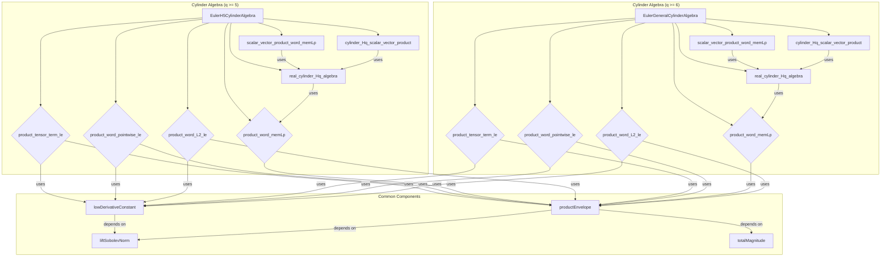
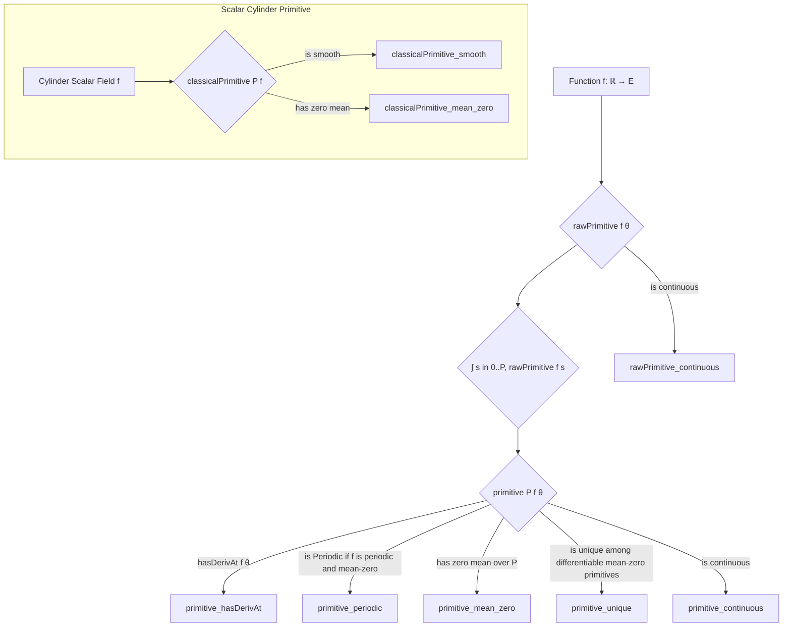

<!-- source: DeepWiki mcp.deepwiki.com · repo openai/NavierStokesAndEuler · extra page Cylinder Algebras, Means, and Angular Primitives · fetched 2026-10-26 -->

# Cylinder Algebras, Means, and Angular Primitives

<details>
<summary>Relevant source files</summary>

The following files were used as context for generating this wiki page:

- [Euler/AngleMeanZeroPrimitive.lean](Euler/AngleMeanZeroPrimitive.lean)
- [Euler/AnglePrimitiveBounds.lean](Euler/AnglePrimitiveBounds.lean)
- [Euler/AnglePrimitiveKernel.lean](Euler/AnglePrimitiveKernel.lean)
- [Euler/AnglePrimitiveMap.lean](Euler/AnglePrimitiveMap.lean)
- [Euler/AnglePrimitiveParity.lean](Euler/AnglePrimitiveParity.lean)
- [Euler/AnglePrimitiveSpatialRegularity.lean](Euler/AnglePrimitiveSpatialRegularity.lean)
- [Euler/AnglePrimitiveTranslation.lean](Euler/AnglePrimitiveTranslation.lean)
- [Euler/CylinderAngleAverageTime.lean](Euler/CylinderAngleAverageTime.lean)
- [Euler/CylinderAngleEvolution.lean](Euler/CylinderAngleEvolution.lean)
- [Euler/CylinderCorrectorMeanZero.lean](Euler/CylinderCorrectorMeanZero.lean)
- [Euler/CylinderEndpointSupport.lean](Euler/CylinderEndpointSupport.lean)
- [Euler/CylinderPhysicalTensor.lean](Euler/CylinderPhysicalTensor.lean)
- [Euler/CylinderPhysicalTensorDifference.lean](Euler/CylinderPhysicalTensorDifference.lean)
- [Euler/CylinderPhysicalTensorLp.lean](Euler/CylinderPhysicalTensorLp.lean)
- [Euler/CylinderPotentialWeight.lean](Euler/CylinderPotentialWeight.lean)
- [Euler/CylinderRetractRepresentative.lean](Euler/CylinderRetractRepresentative.lean)
- [Euler/CylinderScalarClassical.lean](Euler/CylinderScalarClassical.lean)
- [Euler/CylinderScalarParity.lean](Euler/CylinderScalarParity.lean)
- [Euler/CylinderScalarRepresentative.lean](Euler/CylinderScalarRepresentative.lean)
- [Euler/CylinderScalarTime.lean](Euler/CylinderScalarTime.lean)
- [Euler/CylinderSlowCurl.lean](Euler/CylinderSlowCurl.lean)
- [Euler/CylinderSlowCurlBounds.lean](Euler/CylinderSlowCurlBounds.lean)
- [Euler/CylinderSlowCurlTime.lean](Euler/CylinderSlowCurlTime.lean)
- [Euler/CylinderSlowCurlWeight.lean](Euler/CylinderSlowCurlWeight.lean)
- [Euler/CylinderSpatialMeanTime.lean](Euler/CylinderSpatialMeanTime.lean)
- [Euler/CylinderTimeRegularity.lean](Euler/CylinderTimeRegularity.lean)
- [Euler/FieldTowerCanonicalGraph.lean](Euler/FieldTowerCanonicalGraph.lean)
- [Euler/FieldTowerPhysicalContinuity.lean](Euler/FieldTowerPhysicalContinuity.lean)
- [Euler/FieldTowerPhysicalL2.lean](Euler/FieldTowerPhysicalL2.lean)
- [Euler/FieldTowerRepresentative.lean](Euler/FieldTowerRepresentative.lean)
- [Euler/FieldTowerVolumeSobolev.lean](Euler/FieldTowerVolumeSobolev.lean)
- [Euler/GeneralCylinderAlgebra.lean](Euler/GeneralCylinderAlgebra.lean)
- [Euler/GeneralRealCylinderAlgebra.lean](Euler/GeneralRealCylinderAlgebra.lean)
- [Euler/H5CylinderAlgebra.lean](Euler/H5CylinderAlgebra.lean)
- [Euler/H5RealCylinderAlgebra.lean](Euler/H5RealCylinderAlgebra.lean)
- [Euler/MeanPacketAngularForcing.lean](Euler/MeanPacketAngularForcing.lean)
- [Euler/MeanPacketContract.lean](Euler/MeanPacketContract.lean)
- [Euler/MeanPacketInitialZero.lean](Euler/MeanPacketInitialZero.lean)
- [Euler/MeanPathSpatialRepresentative.lean](Euler/MeanPathSpatialRepresentative.lean)
- [Euler/PacketCylinderFieldAverage.lean](Euler/PacketCylinderFieldAverage.lean)
- [Euler/PacketCylinderFieldWeight.lean](Euler/PacketCylinderFieldWeight.lean)
- [Euler/PacketPhysicalFieldTower.lean](Euler/PacketPhysicalFieldTower.lean)
- [Euler/SourceCylinderMeanZero.lean](Euler/SourceCylinderMeanZero.lean)

</details>


This page details the algebraic structures and analytical tools used for functions defined on the cylinder domain. It covers Sobolev algebras, particularly H5 and H6, for product estimates, the construction of angle-mean-zero primitives, the representation of spatial means, and the handling of physical tensor fields in Lp spaces. These concepts are fundamental for establishing regularity and bounds for solutions to the Euler and Navier-Stokes equations on the cylinder.

## H5/H6 and General Cylinder Algebras

The codebase defines Sobolev algebras on the cylinder, specifically focusing on $H^5$ and $H^6$ spaces. These algebras provide crucial product estimates for functions defined on the `LiftDomain` (a lifted representation of the cylinder). The core idea is to bound the Sobolev norm of a product of two functions by the product of their individual Sobolev norms, scaled by an `algebraConstant`.

The `EulerGeneralCylinderAlgebra` namespace [Euler/GeneralCylinderAlgebra.lean:7-11]() defines the general cylinder algebra for $q \ge 6$.
The `EulerH5CylinderAlgebra` namespace [Euler/H5CylinderAlgebra.lean:8-11]() extends this to $q \ge 5$.

A key component is the `lowDerivativeConstant` [Euler/GeneralCylinderAlgebra.lean:16-16]() which is used in bounding individual terms in the Leibniz rule for derivatives of products. This constant depends on the period of the cylinder and the Sobolev order `q`.

The `productEnvelope` [Euler/GeneralCylinderAlgebra:84-86]() function defines a pointwise envelope for product derivatives, which is used to establish L² bounds for product derivatives. It combines the Sobolev norm of one function with the `totalMagnitude` of the other.

The main theorems in these algebras are:
*   `product_tensor_term_le`: Bounds individual terms in the Leibniz rule for Fréchet derivatives [Euler/H5CylinderAlgebra.lean:16-41](), [Euler/GeneralCylinderAlgebra.lean:94-118](). This theorem states that for a product derivative of order `n`, one factor must have at least three "spare" derivatives (i.e., its derivative order plus 3 is less than or equal to `q`) to ensure a pointwise bound.
*   `product_word_pointwise_le`: Provides a pointwise bound for any derivative word of a product [Euler/H5CylinderAlgebra.lean:45-82]().
*   `product_word_memLp`: Proves that every derivative word of a product belongs to L² [Euler/H5CylinderAlgebra.lean:85-99]().
*   `product_word_L2_le`: Gives an explicit L² bound for product derivatives [Euler/H5CylinderAlgebra.lean:102-117]().
*   `real_cylinder_Hq_algebra`: The main algebra estimate for real-valued functions, showing that the Sobolev norm of a product is bounded by the product of individual Sobolev norms [Euler/H5RealCylinderAlgebra.lean:16-34](), [Euler/GeneralRealCylinderAlgebra.lean:17-34]().
*   `scalar_vector_product_word_memLp`: Ensures that scalar-vector product derivatives are in L² [Euler/H5RealCylinderAlgebra.lean:58-77](), [Euler/GeneralRealCylinderAlgebra.lean:58-77]().
*   `cylinder_Hq_scalar_vector_product`: Provides a Sobolev norm bound for scalar-vector products [Euler/H5RealCylinderAlgebra.lean:79-108](), [Euler/GeneralRealCylinderAlgebra.lean:79-108]().


**Diagram: Cylinder Algebra Structure**
Sources: [Euler/H5CylinderAlgebra.lean:16-117](), [Euler/GeneralCylinderAlgebra.lean:16-118](), [Euler/H5RealCylinderAlgebra.lean:16-108](), [Euler/GeneralRealCylinderAlgebra.lean:17-108]()

## Angle-Mean-Zero Primitives

The `EulerAngleMeanZeroPrimitive` namespace [Euler/AngleMeanZeroPrimitive.lean:14-17]() defines the construction of an angular primitive with a zero mean over one period. This is crucial for handling periodic functions on the cylinder where the mean component needs to be isolated or removed.

The `rawPrimitive` [Euler/AngleMeanZeroPrimitive.lean:22-22]() is the basic integral of a function `f` from `0` to `θ`.
The `primitive` [Euler/AngleMeanZeroPrimitive.lean:25-26]() then subtracts the mean of the `rawPrimitive` over one period `P` to ensure a zero mean.

Key properties include:
*   `rawPrimitive_hasDerivAt` and `primitive_hasDerivAt`: Show that the derivative of both the raw and mean-zero primitive is the original function `f` [Euler/AngleMeanZeroPrimitive.lean:29-31](), [Euler/AngleMeanZeroPrimitive.lean:39-41]().
*   `rawPrimitive_periodic` and `primitive_periodic`: Demonstrate that if the original function `f` is periodic and has zero mean, then the raw primitive is periodic, and the mean-zero primitive is genuinely periodic [Euler/AngleMeanZeroPrimitive.lean:50-58](), [Euler/AngleMeanZeroPrimitive.lean:60-65]().
*   `primitive_mean_zero`: Confirms that the `primitive` indeed has a zero integral over one period [Euler/AngleMeanZeroPrimitive.lean:68-74]().
*   `primitive_unique`: Establishes the uniqueness of the zero-mean angular primitive among differentiable primitives [Euler/AngleMeanZeroPrimitive.lean:76-99]().

The `EulerCylinderScalarPrimitive` namespace [Euler/CylinderScalarClassical.lean:8-10]() applies this concept to scalar fields on the cylinder.
*   `classicalPrimitive`: Defines the normalized integral descended to the actual periodic cylinder [Euler/CylinderScalarClassical.lean:22-26]().
*   `classicalPrimitive_smooth`: Proves that the actual normalized integral is smooth in all cylinder variables [Euler/CylinderScalarClassical.lean:53-71]().
*   `classicalPrimitive_mean_zero`: Confirms the zero mean property for the `classicalPrimitive` [Euler/CylinderScalarClassical.lean:47-50]().


**Diagram: Angular Primitive Construction and Properties**
Sources: [Euler/AngleMeanZeroPrimitive.lean:22-99](), [Euler/CylinderScalarClassical.lean:22-71]()

## Spatial Mean Representatives

The concept of spatial mean representatives is crucial for handling functions on the cylinder. The `EulerCylinderRetractRepresentative` namespace [Euler/CylinderRetractRepresentative.lean:15-17]() provides tools to obtain actual pointwise representatives for coordinate spaces embedded in `Space`. This is particularly relevant for the two-dimensional reference plane.

*   `pointField`: Defines a pointwise representative of a `CylinderL2` path `p` by applying a retraction `L` to the result of `EulerCylinderSmoothOrbit.pointField` [Euler/CylinderRetractRepresentative.lean:27-28](). This effectively projects the Sobolev path onto a specific coordinate space.
*   `pointField_joint_continuous`: Shows that this `pointField` is jointly continuous in time and cylinder position [Euler/CylinderRetractRepresentative.lean:30-32]().
*   `pointField_smooth`: Proves that each time slice of the `pointField` is smooth in all spatial and angular variables [Euler/CylinderRetractRepresentative.lean:34-36]().
*   `pointField_ae`: States that the `pointField` is almost everywhere equal to the original `CylinderL2` path `p` [Euler/CylinderRetractRepresentative.lean:47-51]().
*   `pointField_eq`: Provides a condition under which the `pointField` is exactly equal to a continuous function `f` [Euler/CylinderRetractRepresentative.lean:53-56]().
*   `pointPath_hasDerivWithinAt`: Connects the time derivative of the `pointPath` to the `pointPath` of the derivative, ensuring consistency in time regularity [Euler/CylinderRetractRepresentative.lean:72-83]().

The `EulerCylinderSmoothOrbit` namespace [Euler/CylinderTimeRegularity.lean:22-24]() provides the underlying mechanism for constructing genuine representatives from continuous mixed-orbit paths.
*   `pointField`: The core definition of the genuine representative obtained by bounded H3 point evaluation [Euler/CylinderTimeRegularity.lean:28-31]().
*   `pointField_joint_continuous`: The reconstructed field is jointly continuous in time and cylinder position [Euler/CylinderTimeRegularity.lean:33-35]().
*   `pointField_eq_representative`: The bounded point evaluation is exactly the smooth representative of each actual L² slice [Euler/CylinderTimeRegularity.lean:37-41]().
*   `pointField_smooth`: Every time slice is genuinely smooth in all three spatial and the angular variable [Euler/CylinderTimeRegularity.lean:43-47]().
*   `pointField_ae`: The reconstructed field represents the original L² slice [Euler/CylinderTimeRegularity.lean:49-52]().
*   `sobolevPath_hasDerivWithinAt`: The time equation is actual in each complete Sobolev space, by injectivity of its L² inclusion [Euler/CylinderTimeRegularity.lean:70-82]().
*   `pointField_hasDerivWithinAt`: The pointwise PDE time derivative holds within the closed interval at every cylinder point [Euler/CylinderTimeRegularity.lean:85-89]().

```mermaid
graph TD
    subgraph "Cylinder Smooth Orbit"
        A[C(K,LiftL2 period) p] --> B{pathTranslate period a p}
        B --> C[sobolevPath period 3 p hp]
        C --> D[EulerSobolevPointEvaluation.pointEvaluation period x]
        D --> E[pointField period p hp t x]
        E -- "is jointly continuous" --> F[pointField_joint_continuous]
        E -- "is smooth in spatial/angular variables" --> G[pointField_smooth]
        E -- "is ae equal to p t" --> H[pointField_ae]
        E -- "time derivative" --> I[pointField_hasDerivWithinAt]
    end

    subgraph "Cylinder Retract Representative"
        J[C(K,CylinderL2 P U) p] --> K[pathMap P J p]
        K --> L[EulerCylinderSmoothOrbit.pointField]
        L --> M[L (EulerCylinderSmoothOrbit.pointField ...)]
        M --> N[pointField P J L p hp t x]
        N -- "is jointly continuous" --> O[pointField_joint_continuous]
        N -- "is smooth" --> P[pointField_smooth]
        N -- "is ae equal to p t" --> Q[pointField_ae]
        N -- "time derivative" --> R[pointPath_hasDerivWithinAt]
    end

    J -- uses --> A
    K -- uses --> B
    L -- uses --> E
```
**Diagram: Spatial Mean Representative Construction**
Sources: [Euler/CylinderRetractRepresentative.lean:27-83](), [Euler/CylinderTimeRegularity.lean:28-89]()

## Slow-Curl and Potential Weights

The codebase includes definitions and bounds related to the "slow curl" and potential weights, which are important for analyzing the structure of vector fields on the cylinder.

The `EulerCylinderSlowCurl` namespace [Euler/CylinderSlowCurlBounds.lean:8-13]() defines the literal slow curl as a continuous cylinder L² path.
*   `path_block_bound`: This theorem provides a bound for the block norm of the slow curl path, indicating how spatial derivatives consume shifts and how the external radius remains unchanged [Euler/CylinderSlowCurlBounds.lean:40-72](). This is crucial for controlling the growth of norms under the slow curl operation.

The `EulerCylinderPotentialWeight` namespace (not fully shown, but referenced) likely deals with the weights associated with potential fields, which are often used in Helmholtz decompositions or for constructing divergence-free fields.

## Physical Tensor Lp

The `EulerCylinderPhysicalTensor` namespace [Euler/CylinderPhysicalTensor.lean:8-12]() deals with the L² properties of derivative tensors of the actual graph field. These tensors are important for analyzing the regularity of physical fields after a coordinate transformation (e.g., `cylinderGraph`).

*   `graphWord_memLp`: Proves that any derivative word of a function composed with `cylinderGraph` belongs to L² [Euler/CylinderPhysicalTensor.lean:24-25]().
*   `physicalTensor_memLp`: Shows that the iterated Fréchet derivative of the `physicalField` (which involves `cylinderGraph`) is in L² [Euler/CylinderPhysicalTensor.lean:27-40]().
*   `physicalTensorLp`: Defines the L² space for these physical tensors [Euler/CylinderPhysicalTensor.lean:42-43]().
*   `physicalTensorLp_norm_le`: Provides an explicit bound for the L² norm of the `physicalTensorLp`, showing its dependence on `frequencyFactor` and the norms of the individual derivative words [Euler/CylinderPhysicalTensor.lean:49-89]().

The `EulerVolumeSobolevPath` namespace [Euler/FieldTowerVolumeSobolev.lean:8-12]() and `EulerAllOrderCorrectionData.FieldTower` namespace [Euler/FieldTowerVolumeSobolev.lean:49-53]() extend this to field towers under volume-preserving changes of coordinates.
*   `volumePointField`: Defines a point field after a volume-preserving coordinate transformation `Y` [Euler/FieldTowerVolumeSobolev.lean:64-65]().
*   `volumeTensorPath`: Defines the corresponding tensor path in L² [Euler/FieldTowerVolumeSobolev.lean:67-69]().
*   `volumeTensorPath_norm_le`: Provides a bound for the norm of this `volumeTensorPath`, showing how the Sobolev regularity is retained after the coordinate change [Euler/FieldTowerVolumeSobolev.lean:82-90]().

```mermaid
graph TD
    subgraph "Physical Tensor L2"
        A[f: LiftDomain P → Vector3] --> B{cylinderGraph P k m x}
        B --> C{iteratedFieldDerivative P w f (cylinderGraph P k m x)}
        C -- "is in L2" --> D[graphWord_memLp]
        A --> E{physicalField P k m f}
        E --> F{iteratedFDeriv ℝ n (physicalField P k m f)}
        F -- "is in L2" --> G[physicalTensor_memLp]
        G --> H[physicalTensorLp]
        H -- "norm bounded by frequencyFactor" --> I[physicalTensorLp_norm_le]
    end

    subgraph "Volume Sobolev Path"
        J[Y: C(K,C(Vector3,Vector3))] --> K{volumePointField t}
        K --> L{iteratedFDeriv ℝ n (volumePointField t)}
        L --> M[volumeTensorPath]
        M -- "norm bounded by D^n * sum of u norms" --> N[volumeTensorPath_norm_le]
    end
```
**Diagram: Physical Tensor L² and Volume Sobolev Path**
Sources: [Euler/CylinderPhysicalTensor.lean:24-89](), [Euler/FieldTowerVolumeSobolev.lean:64-90]()

---

