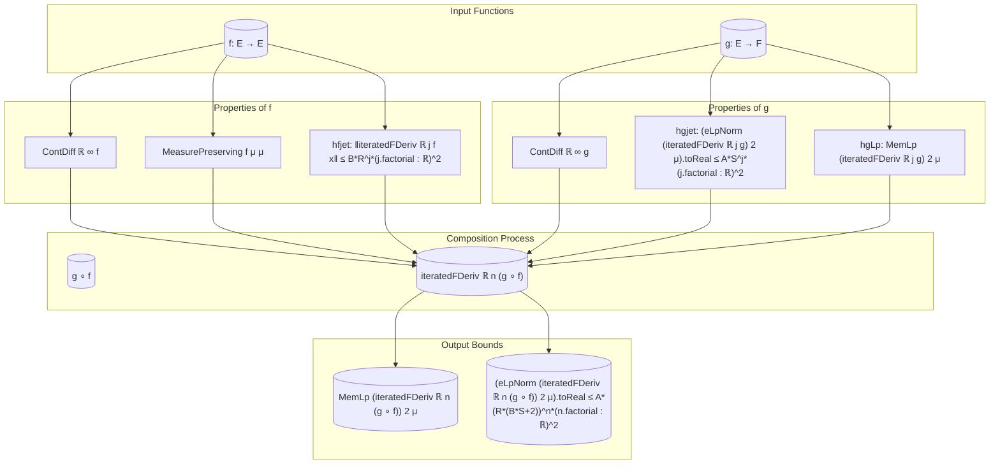

<!-- source: DeepWiki mcp.deepwiki.com · repo openai/NavierStokesAndEuler · extra page Gevrey Calculus and Operator Composition · fetched 2026-10-26 -->

# Gevrey Calculus and Operator Composition

<details>
<summary>Relevant source files</summary>

The following files were used as context for generating this wiki page:

- [Euler/BoundedFieldForwardGenerator.lean](Euler/BoundedFieldForwardGenerator.lean)
- [Euler/BoundedFieldGramGevrey.lean](Euler/BoundedFieldGramGevrey.lean)
- [Euler/ContinuousAccelerationForcing.lean](Euler/ContinuousAccelerationForcing.lean)
- [Euler/ContinuousGramGevrey.lean](Euler/ContinuousGramGevrey.lean)
- [Euler/CylinderGraphGevrey.lean](Euler/CylinderGraphGevrey.lean)
- [Euler/CylinderJetGraphTrace.lean](Euler/CylinderJetGraphTrace.lean)
- [Euler/GevreyCompactProduct.lean](Euler/GevreyCompactProduct.lean)
- [Euler/GevreyCompositionLp.lean](Euler/GevreyCompositionLp.lean)
- [Euler/GevreyJetCompositionLp.lean](Euler/GevreyJetCompositionLp.lean)
- [Euler/GevreyProductLp.lean](Euler/GevreyProductLp.lean)
- [Euler/LpSmoothCoefficientProduct.lean](Euler/LpSmoothCoefficientProduct.lean)
- [Euler/OperatorGevreyCalculus.lean](Euler/OperatorGevreyCalculus.lean)
- [Euler/PacketTerminalDatumBounds.lean](Euler/PacketTerminalDatumBounds.lean)
- [Euler/SmoothCylinderAccelerationComposition.lean](Euler/SmoothCylinderAccelerationComposition.lean)
- [Euler/SmoothCylinderAccelerationLp.lean](Euler/SmoothCylinderAccelerationLp.lean)
- [Euler/SmoothL2GevreyCalculus.lean](Euler/SmoothL2GevreyCalculus.lean)
- [Euler/TimeLpAccelerationForcing.lean](Euler/TimeLpAccelerationForcing.lean)
- [Euler/TransverseForwardCoefficientGevrey.lean](Euler/TransverseForwardCoefficientGevrey.lean)
- [Euler/VolumeSobolevComposition.lean](Euler/VolumeSobolevComposition.lean)

</details>


This page details the application of Gevrey regularity in the context of operator composition and product estimates within $L^p$ spaces. It covers the Gevrey calculus for operators, volume Sobolev composition, and bounds for Gram-inverse Gevrey/Sobolev blocks. The core idea is to quantify the regularity of composed or multiplied functions and operators, particularly how Gevrey norms (which involve factorial growth of derivatives) behave under these operations. This is crucial for establishing precise bounds on the solutions of PDEs, especially in the context of finite-time breakdown analysis.

## Gevrey Composition and Product Estimates in $L^p$

The codebase extensively uses Gevrey regularity, characterized by bounds on iterated Fréchet derivatives that grow factorially. When composing or multiplying functions, these factorial bounds need to be carefully tracked.

### Gevrey Composition in $L^p$

The `EulerGevreyCompositionLp` namespace [Euler/GevreyCompositionLp.lean]() provides theorems for Gevrey composition in $L^p$ spaces. The key idea is to bound the $L^p$ norm of the iterated Fréchet derivative of a composed function `g ∘ f`.

The `composition_memLp_and_bound` theorem [Euler/GevreyCompositionLp.lean:57-130]() is central here. It states that if `f` is a `ContDiff ℝ ∞` function that preserves measure (`MeasurePreserving f μ μ`), and `g` is also `ContDiff ℝ ∞`, then the $L^p$ norm of the $n$-th iterated derivative of `g ∘ f` can be bounded.

**Theorem: `composition_memLp_and_bound`**
Given:
* A measure space `E` with measure `μ`.
* Functions `f : E → E` and `g : E → F`.
* `hf : ContDiff ℝ ∞ f`, `hg : ContDiff ℝ ∞ g`.
* `hmp : MeasurePreserving f μ μ` (f preserves the measure).
* `n : ℕ` (order of derivative).
* `hfg : AEStronglyMeasurable (iteratedFDeriv ℝ n (g ∘ f)) μ`.
* Constants `A, B, R, S : ℝ` with non-negativity conditions.
* `hgLp : ∀ j ≤ n, MemLp (iteratedFDeriv ℝ j g) 2 μ` (g's derivatives are in $L^2$).
* `hgjet : ∀ j ≤ n, (eLpNorm (iteratedFDeriv ℝ j g) 2 μ).toReal ≤ A*S^j*(j.factorial : ℝ)^2` (Gevrey bound for g's derivatives in $L^2$).
* `hfjet : ∀ j, 0 < j → j ≤ n → ∀ x, ‖iteratedFDeriv ℝ j f x‖ ≤ B*R^j*(j.factorial : ℝ)^2` (Gevrey bound for f's derivatives in sup norm).

Then:
`MemLp (iteratedFDeriv ℝ n (g ∘ f)) 2 μ` and
`(eLpNorm (iteratedFDeriv ℝ n (g ∘ f)) 2 μ).toReal ≤ A*(R*(B*S+2))^n*(n.factorial : ℝ)^2`.

This theorem shows that the Gevrey regularity is preserved under composition, with the radius and amplitude constants combining in a specific way. The `innerPartitionBound` [Euler/GevreyCompositionLp.lean:22-24]() and `composition_partition_bound` [Euler/GevreyCompositionLp.lean:35-51]() lemmas are used to break down the iterated derivative of the composition into a sum over ordered finite partitions, where each term is bounded by products of derivatives of `f` and `g`.

The `EulerGevreyJetCompositionLp` namespace [Euler/GevreyJetCompositionLp.lean]() extends this to compositions of formal multilinear series (jets), which are used to represent derivatives. The `composition_memLp_and_bound` theorem [Euler/GevreyJetCompositionLp.lean:39-106]() in this file is analogous, but works with `FormalMultilinearSeries` objects, allowing for more abstract jet calculus.

#### Diagram: Gevrey Composition in $L^p$


Sources: [Euler/GevreyCompositionLp.lean:57-130]()

### Gevrey Product Estimates in $L^p$

The `EulerGevreyProductLp` namespace (not fully shown, but imported by [Euler/SmoothL2GevreyCalculus.lean:3]()) provides theorems for products of functions in $L^p$. The `SmoothL2Field.productField` definition [Euler/SmoothL2GevreyCalculus.lean:110-119]() and `productField_bound` theorem [Euler/SmoothL2GevreyCalculus.lean:123-134]() demonstrate how Gevrey bounds are maintained for products of a `SmoothL2Field` with a `ContinuousLinearMap`-valued function.

The `productField_bound` theorem states that if `g : Space → V →L[ℝ] W` has `HasSupBound g B R` (Gevrey bound in sup norm) and `A : SmoothL2Field V` has `HasJetBound C R` (Gevrey bound in $L^2$ norm), then their product `(fun x => g x (A.field x))` forms a `SmoothL2Field W` with a Gevrey bound `(3*B*C) R`. This shows a multiplicative increase in the amplitude constant `3*B*C` while preserving the radius `R`.

## Operator Gevrey Calculus

The `EulerOperatorGevreyCalculus` namespace [Euler/OperatorGevreyCalculus.lean]() provides fundamental theorems for Gevrey bounds on various operator operations, such as linear maps, bilinear maps, and compositions of continuous linear maps. These theorems are crucial for propagating Gevrey regularity through complex operator expressions.

Key theorems include:
* `const_bound` [Euler/OperatorGevreyCalculus.lean:33-42](): A constant field has an order-zero Gevrey bound.
* `linear_bound` [Euler/OperatorGevreyCalculus.lean:45-51](): Bounded linear maps preserve Gevrey bounds.
* `contraction_bound` [Euler/OperatorGevreyCalculus.lean:54-62](): A linear contraction does not enlarge the Gevrey multiplier constant.
* `bilinear_bound` [Euler/OperatorGevreyCalculus.lean:65-79](): Provides a shifted product bound for bilinear contractions, resulting in an amplitude constant `3*A*C` and a sum of shift orders `d+e`.
* `clm_apply_bound` [Euler/OperatorGevreyCalculus.lean:81-91](): Bounds the Gevrey norm of applying a continuous linear map (CLM) to a field, effectively a product. This uses `bilinear_bound`.
* `clm_comp_bound` [Euler/OperatorGevreyCalculus.lean:93-102](): Bounds the Gevrey norm of composing two CLMs, also using `bilinear_bound`.
* `add_bound` [Euler/OperatorGevreyCalculus.lean:104-112]() and `sub_bound` [Euler/OperatorGevreyCalculus.lean:114-124](): Adding or subtracting Gevrey-bounded functions adds their amplitude constants.

These theorems form the building blocks for analyzing the Gevrey regularity of more complex expressions involving operators.

#### Diagram: Operator Gevrey Calculus

```mermaid
graph TD
    subgraph "Gevrey Bounded Inputs"
        F[("f: P → E")]
        G[("g: P → F")]
        A[("A: P → E →L[ℝ] F")]
        B[("B: P → E →L[ℝ] F")]
        L[("L: E →L[ℝ] F")]
        BL[("Bilinear Map: E →L[ℝ] F →L[ℝ] G")]
    end

    subgraph "Gevrey Operations"
        Op1["`linear_bound` (L ∘ f)"]
        Op2["`contraction_bound` (L ∘ f)"]
        Op3["`bilinear_bound` (BL(f, g))"]
        Op4["`clm_apply_bound` (A(u))"]
        Op5["`clm_comp_bound` (A ∘ B)"]
        Op6["`add_bound` (f + g)"]
        Op7["`sub_bound` (f - g)"]
    end

    subgraph "Gevrey Bounded Outputs"
        Out1["‖iteratedFDeriv ℝ n (L ∘ f) x‖ ≤ (‖L‖*A) * majorant R d n"]
        Out2["‖iteratedFDeriv ℝ n (L ∘ f) x‖ ≤ A * majorant R d n (if ‖L‖ ≤ 1)"]
        Out3["‖iteratedFDeriv ℝ n (BL(f, g)) x‖ ≤ (3*A*C) * majorant R (d+e) n"]
        Out4["‖iteratedFDeriv ℝ n (A(u)) x‖ ≤ (3*C*D) * majorant R (d+e) n"]
        Out5["‖iteratedFDeriv ℝ n (A ∘ B) x‖ ≤ (3*C*D) * majorant R (d+e) n"]
        Out6["‖iteratedFDeriv ℝ n (f + g) x‖ ≤ (A+B) * majorant R d n"]
        Out7["‖iteratedFDeriv ℝ n (f - g) x‖ ≤ (A+B) * majorant R d n"]
    end

    L -- Gevrey bound (A, R, d) --> Op1;
    F -- Gevrey bound (A, R, d) --> Op1;
    Op1 --> Out1;

    L -- Gevrey bound (A, R, d), ‖L‖ ≤ 1 --> Op2;
    F -- Gevrey bound (A, R, d) --> Op2;
    Op2 --> Out2;

    BL -- Gevrey bound (A, R, d), (C, R, e) --> Op3;
    F -- Gevrey bound (A, R, d) --> Op3;
    G -- Gevrey bound (C, R, e) --> Op3;
    Op3 --> Out3;

    A -- Gevrey bound (C, R, d) --> Op4;
    G -- Gevrey bound (D, R, e) --> Op4;
    Op4 --> Out4;

    A -- Gevrey bound (C, R, d) --> Op5;
    B -- Gevrey bound (D, R, e) --> Op5;
    Op5 --> Out5;

    F -- Gevrey bound (A, R, d) --> Op6;
    G -- Gevrey bound (B, R, d) --> Op6;
    Op6 --> Out6;

    F -- Gevrey bound (A, R, d) --> Op7;
    G -- Gevrey bound (B, R, d) --> Op7;
    Op7 --> Out7;
```
Sources: [Euler/OperatorGevreyCalculus.lean:33-124]()

## Volume Sobolev Composition

The `EulerVolumeSobolevComposition` namespace [Euler/VolumeSobolevComposition.lean]() focuses on the Sobolev integrability of composed functions when the inner function is volume-preserving. This is particularly relevant for transformations that maintain the "volume" of the domain, which is common in fluid dynamics.

The `compositionTensor_pointwise` theorem [Euler/VolumeSobolevComposition.lean:19-29]() provides a pointwise bound for the iterated derivative of `g ∘ f`.
The `compositionTensor_memLp` theorem [Euler/VolumeSobolevComposition.lean:40-51]() then establishes that if `f` is `MeasurePreserving` and `g`'s derivatives are in $L^2$, then the composed derivative is also in $L^2$.
Finally, `compositionTensorLp_norm_le` [Euler/VolumeSobolevComposition.lean:57-96]() gives an explicit bound on the $L^2$ norm of the composed derivative, showing how the constants `D` (from `f`) and the $L^2$ norms of `g`'s derivatives combine.

This is a crucial result for understanding how Sobolev regularity (which is an $L^p$ based regularity) behaves under volume-preserving coordinate changes.

## Gram-Inverse Gevrey/Sobolev Block Bounds

The Gram inverse plays a significant role in solving linear systems arising from the PDE. The codebase provides Gevrey bounds for the Gram inverse itself and for related operators.

### Continuous Gram Inverse

The `EulerContinuousGramGevrey` namespace [Euler/ContinuousGramGevrey.lean]() deals with the Gevrey regularity of the continuous Gram inverse.
The `inversePath_gevrey` theorem [Euler/ContinuousGramGevrey.lean:75-121]() states that the actual continuous inverse path has a one-factorial shift in its Gevrey bound. This means if the input `Q` has a Gevrey bound with shift `0`, the inverse `V` will have a Gevrey bound with shift `1`.

**Theorem: `inversePath_gevrey`**
Given:
* `Q : P → C(Icc (0 : ℝ) T,U →L[ℝ] E)` (a path of operators).
* `c : ℝ`, `hc : 0 < c` (coercivity constant).
* `hLower : ∀ x t v, c*‖v‖^2 ≤ ‖Q x t v‖^2` (coercivity condition).
* `hQ : ContDiff ℝ ∞ Q`.
* `Rc, C : ℝ` (Gevrey radius and amplitude for `Q`).
* `hbQ : ∀ n x, ‖iteratedFDeriv ℝ n Q x‖ ≤ C*majorant Rc 0 n`.
* `R : ℝ`, `hR : 2*gramCost c C 1*(Rc+1) ≤ R` (radius for the inverse).

Then:
`‖iteratedFDeriv ℝ n (fun y => gramInversePath T (Q y) c hc (hLower y)) x‖ ≤ majorant R 1 n`.

This theorem is critical for ensuring that the inverse operator maintains a controlled level of regularity, which is essential for the well-posedness of the solutions. The `solution_gevrey` theorem [Euler/ContinuousGramGevrey.lean:124-143]() extends this to the solution of a linear system involving the Gram operator, showing a similar one-shift in the Gevrey bound.

### Bounded Field Gram Inverse

The `EulerBoundedFieldGramGevrey` namespace [Euler/BoundedFieldGramGevrey.lean]() provides similar Gevrey bounds for the Gram inverse in a bounded-field setting.
The `inversePath_gevrey` theorem [Euler/BoundedFieldGramGevrey.lean:70-122]() here is analogous to the continuous case, providing a one-factorial shift in the Gevrey bound for the inverse path.
The `inversePath_coefficient_bound` theorem [Euler/BoundedFieldGramGevrey.lean:125-131]() further refines this, showing that a fixed coefficient radius can absorb this one-shift.

### Gram-Inverse Block Bounds

The `EulerPacketTerminalDatum` namespace [Euler/PacketTerminalDatum.lean]() uses these Gevrey calculus results to derive bounds for "blocks" of operators, which are crucial for the packet construction in the Euler breakdown proof.
The `terminal_block_bound` theorem [Euler/PacketTerminalDatum.lean:111-118]() bounds the `block` operator (a type of derivative) of a translated terminal field. This bound involves `sobolevCoefficientAmplitude` and `majorant` terms, demonstrating how Gevrey and Sobolev norms are combined.

The `leftInversePath` [Euler/BoundedFieldForwardGenerator.lean:47-49]() and `generatorPath` [Euler/BoundedFieldForwardGenerator.lean:51-54]() definitions represent key operators in the system. Their Gevrey regularity is established by `leftInversePath_contDiff` [Euler/BoundedFieldForwardGenerator.lean:68-71]() and `generatorPath_contDiff` [Euler/BoundedFieldForwardGenerator.lean:73-79](), and their bounds are given by `leftInversePath_bound` [Euler/BoundedFieldForwardGenerator.lean:89-103]() and `generatorPath_bound` [Euler/BoundedFieldForwardGenerator.lean:106-122](). These bounds show how the Gevrey constants propagate through the construction of these operators.

#### Diagram: Gram-Inverse Gevrey Block Bounds

```mermaid
graph TD
    subgraph "Input: Operator Path Q"
        Q_path["Q: P → C(K,α →ᵇ U →L[ℝ] E)"]
        Q_contdiff["ContDiff ℝ ∞ Q"]
        Q_gevrey_bound["‖iteratedFDeriv ℝ n Q x‖ ≤ C*majorant Rc 0 n"]
        Q_coercivity["c*‖v‖^2 ≤ ‖Q y t x v‖^2"]
    end

    subgraph "Gram Inverse Construction"
        GramPath["gramPath (Q y)"]
        InversePath["inversePath c hc (Q y) (hLower y)"]
        LeftInversePath["leftInversePath c hc (Q y) (hQ y)"]
        GeneratorPath["generatorPath c hc (Q y) (Q₁ y) (hQ y)"]
    end

    subgraph "Gevrey Bounds for Inverse"
        InvPath_gevrey["`inversePath_gevrey`: ‖iteratedFDeriv ℝ n InversePath x‖ ≤ majorant R 1 n"]
        InvPath_coeff_bound["`inversePath_coefficient_bound`: ‖iteratedFDeriv ℝ n InversePath x‖ ≤ R*majorant (4*R) 0 n"]
        LeftInvPath_bound["`leftInversePath_bound`: ‖iteratedFDeriv ℝ n LeftInversePath x‖ ≤ (3*Ri*C₀)*majorant (4*Ri) 0 n"]
        GenPath_bound["`generatorPath_bound`: ‖iteratedFDeriv ℝ n GeneratorPath x‖ ≤ (18*Ri*C₀*C₁)*majorant (4*Ri) 0 n"]
    end

    Q_path --> GramPath;
    Q_path & Q_contdiff & Q_coercivity & Q_gevrey_bound --> InversePath;
    InversePath --> InvPath_gevrey;
    InversePath --> InvPath_coeff_bound;

    InversePath & Q_path --> LeftInversePath;
    LeftInversePath --> LeftInvPath_bound;

    LeftInversePath & Q_path & Q_path_Q1["Q₁: P → C(K,α →ᵇ U →L[ℝ] E)"] --> GeneratorPath;
    GeneratorPath --> GenPath_bound;
```
Sources:
- [Euler/ContinuousGramGevrey.lean:75-121]()
- [Euler/BoundedFieldGramGevrey.lean:70-122]()
- [Euler/BoundedFieldGramGevrey.lean:125-131]()
- [Euler/BoundedFieldForwardGenerator.lean:89-103]()
- [Euler/BoundedFieldForwardGenerator.lean:106-122]()

---

