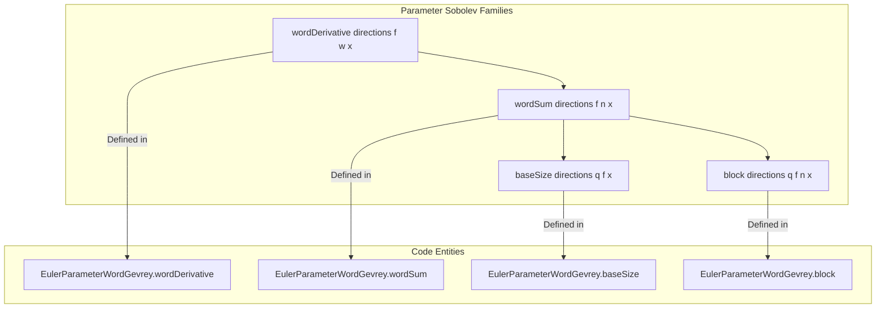
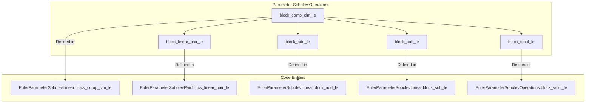
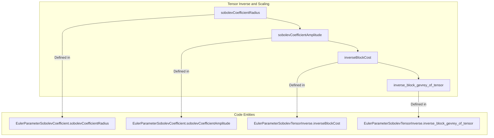
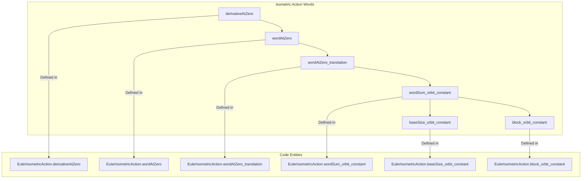
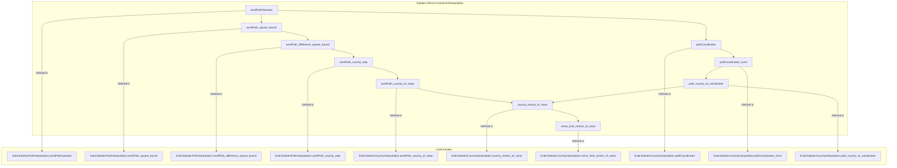

<!-- source: DeepWiki mcp.deepwiki.com · repo openai/NavierStokesAndEuler · extra page Parameter Sobolev and Word Calculus · fetched 2026-10-26 -->

# Parameter Sobolev and Word Calculus

Relevant source files

The following files were used as context for generating this wiki page:

- [Euler/CylinderSobolevWordBounds.lean](Euler/CylinderSobolevWordBounds.lean)
- [Euler/EnergyWordCoordinates.lean](Euler/EnergyWordCoordinates.lean)
- [Euler/IsometricActionWords.lean](Euler/IsometricActionWords.lean)
- [Euler/OrdinaryWordConstraints.lean](Euler/OrdinaryWordConstraints.lean)
- [Euler/OrdinaryWordTime.lean](Euler/OrdinaryWordTime.lean)
- [Euler/ParameterNestedWordSum.lean](Euler/ParameterNestedWordSum.lean)
- [Euler/ParameterSobolevCoefficient.lean](Euler/ParameterSobolevCoefficient.lean)
- [Euler/ParameterSobolevFiniteSum.lean](Euler/ParameterSobolevFiniteSum.lean)
- [Euler/ParameterSobolevGevrey.lean](Euler/ParameterSobolevGevrey.lean)
- [Euler/ParameterSobolevGevreyAt.lean](Euler/ParameterSobolevGevreyAt.lean)
- [Euler/ParameterSobolevLinear.lean](Euler/ParameterSobolevLinear.lean)
- [Euler/ParameterSobolevLocal.lean](Euler/ParameterSobolevLocal.lean)
- [Euler/ParameterSobolevOperations.lean](Euler/ParameterSobolevOperations.lean)
- [Euler/ParameterSobolevPair.lean](Euler/ParameterSobolevPair.lean)
- [Euler/ParameterSobolevProductAt.lean](Euler/ParameterSobolevProductAt.lean)
- [Euler/ParameterSobolevProductGevrey.lean](Euler/ParameterSobolevProductGevrey.lean)
- [Euler/ParameterSobolevScaling.lean](Euler/ParameterSobolevScaling.lean)
- [Euler/ParameterSobolevTensorInverse.lean](Euler/ParameterSobolevTensorInverse.lean)
- [Euler/ParameterWordCalculus.lean](Euler/ParameterWordCalculus.lean)
- [Euler/ParameterWordGevrey.lean](Euler/ParameterWordGevrey.lean)
- [Euler/ParameterWordHigher.lean](Euler/ParameterWordHigher.lean)
- [Euler/ParameterWordInverse.lean](Euler/ParameterWordInverse.lean)
- [Euler/ParameterWordLocal.lean](Euler/ParameterWordLocal.lean)
- [Euler/SobolevCauchyInterpolation.lean](Euler/SobolevCauchyInterpolation.lean)
- [Euler/SobolevPathInterpolation.lean](Euler/SobolevPathInterpolation.lean)
- [Euler/SobolevWordBlockCoordinates.lean](Euler/SobolevWordBlockCoordinates.lean)
- [Euler/SobolevWordConstraints.lean](Euler/SobolevWordConstraints.lean)
- [Euler/SobolevWordLevel.lean](Euler/SobolevWordLevel.lean)
- [Euler/SobolevWordValueIdentity.lean](Euler/SobolevWordValueIdentity.lean)

This page details the `ParameterSobolev*` families, which define various Sobolev-like norms and their calculus in the context of parameter-dependent functions. It covers products, tensor inverse, scaling, and Gevrey-at properties. Additionally, it explains isometric action words, nested word sums, and Sobolev word constraints/interpolation, providing the foundational mathematical tools for analyzing the regularity of solutions in the Euler and Navier-Stokes equations.

## Parameter Sobolev Families

The codebase defines several "Parameter Sobolev" families, which are extensions of standard Sobolev spaces to functions that depend on parameters. These families are crucial for handling the parameter-dependent nature of the fields and operators in the Euler and Navier-Stokes equations.

### `block` and `wordSum`

The core concepts are `block` and `wordSum`, which quantify the regularity of functions with respect to their parameters.

*   `wordDerivative directions f w x`: Represents the iterated Fréchet derivative of a function `f` at point `x` in the directions specified by `w`.
    Sources: [Euler/ParameterWordCalculus.lean:33-35]()
*   `wordSum directions f n x`: Calculates the sum of norms of `wordDerivative` for all possible words `w` of length `n`.
    Sources: [Euler/ParameterWordCalculus.lean:69-72]()
*   `baseSize directions q f x`: Represents a sum of `wordSum` up to order `q`.
    Sources: [Euler/ParameterSobolevBlocks.lean:22-25]()
*   `block directions q f n x`: Represents a sum of `wordSum` up to order `q` for the `n`-th word derivative.
    Sources: [Euler/ParameterSobolevBlocks.lean:28-31]()

These definitions are fundamental for measuring the "smoothness" of parameter-dependent functions in a way that is compatible with Gevrey regularity.

Sources: [Euler/ParameterWordCalculus.lean:25-72](), [Euler/ParameterSobolevBlocks.lean:19-31]()

### Products and Linear Operations

The codebase provides theorems for how these Sobolev-like norms behave under common operations:

*   **Composition with Continuous Linear Maps (`block_comp_clm_le`)**: If `L` is a continuous linear map, then the `block` norm of `L ∘ f` is bounded by `‖L‖` times the `block` norm of `f`.
    Sources: [Euler/ParameterSobolevLinear.lean:20-24]()
*   **Addition (`block_add_le`)**: The `block` norm of `f + g` is bounded by the sum of the `block` norms of `f` and `g`.
    Sources: [Euler/ParameterSobolevLinear.lean:26-30]()
*   **Subtraction (`block_sub_le`)**: Similar to addition, the `block` norm of `f - g` is bounded by the sum of the `block` norms of `f` and `g`.
    Sources: [Euler/ParameterSobolevLinear.lean:32-36]()
*   **Scalar Multiplication (`block_smul_le`)**: The `block` norm of `a • f` is bounded by `|a|` times the `block` norm of `f`.
    Sources: [Euler/ParameterSobolevOperations.lean:17-24]()
*   **Linear Pair (`block_linear_pair_le`)**: For a linear map `L` acting on a pair `(f, g)`, the `block` norm of `L(f, g)` is bounded by a linear combination of the `block` norms of `f` and `g`.
    Sources: [Euler/ParameterSobolevPair.lean:60-77]()

These theorems are essential for propagating regularity estimates through complex expressions involving parameter-dependent functions.

Sources: [Euler/ParameterSobolevLinear.lean:20-36](), [Euler/ParameterSobolevOperations.lean:17-24](), [Euler/ParameterSobolevPair.lean:60-77]()

### Tensor Inverse and Scaling

The `ParameterSobolevTensorInverse.lean` file introduces the concept of a "one-time coefficient absorption for a genuine fixed-Sobolev inverse." This is crucial for handling inverse operators in the context of Gevrey regularity.

*   `sobolevCoefficientRadius ι Rc`: Defines an enlarged radius for coefficients, which depends on the original coefficient radius `Rc` and the cardinality of the index set `ι`.
    Sources: [Euler/ParameterSobolevCoefficient.lean:38-39]()
*   `sobolevCoefficientAmplitude ι q Rc C`: Represents a polynomial in the original coefficient radius and amplitude, with numerical factorial coefficients.
    Sources: [Euler/ParameterSobolevCoefficient.lean:43-44]()
*   `inverseBlockCost ι q I Rc C D`: An explicit polynomial in the inverse, coefficient, and forcing constants, without grade dependence.
    Sources: [Euler/ParameterSobolevTensorInverse.lean:19-21]()
*   `inverse_block_gevrey_of_tensor`: This theorem states that the source radius is chosen once from coefficient data, and each inverse application increases the grade by one without changing that radius.
    Sources: [Euler/ParameterSobolevTensorInverse.lean:30-64]()

This mechanism allows for the absorption of coefficient orders into a single, enlarged radius, simplifying the analysis of Gevrey regularity for inverse problems.

Sources: [Euler/ParameterSobolevCoefficient.lean:38-44](), [Euler/ParameterSobolevTensorInverse.lean:19-64]()

### Gevrey-at Properties

The `ParameterSobolevGevrey.lean` and `ParameterSobolevGevreyAt.lean` files focus on Gevrey regularity, particularly for inverse estimates.

*   `block_inverse_bound`: This theorem provides a fixed Sobolev inverse bound applied to each external word. Its commutator contains only positive external coefficient derivatives, preserving the original factorial radius at every grade.
    Sources: [Euler/ParameterSobolevGevrey.lean:28-57]()
*   `block_inverse_recurrence`: A genuine fixed-Sobolev external-word recurrence with the computed base inverse constant.
    Sources: [Euler/ParameterSobolevGevrey.lean:59-76]()
*   `block_inverse_gevrey`: This theorem demonstrates a factorial shift in fixed Hq, using identical input and output radius and constants independent of the input shift and external order.
    Sources: [Euler/ParameterSobolevGevrey.lean:78-122]()
*   `block_inverse_gevrey_at`: This is a specialized version of `block_inverse_gevrey` where the inverse estimate needs bounds only at its base point `x`. This is particularly useful for frozen Duhamel equations where the base operator is the identity.
    Sources: [Euler/ParameterSobolevGevreyAt.lean:21-64]()

These theorems are critical for establishing Gevrey regularity for solutions of PDEs, especially when dealing with inverse operators or localized estimates.

## Isometric Action Words

The `IsometricActionWords.lean` file defines how word derivatives behave under isometric actions. An isometric action `τ` preserves the norm of elements.

*   `derivativeAtZero τ u v`: Represents the Fréchet derivative of the orbit `a ↦ τ a u` at `0` in direction `v`.
    Sources: [Euler/IsometricActionWords.lean:26-26]()
*   `wordAtZero τ directions u w`: Represents the word derivative of the orbit `a ↦ τ a u` at `0` in the specified directions `w`.
    Sources: [Euler/IsometricActionWords.lean:43-44]()
*   `wordAtZero_translation`: This theorem states that applying the isometric action `τ a` to `wordAtZero τ directions u w` is equivalent to taking the word derivative of the orbit `a ↦ τ a u` at `a`. This means the word derivative of an isometric orbit is the orbit of its derivative at zero.
    Sources: [Euler/IsometricActionWords.lean:63-78]()
*   `wordSum_orbit_constant`: This theorem shows that the `wordSum` of an isometric orbit is constant along the orbit, meaning it is independent of the translation parameter `a`.
    Sources: [Euler/IsometricActionWords.lean:91-99]()
*   `baseSize_orbit_constant` and `block_orbit_constant`: These theorems extend the constancy property to `baseSize` and `block` norms, respectively. They show that these norms are independent of the translation parameter `a` for isometric orbits.
    Sources: [Euler/IsometricActionWords.lean:101-108](), [Euler/IsometricActionWords.lean:110-121]()

These results imply that for isometric actions, the Sobolev-like norms are invariant along the orbit, which simplifies regularity analysis in such contexts.

Sources: [Euler/IsometricActionWords.lean:26-121]()

## Nested Word Sums and Sobolev Word Constraints/Interpolation

The concept of "nested word sums" is implicitly handled through the recursive definitions of `block` and `coefficientBlock`, which sum over different levels of word derivatives.

The `SobolevCauchyInterpolation.lean` and `SobolevPathInterpolation.lean` files deal with Sobolev word constraints and interpolation, particularly in the context of Cauchy sequences and uniform bounds.

*   `wordPathOperator period h w T`: This is a continuous time-path operator that extracts a specific Sobolev derivative coordinate (`word`) from a Sobolev space-valued function `u` over a time interval `[0, T]`.
    Sources: [Euler/SobolevPathInterpolation.lean:54-56]()
*   `wordPath_square_bound`: This theorem provides an interpolation inequality for the `wordPathOperator`. It states that the square of the norm of a higher-order derivative path is bounded by the product of the norm of a lower-order derivative path and the norm of the original function.
    Sources: [Euler/SobolevPathInterpolation.lean:64-81]()
*   `wordPath_difference_square_bound`: This extends the interpolation bound to differences of functions, showing that the difference in higher-order derivative paths is controlled by the difference in lower-order derivative paths, given uniform bounds on the original functions.
    Sources: [Euler/SobolevPathInterpolation.lean:89-100]()
*   `wordPath_cauchy_step`: This is a crucial lemma that uses the `cauchySeq_of_square_bound` and `wordPath_difference_square_bound` to show that if a sequence of Sobolev paths is Cauchy in a lower-order derivative, and uniformly bounded, then it is also Cauchy in a higher-order derivative. This is a step-by-step propagation of Cauchy property.
    Sources: [Euler/SobolevPathInterpolation.lean:102-108]()
*   `wordPath_cauchy_of_value`: This theorem generalizes `wordPath_cauchy_step` to show that if the `valueOperator` (representing the function itself, a 0-th order derivative) is Cauchy, then all higher-order derivative paths up to `s-1` are also Cauchy.
    Sources: [Euler/SobolevCauchyInterpolation.lean:22-37]()
*   `pathCoordinates q T`: This is a continuous linear map that maps a Sobolev path to a collection of all its Sobolev word paths.
    Sources: [Euler/SobolevCauchyInterpolation.lean:41-43]()
*   `pathCoordinates_norm`: This theorem establishes that the `pathCoordinates` map is an isometry, meaning it preserves the full uniform Sobolev norm exactly.
    Sources: [Euler/SobolevCauchyInterpolation.lean:46-57]()
*   `path_cauchy_of_coordinates`: This theorem states that if all individual Sobolev word paths are Cauchy, then the complete Sobolev path itself is Cauchy. This is a consequence of `pathCoordinates` being an isometry.
    Sources: [Euler/SobolevCauchyInterpolation.lean:59-76]()
*   `cauchy_restrict_of_value`: This theorem combines the above results to show that a uniformly bounded Sobolev sequence that is Cauchy in L² (via `valueOperator`) is Cauchy at every strictly lower Sobolev order, uniformly in time.
    Sources: [Euler/SobolevCauchyInterpolation.lean:78-85]()
*   `exists_limit_restrict_of_value`: This theorem leverages the completeness of Sobolev spaces to guarantee the existence of a strong lower-order Sobolev limit from such Cauchy sequences.
    Sources: [Euler/SobolevCauchyInterpolation.lean:87-92]()

These interpolation and Cauchy sequence results are fundamental for proving convergence and existence of solutions in Sobolev spaces, especially when dealing with limits of approximate solutions or establishing compactness properties.

Sources: [Euler/SobolevPathInterpolation.lean:54-108](), [Euler/SobolevCauchyInterpolation.lean:22-92]()

---

