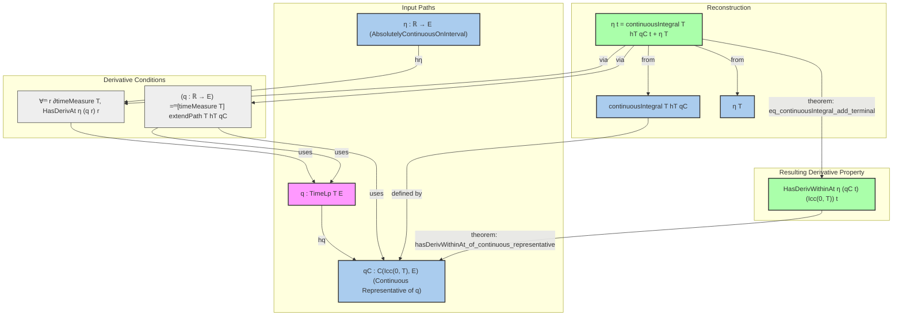

<!-- source: DeepWiki mcp.deepwiki.com · repo openai/NavierStokesAndEuler · extra page Time-Lp Spaces and Time Integration · fetched 2026-10-26 -->

# Time-Lp Spaces and Time Integration

<details>
<summary>Relevant source files</summary>

The following files were used as context for generating this wiki page:

- [Euler/BoundedFieldTimeDerivative.lean](Euler/BoundedFieldTimeDerivative.lean)
- [Euler/ContinuousTimeIntegral.lean](Euler/ContinuousTimeIntegral.lean)
- [Euler/CylinderGraphDerivative.lean](Euler/CylinderGraphDerivative.lean)
- [Euler/InjectivePathDerivative.lean](Euler/InjectivePathDerivative.lean)
- [Euler/InjectivePathDerivativeWithin.lean](Euler/InjectivePathDerivativeWithin.lean)
- [Euler/LpCylinderFullTime.lean](Euler/LpCylinderFullTime.lean)
- [Euler/MeanCoefficientTime.lean](Euler/MeanCoefficientTime.lean)
- [Euler/MeanPathLpBlocks.lean](Euler/MeanPathLpBlocks.lean)
- [Euler/OrdinarySobolevTower.lean](Euler/OrdinarySobolevTower.lean)
- [Euler/OrdinaryStrongTime.lean](Euler/OrdinaryStrongTime.lean)
- [Euler/SeparatingTimeDerivative.lean](Euler/SeparatingTimeDerivative.lean)
- [Euler/TimeForcingRepresentative.lean](Euler/TimeForcingRepresentative.lean)
- [Euler/TimeH1ContinuousDerivative.lean](Euler/TimeH1ContinuousDerivative.lean)
- [Euler/TimeLp.lean](Euler/TimeLp.lean)
- [Euler/TimeLpLinearity.lean](Euler/TimeLpLinearity.lean)
- [Euler/TimeLpMap.lean](Euler/TimeLpMap.lean)
- [Euler/TimeLpMultiplier.lean](Euler/TimeLpMultiplier.lean)
- [Euler/TimeLpObservation.lean](Euler/TimeLpObservation.lean)
- [Euler/TimeLpStrongOperators.lean](Euler/TimeLpStrongOperators.lean)
- [Euler/TimePathApply.lean](Euler/TimePathApply.lean)

</details>


This page details the formalization of time-Lp spaces and related time integration concepts within the Lean 4 codebase. It covers the definition of `TimeLp` spaces, the embedding of continuous paths into these spaces, the construction of continuous time integrals and strong time derivatives, and lemmas related to path derivatives and `H1` reconstruction. The core idea is to bridge classical continuous-time analysis with Bochner-Lp spaces, which are crucial for maximal regularity results.

## Time-Lp Spaces

The `TimeLp` space, defined as `Lp E 2 (timeMeasure T)` [Euler/TimeLp.lean:23](), represents the Bochner L² space of time-dependent values in a normed space `E` over a compact evolution interval `[0, T]`. The `timeMeasure T` is the Lebesgue time measure restricted to this interval [Euler/TimeLp.lean:15]().

### Continuous Path Embedding

Continuous paths can be embedded into `TimeLp` spaces. The `pathLp` function [Euler/TimeLp.lean:35]() takes a continuous function `f : C(Icc (0 : ℝ) T, E)` and returns its representation in `TimeLp T E`. This embedding preserves the L² norm in the sense that the squared norm of `pathLp` is the integral of the squared pointwise norm of the continuous path [Euler/TimeLp.lean:87]().

```lean
/-- The actual Bochner L² space of time-dependent values in a normed space. -/
abbrev TimeLp (T : ℝ) (E : Type*) [NormedAddCommGroup E] := Lp E 2 (timeMeasure T)

/-- A continuous time path represented in the actual Bochner L² space. -/
def pathLp (T : ℝ) (hT : 0 ≤ T) (f : C(Icc (0 : ℝ) T, E)) : TimeLp T E :=
  (path_memLp T hT f).toLp (extendPath T hT f)
```

Sources:
* [Euler/TimeLp.lean:15]()
* [Euler/TimeLp.lean:23]()
* [Euler/TimeLp.lean:35]()
* [Euler/TimeLp.lean:87]()

### Time-Lp Multipliers and Maps

The codebase defines operations that act on `TimeLp` fields.

#### `timeMultiplier`

The `timeMultiplier` [Euler/TimeLpMultiplier.lean:66]() represents a bounded time-dependent linear operator acting on `TimeLp` fields. It takes a continuous path of operators `A : C(Icc (0 : ℝ) T, E →L[ℝ] F)` and a `TimeLp` field `u : TimeLp T E`, producing a `TimeLp` field `TimeLp T F`. This operation is linear [Euler/TimeLpMultiplier.lean:37]() and bounded by the uniform operator-path norm [Euler/TimeLpMultiplier.lean:55]().

```lean
/-- The bounded actual time multiplier on Bochner L² spaces. -/
def timeMultiplier (T : ℝ) (hT : 0 ≤ T) (A : C(Icc (0 : ℝ) T, E →L[ℝ] F)) :
    TimeLp T E →L[ℝ] TimeLp T F :=
  (timeApplyLinear T hT A).mkContinuous ‖A‖ (timeApply_bound T hT A)
```

Sources:
* [Euler/TimeLpMultiplier.lean:37]()
* [Euler/TimeLpMultiplier.lean:55]()
* [Euler/TimeLpMultiplier.lean:66]()

#### `pathLp_map`

The `pathLp_map` theorem [Euler/TimeLpMap.lean:16]() establishes that applying a bounded spatial map `A : E →L[ℝ] F` commutes with the `pathLp` embedding. This means `A.compLpL (pathLp f)` is equivalent to `pathLp (A.compLeftContinuous f)`.

```lean
/-- Applying a bounded spatial map commutes exactly with the genuine L² time embedding. -/
theorem pathLp_map (T : ℝ) (hT : 0 ≤ T) (A : E →L[ℝ] F) (f : C(Icc (0 : ℝ) T, E)) :
    A.compLpL 2 (timeMeasure T) (pathLp T hT f) =
      pathLp T hT (A.compLeftContinuous ℝ (Icc (0 : ℝ) T) f) := by
  -- ...
```

Sources:
* [Euler/TimeLpMap.lean:16]()

#### `timePathApply`

The `timePathApply` function [Euler/TimePathApply.lean:17]() defines the pointwise action of a continuous operator path `A` on a continuous field path `u`. This function is compatible with the `timeMultiplier` via `pathLp_timePathApply` [Euler/TimePathApply.lean:23]().

```lean
/-- The actual pointwise action of a continuous operator path on a continuous field path. -/
def timePathApply (T : ℝ) (A : C(Icc (0 : ℝ) T, E →L[ℝ] F))
    (u : C(Icc (0 : ℝ) T, E)) : C(Icc (0 : ℝ) T, F) :=
  ⟨fun t => A t (u t), A.continuous.clm_apply u.continuous⟩
```

Sources:
* [Euler/TimePathApply.lean:17]()
* [Euler/TimePathApply.lean:23]()

### Time-Lp Observations

The `observation_time_eq` theorem [Euler/TimeLpObservation.lean:25]() is crucial for relating different representations of fields. It states that if a lower-order continuous representative `f` and a higher-order `TimeLp` field `u` agree under a bounded spatial map `A`, then their observations under another map `D` (such that `D ∘ A = W`) will also agree.

```lean
/-- A continuous lower-order representative and an actual higher-order time field have identical bounded observations when the operators agree on restriction. -/
theorem observation_time_eq (T : ℝ) (hT : 0 ≤ T) (A : E →L[ℝ] F) (D : F →L[ℝ] G) (W : E →L[ℝ] G)
    (hDA : ∀ x, D (A x) = W x) (u : TimeLp T E) (f : C(Icc (0 : ℝ) T, F))
    (hf : (fun t => A (u t)) =ᵐ[timeMeasure T] extendPath T hT f) :
    pathLp T hT (D.compLeftContinuous ℝ (Icc (0 : ℝ) T) f) = W.compLpL 2 (timeMeasure T) u := by
  -- ...
```

Sources:
* [Euler/TimeLpObservation.lean:25]()

## Continuous Time Integrals

The `EulerContinuousTimeIntegral` namespace provides tools for defining and working with continuous time integrals.

### `multiplier`

The `multiplier` function [Euler/ContinuousTimeIntegral.lean:38]() defines a bounded linear operator for pointwise multiplication by an operator-valued continuous path `A : C(K, E →L[ℝ] F)`. It ensures that no derivative-dependent loss occurs during continuous path multiplication [Euler/ContinuousTimeIntegral.lean:45]().

```lean
/-- The genuine bounded multiplier on continuous time paths. -/
def multiplier (A : C(K,E →L[ℝ] F)) : C(K,E) →L[ℝ] C(K,F) :=
  (multiplierLinear A).mkContinuous ‖A‖ (multiplierLinear_bound A)
```

Sources:
* [Euler/ContinuousTimeIntegral.lean:38]()
* [Euler/ContinuousTimeIntegral.lean:45]()

### `integral`

The `integral` function [Euler/ContinuousTimeIntegral.lean:88]() defines the zero-initial-time integral as a bounded linear operator on continuous paths. It takes a continuous path `f : C(Icc (0 : ℝ) T, E)` and returns its primitive. The integral has the actual classical derivative [Euler/ContinuousTimeIntegral.lean:57]() and its uniform norm is bounded by the time length `T` times the input norm [Euler/ContinuousTimeIntegral.lean:77]().

```lean
/-- The zero-initial-time integral as a bounded linear operator. -/
def integral : C(Icc (0 : ℝ) T,E) →L[ℝ] C(Icc (0 : ℝ) T,E) :=
  (integralLinear T hT).mkContinuous T (integralLinear_bound T hT)
```

Sources:
* [Euler/ContinuousTimeIntegral.lean:57]()
* [Euler/ContinuousTimeIntegral.lean:77]()
* [Euler/ContinuousTimeIntegral.lean:88]()

### `eq_initial_add_integral`

This theorem [Euler/ContinuousTimeIntegral.lean:115]() states that a path `a` with a prescribed derivative `f` can be reconstructed as its initial value plus the integral of `f`. This is a fundamental result for time integration.

```lean
/-- A path with this derivative is its initial value plus the actual integral. -/
theorem eq_initial_add_integral (f : C(Icc (0 : ℝ) T,E)) (a : ℝ → E)
    (ha : ∀ t : Icc (0 : ℝ) T, HasDerivWithinAt a (f t) (Icc (0 : ℝ) T) t)
    (t : Icc (0 : ℝ) T) : a t = a 0 + integral T hT f t := by
  -- ...
```

Sources:
* [Euler/ContinuousTimeIntegral.lean:115]()

## Strong Time Derivatives

The codebase provides mechanisms to establish strong time derivatives for paths, particularly when pointwise derivatives are available.

### `EulerSeparatingTimeDerivative`

This namespace deals with reconstructing a path from its derivative when observed through a separating family of bounded linear observations.

#### `eq_initial_add_integral` and `hasDerivWithinAt`

The `eq_initial_add_integral` theorem [Euler/SeparatingTimeDerivative.lean:24]() in this context shows that if a path `f` and a candidate derivative `g` are related by a separating family of observations `L`, then `f` can be expressed as its initial value plus the integral of `g`. This leads to the `hasDerivWithinAt` theorem [Euler/SeparatingTimeDerivative.lean:49](), which states that `g` is indeed the derivative of `f` within the interval.

```lean
include hsep hd in
theorem eq_initial_add_integral (t : Icc (0 : ℝ) T) :
    f t = f ⟨0,le_rfl,hT⟩ + integral T hT g t := by
  -- ...

include hsep hd in
theorem hasDerivWithinAt (t : Icc (0 : ℝ) T) :
    HasDerivWithinAt (extendPath T hT f) (g t) (Icc (0 : ℝ) T) t := by
  -- ...
```

Sources:
* [Euler/SeparatingTimeDerivative.lean:24]()
* [Euler/SeparatingTimeDerivative.lean:49]()

### `EulerBoundedFieldTimeDerivative`

This namespace focuses on time derivatives of uniformly continuous bounded fields.

#### `integral_eq_sub` and `hasDerivWithinAt`

Similar to the separating observations, if pointwise derivatives exist for bounded fields `A` and `A'`, then an integral identity holds [Euler/BoundedFieldTimeDerivative.lean:24](), leading to `A'` being the derivative of `A` in the uniform bounded-field norm [Euler/BoundedFieldTimeDerivative.lean:47]().

```lean
/-- Pointwise derivatives imply the exact integral identity in the bounded-field space. -/
theorem integral_eq_sub
    (hpoint : ∀ t ∈ Icc (0 : ℝ) T, ∀ x : X,
      HasDerivWithinAt (fun s => extendPath T hT A s x)
        (extendPath T hT A' t x) (Icc (0 : ℝ) T) t)
    (t : ℝ) (ht : t ∈ Icc (0 : ℝ) T) :
    (∫ s in (0 : ℝ)..t, extendPath T hT A' s) =
      extendPath T hT A t - extendPath T hT A 0 := by
  -- ...

/-- This is a genuine derivative in the uniform bounded-field norm. -/
theorem hasDerivWithinAt
    (hpoint : ∀ t ∈ Icc (0 : ℝ) T, ∀ x : X,
      HasDerivWithinAt (fun s => extendPath T hT A s x)
        (extendPath T hT A' t x) (Icc (0 : ℝ) T) t)
    (t : ℝ) (ht : t ∈ Icc (0 : ℝ) T) :
    HasDerivWithinAt (extendPath T hT A) (extendPath T hT A' t) (Icc (0 : ℝ) T) t := by
  -- ...
```

Sources:
* [Euler/BoundedFieldTimeDerivative.lean:24]()
* [Euler/BoundedFieldTimeDerivative.lean:47]()

## H1 Reconstruction and Path Derivative Lemmas

### `EulerTimeH1ContinuousDerivative`

This namespace deals with upgrading genuine time-H¹ paths to classical paths when their L² derivative has a continuous representative.

#### `continuousIntegral` and `eq_continuousIntegral_add_terminal`

The `continuousIntegral` function [Euler/TimeH1ContinuousDerivative.lean:25]() defines an integral from the terminal time `T` to `t`. If a `TimeLp` field `q` has a continuous representative `qC`, and `η` is an absolutely continuous path whose derivative is `q`, then `η` can be reconstructed as `continuousIntegral qC + η T` [Euler/TimeH1ContinuousDerivative.lean:60]().

```lean
/-- Integrating the genuine continuous derivative after clamping time. -/
def continuousIntegral (T : ℝ) (hT : 0 ≤ T) (q : C(Icc (0 : ℝ) T, E)) (t : ℝ) : E :=
  ∫ r in T..t, extendPath T hT q r

/-- A genuine H¹ path agrees with a concrete C¹ extension when its actual
L² derivative has a continuous representative. -/
theorem eq_continuousIntegral_add_terminal (T : ℝ) (hT : 0 ≤ T)
    (q : TimeLp T E) (qC : C(Icc (0 : ℝ) T, E))
    (hq : (q : ℝ → E) =ᵐ[timeMeasure T] extendPath T hT qC)
    (η : ℝ → E) (hη : AbsolutelyContinuousOnInterval η 0 T)
    (hder : ∀ᵐ r ∂timeMeasure T, HasDerivAt η (q r) r)
    (t : ℝ) (ht : t ∈ Icc (0 : ℝ) T) :
    η t = continuousIntegral T hT qC t + η T :=
  -- ...
```

Sources:
* [Euler/TimeH1ContinuousDerivative.lean:25]()
* [Euler/TimeH1ContinuousDerivative.lean:60]()

#### `hasDerivWithinAt_of_continuous_representative`

This theorem [Euler/TimeH1ContinuousDerivative.lean:73]() states that if an absolutely continuous path `η` has an L² derivative `q` which in turn has a continuous representative `qC`, then `η` has `qC` as its derivative within the closed time interval `[0, T]`.

```lean
/-- The actual derivative is classical throughout the closed time interval,
interpreting endpoint derivatives within that interval. -/
theorem hasDerivWithinAt_of_continuous_representative (T : ℝ) (hT : 0 ≤ T)
    (q : TimeLp T E) (qC : C(Icc (0 : ℝ) T, E))
    (hq : (q : ℝ → E) =ᵐ[timeMeasure T] extendPath T hT qC)
    (η : ℝ → E) (hη : AbsolutelyContinuousOnInterval η 0 T)
    (hder : ∀ᵐ r ∂timeMeasure T, HasDerivAt η (q r) r)
    (t : Icc (0 : ℝ) T) :
    HasDerivWithinAt η (qC t) (Icc (0 : ℝ) T) t := by
  -- ...
```

Sources:
* [Euler/TimeH1ContinuousDerivative.lean:73]()

### `EulerInjectivePathDerivative`

This namespace provides lemmas for lifting derivatives through injective bounded embeddings.

#### `hasDerivWithinAt_of_injective_map`

This theorem [Euler/InjectivePathDerivativeWithin.lean:19]() is crucial: if a continuous path `u` in a stronger space, when mapped by an injective bounded linear map `L`, has a derivative `L(f)` (where `f` is a continuous path in the stronger space), then `u` itself has `f` as its derivative within the closed interval. This allows for transferring derivative properties across different function spaces.

```lean
/-- A continuous stronger-space derivative is genuine even at the interval endpoints. -/
theorem hasDerivWithinAt_of_injective_map (L : E →L[ℝ] F) (hL : Function.Injective L)
    (T : ℝ) (hT : 0 ≤ T) (u f : C(Icc (0 : ℝ) T,E))
    (hd : ∀ t ∈ Ioo 0 T, HasDerivAt (fun r => L (extendPath T hT u r))
      (L (extendPath T hT f t)) t) (t : Icc (0 : ℝ) T) :
    HasDerivWithinAt (extendPath T hT u) (f t) (Icc (0 : ℝ) T) t := by
  -- ...
```

Sources:
* [Euler/InjectivePathDerivativeWithin.lean:19]()

## Sobolev Tower and Time Derivatives

The `EulerOrdinarySobolev.SobolevTower` structure [Euler/OrdinarySobolevTower.lean:23]() represents a time-dependent field with coherent Sobolev realizations. It connects an `L2` path (`field`) with its Sobolev space realizations (`realization`).

### `smoothField` and `smoothField_jet_continuous`

A `SobolevTower` can be associated with a `SmoothL2Field` at each time `t` [Euler/OrdinarySobolevTower.lean:38](). The `smoothField_jet_continuous` theorem [Euler/OrdinarySobolevTower.lean:60]() states that the `n`-th jet of this `smoothField` is continuous in time.

```lean
structure SobolevTower (T : ℝ) where
  field : C(Icc (0 : ℝ) T,EulerMeanSolenoidal.L2)
  realization : ∀ q, C(Icc (0 : ℝ) T,SobolevSpace 1 q)
  value_eq : ∀ q t, value 1 (realization q t)=ordinaryLift (field t)

namespace SobolevTower

variable {T : ℝ} (A : SobolevTower T)

def smoothField (t : Icc (0 : ℝ) T) : SmoothL2Field Space := A.cylinder.zeroGraphField t

theorem smoothField_jet_continuous (n : ℕ) :
    Continuous (fun t => (A.smoothField t).jetLp n) := A.cylinder.zeroGraphField_jetLp_continuous n
```

Sources:
* [Euler/OrdinarySobolevTower.lean:23]()
* [Euler/OrdinarySobolevTower.lean:38]()
* [Euler/OrdinarySobolevTower.lean:60]()

### `operatorPath_hasDerivWithinAt`

In `EulerMeanCoefficients`, the `operatorPath` function [Euler/MeanCoefficientTime.lean:22]() constructs a continuous path of `L2 →L[ℝ] L2` operators from a continuous path of `Field` (matrix) fields. The `operatorPath_hasDerivWithinAt` theorem [Euler/MeanCoefficientTime.lean:71]() shows that if the underlying matrix field has a pointwise time derivative, then the corresponding operator path also has a derivative. This is crucial for handling time-dependent coefficients in PDEs.

```lean
def operatorPath (T : ℝ) (A : C(Icc (0 : ℝ) T, Field)) :
    C(Icc (0 : ℝ) T, L2 →L[ℝ] L2) :=
  ⟨fun t => multiplierMap (A t), multiplierMap.continuous.comp A.continuous⟩

theorem operatorPath_hasDerivWithinAt (T : ℝ) (hT : 0 ≤ T)
    (A A' : C(Icc (0 : ℝ) T, Field))
    (hpoint : ∀ t ∈ Icc (0 : ℝ) T, ∀ x : Space,
      HasDerivWithinAt (fun s => extendPath (Y := Field) T hT A s x)
        (extendPath (Y := Field) T hT A' t x) (Icc (0 : ℝ) T) t) :
    ∀ t : Icc (0 : ℝ) T,
      HasDerivWithinAt (extendPath T hT (operatorPath T A)) (operatorPath T A' t)
        (Icc (0 : ℝ) T) t := by
  -- ...
```

Sources:
* [Euler/MeanCoefficientTime.lean:22]()
* [Euler/MeanCoefficientTime.lean:71]()

## Diagram: Time-Lp Space and Operations

```mermaid
graph TD
    subgraph "Continuous Time Paths"
        C_Icc_0_T_E["C(Icc(0, T), E)"]
        C_Icc_0_T_Op["C(Icc(0, T), E →L[ℝ] F)"]
        C_Icc_0_T_F["C(Icc(0, T), F)"]
    end

    subgraph "Bochner L² Time Spaces"
        TimeLp_T_E["TimeLp T E"]
        TimeLp_T_F["TimeLp T F"]
    end

    C_Icc_0_T_E -- "pathLp" --> TimeLp_T_E
    C_Icc_0_T_Op -- "timeMultiplier" --> TimeLp_T_E_to_F[TimeLp T E →L[ℝ] TimeLp T F]
    TimeLp_T_E_to_F -- "applies to" --> TimeLp_T_E
    TimeLp_T_E_to_F -- "produces" --> TimeLp_T_F

    C_Icc_0_T_Op -- "timePathApply" --> C_Icc_0_T_E
    C_Icc_0_T_E -- "timePathApply" --> C_Icc_0_T_F

    C_Icc_0_T_E -- "integral" --> C_Icc_0_T_E_int[C(Icc(0, T), E)]

    style C_Icc_0_T_E fill:#ace,stroke:#333,stroke-width:2px
    style C_Icc_0_T_Op fill:#ace,stroke:#333,stroke-width:2px
    style C_Icc_0_T_F fill:#ace,stroke:#333,stroke-width:2px
    style TimeLp_T_E fill:#f9f,stroke:#333,stroke-width:2px
    style TimeLp_T_F fill:#f9f,stroke:#333,stroke-width:2px
    style TimeLp_T_E_to_F fill:#f9f,stroke:#333,stroke-width:2px
    style C_Icc_0_T_E_int fill:#ace,stroke:#333,stroke-width:2px
```
Title: "Time-Lp Spaces and Operations"
Sources:
* [Euler/TimeLp.lean:35]()
* [Euler/TimeLpMultiplier.lean:66]()
* [Euler/TimePathApply.lean:17]()
* [Euler/ContinuousTimeIntegral.lean:88]()

## Diagram: Time Derivative Reconstruction


Title: "H1 Path Reconstruction from Continuous L² Derivative"
Sources:
* [Euler/TimeH1ContinuousDerivative.lean:25]()
* [Euler/TimeH1ContinuousDerivative.lean:60]()
* [Euler/TimeH1ContinuousDerivative.lean:73]()

---

