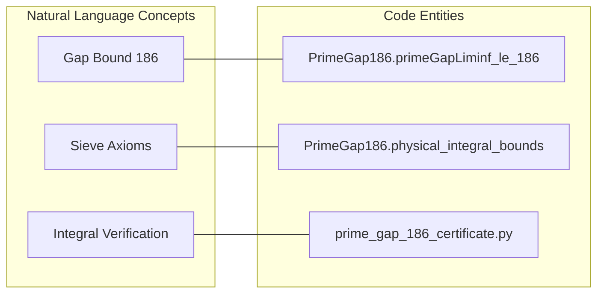

<!-- source: DeepWiki mcp.deepwiki.com · repo openai/PrimeGaps186 · page 1 Overview · fetched 2026-10-26 -->

# Overview

<details>
<summary>Relevant source files</summary>

The following files were used as context for generating this wiki page:

- [LICENSE](LICENSE)
- [README.md](README.md)
- [formalization.yaml](formalization.yaml)

</details>


The **PrimeGaps186** project provides a formal proof in Lean 4 establishing a bound on the limit inferior of gaps between consecutive primes. Specifically, it formalizes the result that $\liminf_{n\to\infty}(p_{n+1}-p_n)\le 186$ [README.md:10-14]().

The project employs a two-layer architecture: a **Lean 4 formalization** that handles the high-level number-theoretic proofs and a **Python numerical certificate** that verifies the complex integral bounds required by the sieve method. The proof is **conditional** on three primary mathematical and numerical inputs which are treated as axioms within the Lean environment [README.md:3-6]().

### Mathematical Goal
The core objective is to prove $\mathrm{DHL}[40,2]$—the statement that every admissible set of forty integer shifts has infinitely many translates containing at least two primes [README.md:16-18](). By applying this to a specific admissible 40-tuple with a diameter of 186, the project derives the consecutive-prime gap bound [README.md:18-19]().

For a deeper look at the number theory and the Maynard-Tao sieve, see [Mathematical Background](#1.1).

### System Architecture
The repository is structured to bridge formal verification with numerical computation. The Lean code defines the mathematical framework and the final theorems, while the Python certificate performs high-precision interval arithmetic to validate specific bounds that are difficult to formalize directly in Lean.

#### High-Level Component Interaction
The following diagram illustrates how the Lean formalization relies on external mathematical estimates and numerical verification.

**Figure 1: Proof Dependency Graph**
```mermaid
graph TD
    subgraph "Lean Formalization Space"
        [PrimeGaps186.lean] --> [Challenge.lean]
        [PrimeGap186.dhl_40_2] --> [PrimeGap186.kloosterman3_bound]
        [PrimeGap186.dhl_40_2] --> [PrimeGap186.kloosterman2_correlation_bound]
        [PrimeGap186.dhl_40_2] --> [PrimeGap186.physical_integral_bounds]
    end

    subgraph "External Verification Space"
        [Python_Certificate] -- "Validates" --> [PrimeGap186.physical_integral_bounds]
        [Deligne_Katz_Estimates] -- "Justifies" --> [PrimeGap186.kloosterman3_bound]
        [Fouvry_Kowalski_Michel] -- "Justifies" --> [PrimeGap186.kloosterman2_correlation_bound]
    end

    [PrimeGap186.primeGapLiminf_le_186] --> [PrimeGap186.dhl_40_2]
```
Sources: [README.md:21-29](), [README.md:45-79](), [formalization.yaml:40-73]()

### The Two-Layer Proof

1.  **Lean Formalization**: Contained in the `PrimeGap186` namespace, the Lean code uses the `Challenge.lean` file to define the specification and axioms, and `PrimeGaps186.lean` to execute the main proof [README.md:21-22](), [README.md:112-115]().
2.  **Numerical Certificate**: The `prime_gap_186_certificate.py` script recomputes the trial function from scratch using `python-flint` and `NumPy` [README.md:81-84](). It verifies 104 outer and 45 inner physical-integral upper bounds, plus three cap bounds [README.md:78-79]().

For a breakdown of every file in the repository, see [Project Structure and Repository Layout](#1.2).

### Conditional Nature of the Proof
The verification is conditional, meaning the Lean kernel accepts the proofs provided the following six axioms are granted [formalization.yaml:44-50]():
*   **Standard Logic**: `propext`, `Quot.sound`, and `Classical.choice`.
*   **Kloosterman Bounds**: `kloosterman3_bound` and `kloosterman2_correlation_bound`, derived from Deligne-type estimates in finite field geometry [README.md:45-74]().
*   **Numerical Bounds**: `physical_integral_bounds`, which are verified by the Python certificate but not proved within Lean [README.md:78-79]().

### Key Code Entities
The following table maps the primary mathematical results to their corresponding declarations in the codebase.

| Mathematical Result | Code Entity | File |
| :--- | :--- | :--- |
| $\mathrm{DHL}[40,2]$ | `PrimeGap186.dhl_40_2` | [PrimeGaps186.lean:1-26]() |
| Admissible 40-tuple translates | `PrimeGap186.infinite_two_prime_translates_admissibleTuple` | [PrimeGaps186.lean:1-27]() |
| Gap Bound $\le 186$ | `PrimeGap186.primeGapLiminf_le_186` | [PrimeGaps186.lean:1-28]() |

**Figure 2: Entity Mapping (Natural Language to Code)**

Sources: [README.md:21-29](), [README.md:81-84](), [formalization.yaml:100-112]()

---

### Child Pages
*   **[Mathematical Background](#1.1)**: Detailed explanation of prime gaps, the Maynard-Tao sieve, and the Kloosterman sum estimates used in the project.
*   **[Project Structure and Repository Layout](#1.2)**: A comprehensive guide to the file system, including Lean sources, build configurations (`lakefile.toml`), and verification artifacts.

---

