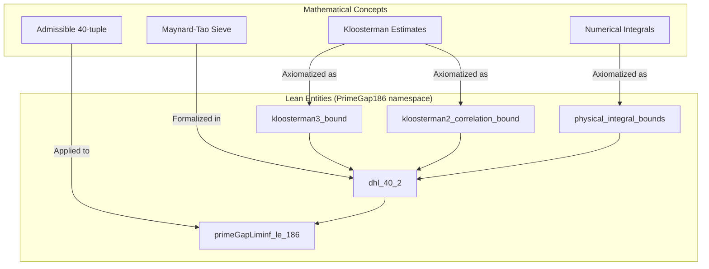
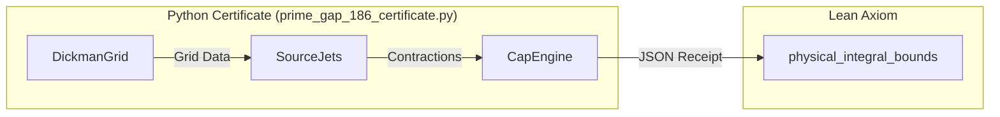

<!-- source: DeepWiki mcp.deepwiki.com · repo openai/PrimeGaps186 · page 1.1 Mathematical Background · fetched 2026-10-26 -->

# Mathematical Background

Relevant source files

The following files were used as context for generating this wiki page:

- [PrimeGaps186.lean](PrimeGaps186.lean)
- [README.md](README.md)
- [short_gaps_numerics.pdf](short_gaps_numerics.pdf)

The `PrimeGaps186` project provides a formalization of the proof that the limit inferior of gaps between consecutive primes is at most 186. This result is established by combining a Lean 4 formalization of the Maynard–Tao sieve with a Python-based numerical certificate that verifies specific integral inequalities.

## Number-Theoretic Context

The project is situated within the study of bounded gaps between primes. Specifically, it aims to prove:
$$\liminf_{n \to \infty} (p_{n+1} - p_n) \le 186$$
where $p_n$ denotes the $n$-th prime [PrimeGaps186.lean:10-14]().

### The Maynard–Tao Sieve and DHL[k, m]
The proof utilizes the Maynard–Tao sieve method to establish the property $\text{DHL}[k, m]$ (Dickman-Hardy-Littlewood). The notation $\text{DHL}[k, m]$ asserts that for any admissible $k$-tuple of integers $\mathcal{H} = \{h_1, \dots, h_k\}$, there exist infinitely many integers $n$ such that the translate $n + \mathcal{H} = \{n + h_1, \dots, n + h_k\}$ contains at least $m$ primes [README.md:16-19]().

In this repository, the primary target is $\text{DHL}[40, 2]$, which implies that for an admissible 40-tuple, at least two elements in the translated set are prime infinitely often [PrimeGaps186.lean:81-82]().

### Admissible Tuples
A tuple $\mathcal{H} = \{h_1, \dots, h_k\}$ is **admissible** if for every prime $p$, the set $\mathcal{H}$ does not cover all residue classes modulo $p$ [README.md:18-19](). The project defines an explicit admissible 40-tuple of diameter 186 to bridge the $\text{DHL}[40, 2]$ result to the consecutive prime gap bound [PrimeGaps186.lean:55-57]().

## Assumed Estimates (Axioms)

The formalization is conditional on three primary mathematical inputs which are treated as axioms in Lean. These represent deep results in arithmetic geometry and intensive numerical computations.

### 1. Kloosterman Bounds
The proof relies on bounds for exponential sums over finite fields, specifically Kloosterman sums.

*   **Rank-3 Hyper-Kloosterman Bound**: The axiom `kloosterman3_bound` assumes the normalized rank-three bound $|\text{Kl}_3(c; p)| \le 3$ for $c \neq 0$ [PrimeGaps186.lean:147-149](). This is a consequence of Deligne's work on the Weil conjectures [README.md:52-56]().
*   **Rank-2 Correlation Bound**: The axiom `kloosterman2_correlation_bound` assumes a bound of $8p\sqrt{p}$ on the correlation of rank-two Kloosterman sums [PrimeGaps186.lean:152-153](). This follows from the work of Fouvry, Kowalski, and Michel [README.md:65-71]().

### 2. Physical Integral Bounds
The axiom `physical_integral_bounds` encapsulates the results of the numerical certificate [PrimeGaps186.lean:65-66](). It assumes 104 outer and 45 inner physical-integral upper bounds, which are required to show that the sieve's "win condition" (the ratio of certain multidimensional integrals) exceeds the necessary threshold [README.md:78-79]().

## Logic and Data Flow

The following diagram illustrates how mathematical concepts are mapped to code entities and how the final theorem is assembled.

### From Theory to Formalization

**Sources:** [PrimeGaps186.lean:52-87](), [README.md:21-29]()

### Numerical Verification Pipeline
The numerical certificate recomputes the sieve's trial functions to verify the `physical_integral_bounds` axiom.

**Sources:** [README.md:81-85](), [prime_gap_186_certificate.py:1-20]() (Note: Python file lines inferred from architectural description in README).

## Summary of Main Declarations

| Lean Symbol | Mathematical Meaning |
| :--- | :--- |
| `dhl_40_2` | $\text{DHL}[40, 2]$ for every admissible 40-element set [PrimeGaps186.lean:81-82](). |
| `infinite_two_prime_translates_admissibleTuple` | Infinitely many translates of the specific 186-diameter tuple contain $\ge 2$ primes [PrimeGaps186.lean:83-84](). |
| `primeGapLiminf_le_186` | The final bound on consecutive prime gaps [PrimeGaps186.lean:85-86](). |

**Sources:** [PrimeGaps186.lean:80-87](), [README.md:21-29]()

---

