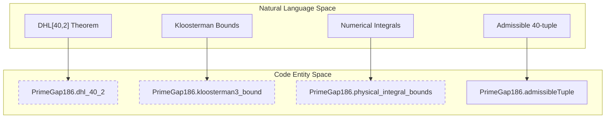
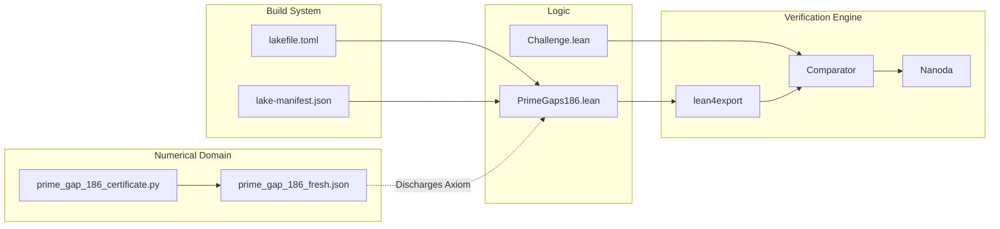

<!-- source: DeepWiki mcp.deepwiki.com · repo openai/PrimeGaps186 · page 1.2 Project Structure and Repository Layout · fetched 2026-10-26 -->

# Project Structure and Repository Layout

Relevant source files

The following files were used as context for generating this wiki page:

- [.gitignore](.gitignore)
- [formalization.yaml](formalization.yaml)
- [lake-manifest.json](lake-manifest.json)
- [lakefile.toml](lakefile.toml)
- [lean-toolchain](lean-toolchain)

This page details the organizational structure of the `PrimeGaps186` repository, describing the role of each file and the data flow between the Lean 4 formalization, the Python numerical certificate, and the verification toolchain.

## Repository Overview

The repository is structured to support a conditional formal proof of the prime gap bound $H_1 \le 186$. It achieves this by partitioning the effort into three distinct domains:
1.  **Lean Formalization**: The core logic and proof scripts.
2.  **Numerical Certification**: A Python engine that discharges complex numerical integrals into Lean axioms.
3.  **Verification Toolchain**: External tools (Nanoda, lean4export, and Comparator) that ensure the Lean kernel and the stated axioms align with the intended mathematical claims.

### System Architecture: From Theory to Code

The following diagram maps the high-level mathematical components to their corresponding entities in the codebase.

**Diagram: Mathematical Space to Code Entity Mapping**

**Sources:** [formalization.yaml:101-112](), [PrimeGaps186.lean:13-15](), [Challenge.lean:11-20]()

---

## File-by-File Description

### Core Lean Sources
The Lean code is split into two primary libraries defined in the build configuration [lakefile.toml:32-48]().

*   **`PrimeGaps186.lean`**: The main proof file. It imports the axioms and definitions from the `Challenge` namespace and provides the formal proofs for the three main results: `dhl_40_2`, `infinite_two_prime_translates_admissibleTuple`, and `primeGapLiminf_le_186` [formalization.yaml:41-73](). This library is built with `warningAsError = true` [lakefile.toml:38]().
*   **`Challenge.lean`**: Contains the specification, definitions of the sieve machinery (e.g., `trialProfile`, `fragmentLaw`), and the axiomatic declarations [Challenge.lean:24-40](). It serves as the "source of truth" for the `Comparator` tool.

### Numerical Certification
*   **`prime_gap_186_certificate.py`**: A standalone Python script using `python-flint` and `NumPy` to perform interval arithmetic. It verifies the numerical claims that are represented as the `physical_integral_bounds` axiom in Lean [formalization.yaml:22-27]().
*   **`prime_gap_186_fresh.json`**: The default output artifact generated by the Python certificate, containing the results of the numerical margin computations [gitignore:11]().

### Configuration and Metadata
*   **`formalization.yaml`**: Metadata following the `mathlib-initiative` schema. It tracks the status of the formalization, identifies the main declarations, and lists the permitted axioms [formalization.yaml:1-119]().
*   **`comparator/main.json`**: The configuration file for the `Comparator` tool. It links the Lean declarations in `PrimeGaps186.lean` to the target specifications in `Challenge.lean` [formalization.yaml:51]().

### Build and Dependency Management
*   **`lakefile.toml`**: The Lake configuration file. It defines the project name, linting drivers, and external dependencies [lakefile.toml:1-30]().
*   **`lake-manifest.json`**: The lockfile ensuring reproducible builds. It pins specific revisions for `mathlib4`, `Comparator`, and `lean4export` [lake-manifest.json:102-136]().
*   **`lean-toolchain`**: Pins the Lean version to `v4.34.0-rc2` [lean-toolchain:1]().

---

## Data Flow and Verification Pipeline

The verification process involves a multi-stage pipeline where Lean code is exported and compared against a formal challenge specification.

**Diagram: Data Flow and Verification**

**Sources:** [lakefile.toml:20-30](), [formalization.yaml:81-84](), [comparator/main.json:1-10]()

### Dependency Graph Details
The project relies on several key external libraries pinned in the manifest:
| Dependency | Purpose | Source |
| :--- | :--- | :--- |
| `mathlib4` | General mathematical library for Lean 4 | [lake-manifest.json:107]() |
| `Comparator` | Validates that the proof matches the challenge spec | [lake-manifest.json:119]() |
| `lean4export` | Exports Lean environment for external checkers | [lake-manifest.json:131]() |
| `batteries` | Used as the `lintDriver` for code quality | [lakefile.toml:6]() |

**Sources:** [lakefile.toml:6-30](), [lake-manifest.json:102-136]()

---

