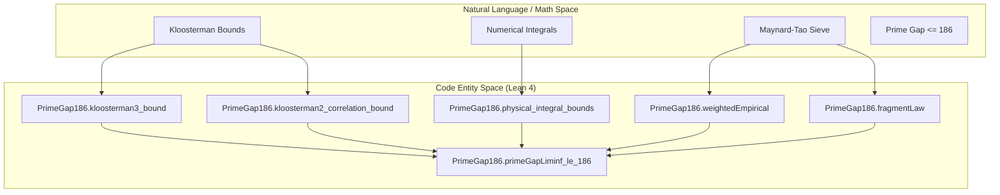
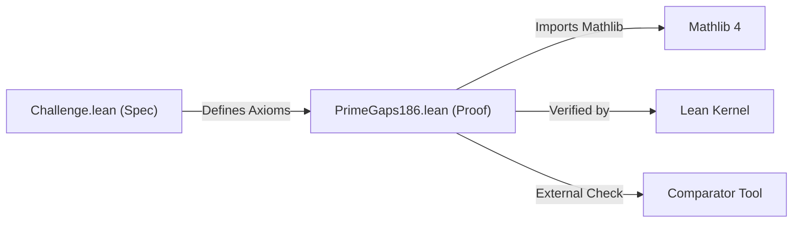

<!-- source: DeepWiki mcp.deepwiki.com · repo openai/PrimeGaps186 · page 2 Lean Formalization · fetched 2026-10-26 -->

# Lean Formalization

Relevant source files

The following files were used as context for generating this wiki page:

- [Challenge.lean](Challenge.lean)
- [PrimeGaps186.lean](PrimeGaps186.lean)
- [formalization.yaml](formalization.yaml)

This page provides a high-level overview of the Lean 4 formalization of the prime gap bound of 186. The project is organized into a specification layer (`Challenge.lean`) and a proof layer (`PrimeGaps186.lean`). The development is conditional, relying on three specific axioms that bridge the gap between analytical number theory, finite field estimates, and numerical integration.

### Namespace and Scope
The entire development resides within the `PrimeGap186` namespace [PrimeGaps186.lean:96-96](). The formalization targets the Maynard-Tao sieve machinery required to prove that the limit inferior of gaps between consecutive primes is at most 186.

### The Three Main Declarations
The success of the formalization is measured by three top-level theorems, which are proved conditionally in the main proof file:

| Declaration | Mathematical Meaning | Source |
| :--- | :--- | :--- |
| `dhl_40_2` | The Dickson-Hardy-Littlewood conjecture $DHL[40, 2]$ holds for any admissible 40-tuple. | [PrimeGaps186.lean:81-82]() |
| `infinite_two_prime_translates_admissibleTuple` | Infinitely many translates of the specific diameter-186 tuple contain at least two primes. | [PrimeGaps186.lean:83-84]() |
| `primeGapLiminf_le_186` | The $\liminf_{n \to \infty} (p_{n+1} - p_n) \leq 186$. | [PrimeGaps186.lean:85-86]() |

**Sources:** [PrimeGaps186.lean:81-87](), [formalization.yaml:101-112]()

---

### Axiomatic Structure
The formalization is **conditional**. It does not prove the underlying Kloosterman sum bounds or the numerical integrals from scratch. Instead, it assumes three specific axioms which are defined in both the specification and proof files to ensure consistency.

#### Finite Field Axioms
1.  **`kloosterman3_bound`**: Assumes Deligne's bound for rank-three hyper-Kloosterman sums [Challenge.lean:48-51]().
2.  **`kloosterman2_correlation_bound`**: Assumes the rank-two correlation bound for Kloosterman sums as established by Fouvry, Kowalski, and Michel [Challenge.lean:52-59]().

#### Numerical Axiom
3.  **`physical_integral_bounds`**: This axiom provides the numerical values for the sieve's "physical" integrals and cap bounds. These values are verified externally by the [Numerical Certificate](#3).

**Sources:** [Challenge.lean:48-59](), [PrimeGaps186.lean:61-66](), [formalization.yaml:48-50]()

---

### Logic and Entity Mapping
The following diagram illustrates how the Lean code entities map to the mathematical concepts involved in the Maynard-Tao sieve and the conditional proof structure.

**Entity Mapping: Mathematics to Lean Code**

**Sources:** [Challenge.lean:48-76](), [PrimeGaps186.lean:147-153](), [formalization.yaml:105-108]()

---

### Sieve Machinery and Fragments
The formalization constructs the Maynard-Tao sieve using measure-theoretic tools. Key components include:
*   **Empirical Measures**: `weightedEmpirical` models the distribution of primes within the sieve [Challenge.lean:66-69]().
*   **Poisson Laws**: `finitePoissonLaw` and `fragmentLaw` represent the probabilistic distribution of "fragments" (prime candidates) [Challenge.lean:76-82](), [Challenge.lean:123-126]().
*   **Trial Functions**: The specification defines the geometry of the trial functions (e.g., `trialProfile`, `trialMesh`) used to optimize the sieve weights.

**Sources:** [Challenge.lean:66-126]()

---

### Detailed Sub-pages

The Lean development is split into two primary modules:

#### 1. [Challenge.lean — Specification and Axioms](#2.1)
This file serves as the formal specification. It defines the "rules of the game" by declaring the axioms and the target theorem statements. It contains the construction of the trial functions and the measure-theoretic framework for the fragments.
*   *Key content*: `OuterBoundRow`, `InnerBoundRow`, `fragmentLaw`, and the three main `axiom` declarations.
*   For details, see [Challenge.lean — Specification and Axioms](#2.1).

#### 2. [PrimeGaps186.lean — Main Proof](#2.2)
This is the primary proof script (over 200,000 lines). It imports the axioms and provides the full derivation of the prime gap bound. It handles the distribution estimates, Selberg moments, and the final assembly of the $DHL[40, 2]$ result.
*   *Key content*: Admissible tuple construction, application of the Maynard bound for $k=50$, and the final proofs for `primeGapLiminf_le_186`.
*   For details, see [PrimeGaps186.lean — Main Proof](#2.2).

**Verification Flow**

**Sources:** [Challenge.lean:1-15](), [PrimeGaps186.lean:1-87](), [formalization.yaml:90-96]()

---

