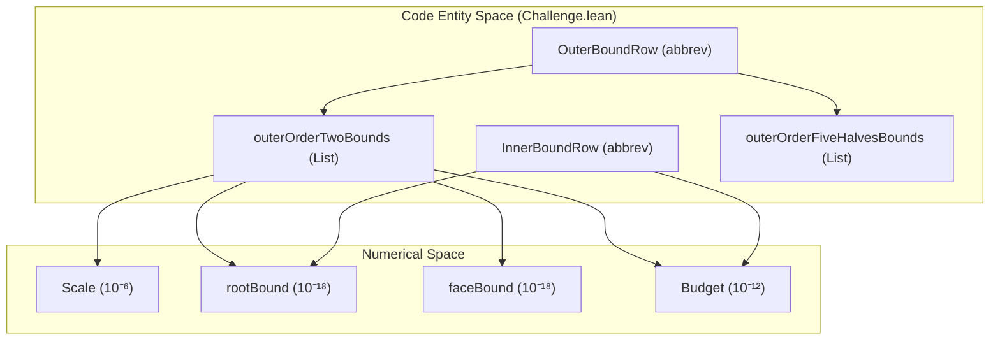

<!-- source: DeepWiki mcp.deepwiki.com · repo openai/PrimeGaps186 · page 2.1 Challenge.lean — Specification and Axioms · fetched 2026-10-26 -->

# Challenge.lean — Specification and Axioms

Relevant source files

The following files were used as context for generating this wiki page:

- [Challenge.lean](Challenge.lean)

This page provides a high-level overview of `Challenge.lean`, which serves as the formal specification and axiomatic foundation for the PrimeGaps186 project. It defines the mathematical constants, trial function geometry, and fragment measures necessary to state the conditional proof of the bounded gaps between primes.

The file is structured as a reference for the `Comparator` tool, ensuring that the main proof module does not import these definitions directly but rather conforms to them via external verification [Challenge.lean:6-13]().

## Kloosterman Axioms

The project relies on two unproved number-theoretic axioms concerning Kloosterman sums. These are used to bound error terms in the sieve machinery.

*   **`kloosterman3_bound`**: A bound on the rank-three Kloosterman sum over `ZMod p`, normalized by `1/p` [Challenge.lean:28-35](). The axiom states that for $c \neq 0$, the norm is at most 3 [Challenge.lean:48-51]().
*   **`kloosterman2_correlation_bound`**: A correlation bound for classical Kloosterman sums [Challenge.lean:41-45](). It asserts a bound of $8p\sqrt{p}$ on the sum of products of Kloosterman sums [Challenge.lean:52-58]().

### Sources:
- Kloosterman definitions: [Challenge.lean:27-45]()
- Axiom declarations: [Challenge.lean:48-59]()

## Fragment Measures and Poisson Laws

The specification defines the distribution of "prime fragments" using measure-theoretic constructions. This models the behavior of the Maynard-Tao sieve in the large-parameter limit.

| Entity | Role |
| :--- | :--- |
| `weightedEmpirical` | Assigns weights to samples based on their value, zeroing negative samples [Challenge.lean:66-69](). |
| `finitePoissonLaw` | A pushforward measure representing a Poisson count of samples drawn from a normalized measure [Challenge.lean:76-81](). |
| `cappedDyadicIntensity` | A measure with density $1/u$ on dyadic intervals, ensuring integrability [Challenge.lean:87-107](). |
| `fragmentLaw` | The probability law of the finite weighted fragment measure $\nu_\zeta$ [Challenge.lean:123-125](). |

For a deeper dive into these measure constructions, see **[Fragment Measures and Poisson Laws](#2.1.2)**.

### Sources:
- Measure definitions: [Challenge.lean:66-125]()

## Trial Function Geometry

A significant portion of `Challenge.lean` is dedicated to the "Trial Function," a piecewise polynomial construction used to optimize the sieve weights. The geometry is defined through discrete "Source Rows."

### Source Row Structure
The codebase uses `OuterBoundRow` and `InnerBoundRow` to represent exact integer-encoded bounds for numerical verification [Challenge.lean:133-142]().

For details on how these rows are marginalized and normalized into the $J$-functional, see **[Trial Function and Sieve Machinery](#2.1.1)**.

### Sources:
- Bound Row Types: [Challenge.lean:128-142]()
- Data Lists: [Challenge.lean:145-170]()

## Target Theorem Statements

The file concludes (in the omitted lines) with the three target statements that the `PrimeGaps186.lean` proof must satisfy. These statements are verified by the `Comparator` tool against the `sorry` placeholders in this file to ensure the proof addresses the correct mathematical challenge.

1.  **`dhl_40_2`**: The assertion of the Dickson-Hardy-Littlewood conjecture for specific parameters.
2.  **`infinite_two_prime_translates_admissibleTuple`**: The existence of infinitely many prime pairs for a specific admissible tuple.
3.  **`primeGapLiminf_le_186`**: The final result stating the liminf of gaps between consecutive primes is at most 186.

### Sources:
- Specification Intent: [Challenge.lean:6-15]()

---

