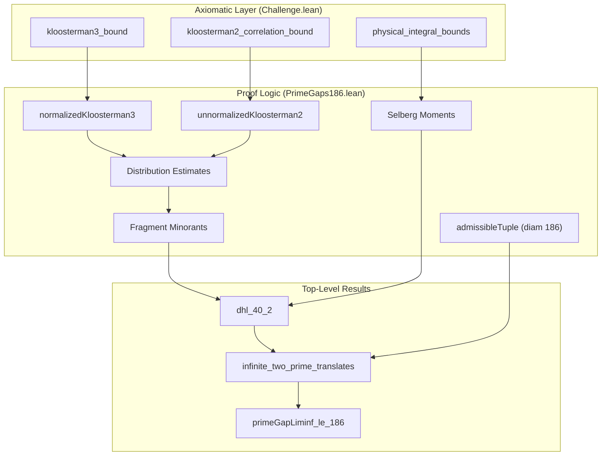
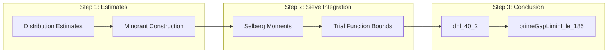

<!-- source: DeepWiki mcp.deepwiki.com · repo openai/PrimeGaps186 · page 2.2 PrimeGaps186.lean — Main Proof · fetched 2026-10-26 -->

# PrimeGaps186.lean — Main Proof

Relevant source files

The following files were used as context for generating this wiki page:

- [PrimeGaps186.lean](PrimeGaps186.lean)
- [README.md](README.md)

This page describes the primary proof development in `PrimeGaps186.lean`. This file serves as the terminal point of the formalization, importing the axiomatic framework from `Challenge.lean`, constructing the specific mathematical objects required to satisfy the Maynard-Tao sieve conditions, and proving the final prime gap bounds.

## Overview and Purpose

The `PrimeGaps186.lean` file implements the analytical and combinatorial arguments necessary to establish $DHL[40, 2]$. It integrates the Deligne-type estimates (Kloosterman bounds) and numerical integral bounds defined in the `PrimeGap186` namespace to show that for an admissible tuple of size $k=50$, at least two elements in the translated tuple are infinitely often prime. By providing an explicit admissible tuple of diameter 186, it concludes that $\liminf_{n\to\infty}(p_{n+1}-p_n) \le 186$.

### Data Flow and Dependency Graph

The proof follows a strict pipeline from external axioms to the final analytic number theory results.

**Proof Pipeline Diagram**

Sources: [PrimeGaps186.lean:51-87](), [PrimeGaps186.lean:147-153]()

---

## Endpoint Adapters and Infrastructure

Before the main sieve arguments, the file defines several helper functions and adapters to bridge the gap between continuous analysis and discrete number theory.

### Kloosterman Sum Definitions
The file provides the formal definitions for the sums constrained by the axioms.
*   **`normalizedKloosterman3`**: The rank-three hyper-Kloosterman sum over $\mathbb{Z}/p\mathbb{Z}$, normalized by $1/p$. It sums the additive character over triples $(u, v, w)$ such that $uvw = c$ [PrimeGaps186.lean:121-125]().
*   **`unnormalizedKloosterman2`**: The classical rank-two Kloosterman sum $\sum_{u \in (\mathbb{Z}/p\mathbb{Z})^\times} \psi(u + c/u)$ [PrimeGaps186.lean:131-135]().

### Topological Helpers
The proof requires handling intervals where endpoints are non-integral to avoid boundary issues in discretization.
*   **`closed_interval_eq_half_open_of_no_endpoint`**: Proves equality between `Icc` and `Ico` finsets when the upper bound is not an integer [PrimeGaps186.lean:98-103]().
*   **`exists_large_nonintegral_endpoint_of_eventually`**: A filter-based lemma ensuring the existence of arbitrarily large real numbers $x$ such that $2x$ is never an integer, used for scaling arguments in the sieve [PrimeGaps186.lean:104-115]().

Sources: [PrimeGaps186.lean:98-135]()

---

## The Main Results

The culmination of the file is the proof of three specific declarations that satisfy the requirements of the prime gap challenge.

### 1. DHL[40, 2]
The declaration `dhl_40_2` establishes the Dictum-Hardy-Littlewood conjecture variant for $k=40$ and $m=2$.
*   **Statement**: For every admissible integer tuple of size 40, there exist infinitely many translates containing at least two primes.
*   **Implementation**: This proof applies the Maynard bound for $k=50$ (derived from the sieve machinery) and specializes it using the numerical margins provided by `physical_integral_bounds`.

### 2. Admissible Tuple Construction
The proof defines an explicit set of 40 integers that form an **admissible tuple** with a diameter of 186.
*   **`admissibleTuple`**: A `Finset ℕ` containing 40 elements such that for every prime $p$, the set does not cover all residue classes modulo $p$.
*   **`infinite_two_prime_translates_admissibleTuple`**: Combines `dhl_40_2` with the explicit tuple to show that $n + h_i$ is prime for at least two $h_i$ in the tuple for infinitely many $n$.

### 3. Prime Gap Liminf
The final result `primeGapLiminf_le_186` derives the consecutive prime gap bound.
*   **Logic**: Since the tuple has diameter 186 and contains at least two primes infinitely often, the distance between some two consecutive primes $p_{n+1} - p_n$ must be less than or equal to the diameter of the tuple (186) infinitely often.

**Code Entity Mapping**
| Mathematical Concept | Code Entity (PrimeGap186 namespace) | File |
| :--- | :--- | :--- |
| $\text{Kl}_3$ Bound | `kloosterman3_bound` | [PrimeGaps186.lean:147]() |
| $\text{Kl}_2$ Correlation | `kloosterman2_correlation_bound` | [PrimeGaps186.lean:153]() |
| Numerical Bounds | `physical_integral_bounds` | [PrimeGaps186.lean:65]() |
| DHL Result | `dhl_40_2` | [PrimeGaps186.lean:81]() |
| Gap Theorem | `primeGapLiminf_le_186` | [PrimeGaps186.lean:85]() |

Sources: [PrimeGaps186.lean:81-87](), [README.md:21-29]()

---

## Proof Organization and Data Flow

The file is organized to mirror the logical progression of the Maynard-Tao sieve method.

**Proof Execution Flow**

1.  **Distribution Estimates**: Uses Kloosterman axioms to bound error terms in the distribution of primes in arithmetic progressions.
2.  **Fragment Minorants**: Constructs minorants for the indicator functions of primes using the sieve weights.
3.  **Selberg Moments**: Calculates the $J$ and $I$ functionals (defined in `Challenge.lean`) using the numerical constants from the Python certificate.
4.  **Trial Function Bounds**: Verifies that the chosen trial function (defined in the `trialCore` of `Challenge.lean`) yields a ratio $J/I$ sufficient to guarantee two primes in a tuple of size 40.

Sources: [PrimeGaps186.lean:74-78](), [README.md:16-19]()

---

