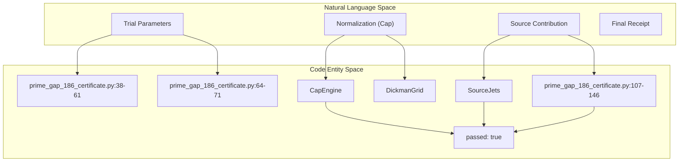
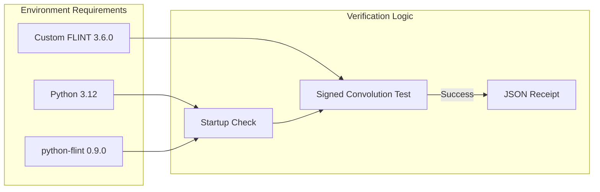

<!-- source: DeepWiki mcp.deepwiki.com · repo openai/PrimeGaps186 · page 3 Numerical Certificate · fetched 2026-10-26 -->

# Numerical Certificate

Relevant source files

The following files were used as context for generating this wiki page:

- [README.md](README.md)
- [prime_gap_186_certificate.py](prime_gap_186_certificate.py)

The **Numerical Certificate** is a Python-based verification engine designed to discharge the numerical requirements of the $p_{n+1}-p_n \le 186$ proof. While the core logic of the prime gap bound is formalized in Lean 4, the proof is conditional on specific upper bounds for physical integrals that model the Maynard-Tao sieve. The Python component recomputes these bounds from first principles using rigorous interval arithmetic and produces a machine-readable receipt.

## Purpose and Relation to Lean

The Lean formalization in `Challenge.lean` defines an axiom named `physical_integral_bounds` [README.md:78-79](). This axiom assumes the validity of 104 outer physical-integral bounds, 45 inner bounds, and three cap bounds [README.md:78-79](). 

The Python certificate serves as the "ground truth" for these values. It recomputes the trial function, source ladders, and mass distributions without reading any pre-saved results [prime_gap_186_certificate.py:8-10](). A successful execution of the certificate verifies that the numerical margins required by the Lean proof are satisfied under rigorous interval arithmetic.

### High-Level Workflow

The certificate operates through a three-phase pipeline:
1.  **Trial Derivation**: Reconstructing the radial polynomial and trial function parameters.
2.  **Cap Evaluation**: Computing the normalization constants ($I$ and $J$ functionals) using Dickman-based integration.
3.  **Source Contraction**: Calculating the contribution of "source rows" to the sieve mass, ensuring the total mass does not exceed the theoretical thresholds.

## Component Overview

The certificate relies on several specialized sub-systems to ensure precision and correctness:

| Component | Responsibility | Key Symbols |
| :--- | :--- | :--- |
| **Interval Arithmetic** | Provides rigorous bounds using the FLINT library. | `flint.arb`, `flint.arb_poly` [prime_gap_186_certificate.py:30-30]() |
| **Grid Management** | Discretizes the integration space into manageable cells. | `POLICY["intervals"]` [prime_gap_186_certificate.py:76-76]() |
| **Ladder Logic** | Constructs exact source ladders for different source orders. | `_ladder` [prime_gap_186_certificate.py:107-107]() |
| **Precision Policy** | Defines bit-depths for different stages of the calculation. | `POLICY` [prime_gap_186_certificate.py:75-104]() |

### Numerical Pipeline Architecture

The following diagram illustrates the relationship between the Python classes and the mathematical phases of the certificate.

**Certificate Execution Flow**

Sources: [prime_gap_186_certificate.py:38-71](), [prime_gap_186_certificate.py:107-146]()

## Environment and Safety Checks

The certificate requires a specific environment to ensure numerical integrity, notably **Python 3.12** and **python-flint 0.9.0** [README.md:82-83](). A critical requirement is a custom build of **FLINT 3.6.0** that fixes a known defect in signed polynomial convolution [README.md:83-84](). 

The script performs a mandatory startup regression check to detect this defect; if the check fails, the certificate will not proceed [prime_gap_186_certificate.py:4-6]().

**Environment Validation Logic**

Sources: [README.md:81-84](), [prime_gap_186_certificate.py:4-6]()

## Detailed Documentation

For in-depth technical details on the implementation and usage of the certificate, refer to the following child pages:

*   **[Certificate Architecture](#3.1)**: A detailed walkthrough of the three-phase pipeline, the `CapEngine`, `SourceJets`, and the precision policies used to maintain rigor.
*   **[Running the Certificate](#3.2)**: Instructions for setting up the environment, executing the script with specific CLI arguments (e.g., `--workers`), and interpreting the output JSON receipt.

---

