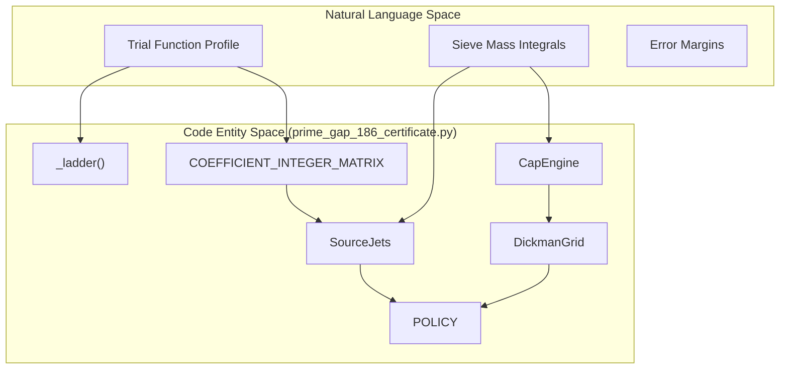
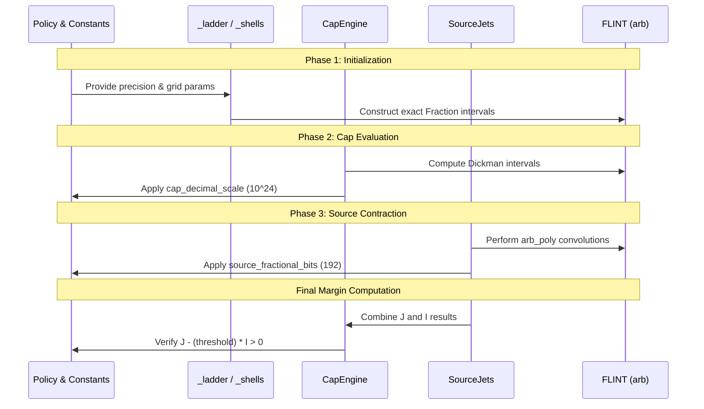

<!-- source: DeepWiki mcp.deepwiki.com · repo openai/PrimeGaps186 · page 3.1 Certificate Architecture · fetched 2026-10-26 -->

# Certificate Architecture

Relevant source files

The following files were used as context for generating this wiki page:

- [prime_gap_186_certificate.py](prime_gap_186_certificate.py)

The numerical certificate is a high-precision verification pipeline implemented in Python that computes the lower bounds for the $J$ and $I$ functionals required by the Lean formalization. It discharges the `physical_integral_bounds` axiom by performing rigorous interval arithmetic and verified convolution to ensure that the mass of the trial function exceeds the threshold necessary to prove a prime gap of at least 186.

## Pipeline Overview

The certificate execution follows a three-phase pipeline orchestrated within `prime_gap_186_certificate.py`. It utilizes the `python-flint` library for arbitrary-precision ball arithmetic (via the FLINT C library) to track numerical errors throughout the computation.

### Phase 1: Trial Derivation
The script begins by embedding the exact trial parameters, including the radial polynomial coefficients and the admissible tuple geometry.
*   **Coefficient Matrix**: The `COEFFICIENT_INTEGER_MATRIX` [prime_gap_186_certificate.py:38-61]() defines the coefficients for the radial polynomials across different signatures.
*   **Young Diagrams**: The `YOUNG_Q` parameters [prime_gap_186_certificate.py:64-71]() define the discretization of the Young diagrams used in the sieve.
*   **Ladder Construction**: The `_ladder` function [prime_gap_186_certificate.py:107-146]() builds exact source ladders that determine the integration bounds for the source contraction phase.

### Phase 2: Cap Evaluation (`CapEngine`)
The `CapEngine` is responsible for evaluating the Dickman-type integrals that bound the "cap" (the tail of the distribution).
*   **Dickman Grid**: The system uses a `DickmanGrid` to precompute values of the Dickman function $\rho(u)$ with rigorous error bounds.
*   **Integration Methods**: The `POLICY` [prime_gap_186_certificate.py:75-104]() specifies the use of `trapezoid_with_renewal_fallback` for low-value Dickman integrals to maintain precision.

### Phase 3: Source Contraction (`SourceJets`)
The `SourceJets` component handles the high-dimensional integration of the trial function's core.
*   **Jet Propagation**: The engine uses Taylor-style "jets" to propagate polynomial bounds through the discretization grid.
*   **Precision Policy**: Calculations are performed with `arb_precision_bits` (set to 160) and specific fractional bit depths for caps (224) and sources (192) [prime_gap_186_certificate.py:78-80]().

**Sources:** [prime_gap_186_certificate.py:1-170]()

## Code Entity Architecture

The following diagrams illustrate the relationship between the mathematical requirements and the Python implementation.

### System Components and Data Flow

**Sources:** [prime_gap_186_certificate.py:35-104](), [prime_gap_186_certificate.py:107-146]()

### Numerical Verification Pipeline

**Sources:** [prime_gap_186_certificate.py:75-104](), [prime_gap_186_certificate.py:107-160]()

## Key Classes and Implementation Details

### Precision and Interval Arithmetic
The certificate relies on `flint.arb` [prime_gap_186_certificate.py:30]() to represent real numbers as intervals $[m \pm r]$. This ensures that every operation, including the massive convolutions required for the $J$ functional, carries a rigorous error bound. The `POLICY` dictionary [prime_gap_186_certificate.py:75-104]() dictates the strictness of these bounds:
*   `arb_precision_bits`: 160 bits for general ball arithmetic.
*   `convolution_length`: 98264 points for the FFT-based polynomial convolutions.

### Geometry and Discretization
The integration domain is partitioned into shells and cells:
*   **`_shells`**: Describes consecutive radial shells [prime_gap_186_certificate.py:149-155]().
*   **`_cells`**: Selects specific grid cells for each shell and calculates indices relative to the grid resolution $h$ [prime_gap_186_certificate.py:158-170]().

### Final Margin Computation
The certificate's ultimate goal is to compute the margin:
$$\text{Margin} = J - (\text{Threshold}) \cdot I$$
The `source_normalization_denominator` is derived from the lower bound of the $I$ integral (`fresh_cap_I_lower`) to ensure that the resulting ratio is a valid lower bound for the sieve efficiency [prime_gap_186_certificate.py:103]().

**Sources:** [prime_gap_186_certificate.py:30](), [prime_gap_186_certificate.py:75-104](), [prime_gap_186_certificate.py:149-170]()

---

