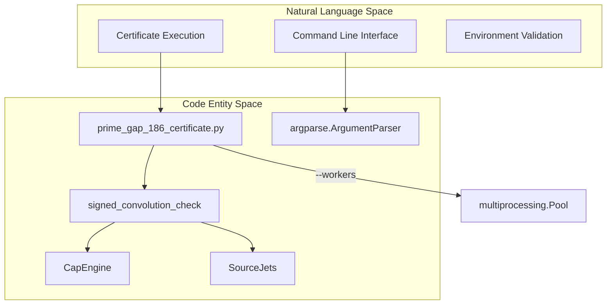
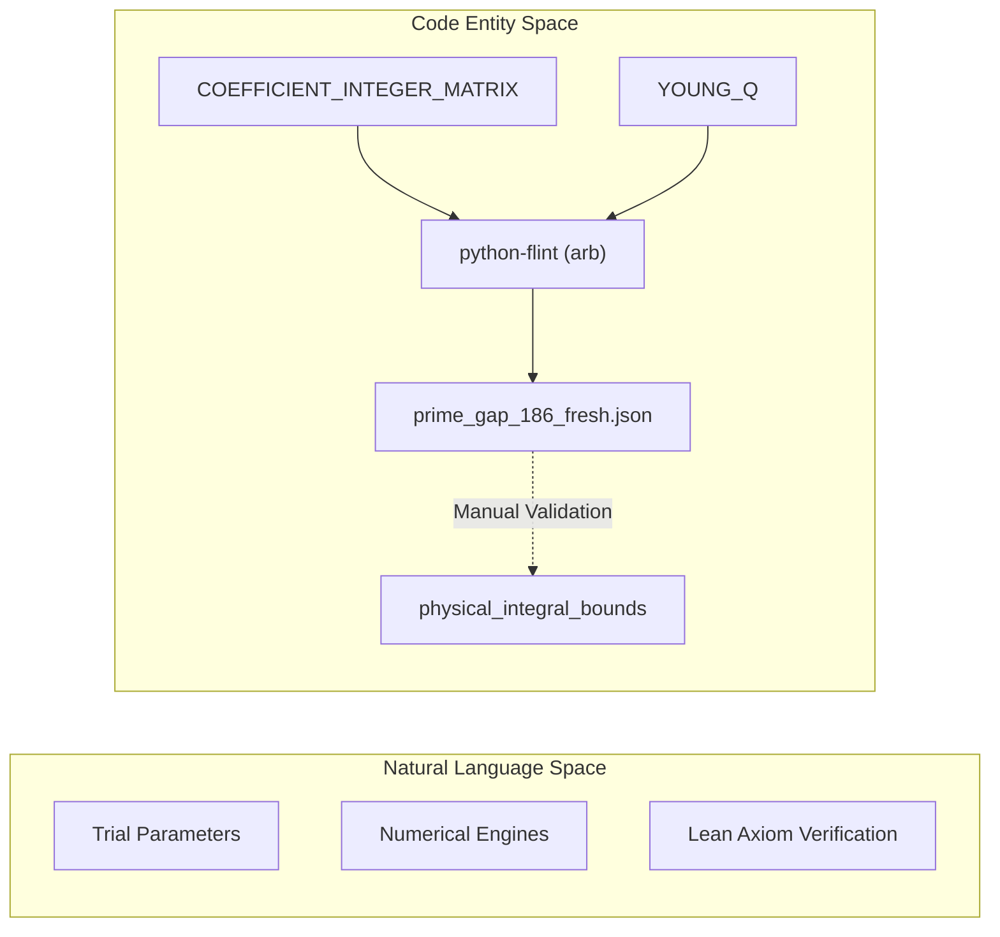

<!-- source: DeepWiki mcp.deepwiki.com · repo openai/PrimeGaps186 · page 3.2 Running the Certificate · fetched 2026-10-26 -->

# Running the Certificate

<details>
<summary>Relevant source files</summary>

The following files were used as context for generating this wiki page:

- [.gitignore](.gitignore)
- [README.md](README.md)
- [prime_gap_186_certificate.py](prime_gap_186_certificate.py)

</details>


The Python-based numerical certificate recomputes the trial function construction and verifies the integral bounds required by the Lean formalization. It acts as a bridge between the theoretical Maynard-Tao sieve framework and the concrete numerical constants used in the `PrimeGap186` proof. A successful execution produces a JSON receipt containing high-precision interval results that correspond to the `PrimeGap186.physical_integral_bounds` axiom.

## Environment and Dependencies

The certificate requires a specific environment to ensure numerical stability and to mitigate known defects in polynomial convolution libraries.

*   **Python 3.10+**: Tested primarily on Python 3.12.13 [README.md:81-82]().
*   **NumPy**: Used for internal matrix operations [prime_gap_186_certificate.py:29]().
*   **python-flint**: Interface for the FLINT (Fast Library for Number Theory) library, used for interval arithmetic (`arb`) and exact polynomial arithmetic (`fmpz_poly`) [prime_gap_186_certificate.py:30]().
*   **Custom FLINT 3.6.0**: The script requires a FLINT build where the signed FFT integer-polynomial convolution defect is corrected [prime_gap_186_certificate.py:4-6]().

### The Signed-Convolution Defect Check
Upon startup, the script performs a mandatory regression check for the FLINT signed-convolution defect [prime_gap_186_certificate.py:5-6](). If the underlying library produces incorrect results for signed polynomial multiplications, the script will terminate immediately to prevent the generation of an invalid certificate [README.md:90-91]().

Sources: [README.md:81-84](), [README.md:90-93](), [prime_gap_186_certificate.py:1-10]().

---

## Execution and CLI Arguments

The certificate is executed via the command line. It is recommended to run without Python optimizations (`-O` or `-OO`) to ensure all assertions and checks are active [README.md:90-91]().

```sh
python3 -B prime_gap_186_certificate.py --workers 4 --output prime_gap_186_fresh.json
```

### Command Line Arguments
| Argument | Description |
| :--- | :--- |
| `--workers` | Number of parallel processes for computing physical integrals. Parallelization is applied to both Cap evaluation and Source contraction [prime_gap_186_certificate.py:17](). |
| `--output` | File path for the resulting JSON receipt. The default is `prime_gap_186_fresh.json` [README.md:87-88](). |

### Execution Logic Flow
The diagram below illustrates the relationship between the CLI entry point and the internal processing engines.

**Diagram: Execution Pipeline Association**

Sources: [README.md:86-93](), [prime_gap_186_certificate.py:12-27]().

---

## The JSON Receipt and Lean Axioms

The certificate outputs a JSON file that documents every numerical bound computed. This receipt is the numerical evidence supporting the `physical_integral_bounds` axiom in `Challenge.lean` [README.md:78-79]().

### Receipt Structure
The receipt includes:
1.  **Metadata**: Execution time, environment details, and the `passed: true` flag [README.md:91-92]().
2.  **Cap Bounds**: Results for the three cap bounds ($I$, $J$, $K$) computed via the `CapEngine`.
3.  **Physical Integral Bounds**: 104 outer and 45 inner bounds derived from the `SourceJets` and radial shell evaluations [README.md:78-79]().
4.  **Interval Margins**: The lower and upper bounds of the `arb` intervals, ensuring that the true mathematical value is contained within the certified range [prime_gap_186_certificate.py:30](), [prime_gap_186_certificate.py:78-80]().

### Relationship to Lean Axioms
The Lean formalization in `PrimeGaps186.lean` assumes these bounds as an axiom (`PrimeGap186.physical_integral_bounds`). The Python script recomputes the trial function from the `COEFFICIENT_INTEGER_MATRIX` [prime_gap_186_certificate.py:38-61]() and `YOUNG_Q` [prime_gap_186_certificate.py:64-71]() parameters to verify that the functional $J$ and the mass distributions meet the thresholds required for the Maynard-Tao sieve to prove $\mathrm{DHL}[40,2]$ [README.md:16-19]().

**Diagram: Data Flow from Matrix to Receipt**

Sources: [README.md:78-84](), [README.md:107-115](), [prime_gap_186_certificate.py:35-71]().

---

## Implementation Details

### Precision Policy
The certificate uses a rigorous precision policy defined in the `POLICY` dictionary [prime_gap_186_certificate.py:75-104]().
*   **Intervals**: 98,304 intervals for discretization [prime_gap_186_certificate.py:76]().
*   **Arb Precision**: 160 bits for standard interval calculations [prime_gap_186_certificate.py:78]().
*   **Cap/Source Bits**: Higher precision (224 and 192 bits respectively) for critical path summations [prime_gap_186_certificate.py:79-80]().

### Source Ladders
The function `_ladder` constructs the exact source ladders required for the contraction phase [prime_gap_186_certificate.py:107-146](). It increases the `source_order` every twelve steps, capping at order 3 [prime_gap_186_certificate.py:112-113](). This geometric construction ensures the sieve mass is correctly accounted for across different scales of the admissible tuple.

Sources: [prime_gap_186_certificate.py:75-104](), [prime_gap_186_certificate.py:107-146]().

---

