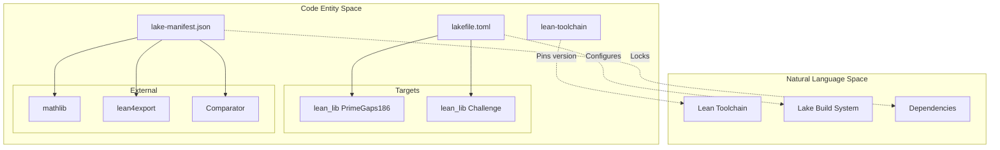
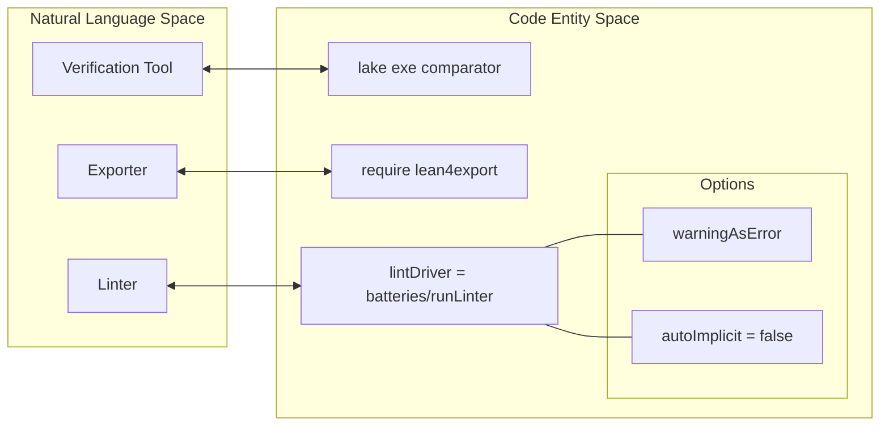

<!-- source: DeepWiki mcp.deepwiki.com · repo openai/PrimeGaps186 · page 4 Build System and Toolchain · fetched 2026-10-26 -->

# Build System and Toolchain

Relevant source files

The following files were used as context for generating this wiki page:

- [lake-manifest.json](lake-manifest.json)
- [lakefile.toml](lakefile.toml)
- [lean-toolchain](lean-toolchain)

The **PrimeGaps186** project utilizes the Lean 4 **Lake** build system to manage a complex formalization environment. The toolchain is strictly pinned to ensure reproducibility across different verification environments, coordinating the core proof library, the axiomatic specification, and external verification tools.

### Build Orchestration

The project is governed by `lakefile.toml`, which defines the build targets and linting policies. The build system distinguishes between the main proof development and the axiomatic specification, applying different strictness levels to each. 

#### Toolchain Pinning
To prevent regressions caused by updates to the Lean 4 compiler or the standard library, the project enforces a fixed toolchain.
*   **Version:** The project is pinned to `leanprover/lean4:v4.34.0-rc2` [lean-toolchain:1-1]().
*   **Enforcement:** The `fixedToolchain = true` flag is set in both the build configuration [lakefile.toml:5-5]() and the package manifest [lake-manifest.json:140-140]().

#### Build Targets and Quality Gates
The build system manages two primary Lean libraries with distinct roles:

| Target | Role | Quality Gate |
| :--- | :--- | :--- |
| `PrimeGaps186` | Main proof implementation. | `warningAsError = true` [lakefile.toml:38-38]() |
| `Challenge` | Axiomatic specification and definitions. | `warningAsError = false` [lakefile.toml:48-48]() |

The `Challenge` library is excluded from the default build targets [lakefile.toml:4-4]() and is permitted to contain `sorry` placeholders [lakefile.toml:41-41](), as its purpose is to define the interface for external verification rather than providing a complete internal proof.

For more details on library targets and linting configurations, see **[Lake Configuration](#4.1)**.

Sources: [lakefile.toml:1-48](), [lean-toolchain:1-1](), [lake-manifest.json:140-140]()

---

### Dependency Management

The project relies on a specific graph of dependencies, including `mathlib4` for general mathematical foundations and specialized tools for proof export and verification. These are managed via `lake-manifest.json`, which acts as a lockfile to ensure that every contributor and CI runner uses the exact same revisions of external code.

#### Dependency Categories
1.  **Direct Dependencies:** Explicitly required in the configuration, such as `mathlib`, `Comparator`, and `lean4export` [lakefile.toml:13-30]().
2.  **Inherited Dependencies:** Transitive dependencies pulled in by mathlib, such as `aesop`, `batteries`, and `proofwidgets` [lake-manifest.json:54-88]().

#### Build System Component Mapping
The following diagram illustrates how the Lake build system connects the configuration files to the external toolchain and libraries.

**Toolchain and Build Entity Mapping**

For a full breakdown of the dependency graph and the role of the manifest file, see **[Dependencies and Package Manifest](#4.2)**.

Sources: [lake-manifest.json:1-141](), [lakefile.toml:1-48]()

---

### Verification and Linting

The toolchain integrates automated linting to maintain code quality and ensure adherence to mathematical standards.
*   **Lint Driver:** The project uses `batteries/runLinter` to analyze the source code [lakefile.toml:6-6]().
*   **Standard Sets:** The `linter.mathlibStandardSet` is enabled to enforce naming and style conventions consistent with the Lean community [lakefile.toml:11-11]().
*   **Implicit Arguments:** `autoImplicit` is disabled project-wide to ensure that all variables are explicitly declared, preventing accidental shadowing or ambiguity [lakefile.toml:10-10]().

#### Verification Pipeline Integration
The build system provides the infrastructure for the **Verification Pipeline**, specifically by including the `Comparator` and `lean4export` tools. These tools allow the Lean kernel's output to be checked against the numerical certificates generated by the Python components.

**Verification Entity Mapping**

Sources: [lakefile.toml:6-11](), [lakefile.toml:19-30]()

---

### Child Pages
*   **[Lake Configuration](#4.1)**: Details on `lakefile.toml`, library targets, and linting policies.
*   **[Dependencies and Package Manifest](#4.2)**: Details on `lake-manifest.json`, the dependency graph, and toolchain pinning.

---

