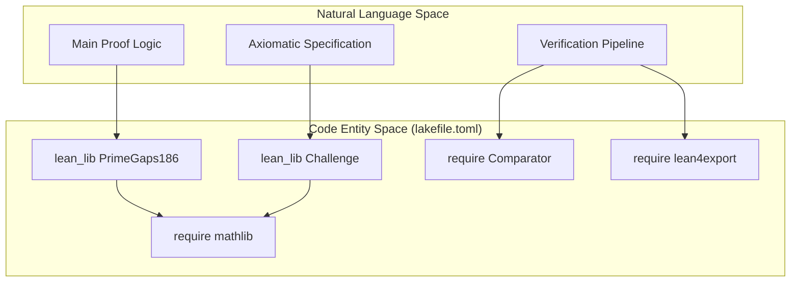
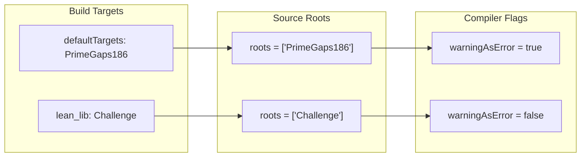

<!-- source: DeepWiki mcp.deepwiki.com · repo openai/PrimeGaps186 · page 4.1 Lake Configuration · fetched 2026-10-26 -->

# Lake Configuration

Relevant source files

The following files were used as context for generating this wiki page:

- [lakefile.toml](lakefile.toml)
- [lean-toolchain](lean-toolchain)

The `lakefile.toml` serves as the primary build configuration for the `PrimeGaps186` project, orchestrating the Lean 4 compilation process, dependency management, and linting standards. It defines the project's structure into two distinct library targets with differing quality gates and pins the toolchain and external libraries to ensure reproducible formalization results.

## Build System Overview

The project is built using **Lake** (Lean Build Framework). The configuration is designed to separate the rigorous proof development from the specification and verification components.

### Core Package Metadata
The package is named `primeGaps186` [lakefile.toml:1-3]() and is pinned to a specific toolchain version, `leanprover/lean4:v4.34.0-rc2`, as specified in the `lean-toolchain` file [lean-toolchain:1-1](). The `fixedToolchain = true` setting in the manifest ensures that all contributors and CI environments use this exact version [lakefile.toml:5-5]().

### Compilation Targets
The project defines two `lean_lib` targets with specific roles and compiler settings:

| Target Name | Role | Compiler Options |
| :--- | :--- | :--- |
| `PrimeGaps186` | **Main Proof Library**. Contains the actual formalization of the prime gap bound. | `warningAsError = true` [lakefile.toml:38-38]() |
| `Challenge` | **Specification Library**. Contains axioms and definitions for verification; not imported by the main proof. | `warningAsError = false` [lakefile.toml:48-48]() |

The `Challenge` target is permitted to contain `sorry` placeholders, as it serves as the interface for external verification tools rather than a complete internal proof [lakefile.toml:40-41]().

**Sources:** [lakefile.toml:1-7](), [lakefile.toml:32-48](), [lean-toolchain:1-1]()

## Linting and Lean Options

The project enforces strict coding standards through global `leanOptions` and a dedicated linting driver.

### Global Options
- **`autoImplicit = false`**: Disables Lean's ability to automatically introduce implicit arguments. This forces explicit declaration of all variables, enhancing proof readability and preventing accidental shadowing [lakefile.toml:10-10]().
- **`linter.mathlibStandardSet = true`**: Enables the standard suite of linters used by the `mathlib4` community, ensuring stylistic consistency with the wider ecosystem [lakefile.toml:11-11]().

### Linting Pipeline
The project utilizes the `batteries` library to drive its linting process. The `lintDriver` is set to `batteries/runLinter`, which is executed with the `--trace` and `--no-build` flags against the `PrimeGaps186` target [lakefile.toml:6-7]().

**Sources:** [lakefile.toml:6-11]()

## External Dependencies

The project relies on three primary external repositories, each pinned to a specific Git revision (`rev`) to prevent breaking changes from upstream updates.

### Dependency Mapping

| Dependency | Scope / Git URL | Purpose |
| :--- | :--- | :--- |
| `mathlib` | `leanprover-community/mathlib4` | The standard mathematical library for Lean 4, providing the foundation for number theory and analysis [lakefile.toml:14-17](). |
| `Comparator` | `leanprover/comparator` | An executable tool used to verify the consistency of the formalization against external specifications [lakefile.toml:21-23](). |
| `lean4export` | `leanprover/lean4export` | A tool that exports Lean 4 environments into a low-level format for consumption by external checkers like `nanoda` [lakefile.toml:27-30](). |

### Dependency Interaction Diagram

This diagram illustrates how the `lakefile.toml` entities relate to the external code space.

**Sources:** [lakefile.toml:13-30](), [lakefile.toml:32-48]()

## Build Target Configuration

The `lakefile.toml` distinguishes between the default build behavior and specialized verification needs.

### Target Definitions and Data Flow

The `PrimeGaps186` target is the only one included in `defaultTargets` [lakefile.toml:4-4](). This ensures that a standard `lake build` command focuses on the primary proof library and enforces the `warningAsError` policy [lakefile.toml:37-38](). The `Challenge` library is isolated to ensure its `sorry` implementations do not pollute the main build's quality gate [lakefile.toml:40-41]().

**Sources:** [lakefile.toml:4-4](), [lakefile.toml:32-48]()

---

