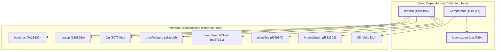
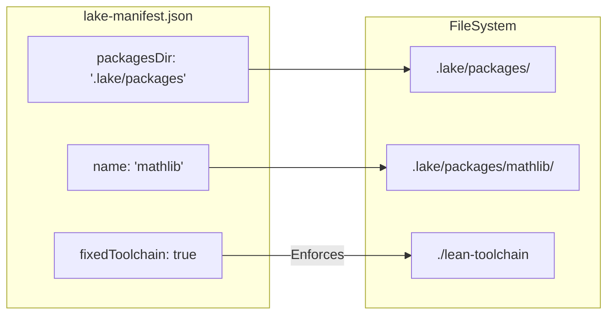

<!-- source: DeepWiki mcp.deepwiki.com · repo openai/PrimeGaps186 · page 4.2 Dependencies and Package Manifest · fetched 2026-10-26 -->

# Dependencies and Package Manifest

Relevant source files

The following files were used as context for generating this wiki page:

- [lake-manifest.json](lake-manifest.json)

This page provides a technical breakdown of the `lake-manifest.json` file within the `PrimeGaps186` project. It details the full dependency graph, the mechanism for ensuring reproducible builds via toolchain pinning, and the distinction between direct and inherited dependencies.

## The Role of lake-manifest.json

The `lake-manifest.json` file serves as the definitive lockfile for the Lean 4 build system (Lake). It records the exact Git revisions (`rev`) of every dependency in the project's tree to ensure that every contributor and CI environment builds against the identical source code [lake-manifest.json:1-141]().

### Reproducibility and Toolchain Pinning
The manifest explicitly sets the `fixedToolchain` flag to `true` [lake-manifest.json:140-140](). This ensures that Lake enforces the use of the specific Lean 4 version defined in the project's `lean-toolchain` file, preventing subtle proof breakages caused by compiler or tactic updates in newer Lean releases.

## Dependency Classification

The project distinguishes between **Direct Dependencies** (declared in `lakefile.toml`) and **Inherited Dependencies** (transitive dependencies required by the direct ones).

### Direct Dependencies
These are the core libraries explicitly required for the `PrimeGaps186` formalization and the `Comparator` verification tool.

| Package Name | Role | Source |
| :--- | :--- | :--- |
| `mathlib` | The standard mathematical library for Lean 4. | [lake-manifest.json:102-112]() |
| `Comparator` | Internal tool for axiom auditing and export verification. | [lake-manifest.json:114-124]() |
| `lean4export` | Tool to export Lean 4 environments for external checkers. | [lake-manifest.json:126-136]() |

### Inherited Dependencies
These packages are brought in primarily as dependencies of `mathlib` or the `Comparator` tool.

| Package Name | Role | Inherited From |
| :--- | :--- | :--- |
| `batteries` | Extended standard library for Lean 4. | [lake-manifest.json:78-88]() |
| `aesop` | Automated Extensible Search Over Proofs (tactic). | [lake-manifest.json:54-64]() |
| `Qq` | Quote4: Type-safe expression quotations. | [lake-manifest.json:66-76]() |
| `proofwidgets` | UI components for Lean Infoview. | [lake-manifest.json:42-52]() |
| `Cli` | Command-line argument parsing for Lean executables. | [lake-manifest.json:90-100]() |
| `plausible` | Property-based testing for Lean. | [lake-manifest.json:6-16]() |
| `importGraph` | Utility to generate module dependency graphs. | [lake-manifest.json:30-40]() |
| `LeanSearchClient` | Client for Lean search services. | [lake-manifest.json:18-28]() |

**Sources:** [lake-manifest.json:1-137]()

## Dependency Graph Architecture

The following diagram maps the relationships between the manifest entries and their roles in the build system.

### Dependency Flow and Inheritance

**Sources:** [lake-manifest.json:6-136]()

## Manifest Implementation Details

The manifest structure follows the `version: 1.2.0` schema [lake-manifest.json:2-2](). Each package entry contains specific metadata used by Lake to fetch and verify the code.

### Package Entry Structure
A typical entry, such as `mathlib`, contains:
*   **url**: The Git repository location [lake-manifest.json:102-102]().
*   **rev**: The specific git commit hash ensuring the build is locked to a known-good state [lake-manifest.json:106-106]().
*   **inputRev**: The branch or tag requested in the `lakefile.toml` [lake-manifest.json:109-109]().
*   **inherited**: A boolean flag indicating if the package is a transitive dependency [lake-manifest.json:110-110]().
*   **configFile**: The configuration file used by the dependency (`lakefile.lean` or `lakefile.toml`) [lake-manifest.json:111-111]().

### Manifest-to-Code Mapping
This diagram bridges the manifest definitions to the physical directory structure used during the build process.

**Sources:** [lake-manifest.json:3-4](), [lake-manifest.json:107-107](), [lake-manifest.json:140-140]()

## Key Manifest Attributes

| Attribute | Description | Code Reference |
| :--- | :--- | :--- |
| `packagesDir` | The directory where Lake downloads external source code. | [lake-manifest.json:3-3]() |
| `rev` | The immutable SHA-1 hash of the git commit. | [lake-manifest.json:10-10]() |
| `fixedToolchain` | Prevents Lake from attempting to update the Lean version automatically. | [lake-manifest.json:140-140]() |
| `name` | The internal identifier used for `import` statements and target resolution. | [lake-manifest.json:138-138]() |

**Sources:** [lake-manifest.json:1-141]()

---

