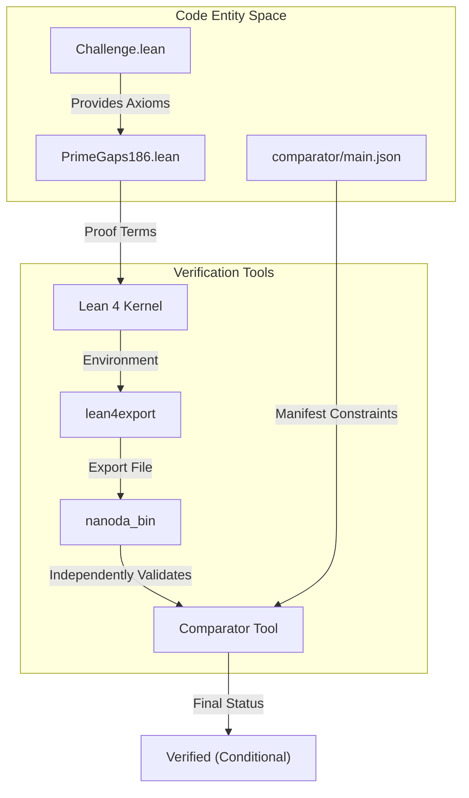
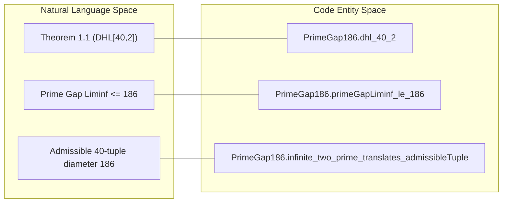

<!-- source: DeepWiki mcp.deepwiki.com · repo openai/PrimeGaps186 · page 5 Verification Pipeline · fetched 2026-10-26 -->

# Verification Pipeline

Relevant source files

The following files were used as context for generating this wiki page:

- [comparator/README.md](comparator/README.md)
- [comparator/main.json](comparator/main.json)
- [formalization.yaml](formalization.yaml)

The **Verification Pipeline** ensures the mathematical integrity of the PrimeGaps186 project by combining Lean 4's kernel verification with external proof checkers and a rigorous axiom audit. Because the project relies on specific number-theoretic bounds that are currently provided as axioms, the pipeline is designed to isolate these assumptions and verify that the main theorems—`PrimeGap186.dhl_40_2`, `PrimeGap186.infinite_two_prime_translates_admissibleTuple`, and `PrimeGap186.primeGapLiminf_le_186`—follow logically from them.

### Workflow Overview

The pipeline operates in three distinct stages:
1.  **Lean Kernel Check**: The standard `lake build` process ensures that the proofs in `PrimeGaps186.lean` are type-correct and logically sound within the Lean 4 environment.
2.  **Export and External Verification**: The `Comparator` tool exports the environment to a low-level format (`lean4export`) and invokes `nanoda_bin` to verify the proof terms independently of the Lean 4 compiler.
3.  **Axiom Alignment**: The `Comparator` tool cross-references the environment against `comparator/main.json` to ensure no "illegal" axioms (like `sorry`) were used and that only the six permitted assumptions are present.

### Verification Architecture

The following diagram illustrates how the verification tools interact with the codebase entities to validate the final theorems.

**System Verification Flow**

Sources: [comparator/main.json:1-18](), [formalization.yaml:75-88](), [comparator/README.md:1-12]()

### The Comparator Tool

The `Comparator` tool is the primary orchestrator for the verification suite. It reads a configuration file, `comparator/main.json`, which defines the "Challenge" module (the specification) and the "Solution" module (the proof). It automates the process of checking that the solution satisfies the challenge without introducing unauthorized axioms.

Key components of the Comparator execution:
*   **Manifest**: Uses `comparator/main.json` to define target theorems and permitted axioms.
*   **Nanoda Integration**: When `enable_nanoda` is set to `true`, the tool performs a second-layer verification of the exported Lean kernel terms.
*   **Sandboxing**: Requires `landrun` to execute the verification in a controlled environment.

For details on execution and binary requirements, see **[Comparator Tool](#5.1)**.

Sources: [comparator/main.json:1-18](), [comparator/README.md:1-12](), [formalization.yaml:51-73]()

### Axiom Audit and Permitted Assumptions

A critical part of the pipeline is the **Axiom Audit**. The project is explicitly "conditional," meaning it assumes the truth of certain complex mathematical bounds that are not yet formalized in Lean. The verification pipeline is configured to fail if any axiom outside of the six permitted ones is detected.

**Permitted Axioms Table**
| Axiom Name | Type | Purpose |
| :--- | :--- | :--- |
| `propext` | Logic | Propositional Extensionality |
| `Quot.sound` | Logic | Quotient Soundness |
| `Classical.choice` | Logic | Axiom of Choice |
| `kloosterman3_bound` | Number Theory | Rank-three hyper-Kloosterman bound |
| `kloosterman2_correlation_bound` | Number Theory | Rank-two Kloosterman correlation bound |
| `physical_integral_bounds` | Numerical | Bounds on the J-functional and trial functions |

The pipeline ensures that these specific symbols are the only terminal leaves in the proof tree for the main results. For the mathematical justification of these bounds and their literary sources, see **[Axiom Audit and Permitted Assumptions](#5.2)**.

Sources: [comparator/main.json:9-16](), [formalization.yaml:35-50](), [formalization.yaml:98-113]()

### Alignment with Formalization Metadata

The results of the verification pipeline are tracked in `formalization.yaml`. This file maps the Lean declarations to their corresponding mathematical theorems in the source literature (e.g., DHL[40,2]).

**Source-to-Code Mapping**

Sources: [formalization.yaml:98-113](), [comparator/main.json:4-8]()

---

