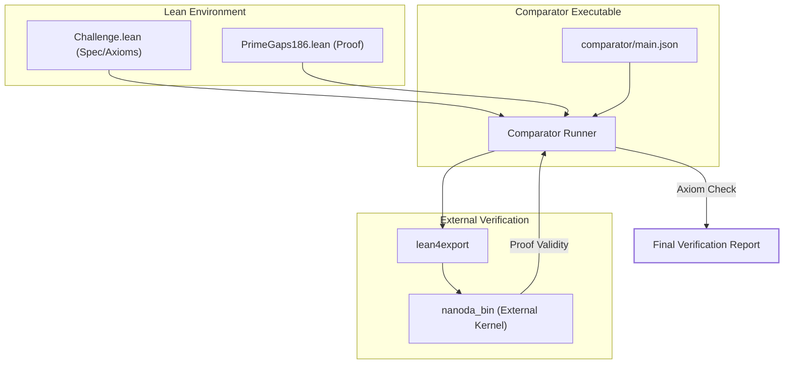

<!-- source: DeepWiki mcp.deepwiki.com · repo openai/PrimeGaps186 · page 5.1 Comparator Tool · fetched 2026-10-26 -->

# Comparator Tool

<details>
<summary>Relevant source files</summary>

The following files were used as context for generating this wiki page:

- [comparator/README.md](comparator/README.md)
- [comparator/main.json](comparator/main.json)

</details>


The Comparator tool is the primary verification executable used to ensure that the Lean 4 formalization correctly satisfies the project's requirements. It automates the process of exporting Lean declarations, verifying them via external kernels, and auditing the resulting axiom set against a predefined manifest [comparator/main.json:1-18]().

## Purpose and Scope

The Comparator serves as the "source of truth" for the verification pipeline. Its role is to bridge the gap between the `Challenge` module (which defines the mathematical specification and axioms) and the `PrimeGaps186` module (which contains the actual proofs) [comparator/main.json:2-3](). By running the comparator, the system confirms that the three top-level theorems—`dhl_40_2`, `infinite_two_prime_translates_admissibleTuple`, and `primeGapLiminf_le_186`—are fully proven within Lean 4, using only the six permitted axioms [comparator/main.json:4-16]().

## External Binary Requirements

The tool operates by orchestrating several low-level binaries. For the tool to function, the following must be available on the system `PATH`:

| Binary | Role |
| :--- | :--- |
| `lean4export` | Exports Lean 4 environments into a low-level format readable by external checkers. |
| `nanoda_bin` | A Rust-based independent kernel for Lean 4 that re-verifies the exported proofs to ensure kernel integrity. |
| `landrun` | A sandboxing utility used to execute these processes in a controlled environment. |

**Sources:** [comparator/README.md:3-5]()

## Execution Pipeline

The tool is invoked via the Lean package manager (`lake`). The standard execution command is:

```sh
lake exe comparator comparator/main.json
```

### Data Flow and Verification Logic

The following diagram illustrates how the Comparator tool processes the Lean source code and interacts with external checkers to validate the proof of the prime gap bound.

**Verification Data Flow**

**Sources:** [comparator/README.md:9-12](), [comparator/main.json:1-18]()

## The Verification Manifest (`main.json`)

The file `comparator/main.json` acts as the configuration schema for the verification process. It defines the boundaries of the proof and the "ground truth" axioms that the project is allowed to assume.

### Manifest Components

*   **Module Mapping**: It identifies `Challenge` as the module containing the problem statement and `PrimeGaps186` as the module containing the solution [comparator/main.json:2-3]().
*   **Target Theorems**: It lists the specific declarations that must be verified as `Theorem` objects [comparator/main.json:4-8]().
*   **Permitted Axioms**: This is the critical security policy. The tool will fail if the proof depends on any axiom not listed here. The list includes standard Lean axioms (`propext`, `Quot.sound`, `Classical.choice`) and the three project-specific mathematical assumptions (`kloosterman3_bound`, `kloosterman2_correlation_bound`, and `physical_integral_bounds`) [comparator/main.json:9-16]().
*   **Kernel Redundancy**: The `enable_nanoda: true` flag ensures that the proof is not just checked by the standard Lean kernel, but also by the independent Nanoda kernel to mitigate risks of kernel-level bugs [comparator/main.json:17]().

## Integration with Code Entities

The Comparator tool specifically targets the top-level proofs that establish the main result of the repository. The following diagram maps the Comparator's configuration to the specific code entities in the Lean source files.

**Manifest to Code Mapping**
```mermaid
classDiagram
    class "comparator/main.json" {
        challenge_module: "Challenge"
        solution_module: "PrimeGaps186"
        theorem_names: List
        permitted_axioms: List
    }

    class "PrimeGaps186.lean" {
        +dhl_40_2
        +infinite_two_prime_translates_admissibleTuple
        +primeGapLiminf_le_186
    }

    class "Challenge.lean" {
        <<Axioms>>
        +kloosterman3_bound
        +kloosterman2_correlation_bound
        +physical_integral_bounds
    }

    "comparator/main.json" ..> "PrimeGaps186.lean" : "Validates Theorems"
    "comparator/main.json" ..> "Challenge.lean" : "Permits Axioms"
```
**Sources:** [comparator/main.json:2-16]()

---

