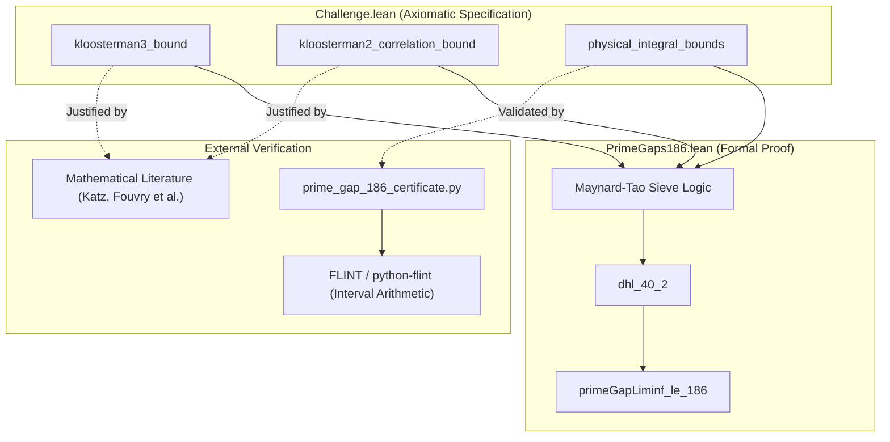

<!-- source: DeepWiki mcp.deepwiki.com · repo openai/PrimeGaps186 · page 5.2 Axiom Audit and Permitted Assumptions · fetched 2026-10-26 -->

# Axiom Audit and Permitted Assumptions

Relevant source files

The following files were used as context for generating this wiki page:

- [Challenge.lean](Challenge.lean)
- [README.md](README.md)
- [comparator/main.json](comparator/main.json)

The `PrimeGaps186` project is a conditional formalization. While the core logical derivation of the prime gap bound $\liminf_{n\to\infty}(p_{n+1}-p_n)\le 186$ is fully verified in Lean 4, the proof relies on six specific axioms. Three of these are standard Lean foundational axioms, while the remaining three represent deep results from analytic number theory and high-precision numerical integration that are assumed as inputs.

## Permitted Axioms List

The verification pipeline, governed by the `Comparator` tool and its configuration in `comparator/main.json` [comparator/main.json:1-18](), restricts the proof's environment to exactly six axioms. Any other `sorry` or unproven assumption would result in a verification failure.

| Axiom Name | Category | Description |
| :--- | :--- | :--- |
| `propext` | Foundational | Propositional Extensionality (Standard Lean). |
| `Quot.sound` | Foundational | Quotient Soundness (Standard Lean). |
| `Classical.choice` | Foundational | Axiom of Choice (Standard Lean). |
| `kloosterman3_bound` | Number Theory | Deligne-type bound for rank-3 Kloosterman sums. |
| `kloosterman2_correlation_bound` | Number Theory | Correlation bound for rank-2 Kloosterman sums. |
| `physical_integral_bounds` | Numerical | Bounds on trial function integrals (J-functional). |

**Sources:** [comparator/main.json:9-16](), [README.md:4-6]()

## Mathematical Assumptions and Literary Sources

The two Kloosterman axioms represent estimates established in the literature of arithmetic geometry and exponential sums. These are defined in `Challenge.lean` and used to bound error terms in the Maynard-Tao sieve.

### 1. `kloosterman3_bound`
This axiom assumes a bound for the normalized rank-three Kloosterman sum over $\mathbb{Z}/p\mathbb{Z}$:
$$ \left|\mathrm{Kl}_3(c;p)\right|\le 3 $$
for every prime $p$ and $c \neq 0$ [Challenge.lean:48-51]().

*   **Implementation:** Defined via `normalizedKloosterman3` [Challenge.lean:31-36]().
*   **Justification:** Follows from Deligne's theorem. Specifically, Nicholas M. Katz, *Gauss Sums, Kloosterman Sums, and Monodromy Groups* (1988), Theorem 4.1.1(1)–(2), p. 49 [README.md:52-56]().

### 2. `kloosterman2_correlation_bound`
This axiom assumes a bound on the correlation of two unnormalized rank-two Kloosterman sums $K_2$:
$$ \left|\sum_{t\in\mathbb{F}_p\setminus\{0,-1\}} K_2(A/t;p)\,K_2(B/(t+1);p)\right|\le 8p\sqrt p $$
for $A, B \neq 0$ [Challenge.lean:52-59]().

*   **Implementation:** Defined via `unnormalizedKloosterman2` [Challenge.lean:41-45]().
*   **Justification:** Étienne Fouvry, Emmanuel Kowalski, and Philippe Michel, *The Friedlander–Iwaniec character sum* (2013), Proposition 2, p. 1 [README.md:66-71]().

**Sources:** [Challenge.lean:31-59](), [README.md:30-75]()

## Numerical Integration and the J-Functional

The axiom `PrimeGap186.physical_integral_bounds` encapsulates the numerical heavy lifting of the project. It assumes 104 outer bounds, 45 inner bounds, and three cap bounds related to the trial function's performance in the sieve [README.md:78-79]().

### Why these are not discharged in Lean
The bounds involve high-dimensional integrals of the `trialProfile` and `trialRadialPolynomial` over complex geometric regions defined by `trialMesh` and `trialCore` [Challenge.lean:10-14](). Discharging these in Lean would require:
1.  A formal theory of interval arithmetic and rigorous integration (e.g., using `Taylor models`).
2.  Formal verification of the `Dickman` function and its derivatives.
3.  Extensive computational time within the Lean kernel to process the 152+ required bounds.

Instead, these are verified by a **Python Numerical Certificate** (`prime_gap_186_certificate.py`) which uses the `python-flint` library for interval arithmetic and `FLINT 3.6.0` for polynomial operations [README.md:81-85]().

### Natural Language to Code Entity Mapping: Numerical Bounds

Axiom | Code Entity (Lean) | Verification Entity (Python)
--- | --- | ---
`physical_integral_bounds` | `Challenge.lean` Axiom | `prime_gap_186_certificate.py`
Outer Bounds | `outerOrderTwoBounds` [Challenge.lean:145]() | `CapEngine.evaluate_outer`
Inner Bounds | `innerBounds` (in `Challenge.lean`) | `SourceJets.contract`
Cap Bounds | `capBounds` (in `Challenge.lean`) | `DickmanGrid` evaluation

### Data Flow: From Axioms to Proof

The following diagram illustrates how the `Challenge.lean` axioms are consumed by the main proof and verified against the Python certificate.

**Axiom Consumption and Verification Flow**

**Sources:** [Challenge.lean:48-59](), [README.md:16-29](), [README.md:81-94](), [comparator/main.json:1-18]()

## Physical Integral Table Structures

The `physical_integral_bounds` axiom relies on structured data representing the discretization of the trial function.

### Outer Bound Rows
Represent order-two and order-5/2 components of the sieve mass.
*   **Fields:** `(scale, rootBound, faceBound, budget)` [Challenge.lean:128-132]().
*   **Encoding:** Scale is in $10^{-6}$, component bounds in $10^{-18}$, and budgets in $10^{-12}$ [Challenge.lean:128-131]().

### Inner Bound Rows
Represent the mass bounds for the core of the trial function.
*   **Fields:** `(massBound, budget)` [Challenge.lean:136-139]().
*   **Encoding:** Component bounds in $10^{-18}$, budgets in $10^{-12}$ [Challenge.lean:137-138]().

**Sources:** [Challenge.lean:128-162]()

---

