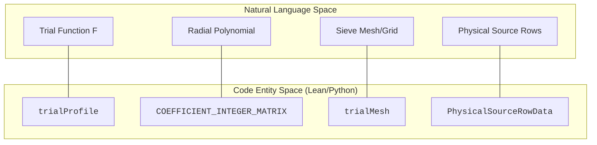
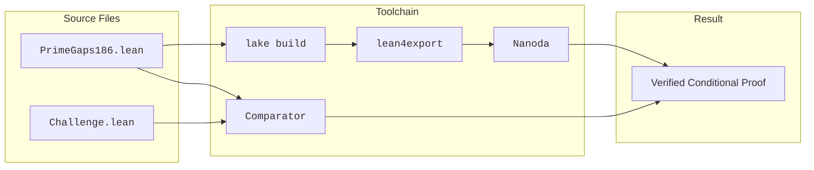

<!-- source: DeepWiki mcp.deepwiki.com · repo openai/PrimeGaps186 · page 6 Glossary · fetched 2026-10-26 -->

# Glossary

Relevant source files

The following files were used as context for generating this wiki page:

- [.gitignore](.gitignore)
- [Challenge.lean](Challenge.lean)
- [PrimeGaps186.lean](PrimeGaps186.lean)
- [README.md](README.md)
- [comparator/main.json](comparator/main.json)
- [lake-manifest.json](lake-manifest.json)
- [lakefile.toml](lakefile.toml)
- [lean-toolchain](lean-toolchain)
- [prime_gap_186_certificate.py](prime_gap_186_certificate.py)

This page provides definitions for mathematical terms, codebase-specific constructs, and toolnames used in the **PrimeGaps186** project. It serves as a bridge between the number-theoretic concepts of the Maynard-Tao sieve and the specific implementation details found in the Lean formalization and Python numerical certificate.

## Mathematical Terms

| Term | Definition | Code Pointers |
| :--- | :--- | :--- |
| **Admissible Tuple** | A finite set of integers $\mathcal{H} = \{h_1, \dots, h_k\}$ such that for every prime $p$, the set $\mathcal{H} \pmod p$ does not cover all residue classes modulo $p$. | [PrimeGaps186.lean:16-19](), [PrimeGaps186.lean:55-57]() |
| **DHL[k, m]** | The Dickson-Hardy-Littlewood conjecture variant: for an admissible tuple of size $k$, there exist infinitely many integers $n$ such that at least $m$ of the values $\{n+h_1, \dots, n+h_k\}$ are prime. | [PrimeGaps186.lean:81-82](), [README.md:16-19]() |
| **Kloosterman Sum (Kl₃)** | A rank-three hyper-Kloosterman sum over a finite field $\mathbb{F}_p$, normalized by $1/p$. Used in the distribution estimates of the sieve. | [Challenge.lean:31-36](), [PrimeGaps186.lean:121-126]() |
| **Kloosterman Correlation** | A sum of products of rank-two Kloosterman sums ($K_2$). The project assumes a bound of $8p\sqrt{p}$ for these correlations. | [Challenge.lean:52-59](), [PrimeGaps186.lean:151-153]() |
| **Dickman Function** | A function $\rho(u)$ used to estimate the density of smooth numbers. In the certificate, it is evaluated on a grid to bound sieve integrals. | [prime_gap_186_certificate.py:84-90]() |

**Sources:** [README.md:16-74](), [Challenge.lean:31-59](), [PrimeGaps186.lean:81-153]()

---

## Codebase Entities

### Lean Specification (Challenge.lean)
The `Challenge` namespace defines the axiomatic interface that the main proof must satisfy.

*   **`weightedEmpirical`**: A noncomputable function constructing a finite atomic measure where atoms are weighted by the value of the sample. [Challenge.lean:66-69]()
*   **`finitePoissonLaw`**: Models the pushforward measure obtained by drawing a Poisson-distributed number of samples from a normalized measure. [Challenge.lean:76-81]()
*   **`fragmentLaw`**: The probability law of the finite weighted fragment measure $\nu_\zeta$, crucial for modeling prime distributions in the sieve. [Challenge.lean:123-125]()
*   **`OuterBoundRow` / `InnerBoundRow`**: Type aliases for rows in the numerical tables that define the bounds for the physical integrals. [Challenge.lean:133-140]()

### Python Certificate (prime_gap_186_certificate.py)
The certificate recomputes numerical bounds to verify the `physical_integral_bounds` axiom.

*   **`COEFFICIENT_INTEGER_MATRIX`**: A $11 \times 7$ matrix of large integers representing the radial polynomial coefficients of the trial function. [prime_gap_186_certificate.py:38-61]()
*   **`CapEngine`**: (Logic implied by `cap_dickman_method`) The component responsible for computing upper bounds on the "Cap" integrals using Dickman function approximations. [prime_gap_186_certificate.py:84-85]()
*   **`SourceJets`**: (Logic implied by `low_inner_dual_jets`) A structure representing Taylor expansions (jets) of the trial function used to contract source rows efficiently. [prime_gap_186_certificate.py:93]()

**Sources:** [Challenge.lean:66-162](), [prime_gap_186_certificate.py:32-104]()

---

## Sieve Geometry and Trial Functions

The project uses a specific trial function $F$ to optimize the Maynard-Tao sieve. The following diagram maps the mathematical components of this trial function to their code representations.

### Sieve Construction Mapping

**Sources:** [Challenge.lean:145-170](), [prime_gap_186_certificate.py:38-72]()

---

## Verification Toolchain

The verification process involves multiple tools to ensure the Lean proof is sound and matches the intended challenge.

*   **Comparator**: A Lean executable that checks if the definitions and theorem statements in `PrimeGaps186.lean` match those in `Challenge.lean`. [comparator/main.json:1-8]()
*   **Nanoda**: A kernel validator for Lean 4 exports, used to double-check the proof without relying on the standard Lean kernel. [comparator/main.json:17]()
*   **Lake**: The Lean build system and package manager. [lakefile.toml:1-6]()
*   **python-flint**: Python bindings for the FLINT C library, used for arbitrary-precision interval arithmetic and polynomial convolution. [prime_gap_186_certificate.py:30-31]()

### Verification Pipeline Flow

**Sources:** [lakefile.toml:21-30](), [comparator/main.json:1-18](), [README.md:95-115]()

---

## Abbreviations and Constants

| Abbreviation | Meaning | Code Reference |
| :--- | :--- | :--- |
| **`Icc` / `Ico`** | Closed and Half-Open intervals in Lean's `Finset` library. | [PrimeGaps186.lean:98-103]() |
| **`arb`** | Arbitrary-precision ball (interval) arithmetic type from FLINT. | [prime_gap_186_certificate.py:30]() |
| **`DHL`** | Dickson-Hardy-Littlewood (Conjecture). | [PrimeGaps186.lean:55]() |
| **`ζ` (Zeta)** | A parameter controlling the scale of fragment measures. | [Challenge.lean:87-90]() |
| **`10⁻¹⁸`** | The unit scale for component bounds in the numerical tables. | [Challenge.lean:128-132]() |

**Sources:** [Challenge.lean:87-132](), [PrimeGaps186.lean:98-103](), [prime_gap_186_certificate.py:30]()