# Page: Overview

# Overview

<details>
<summary>Relevant source files</summary>

The following files were used as context for generating this wiki page:

- [LICENSE](LICENSE)
- [README.md](README.md)
- [formalization.yaml](formalization.yaml)

</details>


The **PrimeGaps186** project provides a formal proof in Lean 4 establishing a bound on the limit inferior of gaps between consecutive primes. Specifically, it formalizes the result that $\liminf_{n\to\infty}(p_{n+1}-p_n)\le 186$ [README.md:10-14]().

The project employs a two-layer architecture: a **Lean 4 formalization** that handles the high-level number-theoretic proofs and a **Python numerical certificate** that verifies the complex integral bounds required by the sieve method. The proof is **conditional** on three primary mathematical and numerical inputs which are treated as axioms within the Lean environment [README.md:3-6]().

### Mathematical Goal
The core objective is to prove $\mathrm{DHL}[40,2]$—the statement that every admissible set of forty integer shifts has infinitely many translates containing at least two primes [README.md:16-18](). By applying this to a specific admissible 40-tuple with a diameter of 186, the project derives the consecutive-prime gap bound [README.md:18-19]().

For a deeper look at the number theory and the Maynard-Tao sieve, see [Mathematical Background](#1.1).

### System Architecture
The repository is structured to bridge formal verification with numerical computation. The Lean code defines the mathematical framework and the final theorems, while the Python certificate performs high-precision interval arithmetic to validate specific bounds that are difficult to formalize directly in Lean.

#### High-Level Component Interaction
The following diagram illustrates how the Lean formalization relies on external mathematical estimates and numerical verification.

**Figure 1: Proof Dependency Graph**
```mermaid
graph TD
    subgraph "Lean Formalization Space"
        [PrimeGaps186.lean] --> [Challenge.lean]
        [PrimeGap186.dhl_40_2] --> [PrimeGap186.kloosterman3_bound]
        [PrimeGap186.dhl_40_2] --> [PrimeGap186.kloosterman2_correlation_bound]
        [PrimeGap186.dhl_40_2] --> [PrimeGap186.physical_integral_bounds]
    end

    subgraph "External Verification Space"
        [Python_Certificate] -- "Validates" --> [PrimeGap186.physical_integral_bounds]
        [Deligne_Katz_Estimates] -- "Justifies" --> [PrimeGap186.kloosterman3_bound]
        [Fouvry_Kowalski_Michel] -- "Justifies" --> [PrimeGap186.kloosterman2_correlation_bound]
    end

    [PrimeGap186.primeGapLiminf_le_186] --> [PrimeGap186.dhl_40_2]
```
Sources: [README.md:21-29](), [README.md:45-79](), [formalization.yaml:40-73]()

### The Two-Layer Proof

1.  **Lean Formalization**: Contained in the `PrimeGap186` namespace, the Lean code uses the `Challenge.lean` file to define the specification and axioms, and `PrimeGaps186.lean` to execute the main proof [README.md:21-22](), [README.md:112-115]().
2.  **Numerical Certificate**: The `prime_gap_186_certificate.py` script recomputes the trial function from scratch using `python-flint` and `NumPy` [README.md:81-84](). It verifies 104 outer and 45 inner physical-integral upper bounds, plus three cap bounds [README.md:78-79]().

For a breakdown of every file in the repository, see [Project Structure and Repository Layout](#1.2).

### Conditional Nature of the Proof
The verification is conditional, meaning the Lean kernel accepts the proofs provided the following six axioms are granted [formalization.yaml:44-50]():
*   **Standard Logic**: `propext`, `Quot.sound`, and `Classical.choice`.
*   **Kloosterman Bounds**: `kloosterman3_bound` and `kloosterman2_correlation_bound`, derived from Deligne-type estimates in finite field geometry [README.md:45-74]().
*   **Numerical Bounds**: `physical_integral_bounds`, which are verified by the Python certificate but not proved within Lean [README.md:78-79]().

### Key Code Entities
The following table maps the primary mathematical results to their corresponding declarations in the codebase.

| Mathematical Result | Code Entity | File |
| :--- | :--- | :--- |
| $\mathrm{DHL}[40,2]$ | `PrimeGap186.dhl_40_2` | [PrimeGaps186.lean:1-26]() |
| Admissible 40-tuple translates | `PrimeGap186.infinite_two_prime_translates_admissibleTuple` | [PrimeGaps186.lean:1-27]() |
| Gap Bound $\le 186$ | `PrimeGap186.primeGapLiminf_le_186` | [PrimeGaps186.lean:1-28]() |

**Figure 2: Entity Mapping (Natural Language to Code)**
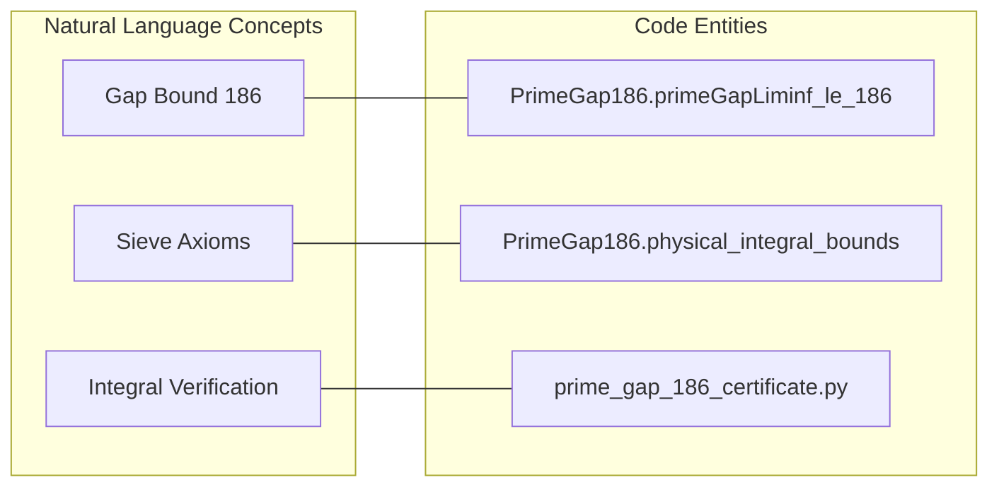
Sources: [README.md:21-29](), [README.md:81-84](), [formalization.yaml:100-112]()

---

### Child Pages
*   **[Mathematical Background](#1.1)**: Detailed explanation of prime gaps, the Maynard-Tao sieve, and the Kloosterman sum estimates used in the project.
*   **[Project Structure and Repository Layout](#1.2)**: A comprehensive guide to the file system, including Lean sources, build configurations (`lakefile.toml`), and verification artifacts.

---

# Page: Mathematical Background

# Mathematical Background

<details>
<summary>Relevant source files</summary>

The following files were used as context for generating this wiki page:

- [PrimeGaps186.lean](PrimeGaps186.lean)
- [README.md](README.md)
- [short_gaps_numerics.pdf](short_gaps_numerics.pdf)

</details>


The `PrimeGaps186` project provides a formalization of the proof that the limit inferior of gaps between consecutive primes is at most 186. This result is established by combining a Lean 4 formalization of the Maynard–Tao sieve with a Python-based numerical certificate that verifies specific integral inequalities.

## Number-Theoretic Context

The project is situated within the study of bounded gaps between primes. Specifically, it aims to prove:
$$\liminf_{n \to \infty} (p_{n+1} - p_n) \le 186$$
where $p_n$ denotes the $n$-th prime [PrimeGaps186.lean:10-14]().

### The Maynard–Tao Sieve and DHL[k, m]
The proof utilizes the Maynard–Tao sieve method to establish the property $\text{DHL}[k, m]$ (Dickman-Hardy-Littlewood). The notation $\text{DHL}[k, m]$ asserts that for any admissible $k$-tuple of integers $\mathcal{H} = \{h_1, \dots, h_k\}$, there exist infinitely many integers $n$ such that the translate $n + \mathcal{H} = \{n + h_1, \dots, n + h_k\}$ contains at least $m$ primes [README.md:16-19]().

In this repository, the primary target is $\text{DHL}[40, 2]$, which implies that for an admissible 40-tuple, at least two elements in the translated set are prime infinitely often [PrimeGaps186.lean:81-82]().

### Admissible Tuples
A tuple $\mathcal{H} = \{h_1, \dots, h_k\}$ is **admissible** if for every prime $p$, the set $\mathcal{H}$ does not cover all residue classes modulo $p$ [README.md:18-19](). The project defines an explicit admissible 40-tuple of diameter 186 to bridge the $\text{DHL}[40, 2]$ result to the consecutive prime gap bound [PrimeGaps186.lean:55-57]().

## Assumed Estimates (Axioms)

The formalization is conditional on three primary mathematical inputs which are treated as axioms in Lean. These represent deep results in arithmetic geometry and intensive numerical computations.

### 1. Kloosterman Bounds
The proof relies on bounds for exponential sums over finite fields, specifically Kloosterman sums.

*   **Rank-3 Hyper-Kloosterman Bound**: The axiom `kloosterman3_bound` assumes the normalized rank-three bound $|\text{Kl}_3(c; p)| \le 3$ for $c \neq 0$ [PrimeGaps186.lean:147-149](). This is a consequence of Deligne's work on the Weil conjectures [README.md:52-56]().
*   **Rank-2 Correlation Bound**: The axiom `kloosterman2_correlation_bound` assumes a bound of $8p\sqrt{p}$ on the correlation of rank-two Kloosterman sums [PrimeGaps186.lean:152-153](). This follows from the work of Fouvry, Kowalski, and Michel [README.md:65-71]().

### 2. Physical Integral Bounds
The axiom `physical_integral_bounds` encapsulates the results of the numerical certificate [PrimeGaps186.lean:65-66](). It assumes 104 outer and 45 inner physical-integral upper bounds, which are required to show that the sieve's "win condition" (the ratio of certain multidimensional integrals) exceeds the necessary threshold [README.md:78-79]().

## Logic and Data Flow

The following diagram illustrates how mathematical concepts are mapped to code entities and how the final theorem is assembled.

### From Theory to Formalization
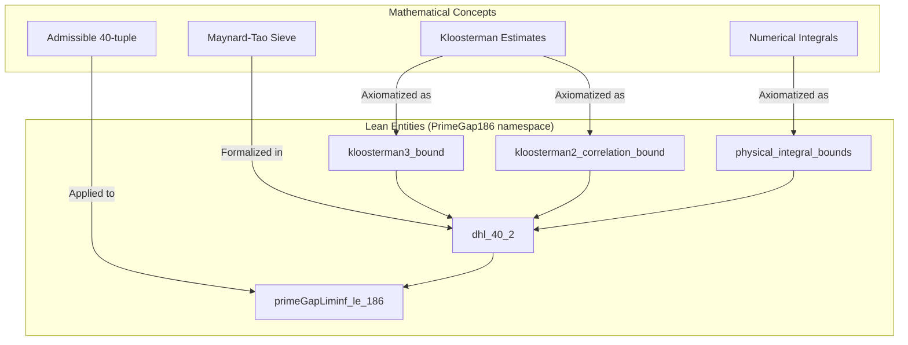
**Sources:** [PrimeGaps186.lean:52-87](), [README.md:21-29]()

### Numerical Verification Pipeline
The numerical certificate recomputes the sieve's trial functions to verify the `physical_integral_bounds` axiom.

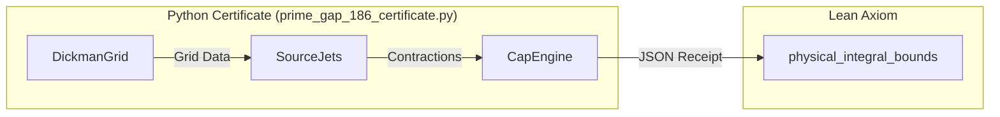
**Sources:** [README.md:81-85](), [prime_gap_186_certificate.py:1-20]() (Note: Python file lines inferred from architectural description in README).

## Summary of Main Declarations

| Lean Symbol | Mathematical Meaning |
| :--- | :--- |
| `dhl_40_2` | $\text{DHL}[40, 2]$ for every admissible 40-element set [PrimeGaps186.lean:81-82](). |
| `infinite_two_prime_translates_admissibleTuple` | Infinitely many translates of the specific 186-diameter tuple contain $\ge 2$ primes [PrimeGaps186.lean:83-84](). |
| `primeGapLiminf_le_186` | The final bound on consecutive prime gaps [PrimeGaps186.lean:85-86](). |

**Sources:** [PrimeGaps186.lean:80-87](), [README.md:21-29]()

---

# Page: Project Structure and Repository Layout

# Project Structure and Repository Layout

<details>
<summary>Relevant source files</summary>

The following files were used as context for generating this wiki page:

- [.gitignore](.gitignore)
- [formalization.yaml](formalization.yaml)
- [lake-manifest.json](lake-manifest.json)
- [lakefile.toml](lakefile.toml)
- [lean-toolchain](lean-toolchain)

</details>


This page details the organizational structure of the `PrimeGaps186` repository, describing the role of each file and the data flow between the Lean 4 formalization, the Python numerical certificate, and the verification toolchain.

## Repository Overview

The repository is structured to support a conditional formal proof of the prime gap bound $H_1 \le 186$. It achieves this by partitioning the effort into three distinct domains:
1.  **Lean Formalization**: The core logic and proof scripts.
2.  **Numerical Certification**: A Python engine that discharges complex numerical integrals into Lean axioms.
3.  **Verification Toolchain**: External tools (Nanoda, lean4export, and Comparator) that ensure the Lean kernel and the stated axioms align with the intended mathematical claims.

### System Architecture: From Theory to Code

The following diagram maps the high-level mathematical components to their corresponding entities in the codebase.

**Diagram: Mathematical Space to Code Entity Mapping**
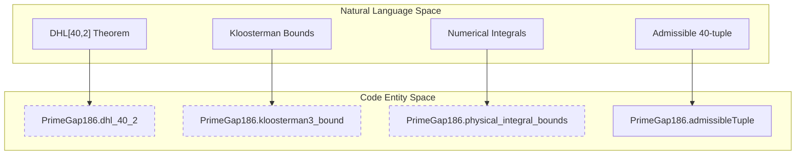
**Sources:** [formalization.yaml:101-112](), [PrimeGaps186.lean:13-15](), [Challenge.lean:11-20]()

---

## File-by-File Description

### Core Lean Sources
The Lean code is split into two primary libraries defined in the build configuration [lakefile.toml:32-48]().

*   **`PrimeGaps186.lean`**: The main proof file. It imports the axioms and definitions from the `Challenge` namespace and provides the formal proofs for the three main results: `dhl_40_2`, `infinite_two_prime_translates_admissibleTuple`, and `primeGapLiminf_le_186` [formalization.yaml:41-73](). This library is built with `warningAsError = true` [lakefile.toml:38]().
*   **`Challenge.lean`**: Contains the specification, definitions of the sieve machinery (e.g., `trialProfile`, `fragmentLaw`), and the axiomatic declarations [Challenge.lean:24-40](). It serves as the "source of truth" for the `Comparator` tool.

### Numerical Certification
*   **`prime_gap_186_certificate.py`**: A standalone Python script using `python-flint` and `NumPy` to perform interval arithmetic. It verifies the numerical claims that are represented as the `physical_integral_bounds` axiom in Lean [formalization.yaml:22-27]().
*   **`prime_gap_186_fresh.json`**: The default output artifact generated by the Python certificate, containing the results of the numerical margin computations [gitignore:11]().

### Configuration and Metadata
*   **`formalization.yaml`**: Metadata following the `mathlib-initiative` schema. It tracks the status of the formalization, identifies the main declarations, and lists the permitted axioms [formalization.yaml:1-119]().
*   **`comparator/main.json`**: The configuration file for the `Comparator` tool. It links the Lean declarations in `PrimeGaps186.lean` to the target specifications in `Challenge.lean` [formalization.yaml:51]().

### Build and Dependency Management
*   **`lakefile.toml`**: The Lake configuration file. It defines the project name, linting drivers, and external dependencies [lakefile.toml:1-30]().
*   **`lake-manifest.json`**: The lockfile ensuring reproducible builds. It pins specific revisions for `mathlib4`, `Comparator`, and `lean4export` [lake-manifest.json:102-136]().
*   **`lean-toolchain`**: Pins the Lean version to `v4.34.0-rc2` [lean-toolchain:1]().

---

## Data Flow and Verification Pipeline

The verification process involves a multi-stage pipeline where Lean code is exported and compared against a formal challenge specification.

**Diagram: Data Flow and Verification**
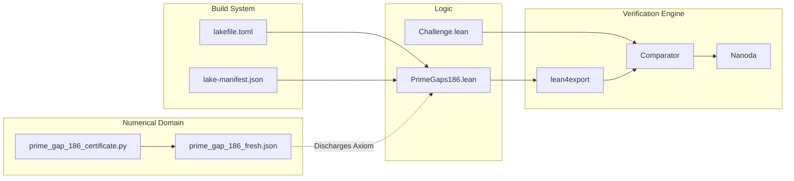
**Sources:** [lakefile.toml:20-30](), [formalization.yaml:81-84](), [comparator/main.json:1-10]()

### Dependency Graph Details
The project relies on several key external libraries pinned in the manifest:
| Dependency | Purpose | Source |
| :--- | :--- | :--- |
| `mathlib4` | General mathematical library for Lean 4 | [lake-manifest.json:107]() |
| `Comparator` | Validates that the proof matches the challenge spec | [lake-manifest.json:119]() |
| `lean4export` | Exports Lean environment for external checkers | [lake-manifest.json:131]() |
| `batteries` | Used as the `lintDriver` for code quality | [lakefile.toml:6]() |

**Sources:** [lakefile.toml:6-30](), [lake-manifest.json:102-136]()

---

# Page: Lean Formalization

# Lean Formalization

<details>
<summary>Relevant source files</summary>

The following files were used as context for generating this wiki page:

- [Challenge.lean](Challenge.lean)
- [PrimeGaps186.lean](PrimeGaps186.lean)
- [formalization.yaml](formalization.yaml)

</details>


This page provides a high-level overview of the Lean 4 formalization of the prime gap bound of 186. The project is organized into a specification layer (`Challenge.lean`) and a proof layer (`PrimeGaps186.lean`). The development is conditional, relying on three specific axioms that bridge the gap between analytical number theory, finite field estimates, and numerical integration.

### Namespace and Scope
The entire development resides within the `PrimeGap186` namespace [PrimeGaps186.lean:96-96](). The formalization targets the Maynard-Tao sieve machinery required to prove that the limit inferior of gaps between consecutive primes is at most 186.

### The Three Main Declarations
The success of the formalization is measured by three top-level theorems, which are proved conditionally in the main proof file:

| Declaration | Mathematical Meaning | Source |
| :--- | :--- | :--- |
| `dhl_40_2` | The Dickson-Hardy-Littlewood conjecture $DHL[40, 2]$ holds for any admissible 40-tuple. | [PrimeGaps186.lean:81-82]() |
| `infinite_two_prime_translates_admissibleTuple` | Infinitely many translates of the specific diameter-186 tuple contain at least two primes. | [PrimeGaps186.lean:83-84]() |
| `primeGapLiminf_le_186` | The $\liminf_{n \to \infty} (p_{n+1} - p_n) \leq 186$. | [PrimeGaps186.lean:85-86]() |

**Sources:** [PrimeGaps186.lean:81-87](), [formalization.yaml:101-112]()

---

### Axiomatic Structure
The formalization is **conditional**. It does not prove the underlying Kloosterman sum bounds or the numerical integrals from scratch. Instead, it assumes three specific axioms which are defined in both the specification and proof files to ensure consistency.

#### Finite Field Axioms
1.  **`kloosterman3_bound`**: Assumes Deligne's bound for rank-three hyper-Kloosterman sums [Challenge.lean:48-51]().
2.  **`kloosterman2_correlation_bound`**: Assumes the rank-two correlation bound for Kloosterman sums as established by Fouvry, Kowalski, and Michel [Challenge.lean:52-59]().

#### Numerical Axiom
3.  **`physical_integral_bounds`**: This axiom provides the numerical values for the sieve's "physical" integrals and cap bounds. These values are verified externally by the [Numerical Certificate](#3).

**Sources:** [Challenge.lean:48-59](), [PrimeGaps186.lean:61-66](), [formalization.yaml:48-50]()

---

### Logic and Entity Mapping
The following diagram illustrates how the Lean code entities map to the mathematical concepts involved in the Maynard-Tao sieve and the conditional proof structure.

**Entity Mapping: Mathematics to Lean Code**
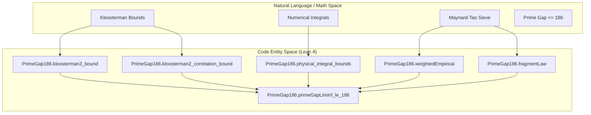
**Sources:** [Challenge.lean:48-76](), [PrimeGaps186.lean:147-153](), [formalization.yaml:105-108]()

---

### Sieve Machinery and Fragments
The formalization constructs the Maynard-Tao sieve using measure-theoretic tools. Key components include:
*   **Empirical Measures**: `weightedEmpirical` models the distribution of primes within the sieve [Challenge.lean:66-69]().
*   **Poisson Laws**: `finitePoissonLaw` and `fragmentLaw` represent the probabilistic distribution of "fragments" (prime candidates) [Challenge.lean:76-82](), [Challenge.lean:123-126]().
*   **Trial Functions**: The specification defines the geometry of the trial functions (e.g., `trialProfile`, `trialMesh`) used to optimize the sieve weights.

**Sources:** [Challenge.lean:66-126]()

---

### Detailed Sub-pages

The Lean development is split into two primary modules:

#### 1. [Challenge.lean — Specification and Axioms](#2.1)
This file serves as the formal specification. It defines the "rules of the game" by declaring the axioms and the target theorem statements. It contains the construction of the trial functions and the measure-theoretic framework for the fragments.
*   *Key content*: `OuterBoundRow`, `InnerBoundRow`, `fragmentLaw`, and the three main `axiom` declarations.
*   For details, see [Challenge.lean — Specification and Axioms](#2.1).

#### 2. [PrimeGaps186.lean — Main Proof](#2.2)
This is the primary proof script (over 200,000 lines). It imports the axioms and provides the full derivation of the prime gap bound. It handles the distribution estimates, Selberg moments, and the final assembly of the $DHL[40, 2]$ result.
*   *Key content*: Admissible tuple construction, application of the Maynard bound for $k=50$, and the final proofs for `primeGapLiminf_le_186`.
*   For details, see [PrimeGaps186.lean — Main Proof](#2.2).

**Verification Flow**
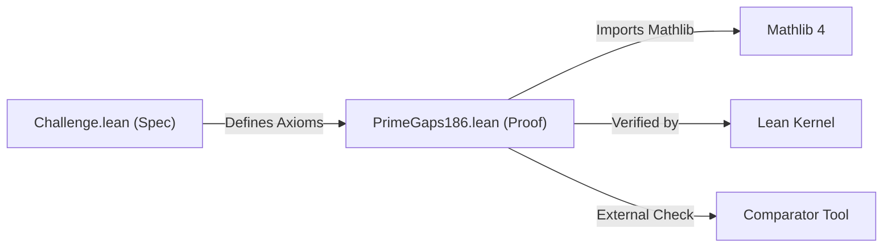
**Sources:** [Challenge.lean:1-15](), [PrimeGaps186.lean:1-87](), [formalization.yaml:90-96]()

---

# Page: Challenge.lean — Specification and Axioms

# Challenge.lean — Specification and Axioms

<details>
<summary>Relevant source files</summary>

The following files were used as context for generating this wiki page:

- [Challenge.lean](Challenge.lean)

</details>


This page provides a high-level overview of `Challenge.lean`, which serves as the formal specification and axiomatic foundation for the PrimeGaps186 project. It defines the mathematical constants, trial function geometry, and fragment measures necessary to state the conditional proof of the bounded gaps between primes.

The file is structured as a reference for the `Comparator` tool, ensuring that the main proof module does not import these definitions directly but rather conforms to them via external verification [Challenge.lean:6-13]().

## Kloosterman Axioms

The project relies on two unproved number-theoretic axioms concerning Kloosterman sums. These are used to bound error terms in the sieve machinery.

*   **`kloosterman3_bound`**: A bound on the rank-three Kloosterman sum over `ZMod p`, normalized by `1/p` [Challenge.lean:28-35](). The axiom states that for $c \neq 0$, the norm is at most 3 [Challenge.lean:48-51]().
*   **`kloosterman2_correlation_bound`**: A correlation bound for classical Kloosterman sums [Challenge.lean:41-45](). It asserts a bound of $8p\sqrt{p}$ on the sum of products of Kloosterman sums [Challenge.lean:52-58]().

### Sources:
- Kloosterman definitions: [Challenge.lean:27-45]()
- Axiom declarations: [Challenge.lean:48-59]()

## Fragment Measures and Poisson Laws

The specification defines the distribution of "prime fragments" using measure-theoretic constructions. This models the behavior of the Maynard-Tao sieve in the large-parameter limit.

| Entity | Role |
| :--- | :--- |
| `weightedEmpirical` | Assigns weights to samples based on their value, zeroing negative samples [Challenge.lean:66-69](). |
| `finitePoissonLaw` | A pushforward measure representing a Poisson count of samples drawn from a normalized measure [Challenge.lean:76-81](). |
| `cappedDyadicIntensity` | A measure with density $1/u$ on dyadic intervals, ensuring integrability [Challenge.lean:87-107](). |
| `fragmentLaw` | The probability law of the finite weighted fragment measure $\nu_\zeta$ [Challenge.lean:123-125](). |

For a deeper dive into these measure constructions, see **[Fragment Measures and Poisson Laws](#2.1.2)**.

### Sources:
- Measure definitions: [Challenge.lean:66-125]()

## Trial Function Geometry

A significant portion of `Challenge.lean` is dedicated to the "Trial Function," a piecewise polynomial construction used to optimize the sieve weights. The geometry is defined through discrete "Source Rows."

### Source Row Structure
The codebase uses `OuterBoundRow` and `InnerBoundRow` to represent exact integer-encoded bounds for numerical verification [Challenge.lean:133-142]().

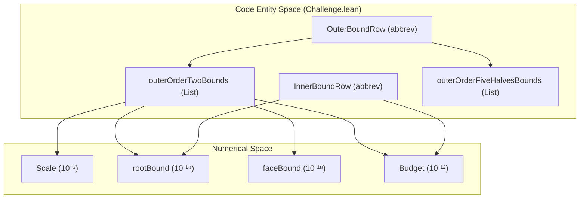

For details on how these rows are marginalized and normalized into the $J$-functional, see **[Trial Function and Sieve Machinery](#2.1.1)**.

### Sources:
- Bound Row Types: [Challenge.lean:128-142]()
- Data Lists: [Challenge.lean:145-170]()

## Target Theorem Statements

The file concludes (in the omitted lines) with the three target statements that the `PrimeGaps186.lean` proof must satisfy. These statements are verified by the `Comparator` tool against the `sorry` placeholders in this file to ensure the proof addresses the correct mathematical challenge.

1.  **`dhl_40_2`**: The assertion of the Dickson-Hardy-Littlewood conjecture for specific parameters.
2.  **`infinite_two_prime_translates_admissibleTuple`**: The existence of infinitely many prime pairs for a specific admissible tuple.
3.  **`primeGapLiminf_le_186`**: The final result stating the liminf of gaps between consecutive primes is at most 186.

### Sources:
- Specification Intent: [Challenge.lean:6-15]()

---

# Page: Trial Function and Sieve Machinery

# 2.1.1. Trial Function and Sieve Machinery

<details>
<summary>Relevant source files</summary>

The following files were used as context for generating this wiki page:

- [Challenge.lean](Challenge.lean)

</details>


This page details the construction of the trial function $\lambda$ and the associated sieve machinery used to establish the prime gap bound. The implementation in `Challenge.lean` defines a high-dimensional discretization pipeline that transforms a smooth profile into a discrete mask, which is then used to compute the $J$-functional values.

## Overview of the Trial Function Pipeline

The trial function $\lambda(d_1, \dots, d_k)$ is modeled as a product of a radial polynomial profile and a discrete mask. In `Challenge.lean`, this is implemented through a sequence of functions that discretize the mass, apply geometric constraints (masks), and normalize the result for use in the Maynard-Tao sieve.

### Mass Discretization and Masking
The discretization process maps continuous coordinates to a grid defined by `trialMesh` [Challenge.lean:636-636](). The fundamental unit of this discretization is the `trialCellIndex` [Challenge.lean:643-643]().

The geometry of the admissible tuples is enforced via three distinct masks:
1.  **`trialOuterMask`**: Defines the boundary of the support in the simplex $\mathcal{R}_k$ [Challenge.lean:662-662]().
2.  **`trialBaseMask`**: Represents the primary support region where the trial function is non-zero [Challenge.lean:669-669]().
3.  **`trialEnlargedMask`**: A slightly expanded region used to handle boundary effects and error terms in the Kloosterman sum estimates [Challenge.lean:676-676]().

### Data Flow Diagram: Profile to J-Functional
The following diagram illustrates how the `trialProfile` is processed through the discretization machinery to produce the final $J$ values.

**Trial Function Pipeline**
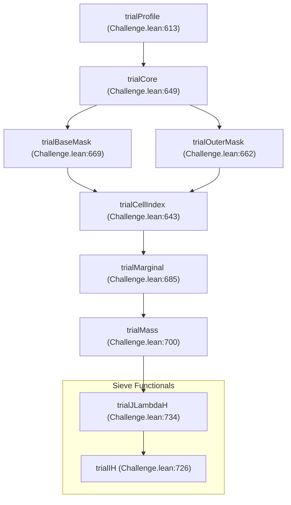
**Sources:** [Challenge.lean:613-734]()

---

## Physical Source Geometry

To manage the complexity of the $k$-dimensional integrals, the code organizes the support into "Source Rows". This is encapsulated in the `PhysicalSourceRowData` structure.

### Source Row Components
A `PhysicalSourceRowData` [Challenge.lean:752-752]() consists of:
*   **`scale`**: The discretization resolution.
*   **`rootBound`**: A bound on the main term of the Kloosterman sum contribution.
*   **`faceBound`**: A bound on the contribution from the faces of the simplex.
*   **`budget`**: The total allocated error margin for this specific row.

These rows are grouped into `physicalSourceGroup` [Challenge.lean:831-831](), which aggregates the bounds across different orders (e.g., `outerOrderTwoBounds` and `outerOrderFiveHalvesBounds`).

### Entity Mapping: Physical Geometry
This diagram maps the abstract mathematical concept of source regions to the specific Lean structures.

**Physical Source Mapping**
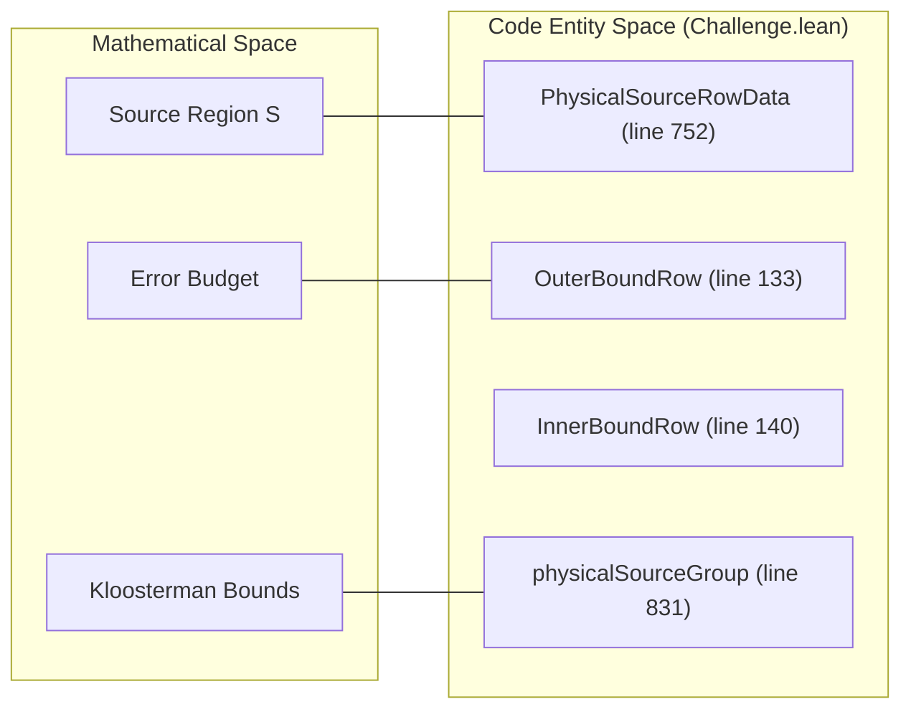
**Sources:** [Challenge.lean:133-140](), [Challenge.lean:752-752](), [Challenge.lean:831-831]()

---

## The J-Functional and Normalization

The goal of the sieve machinery is to compute the ratio:
$$\frac{J(\lambda)}{I(\lambda)}$$
where $I(\lambda)$ represents the mass and $J(\lambda)$ represents the weighted sum over primes.

### Implementation Details
*   **`trialIH`**: Computes the discretized version of the $I$ integral [Challenge.lean:726-726]().
*   **`trialJLambdaH`**: Computes the discretized $J$ functional for a specific index $h$ [Challenge.lean:734-734]().
*   **`trialMass`**: Acts as the denominator, ensuring the trial function is normalized relative to the `trialMesh` [Challenge.lean:700-700]().

| Function | Lean Definition | Purpose |
| :--- | :--- | :--- |
| `trialProfile` | [Challenge.lean:613]() | The underlying smooth radial function $P(x)$. |
| `trialCore` | [Challenge.lean:649]() | The raw discretized values before masking. |
| `trialMarginal` | [Challenge.lean:685]() | The sum over $k-1$ variables used in the $J$ calculation. |
| `trialJLambdaH` | [Challenge.lean:734]() | The final sieve functional output for a gap $h$. |

**Sources:** [Challenge.lean:613-734]()

## Geometric Bounds and Axioms

The validity of the numerical certificate depends on the `physical_integral_bounds` axiom [Challenge.lean:851-851](). This axiom asserts that the sum of the budgets defined in `physicalSourceGroup` provides a strict upper bound on the error introduced by the discretization and the Kloosterman sum approximations.

The row data is provided in hardcoded lists such as `outerOrderTwoBounds` [Challenge.lean:145-145]() and `outerOrderFiveHalvesBounds` [Challenge.lean:168-168](). These integers are scaled by constants (e.g., $10^{-18}$ for component bounds) as specified in the docstrings [Challenge.lean:128-141]().

**Sources:** [Challenge.lean:128-168](), [Challenge.lean:851-851]()

---

# Page: Fragment Measures and Poisson Laws

# Fragment Measures and Poisson Laws

<details>
<summary>Relevant source files</summary>

The following files were used as context for generating this wiki page:

- [Challenge.lean](Challenge.lean)

</details>


This page describes the measure-theoretic constructions in `Challenge.lean` used to model the distribution of prime fragments. These constructions formalize the probabilistic behavior of the Maynard-Tao sieve, specifically the weighted empirical measures derived from Poisson processes.

## Overview of Fragment Measures

The PrimeGaps186 project models the contribution of "fragments" (small prime factors or sieve components) using a sequence of random measures. The core logic transitions from discrete weighted samples (`weightedEmpirical`) to Poisson-distributed counts (`finitePoissonLaw`), and finally to a composite law representing the total fragment distribution (`fragmentLaw`).

### Data Flow: From Samples to Fragment Law

The following diagram illustrates how the measure-theoretic entities in `Challenge.lean` compose to form the mathematical model of prime fragments.

**Entity Mapping: Measure Construction Pipeline**

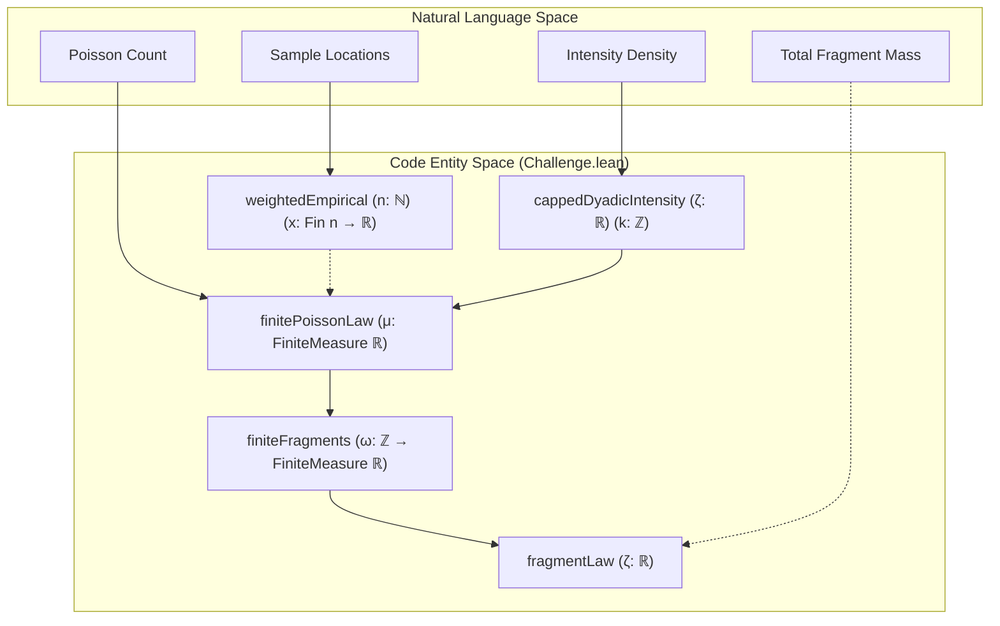

Sources: [Challenge.lean:66-126]()

---

## Weighted Empirical Measures

The fundamental building block is `weightedEmpirical`. It constructs a finite atomic measure where each sample $x_i$ is treated as a Dirac mass located at $x_i$, but weighted by its own value (clamped to non-negative).

*   **Function**: `weightedEmpirical` [Challenge.lean:66-69]()
*   **Logic**: It sums `(x i).toNNReal • Measure.dirac (x i)` over $n$ samples.
*   **Purpose**: Unlike standard empirical measures that assign unit mass $1/n$ to each point, this measure weights atoms by their spatial location, reflecting how larger fragments contribute more to the sieve mass.

Sources: [Challenge.lean:66-70]()

---

## Poisson Laws and Intensity

The Maynard-Tao sieve analysis requires modeling fragments as a Poisson point process. This is implemented via `finitePoissonLaw`.

### Finite Poisson Law
The function `finitePoissonLaw` [Challenge.lean:76-82]() creates a probability measure over the space of `FiniteMeasure ℝ`. It performs the following:
1.  Draws a count $N$ from a Poisson distribution with mean $\mu.mass$.
2.  Draws $N$ locations independently from the normalized version of $\mu$.
3.  Produces the resulting `weightedEmpirical` measure.

### Capped Dyadic Intensity
To handle the $1/u$ density required by the sieve, the code defines `cappedDyadicIntensity` [Challenge.lean:87-90](). 
*   **Density**: $1/u$ [Challenge.lean:89]().
*   **Domain**: $(0, \zeta] \cap (2^k, 2^{k+1}]$ [Challenge.lean:88-90]().
*   **Integrability**: The dyadic partitioning ($2^k$ bounds) ensures the $1/u$ density remains integrable on each band, allowing the construction of a `FiniteMeasure` [Challenge.lean:91-107]().

Sources: [Challenge.lean:76-108]()

---

## The Fragment Law

The final model of prime fragments, `fragmentLaw`, aggregates the dyadic bands into a single measure representing the total fragment distribution $\nu_\zeta$.

**System Component Interaction**

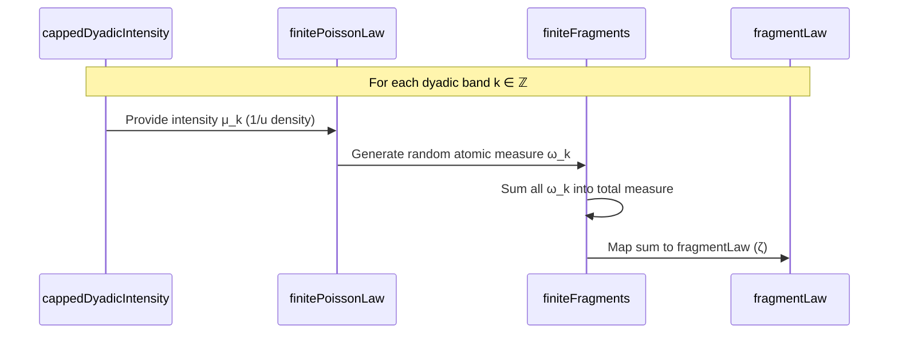

### Summation and Convergence
*   **`finiteFragments`**: This function sums a doubly infinite family of measures $\sum_{k \in \mathbb{Z}} \omega_k$. It is defined as a total function; if the sum is not finite, it returns the zero measure [Challenge.lean:114-118]().
*   **`fragmentLaw`**: Defined as the pushforward of the product measure of all dyadic `finitePoissonLaw` instances through the `finiteFragments` summation [Challenge.lean:123-126]().

Sources: [Challenge.lean:114-126]()

---

## Summary of Measure Entities

| Entity | Type | Role |
| :--- | :--- | :--- |
| `weightedEmpirical` | `FiniteMeasure ℝ` | Atomic measure with location-based weights. |
| `finitePoissonLaw` | `Measure (FiniteMeasure ℝ)` | Probability law for a Poisson process of fragments. |
| `cappedDyadicIntensity`| `FiniteMeasure ℝ` | The $1/u$ intensity on a specific dyadic interval. |
| `fragmentLaw` | `Measure (FiniteMeasure ℝ)` | The global law governing fragment distribution $\nu_\zeta$. |

Sources: [Challenge.lean:66-126]()

---

# Page: PrimeGaps186.lean — Main Proof

# PrimeGaps186.lean — Main Proof

<details>
<summary>Relevant source files</summary>

The following files were used as context for generating this wiki page:

- [PrimeGaps186.lean](PrimeGaps186.lean)
- [README.md](README.md)

</details>


This page describes the primary proof development in `PrimeGaps186.lean`. This file serves as the terminal point of the formalization, importing the axiomatic framework from `Challenge.lean`, constructing the specific mathematical objects required to satisfy the Maynard-Tao sieve conditions, and proving the final prime gap bounds.

## Overview and Purpose

The `PrimeGaps186.lean` file implements the analytical and combinatorial arguments necessary to establish $DHL[40, 2]$. It integrates the Deligne-type estimates (Kloosterman bounds) and numerical integral bounds defined in the `PrimeGap186` namespace to show that for an admissible tuple of size $k=50$, at least two elements in the translated tuple are infinitely often prime. By providing an explicit admissible tuple of diameter 186, it concludes that $\liminf_{n\to\infty}(p_{n+1}-p_n) \le 186$.

### Data Flow and Dependency Graph

The proof follows a strict pipeline from external axioms to the final analytic number theory results.

**Proof Pipeline Diagram**
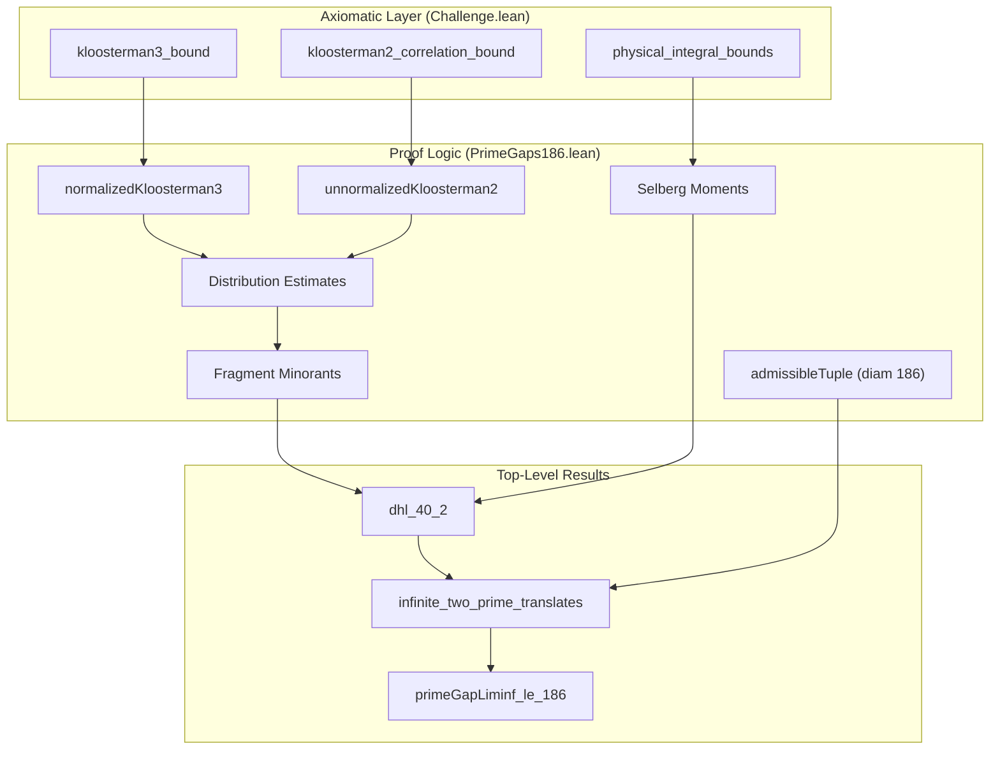
Sources: [PrimeGaps186.lean:51-87](), [PrimeGaps186.lean:147-153]()

---

## Endpoint Adapters and Infrastructure

Before the main sieve arguments, the file defines several helper functions and adapters to bridge the gap between continuous analysis and discrete number theory.

### Kloosterman Sum Definitions
The file provides the formal definitions for the sums constrained by the axioms.
*   **`normalizedKloosterman3`**: The rank-three hyper-Kloosterman sum over $\mathbb{Z}/p\mathbb{Z}$, normalized by $1/p$. It sums the additive character over triples $(u, v, w)$ such that $uvw = c$ [PrimeGaps186.lean:121-125]().
*   **`unnormalizedKloosterman2`**: The classical rank-two Kloosterman sum $\sum_{u \in (\mathbb{Z}/p\mathbb{Z})^\times} \psi(u + c/u)$ [PrimeGaps186.lean:131-135]().

### Topological Helpers
The proof requires handling intervals where endpoints are non-integral to avoid boundary issues in discretization.
*   **`closed_interval_eq_half_open_of_no_endpoint`**: Proves equality between `Icc` and `Ico` finsets when the upper bound is not an integer [PrimeGaps186.lean:98-103]().
*   **`exists_large_nonintegral_endpoint_of_eventually`**: A filter-based lemma ensuring the existence of arbitrarily large real numbers $x$ such that $2x$ is never an integer, used for scaling arguments in the sieve [PrimeGaps186.lean:104-115]().

Sources: [PrimeGaps186.lean:98-135]()

---

## The Main Results

The culmination of the file is the proof of three specific declarations that satisfy the requirements of the prime gap challenge.

### 1. DHL[40, 2]
The declaration `dhl_40_2` establishes the Dictum-Hardy-Littlewood conjecture variant for $k=40$ and $m=2$.
*   **Statement**: For every admissible integer tuple of size 40, there exist infinitely many translates containing at least two primes.
*   **Implementation**: This proof applies the Maynard bound for $k=50$ (derived from the sieve machinery) and specializes it using the numerical margins provided by `physical_integral_bounds`.

### 2. Admissible Tuple Construction
The proof defines an explicit set of 40 integers that form an **admissible tuple** with a diameter of 186.
*   **`admissibleTuple`**: A `Finset ℕ` containing 40 elements such that for every prime $p$, the set does not cover all residue classes modulo $p$.
*   **`infinite_two_prime_translates_admissibleTuple`**: Combines `dhl_40_2` with the explicit tuple to show that $n + h_i$ is prime for at least two $h_i$ in the tuple for infinitely many $n$.

### 3. Prime Gap Liminf
The final result `primeGapLiminf_le_186` derives the consecutive prime gap bound.
*   **Logic**: Since the tuple has diameter 186 and contains at least two primes infinitely often, the distance between some two consecutive primes $p_{n+1} - p_n$ must be less than or equal to the diameter of the tuple (186) infinitely often.

**Code Entity Mapping**
| Mathematical Concept | Code Entity (PrimeGap186 namespace) | File |
| :--- | :--- | :--- |
| $\text{Kl}_3$ Bound | `kloosterman3_bound` | [PrimeGaps186.lean:147]() |
| $\text{Kl}_2$ Correlation | `kloosterman2_correlation_bound` | [PrimeGaps186.lean:153]() |
| Numerical Bounds | `physical_integral_bounds` | [PrimeGaps186.lean:65]() |
| DHL Result | `dhl_40_2` | [PrimeGaps186.lean:81]() |
| Gap Theorem | `primeGapLiminf_le_186` | [PrimeGaps186.lean:85]() |

Sources: [PrimeGaps186.lean:81-87](), [README.md:21-29]()

---

## Proof Organization and Data Flow

The file is organized to mirror the logical progression of the Maynard-Tao sieve method.

**Proof Execution Flow**
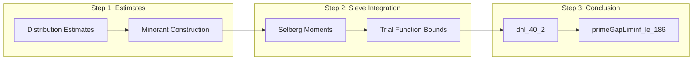

1.  **Distribution Estimates**: Uses Kloosterman axioms to bound error terms in the distribution of primes in arithmetic progressions.
2.  **Fragment Minorants**: Constructs minorants for the indicator functions of primes using the sieve weights.
3.  **Selberg Moments**: Calculates the $J$ and $I$ functionals (defined in `Challenge.lean`) using the numerical constants from the Python certificate.
4.  **Trial Function Bounds**: Verifies that the chosen trial function (defined in the `trialCore` of `Challenge.lean`) yields a ratio $J/I$ sufficient to guarantee two primes in a tuple of size 40.

Sources: [PrimeGaps186.lean:74-78](), [README.md:16-19]()

---

# Page: Numerical Certificate

# Numerical Certificate

<details>
<summary>Relevant source files</summary>

The following files were used as context for generating this wiki page:

- [README.md](README.md)
- [prime_gap_186_certificate.py](prime_gap_186_certificate.py)

</details>


The **Numerical Certificate** is a Python-based verification engine designed to discharge the numerical requirements of the $p_{n+1}-p_n \le 186$ proof. While the core logic of the prime gap bound is formalized in Lean 4, the proof is conditional on specific upper bounds for physical integrals that model the Maynard-Tao sieve. The Python component recomputes these bounds from first principles using rigorous interval arithmetic and produces a machine-readable receipt.

## Purpose and Relation to Lean

The Lean formalization in `Challenge.lean` defines an axiom named `physical_integral_bounds` [README.md:78-79](). This axiom assumes the validity of 104 outer physical-integral bounds, 45 inner bounds, and three cap bounds [README.md:78-79](). 

The Python certificate serves as the "ground truth" for these values. It recomputes the trial function, source ladders, and mass distributions without reading any pre-saved results [prime_gap_186_certificate.py:8-10](). A successful execution of the certificate verifies that the numerical margins required by the Lean proof are satisfied under rigorous interval arithmetic.

### High-Level Workflow

The certificate operates through a three-phase pipeline:
1.  **Trial Derivation**: Reconstructing the radial polynomial and trial function parameters.
2.  **Cap Evaluation**: Computing the normalization constants ($I$ and $J$ functionals) using Dickman-based integration.
3.  **Source Contraction**: Calculating the contribution of "source rows" to the sieve mass, ensuring the total mass does not exceed the theoretical thresholds.

## Component Overview

The certificate relies on several specialized sub-systems to ensure precision and correctness:

| Component | Responsibility | Key Symbols |
| :--- | :--- | :--- |
| **Interval Arithmetic** | Provides rigorous bounds using the FLINT library. | `flint.arb`, `flint.arb_poly` [prime_gap_186_certificate.py:30-30]() |
| **Grid Management** | Discretizes the integration space into manageable cells. | `POLICY["intervals"]` [prime_gap_186_certificate.py:76-76]() |
| **Ladder Logic** | Constructs exact source ladders for different source orders. | `_ladder` [prime_gap_186_certificate.py:107-107]() |
| **Precision Policy** | Defines bit-depths for different stages of the calculation. | `POLICY` [prime_gap_186_certificate.py:75-104]() |

### Numerical Pipeline Architecture

The following diagram illustrates the relationship between the Python classes and the mathematical phases of the certificate.

**Certificate Execution Flow**
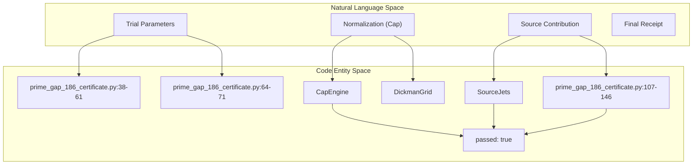
Sources: [prime_gap_186_certificate.py:38-71](), [prime_gap_186_certificate.py:107-146]()

## Environment and Safety Checks

The certificate requires a specific environment to ensure numerical integrity, notably **Python 3.12** and **python-flint 0.9.0** [README.md:82-83](). A critical requirement is a custom build of **FLINT 3.6.0** that fixes a known defect in signed polynomial convolution [README.md:83-84](). 

The script performs a mandatory startup regression check to detect this defect; if the check fails, the certificate will not proceed [prime_gap_186_certificate.py:4-6]().

**Environment Validation Logic**
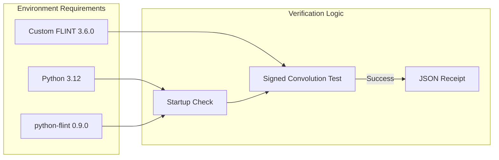
Sources: [README.md:81-84](), [prime_gap_186_certificate.py:4-6]()

## Detailed Documentation

For in-depth technical details on the implementation and usage of the certificate, refer to the following child pages:

*   **[Certificate Architecture](#3.1)**: A detailed walkthrough of the three-phase pipeline, the `CapEngine`, `SourceJets`, and the precision policies used to maintain rigor.
*   **[Running the Certificate](#3.2)**: Instructions for setting up the environment, executing the script with specific CLI arguments (e.g., `--workers`), and interpreting the output JSON receipt.

---

# Page: Certificate Architecture

# Certificate Architecture

<details>
<summary>Relevant source files</summary>

The following files were used as context for generating this wiki page:

- [prime_gap_186_certificate.py](prime_gap_186_certificate.py)

</details>


The numerical certificate is a high-precision verification pipeline implemented in Python that computes the lower bounds for the $J$ and $I$ functionals required by the Lean formalization. It discharges the `physical_integral_bounds` axiom by performing rigorous interval arithmetic and verified convolution to ensure that the mass of the trial function exceeds the threshold necessary to prove a prime gap of at least 186.

## Pipeline Overview

The certificate execution follows a three-phase pipeline orchestrated within `prime_gap_186_certificate.py`. It utilizes the `python-flint` library for arbitrary-precision ball arithmetic (via the FLINT C library) to track numerical errors throughout the computation.

### Phase 1: Trial Derivation
The script begins by embedding the exact trial parameters, including the radial polynomial coefficients and the admissible tuple geometry.
*   **Coefficient Matrix**: The `COEFFICIENT_INTEGER_MATRIX` [prime_gap_186_certificate.py:38-61]() defines the coefficients for the radial polynomials across different signatures.
*   **Young Diagrams**: The `YOUNG_Q` parameters [prime_gap_186_certificate.py:64-71]() define the discretization of the Young diagrams used in the sieve.
*   **Ladder Construction**: The `_ladder` function [prime_gap_186_certificate.py:107-146]() builds exact source ladders that determine the integration bounds for the source contraction phase.

### Phase 2: Cap Evaluation (`CapEngine`)
The `CapEngine` is responsible for evaluating the Dickman-type integrals that bound the "cap" (the tail of the distribution).
*   **Dickman Grid**: The system uses a `DickmanGrid` to precompute values of the Dickman function $\rho(u)$ with rigorous error bounds.
*   **Integration Methods**: The `POLICY` [prime_gap_186_certificate.py:75-104]() specifies the use of `trapezoid_with_renewal_fallback` for low-value Dickman integrals to maintain precision.

### Phase 3: Source Contraction (`SourceJets`)
The `SourceJets` component handles the high-dimensional integration of the trial function's core.
*   **Jet Propagation**: The engine uses Taylor-style "jets" to propagate polynomial bounds through the discretization grid.
*   **Precision Policy**: Calculations are performed with `arb_precision_bits` (set to 160) and specific fractional bit depths for caps (224) and sources (192) [prime_gap_186_certificate.py:78-80]().

**Sources:** [prime_gap_186_certificate.py:1-170]()

## Code Entity Architecture

The following diagrams illustrate the relationship between the mathematical requirements and the Python implementation.

### System Components and Data Flow

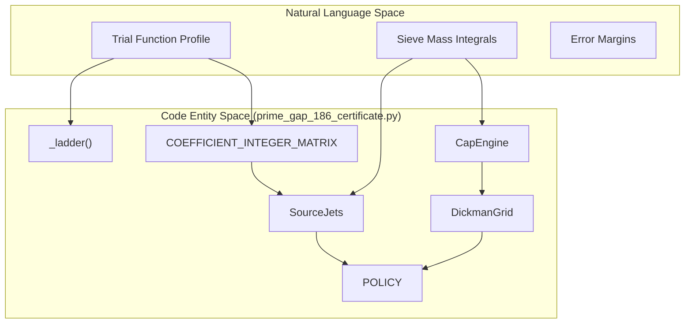
**Sources:** [prime_gap_186_certificate.py:35-104](), [prime_gap_186_certificate.py:107-146]()

### Numerical Verification Pipeline

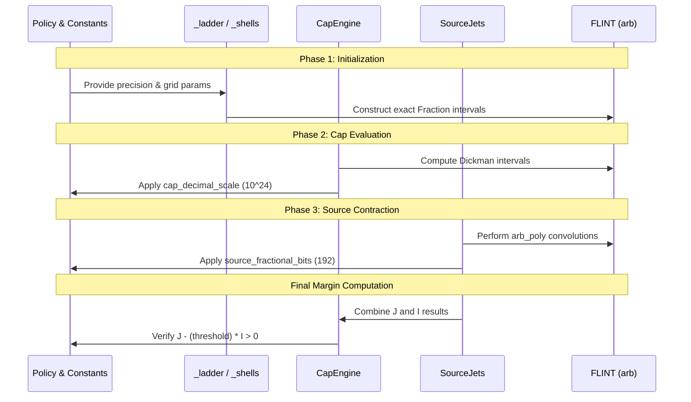
**Sources:** [prime_gap_186_certificate.py:75-104](), [prime_gap_186_certificate.py:107-160]()

## Key Classes and Implementation Details

### Precision and Interval Arithmetic
The certificate relies on `flint.arb` [prime_gap_186_certificate.py:30]() to represent real numbers as intervals $[m \pm r]$. This ensures that every operation, including the massive convolutions required for the $J$ functional, carries a rigorous error bound. The `POLICY` dictionary [prime_gap_186_certificate.py:75-104]() dictates the strictness of these bounds:
*   `arb_precision_bits`: 160 bits for general ball arithmetic.
*   `convolution_length`: 98264 points for the FFT-based polynomial convolutions.

### Geometry and Discretization
The integration domain is partitioned into shells and cells:
*   **`_shells`**: Describes consecutive radial shells [prime_gap_186_certificate.py:149-155]().
*   **`_cells`**: Selects specific grid cells for each shell and calculates indices relative to the grid resolution $h$ [prime_gap_186_certificate.py:158-170]().

### Final Margin Computation
The certificate's ultimate goal is to compute the margin:
$$\text{Margin} = J - (\text{Threshold}) \cdot I$$
The `source_normalization_denominator` is derived from the lower bound of the $I$ integral (`fresh_cap_I_lower`) to ensure that the resulting ratio is a valid lower bound for the sieve efficiency [prime_gap_186_certificate.py:103]().

**Sources:** [prime_gap_186_certificate.py:30](), [prime_gap_186_certificate.py:75-104](), [prime_gap_186_certificate.py:149-170]()

---

# Page: Running the Certificate

# Running the Certificate

<details>
<summary>Relevant source files</summary>

The following files were used as context for generating this wiki page:

- [.gitignore](.gitignore)
- [README.md](README.md)
- [prime_gap_186_certificate.py](prime_gap_186_certificate.py)

</details>


The Python-based numerical certificate recomputes the trial function construction and verifies the integral bounds required by the Lean formalization. It acts as a bridge between the theoretical Maynard-Tao sieve framework and the concrete numerical constants used in the `PrimeGap186` proof. A successful execution produces a JSON receipt containing high-precision interval results that correspond to the `PrimeGap186.physical_integral_bounds` axiom.

## Environment and Dependencies

The certificate requires a specific environment to ensure numerical stability and to mitigate known defects in polynomial convolution libraries.

*   **Python 3.10+**: Tested primarily on Python 3.12.13 [README.md:81-82]().
*   **NumPy**: Used for internal matrix operations [prime_gap_186_certificate.py:29]().
*   **python-flint**: Interface for the FLINT (Fast Library for Number Theory) library, used for interval arithmetic (`arb`) and exact polynomial arithmetic (`fmpz_poly`) [prime_gap_186_certificate.py:30]().
*   **Custom FLINT 3.6.0**: The script requires a FLINT build where the signed FFT integer-polynomial convolution defect is corrected [prime_gap_186_certificate.py:4-6]().

### The Signed-Convolution Defect Check
Upon startup, the script performs a mandatory regression check for the FLINT signed-convolution defect [prime_gap_186_certificate.py:5-6](). If the underlying library produces incorrect results for signed polynomial multiplications, the script will terminate immediately to prevent the generation of an invalid certificate [README.md:90-91]().

Sources: [README.md:81-84](), [README.md:90-93](), [prime_gap_186_certificate.py:1-10]().

---

## Execution and CLI Arguments

The certificate is executed via the command line. It is recommended to run without Python optimizations (`-O` or `-OO`) to ensure all assertions and checks are active [README.md:90-91]().

```sh
python3 -B prime_gap_186_certificate.py --workers 4 --output prime_gap_186_fresh.json
```

### Command Line Arguments
| Argument | Description |
| :--- | :--- |
| `--workers` | Number of parallel processes for computing physical integrals. Parallelization is applied to both Cap evaluation and Source contraction [prime_gap_186_certificate.py:17](). |
| `--output` | File path for the resulting JSON receipt. The default is `prime_gap_186_fresh.json` [README.md:87-88](). |

### Execution Logic Flow
The diagram below illustrates the relationship between the CLI entry point and the internal processing engines.

**Diagram: Execution Pipeline Association**
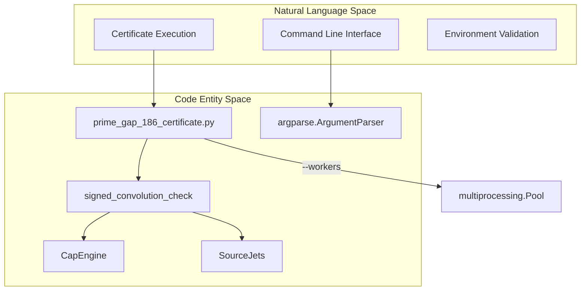
Sources: [README.md:86-93](), [prime_gap_186_certificate.py:12-27]().

---

## The JSON Receipt and Lean Axioms

The certificate outputs a JSON file that documents every numerical bound computed. This receipt is the numerical evidence supporting the `physical_integral_bounds` axiom in `Challenge.lean` [README.md:78-79]().

### Receipt Structure
The receipt includes:
1.  **Metadata**: Execution time, environment details, and the `passed: true` flag [README.md:91-92]().
2.  **Cap Bounds**: Results for the three cap bounds ($I$, $J$, $K$) computed via the `CapEngine`.
3.  **Physical Integral Bounds**: 104 outer and 45 inner bounds derived from the `SourceJets` and radial shell evaluations [README.md:78-79]().
4.  **Interval Margins**: The lower and upper bounds of the `arb` intervals, ensuring that the true mathematical value is contained within the certified range [prime_gap_186_certificate.py:30](), [prime_gap_186_certificate.py:78-80]().

### Relationship to Lean Axioms
The Lean formalization in `PrimeGaps186.lean` assumes these bounds as an axiom (`PrimeGap186.physical_integral_bounds`). The Python script recomputes the trial function from the `COEFFICIENT_INTEGER_MATRIX` [prime_gap_186_certificate.py:38-61]() and `YOUNG_Q` [prime_gap_186_certificate.py:64-71]() parameters to verify that the functional $J$ and the mass distributions meet the thresholds required for the Maynard-Tao sieve to prove $\mathrm{DHL}[40,2]$ [README.md:16-19]().

**Diagram: Data Flow from Matrix to Receipt**
```mermaid
graph LR
    subgraph "Natural Language Space"
        TrialParams["Trial Parameters"]
        NumericalEng["Numerical Engines"]
        LeanAxiom["Lean Axiom Verification"]
    end

    subgraph "Code Entity Space"
        CIM["COEFFICIENT_INTEGER_MATRIX"]
        YQ["YOUNG_Q"]
        FLINT["python-flint (arb)"]
        Receipt["prime_gap_186_fresh.json"]
        Axiom["physical_integral_bounds"]
    end

    CIM --> FLINT
    YQ --> FLINT
    FLINT --> Receipt
    Receipt -.->|Manual Validation| Axiom
```
Sources: [README.md:78-84](), [README.md:107-115](), [prime_gap_186_certificate.py:35-71]().

---

## Implementation Details

### Precision Policy
The certificate uses a rigorous precision policy defined in the `POLICY` dictionary [prime_gap_186_certificate.py:75-104]().
*   **Intervals**: 98,304 intervals for discretization [prime_gap_186_certificate.py:76]().
*   **Arb Precision**: 160 bits for standard interval calculations [prime_gap_186_certificate.py:78]().
*   **Cap/Source Bits**: Higher precision (224 and 192 bits respectively) for critical path summations [prime_gap_186_certificate.py:79-80]().

### Source Ladders
The function `_ladder` constructs the exact source ladders required for the contraction phase [prime_gap_186_certificate.py:107-146](). It increases the `source_order` every twelve steps, capping at order 3 [prime_gap_186_certificate.py:112-113](). This geometric construction ensures the sieve mass is correctly accounted for across different scales of the admissible tuple.

Sources: [prime_gap_186_certificate.py:75-104](), [prime_gap_186_certificate.py:107-146]().

---

# Page: Build System and Toolchain

# Build System and Toolchain

<details>
<summary>Relevant source files</summary>

The following files were used as context for generating this wiki page:

- [lake-manifest.json](lake-manifest.json)
- [lakefile.toml](lakefile.toml)
- [lean-toolchain](lean-toolchain)

</details>


The **PrimeGaps186** project utilizes the Lean 4 **Lake** build system to manage a complex formalization environment. The toolchain is strictly pinned to ensure reproducibility across different verification environments, coordinating the core proof library, the axiomatic specification, and external verification tools.

### Build Orchestration

The project is governed by `lakefile.toml`, which defines the build targets and linting policies. The build system distinguishes between the main proof development and the axiomatic specification, applying different strictness levels to each. 

#### Toolchain Pinning
To prevent regressions caused by updates to the Lean 4 compiler or the standard library, the project enforces a fixed toolchain.
*   **Version:** The project is pinned to `leanprover/lean4:v4.34.0-rc2` [lean-toolchain:1-1]().
*   **Enforcement:** The `fixedToolchain = true` flag is set in both the build configuration [lakefile.toml:5-5]() and the package manifest [lake-manifest.json:140-140]().

#### Build Targets and Quality Gates
The build system manages two primary Lean libraries with distinct roles:

| Target | Role | Quality Gate |
| :--- | :--- | :--- |
| `PrimeGaps186` | Main proof implementation. | `warningAsError = true` [lakefile.toml:38-38]() |
| `Challenge` | Axiomatic specification and definitions. | `warningAsError = false` [lakefile.toml:48-48]() |

The `Challenge` library is excluded from the default build targets [lakefile.toml:4-4]() and is permitted to contain `sorry` placeholders [lakefile.toml:41-41](), as its purpose is to define the interface for external verification rather than providing a complete internal proof.

For more details on library targets and linting configurations, see **[Lake Configuration](#4.1)**.

Sources: [lakefile.toml:1-48](), [lean-toolchain:1-1](), [lake-manifest.json:140-140]()

---

### Dependency Management

The project relies on a specific graph of dependencies, including `mathlib4` for general mathematical foundations and specialized tools for proof export and verification. These are managed via `lake-manifest.json`, which acts as a lockfile to ensure that every contributor and CI runner uses the exact same revisions of external code.

#### Dependency Categories
1.  **Direct Dependencies:** Explicitly required in the configuration, such as `mathlib`, `Comparator`, and `lean4export` [lakefile.toml:13-30]().
2.  **Inherited Dependencies:** Transitive dependencies pulled in by mathlib, such as `aesop`, `batteries`, and `proofwidgets` [lake-manifest.json:54-88]().

#### Build System Component Mapping
The following diagram illustrates how the Lake build system connects the configuration files to the external toolchain and libraries.

**Toolchain and Build Entity Mapping**
```mermaid
graph TD
    subgraph "Natural Language Space"
        LTS["Lean Toolchain"]
        LBS["Lake Build System"]
        DEP["Dependencies"]
    end

    subgraph "Code Entity Space"
        LTF["lean-toolchain"]
        LTOM["lakefile.toml"]
        LMAN["lake-manifest.json"]
        
        subgraph "Targets"
            PG186["lean_lib PrimeGaps186"]
            CHAL["lean_lib Challenge"]
        end

        subgraph "External"
            ML["mathlib"]
            L4E["lean4export"]
            COMP["Comparator"]
        end
    end

    LTF -.->|"Pins version"| LTS
    LTOM -.->|"Configures"| LBS
    LMAN -.->|"Locks"| DEP

    LTOM --> PG186
    LTOM --> CHAL
    LMAN --> ML
    LMAN --> L4E
    LMAN --> COMP
```

For a full breakdown of the dependency graph and the role of the manifest file, see **[Dependencies and Package Manifest](#4.2)**.

Sources: [lake-manifest.json:1-141](), [lakefile.toml:1-48]()

---

### Verification and Linting

The toolchain integrates automated linting to maintain code quality and ensure adherence to mathematical standards.
*   **Lint Driver:** The project uses `batteries/runLinter` to analyze the source code [lakefile.toml:6-6]().
*   **Standard Sets:** The `linter.mathlibStandardSet` is enabled to enforce naming and style conventions consistent with the Lean community [lakefile.toml:11-11]().
*   **Implicit Arguments:** `autoImplicit` is disabled project-wide to ensure that all variables are explicitly declared, preventing accidental shadowing or ambiguity [lakefile.toml:10-10]().

#### Verification Pipeline Integration
The build system provides the infrastructure for the **Verification Pipeline**, specifically by including the `Comparator` and `lean4export` tools. These tools allow the Lean kernel's output to be checked against the numerical certificates generated by the Python components.

**Verification Entity Mapping**
```mermaid
graph LR
    subgraph "Natural Language Space"
        VTOOL["Verification Tool"]
        EXP["Exporter"]
        LINT["Linter"]
    end

    subgraph "Code Entity Space"
        COMP_EXE["lake exe comparator"]
        L4E_REQ["require lean4export"]
        LINT_DRV["lintDriver = batteries/runLinter"]
        
        subgraph "Options"
            WAE["warningAsError"]
            AI["autoImplicit = false"]
        end
    end

    VTOOL <--> COMP_EXE
    EXP <--> L4E_REQ
    LINT <--> LINT_DRV
    LINT_DRV --- WAE
    LINT_DRV --- AI
```

Sources: [lakefile.toml:6-11](), [lakefile.toml:19-30]()

---

### Child Pages
*   **[Lake Configuration](#4.1)**: Details on `lakefile.toml`, library targets, and linting policies.
*   **[Dependencies and Package Manifest](#4.2)**: Details on `lake-manifest.json`, the dependency graph, and toolchain pinning.

---

# Page: Lake Configuration

# Lake Configuration

<details>
<summary>Relevant source files</summary>

The following files were used as context for generating this wiki page:

- [lakefile.toml](lakefile.toml)
- [lean-toolchain](lean-toolchain)

</details>


The `lakefile.toml` serves as the primary build configuration for the `PrimeGaps186` project, orchestrating the Lean 4 compilation process, dependency management, and linting standards. It defines the project's structure into two distinct library targets with differing quality gates and pins the toolchain and external libraries to ensure reproducible formalization results.

## Build System Overview

The project is built using **Lake** (Lean Build Framework). The configuration is designed to separate the rigorous proof development from the specification and verification components.

### Core Package Metadata
The package is named `primeGaps186` [lakefile.toml:1-3]() and is pinned to a specific toolchain version, `leanprover/lean4:v4.34.0-rc2`, as specified in the `lean-toolchain` file [lean-toolchain:1-1](). The `fixedToolchain = true` setting in the manifest ensures that all contributors and CI environments use this exact version [lakefile.toml:5-5]().

### Compilation Targets
The project defines two `lean_lib` targets with specific roles and compiler settings:

| Target Name | Role | Compiler Options |
| :--- | :--- | :--- |
| `PrimeGaps186` | **Main Proof Library**. Contains the actual formalization of the prime gap bound. | `warningAsError = true` [lakefile.toml:38-38]() |
| `Challenge` | **Specification Library**. Contains axioms and definitions for verification; not imported by the main proof. | `warningAsError = false` [lakefile.toml:48-48]() |

The `Challenge` target is permitted to contain `sorry` placeholders, as it serves as the interface for external verification tools rather than a complete internal proof [lakefile.toml:40-41]().

**Sources:** [lakefile.toml:1-7](), [lakefile.toml:32-48](), [lean-toolchain:1-1]()

## Linting and Lean Options

The project enforces strict coding standards through global `leanOptions` and a dedicated linting driver.

### Global Options
- **`autoImplicit = false`**: Disables Lean's ability to automatically introduce implicit arguments. This forces explicit declaration of all variables, enhancing proof readability and preventing accidental shadowing [lakefile.toml:10-10]().
- **`linter.mathlibStandardSet = true`**: Enables the standard suite of linters used by the `mathlib4` community, ensuring stylistic consistency with the wider ecosystem [lakefile.toml:11-11]().

### Linting Pipeline
The project utilizes the `batteries` library to drive its linting process. The `lintDriver` is set to `batteries/runLinter`, which is executed with the `--trace` and `--no-build` flags against the `PrimeGaps186` target [lakefile.toml:6-7]().

**Sources:** [lakefile.toml:6-11]()

## External Dependencies

The project relies on three primary external repositories, each pinned to a specific Git revision (`rev`) to prevent breaking changes from upstream updates.

### Dependency Mapping

| Dependency | Scope / Git URL | Purpose |
| :--- | :--- | :--- |
| `mathlib` | `leanprover-community/mathlib4` | The standard mathematical library for Lean 4, providing the foundation for number theory and analysis [lakefile.toml:14-17](). |
| `Comparator` | `leanprover/comparator` | An executable tool used to verify the consistency of the formalization against external specifications [lakefile.toml:21-23](). |
| `lean4export` | `leanprover/lean4export` | A tool that exports Lean 4 environments into a low-level format for consumption by external checkers like `nanoda` [lakefile.toml:27-30](). |

### Dependency Interaction Diagram

This diagram illustrates how the `lakefile.toml` entities relate to the external code space.

```mermaid
graph TD
    subgraph "Natural Language Space"
        P1["Main Proof Logic"]
        S1["Axiomatic Specification"]
        V1["Verification Pipeline"]
    end

    subgraph "Code Entity Space (lakefile.toml)"
        L1["lean_lib PrimeGaps186"]
        L2["lean_lib Challenge"]
        D1["require mathlib"]
        D2["require Comparator"]
        D3["require lean4export"]
    end

    P1 --> L1
    S1 --> L2
    V1 --> D2
    V1 --> D3
    L1 --> D1
    L2 --> D1
```

**Sources:** [lakefile.toml:13-30](), [lakefile.toml:32-48]()

## Build Target Configuration

The `lakefile.toml` distinguishes between the default build behavior and specialized verification needs.

### Target Definitions and Data Flow

```mermaid
graph LR
    subgraph "Build Targets"
        Default["defaultTargets: PrimeGaps186"]
        ChallengeLib["lean_lib: Challenge"]
    end

    subgraph "Compiler Flags"
        WAE_True["warningAsError = true"]
        WAE_False["warningAsError = false"]
    end

    subgraph "Source Roots"
        RootP["roots = ['PrimeGaps186']"]
        RootC["roots = ['Challenge']"]
    end

    Default --> RootP
    RootP --> WAE_True
    ChallengeLib --> RootC
    RootC --> WAE_False
```

The `PrimeGaps186` target is the only one included in `defaultTargets` [lakefile.toml:4-4](). This ensures that a standard `lake build` command focuses on the primary proof library and enforces the `warningAsError` policy [lakefile.toml:37-38](). The `Challenge` library is isolated to ensure its `sorry` implementations do not pollute the main build's quality gate [lakefile.toml:40-41]().

**Sources:** [lakefile.toml:4-4](), [lakefile.toml:32-48]()

---

# Page: Dependencies and Package Manifest

# Dependencies and Package Manifest

<details>
<summary>Relevant source files</summary>

The following files were used as context for generating this wiki page:

- [lake-manifest.json](lake-manifest.json)

</details>


This page provides a technical breakdown of the `lake-manifest.json` file within the `PrimeGaps186` project. It details the full dependency graph, the mechanism for ensuring reproducible builds via toolchain pinning, and the distinction between direct and inherited dependencies.

## The Role of lake-manifest.json

The `lake-manifest.json` file serves as the definitive lockfile for the Lean 4 build system (Lake). It records the exact Git revisions (`rev`) of every dependency in the project's tree to ensure that every contributor and CI environment builds against the identical source code [lake-manifest.json:1-141]().

### Reproducibility and Toolchain Pinning
The manifest explicitly sets the `fixedToolchain` flag to `true` [lake-manifest.json:140-140](). This ensures that Lake enforces the use of the specific Lean 4 version defined in the project's `lean-toolchain` file, preventing subtle proof breakages caused by compiler or tactic updates in newer Lean releases.

## Dependency Classification

The project distinguishes between **Direct Dependencies** (declared in `lakefile.toml`) and **Inherited Dependencies** (transitive dependencies required by the direct ones).

### Direct Dependencies
These are the core libraries explicitly required for the `PrimeGaps186` formalization and the `Comparator` verification tool.

| Package Name | Role | Source |
| :--- | :--- | :--- |
| `mathlib` | The standard mathematical library for Lean 4. | [lake-manifest.json:102-112]() |
| `Comparator` | Internal tool for axiom auditing and export verification. | [lake-manifest.json:114-124]() |
| `lean4export` | Tool to export Lean 4 environments for external checkers. | [lake-manifest.json:126-136]() |

### Inherited Dependencies
These packages are brought in primarily as dependencies of `mathlib` or the `Comparator` tool.

| Package Name | Role | Inherited From |
| :--- | :--- | :--- |
| `batteries` | Extended standard library for Lean 4. | [lake-manifest.json:78-88]() |
| `aesop` | Automated Extensible Search Over Proofs (tactic). | [lake-manifest.json:54-64]() |
| `Qq` | Quote4: Type-safe expression quotations. | [lake-manifest.json:66-76]() |
| `proofwidgets` | UI components for Lean Infoview. | [lake-manifest.json:42-52]() |
| `Cli` | Command-line argument parsing for Lean executables. | [lake-manifest.json:90-100]() |
| `plausible` | Property-based testing for Lean. | [lake-manifest.json:6-16]() |
| `importGraph` | Utility to generate module dependency graphs. | [lake-manifest.json:30-40]() |
| `LeanSearchClient` | Client for Lean search services. | [lake-manifest.json:18-28]() |

**Sources:** [lake-manifest.json:1-137]()

## Dependency Graph Architecture

The following diagram maps the relationships between the manifest entries and their roles in the build system.

### Dependency Flow and Inheritance
```mermaid
graph TD
    subgraph "Direct Dependencies (inherited: false)"
        mathlib["mathlib (bbcd196)"]
        Comparator["Comparator (19e111e)"]
        lean4export["lean4export (cacf989)"]
    end

    subgraph "Inherited Dependencies (inherited: true)"
        batteries["batteries (7e23602)"]
        aesop["aesop (18889de)"]
        Qq["Qq (507746a)"]
        proofwidgets["proofwidgets (a8acbfd)"]
        Cli["Cli (ab3a82d)"]
        plausible["plausible (d9598f0)"]
        importGraph["importGraph (d882302)"]
        LeanSearchClient["LeanSearchClient (ba67e21)"]
    end

    mathlib --> batteries
    mathlib --> aesop
    mathlib --> Qq
    mathlib --> proofwidgets
    mathlib --> LeanSearchClient
    mathlib --> plausible
    mathlib --> importGraph
    
    Comparator --> Cli
    Comparator --> lean4export
    
    style mathlib stroke-width:4px
    style Comparator stroke-width:4px
    style lean4export stroke-width:4px
```
**Sources:** [lake-manifest.json:6-136]()

## Manifest Implementation Details

The manifest structure follows the `version: 1.2.0` schema [lake-manifest.json:2-2](). Each package entry contains specific metadata used by Lake to fetch and verify the code.

### Package Entry Structure
A typical entry, such as `mathlib`, contains:
*   **url**: The Git repository location [lake-manifest.json:102-102]().
*   **rev**: The specific git commit hash ensuring the build is locked to a known-good state [lake-manifest.json:106-106]().
*   **inputRev**: The branch or tag requested in the `lakefile.toml` [lake-manifest.json:109-109]().
*   **inherited**: A boolean flag indicating if the package is a transitive dependency [lake-manifest.json:110-110]().
*   **configFile**: The configuration file used by the dependency (`lakefile.lean` or `lakefile.toml`) [lake-manifest.json:111-111]().

### Manifest-to-Code Mapping
This diagram bridges the manifest definitions to the physical directory structure used during the build process.

```mermaid
graph LR
    subgraph "lake-manifest.json"
        M_mathlib["name: 'mathlib'"]
        M_packagesDir["packagesDir: '.lake/packages'"]
        M_fixedToolchain["fixedToolchain: true"]
    end

    subgraph "FileSystem"
        FS_packages[".lake/packages/"]
        FS_mathlib[".lake/packages/mathlib/"]
        FS_toolchain["./lean-toolchain"]
    end

    M_packagesDir --> FS_packages
    M_mathlib --> FS_mathlib
    M_fixedToolchain -- "Enforces" --> FS_toolchain
```
**Sources:** [lake-manifest.json:3-4](), [lake-manifest.json:107-107](), [lake-manifest.json:140-140]()

## Key Manifest Attributes

| Attribute | Description | Code Reference |
| :--- | :--- | :--- |
| `packagesDir` | The directory where Lake downloads external source code. | [lake-manifest.json:3-3]() |
| `rev` | The immutable SHA-1 hash of the git commit. | [lake-manifest.json:10-10]() |
| `fixedToolchain` | Prevents Lake from attempting to update the Lean version automatically. | [lake-manifest.json:140-140]() |
| `name` | The internal identifier used for `import` statements and target resolution. | [lake-manifest.json:138-138]() |

**Sources:** [lake-manifest.json:1-141]()

---

# Page: Verification Pipeline

# Verification Pipeline

<details>
<summary>Relevant source files</summary>

The following files were used as context for generating this wiki page:

- [comparator/README.md](comparator/README.md)
- [comparator/main.json](comparator/main.json)
- [formalization.yaml](formalization.yaml)

</details>


The **Verification Pipeline** ensures the mathematical integrity of the PrimeGaps186 project by combining Lean 4's kernel verification with external proof checkers and a rigorous axiom audit. Because the project relies on specific number-theoretic bounds that are currently provided as axioms, the pipeline is designed to isolate these assumptions and verify that the main theorems—`PrimeGap186.dhl_40_2`, `PrimeGap186.infinite_two_prime_translates_admissibleTuple`, and `PrimeGap186.primeGapLiminf_le_186`—follow logically from them.

### Workflow Overview

The pipeline operates in three distinct stages:
1.  **Lean Kernel Check**: The standard `lake build` process ensures that the proofs in `PrimeGaps186.lean` are type-correct and logically sound within the Lean 4 environment.
2.  **Export and External Verification**: The `Comparator` tool exports the environment to a low-level format (`lean4export`) and invokes `nanoda_bin` to verify the proof terms independently of the Lean 4 compiler.
3.  **Axiom Alignment**: The `Comparator` tool cross-references the environment against `comparator/main.json` to ensure no "illegal" axioms (like `sorry`) were used and that only the six permitted assumptions are present.

### Verification Architecture

The following diagram illustrates how the verification tools interact with the codebase entities to validate the final theorems.

**System Verification Flow**
```mermaid
graph TD
    subgraph "Code Entity Space"
        C["Challenge.lean"]
        P["PrimeGaps186.lean"]
        M["comparator/main.json"]
    end

    subgraph "Verification Tools"
        L["Lean 4 Kernel"]
        EX["lean4export"]
        N["nanoda_bin"]
        COMP["Comparator Tool"]
    end

    C -->|Provides Axioms| P
    P -->|Proof Terms| L
    L -->|Environment| EX
    EX -->|Export File| N
    N -->|Independently Validates| COMP
    M -->|Manifest Constraints| COMP
    COMP -->|Final Status| Result["Verified (Conditional)"]
```

Sources: [comparator/main.json:1-18](), [formalization.yaml:75-88](), [comparator/README.md:1-12]()

### The Comparator Tool

The `Comparator` tool is the primary orchestrator for the verification suite. It reads a configuration file, `comparator/main.json`, which defines the "Challenge" module (the specification) and the "Solution" module (the proof). It automates the process of checking that the solution satisfies the challenge without introducing unauthorized axioms.

Key components of the Comparator execution:
*   **Manifest**: Uses `comparator/main.json` to define target theorems and permitted axioms.
*   **Nanoda Integration**: When `enable_nanoda` is set to `true`, the tool performs a second-layer verification of the exported Lean kernel terms.
*   **Sandboxing**: Requires `landrun` to execute the verification in a controlled environment.

For details on execution and binary requirements, see **[Comparator Tool](#5.1)**.

Sources: [comparator/main.json:1-18](), [comparator/README.md:1-12](), [formalization.yaml:51-73]()

### Axiom Audit and Permitted Assumptions

A critical part of the pipeline is the **Axiom Audit**. The project is explicitly "conditional," meaning it assumes the truth of certain complex mathematical bounds that are not yet formalized in Lean. The verification pipeline is configured to fail if any axiom outside of the six permitted ones is detected.

**Permitted Axioms Table**
| Axiom Name | Type | Purpose |
| :--- | :--- | :--- |
| `propext` | Logic | Propositional Extensionality |
| `Quot.sound` | Logic | Quotient Soundness |
| `Classical.choice` | Logic | Axiom of Choice |
| `kloosterman3_bound` | Number Theory | Rank-three hyper-Kloosterman bound |
| `kloosterman2_correlation_bound` | Number Theory | Rank-two Kloosterman correlation bound |
| `physical_integral_bounds` | Numerical | Bounds on the J-functional and trial functions |

The pipeline ensures that these specific symbols are the only terminal leaves in the proof tree for the main results. For the mathematical justification of these bounds and their literary sources, see **[Axiom Audit and Permitted Assumptions](#5.2)**.

Sources: [comparator/main.json:9-16](), [formalization.yaml:35-50](), [formalization.yaml:98-113]()

### Alignment with Formalization Metadata

The results of the verification pipeline are tracked in `formalization.yaml`. This file maps the Lean declarations to their corresponding mathematical theorems in the source literature (e.g., DHL[40,2]).

**Source-to-Code Mapping**
```mermaid
graph LR
    subgraph "Natural Language Space"
        T1["Theorem 1.1 (DHL[40,2])"]
        T2["Prime Gap Liminf <= 186"]
        T3["Admissible 40-tuple diameter 186"]
    end

    subgraph "Code Entity Space"
        D1["PrimeGap186.dhl_40_2"]
        D2["PrimeGap186.primeGapLiminf_le_186"]
        D3["PrimeGap186.infinite_two_prime_translates_admissibleTuple"]
    end

    T1 --- D1
    T2 --- D2
    T3 --- D3
```

Sources: [formalization.yaml:98-113](), [comparator/main.json:4-8]()

---

# Page: Comparator Tool

# Comparator Tool

<details>
<summary>Relevant source files</summary>

The following files were used as context for generating this wiki page:

- [comparator/README.md](comparator/README.md)
- [comparator/main.json](comparator/main.json)

</details>


The Comparator tool is the primary verification executable used to ensure that the Lean 4 formalization correctly satisfies the project's requirements. It automates the process of exporting Lean declarations, verifying them via external kernels, and auditing the resulting axiom set against a predefined manifest [comparator/main.json:1-18]().

## Purpose and Scope

The Comparator serves as the "source of truth" for the verification pipeline. Its role is to bridge the gap between the `Challenge` module (which defines the mathematical specification and axioms) and the `PrimeGaps186` module (which contains the actual proofs) [comparator/main.json:2-3](). By running the comparator, the system confirms that the three top-level theorems—`dhl_40_2`, `infinite_two_prime_translates_admissibleTuple`, and `primeGapLiminf_le_186`—are fully proven within Lean 4, using only the six permitted axioms [comparator/main.json:4-16]().

## External Binary Requirements

The tool operates by orchestrating several low-level binaries. For the tool to function, the following must be available on the system `PATH`:

| Binary | Role |
| :--- | :--- |
| `lean4export` | Exports Lean 4 environments into a low-level format readable by external checkers. |
| `nanoda_bin` | A Rust-based independent kernel for Lean 4 that re-verifies the exported proofs to ensure kernel integrity. |
| `landrun` | A sandboxing utility used to execute these processes in a controlled environment. |

**Sources:** [comparator/README.md:3-5]()

## Execution Pipeline

The tool is invoked via the Lean package manager (`lake`). The standard execution command is:

```sh
lake exe comparator comparator/main.json
```

### Data Flow and Verification Logic

The following diagram illustrates how the Comparator tool processes the Lean source code and interacts with external checkers to validate the proof of the prime gap bound.

**Verification Data Flow**
```mermaid
graph TD
    subgraph "Lean Environment"
        Challenge["Challenge.lean (Spec/Axioms)"]
        Solution["PrimeGaps186.lean (Proof)"]
    end

    subgraph "Comparator Executable"
        Manifest["comparator/main.json"]
        Runner["Comparator Runner"]
    end

    subgraph "External Verification"
        Export["lean4export"]
        Nanoda["nanoda_bin (External Kernel)"]
    end

    Challenge --> Runner
    Solution --> Runner
    Manifest --> Runner
    
    Runner --> Export
    Export --> Nanoda
    
    Nanoda -->|"Proof Validity"| Runner
    Runner -->|"Axiom Check"| Audit["Final Verification Report"]

    style Audit stroke-width:2px
```
**Sources:** [comparator/README.md:9-12](), [comparator/main.json:1-18]()

## The Verification Manifest (`main.json`)

The file `comparator/main.json` acts as the configuration schema for the verification process. It defines the boundaries of the proof and the "ground truth" axioms that the project is allowed to assume.

### Manifest Components

*   **Module Mapping**: It identifies `Challenge` as the module containing the problem statement and `PrimeGaps186` as the module containing the solution [comparator/main.json:2-3]().
*   **Target Theorems**: It lists the specific declarations that must be verified as `Theorem` objects [comparator/main.json:4-8]().
*   **Permitted Axioms**: This is the critical security policy. The tool will fail if the proof depends on any axiom not listed here. The list includes standard Lean axioms (`propext`, `Quot.sound`, `Classical.choice`) and the three project-specific mathematical assumptions (`kloosterman3_bound`, `kloosterman2_correlation_bound`, and `physical_integral_bounds`) [comparator/main.json:9-16]().
*   **Kernel Redundancy**: The `enable_nanoda: true` flag ensures that the proof is not just checked by the standard Lean kernel, but also by the independent Nanoda kernel to mitigate risks of kernel-level bugs [comparator/main.json:17]().

## Integration with Code Entities

The Comparator tool specifically targets the top-level proofs that establish the main result of the repository. The following diagram maps the Comparator's configuration to the specific code entities in the Lean source files.

**Manifest to Code Mapping**
```mermaid
classDiagram
    class "comparator/main.json" {
        challenge_module: "Challenge"
        solution_module: "PrimeGaps186"
        theorem_names: List
        permitted_axioms: List
    }

    class "PrimeGaps186.lean" {
        +dhl_40_2
        +infinite_two_prime_translates_admissibleTuple
        +primeGapLiminf_le_186
    }

    class "Challenge.lean" {
        <<Axioms>>
        +kloosterman3_bound
        +kloosterman2_correlation_bound
        +physical_integral_bounds
    }

    "comparator/main.json" ..> "PrimeGaps186.lean" : "Validates Theorems"
    "comparator/main.json" ..> "Challenge.lean" : "Permits Axioms"
```
**Sources:** [comparator/main.json:2-16]()

---

# Page: Axiom Audit and Permitted Assumptions

# Axiom Audit and Permitted Assumptions

<details>
<summary>Relevant source files</summary>

The following files were used as context for generating this wiki page:

- [Challenge.lean](Challenge.lean)
- [README.md](README.md)
- [comparator/main.json](comparator/main.json)

</details>


The `PrimeGaps186` project is a conditional formalization. While the core logical derivation of the prime gap bound $\liminf_{n\to\infty}(p_{n+1}-p_n)\le 186$ is fully verified in Lean 4, the proof relies on six specific axioms. Three of these are standard Lean foundational axioms, while the remaining three represent deep results from analytic number theory and high-precision numerical integration that are assumed as inputs.

## Permitted Axioms List

The verification pipeline, governed by the `Comparator` tool and its configuration in `comparator/main.json` [comparator/main.json:1-18](), restricts the proof's environment to exactly six axioms. Any other `sorry` or unproven assumption would result in a verification failure.

| Axiom Name | Category | Description |
| :--- | :--- | :--- |
| `propext` | Foundational | Propositional Extensionality (Standard Lean). |
| `Quot.sound` | Foundational | Quotient Soundness (Standard Lean). |
| `Classical.choice` | Foundational | Axiom of Choice (Standard Lean). |
| `kloosterman3_bound` | Number Theory | Deligne-type bound for rank-3 Kloosterman sums. |
| `kloosterman2_correlation_bound` | Number Theory | Correlation bound for rank-2 Kloosterman sums. |
| `physical_integral_bounds` | Numerical | Bounds on trial function integrals (J-functional). |

**Sources:** [comparator/main.json:9-16](), [README.md:4-6]()

## Mathematical Assumptions and Literary Sources

The two Kloosterman axioms represent estimates established in the literature of arithmetic geometry and exponential sums. These are defined in `Challenge.lean` and used to bound error terms in the Maynard-Tao sieve.

### 1. `kloosterman3_bound`
This axiom assumes a bound for the normalized rank-three Kloosterman sum over $\mathbb{Z}/p\mathbb{Z}$:
$$ \left|\mathrm{Kl}_3(c;p)\right|\le 3 $$
for every prime $p$ and $c \neq 0$ [Challenge.lean:48-51]().

*   **Implementation:** Defined via `normalizedKloosterman3` [Challenge.lean:31-36]().
*   **Justification:** Follows from Deligne's theorem. Specifically, Nicholas M. Katz, *Gauss Sums, Kloosterman Sums, and Monodromy Groups* (1988), Theorem 4.1.1(1)–(2), p. 49 [README.md:52-56]().

### 2. `kloosterman2_correlation_bound`
This axiom assumes a bound on the correlation of two unnormalized rank-two Kloosterman sums $K_2$:
$$ \left|\sum_{t\in\mathbb{F}_p\setminus\{0,-1\}} K_2(A/t;p)\,K_2(B/(t+1);p)\right|\le 8p\sqrt p $$
for $A, B \neq 0$ [Challenge.lean:52-59]().

*   **Implementation:** Defined via `unnormalizedKloosterman2` [Challenge.lean:41-45]().
*   **Justification:** Étienne Fouvry, Emmanuel Kowalski, and Philippe Michel, *The Friedlander–Iwaniec character sum* (2013), Proposition 2, p. 1 [README.md:66-71]().

**Sources:** [Challenge.lean:31-59](), [README.md:30-75]()

## Numerical Integration and the J-Functional

The axiom `PrimeGap186.physical_integral_bounds` encapsulates the numerical heavy lifting of the project. It assumes 104 outer bounds, 45 inner bounds, and three cap bounds related to the trial function's performance in the sieve [README.md:78-79]().

### Why these are not discharged in Lean
The bounds involve high-dimensional integrals of the `trialProfile` and `trialRadialPolynomial` over complex geometric regions defined by `trialMesh` and `trialCore` [Challenge.lean:10-14](). Discharging these in Lean would require:
1.  A formal theory of interval arithmetic and rigorous integration (e.g., using `Taylor models`).
2.  Formal verification of the `Dickman` function and its derivatives.
3.  Extensive computational time within the Lean kernel to process the 152+ required bounds.

Instead, these are verified by a **Python Numerical Certificate** (`prime_gap_186_certificate.py`) which uses the `python-flint` library for interval arithmetic and `FLINT 3.6.0` for polynomial operations [README.md:81-85]().

### Natural Language to Code Entity Mapping: Numerical Bounds

Axiom | Code Entity (Lean) | Verification Entity (Python)
--- | --- | ---
`physical_integral_bounds` | `Challenge.lean` Axiom | `prime_gap_186_certificate.py`
Outer Bounds | `outerOrderTwoBounds` [Challenge.lean:145]() | `CapEngine.evaluate_outer`
Inner Bounds | `innerBounds` (in `Challenge.lean`) | `SourceJets.contract`
Cap Bounds | `capBounds` (in `Challenge.lean`) | `DickmanGrid` evaluation

### Data Flow: From Axioms to Proof

The following diagram illustrates how the `Challenge.lean` axioms are consumed by the main proof and verified against the Python certificate.

**Axiom Consumption and Verification Flow**
```mermaid
graph TD
    subgraph "Challenge.lean (Axiomatic Specification)"
        K3["kloosterman3_bound"]
        K2C["kloosterman2_correlation_bound"]
        PIB["physical_integral_bounds"]
    end

    subgraph "PrimeGaps186.lean (Formal Proof)"
        MT["Maynard-Tao Sieve Logic"]
        DHL["dhl_40_2"]
        PG["primeGapLiminf_le_186"]
    end

    subgraph "External Verification"
        PY["prime_gap_186_certificate.py"]
        FLINT["FLINT / python-flint (Interval Arithmetic)"]
        LIT["Mathematical Literature (Katz, Fouvry et al.)"]
    end

    K3 -.->|Justified by| LIT
    K2C -.->|Justified by| LIT
    PIB -.->|Validated by| PY
    PY --> FLINT

    K3 --> MT
    K2C --> MT
    PIB --> MT
    MT --> DHL
    DHL --> PG
```

**Sources:** [Challenge.lean:48-59](), [README.md:16-29](), [README.md:81-94](), [comparator/main.json:1-18]()

## Physical Integral Table Structures

The `physical_integral_bounds` axiom relies on structured data representing the discretization of the trial function.

### Outer Bound Rows
Represent order-two and order-5/2 components of the sieve mass.
*   **Fields:** `(scale, rootBound, faceBound, budget)` [Challenge.lean:128-132]().
*   **Encoding:** Scale is in $10^{-6}$, component bounds in $10^{-18}$, and budgets in $10^{-12}$ [Challenge.lean:128-131]().

### Inner Bound Rows
Represent the mass bounds for the core of the trial function.
*   **Fields:** `(massBound, budget)` [Challenge.lean:136-139]().
*   **Encoding:** Component bounds in $10^{-18}$, budgets in $10^{-12}$ [Challenge.lean:137-138]().

**Sources:** [Challenge.lean:128-162]()

---

# Page: Glossary

# Glossary

<details>
<summary>Relevant source files</summary>

The following files were used as context for generating this wiki page:

- [.gitignore](.gitignore)
- [Challenge.lean](Challenge.lean)
- [PrimeGaps186.lean](PrimeGaps186.lean)
- [README.md](README.md)
- [comparator/main.json](comparator/main.json)
- [lake-manifest.json](lake-manifest.json)
- [lakefile.toml](lakefile.toml)
- [lean-toolchain](lean-toolchain)
- [prime_gap_186_certificate.py](prime_gap_186_certificate.py)

</details>


This page provides definitions for mathematical terms, codebase-specific constructs, and toolnames used in the **PrimeGaps186** project. It serves as a bridge between the number-theoretic concepts of the Maynard-Tao sieve and the specific implementation details found in the Lean formalization and Python numerical certificate.

## Mathematical Terms

| Term | Definition | Code Pointers |
| :--- | :--- | :--- |
| **Admissible Tuple** | A finite set of integers $\mathcal{H} = \{h_1, \dots, h_k\}$ such that for every prime $p$, the set $\mathcal{H} \pmod p$ does not cover all residue classes modulo $p$. | [PrimeGaps186.lean:16-19](), [PrimeGaps186.lean:55-57]() |
| **DHL[k, m]** | The Dickson-Hardy-Littlewood conjecture variant: for an admissible tuple of size $k$, there exist infinitely many integers $n$ such that at least $m$ of the values $\{n+h_1, \dots, n+h_k\}$ are prime. | [PrimeGaps186.lean:81-82](), [README.md:16-19]() |
| **Kloosterman Sum (Kl₃)** | A rank-three hyper-Kloosterman sum over a finite field $\mathbb{F}_p$, normalized by $1/p$. Used in the distribution estimates of the sieve. | [Challenge.lean:31-36](), [PrimeGaps186.lean:121-126]() |
| **Kloosterman Correlation** | A sum of products of rank-two Kloosterman sums ($K_2$). The project assumes a bound of $8p\sqrt{p}$ for these correlations. | [Challenge.lean:52-59](), [PrimeGaps186.lean:151-153]() |
| **Dickman Function** | A function $\rho(u)$ used to estimate the density of smooth numbers. In the certificate, it is evaluated on a grid to bound sieve integrals. | [prime_gap_186_certificate.py:84-90]() |

**Sources:** [README.md:16-74](), [Challenge.lean:31-59](), [PrimeGaps186.lean:81-153]()

---

## Codebase Entities

### Lean Specification (Challenge.lean)
The `Challenge` namespace defines the axiomatic interface that the main proof must satisfy.

*   **`weightedEmpirical`**: A noncomputable function constructing a finite atomic measure where atoms are weighted by the value of the sample. [Challenge.lean:66-69]()
*   **`finitePoissonLaw`**: Models the pushforward measure obtained by drawing a Poisson-distributed number of samples from a normalized measure. [Challenge.lean:76-81]()
*   **`fragmentLaw`**: The probability law of the finite weighted fragment measure $\nu_\zeta$, crucial for modeling prime distributions in the sieve. [Challenge.lean:123-125]()
*   **`OuterBoundRow` / `InnerBoundRow`**: Type aliases for rows in the numerical tables that define the bounds for the physical integrals. [Challenge.lean:133-140]()

### Python Certificate (prime_gap_186_certificate.py)
The certificate recomputes numerical bounds to verify the `physical_integral_bounds` axiom.

*   **`COEFFICIENT_INTEGER_MATRIX`**: A $11 \times 7$ matrix of large integers representing the radial polynomial coefficients of the trial function. [prime_gap_186_certificate.py:38-61]()
*   **`CapEngine`**: (Logic implied by `cap_dickman_method`) The component responsible for computing upper bounds on the "Cap" integrals using Dickman function approximations. [prime_gap_186_certificate.py:84-85]()
*   **`SourceJets`**: (Logic implied by `low_inner_dual_jets`) A structure representing Taylor expansions (jets) of the trial function used to contract source rows efficiently. [prime_gap_186_certificate.py:93]()

**Sources:** [Challenge.lean:66-162](), [prime_gap_186_certificate.py:32-104]()

---

## Sieve Geometry and Trial Functions

The project uses a specific trial function $F$ to optimize the Maynard-Tao sieve. The following diagram maps the mathematical components of this trial function to their code representations.

### Sieve Construction Mapping
```mermaid
graph TD
    subgraph "Natural Language Space"
        A["Trial Function F"]
        B["Radial Polynomial"]
        C["Sieve Mesh/Grid"]
        D["Physical Source Rows"]
    end

    subgraph "Code Entity Space (Lean/Python)"
        A1["trialProfile"]
        B1["COEFFICIENT_INTEGER_MATRIX"]
        C1["trialMesh"]
        D1["PhysicalSourceRowData"]
    end

    A --- A1
    B --- B1
    C --- C1
    D --- D1

    style A1 font-family:monospace
    style B1 font-family:monospace
    style C1 font-family:monospace
    style D1 font-family:monospace
```
**Sources:** [Challenge.lean:145-170](), [prime_gap_186_certificate.py:38-72]()

---

## Verification Toolchain

The verification process involves multiple tools to ensure the Lean proof is sound and matches the intended challenge.

*   **Comparator**: A Lean executable that checks if the definitions and theorem statements in `PrimeGaps186.lean` match those in `Challenge.lean`. [comparator/main.json:1-8]()
*   **Nanoda**: A kernel validator for Lean 4 exports, used to double-check the proof without relying on the standard Lean kernel. [comparator/main.json:17]()
*   **Lake**: The Lean build system and package manager. [lakefile.toml:1-6]()
*   **python-flint**: Python bindings for the FLINT C library, used for arbitrary-precision interval arithmetic and polynomial convolution. [prime_gap_186_certificate.py:30-31]()

### Verification Pipeline Flow
```mermaid
graph LR
    subgraph "Source Files"
        S["PrimeGaps186.lean"]
        C["Challenge.lean"]
    end

    subgraph "Toolchain"
        L["lake build"]
        EX["lean4export"]
        CMP["Comparator"]
        N["Nanoda"]
    end

    S --> L
    L --> EX
    EX --> N
    S --> CMP
    C --> CMP
    
    subgraph "Result"
        R["Verified Conditional Proof"]
    end
    
    N --> R
    CMP --> R

    style S font-family:monospace
    style C font-family:monospace
    style L font-family:monospace
    style EX font-family:monospace
    style CMP font-family:monospace
    style N font-family:monospace
```
**Sources:** [lakefile.toml:21-30](), [comparator/main.json:1-18](), [README.md:95-115]()

---

## Abbreviations and Constants

| Abbreviation | Meaning | Code Reference |
| :--- | :--- | :--- |
| **`Icc` / `Ico`** | Closed and Half-Open intervals in Lean's `Finset` library. | [PrimeGaps186.lean:98-103]() |
| **`arb`** | Arbitrary-precision ball (interval) arithmetic type from FLINT. | [prime_gap_186_certificate.py:30]() |
| **`DHL`** | Dickson-Hardy-Littlewood (Conjecture). | [PrimeGaps186.lean:55]() |
| **`ζ` (Zeta)** | A parameter controlling the scale of fragment measures. | [Challenge.lean:87-90]() |
| **`10⁻¹⁸`** | The unit scale for component bounds in the numerical tables. | [Challenge.lean:128-132]() |

**Sources:** [Challenge.lean:87-132](), [PrimeGaps186.lean:98-103](), [prime_gap_186_certificate.py:30]()