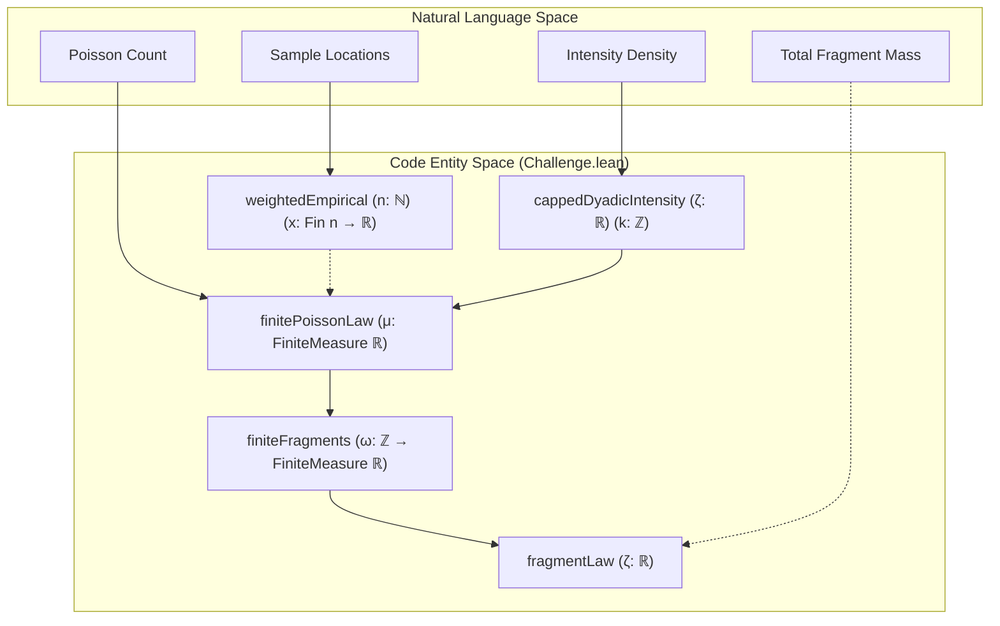
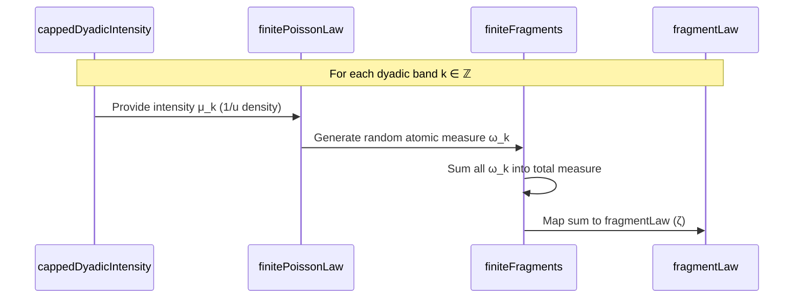

<!-- source: DeepWiki mcp.deepwiki.com · repo openai/PrimeGaps186 · extra page Fragment Measures and Poisson Laws · fetched 2026-10-26 -->

# Fragment Measures and Poisson Laws

Relevant source files

The following files were used as context for generating this wiki page:

- [Challenge.lean](Challenge.lean)

This page describes the measure-theoretic constructions in `Challenge.lean` used to model the distribution of prime fragments. These constructions formalize the probabilistic behavior of the Maynard-Tao sieve, specifically the weighted empirical measures derived from Poisson processes.

## Overview of Fragment Measures

The PrimeGaps186 project models the contribution of "fragments" (small prime factors or sieve components) using a sequence of random measures. The core logic transitions from discrete weighted samples (`weightedEmpirical`) to Poisson-distributed counts (`finitePoissonLaw`), and finally to a composite law representing the total fragment distribution (`fragmentLaw`).

### Data Flow: From Samples to Fragment Law

The following diagram illustrates how the measure-theoretic entities in `Challenge.lean` compose to form the mathematical model of prime fragments.

**Entity Mapping: Measure Construction Pipeline**

Sources: [Challenge.lean:66-126]()

---

## Weighted Empirical Measures

The fundamental building block is `weightedEmpirical`. It constructs a finite atomic measure where each sample $x_i$ is treated as a Dirac mass located at $x_i$, but weighted by its own value (clamped to non-negative).

*   **Function**: `weightedEmpirical` [Challenge.lean:66-69]()
*   **Logic**: It sums `(x i).toNNReal • Measure.dirac (x i)` over $n$ samples.
*   **Purpose**: Unlike standard empirical measures that assign unit mass $1/n$ to each point, this measure weights atoms by their spatial location, reflecting how larger fragments contribute more to the sieve mass.

Sources: [Challenge.lean:66-70]()

---

## Poisson Laws and Intensity

The Maynard-Tao sieve analysis requires modeling fragments as a Poisson point process. This is implemented via `finitePoissonLaw`.

### Finite Poisson Law
The function `finitePoissonLaw` [Challenge.lean:76-82]() creates a probability measure over the space of `FiniteMeasure ℝ`. It performs the following:
1.  Draws a count $N$ from a Poisson distribution with mean $\mu.mass$.
2.  Draws $N$ locations independently from the normalized version of $\mu$.
3.  Produces the resulting `weightedEmpirical` measure.

### Capped Dyadic Intensity
To handle the $1/u$ density required by the sieve, the code defines `cappedDyadicIntensity` [Challenge.lean:87-90](). 
*   **Density**: $1/u$ [Challenge.lean:89]().
*   **Domain**: $(0, \zeta] \cap (2^k, 2^{k+1}]$ [Challenge.lean:88-90]().
*   **Integrability**: The dyadic partitioning ($2^k$ bounds) ensures the $1/u$ density remains integrable on each band, allowing the construction of a `FiniteMeasure` [Challenge.lean:91-107]().

Sources: [Challenge.lean:76-108]()

---

## The Fragment Law

The final model of prime fragments, `fragmentLaw`, aggregates the dyadic bands into a single measure representing the total fragment distribution $\nu_\zeta$.

**System Component Interaction**

### Summation and Convergence
*   **`finiteFragments`**: This function sums a doubly infinite family of measures $\sum_{k \in \mathbb{Z}} \omega_k$. It is defined as a total function; if the sum is not finite, it returns the zero measure [Challenge.lean:114-118]().
*   **`fragmentLaw`**: Defined as the pushforward of the product measure of all dyadic `finitePoissonLaw` instances through the `finiteFragments` summation [Challenge.lean:123-126]().

Sources: [Challenge.lean:114-126]()

---

## Summary of Measure Entities

| Entity | Type | Role |
| :--- | :--- | :--- |
| `weightedEmpirical` | `FiniteMeasure ℝ` | Atomic measure with location-based weights. |
| `finitePoissonLaw` | `Measure (FiniteMeasure ℝ)` | Probability law for a Poisson process of fragments. |
| `cappedDyadicIntensity`| `FiniteMeasure ℝ` | The $1/u$ intensity on a specific dyadic interval. |
| `fragmentLaw` | `Measure (FiniteMeasure ℝ)` | The global law governing fragment distribution $\nu_\zeta$. |

Sources: [Challenge.lean:66-126]()

---

