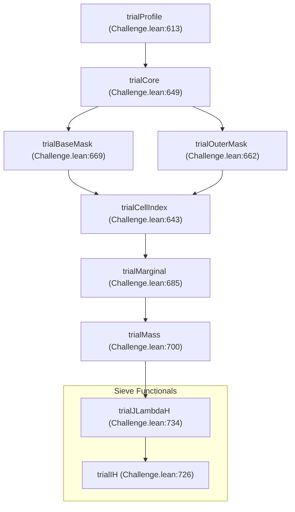
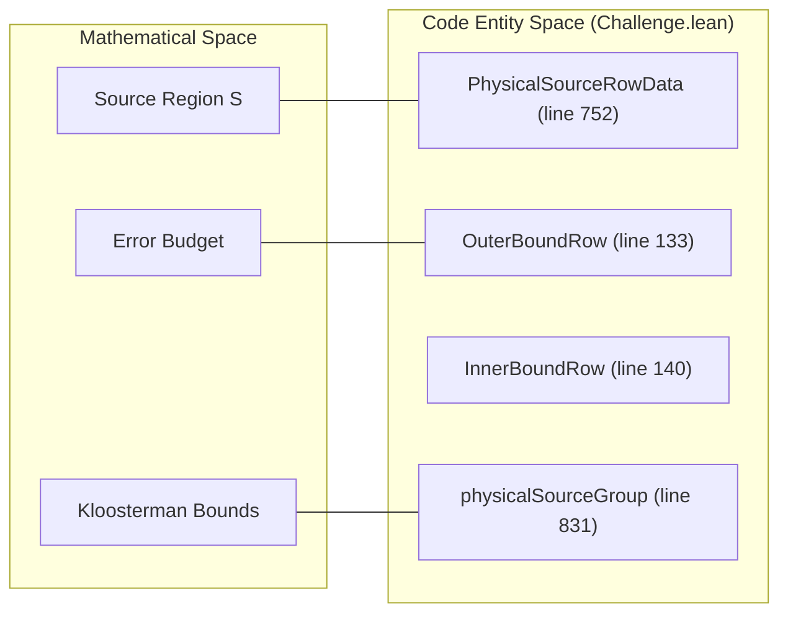

<!-- source: DeepWiki mcp.deepwiki.com · repo openai/PrimeGaps186 · extra page Trial Function and Sieve Machinery · fetched 2026-10-26 -->

# 2.1.1. Trial Function and Sieve Machinery

Relevant source files

The following files were used as context for generating this wiki page:

- [Challenge.lean](Challenge.lean)

This page details the construction of the trial function $\lambda$ and the associated sieve machinery used to establish the prime gap bound. The implementation in `Challenge.lean` defines a high-dimensional discretization pipeline that transforms a smooth profile into a discrete mask, which is then used to compute the $J$-functional values.

## Overview of the Trial Function Pipeline

The trial function $\lambda(d_1, \dots, d_k)$ is modeled as a product of a radial polynomial profile and a discrete mask. In `Challenge.lean`, this is implemented through a sequence of functions that discretize the mass, apply geometric constraints (masks), and normalize the result for use in the Maynard-Tao sieve.

### Mass Discretization and Masking
The discretization process maps continuous coordinates to a grid defined by `trialMesh` [Challenge.lean:636-636](). The fundamental unit of this discretization is the `trialCellIndex` [Challenge.lean:643-643]().

The geometry of the admissible tuples is enforced via three distinct masks:
1.  **`trialOuterMask`**: Defines the boundary of the support in the simplex $\mathcal{R}_k$ [Challenge.lean:662-662]().
2.  **`trialBaseMask`**: Represents the primary support region where the trial function is non-zero [Challenge.lean:669-669]().
3.  **`trialEnlargedMask`**: A slightly expanded region used to handle boundary effects and error terms in the Kloosterman sum estimates [Challenge.lean:676-676]().

### Data Flow Diagram: Profile to J-Functional
The following diagram illustrates how the `trialProfile` is processed through the discretization machinery to produce the final $J$ values.

**Trial Function Pipeline**

**Sources:** [Challenge.lean:613-734]()

---

## Physical Source Geometry

To manage the complexity of the $k$-dimensional integrals, the code organizes the support into "Source Rows". This is encapsulated in the `PhysicalSourceRowData` structure.

### Source Row Components
A `PhysicalSourceRowData` [Challenge.lean:752-752]() consists of:
*   **`scale`**: The discretization resolution.
*   **`rootBound`**: A bound on the main term of the Kloosterman sum contribution.
*   **`faceBound`**: A bound on the contribution from the faces of the simplex.
*   **`budget`**: The total allocated error margin for this specific row.

These rows are grouped into `physicalSourceGroup` [Challenge.lean:831-831](), which aggregates the bounds across different orders (e.g., `outerOrderTwoBounds` and `outerOrderFiveHalvesBounds`).

### Entity Mapping: Physical Geometry
This diagram maps the abstract mathematical concept of source regions to the specific Lean structures.

**Physical Source Mapping**

**Sources:** [Challenge.lean:133-140](), [Challenge.lean:752-752](), [Challenge.lean:831-831]()

---

## The J-Functional and Normalization

The goal of the sieve machinery is to compute the ratio:
$$\frac{J(\lambda)}{I(\lambda)}$$
where $I(\lambda)$ represents the mass and $J(\lambda)$ represents the weighted sum over primes.

### Implementation Details
*   **`trialIH`**: Computes the discretized version of the $I$ integral [Challenge.lean:726-726]().
*   **`trialJLambdaH`**: Computes the discretized $J$ functional for a specific index $h$ [Challenge.lean:734-734]().
*   **`trialMass`**: Acts as the denominator, ensuring the trial function is normalized relative to the `trialMesh` [Challenge.lean:700-700]().

| Function | Lean Definition | Purpose |
| :--- | :--- | :--- |
| `trialProfile` | [Challenge.lean:613]() | The underlying smooth radial function $P(x)$. |
| `trialCore` | [Challenge.lean:649]() | The raw discretized values before masking. |
| `trialMarginal` | [Challenge.lean:685]() | The sum over $k-1$ variables used in the $J$ calculation. |
| `trialJLambdaH` | [Challenge.lean:734]() | The final sieve functional output for a gap $h$. |

**Sources:** [Challenge.lean:613-734]()

## Geometric Bounds and Axioms

The validity of the numerical certificate depends on the `physical_integral_bounds` axiom [Challenge.lean:851-851](). This axiom asserts that the sum of the budgets defined in `physicalSourceGroup` provides a strict upper bound on the error introduced by the discretization and the Kloosterman sum approximations.

The row data is provided in hardcoded lists such as `outerOrderTwoBounds` [Challenge.lean:145-145]() and `outerOrderFiveHalvesBounds` [Challenge.lean:168-168](). These integers are scaled by constants (e.g., $10^{-18}$ for component bounds) as specified in the docstrings [Challenge.lean:128-141]().

**Sources:** [Challenge.lean:128-168](), [Challenge.lean:851-851]()

---

