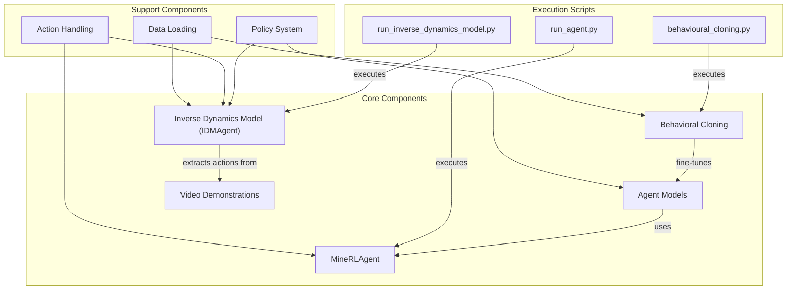
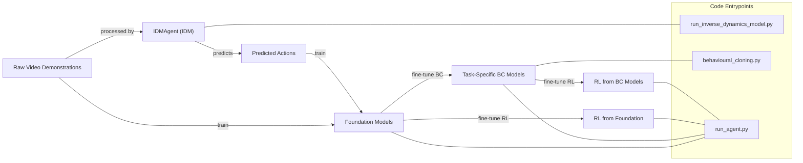
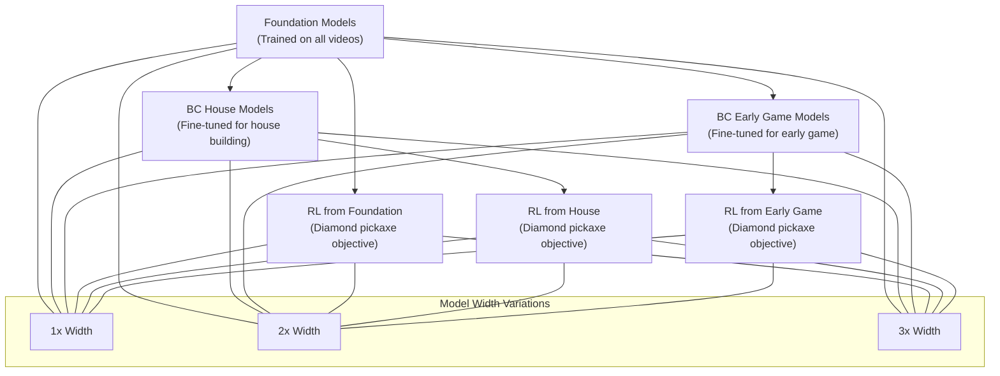
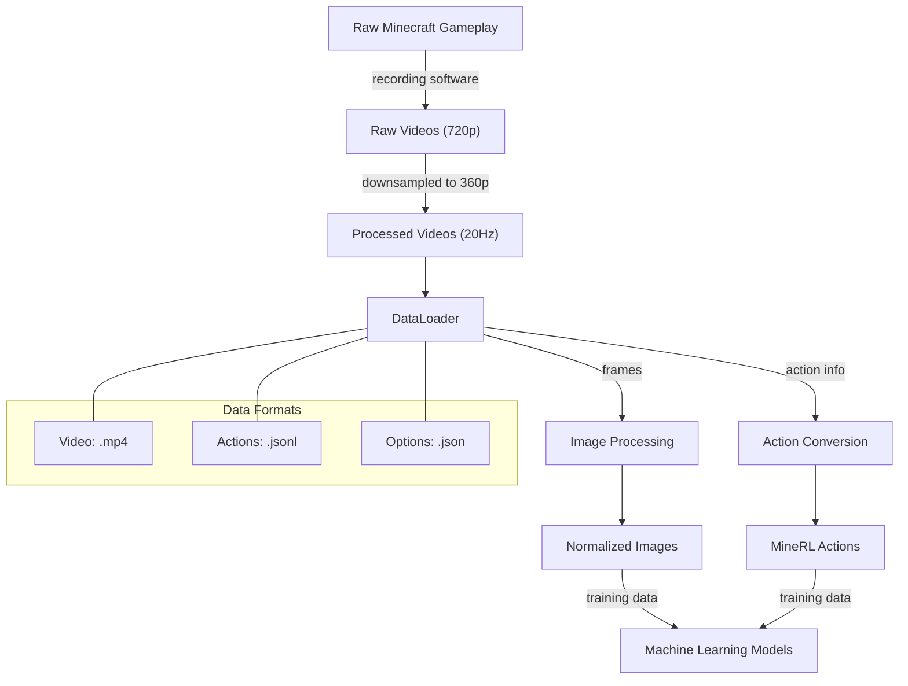

<!-- source: DeepWiki mcp.deepwiki.com · repo openai/Video-Pre-Training · page 1 Overview · fetched 2026-10-26 -->

# Overview

Relevant source files

The following files were used as context for generating this wiki page:

- [README.md](README.md)
- [requirements.txt](requirements.txt)

The Video Pre-Training (VPT) repository implements a novel approach for training AI agents to perform tasks in Minecraft by learning from unlabeled human gameplay videos. Instead of requiring labeled actions during training, VPT uses an Inverse Dynamics Model (IDM) to predict player actions from video frames and then trains agent models using these predictions.

For more detailed information about specific aspects of the system, see:
- [Agent Models](#2) for neural network architectures and model types
- [Inverse Dynamics Model (IDM)](#3) for action prediction from videos
- [Data and Datasets](#4) for information about contractor demonstrations
- [Running the System](#5) for execution instructions
- [Technical Components](#6) for implementation details

## System Architecture

The VPT system consists of three primary components working together to enable learning from unlabeled gameplay videos:

Sources: [README.md:13-121](), [run_agent.py:1-50](), [run_inverse_dynamics_model.py:1-40](), [behavioural_cloning.py:1-60]()

## Learning Pipeline

The following diagram illustrates how data flows through the VPT system, from raw videos to trained agent models. It highlights the relationship between the high-level concepts and the specific Python entrypoints used to interact with them.

Sources: [README.md:35-80](), [README.md:81-101](), [run_agent.py:11-20](), [behavioural_cloning.py:136-150]()

## Model Hierarchy

VPT includes multiple model types with different specializations, organized in a hierarchy. The models are categorized by their training stage and the data subsets they were refined on.

Sources: [README.md:35-80]()

## Available Models

The repository provides pre-trained models of varying sizes and training approaches. The "width" refers to the hidden dimension scaling of the neural network components like the `ImpalaCNN` and `ResidualRecurrentBlocks`.

| Model Type | Width Variations | Training Method | Purpose |
|------------|------------------|----------------|---------|
| Foundation | 1x, 2x, 3x | BC on all videos | General Minecraft skills |
| House | 3x | BC on house data | House building specialist |
| Early Game | 2x, 3x | BC on early game | Early game progression |
| RL from Foundation | 2x | RL + Foundation | Diamond pickaxe acquisition |
| RL from House | 2x | RL + House | Diamond pickaxe acquisition |
| RL from Early Game | 2x | RL + Early Game | Diamond pickaxe acquisition |

Sources: [README.md:35-80]()

## Data Collection and Processing

VPT relies on contractor demonstrations, which are screen recordings of humans playing Minecraft. The data pipeline involves processing these recordings and their associated `.jsonl` action logs.

Sources: [README.md:122-347](), [behavioural_cloning.py:136-150]()

## Tasks and Data Versions

The contractor demonstrations were collected for various tasks across different recorder versions. Major versions often represent changes in the prompt or recording features.

| Version | Task | Description |
|---------|------|-------------|
| 6.x-7.x | General Gameplay | Free play in Minecraft with focus on early game |
| 8.x | House Building | Building simple houses from scratch in 10-15 minutes |
| 9.x | House from Materials | Building houses with provided random materials |
| 10.0 | Diamond Pickaxe | Obtaining a diamond pickaxe within 20 minutes |
| BASALT | Competition Tasks | FindCave, MakeWaterfall, PenAnimals, BuildHouse |

Sources: [README.md:124-482]()

## Key Components and Scripts

The repository provides three main executable scripts that serve as the primary interface for users:

1. **`run_agent.py`**: Runs a trained agent model in the `MineRL` environment.
   - Utilizes `MineRLAgent` to wrap the policy and handle environment steps. [run_agent.py:11-20]()
   - Takes model (`--model`) and weights (`--weights`) file paths as inputs. [run_agent.py:44-48]()

2. **`run_inverse_dynamics_model.py`**: Demonstrates the IDM functionality.
   - Uses `IDMAgent` to process video frames and predict actions. [run_inverse_dynamics_model.py:25-30]()
   - Shows predicted vs. actual actions frame-by-frame using OpenCV. [run_inverse_dynamics_model.py:100-110]()

3. **`behavioural_cloning.py`**: Fine-tunes models using behavioral cloning.
   - Implements a training loop that iterates over data from `DataLoader`. [behavioural_cloning.py:136-160]()
   - Optimized for consumer hardware by computing gradients one sample at a time. [behavioural_cloning.py:118-121]()

Sources: [README.md:13-121](), [run_agent.py:1-50](), [run_inverse_dynamics_model.py:1-40](), [behavioural_cloning.py:1-60]()

The VPT system represents a significant advancement in learning from unlabeled videos, enabling agents to perform complex tasks in Minecraft by observing human gameplay without requiring direct action labels during training.

---

