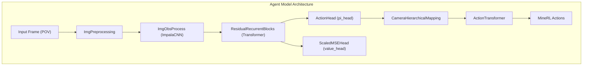

<!-- source: DeepWiki mcp.deepwiki.com · repo openai/Video-Pre-Training · page 2 Agent Models · fetched 2026-10-26 -->

# Agent Models

<details>
<summary>Relevant source files</summary>

The following files were used as context for generating this wiki page:

- [agent.py](agent.py)
- [lib/policy.py](lib/policy.py)

</details>


## Purpose and Scope

This document provides a comprehensive overview of the agent model architecture in the OpenAI Video Pre-Training (VPT) system for Minecraft. It explains how the neural network models process observations from the Minecraft environment and generate appropriate actions. This page focuses on the agent model architecture, neural network components, and their interactions. For information about fine-tuning these models with behavioral cloning, see [Fine-tuning with Behavioral Cloning](#5.3), and for details about the neural network architecture specifics, see [Neural Network Architecture](#6.1).

## Overview

Agent models in the VPT system are neural networks that enable an AI agent to play Minecraft by processing visual observations and producing actions. The architecture employs a combination of convolutional neural networks for visual processing, transformer or recurrent components for temporal reasoning, and specialized action heads for controlling the agent's behavior.



Sources: [agent.py:106-206](), [lib/policy.py:83-219](), [lib/policy.py:227-340]()

## Model Hierarchy and Types

VPT provides several agent models with different capabilities and training regimes. These models vary in width (model capacity) and training approach. For technical details on these specific categories, refer to the child pages linked below.

### [Foundation Models](#2.1)
Foundation models are the base models trained on the complete dataset of human video demonstrations using behavioral cloning. These serve as the starting point for all other specialized models. They are available in three different model widths (1x, 2x, and 3x), offering a tradeoff between performance and computational requirements.

### [Behavioral Cloning Models](#2.2)
Behavioral cloning (BC) models refine the foundation models by further training on specific subsets of data:
- **House models**: Focused on building houses, trained on house-building contractor data.
- **Early game models**: Specialized in early game progression, trained on early game video subset.

### [Reinforcement Learning Enhanced Models](#2.3)
RL-enhanced models build upon either foundation models or BC models with additional training using reinforcement learning. These models excel at progressing through the tech tree quickly using a reward function targeted at obtaining diamond pickaxes.

Sources: [README.md:42-80]()

## Core Components

### MineRLAgent

The `MineRLAgent` class in `agent.py` serves as the primary interface between the Minecraft environment and the neural network policy. It handles observation processing, action transformation, and state management.

```mermaid
classDiagram
    class MineRLAgent {
        +policy: MinecraftAgentPolicy
        +action_mapper: CameraHierarchicalMapping
        +action_transformer: ActionTransformer
        +hidden_state: Tensor
        +device: th.device
        +load_weights(path)
        +reset()
        +get_action(minerl_obs)
        -_env_obs_to_agent(minerl_obs)
        -_agent_action_to_env(agent_action)
    }
    
    MineRLAgent -- MinecraftAgentPolicy: uses [agent.py:128]
    MineRLAgent -- CameraHierarchicalMapping: uses [agent.py:115]
    MineRLAgent -- ActionTransformer: uses [agent.py:119]
```

Key responsibilities:
- Validates the environment configuration against `ENV_KWARGS` [agent.py:84-98]().
- Processes observations, resizing images to 128×128 via `resize_image` [agent.py:100-103]().
- Converts actions between agent and environment formats using `ActionTransformer` [agent.py:151-189]().
- Manages the agent's recurrent state (`hidden_state`) [agent.py:139]().

Sources: [agent.py:106-206]()

### MinecraftAgentPolicy

The `MinecraftAgentPolicy` in `lib/policy.py` is the core policy class that combines the neural network backbone with action and value heads.

```mermaid
classDiagram
    class MinecraftAgentPolicy {
        +net: MinecraftPolicy
        +value_head: ScaledMSEHead
        +pi_head: ActionHead
        +initial_state(batch_size)
        +act(obs, first, state_in, stochastic)
        +v(obs, first, state_in)
    }
    
    MinecraftAgentPolicy -- MinecraftPolicy: contains [lib/policy.py:257]
    MinecraftAgentPolicy -- ScaledMSEHead: uses [lib/policy.py:273]
    MinecraftAgentPolicy -- ActionHead: uses [lib/policy.py:263]
```

Sources: [lib/policy.py:227-340]()

### MinecraftPolicy

The `MinecraftPolicy` class implements the neural network backbone that processes observations and produces latent representations. It handles the integration of `ImgPreprocessing`, `ImgObsProcess` (which wraps `ImpalaCNN`), and `ResidualRecurrentBlocks`.

Sources: [lib/policy.py:83-225]()

## Neural Network Architecture

The architecture consists of several key stages:

### Observation Processing
1. **ImgPreprocessing**: Normalizes input images by scaling pixel values or applying statistics [lib/policy.py:21-45]().
2. **ImgObsProcess**: Passes the normalized image through an `ImpalaCNN` and a final linear layer to reach the `hidsize` dimension [lib/policy.py:48-81]().

### Recurrent Processing
The models primarily use **Transformer** recurrence (specified via `recurrence_type="transformer"`) [agent.py:32](). The `ResidualRecurrentBlocks` class manages these layers, supporting residual connections and pointwise layers [lib/policy.py:173-185]().

### Action Representation
The model outputs actions in a factored format. The `CameraHierarchicalMapping` and `ActionTransformer` classes are used to map these neural network outputs back to the discrete and continuous inputs required by the MineRL environment [agent.py:162-163]().

## Model Configuration

Default hyperparameters for the agent models are defined in `POLICY_KWARGS`:

| Parameter | Value | Description |
|-----------|-------|-------------|
| `attention_heads` | 16 | Number of attention heads in transformer [agent.py:17]() |
| `hidsize` | 2048 | Hidden layer size [agent.py:21]() |
| `impala_width` | 8 | Width multiplier for ImpalaCNN [agent.py:25]() |
| `n_recurrence_layers` | 4 | Number of recurrent layers [agent.py:27]() |
| `recurrence_type` | "transformer" | Type of recurrent processing [agent.py:32]() |

Sources: [agent.py:16-35]()

## Usage

To use an agent model:
1. Initialize `MineRLAgent` with the environment [agent.py:107]().
2. Load weights using `load_weights(path)` [agent.py:132]().
3. Call `get_action(minerl_obs)` during the environment loop to retrieve the next action [agent.py:190]().

The agent automatically handles the internal state management required for the recurrent components.

Sources: [agent.py:132-206]()

---

