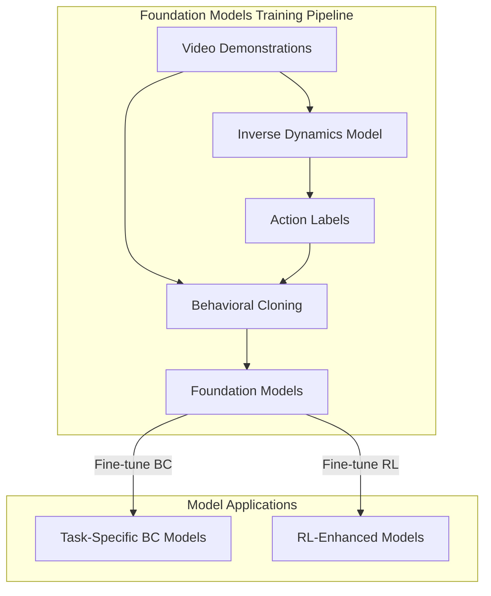
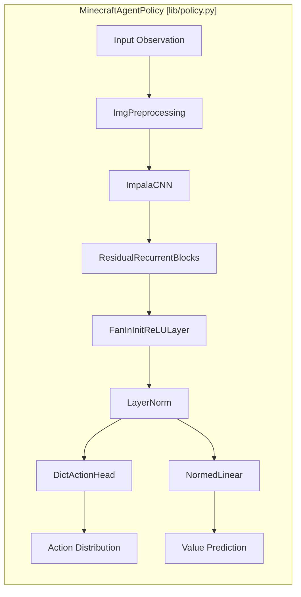
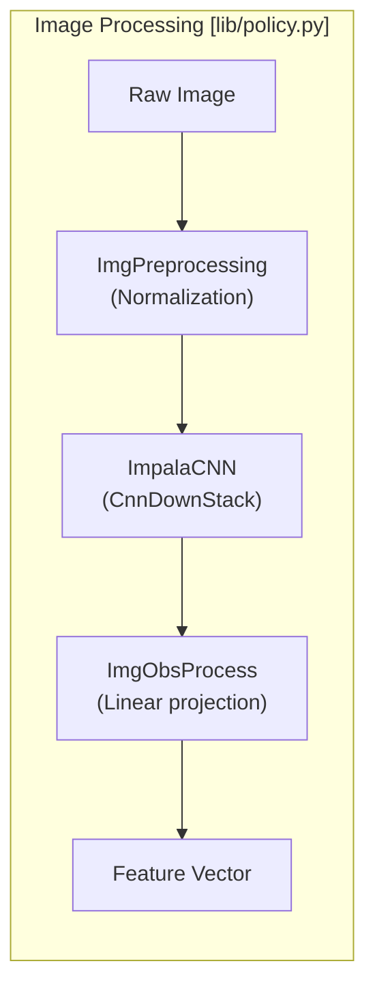

<!-- source: DeepWiki mcp.deepwiki.com · repo openai/Video-Pre-Training · page 2.1 Foundation Models · fetched 2026-10-26 -->

# Foundation Models

<details>
<summary>Relevant source files</summary>

The following files were used as context for generating this wiki page:

- [README.md](README.md)
- [agent.py](agent.py)

</details>


## Purpose and Scope

This document provides a detailed overview of the foundation models within the Video-Pre-Training (VPT) system for Minecraft. Foundation models serve as the base policies trained on large-scale unlabeled video using behavioral cloning (BC). They form the backbone of the VPT approach, capturing general Minecraft gameplay patterns that are later refined for specific objectives.

## What Are Foundation Models?

Foundation models are neural network policies trained on a large corpus of human gameplay videos. Unlike specialized agents, these models learn to mimic human behavior across a wide range of Minecraft activities. They represent the first stage in the VPT training process: using an Inverse Dynamics Model (IDM) to label unlabeled video with actions, then training a policy to predict those actions from the visual input.



Sources: [README.md:42-56](), [README.md:83-84]()

## Model Architecture

The foundation models are implemented via the `MinecraftAgentPolicy` class, which wraps the core `MinecraftPolicy`. They process observations from the Minecraft environment (128x128 resolution) and output action distributions and value predictions.



Sources: [lib/policy.py:227-329](), [agent.py:14-16](), [agent.py:128-129]()

### Image Processing Pipeline

The models preprocess raw Minecraft game frames (typically 640x360) by resizing them to 128x128. Within the network, the `ImgPreprocessing` class normalizes the images. The frames then pass through an `ImpalaCNN` architecture, which uses `CnnDownStack` and `CnnBasicBlock` modules to extract visual features.



Sources: [lib/policy.py:21-80](), [lib/policy.py:151-163](), [agent.py:100-103]()

### Recurrent Components

Foundation models utilize a transformer-based recurrence by default (though LSTM is supported). This allows the model to maintain long-term context over the `timesteps` parameter (set to 128 in standard configs).

*   **Transformer Style**: Uses `ResidualRecurrentBlocks` with `recurrence_type="transformer"`.
*   **Attention**: Employs `MaskedAttention` with a `clipped_causal` style, ensuring the agent only looks at past frames.

Sources: [lib/policy.py:166-188](), [agent.py:16-36](), [lib/xf.py:213-240]()

## Model Variants (Width Scaling)

Foundation models are released in three width variants. The width parameter scales the number of channels in the `ImpalaCNN` backbone and the hidden size of the transformer layers.

| Width | Hidden Size (`hidsize`) | Model File | Weights File |
|-------|-------------------------|------------|--------------|
| 1x    | 1024 (scaled)           | foundation-model-1x.model | foundation-model-1x.weights |
| 2x    | 2048 (scaled)           | 2x.model | foundation-model-2x.weights |
| 3x    | 3072 (scaled)           | foundation-model-3x.model | foundation-model-3x.weights |

The channel count in `ImpalaCNN` is calculated as:
`chans = tuple(int(impala_width * c) for c in impala_chans)`

Sources: [README.md:39-55](), [lib/policy.py:140](), [agent.py:21-25]()

## Action Space and Handling

The foundation models output actions in a specialized format that is later mapped back to the MineRL environment.

1.  **Action Distribution**: Generated by `DictActionHead`, which combines `CategoricalActionHead` for buttons and `DiagGaussianActionHead` (or quantized bins) for camera movement.
2.  **Mapping**: The `CameraHierarchicalMapping` class converts the model's internal representation into the `TARGET_ACTION_SPACE` required by the game.
3.  **Quantization**: Camera movements are processed using a `mu_law` quantization scheme via the `ActionTransformer`.

Sources: [agent.py:40-45](), [agent.py:115-120](), [lib/action_mapping.py:40-65](), [lib/actions.py:23-45]()

## Training Process

Foundation models are trained using Behavioral Cloning (BC). The `behavioural_cloning.py` script demonstrates the logic:
1.  **Data Loading**: Uses `DataLoader` to fetch sequences of frames and actions.
2.  **Loss Calculation**: The policy minimizes the log-likelihood of the human action given the frame: `loss = -policy.get_logprop_action(obs, action)`.
3.  **Optimization**: Standard Adam optimizer is used to update the `MinecraftAgentPolicy` weights.

Sources: [README.md:101-116](), [behavioural_cloning.py:1-50]()

## Running Foundation Models

To run a foundation model, use the `run_agent.py` entry point. This script initializes a `MineRLAgent`, loads the weights, and enters a loop where `agent.get_action(obs)` is called for every environment step.

```bash
python run_agent.py --model foundation-model-1x.model --weights foundation-model-1x.weights
```

Sources: [README.md:25-29](), [run_agent.py:10-30]()

## Summary of Technical Components

| Component | Code Entity | Role |
|-----------|-------------|------|
| **Policy Wrapper** | `MinecraftAgentPolicy` | High-level interface for actions/hidden states. |
| **Backbone** | `ImpalaCNN` | Extracts visual features from 128x128 frames. |
| **Recurrence** | `ResidualRecurrentBlocks` | Manages temporal context via Transformer layers. |
| **Action Head** | `DictActionHead` | Branches into discrete (buttons) and continuous (camera) outputs. |
| **Transformation** | `ActionTransformer` | Handles mu-law scaling and discretization of camera input. |

Sources: [lib/policy.py:121-219](), [lib/policy.py:227-329](), [lib/actions.py:23-30]()

---

