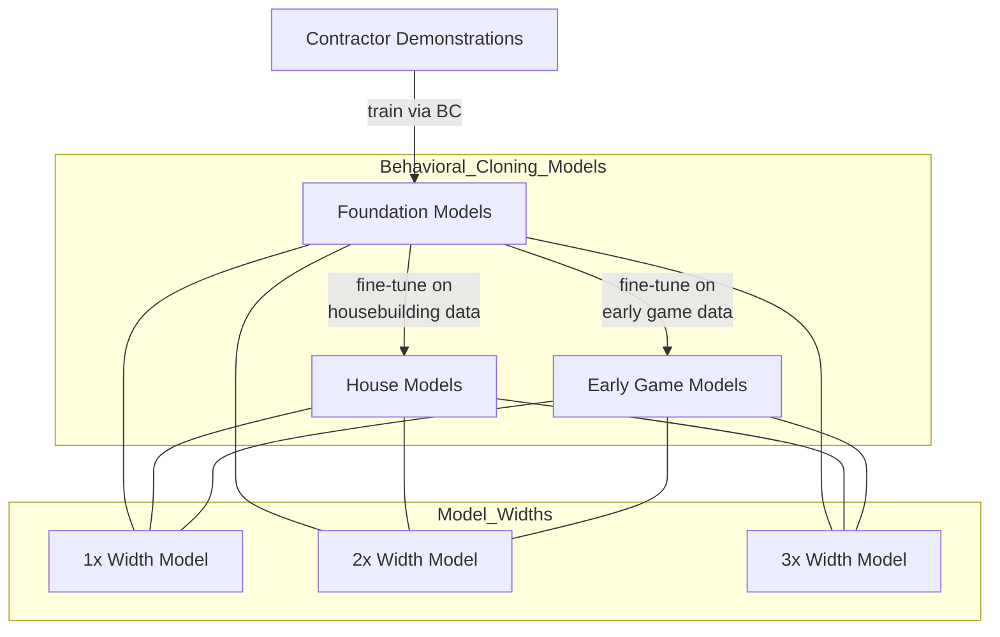
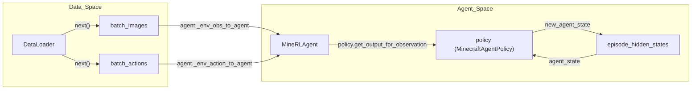

<!-- source: DeepWiki mcp.deepwiki.com · repo openai/Video-Pre-Training · page 2.2 Behavioral Cloning Models · fetched 2026-10-26 -->

# Behavioral Cloning Models

<details>
<summary>Relevant source files</summary>

The following files were used as context for generating this wiki page:

- [README.md](README.md)
- [behavioural_cloning.py](behavioural_cloning.py)

</details>


## Introduction

Behavioral Cloning (BC) models are a key component of the Video Pre-Training (VPT) system for Minecraft agents. These models are trained directly on video demonstrations of humans playing Minecraft, learning to mimic human actions in similar game states. Unlike reinforcement learning models that are optimized for specific rewards, BC models aim to replicate general gameplay behavior, making them more versatile across a range of tasks [README.md:43-50]().

## BC Model Types and Hierarchy

The VPT system includes several types of behavioral cloning models that form a hierarchical structure:



**Diagram: BC Model Hierarchy and Training Flow**

1. **Foundation Models**: Base models trained on all available demonstration videos in a single training run. These models capture general Minecraft gameplay skills [README.md:47-48]().
2. **House Models**: Models fine-tuned from foundation models using specifically the housebuilding contractor data. These models excel at building structures [README.md:48-49]().
3. **Early Game Models**: Models fine-tuned from foundation models using a subset of videos showing early game progression [README.md:49-50]().

Each model type is available in different widths (1x, 2x, 3x), with wider models having more parameters and potentially better performance [README.md:36-41]().

Sources: [README.md:36-62]()

## Available Model Weights

The following pre-trained BC model weights are available for download and use:

| Model Type | Width | Description | Weight File |
|------------|-------|-------------|------------|
| Foundation | 1x | Base model trained on all demonstrations | `foundation-model-1x.weights` |
| Foundation | 2x | Base model with 2x width | `foundation-model-2x.weights` |
| Foundation | 3x | Base model with 3x width | `foundation-model-3x.weights` |
| House | 3x | Fine-tuned for house building | `bc-house-3x.weights` |
| Early Game | 2x | Fine-tuned for early game progression | `bc-early-game-2x.weights` |
| Early Game | 3x | Fine-tuned for early game progression | `bc-early-game-3x.weights` |

Sources: [README.md:52-62]()

## Implementation and Data Flow

The BC training logic is implemented in `behavioural_cloning.py`, which utilizes the `MineRLAgent` and `DataLoader` classes to manage the training loop.



**Diagram: BC Data Flow and Entity Mapping**

1. **Observation Processing**: Images from the `DataLoader` are passed through `agent._env_obs_to_agent` to prepare the pixel data for the policy [behavioural_cloning.py:94]().
2. **Action Processing**: Human actions from the dataset are converted to the agent's internal action space using `agent._env_action_to_agent` [behavioural_cloning.py:89]().
3. **State Management**: The training loop maintains a dictionary `episode_hidden_states` to track the recurrent state of the model across different trajectories [behavioural_cloning.py:82]().

Sources: [behavioural_cloning.py:82-105]()

## Training Process

Behavioral cloning models are trained to maximize the log probability of human-demonstrated actions. The implementation in `behavioural_cloning.py` is designed for consumer hardware, using gradient accumulation with a batch size of 1 per step to minimize VRAM usage [behavioural_cloning.py:1-5]().

```mermaid
sequenceDiagram
    participant DL as DataLoader
    participant Agent as MineRLAgent
    participant Policy as MinecraftAgentPolicy
    participant Opt as Adam Optimizer
    
    DL->>DL: Load batch (batch_size=8)
    loop For each sample in batch
        DL->>Agent: image, action, episode_id
        Agent->>Policy: get_output_for_observation(obs, state)
        Policy-->>Agent: pi_distribution, new_state
        Agent->>Policy: get_logprob_of_action(pi_distribution, human_action)
        Policy-->>Agent: log_prob
        Agent->>Agent: loss = -log_prob / BATCH_SIZE
        Agent->>Policy: loss.backward()
    end
    Agent->>Opt: clip_grad_norm_
    Agent->>Opt: step()
    Agent->>Opt: zero_grad()
```

**Diagram: BC Training Loop Logic**

Key hyperparameters from the VPT paper used in the implementation:
* **Learning Rate**: `0.000181` [behavioural_cloning.py:38]()
* **Weight Decay**: `0.039428` [behavioural_cloning.py:39]()
* **Max Gradient Norm**: `5.0` [behavioural_cloning.py:40]()
* **Optimizer**: Adam [behavioural_cloning.py:63]()

Sources: [behavioural_cloning.py:26-40](), [behavioural_cloning.py:86-123]()

## Fine-tuning BC Models

The fine-tuning script `behavioural_cloning.py` allows users to refine foundation models on specific datasets.

1. **Model Loading**: The script loads model architecture and hyperparameters from the `.model` file (a pickled dictionary) [behavioural_cloning.py:42-47]().
2. **Recurrence Handling**: To save memory, the implementation detaches the hidden state after every step: `new_agent_state = tree_map(lambda x: x.detach(), new_agent_state)` [behavioural_cloning.py:111](). This prevents backpropagation through long sequences.
3. **Weight Saving**: After training, the `policy.state_dict()` is saved to the output path [behavioural_cloning.py:131-132]().

Sources: [behavioural_cloning.py:42-132](), [README.md:101-116]()

---

