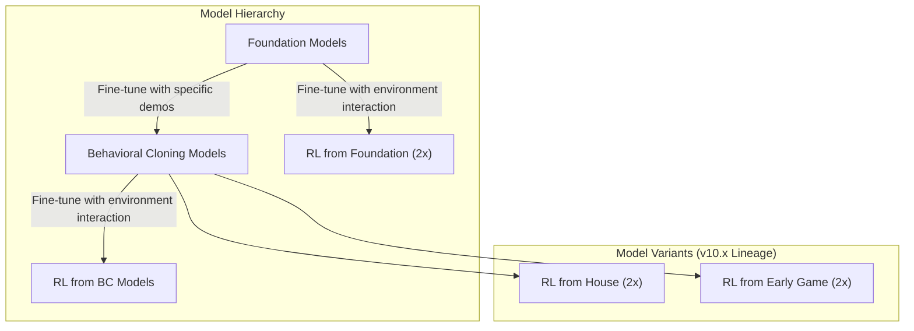
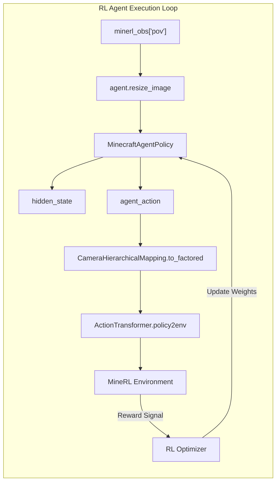
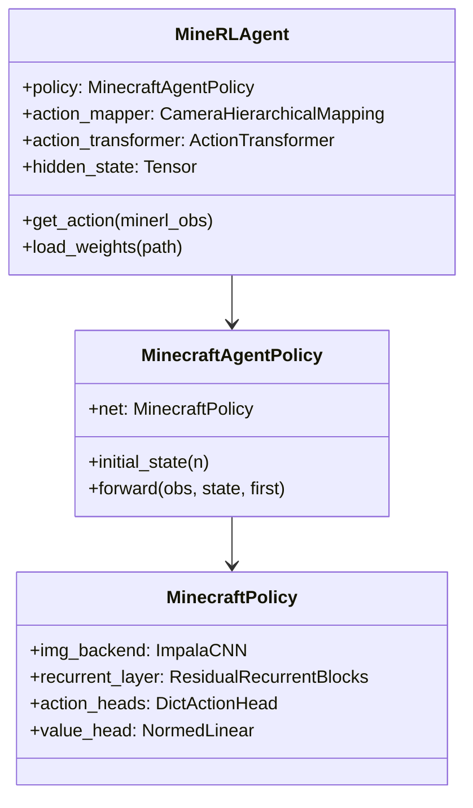

<!-- source: DeepWiki mcp.deepwiki.com · repo openai/Video-Pre-Training · page 2.3 Reinforcement Learning Enhanced Models · fetched 2026-10-26 -->

# Reinforcement Learning Enhanced Models

<details>
<summary>Relevant source files</summary>

The following files were used as context for generating this wiki page:

- [README.md](README.md)
- [agent.py](agent.py)

</details>


This page documents the Reinforcement Learning (RL) enhanced models in the Video Pre-Training (VPT) system for Minecraft. These models build upon foundation models and behavioral cloning models by incorporating environment interactions with reward functions to optimize for specific objectives, specifically the "Diamond Pickaxe" challenge.

## Overview

RL-enhanced models represent the final stage in the VPT model hierarchy. While foundation models ([Section 2.1]()) and behavioral cloning models ([Section 2.2]()) are trained using supervised learning on human demonstrations, RL-enhanced models are fine-tuned through direct interaction with the Minecraft environment using reinforcement learning techniques. These models are categorized under the "v10.x" recorder versions in the contractor data lineage, representing the most advanced task-specific agents in the repository.


Sources: [README.md:64-80](), [README.md:144-148]()

## Model Variants

The VPT repository provides three specific RL-enhanced weight sets, all utilizing the 2x width model architecture. These models are designed to progress through the Minecraft tech tree quickly.

| Model Variant | Base Model Starting Point | Model File | Weights File |
| :--- | :--- | :--- | :--- |
| **RL from Foundation** | Foundation Model (unlabeled video) | `2x.model` | `rl-from-foundation-2x.weights` |
| **RL from House** | House BC Model (fine-tuned) | `2x.model` | `rl-from-house-2x.weights` |
| **RL from Early Game** | Early Game BC Model (fine-tuned) | `2x.model` | `rl-from-early-game-2x.weights` |

Sources: [README.md:72-80](), [README.md:40-41]()

## RL Fine-tuning Methodology

The RL models are trained by rewarding the agent for reaching specific milestones in the Minecraft "Diamond Pickaxe" tech tree. 

### Data Flow and Environment Interaction
The `MineRLAgent` class handles the interface between the neural network policy and the `MineRL` environment. For RL models, the agent must not only predict actions but also effectively explore the state space to maximize the reward signal.


Sources: [agent.py:106-164](), [README.md:64-70]()

### Reward Schedule
The models were trained using a reward function targeted at obtaining diamond pickaxes. This includes rewards for:
1.  **Acquisition**: Obtaining items like logs, cobblestone, iron ore, and diamonds.
2.  **Crafting**: Successfully using a crafting table to create wooden, stone, and iron tools.
3.  **Smelting**: Using a furnace to produce iron ingots.

Sources: [README.md:65-70]()

## Architecture Implementation

RL-enhanced models utilize the `MinecraftAgentPolicy`. In the context of RL, the policy architecture must support temporal dependencies to remember inventory state and environmental progress.

### Policy Configuration
The default `POLICY_KWARGS` used for these agents include:
*   **Recurrence**: A transformer-based recurrence (`recurrence_type="transformer"`) with 4 layers (`n_recurrence_layers=4`).
*   **Attention**: 16 attention heads with a `clipped_causal` mask style and a memory size of 256.
*   **Visual Backbone**: An `ImpalaCNN` with `impala_width=8` and channels `[16, 32, 32]`.


Sources: [agent.py:16-36](), [agent.py:106-130](), [lib/policy.py:249-341]()

## Technical Execution

To run an RL-enhanced model, the `MineRLAgent` is initialized with the standard `2x.model` architecture and the specific RL weights.

### Implementation Details
*   **Action Mapping**: Uses `CameraHierarchicalMapping` with 11 camera bins [agent.py:115]().
*   **Resolution**: Input frames are resized to 128x128 using `cv2.INTER_LINEAR` [agent.py:100-103]().
*   **Inference**: The `get_action` method processes the observation, updates the `hidden_state`, and converts the policy output to MineRL-compatible actions using the `ActionTransformer` [agent.py:190-211]().

### Command Line Example
```bash
python run_agent.py --model models/2x.model --weights models/rl-from-early-game-2x.weights
```
Sources: [README.md:28-29](), [agent.py:132-135]()

## Summary of RL Characteristics
*   **Efficiency**: Significantly faster at reaching the "Diamond" stage than BC or Foundation models.
*   **Specificity**: Highly optimized for the tech tree; may exhibit less "creative" or "varied" behavior compared to Foundation models.
*   **Architecture**: Uses the same `ImpalaCNN` + `Transformer` stack, demonstrating that the base architecture is robust enough for both supervised and reinforcement learning.

Sources: [README.md:64-70]()

---

