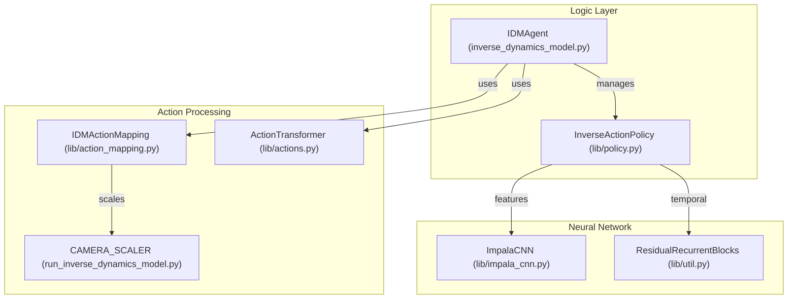
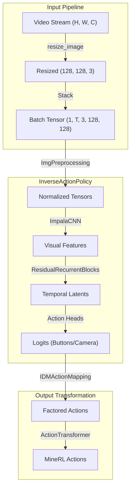
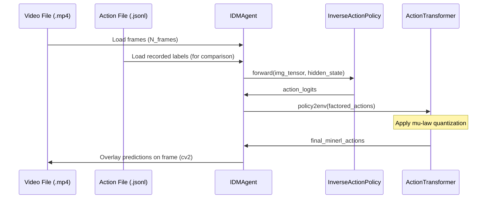

<!-- source: DeepWiki mcp.deepwiki.com · repo openai/Video-Pre-Training · page 3 Inverse Dynamics Model (IDM) · fetched 2026-10-26 -->

# Inverse Dynamics Model (IDM)

Relevant source files

The following files were used as context for generating this wiki page:

- [inverse_dynamics_model.py](inverse_dynamics_model.py)
- [lib/action_mapping.py](lib/action_mapping.py)
- [lib/policy.py](lib/policy.py)
- [run_inverse_dynamics_model.py](run_inverse_dynamics_model.py)

## Purpose and Scope

The Inverse Dynamics Model (IDM) is a critical component of the Video Pre-Training (VPT) system that predicts actions taken by human players from video frames. The IDM serves as the bridge between unlabeled gameplay videos and actionable training data by inferring what controls a human player pressed based solely on visual observations. 

Unlike the forward policy (Agent), which predicts the next action given current and past observations to achieve a goal, the IDM is trained to predict the action $a_t$ that occurred between frames $s_t$ and $s_{t+1}$. This allows the system to generate labels for millions of hours of unlabeled YouTube videos, which are then used to train the Foundation Models.

Sources: [inverse_dynamics_model.py:21-27](), [run_inverse_dynamics_model.py:68-73]()

## System Overview

The IDM implementation in this repository is provided as a utility to predict actions from MineRL recordings. It uses a specialized policy architecture that processes temporal sequences of frames.

### IDM Code Entity Map

This diagram maps the high-level IDM concepts to the specific classes and functions in the codebase.

Sources: [inverse_dynamics_model.py:21-44](), [lib/policy.py:205-220](), [run_inverse_dynamics_model.py:77-78]()

## Architecture and Implementation

The IDM is implemented as a neural network that processes sequences of video frames. While it shares structural similarities with the `MinecraftPolicy`, it is encapsulated in `InverseActionPolicy` to handle the specific requirements of predicting actions from a video stream.

### Key Classes

1.  **`IDMAgent`**: A "sugarcoating" wrapper around the model. It handles the high-level API for loading weights, resetting hidden states, and converting video frames into tensor inputs.
    *   `predict_actions(video_frames)`: Accepts a sequence of shape `(N, H, W, C)` and returns predicted MineRL actions [inverse_dynamics_model.py:74-95]().
    *   `_video_obs_to_agent(video_frames)`: Resizes frames to `AGENT_RESOLUTION` (128x128) and prepares them for the torch device [inverse_dynamics_model.py:54-59]().

2.  **`InverseActionPolicy`**: Defined in `lib/policy.py`, this class extends the base policy logic to include the `InverseActionNet`.
    *   It utilizes an `ImpalaCNN` for visual feature extraction [lib/policy.py:155-165]().
    *   It uses `ResidualRecurrentBlocks` to handle temporal dependencies, supporting recurrence types like `transformer` or `multi_layer_bilstm` [lib/policy.py:173-185]().

3.  **`IDMActionMapping`**: A specialized version of `ActionMapping` that acts as an identity mapping for the IDM, as the model's output space is designed to match the environment's factored action space directly [lib/action_mapping.py:102-115]().

### Temporal Processing (3D Convolution)

The IDM architecture is designed to look at a window of frames to determine the action. This is achieved through the combination of the CNN backbone and recurrent layers.

Sources: [lib/policy.py:193-200](), [inverse_dynamics_model.py:85-95](), [lib/impala_cnn.py:46-55]()

## Data Flow: Video to Action

The transformation from raw pixels to a structured MineRL action dictionary involves several coordinate and scale shifts, particularly for camera movement.

### Camera Scaling and Mapping
Minecraft's internal mouse sensitivity is mapped to the model's output space using a `CAMERA_SCALER`.
*   **Sensitivity Constant**: `360.0 / 2400.0` [run_inverse_dynamics_model.py:77]().
*   **Conversion**: `json_action_to_env_action` applies this scaler to `dx` and `dy` values from the recorded JSON data to align them with the model's expectations [run_inverse_dynamics_model.py:101-104]().

### Action Processing Sequence

Sources: [run_inverse_dynamics_model.py:146-163](), [inverse_dynamics_model.py:70-72]()

## Usage and Execution

The `run_inverse_dynamics_model.py` script serves as the primary entry point for testing the IDM. It visualizes predictions by overlaying them on the video frames using OpenCV.

### Configuration
The model uses specific quantization parameters for camera movement to handle the wide dynamic range of mouse deltas:
*   `camera_binsize`: 2
*   `camera_maxval`: 10
*   `camera_mu`: 10
*   `camera_quantization_scheme`: "mu_law"

Sources: [inverse_dynamics_model.py:14-19]()

### Keyboard Mapping
The IDM maps Minecraft's internal key strings (e.g., `key.keyboard.w`) to the agent's internal button names (e.g., `forward`) via the `KEYBOARD_BUTTON_MAPPING` dictionary [run_inverse_dynamics_model.py:17-38]().

### Technical Limitations
As noted in the source code, the IDM provided in this repository is a re-implementation and may exhibit slight performance variances compared to the original model described in the VPT paper [run_inverse_dynamics_model.py:1-4](). It requires high-resolution input (640x360) which it internally downsamples to 128x128 for the `ImpalaCNN` [run_inverse_dynamics_model.py:155](), [inverse_dynamics_model.py:55]().

---

