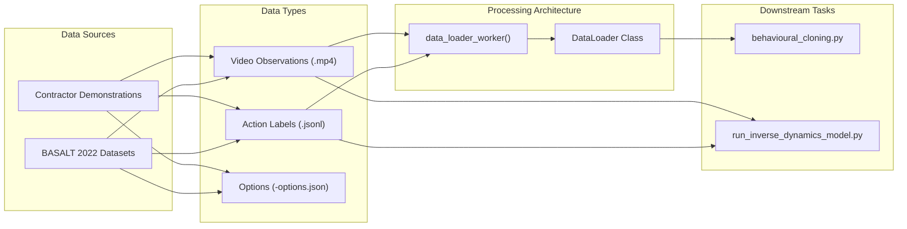
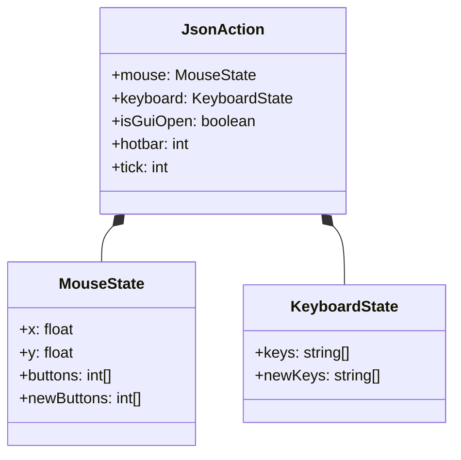
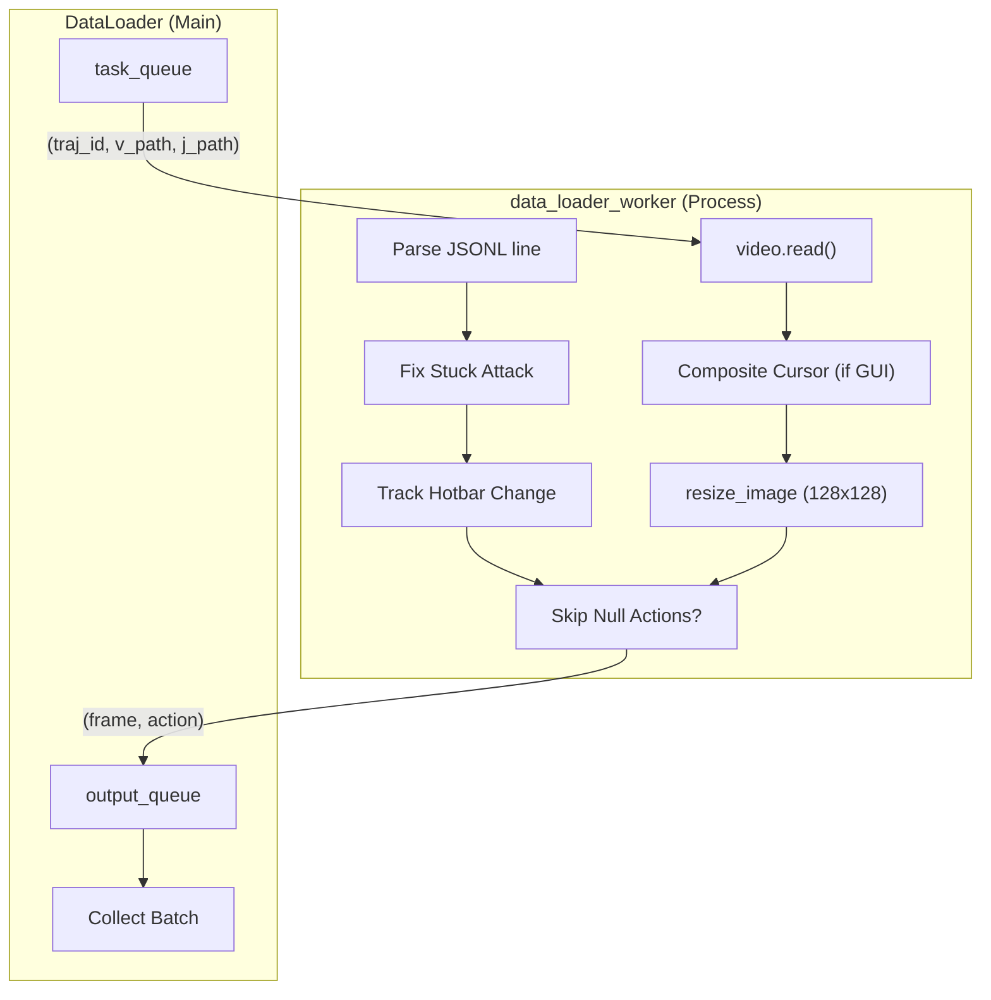

<!-- source: DeepWiki mcp.deepwiki.com · repo openai/Video-Pre-Training · page 4 Data and Datasets · fetched 2026-10-26 -->

# Data and Datasets

Relevant source files

The following files were used as context for generating this wiki page:

- [README.md](README.md)
- [cursors/mouse_cursor_white_16x16.png](cursors/mouse_cursor_white_16x16.png)
- [data_loader.py](data_loader.py)

This page documents the datasets used in the Video Pre-Training (VPT) system, their structure, collection methodology, and processing mechanisms. It covers the contractor demonstrations dataset used for training foundation models and the multi-process `DataLoader` pipeline that prepares this data for behavioral cloning.

## Overview of VPT Datasets

The VPT system primarily relies on large-scale video data of human players. Because raw online videos lack action labels (keystrokes/mouse movements), the system uses an Inverse Dynamics Model (IDM) to predict actions for unlabeled video, or uses direct recordings from contractors which include ground-truth labels.

Sources: [README.md:82-90](), [README.md:125-133](), [data_loader.py:48-62]()

## Data Collection Environment

All gameplay data was collected under controlled conditions to ensure consistency for the neural network:
- **Resolution**: Windowed mode at 720p, downsampled to 360p at 20Hz [README.md:310-313]().
- **Normalization**: Player interface options were locked to prevent changes to brightness or rendering [README.md:314-315]().
- **Segmentation**: Gameplay was segmented into chunks of up to 5 minutes [README.md:316-317]().

Sources: [README.md:310-317]()

## Contractor Demonstrations Dataset

The dataset consists of humans playing Minecraft with their actions recorded. Collection evolved through several versions targeting different gameplay stages:

| Version | Task Focus | Duration |
| :--- | :--- | :--- |
| **6.x** | Core recorder development and feature-complete versions | Variable |
| **7.x** | Early game progression (first 30 mins of play) | Variable |
| **8.x** | House Building from Scratch (wood, dirt, sand) | 10-15 mins |
| **9.x** | House Building with Random Materials (provided inventory) | 10 mins |
| **10.0** | Obtain Diamond Pickaxe (no village searching) | 20 mins |

Sources: [README.md:134-302]()

## Data Format and Structure

### File Structure
Each demonstration segment consists of three primary files sharing a unique trajectory ID:
- **Video (.mp4)**: Screen capture at 20Hz [README.md:318-319]().
- **Action (.jsonl)**: Line-by-line JSON records of player actions [README.md:320-321]().
- **Options (-options.json)**: Environment configuration [README.md:322-323]().

### Action Format
The `.jsonl` files contain per-tick metadata and input state. The `data_loader_worker` parses these into a structured format using `json_action_to_env_action` [data_loader.py:97]().

Sources: [data_loader.py:76-105](), [README.md:352-414]()

## Data Processing Pipeline

The `DataLoader` implementation in `data_loader.py` uses a multi-process architecture to handle video decoding and action transformation.

### Worker Architecture
The `data_loader_worker` function runs in separate processes to prevent the training loop from being bottlenecked by OpenCV video decoding [data_loader.py:48-51]().

1.  **Video Decoding**: Uses `cv2.VideoCapture` to read frames [data_loader.py:63]().
2.  **Cursor Composition**: If `isGuiOpen` is true, a hardware cursor image (`mouse_cursor_white_16x16.png`) is composited onto the frame at the recorded coordinates [data_loader.py:113-117]().
3.  **Action Cleaning**:
    *   **Attack Unsticking**: Detects and fixes a known issue where the attack button is "stuck" down at the start of recordings [data_loader.py:64-96]().
    *   **Hotbar Tracking**: Since scrollwheel events aren't captured, the loader tracks the `hotbar` field and generates synthetic "hotbar.N" actions when selection changes [data_loader.py:99-103]().
4.  **Normalization**: Frames are converted to RGB, clipped, and resized to `AGENT_RESOLUTION` (128x128) [data_loader.py:118-120]().
5.  **Null Action Filtering**: Frames with no significant actions are skipped to match the VPT paper methodology [data_loader.py:111-112]().

Sources: [data_loader.py:48-129](), [data_loader.py:145-171]()

### DataLoader Class
The `DataLoader` class manages the lifecycle of worker processes and queues [data_loader.py:130-144]().

- **Initialization**: Scans the dataset directory for matching `.mp4` and `.jsonl` pairs [data_loader.py:152-160]().
- **Shuffling**: Shuffles trajectories at the start of each epoch [data_loader.py:167-169]().
- **Batching**: Aggregates samples from the `output_queue` into numpy arrays for training [data_loader.py:201-218]().

| Parameter | Default | Description |
| :--- | :--- | :--- |
| `n_workers` | 8 | Number of parallel worker processes [data_loader.py:145]() |
| `batch_size` | 8 | Number of samples per returned batch [data_loader.py:145]() |
| `max_queue_size` | 16 | Buffer size for the output queue [data_loader.py:145]() |

Sources: [data_loader.py:130-171]()

## Implementation Details

### Cursor Composition
Since Minecraft hides the system cursor in-game but uses it in GUI screens, the loader must manually render the cursor into the frame so the agent can learn GUI interactions [data_loader.py:52-56](). The `composite_images_with_alpha` function handles this by blending the cursor's alpha channel with the video frame [data_loader.py:34-45]().

### Version-Specific Scaling
The `MINEREC_VERSION_SPECIFIC_SCALERS` dictionary accounts for sensitivity changes across different recorder versions (5.7 through 6.9) to ensure mouse movement `dx/dy` values are normalized [data_loader.py:25-31]().

Sources: [data_loader.py:25-56](), [data_loader.py:113-117]()

---

