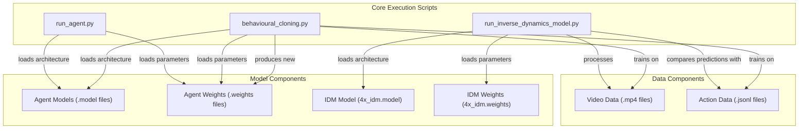

<!-- source: DeepWiki mcp.deepwiki.com · repo openai/Video-Pre-Training · page 5 Running the System · fetched 2026-10-26 -->

# Running the System

<details>
<summary>Relevant source files</summary>

The following files were used as context for generating this wiki page:

- [README.md](README.md)
- [requirements.txt](requirements.txt)

</details>


This page provides an overview of how to set up and run the Video Pre-Training (VPT) system for Minecraft, covering dependencies, file requirements, and execution workflows. For detailed instructions on specific operations, refer to:

- [Running Agent Models](#5.1): Detailed guide for running pre-trained agent models in the MineRL environment.
- [Running the IDM](#5.2): Instructions for running the Inverse Dynamics Model to predict actions from video recordings.
- [Fine-tuning with Behavioral Cloning](#5.3): Steps for fine-tuning models using behavioral cloning on demonstration data.

## System Requirements and Setup

Before running any component of the VPT system, you need to set up the required environment.

### Dependencies

First, install the pre-requirements for MineRL and the project dependencies:

```bash
pip install git+https://github.com/minerllabs/minerl
pip install -r requirements.txt
```

The requirements include:
- `torch==1.9.0`
- `gym3`
- `attrs`
- `opencv-python`

> **Note**: For reproducibility reasons, the PyTorch version is pinned to `torch==1.9.0` [requirements.txt:1](), which is incompatible with Python 3.10+. If using Python 3.10+, install a newer version of PyTorch, but be aware this might subtly change model behavior [README.md:23-24]().

Sources: [README.md:15-21](), [requirements.txt:1-4]()

### Model Files

Depending on which component you want to run, you'll need to download different model files:

| Component | Required Files |
|-----------|---------------|
| Agent Models | - `.model` architecture file (e.g., `foundation-model-1x.model`) [README.md:39-41]()<br>- `.weights` parameter file (e.g., `foundation-model-1x.weights`) [README.md:53-55]() |
| IDM | - IDM model file (`4x_idm.model`) [README.md:87]()<br>- IDM weights file (`4x_idm.weights`) [README.md:87]()<br>- Video files (`.mp4`) and Action files (`.jsonl`) [README.md:89-90]() |
| Behavioral Cloning | - Base model file (`.model`) [README.md:107]()<br>- Base weights file (`.weights`) [README.md:107]()<br>- Demonstration data (`.mp4` and `.jsonl` files) [README.md:108]() |

Sources: [README.md:35-80](), [README.md:87-90](), [README.md:107-108]()

## System Components and Architecture

The VPT system consists of several key components that work together to enable learning from video demonstrations.

### Component Relationship Diagram
This diagram maps high-level system operations to their respective entrypoint scripts and data dependencies.



Sources: [README.md:13-31](), [README.md:81-99](), [README.md:101-121]()

### System Execution Workflow

The following diagram illustrates the standard operating procedures for the three main modes of the system.

```mermaid
flowchart TD
    subgraph "Agent Model Execution"
        AM["1. Download Model & Weights"] --> 
        RA["2. run_agent.py --model [path] --weights [path]"] -->
        MO["3. MineRL Environment Starts"] -->
        OA["4. Agent Plays Minecraft"]
    end
    
    subgraph "IDM Execution"
        IDM["1. Download IDM & Data Files"] --> 
        RIDM["2. run_inverse_dynamics_model.py 
              --weights [path] 
              --model [path] 
              --video-path [path] 
              --jsonl-path [path]"] -->
        FR["3. Process Video Frames"] -->
        VIS["4. Visualize Predictions vs Actual Actions"]
    end
    
    subgraph "Behavioral Cloning Execution"
        BCF["1. Download Base Model & Training Data"] --> 
        BC["2. behavioural_cloning.py
            --data-dir [path]
            --in-model [path]
            --in-weights [path]
            --out-weights [path]"] -->
        TR["3. Train on Demonstration Data"] -->
        OFM["4. Save Fine-tuned Model Weights"]
    end
```



Sources: [README.md:25-31](), [README.md:92-97](), [README.md:111-116]()

## Running System Components

### Running Agent Models
The primary entrypoint for observing a trained agent is `run_agent.py` [README.md:28](). It initializes the MineRL environment and uses the specified model and weights to drive the agent's actions. For details, see [Running Agent Models](#5.1).

### Running the IDM
The Inverse Dynamics Model is used to infer actions from raw video. The `run_inverse_dynamics_model.py` script provides a visualization of the model's predictions compared to recorded contractor actions [README.md:94-97](). For details, see [Running the IDM](#5.2).

### Fine-tuning with Behavioral Cloning
To adapt a foundation model to specific tasks using contractor data, use `behavioural_cloning.py` [README.md:113](). This script implements a training loop designed for consumer hardware, though it has specific limitations regarding gradient propagation and speed [README.md:118-121](). For details, see [Fine-tuning with Behavioral Cloning](#5.3).

## Data Formats

### Video Files (.mp4)
Video demonstrations are compressed screen recordings of Minecraft gameplay, usually at 360p resolution sampled at 20Hz [README.md:348-350]().

### Action Files (.jsonl)
Each line in a `.jsonl` file represents an action dictionary containing mouse movements, keyboard keys, and environment state [README.md:355-414]().

**Example action structure snippet:**
```json
{
  "mouse": {
    "dx": 0.0, "dy": 0.0,
    "buttons": []
  },
  "keyboard": {
    "keys": ["key.keyboard.w"]
  },
  "isGuiOpen": false,
  "hotbar": 4
}
```

Sources: [README.md:348-414]()

## Troubleshooting

1.  **PyTorch Version Compatibility**: If using Python 3.10+, you'll need a newer PyTorch version than specified in `requirements.txt`. This might affect model performance [README.md:23-24]().
2.  **Memory Usage**: Larger models (2x and 3x width) are memory-intensive. If encountering out-of-memory errors, use a smaller model or reduce batch sizes [README.md:103]().
3.  **Behavioral Cloning Limitations**: The BC implementation only trains one step at a time (errors are not propagated through timesteps) and computes gradients one sample at a time to keep memory usage low [README.md:118-121]().

Sources: [README.md:23-24](), [README.md:103](), [README.md:118-121]()

---

