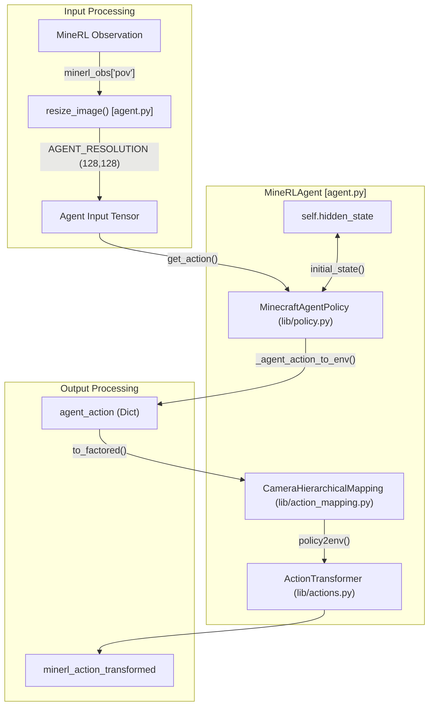
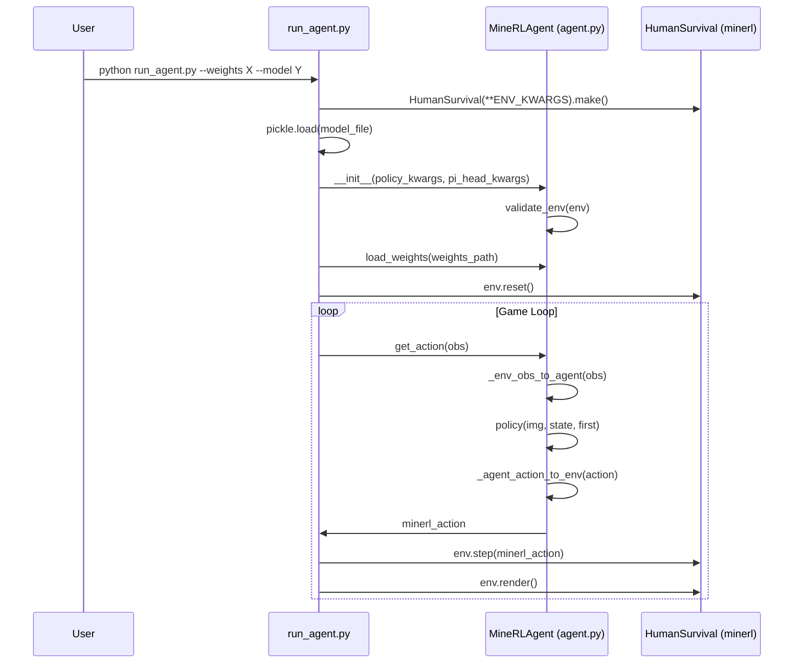

<!-- source: DeepWiki mcp.deepwiki.com · repo openai/Video-Pre-Training · page 5.1 Running Agent Models · fetched 2026-10-26 -->

# Running Agent Models

<details>
<summary>Relevant source files</summary>

The following files were used as context for generating this wiki page:

- [agent.py](agent.py)
- [run_agent.py](run_agent.py)

</details>


This page provides detailed instructions for running pre-trained Minecraft agent models in the MineRL environment. It covers the setup process, model loading, and execution of agent models to play Minecraft autonomously.

## System Requirements and Setup

Before running the agent models, you need to install the required dependencies:

1. First, install the pre-requirements for [MineRL](https://minerl.readthedocs.io/en/latest/tutorials/index.html), which include Java for running Minecraft.

2. Install the Python dependencies:
```bash
pip install git+https://github.com/minerllabs/minerl
pip install -r requirements.txt
```

> ⚠️ Note: For reproducibility, PyTorch is pinned to version 1.9.0 in the requirements. If using Python 3.10 or higher, install a newer version of PyTorch, but be aware this might slightly change model behavior.

Sources: [README.md:15-23]()

## Agent Structure and Components

The agent system consists of several key components that work together to process observations from the Minecraft environment and generate appropriate actions.

### Agent Architecture and Data Flow

The following diagram maps the high-level logic to the specific code entities responsible for the agent's behavior.

**Natural Language to Code Entity Space: Agent Execution**


The agent maintains an internal hidden state `self.hidden_state` that persists between time steps, allowing it to make decisions based on the history of observations via a transformer-based recurrence [agent.py:129-131]().

Sources: [agent.py:106-206](), [agent.py:13-35](), [agent.py:162-163]()

### Agent Resolution and Parameters

The agent operates on a fixed resolution of 128x128 pixels, regardless of the environment's rendering resolution (640x360) [agent.py:14](). Input images are automatically resized using `cv2.INTER_LINEAR` before being fed to the model [agent.py:100-103]().

Key default parameters defined in `POLICY_KWARGS` [agent.py:16-36]():
- `img_shape`: [128, 128, 3]
- `hidsize`: 2048
- `attention_heads`: 16
- `n_recurrence_layers`: 4
- `recurrence_type`: "transformer"

Sources: [agent.py:13-36](), [agent.py:100-103]()

## Running the Agent

To run a pre-trained agent model, use the `run_agent.py` script with paths to the model and weights files:

```bash
python run_agent.py --model [path to .model file] --weights [path to .weights file]
```

### Execution Lifecycle

The script initializes the `HumanSurvival` environment and manages the interaction loop.

**Natural Language to Code Entity Space: Run Script Logic**


The script handles:
1. Loading the model architecture and parameters from a pickled `.model` file [run_agent.py:11-14]().
2. Loading the pre-trained weights into the `MinecraftAgentPolicy` [agent.py:132-135]().
3. Validating that the `HumanSurvival` environment matches the expected `ENV_KWARGS` [agent.py:84-98]().

Sources: [run_agent.py:1-35](), [agent.py:107-135](), [agent.py:190-206]()

## Action and Observation Processing

### Observation Processing
The `MineRLAgent` converts raw environment observations into the format expected by the policy via `_env_obs_to_agent` [agent.py:141-149](). It specifically extracts the "pov" key, resizes it, and wraps it in a dictionary for the policy network.

### Action Processing
The agent transforms policy outputs into MineRL-compatible actions using a multi-stage pipeline:
1. **Numpy Conversion**: Tensors are moved to CPU and converted to numpy [agent.py:157-161]().
2. **Factored Mapping**: The `CameraHierarchicalMapping` converts the model's categorical outputs into a factored dictionary [agent.py:162]().
3. **Env Transformation**: The `ActionTransformer` applies camera scaling (mu-law or linear) and quantization [agent.py:163]().

The target action space includes `ESC`, `attack`, `camera`, `forward`, `jump`, and various `hotbar` slots [agent.py:56-81]().

Sources: [agent.py:141-189](), [agent.py:56-81]()

## Available Pre-trained Models

The VPT repository supports various model widths and fine-tuning stages.

| Model Type | Description | Available Widths |
|------------|-------------|------------------|
| Foundation Models | Trained on all human demonstrations | 1x, 2x, 3x |
| Fine-Tuned House Models | Specialized for house building | 3x |
| Fine-Tuned Early Game Models | Specialized for early game progression | 2x, 3x |
| RL Enhanced Models | Foundation/BC models fine-tuned with RL | 2x |

Sources: [README.md:35-79]()

## Troubleshooting

Common issues when running agent models:

1. **Environment Mismatch**: The `validate_env` function checks `fov_range`, `frameskip`, `gamma_range`, `guiscale_range`, and `resolution` [agent.py:86-90](). It also ensures the action space keys match `TARGET_ACTION_SPACE` [agent.py:91-93]().
2. **Device Management**: The agent uses `default_device_type()` but can be overridden. Hidden states and tensors are automatically moved to the specified device [agent.py:110-115]().
3. **Weight Loading**: `load_weights` uses `strict=False` when loading the state dict [agent.py:134](), which allows for some flexibility in model architecture changes but requires caution.

Sources: [agent.py:84-98](), [agent.py:110-115](), [agent.py:134-135]()

---

