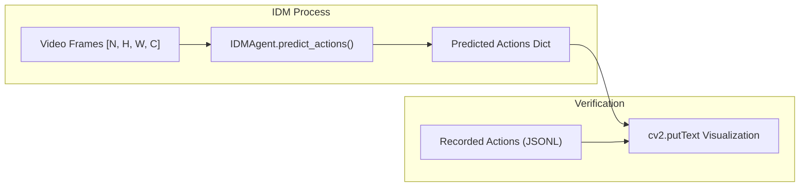
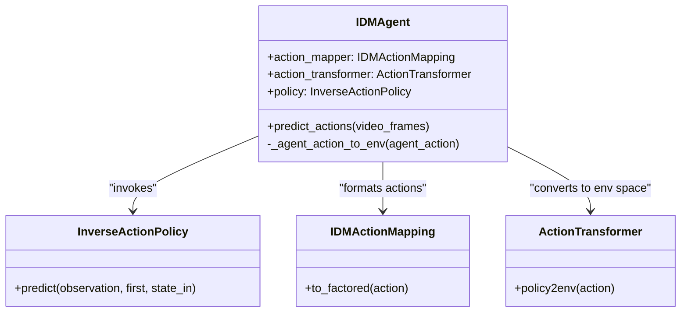
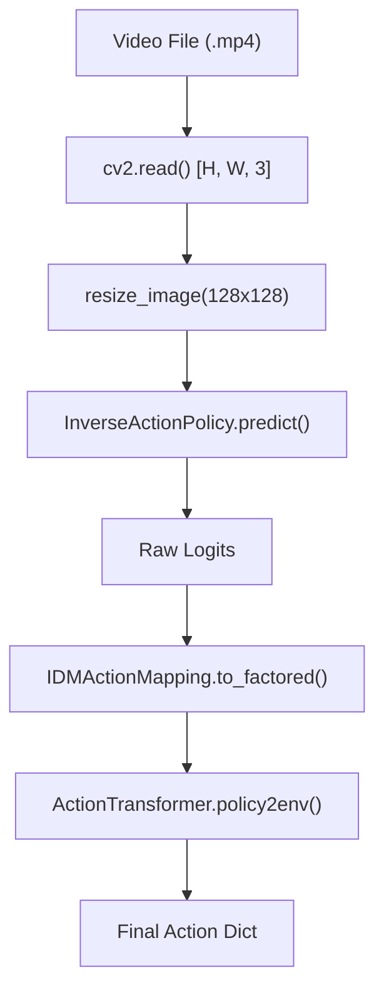

<!-- source: DeepWiki mcp.deepwiki.com · repo openai/Video-Pre-Training · page 5.2 Running the IDM · fetched 2026-10-26 -->

# Running the IDM

<details>
<summary>Relevant source files</summary>

The following files were used as context for generating this wiki page:

- [inverse_dynamics_model.py](inverse_dynamics_model.py)
- [run_inverse_dynamics_model.py](run_inverse_dynamics_model.py)

</details>


This document provides a technical guide on running the Inverse Dynamics Model (IDM) in the Video Pre-Training (VPT) system. The IDM predicts player actions from Minecraft video recordings by analyzing temporal frame sequences and outputting control inputs.

## Overview

The Inverse Dynamics Model is a critical component of the VPT pipeline, used to generate action labels for unlabeled video data. It utilizes a 3D convolutional architecture to process sequences of frames, predicting the actions that most likely produced the state transitions observed in the video.



Sources: [run_inverse_dynamics_model.py:163-187](), [inverse_dynamics_model.py:21-26]()

## Command Structure and Arguments

The IDM is executed via `run_inverse_dynamics_model.py`. This script loads a pre-trained IDM, processes a video file, and visualizes predictions against ground truth data.

### Execution Command
```bash
python run_inverse_dynamics_model.py \
    --weights [path/to/weights] \
    --model [path/to/model] \
    --video-path [path/to/video.mp4] \
    --jsonl-path [path/to/actions.jsonl] \
    --n-frames 128 \
    --n-batches 10
```

### Argument Details

| Argument | Type | Description |
| :--- | :--- | :--- |
| `--weights` | `str` | Path to the `.weights` file containing PyTorch state dicts [run_inverse_dynamics_model.py:196](). |
| `--model` | `str` | Path to the `.model` pickle file containing network hyperparameters [run_inverse_dynamics_model.py:197](). |
| `--video-path` | `str` | Path to the input `.mp4` Minecraft recording [run_inverse_dynamics_model.py:198](). |
| `--jsonl-path` | `str` | Path to the `.jsonl` file containing ground truth actions [run_inverse_dynamics_model.py:199](). |
| `--n-frames` | `int` | Sequence length processed in a single forward pass (default: 128) [run_inverse_dynamics_model.py:200](). |
| `--n-batches` | `int` | Total number of sequences to process for visualization (default: 10) [run_inverse_dynamics_model.py:201](). |

Sources: [run_inverse_dynamics_model.py:194-205]()

## Data Mapping and Scaling

The IDM requires precise mapping between raw recording data and the model's expected input/output formats.

### Camera Scaling
Recorded mouse movements are scaled to match the sensitivity used during model training. The constant `CAMERA_SCALER` is set to `360.0 / 2400.0` (0.15), matching the MineRL Java implementation sensitivity [run_inverse_dynamics_model.py:77-78]().

### Keyboard Mapping
The `KEYBOARD_BUTTON_MAPPING` dictionary translates Minecraft key strings from the JSONL data into the action names used by the `IDMAgent` [run_inverse_dynamics_model.py:17-38]().

| JSON Key | IDM Action |
| :--- | :--- |
| `key.keyboard.w` | `forward` |
| `key.keyboard.s` | `back` |
| `key.keyboard.space` | `jump` |
| `key.keyboard.e` | `inventory` |
| `key.keyboard.left.shift` | `sneak` |

Sources: [run_inverse_dynamics_model.py:17-38](), [run_inverse_dynamics_model.py:77-78]()

## Technical Implementation

### IDM Agent Logic
The `IDMAgent` class encapsulates the `InverseActionPolicy` and the necessary transformers to convert model outputs into environment-compatible actions.



Sources: [inverse_dynamics_model.py:21-43](), [inverse_dynamics_model.py:74-95]()

### Data Flow: Frame to Prediction
The script processes video in chunks of `n_frames`. For each chunk:
1. **Frame Loading**: Frames are read via `cv2.VideoCapture` and converted from BGR to RGB [run_inverse_dynamics_model.py:152-157]().
2. **Action Parsing**: Ground truth actions are loaded from JSONL and converted using `json_action_to_env_action` [run_inverse_dynamics_model.py:80-125]().
3. **Inference**: `IDMAgent.predict_actions(frames)` resizes images to `AGENT_RESOLUTION` (128x128) and runs the `InverseActionPolicy` [inverse_dynamics_model.py:54-59](), [inverse_dynamics_model.py:85-94]().
4. **Post-processing**: Predicted actions are transformed through `IDMActionMapping` and `ActionTransformer` [inverse_dynamics_model.py:61-72]().



Sources: [run_inverse_dynamics_model.py:146-163](), [inverse_dynamics_model.py:54-72](), [inverse_dynamics_model.py:85-95]()

## Visualization Output

The script uses OpenCV to provide a frame-by-frame comparison. For every frame in the batch, a window titled "MineRL IDM model predictions" displays:
- The RGB frame.
- A text overlay for every action head (e.g., `forward`, `jump`, `camera`).
- The format is `action_name: predicted_value (recorded_value)` [run_inverse_dynamics_model.py:177-187]().

Users must press a key to advance to the next frame [run_inverse_dynamics_model.py:190]().

Sources: [run_inverse_dynamics_model.py:165-191]()

## Implementation Notes
- **Resolution**: Input videos must match the `ENV_KWARGS["resolution"]` (typically 640x360) [run_inverse_dynamics_model.py:137-155]().
- **Statefulness**: The IDM maintains a `hidden_state` (recurrent state) across calls to `predict_actions`. This state can be manually cleared via `agent.reset()` [inverse_dynamics_model.py:42-52]().
- **Performance**: While functional, this implementation is a standalone script and may differ slightly in performance from the original training code used in the VPT paper [run_inverse_dynamics_model.py:1-4]().

Sources: [run_inverse_dynamics_model.py:1-4](), [inverse_dynamics_model.py:42-52](), [run_inverse_dynamics_model.py:155]()

---

