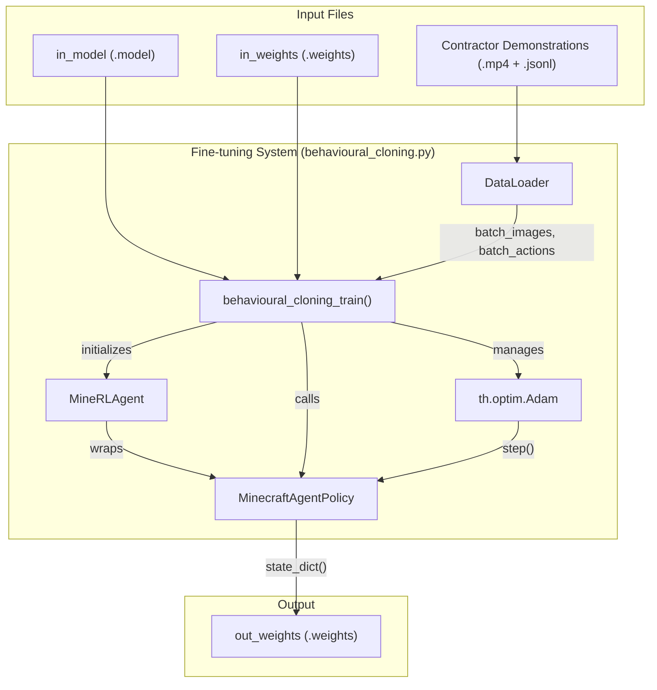
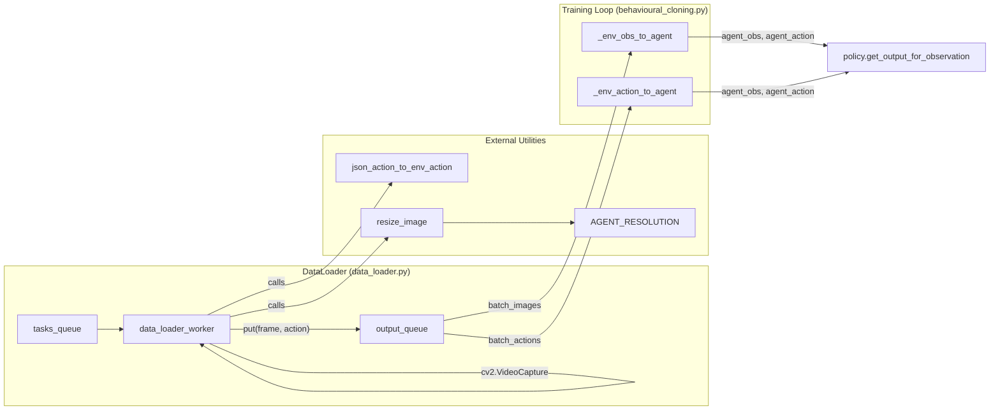
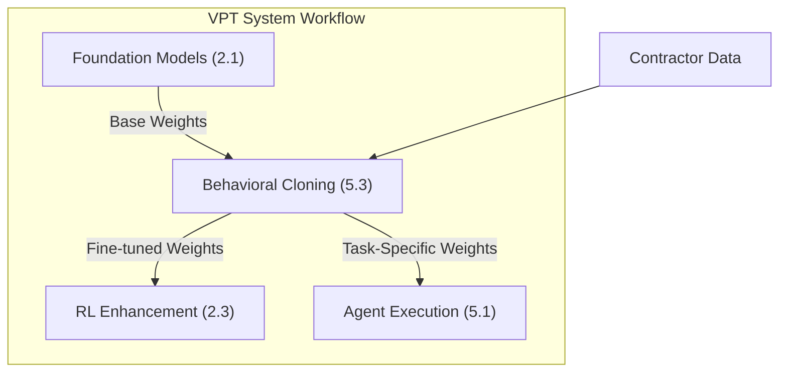

<!-- source: DeepWiki mcp.deepwiki.com · repo openai/Video-Pre-Training · page 5.3 Fine-tuning with Behavioral Cloning · fetched 2026-10-26 -->

# Fine-tuning with Behavioral Cloning

<details>
<summary>Relevant source files</summary>

The following files were used as context for generating this wiki page:

- [behavioural_cloning.py](behavioural_cloning.py)
- [data_loader.py](data_loader.py)

</details>


## Purpose and Overview

This document explains how to fine-tune pre-trained Minecraft agent models using behavioral cloning (BC) in the Video Pre-Training (VPT) system. Behavioral cloning is a form of imitation learning where an agent learns to mimic human actions by training on demonstration data. In the VPT system, this allows you to customize foundation models for specific tasks using contractor demonstrations.

The provided implementation in `behavioural_cloning.py` is designed to be memory-efficient, allowing fine-tuning on consumer-grade hardware (e.g., 8GB VRAM) by using gradient accumulation and processing one step at a time.

Sources: [behavioural_cloning.py:1-12](), [agent.py:15-22]()

## System Architecture

The behavioral cloning fine-tuning system consists of several components that work together to update a pre-trained model's weights based on demonstration data.

### Behavioral Cloning Logic Flow
The diagram below bridges the high-level fine-tuning logic with specific code entities in `behavioural_cloning.py` and `data_loader.py`.



Sources: [behavioural_cloning.py:49-74](), [behavioural_cloning.py:121-132](), [data_loader.py:130-145]()

## Data Processing Pipeline

The `DataLoader` processes raw contractor demonstration data into a format that can be used for training. It handles the synchronization of video frames and JSONL action logs.

### Data Loader Internal Flow
This diagram shows how `data_loader_worker` transforms raw environment data into agent-compatible tensors.



Sources: [data_loader.py:48-129](), [data_loader.py:130-172](), [behavioural_cloning.py:86-94]()

## Behavioral Cloning Training Process

The training process iterates through the dataset, maintaining the hidden state for the recurrent policy to ensure temporal consistency despite the memory-saving single-step updates.

```mermaid
sequenceDiagram
    participant DL as DataLoader
    participant BC as behavioural_cloning.py
    participant Policy as MinecraftAgentPolicy
    participant Opt as th.optim.Adam

    Note over BC,Opt: For each batch of demonstrations
    loop Training Loop
        DL->>BC: (batch_images, batch_actions, batch_episode_id)
        loop Per Sample in Batch
            BC->>BC: episode_hidden_states[episode_id]
            BC->>Policy: get_output_for_observation(agent_obs, agent_state)
            Policy-->>BC: pi_distribution, new_agent_state
            BC->>Policy: get_logprob_of_action(pi_distribution, agent_action)
            BC->>BC: loss = -log_prob / BATCH_SIZE
            BC->>BC: loss.backward()
            BC->>BC: Update episode_hidden_states (detached)
        end
        BC->>BC: th.nn.utils.clip_grad_norm_
        BC->>Opt: optimizer.step()
        BC->>Opt: optimizer.zero_grad()
    end
```

Sources: [behavioural_cloning.py:86-124]()

## Key Parameters and Configuration

The implementation uses hyperparameters derived from the OpenAI VPT paper, optimized for the behavioral cloning phase.

| Parameter | Value | Description | File Reference |
|-----------|-------|-------------|----------------|
| `EPOCHS` | 2 | Number of passes through the complete dataset | [behavioural_cloning.py:26]() |
| `BATCH_SIZE` | 8 | Number of samples for gradient accumulation | [behavioural_cloning.py:28]() |
| `N_WORKERS` | 12 | Parallel data loading processes | [behavioural_cloning.py:33]() |
| `LEARNING_RATE` | 0.000181 | Adam optimizer learning rate | [behavioural_cloning.py:38]() |
| `WEIGHT_DECAY` | 0.039428 | L2 regularization strength | [behavioural_cloning.py:39]() |
| `MAX_GRAD_NORM` | 5.0 | Maximum gradient norm for clipping | [behavioural_cloning.py:40]() |

## Implementation Details

### VRAM Constraints and Gradient Accumulation
To support 8GB GPUs, the script avoids training on full sequences. Instead, it:
1. Loads one step at a time per worker [data_loader.py:134-136]().
2. Computes the gradient for a single step and calls `loss.backward()` [behavioural_cloning.py:117-119]().
3. Accumulates these gradients over `BATCH_SIZE` samples before calling `optimizer.step()` [behavioural_cloning.py:121-123]().

### Hidden State Management
The recurrent state (LSTM/Transformer memory) is persisted across training steps for each trajectory using a dictionary:
- `episode_hidden_states` stores the `new_agent_state` returned by the policy [behavioural_cloning.py:82-101]().
- The state is `.detach()`ed between steps to prevent the computation graph from growing across the entire trajectory, which would cause Out-Of-Memory (OOM) errors [behavioural_cloning.py:111-112]().

### Action Processing
The `data_loader_worker` performs several critical transformations:
- **Null Action Filtering**: Actions that result in no change (null actions) are skipped to match the VPT paper methodology [data_loader.py:108-112]().
- **GUI Handling**: If a GUI is open, the mouse cursor is composited onto the frame [data_loader.py:113-117]().
- **Hotbar Tracking**: Since scrollwheel input isn't captured, the loader tracks the selected hotbar slot and injects "hotbar.X" actions when changes occur [data_loader.py:69-74](), [data_loader.py:99-103]().

Sources: [data_loader.py:48-129](), [behavioural_cloning.py:82-124]()

## Usage Guide

### 1. Data Preparation
Place `.mp4` and `.jsonl` files in a directory. The `DataLoader` matches them by filename prefix [data_loader.py:152-160]().

### 2. Execution
Run the fine-tuning script with the required paths:
```bash
python behavioural_cloning.py \
    --data-dir ./my_data \
    --in-model foundation-model-1x.model \
    --in-weights foundation-model-1x.weights \
    --out-weights finetuned-model.weights
```

### 3. Argument Reference
- `--data-dir`: Directory containing the contractor demonstrations [behavioural_cloning.py:137]().
- `--in-model`: The model definition file (contains architecture metadata) [behavioural_cloning.py:138]().
- `--in-weights`: The base weights to start fine-tuning from [behavioural_cloning.py:139]().
- `--out-weights`: Target path for the fine-tuned state dictionary [behavioural_cloning.py:140]().

Sources: [behavioural_cloning.py:135-143]()

## Integration with the VPT System

Fine-tuning serves as the bridge between the general-purpose Foundation Models and task-specific Reinforcement Learning models.



Sources: [behavioural_cloning.py:6-8](), [agent.py:22]()

---

