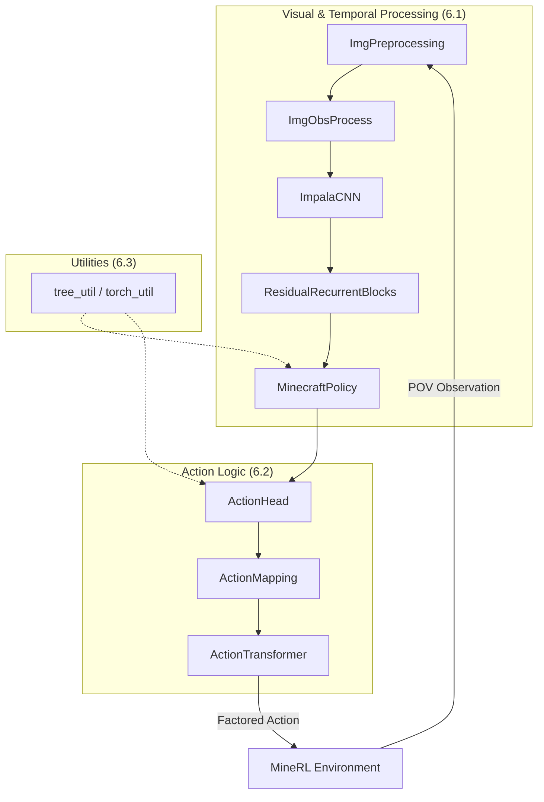
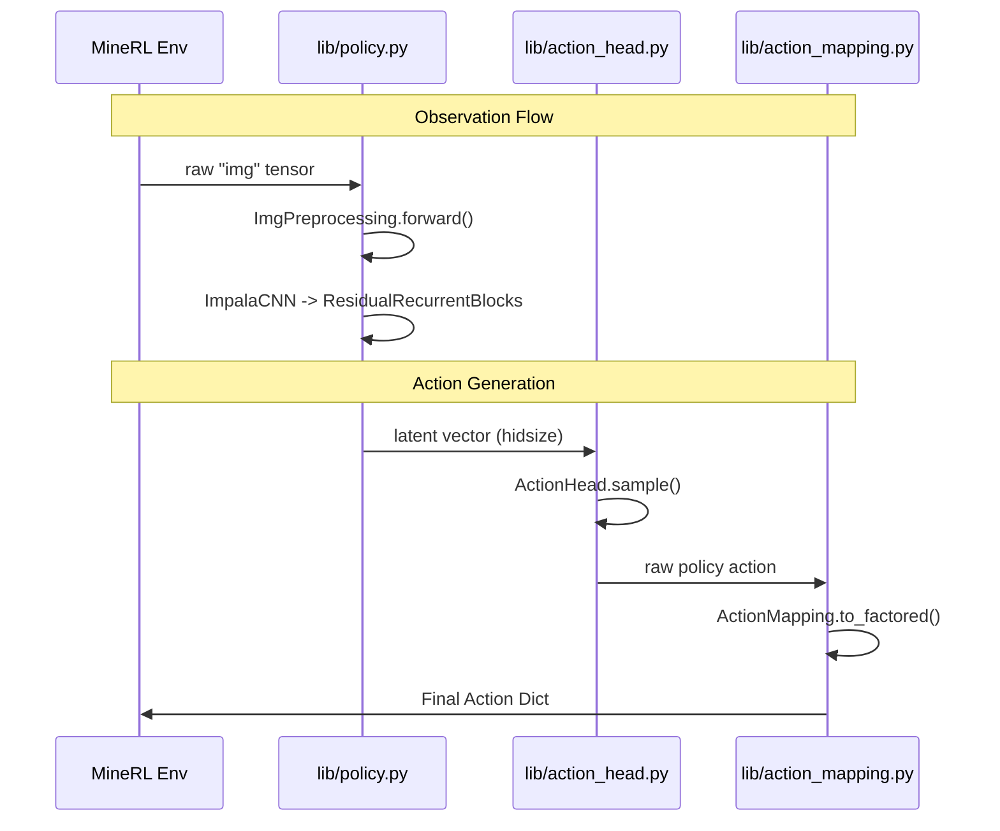

<!-- source: DeepWiki mcp.deepwiki.com · repo openai/Video-Pre-Training · page 6 Technical Components · fetched 2026-10-26 -->

# Technical Components

Relevant source files

The following files were used as context for generating this wiki page:

- [lib/action_head.py](lib/action_head.py)
- [lib/action_mapping.py](lib/action_mapping.py)
- [lib/policy.py](lib/policy.py)

This page provides a high-level overview of the technical components that make up the Video Pre-Training (VPT) system. It serves as a roadmap for the underlying code entities, linking visual input processing, temporal recurrence, and action output mechanisms.

## System Architecture and Code Entities

The VPT system is structured around the `MineRLAgent` class, which orchestrates the flow between the environment, the neural network policy, and action transformation logic.

Sources: [lib/policy.py:21-81](), [lib/policy.py:83-189](), [lib/action_mapping.py:12-29](), [lib/action_head.py:22-52]()

## Core Technical Subsystems

### 1. Neural Network Architecture
The backbone of the VPT system is a hybrid architecture that combines vision-based feature extraction with transformer-based recurrence. 

*   **Vision**: Images are normalized by `ImgPreprocessing` [lib/policy.py:21-45]() and processed through an `ImpalaCNN` [lib/policy.py:66-71]().
*   **Recurrence**: The system supports multiple recurrence types, primarily using `transformer` blocks encapsulated in `ResidualRecurrentBlocks` [lib/policy.py:173-185]().
*   **Policy Classes**: `MinecraftPolicy` handles the core logic of combining vision and recurrence [lib/policy.py:83-126](), while `MinecraftAgentPolicy` (detailed in child pages) provides the interface for agent interaction.

For details, see [Neural Network Architecture](#6.1).

### 2. Action Handling and Transformation
Minecraft has a complex, multi-modal action space (buttons + continuous camera movement). VPT manages this through several abstraction layers:

*   **Action Heads**: Classes like `CategoricalActionHead` and `DiagGaussianActionHead` define the probability distributions for different action types [lib/action_head.py:54-190]().
*   **Action Mapping**: The `ActionMapping` abstract class and its implementations (e.g., `CameraHierarchicalMapping`) convert between the neural network's joint action space and the environment's factored space [lib/action_mapping.py:12-101]().
*   **IDM Mapping**: A specialized `IDMActionMapping` is used for the Inverse Dynamics Model to handle identity mappings of predicted actions [lib/action_mapping.py:102-119]().

For details, see [Action Handling](#6.2).

### 3. Utility Components
The codebase relies on a set of specialized utilities for tensor manipulation and initialization:

*   **Initialization**: `FanInInitReLULayer` and `fan_in_linear` provide custom weight initialization schemes critical for deep policy training [lib/policy.py:72-77](), [lib/action_head.py:14-21]().
*   **Data Structures**: `tree_map` and `tree_util` are used extensively to apply operations across nested dictionaries of tensors (e.g., when processing complex action or observation dictionaries) [lib/policy.py:16]().

For details, see [Utility Components](#6.3).

## Data Flow: Observation to Action

The following diagram bridges the "Natural Language" concepts of the agent's loop with the specific "Code Entities" that execute them.

Sources: [lib/policy.py:193-206](), [lib/action_head.py:40-47](), [lib/action_mapping.py:50-55]()

## Component Relationship Table

| Component Category | Key Code Symbols | Primary Responsibility |
|:---|:---|:---|
| **Perception** | `ImpalaCNN`, `ImgPreprocessing` | Translating RGB pixels into high-dimensional feature vectors. |
| **Memory** | `ResidualRecurrentBlocks`, `MaskedAttention` | Maintaining state across timesteps using Transformers. |
| **Decision** | `MinecraftPolicy`, `ActionHead` | Generating probability distributions over possible actions. |
| **Interface** | `ActionMapping`, `ActionTransformer` | Translating model outputs into valid Minecraft game commands. |

Sources: [lib/policy.py:66-71](), [lib/policy.py:173-185](), [lib/action_head.py:22-52](), [lib/action_mapping.py:12-29]()

---

