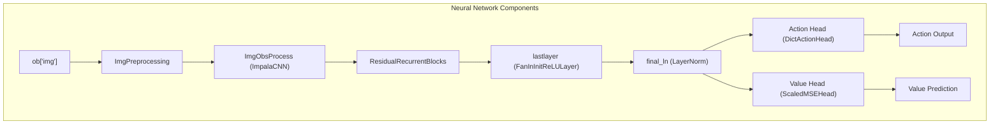
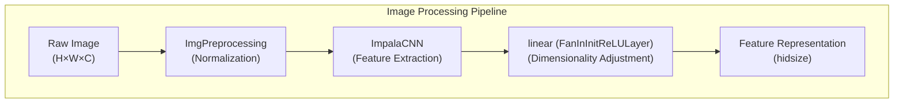
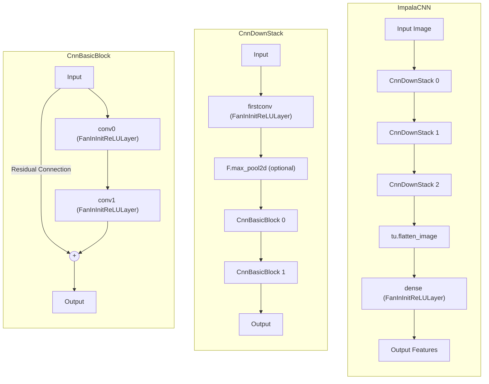
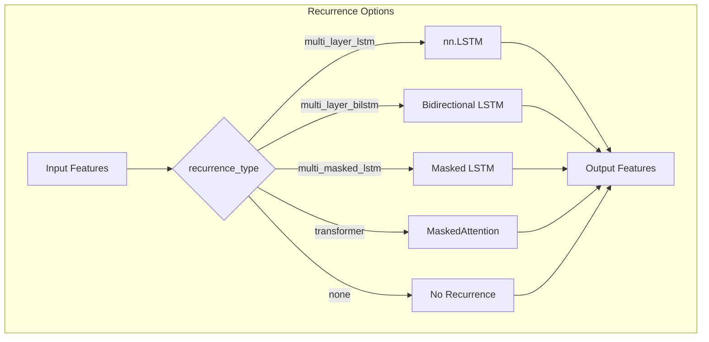
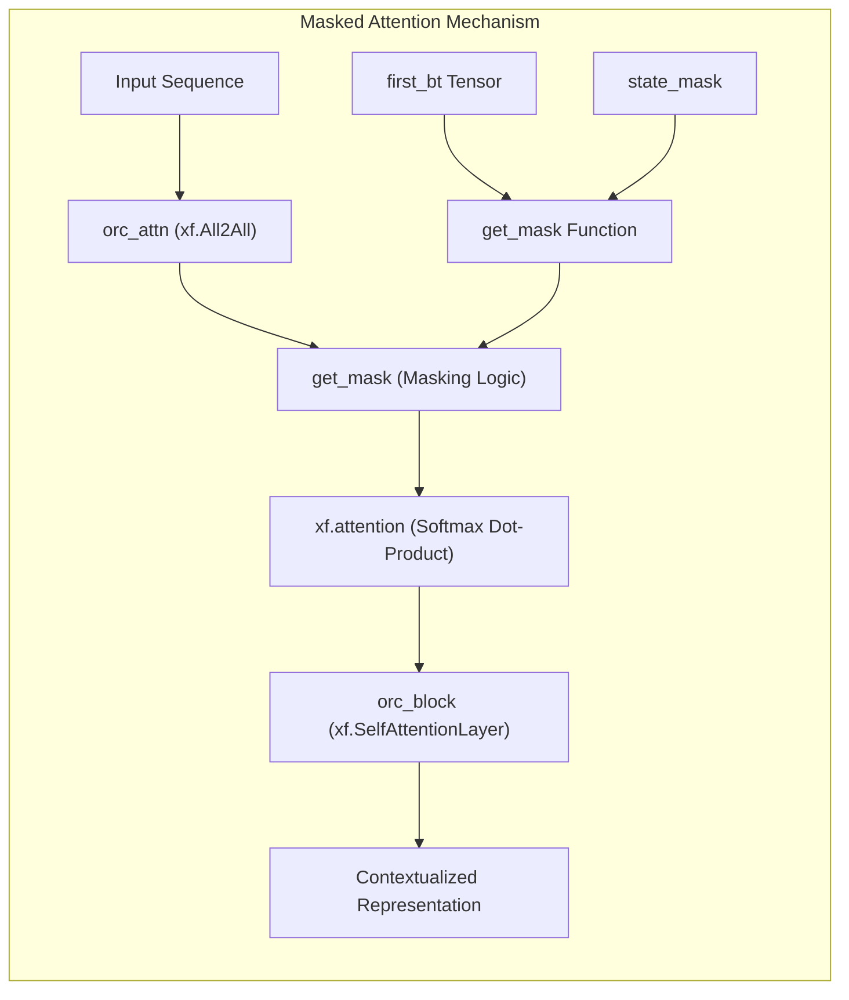
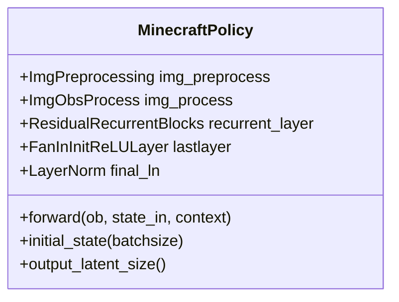
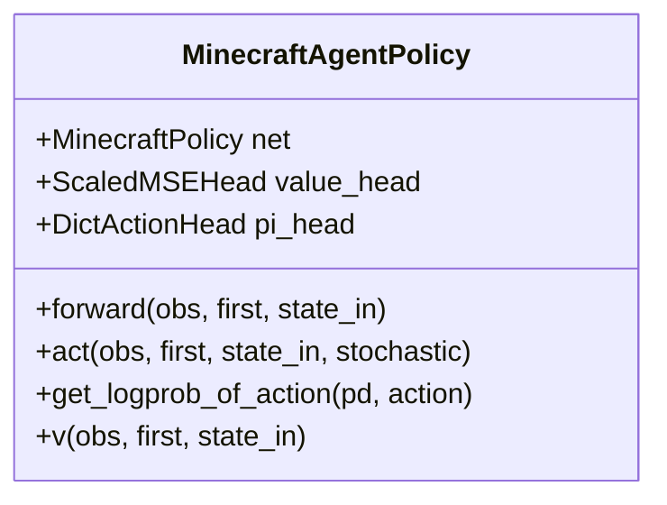
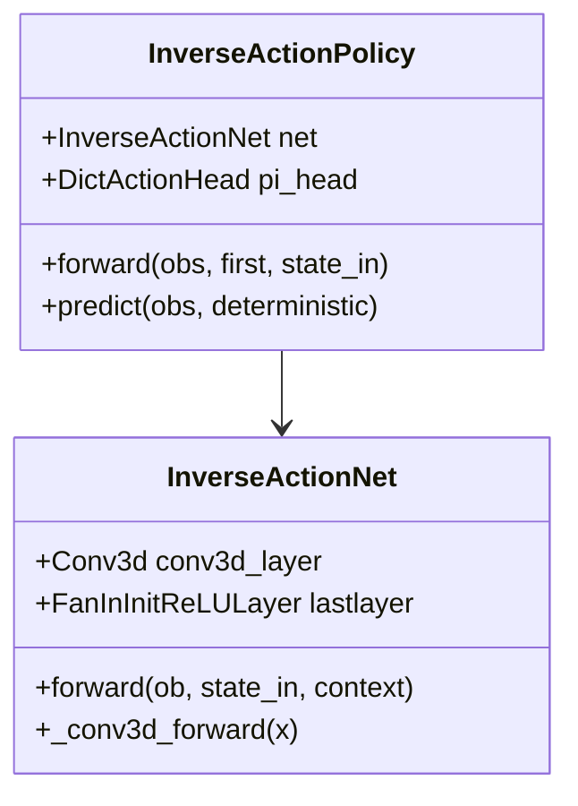

<!-- source: DeepWiki mcp.deepwiki.com · repo openai/Video-Pre-Training · page 6.1 Neural Network Architecture · fetched 2026-10-26 -->

# Neural Network Architecture

Relevant source files

The following files were used as context for generating this wiki page:

- [lib/impala_cnn.py](lib/impala_cnn.py)
- [lib/masked_attention.py](lib/masked_attention.py)
- [lib/mlp.py](lib/mlp.py)
- [lib/normalize_ewma.py](lib/normalize_ewma.py)
- [lib/policy.py](lib/policy.py)
- [lib/scaled_mse_head.py](lib/scaled_mse_head.py)
- [lib/util.py](lib/util.py)
- [lib/xf.py](lib/xf.py)

This document details the neural network architecture used in the Video Pre-Training (VPT) system for Minecraft. It covers the design and implementation of the policy networks, convolutional backbones, recurrent components, and attention mechanisms that enable the agents to process visual observations and generate appropriate actions.

For information about how actions are handled and transformed, see [6.2 Action Handling]().

## Core Architecture Overview

The VPT neural network architecture follows a modular design with several key components that work together to process observations and produce actions:

Sources: [lib/policy.py:83-218](), [lib/policy.py:227-340]()

## Image Processing Path

The agent processes raw image observations through several stages before they reach the recurrent components:

Sources: [lib/policy.py:21-80](), [lib/impala_cnn.py:132-195]()

### ImpalaCNN Architecture

The `ImpalaCNN` is the backbone convolutional network that processes visual input. It consists of multiple `CnnDownStack` layers, each containing a sequence of `CnnBasicBlock` residual modules.

Sources: [lib/impala_cnn.py:13-130](), [lib/impala_cnn.py:132-195]()

## Recurrent Components

The VPT architecture supports multiple types of recurrent mechanisms to maintain temporal information, primarily via the `ResidualRecurrentBlocks` class.

Sources: [lib/policy.py:83-218](), [lib/util.py:91-130]()

### Transformer Attention Architecture

When `recurrence_type` is set to `"transformer"`, the system uses `MaskedAttention` which wraps `lib/xf.py` primitives. It implements a band-diagonal causal mask that can respect episode boundaries via the `first` flag.

Sources: [lib/masked_attention.py:97-183](), [lib/masked_attention.py:47-94](), [lib/xf.py:18-71]()

## Network Implementation Details

### MinecraftPolicy Class

This is the core policy implementation that processes observations through the CNN and recurrent components. It manages the `img_preprocess`, `img_process` (ImpalaCNN), and `recurrent_layer` modules.

Sources: [lib/policy.py:83-224]()

### MinecraftAgentPolicy Class

This class extends the base policy to include action and value heads. It is the primary interface for the agent's decision-making process.

Sources: [lib/policy.py:227-340]()

### InverseActionPolicy Class (IDM)

This specialized policy is used for the Inverse Dynamics Model (IDM). Unlike the standard policy, it uses an `InverseActionNet` which features a `Conv3d` layer to process temporal information across a window of frames.

Sources: [lib/policy.py:342-467]()

## Normalization and Parameter Initialization

The VPT architecture employs several normalization techniques and custom initialization via `FanInInitReLULayer` to ensure stable training:

*   **FanInInitReLULayer**: Implements a modified weight initialization where weights are scaled by `init_scale / weight.norm`, specifically tuned for ReLU activations [lib/util.py:23-82]().
*   **NormalizeEwma**: Performs Exponentially Weighted Moving Average normalization for observation or target vectors [lib/normalize_ewma.py:6-60]().
*   **ScaledMSEHead**: A specialized linear output layer for value prediction that uses `NormalizeEwma` to keep targets normalized to N(0, 1) [lib/scaled_mse_head.py:11-51]().

## Hyperparameters and Model Variants

The architecture is highly configurable to support different model sizes (1x, 2x, 3x width variants):

| Parameter | Description | Typical Values |
|-----------|-------------|----------------|
| `impala_width` | Width multiplier for CNN channels [lib/policy.py:140]() | 1, 2, 4, 8 |
| `impala_chans` | Base channel counts for CNN stacks [lib/policy.py:100]() | (16, 32, 32) |
| `hidsize` | Hidden size for linear and recurrent layers [lib/policy.py:102]() | 512, 1024, 2048 |
| `recurrence_type` | Type of temporal processing [lib/policy.py:98]() | "multi_layer_lstm", "transformer" |
| `n_recurrence_layers` | Number of blocks in `ResidualRecurrentBlocks` [lib/policy.py:121]() | 1, 2, 4 |
| `attention_heads` | Number of heads in `MaskedAttention` [lib/policy.py:116]() | 8 |
| `attention_memory_size` | Total context window for transformer [lib/policy.py:117]() | 2048 |

Sources: [lib/policy.py:96-126](), [lib/impala_cnn.py:132-158]()

## Data Flow During Inference

During a single step of inference:
1.  **Preprocessing**: Raw image `ob["img"]` is cast to float and scaled (or normalized via `img_statistics`) [lib/policy.py:39-45]().
2.  **CNN Backbone**: `ImpalaCNN` extracts spatial features and flattens them [lib/impala_cnn.py:187-195]().
3.  **Temporal Processing**: Features pass through `ResidualRecurrentBlocks`, updating internal states (LSTM hidden states or Transformer KV-caches) [lib/util.py:115-124]().
4.  **Action Generation**: The latent representation passes through `lastlayer` and `final_ln` into the `DictActionHead` to produce a distribution over actions [lib/policy.py:209-217]().
5.  **Sampling**: `MinecraftAgentPolicy.act` samples from the distribution to return a concrete action dictionary [lib/policy.py:307-339]().

Sources: [lib/policy.py:193-218](), [lib/policy.py:307-339]()

---

