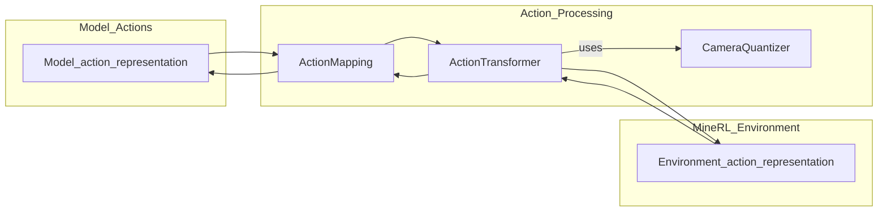
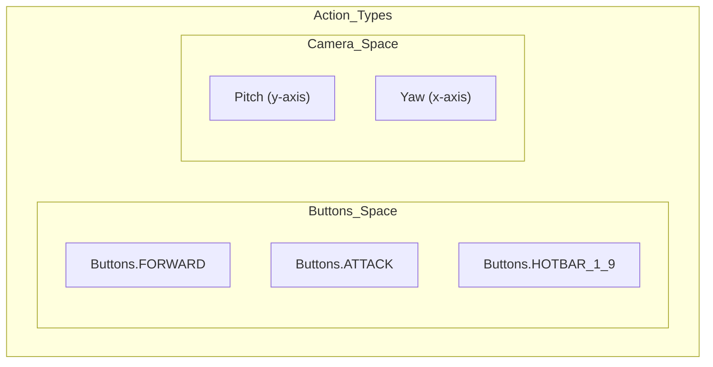
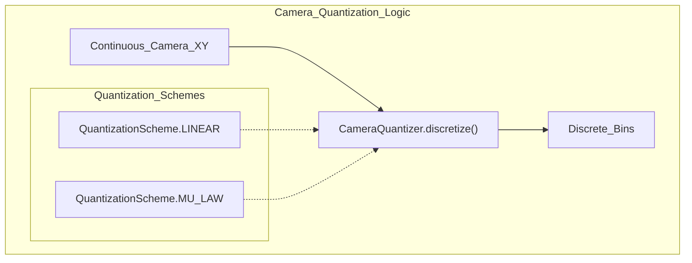
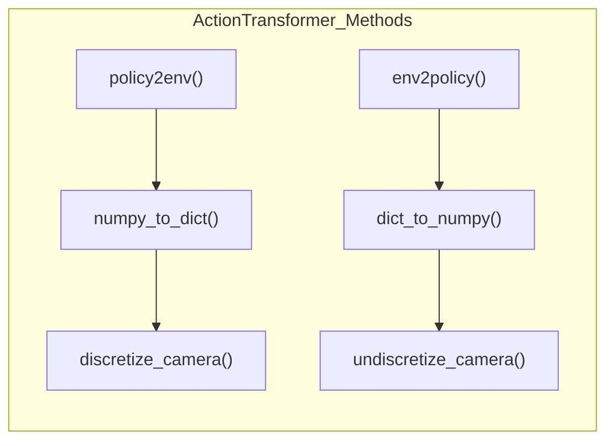
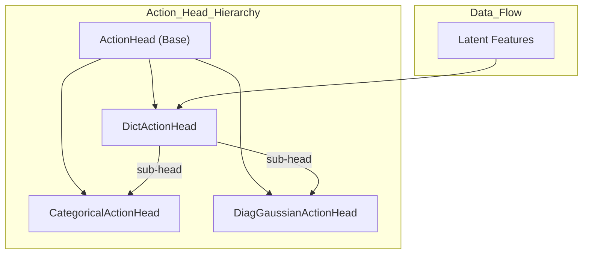

<!-- source: DeepWiki mcp.deepwiki.com · repo openai/Video-Pre-Training · page 6.2 Action Handling · fetched 2026-10-26 -->

# Action Handling

Relevant source files

The following files were used as context for generating this wiki page:

- [lib/action_head.py](lib/action_head.py)
- [lib/action_mapping.py](lib/action_mapping.py)
- [lib/actions.py](lib/actions.py)

This document outlines how Minecraft actions are represented, transformed, and processed within the Video Pre-Training (VPT) system. The action handling subsystem is responsible for converting between the internal model action representation and the format required by the MineRL environment, enabling the agent to effectively interact with Minecraft.

## Overview of Action Handling

The VPT action handling system converts between different action representations and applies appropriate transformations to make them compatible with both the neural network model and the Minecraft environment. This involves handling multiple action types (button presses and camera movements) and addressing their different characteristics.

Sources: [lib/actions.py:105-179](), [lib/action_mapping.py:12-235]()

## Action Representation

The VPT system represents actions in two main formats:

1.  **Environment format**: Used by the MineRL environment, consisting of separate key-value pairs for button actions and camera movements.
2.  **Model format**: Used internally by the agent model, consisting of a structured dictionary with key dimensions for efficiency.

### Action Types

The system handles two primary types of actions:

1.  **Button Actions**: Discrete actions (pressed or not pressed) including movement controls, item usage, and inventory management. These are defined in the `Buttons` class [lib/actions.py:8-34]().
2.  **Camera Actions**: Continuous actions representing changes in camera pitch and yaw.

Sources: [lib/actions.py:8-34](), [lib/actions.py:49-81]()

The button actions are defined as constants in the `Buttons` class:

| Category | Constants |
| :--- | :--- |
| **Movement** | `ATTACK`, `BACK`, `FORWARD`, `JUMP`, `LEFT`, `RIGHT`, `SNEAK`, `SPRINT` |
| **Interaction** | `USE`, `DROP`, `INVENTORY` |
| **Hotbar** | `hotbar.1` through `hotbar.9` |

Sources: [lib/actions.py:8-34]()

## Camera Action Quantization

Camera actions in Minecraft are continuous values, but the model works with discrete action spaces. To handle this, the VPT system quantizes camera actions using the `CameraQuantizer` class, which supports both linear and mu-law quantization schemes.

Sources: [lib/actions.py:43-102]()

### Quantization Methods

1.  **Linear Quantization**: Uniformly divides the range `[-camera_maxval, camera_maxval]` into discrete bins [lib/actions.py:92-92]().
2.  **Mu-law Quantization**: Applies mu-law encoding before quantization, providing finer precision near zero and coarser precision for larger values [lib/actions.py:85-90]().

The `discretize` function clips values to `camera_maxval` before processing [lib/actions.py:83-83](). The `undiscretize` function reverses this process to recover continuous values for the environment [lib/actions.py:94-102]().

Sources: [lib/actions.py:49-102]()

## Action Transformation

The `ActionTransformer` class serves as the core component for converting actions between internal model format and MineRL environment format.

Sources: [lib/actions.py:105-179]()

### Environment-to-Policy Conversion
In `dict_to_numpy`, button actions are stacked into a single array using `Buttons.ALL` as keys [lib/actions.py:140-140](), and camera actions are discretized [lib/actions.py:141-141]().

### Policy-to-Environment Conversion
In `numpy_to_dict`, the stacked button array is unpacked into individual keys [lib/actions.py:161-161](), and the camera bins are converted back to continuous values using `undiscretize_camera` [lib/actions.py:163-163]().

Sources: [lib/actions.py:135-165]()

## Action Mapping

The `ActionMapping` abstract base class defines the interface for mapping between the standard factored Minecraft action space and specialized spaces used by different models [lib/action_mapping.py:12-65]().

### CameraHierarchicalMapping

This mapping creates a hierarchical action space where buttons are represented as joint actions (combinations). It includes a "camera" meta-action in the button space; when triggered, a separate camera head selects a joint camera action [lib/action_mapping.py:120-132]().

The mapper organizes buttons into `BUTTONS_GROUPS` [lib/action_mapping.py:19-28]():

| Group | Options |
| :--- | :--- |
| **hotbar** | `none`, `hotbar.1` ... `hotbar.9` |
| **fore_back** | `none`, `forward`, `back` |
| **left_right** | `none`, `left`, `right` |
| **sprint_sneak** | `none`, `sprint`, `sneak` |
| **camera** | `none`, `camera` |

Sources: [lib/action_mapping.py:19-28](), [lib/action_mapping.py:128-129]()

### IDMActionMapping

The `IDMActionMapping` is used by the Inverse Dynamics Model. It functions primarily as an identity mapping, returning the factored actions directly [lib/action_mapping.py:102-118]().

## Action Heads

Action heads are neural network modules that convert latent features into probability distributions over actions.

*   **CategoricalActionHead**: Used for discrete actions (buttons). It applies a linear layer to input data, reshapes it to the action space, and returns log-probabilities via `F.log_softmax` [lib/action_head.py:136-174]().
*   **DiagGaussianActionHead**: Used for continuous actions where variables are normally distributed. It predicts means via a linear layer while standard deviations are learned parameters [lib/action_head.py:54-84]().
*   **DictActionHead**: A container that manages multiple sub-heads (e.g., one for buttons, one for camera). It aggregates log-probabilities, entropies, and KL divergences across all managed heads [lib/action_head.py:209-312]().

Sources: [lib/action_head.py:22-312]()

---

