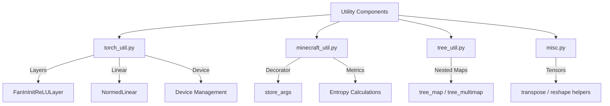
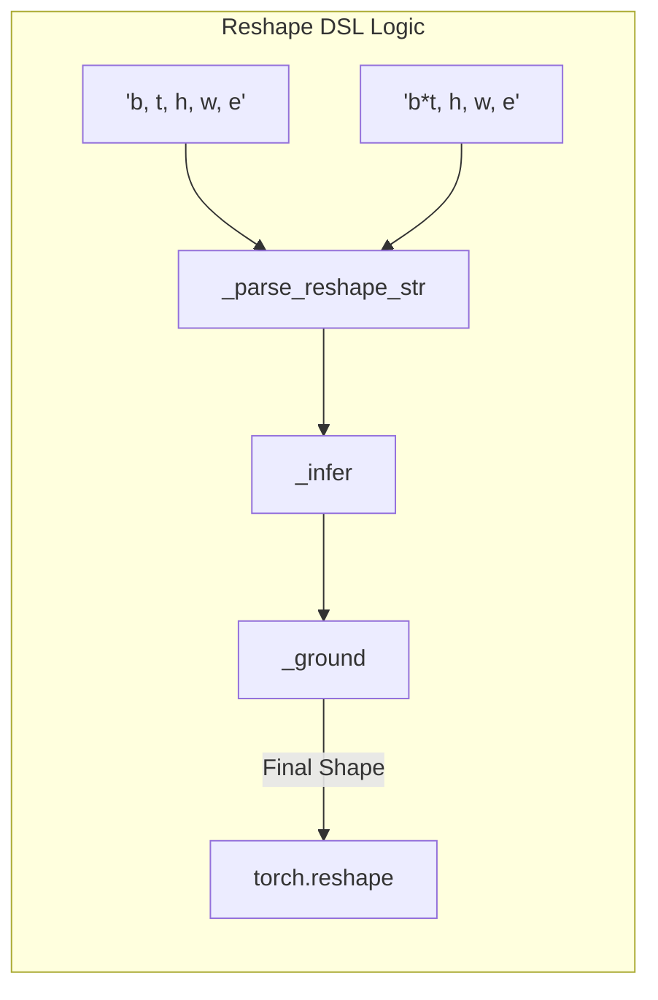
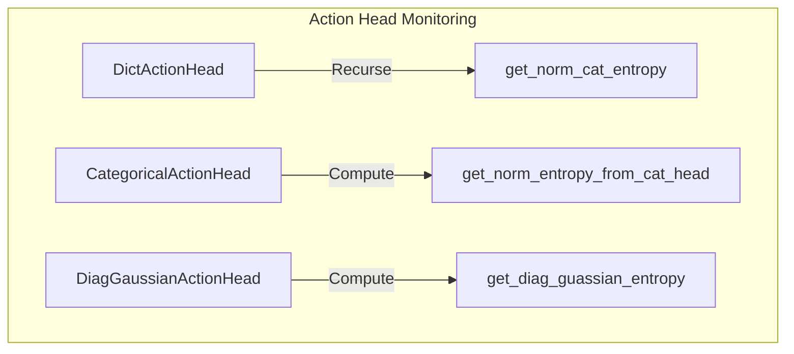
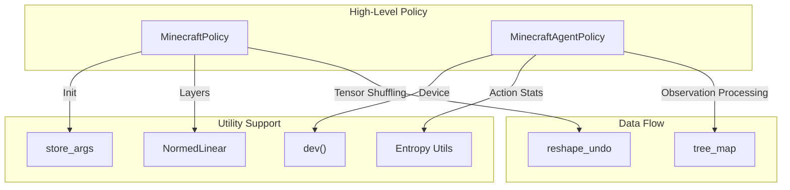

<!-- source: DeepWiki mcp.deepwiki.com · repo openai/Video-Pre-Training · page 6.3 Utility Components · fetched 2026-10-26 -->

# Utility Components

Relevant source files

The following files were used as context for generating this wiki page:

- [lib/__init__.py](lib/__init__.py)
- [lib/minecraft_util.py](lib/minecraft_util.py)
- [lib/misc.py](lib/misc.py)
- [lib/torch_util.py](lib/torch_util.py)
- [lib/tree_util.py](lib/tree_util.py)
- [lib/util.py](lib/util.py)

## Purpose and Scope

This page documents the utility components in the Video Pre-Training (VPT) codebase. These utilities provide specialized neural network layers, tensor manipulation primitives, device management, and tree-based data structure helpers that support the agent models, Inverse Dynamics Model (IDM), and action handling systems.

## Overview of Utility Components

The VPT codebase organizes utilities into several specialized modules: `lib/torch_util.py` for PyTorch-specific helpers, `lib/tree_util.py` for nested structure manipulation, `lib/minecraft_util.py` for environment-specific logic, and `lib/misc.py` for general tensor reshaping and arithmetic.

Sources: [lib/torch_util.py:1-201](), [lib/minecraft_util.py:1-89](), [lib/tree_util.py:1-200](), [lib/misc.py:1-264]()

## Specialized Neural Network Layers

The codebase uses custom initialization and normalization strategies to ensure stable training of large-scale models.

### FanInInitReLULayer
Located in `lib/util.py`, this layer implements a modified initialization that produces standard deviation 1 outputs given a ReLU activation. It supports 2D/3D convolutions and linear layers, with integrated Batch, Group, or Layer normalization [lib/util.py:23-82]().

### NormedLinear
Defined in `lib/torch_util.py`, this is a standard `nn.Linear` wrapper that applies normalized fan-in initialization. It scales weights based on their L2 norm across the input dimension [lib/torch_util.py:68-82]().

### Half-Precision (F16) Helpers
To support memory-efficient training, `lib/torch_util.py` provides `LinearF16` and `LayerNormF16` which cast weights and biases to half-precision during the forward pass [lib/torch_util.py:85-104]().

Sources: [lib/util.py:23-82](), [lib/torch_util.py:68-104]()

## Device and Tensor Management

`lib/torch_util.py` provides a centralized way to manage hardware devices and common tensor operations.

- **Device Management**: `dev()` returns the `DEFAULT_DEVICE`, which is automatically set to CUDA if available [lib/torch_util.py:35-54]().
- **Tensor Creation**: Wrappers like `zeros()`, `ones()`, and `arange()` automatically place tensors on the default device [lib/torch_util.py:56-67]().
- **Batched Indexing**: The `index()` function performs batched, broadcasting indexing of a tensor along a specific dimension [lib/torch_util.py:184-200]().

Sources: [lib/torch_util.py:35-67](), [lib/torch_util.py:184-200]()

## Nested Structure Utilities (tree_util)

The `tree_util.py` module, adapted from JAX, allows for applying functions to nested structures (lists, dicts, tuples) containing tensors.

| Function | Description |
|----------|-------------|
| `tree_map` | Maps a function over every leaf in a pytree [lib/tree_util.py:56-76](). |
| `tree_multimap` | Maps a multi-input function over corresponding leaves of multiple pytrees [lib/tree_util.py:79-110](). |
| `walk_pytree` | Traverses a tree, applying functions to nodes and leaves to produce a new tree and a `PyTreeDef` [lib/tree_util.py:136-147](). |

Sources: [lib/tree_util.py:56-147]()

## Array and Tensor Manipulation (misc.py)

The `misc.py` module provides a powerful string-based DSL for transposing and reshaping tensors, making complex operations more readable.

### Tensor Transposition
- `transpose(x, before, after)`: Uses character strings to define dimension swaps (e.g., `'abc' -> 'bca'`) [lib/misc.py:26-34]().
- `transpose_undo`: Returns the transposed tensor and a closure to revert it [lib/misc.py:37-47]().

### Advanced Reshaping
The `reshape_undo` function supports complex operations like merging and splitting dimensions using a string syntax with operators like `*` and `,` [lib/misc.py:201-243]().

Sources: [lib/misc.py:26-47](), [lib/misc.py:66-243]()

## Minecraft and Action Utilities

The `lib/minecraft_util.py` file contains helpers specific to the MineRL environment and action head metrics.

### store_args Decorator
A decorator used extensively in policy classes to automatically store all constructor arguments as instance attributes (`self.arg_name = arg_name`) [lib/minecraft_util.py:12-34]().

### Entropy Calculation
Utilities for monitoring policy diversity during training:
- `get_norm_cat_entropy`: Recursively calculates normalized entropy for categorical action heads within a `DictActionHead` [lib/minecraft_util.py:62-74]().
- `get_diag_guassian_entropy`: Calculates entropy for continuous camera movement heads [lib/minecraft_util.py:77-89]().

Sources: [lib/minecraft_util.py:12-34](), [lib/minecraft_util.py:62-89]()

## Integration in VPT Architecture

These utilities act as the glue between high-level policy definitions and low-level tensor operations.

Sources: [lib/minecraft_util.py:12-34](), [lib/torch_util.py:39-54](), [lib/tree_util.py:56-76](), [lib/misc.py:201-243]()

---

