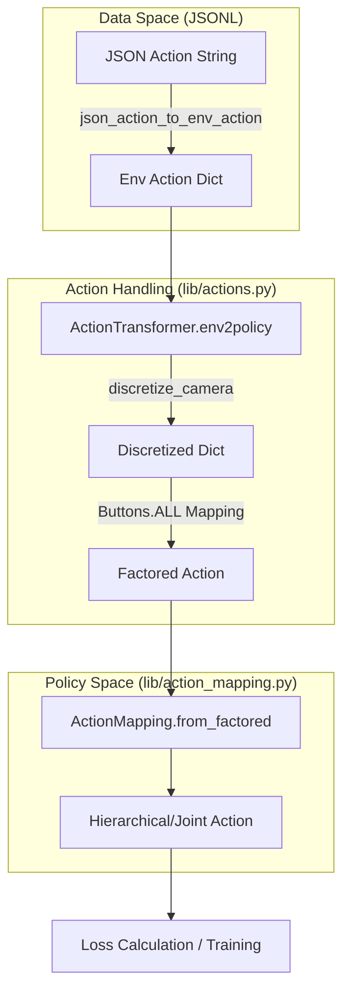
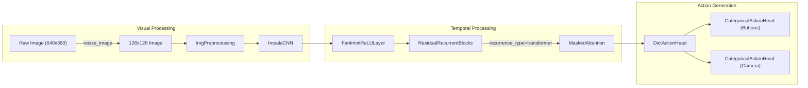

<!-- source: DeepWiki mcp.deepwiki.com · repo openai/Video-Pre-Training · page 7 Glossary · fetched 2026-10-26 -->

# Glossary

Relevant source files

The following files were used as context for generating this wiki page:

- [README.md](README.md)
- [agent.py](agent.py)
- [data_loader.py](data_loader.py)
- [inverse_dynamics_model.py](inverse_dynamics_model.py)
- [lib/action_mapping.py](lib/action_mapping.py)
- [lib/actions.py](lib/actions.py)
- [lib/impala_cnn.py](lib/impala_cnn.py)
- [lib/policy.py](lib/policy.py)
- [lib/xf.py](lib/xf.py)

This page provides definitions for codebase-specific terms, domain concepts, and technical jargon used within the Video Pre-Training (VPT) repository. It serves as a reference for understanding the implementation details and data flow of the agent and Inverse Dynamics Model (IDM) systems.

## Core Concepts & Terms

### Action Space (Factored vs. Factored-Transformed)
The codebase distinguishes between three representations of Minecraft actions:
1.  **Environment Actions**: The raw dictionary format used by the `MineRL` environment (e.g., `{"attack": 1, "camera": [0.1, 0.5]}`).
2.  **Factored Actions**: A standardized internal dictionary format where buttons are represented as a multi-binary vector and camera movements are discretized into bins [lib/action_mapping.py:34-39]().
3.  **Policy Actions**: The joint-distribution or hierarchical representation used by the neural network heads (e.g., `CameraHierarchicalMapping`) to reduce the combinatorial explosion of the action space [lib/action_mapping.py:120-132]().

### ActionTransformer
A utility class responsible for converting between continuous environment actions and discretized policy actions. It manages camera quantization and mapping button names to tensor indices [lib/actions.py:105-121]().

### Camera Quantization (Mu-Law)
To handle the high dynamic range of mouse movements, the system uses **Mu-Law quantization**. This non-linear transformation provides higher precision for small camera movements while still allowing for large rotations [lib/actions.py:48-72]().
*   **Implementation**: `CameraQuantizer.discretize` [lib/actions.py:82-92]().
*   **Inverse**: `CameraQuantizer.undiscretize` [lib/actions.py:94-102]().

### IDM (Inverse Dynamics Model)
A model trained to predict the actions a human player took based on video frames. Unlike the agent policy, which is causal (predicts $a_t$ from $obs_{\le t}$), the IDM can be non-causal and uses temporal context to label unlabeled video data for pre-training [README.md:81-84]().
*   **Class**: `IDMAgent` [inverse_dynamics_model.py:21-27]().
*   **Policy**: `InverseActionPolicy` [lib/policy.py:311]().

### ImpalaCNN
The primary visual backbone used for processing Minecraft frames. It consists of multiple `CnnDownStack` layers, each containing residual `CnnBasicBlock` units [lib/impala_cnn.py:132-158]().
*   **Resolution**: Hardcoded to $128 \times 128$ for model input [agent.py:14]().

### Transformer Recurrence
The "brain" of the agent, implemented as a series of `ResidualRecurrentBlocks`. It supports different styles of temporal processing, primarily the `transformer` type with `clipped_causal` attention masks [lib/policy.py:83-126]().

---

## Technical Mapping: Natural Language to Code

The following diagrams bridge high-level domain concepts to specific implementation entities in the code.

### Action Transformation Pipeline
This diagram tracks how a raw human action from a dataset is processed before being fed into a training loop.

**Sources:** [lib/actions.py:105-178](), [lib/action_mapping.py:12-65](), [data_loader.py:97-121]()

### Model Architecture Components
Mapping of the neural network hierarchy from image input to action output.

**Sources:** [lib/policy.py:83-190](), [lib/impala_cnn.py:132-195](), [agent.py:106-164]()

---

## Glossary Table

| Term | Definition | Relevant Code |
| :--- | :--- | :--- |
| **Agent Resolution** | The fixed $128 \times 128$ resolution the models are trained on. | [agent.py:14]() |
| **Clipped Causal** | An attention mask style that prevents the model from looking at future frames during training. | [lib/policy.py:115](), [agent.py:18]() |
| **FanInInit** | A custom weight initialization scheme for ReLU layers to maintain variance. | [lib/util.py:10](), [lib/impala_cnn.py:31]() |
| **First** | A boolean tensor indicating the start of a new sequence/episode, used to reset recurrent state. | [lib/policy.py:194](), [agent.py:130]() |
| **Hidden State** | The recurrent state (Transformer memory or LSTM state) passed between timesteps. | [agent.py:129](), [lib/policy.py:223]() |
| **Null Action** | An action where no buttons are pressed and the camera does not move. Often skipped in BC training. | [data_loader.py:111](), [lib/action_mapping.py:63-65]() |
| **Width (1x, 2x, 3x)** | Refers to the multiplier applied to the number of channels in the ImpalaCNN and hidden sizes. | [README.md:37-41](), [agent.py:25]() |

---

## Data Loading & Preprocessing

### Data Loader Worker
A multi-processed worker that reads `.mp4` and `.jsonl` files. It handles complex synchronization issues such as "stuck" attack buttons and UI cursor rendering [data_loader.py:48-129]().

### UI Composite
When a contractor has a GUI open (e.g., inventory), the recorder does not bake the cursor into the video. The `DataLoader` manually composites the `mouse_cursor_white_16x16.png` onto the frame using alpha blending based on the JSON coordinates [data_loader.py:34-45]().

**Sources:** [data_loader.py:19-57](), [agent.py:100-103]()