# Page: Overview

# Overview

<details>
<summary>Relevant source files</summary>

The following files were used as context for generating this wiki page:

- [README.md](README.md)
- [requirements.txt](requirements.txt)

</details>


The Video Pre-Training (VPT) repository implements a novel approach for training AI agents to perform tasks in Minecraft by learning from unlabeled human gameplay videos. Instead of requiring labeled actions during training, VPT uses an Inverse Dynamics Model (IDM) to predict player actions from video frames and then trains agent models using these predictions.

For more detailed information about specific aspects of the system, see:
- [Agent Models](#2) for neural network architectures and model types
- [Inverse Dynamics Model (IDM)](#3) for action prediction from videos
- [Data and Datasets](#4) for information about contractor demonstrations
- [Running the System](#5) for execution instructions
- [Technical Components](#6) for implementation details

## System Architecture

The VPT system consists of three primary components working together to enable learning from unlabeled gameplay videos:

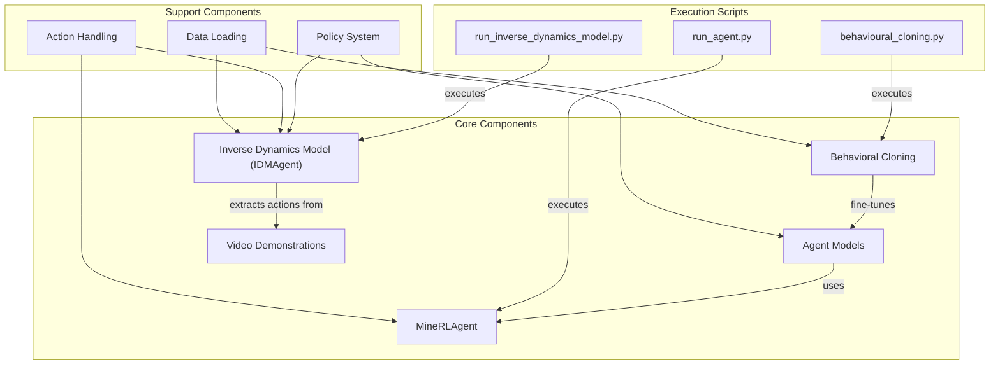

Sources: [README.md:13-121](), [run_agent.py:1-50](), [run_inverse_dynamics_model.py:1-40](), [behavioural_cloning.py:1-60]()

## Learning Pipeline

The following diagram illustrates how data flows through the VPT system, from raw videos to trained agent models. It highlights the relationship between the high-level concepts and the specific Python entrypoints used to interact with them.

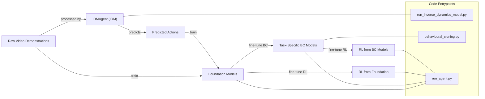

Sources: [README.md:35-80](), [README.md:81-101](), [run_agent.py:11-20](), [behavioural_cloning.py:136-150]()

## Model Hierarchy

VPT includes multiple model types with different specializations, organized in a hierarchy. The models are categorized by their training stage and the data subsets they were refined on.

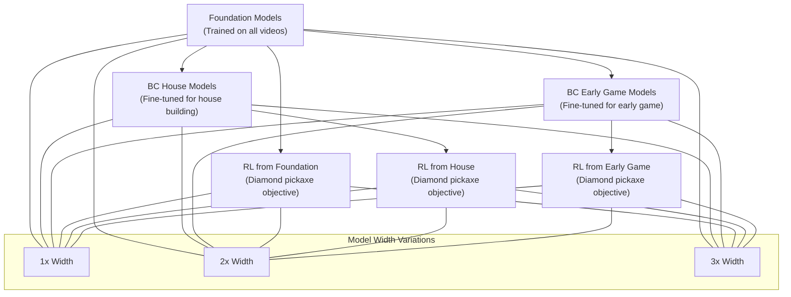

Sources: [README.md:35-80]()

## Available Models

The repository provides pre-trained models of varying sizes and training approaches. The "width" refers to the hidden dimension scaling of the neural network components like the `ImpalaCNN` and `ResidualRecurrentBlocks`.

| Model Type | Width Variations | Training Method | Purpose |
|------------|------------------|----------------|---------|
| Foundation | 1x, 2x, 3x | BC on all videos | General Minecraft skills |
| House | 3x | BC on house data | House building specialist |
| Early Game | 2x, 3x | BC on early game | Early game progression |
| RL from Foundation | 2x | RL + Foundation | Diamond pickaxe acquisition |
| RL from House | 2x | RL + House | Diamond pickaxe acquisition |
| RL from Early Game | 2x | RL + Early Game | Diamond pickaxe acquisition |

Sources: [README.md:35-80]()

## Data Collection and Processing

VPT relies on contractor demonstrations, which are screen recordings of humans playing Minecraft. The data pipeline involves processing these recordings and their associated `.jsonl` action logs.

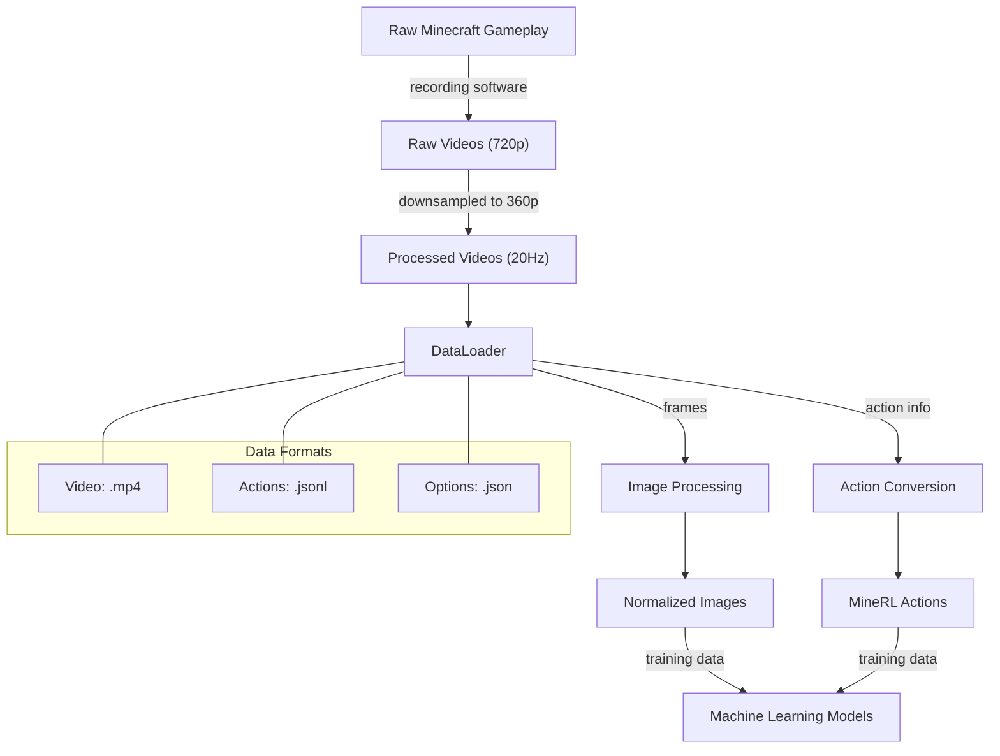

Sources: [README.md:122-347](), [behavioural_cloning.py:136-150]()

## Tasks and Data Versions

The contractor demonstrations were collected for various tasks across different recorder versions. Major versions often represent changes in the prompt or recording features.

| Version | Task | Description |
|---------|------|-------------|
| 6.x-7.x | General Gameplay | Free play in Minecraft with focus on early game |
| 8.x | House Building | Building simple houses from scratch in 10-15 minutes |
| 9.x | House from Materials | Building houses with provided random materials |
| 10.0 | Diamond Pickaxe | Obtaining a diamond pickaxe within 20 minutes |
| BASALT | Competition Tasks | FindCave, MakeWaterfall, PenAnimals, BuildHouse |

Sources: [README.md:124-482]()

## Key Components and Scripts

The repository provides three main executable scripts that serve as the primary interface for users:

1. **`run_agent.py`**: Runs a trained agent model in the `MineRL` environment.
   - Utilizes `MineRLAgent` to wrap the policy and handle environment steps. [run_agent.py:11-20]()
   - Takes model (`--model`) and weights (`--weights`) file paths as inputs. [run_agent.py:44-48]()

2. **`run_inverse_dynamics_model.py`**: Demonstrates the IDM functionality.
   - Uses `IDMAgent` to process video frames and predict actions. [run_inverse_dynamics_model.py:25-30]()
   - Shows predicted vs. actual actions frame-by-frame using OpenCV. [run_inverse_dynamics_model.py:100-110]()

3. **`behavioural_cloning.py`**: Fine-tunes models using behavioral cloning.
   - Implements a training loop that iterates over data from `DataLoader`. [behavioural_cloning.py:136-160]()
   - Optimized for consumer hardware by computing gradients one sample at a time. [behavioural_cloning.py:118-121]()

Sources: [README.md:13-121](), [run_agent.py:1-50](), [run_inverse_dynamics_model.py:1-40](), [behavioural_cloning.py:1-60]()

The VPT system represents a significant advancement in learning from unlabeled videos, enabling agents to perform complex tasks in Minecraft by observing human gameplay without requiring direct action labels during training.

---

# Page: Agent Models

# Agent Models

<details>
<summary>Relevant source files</summary>

The following files were used as context for generating this wiki page:

- [agent.py](agent.py)
- [lib/policy.py](lib/policy.py)

</details>


## Purpose and Scope

This document provides a comprehensive overview of the agent model architecture in the OpenAI Video Pre-Training (VPT) system for Minecraft. It explains how the neural network models process observations from the Minecraft environment and generate appropriate actions. This page focuses on the agent model architecture, neural network components, and their interactions. For information about fine-tuning these models with behavioral cloning, see [Fine-tuning with Behavioral Cloning](#5.3), and for details about the neural network architecture specifics, see [Neural Network Architecture](#6.1).

## Overview

Agent models in the VPT system are neural networks that enable an AI agent to play Minecraft by processing visual observations and producing actions. The architecture employs a combination of convolutional neural networks for visual processing, transformer or recurrent components for temporal reasoning, and specialized action heads for controlling the agent's behavior.

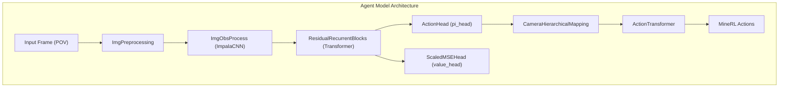

Sources: [agent.py:106-206](), [lib/policy.py:83-219](), [lib/policy.py:227-340]()

## Model Hierarchy and Types

VPT provides several agent models with different capabilities and training regimes. These models vary in width (model capacity) and training approach. For technical details on these specific categories, refer to the child pages linked below.

### [Foundation Models](#2.1)
Foundation models are the base models trained on the complete dataset of human video demonstrations using behavioral cloning. These serve as the starting point for all other specialized models. They are available in three different model widths (1x, 2x, and 3x), offering a tradeoff between performance and computational requirements.

### [Behavioral Cloning Models](#2.2)
Behavioral cloning (BC) models refine the foundation models by further training on specific subsets of data:
- **House models**: Focused on building houses, trained on house-building contractor data.
- **Early game models**: Specialized in early game progression, trained on early game video subset.

### [Reinforcement Learning Enhanced Models](#2.3)
RL-enhanced models build upon either foundation models or BC models with additional training using reinforcement learning. These models excel at progressing through the tech tree quickly using a reward function targeted at obtaining diamond pickaxes.

Sources: [README.md:42-80]()

## Core Components

### MineRLAgent

The `MineRLAgent` class in `agent.py` serves as the primary interface between the Minecraft environment and the neural network policy. It handles observation processing, action transformation, and state management.

```mermaid
classDiagram
    class MineRLAgent {
        +policy: MinecraftAgentPolicy
        +action_mapper: CameraHierarchicalMapping
        +action_transformer: ActionTransformer
        +hidden_state: Tensor
        +device: th.device
        +load_weights(path)
        +reset()
        +get_action(minerl_obs)
        -_env_obs_to_agent(minerl_obs)
        -_agent_action_to_env(agent_action)
    }
    
    MineRLAgent -- MinecraftAgentPolicy: uses [agent.py:128]
    MineRLAgent -- CameraHierarchicalMapping: uses [agent.py:115]
    MineRLAgent -- ActionTransformer: uses [agent.py:119]
```

Key responsibilities:
- Validates the environment configuration against `ENV_KWARGS` [agent.py:84-98]().
- Processes observations, resizing images to 128×128 via `resize_image` [agent.py:100-103]().
- Converts actions between agent and environment formats using `ActionTransformer` [agent.py:151-189]().
- Manages the agent's recurrent state (`hidden_state`) [agent.py:139]().

Sources: [agent.py:106-206]()

### MinecraftAgentPolicy

The `MinecraftAgentPolicy` in `lib/policy.py` is the core policy class that combines the neural network backbone with action and value heads.

```mermaid
classDiagram
    class MinecraftAgentPolicy {
        +net: MinecraftPolicy
        +value_head: ScaledMSEHead
        +pi_head: ActionHead
        +initial_state(batch_size)
        +act(obs, first, state_in, stochastic)
        +v(obs, first, state_in)
    }
    
    MinecraftAgentPolicy -- MinecraftPolicy: contains [lib/policy.py:257]
    MinecraftAgentPolicy -- ScaledMSEHead: uses [lib/policy.py:273]
    MinecraftAgentPolicy -- ActionHead: uses [lib/policy.py:263]
```

Sources: [lib/policy.py:227-340]()

### MinecraftPolicy

The `MinecraftPolicy` class implements the neural network backbone that processes observations and produces latent representations. It handles the integration of `ImgPreprocessing`, `ImgObsProcess` (which wraps `ImpalaCNN`), and `ResidualRecurrentBlocks`.

Sources: [lib/policy.py:83-225]()

## Neural Network Architecture

The architecture consists of several key stages:

### Observation Processing
1. **ImgPreprocessing**: Normalizes input images by scaling pixel values or applying statistics [lib/policy.py:21-45]().
2. **ImgObsProcess**: Passes the normalized image through an `ImpalaCNN` and a final linear layer to reach the `hidsize` dimension [lib/policy.py:48-81]().

### Recurrent Processing
The models primarily use **Transformer** recurrence (specified via `recurrence_type="transformer"`) [agent.py:32](). The `ResidualRecurrentBlocks` class manages these layers, supporting residual connections and pointwise layers [lib/policy.py:173-185]().

### Action Representation
The model outputs actions in a factored format. The `CameraHierarchicalMapping` and `ActionTransformer` classes are used to map these neural network outputs back to the discrete and continuous inputs required by the MineRL environment [agent.py:162-163]().

## Model Configuration

Default hyperparameters for the agent models are defined in `POLICY_KWARGS`:

| Parameter | Value | Description |
|-----------|-------|-------------|
| `attention_heads` | 16 | Number of attention heads in transformer [agent.py:17]() |
| `hidsize` | 2048 | Hidden layer size [agent.py:21]() |
| `impala_width` | 8 | Width multiplier for ImpalaCNN [agent.py:25]() |
| `n_recurrence_layers` | 4 | Number of recurrent layers [agent.py:27]() |
| `recurrence_type` | "transformer" | Type of recurrent processing [agent.py:32]() |

Sources: [agent.py:16-35]()

## Usage

To use an agent model:
1. Initialize `MineRLAgent` with the environment [agent.py:107]().
2. Load weights using `load_weights(path)` [agent.py:132]().
3. Call `get_action(minerl_obs)` during the environment loop to retrieve the next action [agent.py:190]().

The agent automatically handles the internal state management required for the recurrent components.

Sources: [agent.py:132-206]()

---

# Page: Foundation Models

# Foundation Models

<details>
<summary>Relevant source files</summary>

The following files were used as context for generating this wiki page:

- [README.md](README.md)
- [agent.py](agent.py)

</details>


## Purpose and Scope

This document provides a detailed overview of the foundation models within the Video-Pre-Training (VPT) system for Minecraft. Foundation models serve as the base policies trained on large-scale unlabeled video using behavioral cloning (BC). They form the backbone of the VPT approach, capturing general Minecraft gameplay patterns that are later refined for specific objectives.

## What Are Foundation Models?

Foundation models are neural network policies trained on a large corpus of human gameplay videos. Unlike specialized agents, these models learn to mimic human behavior across a wide range of Minecraft activities. They represent the first stage in the VPT training process: using an Inverse Dynamics Model (IDM) to label unlabeled video with actions, then training a policy to predict those actions from the visual input.

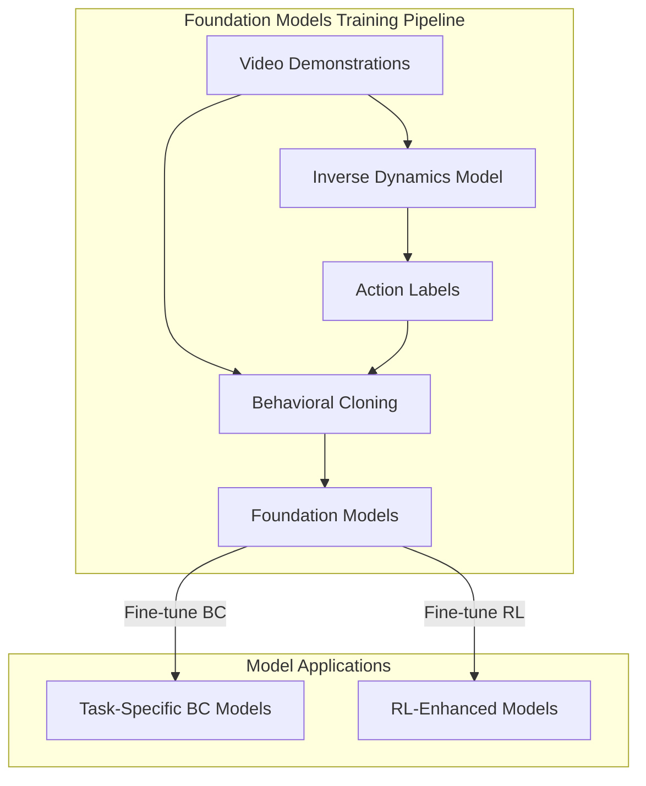

Sources: [README.md:42-56](), [README.md:83-84]()

## Model Architecture

The foundation models are implemented via the `MinecraftAgentPolicy` class, which wraps the core `MinecraftPolicy`. They process observations from the Minecraft environment (128x128 resolution) and output action distributions and value predictions.

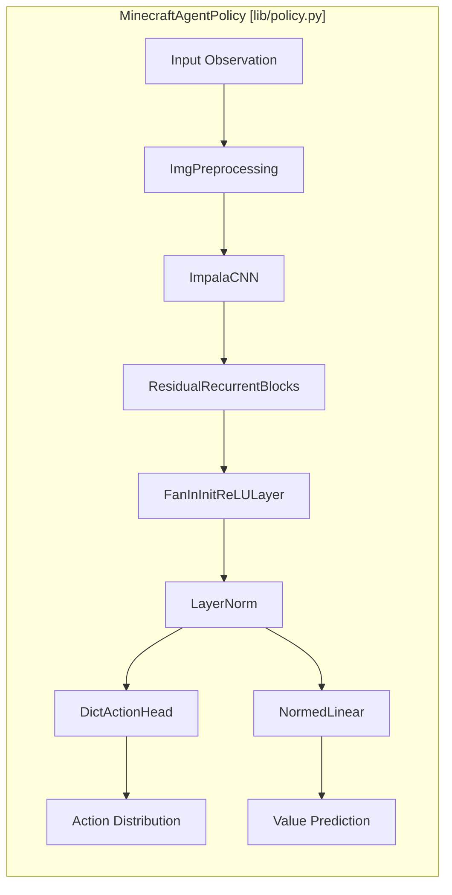

Sources: [lib/policy.py:227-329](), [agent.py:14-16](), [agent.py:128-129]()

### Image Processing Pipeline

The models preprocess raw Minecraft game frames (typically 640x360) by resizing them to 128x128. Within the network, the `ImgPreprocessing` class normalizes the images. The frames then pass through an `ImpalaCNN` architecture, which uses `CnnDownStack` and `CnnBasicBlock` modules to extract visual features.

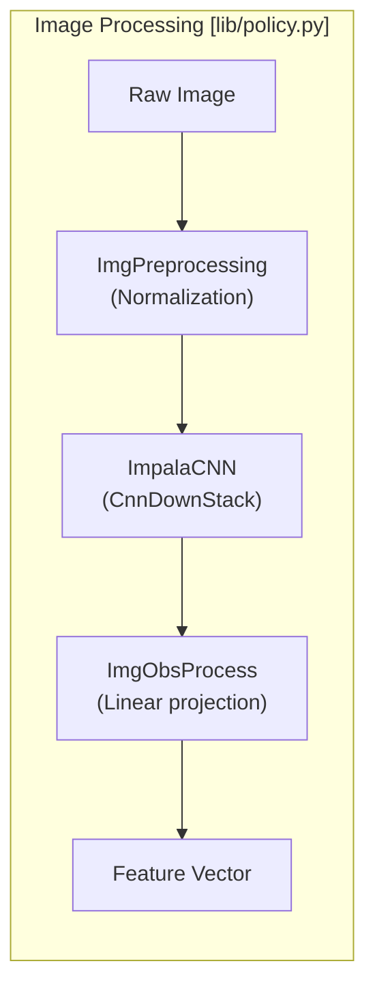

Sources: [lib/policy.py:21-80](), [lib/policy.py:151-163](), [agent.py:100-103]()

### Recurrent Components

Foundation models utilize a transformer-based recurrence by default (though LSTM is supported). This allows the model to maintain long-term context over the `timesteps` parameter (set to 128 in standard configs).

*   **Transformer Style**: Uses `ResidualRecurrentBlocks` with `recurrence_type="transformer"`.
*   **Attention**: Employs `MaskedAttention` with a `clipped_causal` style, ensuring the agent only looks at past frames.

Sources: [lib/policy.py:166-188](), [agent.py:16-36](), [lib/xf.py:213-240]()

## Model Variants (Width Scaling)

Foundation models are released in three width variants. The width parameter scales the number of channels in the `ImpalaCNN` backbone and the hidden size of the transformer layers.

| Width | Hidden Size (`hidsize`) | Model File | Weights File |
|-------|-------------------------|------------|--------------|
| 1x    | 1024 (scaled)           | foundation-model-1x.model | foundation-model-1x.weights |
| 2x    | 2048 (scaled)           | 2x.model | foundation-model-2x.weights |
| 3x    | 3072 (scaled)           | foundation-model-3x.model | foundation-model-3x.weights |

The channel count in `ImpalaCNN` is calculated as:
`chans = tuple(int(impala_width * c) for c in impala_chans)`

Sources: [README.md:39-55](), [lib/policy.py:140](), [agent.py:21-25]()

## Action Space and Handling

The foundation models output actions in a specialized format that is later mapped back to the MineRL environment.

1.  **Action Distribution**: Generated by `DictActionHead`, which combines `CategoricalActionHead` for buttons and `DiagGaussianActionHead` (or quantized bins) for camera movement.
2.  **Mapping**: The `CameraHierarchicalMapping` class converts the model's internal representation into the `TARGET_ACTION_SPACE` required by the game.
3.  **Quantization**: Camera movements are processed using a `mu_law` quantization scheme via the `ActionTransformer`.

Sources: [agent.py:40-45](), [agent.py:115-120](), [lib/action_mapping.py:40-65](), [lib/actions.py:23-45]()

## Training Process

Foundation models are trained using Behavioral Cloning (BC). The `behavioural_cloning.py` script demonstrates the logic:
1.  **Data Loading**: Uses `DataLoader` to fetch sequences of frames and actions.
2.  **Loss Calculation**: The policy minimizes the log-likelihood of the human action given the frame: `loss = -policy.get_logprop_action(obs, action)`.
3.  **Optimization**: Standard Adam optimizer is used to update the `MinecraftAgentPolicy` weights.

Sources: [README.md:101-116](), [behavioural_cloning.py:1-50]()

## Running Foundation Models

To run a foundation model, use the `run_agent.py` entry point. This script initializes a `MineRLAgent`, loads the weights, and enters a loop where `agent.get_action(obs)` is called for every environment step.

```bash
python run_agent.py --model foundation-model-1x.model --weights foundation-model-1x.weights
```

Sources: [README.md:25-29](), [run_agent.py:10-30]()

## Summary of Technical Components

| Component | Code Entity | Role |
|-----------|-------------|------|
| **Policy Wrapper** | `MinecraftAgentPolicy` | High-level interface for actions/hidden states. |
| **Backbone** | `ImpalaCNN` | Extracts visual features from 128x128 frames. |
| **Recurrence** | `ResidualRecurrentBlocks` | Manages temporal context via Transformer layers. |
| **Action Head** | `DictActionHead` | Branches into discrete (buttons) and continuous (camera) outputs. |
| **Transformation** | `ActionTransformer` | Handles mu-law scaling and discretization of camera input. |

Sources: [lib/policy.py:121-219](), [lib/policy.py:227-329](), [lib/actions.py:23-30]()

---

# Page: Behavioral Cloning Models

# Behavioral Cloning Models

<details>
<summary>Relevant source files</summary>

The following files were used as context for generating this wiki page:

- [README.md](README.md)
- [behavioural_cloning.py](behavioural_cloning.py)

</details>


## Introduction

Behavioral Cloning (BC) models are a key component of the Video Pre-Training (VPT) system for Minecraft agents. These models are trained directly on video demonstrations of humans playing Minecraft, learning to mimic human actions in similar game states. Unlike reinforcement learning models that are optimized for specific rewards, BC models aim to replicate general gameplay behavior, making them more versatile across a range of tasks [README.md:43-50]().

## BC Model Types and Hierarchy

The VPT system includes several types of behavioral cloning models that form a hierarchical structure:

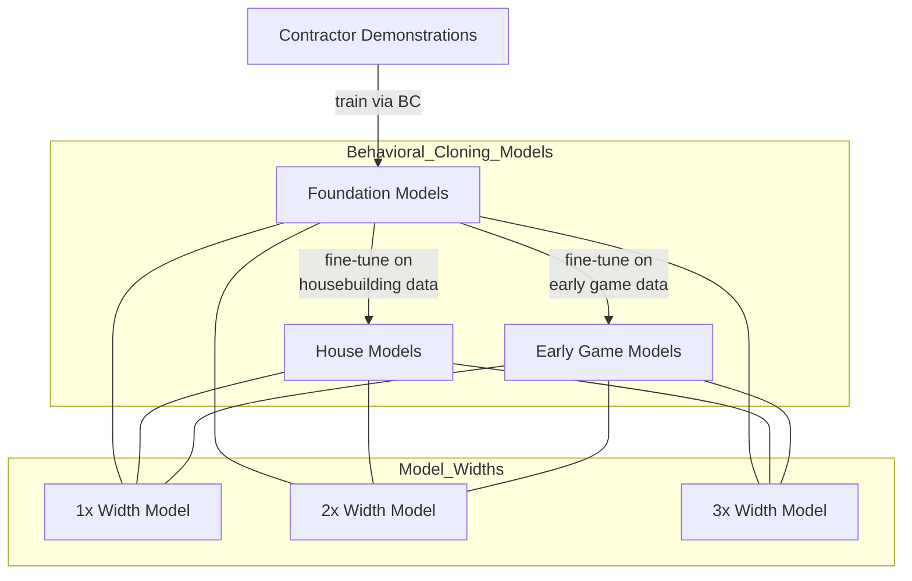

**Diagram: BC Model Hierarchy and Training Flow**

1. **Foundation Models**: Base models trained on all available demonstration videos in a single training run. These models capture general Minecraft gameplay skills [README.md:47-48]().
2. **House Models**: Models fine-tuned from foundation models using specifically the housebuilding contractor data. These models excel at building structures [README.md:48-49]().
3. **Early Game Models**: Models fine-tuned from foundation models using a subset of videos showing early game progression [README.md:49-50]().

Each model type is available in different widths (1x, 2x, 3x), with wider models having more parameters and potentially better performance [README.md:36-41]().

Sources: [README.md:36-62]()

## Available Model Weights

The following pre-trained BC model weights are available for download and use:

| Model Type | Width | Description | Weight File |
|------------|-------|-------------|------------|
| Foundation | 1x | Base model trained on all demonstrations | `foundation-model-1x.weights` |
| Foundation | 2x | Base model with 2x width | `foundation-model-2x.weights` |
| Foundation | 3x | Base model with 3x width | `foundation-model-3x.weights` |
| House | 3x | Fine-tuned for house building | `bc-house-3x.weights` |
| Early Game | 2x | Fine-tuned for early game progression | `bc-early-game-2x.weights` |
| Early Game | 3x | Fine-tuned for early game progression | `bc-early-game-3x.weights` |

Sources: [README.md:52-62]()

## Implementation and Data Flow

The BC training logic is implemented in `behavioural_cloning.py`, which utilizes the `MineRLAgent` and `DataLoader` classes to manage the training loop.

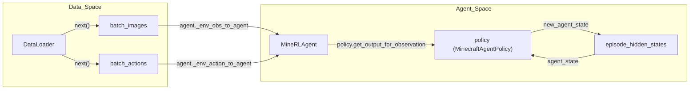

**Diagram: BC Data Flow and Entity Mapping**

1. **Observation Processing**: Images from the `DataLoader` are passed through `agent._env_obs_to_agent` to prepare the pixel data for the policy [behavioural_cloning.py:94]().
2. **Action Processing**: Human actions from the dataset are converted to the agent's internal action space using `agent._env_action_to_agent` [behavioural_cloning.py:89]().
3. **State Management**: The training loop maintains a dictionary `episode_hidden_states` to track the recurrent state of the model across different trajectories [behavioural_cloning.py:82]().

Sources: [behavioural_cloning.py:82-105]()

## Training Process

Behavioral cloning models are trained to maximize the log probability of human-demonstrated actions. The implementation in `behavioural_cloning.py` is designed for consumer hardware, using gradient accumulation with a batch size of 1 per step to minimize VRAM usage [behavioural_cloning.py:1-5]().

```mermaid
sequenceDiagram
    participant DL as DataLoader
    participant Agent as MineRLAgent
    participant Policy as MinecraftAgentPolicy
    participant Opt as Adam Optimizer
    
    DL->>DL: Load batch (batch_size=8)
    loop For each sample in batch
        DL->>Agent: image, action, episode_id
        Agent->>Policy: get_output_for_observation(obs, state)
        Policy-->>Agent: pi_distribution, new_state
        Agent->>Policy: get_logprob_of_action(pi_distribution, human_action)
        Policy-->>Agent: log_prob
        Agent->>Agent: loss = -log_prob / BATCH_SIZE
        Agent->>Policy: loss.backward()
    end
    Agent->>Opt: clip_grad_norm_
    Agent->>Opt: step()
    Agent->>Opt: zero_grad()
```

**Diagram: BC Training Loop Logic**

Key hyperparameters from the VPT paper used in the implementation:
* **Learning Rate**: `0.000181` [behavioural_cloning.py:38]()
* **Weight Decay**: `0.039428` [behavioural_cloning.py:39]()
* **Max Gradient Norm**: `5.0` [behavioural_cloning.py:40]()
* **Optimizer**: Adam [behavioural_cloning.py:63]()

Sources: [behavioural_cloning.py:26-40](), [behavioural_cloning.py:86-123]()

## Fine-tuning BC Models

The fine-tuning script `behavioural_cloning.py` allows users to refine foundation models on specific datasets.

1. **Model Loading**: The script loads model architecture and hyperparameters from the `.model` file (a pickled dictionary) [behavioural_cloning.py:42-47]().
2. **Recurrence Handling**: To save memory, the implementation detaches the hidden state after every step: `new_agent_state = tree_map(lambda x: x.detach(), new_agent_state)` [behavioural_cloning.py:111](). This prevents backpropagation through long sequences.
3. **Weight Saving**: After training, the `policy.state_dict()` is saved to the output path [behavioural_cloning.py:131-132]().

Sources: [behavioural_cloning.py:42-132](), [README.md:101-116]()

---

# Page: Reinforcement Learning Enhanced Models

# Reinforcement Learning Enhanced Models

<details>
<summary>Relevant source files</summary>

The following files were used as context for generating this wiki page:

- [README.md](README.md)
- [agent.py](agent.py)

</details>


This page documents the Reinforcement Learning (RL) enhanced models in the Video Pre-Training (VPT) system for Minecraft. These models build upon foundation models and behavioral cloning models by incorporating environment interactions with reward functions to optimize for specific objectives, specifically the "Diamond Pickaxe" challenge.

## Overview

RL-enhanced models represent the final stage in the VPT model hierarchy. While foundation models ([Section 2.1]()) and behavioral cloning models ([Section 2.2]()) are trained using supervised learning on human demonstrations, RL-enhanced models are fine-tuned through direct interaction with the Minecraft environment using reinforcement learning techniques. These models are categorized under the "v10.x" recorder versions in the contractor data lineage, representing the most advanced task-specific agents in the repository.

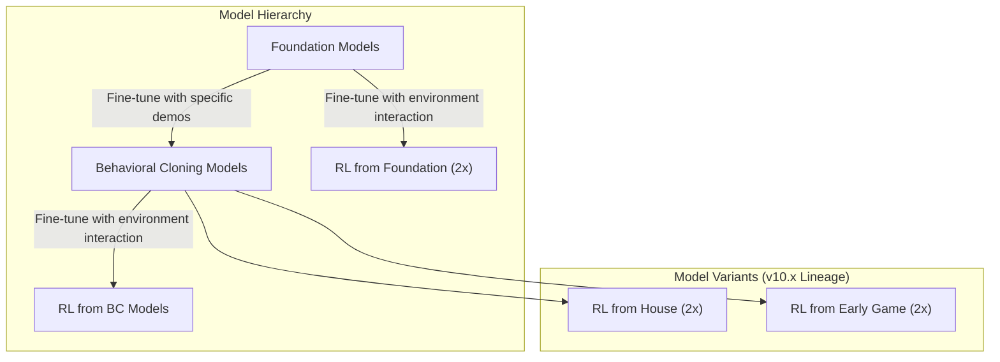
Sources: [README.md:64-80](), [README.md:144-148]()

## Model Variants

The VPT repository provides three specific RL-enhanced weight sets, all utilizing the 2x width model architecture. These models are designed to progress through the Minecraft tech tree quickly.

| Model Variant | Base Model Starting Point | Model File | Weights File |
| :--- | :--- | :--- | :--- |
| **RL from Foundation** | Foundation Model (unlabeled video) | `2x.model` | `rl-from-foundation-2x.weights` |
| **RL from House** | House BC Model (fine-tuned) | `2x.model` | `rl-from-house-2x.weights` |
| **RL from Early Game** | Early Game BC Model (fine-tuned) | `2x.model` | `rl-from-early-game-2x.weights` |

Sources: [README.md:72-80](), [README.md:40-41]()

## RL Fine-tuning Methodology

The RL models are trained by rewarding the agent for reaching specific milestones in the Minecraft "Diamond Pickaxe" tech tree. 

### Data Flow and Environment Interaction
The `MineRLAgent` class handles the interface between the neural network policy and the `MineRL` environment. For RL models, the agent must not only predict actions but also effectively explore the state space to maximize the reward signal.

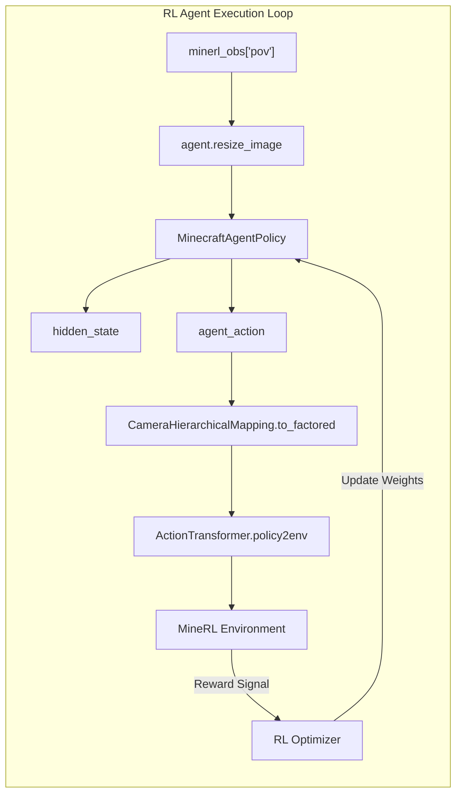
Sources: [agent.py:106-164](), [README.md:64-70]()

### Reward Schedule
The models were trained using a reward function targeted at obtaining diamond pickaxes. This includes rewards for:
1.  **Acquisition**: Obtaining items like logs, cobblestone, iron ore, and diamonds.
2.  **Crafting**: Successfully using a crafting table to create wooden, stone, and iron tools.
3.  **Smelting**: Using a furnace to produce iron ingots.

Sources: [README.md:65-70]()

## Architecture Implementation

RL-enhanced models utilize the `MinecraftAgentPolicy`. In the context of RL, the policy architecture must support temporal dependencies to remember inventory state and environmental progress.

### Policy Configuration
The default `POLICY_KWARGS` used for these agents include:
*   **Recurrence**: A transformer-based recurrence (`recurrence_type="transformer"`) with 4 layers (`n_recurrence_layers=4`).
*   **Attention**: 16 attention heads with a `clipped_causal` mask style and a memory size of 256.
*   **Visual Backbone**: An `ImpalaCNN` with `impala_width=8` and channels `[16, 32, 32]`.

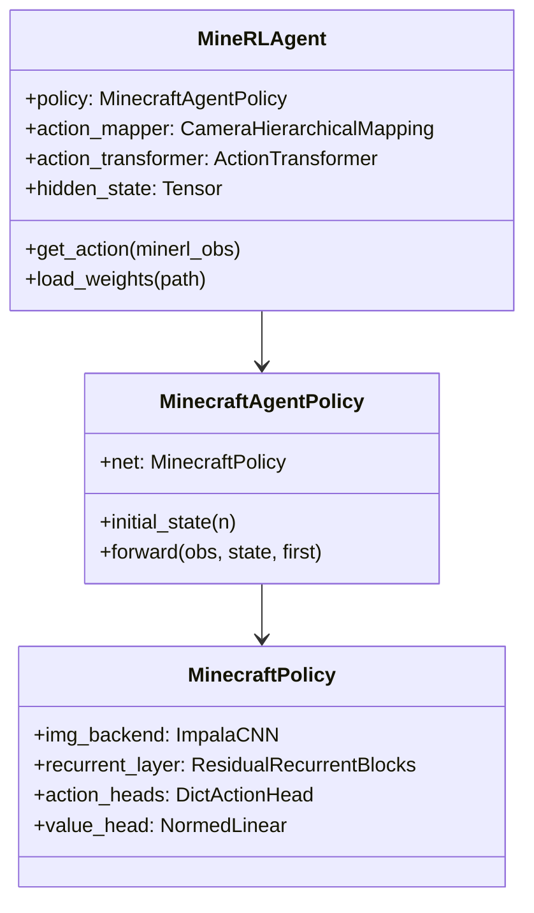
Sources: [agent.py:16-36](), [agent.py:106-130](), [lib/policy.py:249-341]()

## Technical Execution

To run an RL-enhanced model, the `MineRLAgent` is initialized with the standard `2x.model` architecture and the specific RL weights.

### Implementation Details
*   **Action Mapping**: Uses `CameraHierarchicalMapping` with 11 camera bins [agent.py:115]().
*   **Resolution**: Input frames are resized to 128x128 using `cv2.INTER_LINEAR` [agent.py:100-103]().
*   **Inference**: The `get_action` method processes the observation, updates the `hidden_state`, and converts the policy output to MineRL-compatible actions using the `ActionTransformer` [agent.py:190-211]().

### Command Line Example
```bash
python run_agent.py --model models/2x.model --weights models/rl-from-early-game-2x.weights
```
Sources: [README.md:28-29](), [agent.py:132-135]()

## Summary of RL Characteristics
*   **Efficiency**: Significantly faster at reaching the "Diamond" stage than BC or Foundation models.
*   **Specificity**: Highly optimized for the tech tree; may exhibit less "creative" or "varied" behavior compared to Foundation models.
*   **Architecture**: Uses the same `ImpalaCNN` + `Transformer` stack, demonstrating that the base architecture is robust enough for both supervised and reinforcement learning.

Sources: [README.md:64-70]()

---

# Page: Inverse Dynamics Model (IDM)

# Inverse Dynamics Model (IDM)

<details>
<summary>Relevant source files</summary>

The following files were used as context for generating this wiki page:

- [inverse_dynamics_model.py](inverse_dynamics_model.py)
- [lib/action_mapping.py](lib/action_mapping.py)
- [lib/policy.py](lib/policy.py)
- [run_inverse_dynamics_model.py](run_inverse_dynamics_model.py)

</details>


## Purpose and Scope

The Inverse Dynamics Model (IDM) is a critical component of the Video Pre-Training (VPT) system that predicts actions taken by human players from video frames. The IDM serves as the bridge between unlabeled gameplay videos and actionable training data by inferring what controls a human player pressed based solely on visual observations. 

Unlike the forward policy (Agent), which predicts the next action given current and past observations to achieve a goal, the IDM is trained to predict the action $a_t$ that occurred between frames $s_t$ and $s_{t+1}$. This allows the system to generate labels for millions of hours of unlabeled YouTube videos, which are then used to train the Foundation Models.

Sources: [inverse_dynamics_model.py:21-27](), [run_inverse_dynamics_model.py:68-73]()

## System Overview

The IDM implementation in this repository is provided as a utility to predict actions from MineRL recordings. It uses a specialized policy architecture that processes temporal sequences of frames.

### IDM Code Entity Map

This diagram maps the high-level IDM concepts to the specific classes and functions in the codebase.

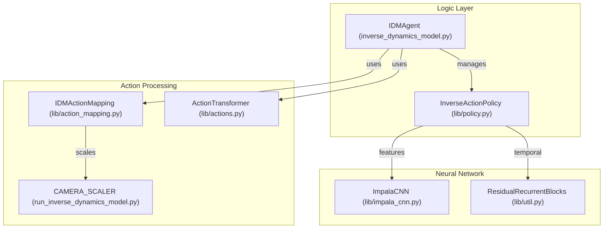

Sources: [inverse_dynamics_model.py:21-44](), [lib/policy.py:205-220](), [run_inverse_dynamics_model.py:77-78]()

## Architecture and Implementation

The IDM is implemented as a neural network that processes sequences of video frames. While it shares structural similarities with the `MinecraftPolicy`, it is encapsulated in `InverseActionPolicy` to handle the specific requirements of predicting actions from a video stream.

### Key Classes

1.  **`IDMAgent`**: A "sugarcoating" wrapper around the model. It handles the high-level API for loading weights, resetting hidden states, and converting video frames into tensor inputs.
    *   `predict_actions(video_frames)`: Accepts a sequence of shape `(N, H, W, C)` and returns predicted MineRL actions [inverse_dynamics_model.py:74-95]().
    *   `_video_obs_to_agent(video_frames)`: Resizes frames to `AGENT_RESOLUTION` (128x128) and prepares them for the torch device [inverse_dynamics_model.py:54-59]().

2.  **`InverseActionPolicy`**: Defined in `lib/policy.py`, this class extends the base policy logic to include the `InverseActionNet`.
    *   It utilizes an `ImpalaCNN` for visual feature extraction [lib/policy.py:155-165]().
    *   It uses `ResidualRecurrentBlocks` to handle temporal dependencies, supporting recurrence types like `transformer` or `multi_layer_bilstm` [lib/policy.py:173-185]().

3.  **`IDMActionMapping`**: A specialized version of `ActionMapping` that acts as an identity mapping for the IDM, as the model's output space is designed to match the environment's factored action space directly [lib/action_mapping.py:102-115]().

### Temporal Processing (3D Convolution)

The IDM architecture is designed to look at a window of frames to determine the action. This is achieved through the combination of the CNN backbone and recurrent layers.

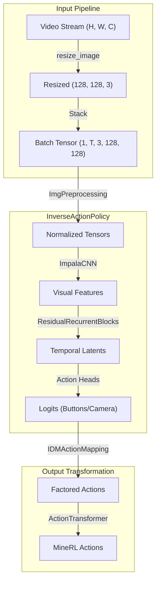

Sources: [lib/policy.py:193-200](), [inverse_dynamics_model.py:85-95](), [lib/impala_cnn.py:46-55]()

## Data Flow: Video to Action

The transformation from raw pixels to a structured MineRL action dictionary involves several coordinate and scale shifts, particularly for camera movement.

### Camera Scaling and Mapping
Minecraft's internal mouse sensitivity is mapped to the model's output space using a `CAMERA_SCALER`.
*   **Sensitivity Constant**: `360.0 / 2400.0` [run_inverse_dynamics_model.py:77]().
*   **Conversion**: `json_action_to_env_action` applies this scaler to `dx` and `dy` values from the recorded JSON data to align them with the model's expectations [run_inverse_dynamics_model.py:101-104]().

### Action Processing Sequence

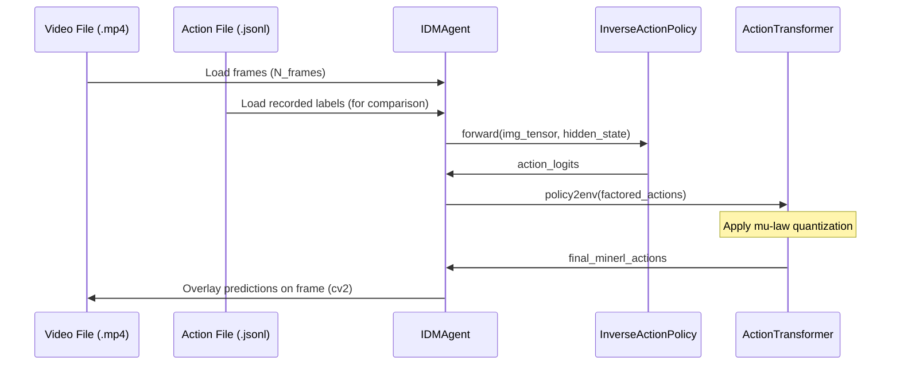

Sources: [run_inverse_dynamics_model.py:146-163](), [inverse_dynamics_model.py:70-72]()

## Usage and Execution

The `run_inverse_dynamics_model.py` script serves as the primary entry point for testing the IDM. It visualizes predictions by overlaying them on the video frames using OpenCV.

### Configuration
The model uses specific quantization parameters for camera movement to handle the wide dynamic range of mouse deltas:
*   `camera_binsize`: 2
*   `camera_maxval`: 10
*   `camera_mu`: 10
*   `camera_quantization_scheme`: "mu_law"

Sources: [inverse_dynamics_model.py:14-19]()

### Keyboard Mapping
The IDM maps Minecraft's internal key strings (e.g., `key.keyboard.w`) to the agent's internal button names (e.g., `forward`) via the `KEYBOARD_BUTTON_MAPPING` dictionary [run_inverse_dynamics_model.py:17-38]().

### Technical Limitations
As noted in the source code, the IDM provided in this repository is a re-implementation and may exhibit slight performance variances compared to the original model described in the VPT paper [run_inverse_dynamics_model.py:1-4](). It requires high-resolution input (640x360) which it internally downsamples to 128x128 for the `ImpalaCNN` [run_inverse_dynamics_model.py:155](), [inverse_dynamics_model.py:55]().

---

# Page: Data and Datasets

# Data and Datasets

<details>
<summary>Relevant source files</summary>

The following files were used as context for generating this wiki page:

- [README.md](README.md)
- [cursors/mouse_cursor_white_16x16.png](cursors/mouse_cursor_white_16x16.png)
- [data_loader.py](data_loader.py)

</details>


This page documents the datasets used in the Video Pre-Training (VPT) system, their structure, collection methodology, and processing mechanisms. It covers the contractor demonstrations dataset used for training foundation models and the multi-process `DataLoader` pipeline that prepares this data for behavioral cloning.

## Overview of VPT Datasets

The VPT system primarily relies on large-scale video data of human players. Because raw online videos lack action labels (keystrokes/mouse movements), the system uses an Inverse Dynamics Model (IDM) to predict actions for unlabeled video, or uses direct recordings from contractors which include ground-truth labels.

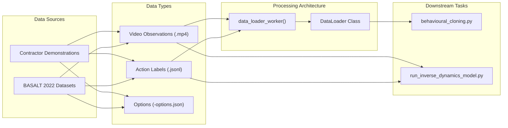

Sources: [README.md:82-90](), [README.md:125-133](), [data_loader.py:48-62]()

## Data Collection Environment

All gameplay data was collected under controlled conditions to ensure consistency for the neural network:
- **Resolution**: Windowed mode at 720p, downsampled to 360p at 20Hz [README.md:310-313]().
- **Normalization**: Player interface options were locked to prevent changes to brightness or rendering [README.md:314-315]().
- **Segmentation**: Gameplay was segmented into chunks of up to 5 minutes [README.md:316-317]().

Sources: [README.md:310-317]()

## Contractor Demonstrations Dataset

The dataset consists of humans playing Minecraft with their actions recorded. Collection evolved through several versions targeting different gameplay stages:

| Version | Task Focus | Duration |
| :--- | :--- | :--- |
| **6.x** | Core recorder development and feature-complete versions | Variable |
| **7.x** | Early game progression (first 30 mins of play) | Variable |
| **8.x** | House Building from Scratch (wood, dirt, sand) | 10-15 mins |
| **9.x** | House Building with Random Materials (provided inventory) | 10 mins |
| **10.0** | Obtain Diamond Pickaxe (no village searching) | 20 mins |

Sources: [README.md:134-302]()

## Data Format and Structure

### File Structure
Each demonstration segment consists of three primary files sharing a unique trajectory ID:
- **Video (.mp4)**: Screen capture at 20Hz [README.md:318-319]().
- **Action (.jsonl)**: Line-by-line JSON records of player actions [README.md:320-321]().
- **Options (-options.json)**: Environment configuration [README.md:322-323]().

### Action Format
The `.jsonl` files contain per-tick metadata and input state. The `data_loader_worker` parses these into a structured format using `json_action_to_env_action` [data_loader.py:97]().

```mermaid
classDiagram
    class JsonAction {
        +mouse: MouseState
        +keyboard: KeyboardState
        +isGuiOpen: boolean
        +hotbar: int
        +tick: int
    }
    class MouseState {
        +x: float
        +y: float
        +buttons: int[]
        +newButtons: int[]
    }
    class KeyboardState {
        +keys: string[]
        +newKeys: string[]
    }
    JsonAction *-- MouseState
    JsonAction *-- KeyboardState
```

Sources: [data_loader.py:76-105](), [README.md:352-414]()

## Data Processing Pipeline

The `DataLoader` implementation in `data_loader.py` uses a multi-process architecture to handle video decoding and action transformation.

### Worker Architecture
The `data_loader_worker` function runs in separate processes to prevent the training loop from being bottlenecked by OpenCV video decoding [data_loader.py:48-51]().

1.  **Video Decoding**: Uses `cv2.VideoCapture` to read frames [data_loader.py:63]().
2.  **Cursor Composition**: If `isGuiOpen` is true, a hardware cursor image (`mouse_cursor_white_16x16.png`) is composited onto the frame at the recorded coordinates [data_loader.py:113-117]().
3.  **Action Cleaning**:
    *   **Attack Unsticking**: Detects and fixes a known issue where the attack button is "stuck" down at the start of recordings [data_loader.py:64-96]().
    *   **Hotbar Tracking**: Since scrollwheel events aren't captured, the loader tracks the `hotbar` field and generates synthetic "hotbar.N" actions when selection changes [data_loader.py:99-103]().
4.  **Normalization**: Frames are converted to RGB, clipped, and resized to `AGENT_RESOLUTION` (128x128) [data_loader.py:118-120]().
5.  **Null Action Filtering**: Frames with no significant actions are skipped to match the VPT paper methodology [data_loader.py:111-112]().

```mermaid
flowchart TD
    subgraph WorkerProcess ["data_loader_worker (Process)"]
        RD["video.read()"]
        JSON["Parse JSONL line"]
        FIX["Fix Stuck Attack"]
        HB["Track Hotbar Change"]
        COMP["Composite Cursor (if GUI)"]
        RSZ["resize_image (128x128)"]
        NULL["Skip Null Actions?"]
    end
    
    subgraph MainProcess ["DataLoader (Main)"]
        TQ["task_queue"]
        OQ["output_queue"]
        BATCH["Collect Batch"]
    end
    
    TQ -- "(traj_id, v_path, j_path)" --> RD
    RD --> COMP
    JSON --> FIX
    FIX --> HB
    HB --> NULL
    COMP --> RSZ
    RSZ --> NULL
    NULL -- "(frame, action)" --> OQ
    OQ --> BATCH
```

Sources: [data_loader.py:48-129](), [data_loader.py:145-171]()

### DataLoader Class
The `DataLoader` class manages the lifecycle of worker processes and queues [data_loader.py:130-144]().

- **Initialization**: Scans the dataset directory for matching `.mp4` and `.jsonl` pairs [data_loader.py:152-160]().
- **Shuffling**: Shuffles trajectories at the start of each epoch [data_loader.py:167-169]().
- **Batching**: Aggregates samples from the `output_queue` into numpy arrays for training [data_loader.py:201-218]().

| Parameter | Default | Description |
| :--- | :--- | :--- |
| `n_workers` | 8 | Number of parallel worker processes [data_loader.py:145]() |
| `batch_size` | 8 | Number of samples per returned batch [data_loader.py:145]() |
| `max_queue_size` | 16 | Buffer size for the output queue [data_loader.py:145]() |

Sources: [data_loader.py:130-171]()

## Implementation Details

### Cursor Composition
Since Minecraft hides the system cursor in-game but uses it in GUI screens, the loader must manually render the cursor into the frame so the agent can learn GUI interactions [data_loader.py:52-56](). The `composite_images_with_alpha` function handles this by blending the cursor's alpha channel with the video frame [data_loader.py:34-45]().

### Version-Specific Scaling
The `MINEREC_VERSION_SPECIFIC_SCALERS` dictionary accounts for sensitivity changes across different recorder versions (5.7 through 6.9) to ensure mouse movement `dx/dy` values are normalized [data_loader.py:25-31]().

Sources: [data_loader.py:25-56](), [data_loader.py:113-117]()

---

# Page: Running the System

# Running the System

<details>
<summary>Relevant source files</summary>

The following files were used as context for generating this wiki page:

- [README.md](README.md)
- [requirements.txt](requirements.txt)

</details>


This page provides an overview of how to set up and run the Video Pre-Training (VPT) system for Minecraft, covering dependencies, file requirements, and execution workflows. For detailed instructions on specific operations, refer to:

- [Running Agent Models](#5.1): Detailed guide for running pre-trained agent models in the MineRL environment.
- [Running the IDM](#5.2): Instructions for running the Inverse Dynamics Model to predict actions from video recordings.
- [Fine-tuning with Behavioral Cloning](#5.3): Steps for fine-tuning models using behavioral cloning on demonstration data.

## System Requirements and Setup

Before running any component of the VPT system, you need to set up the required environment.

### Dependencies

First, install the pre-requirements for MineRL and the project dependencies:

```bash
pip install git+https://github.com/minerllabs/minerl
pip install -r requirements.txt
```

The requirements include:
- `torch==1.9.0`
- `gym3`
- `attrs`
- `opencv-python`

> **Note**: For reproducibility reasons, the PyTorch version is pinned to `torch==1.9.0` [requirements.txt:1](), which is incompatible with Python 3.10+. If using Python 3.10+, install a newer version of PyTorch, but be aware this might subtly change model behavior [README.md:23-24]().

Sources: [README.md:15-21](), [requirements.txt:1-4]()

### Model Files

Depending on which component you want to run, you'll need to download different model files:

| Component | Required Files |
|-----------|---------------|
| Agent Models | - `.model` architecture file (e.g., `foundation-model-1x.model`) [README.md:39-41]()<br>- `.weights` parameter file (e.g., `foundation-model-1x.weights`) [README.md:53-55]() |
| IDM | - IDM model file (`4x_idm.model`) [README.md:87]()<br>- IDM weights file (`4x_idm.weights`) [README.md:87]()<br>- Video files (`.mp4`) and Action files (`.jsonl`) [README.md:89-90]() |
| Behavioral Cloning | - Base model file (`.model`) [README.md:107]()<br>- Base weights file (`.weights`) [README.md:107]()<br>- Demonstration data (`.mp4` and `.jsonl` files) [README.md:108]() |

Sources: [README.md:35-80](), [README.md:87-90](), [README.md:107-108]()

## System Components and Architecture

The VPT system consists of several key components that work together to enable learning from video demonstrations.

### Component Relationship Diagram
This diagram maps high-level system operations to their respective entrypoint scripts and data dependencies.

```mermaid
graph TD
    subgraph "Core Execution Scripts"
        RA["run_agent.py"]
        RIDM["run_inverse_dynamics_model.py"]
        BCPY["behavioural_cloning.py"]
    end
    
    subgraph "Model Components"
        AM["Agent Models (.model files)"]
        AMW["Agent Weights (.weights files)"]
        IDMM["IDM Model (4x_idm.model)"]
        IDMW["IDM Weights (4x_idm.weights)"]
    end
    
    subgraph "Data Components"
        VD["Video Data (.mp4 files)"]
        AD["Action Data (.jsonl files)"]
    end
    
    RA --> |"loads architecture"| AM
    RA --> |"loads parameters"| AMW
    
    RIDM --> |"loads architecture"| IDMM
    RIDM --> |"loads parameters"| IDMW
    RIDM --> |"processes"| VD
    RIDM --> |"compares predictions with"| AD
    
    BCPY --> |"loads architecture"| AM
    BCPY --> |"loads parameters"| AMW
    BCPY --> |"trains on"| VD
    BCPY --> |"trains on"| AD
    BCPY --> |"produces new"| AMW
```

Sources: [README.md:13-31](), [README.md:81-99](), [README.md:101-121]()

### System Execution Workflow

The following diagram illustrates the standard operating procedures for the three main modes of the system.

```mermaid
flowchart TD
    subgraph "Agent Model Execution"
        AM["1. Download Model & Weights"] --> 
        RA["2. run_agent.py --model [path] --weights [path]"] -->
        MO["3. MineRL Environment Starts"] -->
        OA["4. Agent Plays Minecraft"]
    end
    
    subgraph "IDM Execution"
        IDM["1. Download IDM & Data Files"] --> 
        RIDM["2. run_inverse_dynamics_model.py 
              --weights [path] 
              --model [path] 
              --video-path [path] 
              --jsonl-path [path]"] -->
        FR["3. Process Video Frames"] -->
        VIS["4. Visualize Predictions vs Actual Actions"]
    end
    
    subgraph "Behavioral Cloning Execution"
        BCF["1. Download Base Model & Training Data"] --> 
        BC["2. behavioural_cloning.py
            --data-dir [path]
            --in-model [path]
            --in-weights [path]
            --out-weights [path]"] -->
        TR["3. Train on Demonstration Data"] -->
        OFM["4. Save Fine-tuned Model Weights"]
    end
```

Sources: [README.md:25-31](), [README.md:92-97](), [README.md:111-116]()

## Running System Components

### Running Agent Models
The primary entrypoint for observing a trained agent is `run_agent.py` [README.md:28](). It initializes the MineRL environment and uses the specified model and weights to drive the agent's actions. For details, see [Running Agent Models](#5.1).

### Running the IDM
The Inverse Dynamics Model is used to infer actions from raw video. The `run_inverse_dynamics_model.py` script provides a visualization of the model's predictions compared to recorded contractor actions [README.md:94-97](). For details, see [Running the IDM](#5.2).

### Fine-tuning with Behavioral Cloning
To adapt a foundation model to specific tasks using contractor data, use `behavioural_cloning.py` [README.md:113](). This script implements a training loop designed for consumer hardware, though it has specific limitations regarding gradient propagation and speed [README.md:118-121](). For details, see [Fine-tuning with Behavioral Cloning](#5.3).

## Data Formats

### Video Files (.mp4)
Video demonstrations are compressed screen recordings of Minecraft gameplay, usually at 360p resolution sampled at 20Hz [README.md:348-350]().

### Action Files (.jsonl)
Each line in a `.jsonl` file represents an action dictionary containing mouse movements, keyboard keys, and environment state [README.md:355-414]().

**Example action structure snippet:**
```json
{
  "mouse": {
    "dx": 0.0, "dy": 0.0,
    "buttons": []
  },
  "keyboard": {
    "keys": ["key.keyboard.w"]
  },
  "isGuiOpen": false,
  "hotbar": 4
}
```

Sources: [README.md:348-414]()

## Troubleshooting

1.  **PyTorch Version Compatibility**: If using Python 3.10+, you'll need a newer PyTorch version than specified in `requirements.txt`. This might affect model performance [README.md:23-24]().
2.  **Memory Usage**: Larger models (2x and 3x width) are memory-intensive. If encountering out-of-memory errors, use a smaller model or reduce batch sizes [README.md:103]().
3.  **Behavioral Cloning Limitations**: The BC implementation only trains one step at a time (errors are not propagated through timesteps) and computes gradients one sample at a time to keep memory usage low [README.md:118-121]().

Sources: [README.md:23-24](), [README.md:103](), [README.md:118-121]()

---

# Page: Running Agent Models

# Running Agent Models

<details>
<summary>Relevant source files</summary>

The following files were used as context for generating this wiki page:

- [agent.py](agent.py)
- [run_agent.py](run_agent.py)

</details>


This page provides detailed instructions for running pre-trained Minecraft agent models in the MineRL environment. It covers the setup process, model loading, and execution of agent models to play Minecraft autonomously.

## System Requirements and Setup

Before running the agent models, you need to install the required dependencies:

1. First, install the pre-requirements for [MineRL](https://minerl.readthedocs.io/en/latest/tutorials/index.html), which include Java for running Minecraft.

2. Install the Python dependencies:
```bash
pip install git+https://github.com/minerllabs/minerl
pip install -r requirements.txt
```

> ⚠️ Note: For reproducibility, PyTorch is pinned to version 1.9.0 in the requirements. If using Python 3.10 or higher, install a newer version of PyTorch, but be aware this might slightly change model behavior.

Sources: [README.md:15-23]()

## Agent Structure and Components

The agent system consists of several key components that work together to process observations from the Minecraft environment and generate appropriate actions.

### Agent Architecture and Data Flow

The following diagram maps the high-level logic to the specific code entities responsible for the agent's behavior.

**Natural Language to Code Entity Space: Agent Execution**
```mermaid
flowchart TD
    subgraph "MineRLAgent [agent.py]"
        Policy["MinecraftAgentPolicy (lib/policy.py)"]
        ActionMapper["CameraHierarchicalMapping (lib/action_mapping.py)"]
        ActionTransformer["ActionTransformer (lib/actions.py)"]
        HiddenState["self.hidden_state"]
    end
    
    subgraph "Input Processing"
        EnvObs["MineRL Observation"]
        Resize["resize_image() [agent.py]"]
        AgentInput["Agent Input Tensor"]
    end
    
    subgraph "Output Processing"
        AgentAction["agent_action (Dict)"]
        MineRLAction["minerl_action_transformed"]
    end
    
    EnvObs -->|"minerl_obs['pov']"| Resize
    Resize -->|"AGENT_RESOLUTION (128,128)"| AgentInput
    AgentInput -->|"get_action()"| Policy
    HiddenState <-->|"initial_state()"| Policy
    
    Policy -->|"_agent_action_to_env()"| AgentAction
    AgentAction -->|"to_factored()"| ActionMapper
    ActionMapper -->|"policy2env()"| ActionTransformer
    ActionTransformer --> MineRLAction
```

The agent maintains an internal hidden state `self.hidden_state` that persists between time steps, allowing it to make decisions based on the history of observations via a transformer-based recurrence [agent.py:129-131]().

Sources: [agent.py:106-206](), [agent.py:13-35](), [agent.py:162-163]()

### Agent Resolution and Parameters

The agent operates on a fixed resolution of 128x128 pixels, regardless of the environment's rendering resolution (640x360) [agent.py:14](). Input images are automatically resized using `cv2.INTER_LINEAR` before being fed to the model [agent.py:100-103]().

Key default parameters defined in `POLICY_KWARGS` [agent.py:16-36]():
- `img_shape`: [128, 128, 3]
- `hidsize`: 2048
- `attention_heads`: 16
- `n_recurrence_layers`: 4
- `recurrence_type`: "transformer"

Sources: [agent.py:13-36](), [agent.py:100-103]()

## Running the Agent

To run a pre-trained agent model, use the `run_agent.py` script with paths to the model and weights files:

```bash
python run_agent.py --model [path to .model file] --weights [path to .weights file]
```

### Execution Lifecycle

The script initializes the `HumanSurvival` environment and manages the interaction loop.

**Natural Language to Code Entity Space: Run Script Logic**
```mermaid
sequenceDiagram
    participant User
    participant Run as run_agent.py
    participant Agent as MineRLAgent (agent.py)
    participant Env as HumanSurvival (minerl)
    
    User->>Run: python run_agent.py --weights X --model Y
    Run->>Env: HumanSurvival(**ENV_KWARGS).make()
    Run->>Run: pickle.load(model_file)
    Run->>Agent: __init__(policy_kwargs, pi_head_kwargs)
    Agent->>Agent: validate_env(env)
    Run->>Agent: load_weights(weights_path)
    Run->>Env: env.reset()
    
    loop Game Loop
        Run->>Agent: get_action(obs)
        Agent->>Agent: _env_obs_to_agent(obs)
        Agent->>Agent: policy(img, state, first)
        Agent->>Agent: _agent_action_to_env(action)
        Agent->>Run: minerl_action
        Run->>Env: env.step(minerl_action)
        Run->>Env: env.render()
    end
```

The script handles:
1. Loading the model architecture and parameters from a pickled `.model` file [run_agent.py:11-14]().
2. Loading the pre-trained weights into the `MinecraftAgentPolicy` [agent.py:132-135]().
3. Validating that the `HumanSurvival` environment matches the expected `ENV_KWARGS` [agent.py:84-98]().

Sources: [run_agent.py:1-35](), [agent.py:107-135](), [agent.py:190-206]()

## Action and Observation Processing

### Observation Processing
The `MineRLAgent` converts raw environment observations into the format expected by the policy via `_env_obs_to_agent` [agent.py:141-149](). It specifically extracts the "pov" key, resizes it, and wraps it in a dictionary for the policy network.

### Action Processing
The agent transforms policy outputs into MineRL-compatible actions using a multi-stage pipeline:
1. **Numpy Conversion**: Tensors are moved to CPU and converted to numpy [agent.py:157-161]().
2. **Factored Mapping**: The `CameraHierarchicalMapping` converts the model's categorical outputs into a factored dictionary [agent.py:162]().
3. **Env Transformation**: The `ActionTransformer` applies camera scaling (mu-law or linear) and quantization [agent.py:163]().

The target action space includes `ESC`, `attack`, `camera`, `forward`, `jump`, and various `hotbar` slots [agent.py:56-81]().

Sources: [agent.py:141-189](), [agent.py:56-81]()

## Available Pre-trained Models

The VPT repository supports various model widths and fine-tuning stages.

| Model Type | Description | Available Widths |
|------------|-------------|------------------|
| Foundation Models | Trained on all human demonstrations | 1x, 2x, 3x |
| Fine-Tuned House Models | Specialized for house building | 3x |
| Fine-Tuned Early Game Models | Specialized for early game progression | 2x, 3x |
| RL Enhanced Models | Foundation/BC models fine-tuned with RL | 2x |

Sources: [README.md:35-79]()

## Troubleshooting

Common issues when running agent models:

1. **Environment Mismatch**: The `validate_env` function checks `fov_range`, `frameskip`, `gamma_range`, `guiscale_range`, and `resolution` [agent.py:86-90](). It also ensures the action space keys match `TARGET_ACTION_SPACE` [agent.py:91-93]().
2. **Device Management**: The agent uses `default_device_type()` but can be overridden. Hidden states and tensors are automatically moved to the specified device [agent.py:110-115]().
3. **Weight Loading**: `load_weights` uses `strict=False` when loading the state dict [agent.py:134](), which allows for some flexibility in model architecture changes but requires caution.

Sources: [agent.py:84-98](), [agent.py:110-115](), [agent.py:134-135]()

---

# Page: Running the IDM

# Running the IDM

<details>
<summary>Relevant source files</summary>

The following files were used as context for generating this wiki page:

- [inverse_dynamics_model.py](inverse_dynamics_model.py)
- [run_inverse_dynamics_model.py](run_inverse_dynamics_model.py)

</details>


This document provides a technical guide on running the Inverse Dynamics Model (IDM) in the Video Pre-Training (VPT) system. The IDM predicts player actions from Minecraft video recordings by analyzing temporal frame sequences and outputting control inputs.

## Overview

The Inverse Dynamics Model is a critical component of the VPT pipeline, used to generate action labels for unlabeled video data. It utilizes a 3D convolutional architecture to process sequences of frames, predicting the actions that most likely produced the state transitions observed in the video.

```mermaid
flowchart LR
    subgraph "IDM Process"
        V["Video Frames [N, H, W, C]"] --> IDM["IDMAgent.predict_actions()"]
        IDM --> PA["Predicted Actions Dict"]
    end
    
    subgraph "Verification"
        PA --> CP["cv2.putText Visualization"]
        RA["Recorded Actions (JSONL)"] --> CP
    end
```

Sources: [run_inverse_dynamics_model.py:163-187](), [inverse_dynamics_model.py:21-26]()

## Command Structure and Arguments

The IDM is executed via `run_inverse_dynamics_model.py`. This script loads a pre-trained IDM, processes a video file, and visualizes predictions against ground truth data.

### Execution Command
```bash
python run_inverse_dynamics_model.py \
    --weights [path/to/weights] \
    --model [path/to/model] \
    --video-path [path/to/video.mp4] \
    --jsonl-path [path/to/actions.jsonl] \
    --n-frames 128 \
    --n-batches 10
```

### Argument Details

| Argument | Type | Description |
| :--- | :--- | :--- |
| `--weights` | `str` | Path to the `.weights` file containing PyTorch state dicts [run_inverse_dynamics_model.py:196](). |
| `--model` | `str` | Path to the `.model` pickle file containing network hyperparameters [run_inverse_dynamics_model.py:197](). |
| `--video-path` | `str` | Path to the input `.mp4` Minecraft recording [run_inverse_dynamics_model.py:198](). |
| `--jsonl-path` | `str` | Path to the `.jsonl` file containing ground truth actions [run_inverse_dynamics_model.py:199](). |
| `--n-frames` | `int` | Sequence length processed in a single forward pass (default: 128) [run_inverse_dynamics_model.py:200](). |
| `--n-batches` | `int` | Total number of sequences to process for visualization (default: 10) [run_inverse_dynamics_model.py:201](). |

Sources: [run_inverse_dynamics_model.py:194-205]()

## Data Mapping and Scaling

The IDM requires precise mapping between raw recording data and the model's expected input/output formats.

### Camera Scaling
Recorded mouse movements are scaled to match the sensitivity used during model training. The constant `CAMERA_SCALER` is set to `360.0 / 2400.0` (0.15), matching the MineRL Java implementation sensitivity [run_inverse_dynamics_model.py:77-78]().

### Keyboard Mapping
The `KEYBOARD_BUTTON_MAPPING` dictionary translates Minecraft key strings from the JSONL data into the action names used by the `IDMAgent` [run_inverse_dynamics_model.py:17-38]().

| JSON Key | IDM Action |
| :--- | :--- |
| `key.keyboard.w` | `forward` |
| `key.keyboard.s` | `back` |
| `key.keyboard.space` | `jump` |
| `key.keyboard.e` | `inventory` |
| `key.keyboard.left.shift` | `sneak` |

Sources: [run_inverse_dynamics_model.py:17-38](), [run_inverse_dynamics_model.py:77-78]()

## Technical Implementation

### IDM Agent Logic
The `IDMAgent` class encapsulates the `InverseActionPolicy` and the necessary transformers to convert model outputs into environment-compatible actions.

```mermaid
classDiagram
    class IDMAgent {
        +action_mapper: IDMActionMapping
        +action_transformer: ActionTransformer
        +policy: InverseActionPolicy
        +predict_actions(video_frames)
        -_agent_action_to_env(agent_action)
    }
    class InverseActionPolicy {
        +predict(observation, first, state_in)
    }
    class IDMActionMapping {
        +to_factored(action)
    }
    class ActionTransformer {
        +policy2env(action)
    }

    IDMAgent --> InverseActionPolicy : "invokes"
    IDMAgent --> IDMActionMapping : "formats actions"
    IDMAgent --> ActionTransformer : "converts to env space"
```

Sources: [inverse_dynamics_model.py:21-43](), [inverse_dynamics_model.py:74-95]()

### Data Flow: Frame to Prediction
The script processes video in chunks of `n_frames`. For each chunk:
1. **Frame Loading**: Frames are read via `cv2.VideoCapture` and converted from BGR to RGB [run_inverse_dynamics_model.py:152-157]().
2. **Action Parsing**: Ground truth actions are loaded from JSONL and converted using `json_action_to_env_action` [run_inverse_dynamics_model.py:80-125]().
3. **Inference**: `IDMAgent.predict_actions(frames)` resizes images to `AGENT_RESOLUTION` (128x128) and runs the `InverseActionPolicy` [inverse_dynamics_model.py:54-59](), [inverse_dynamics_model.py:85-94]().
4. **Post-processing**: Predicted actions are transformed through `IDMActionMapping` and `ActionTransformer` [inverse_dynamics_model.py:61-72]().

```mermaid
flowchart TD
    RawVideo["Video File (.mp4)"] --> CV2Read["cv2.read() [H, W, 3]"]
    CV2Read --> Resize["resize_image(128x128)"]
    Resize --> Model["InverseActionPolicy.predict()"]
    Model --> RawPreds["Raw Logits"]
    RawPreds --> Mapping["IDMActionMapping.to_factored()"]
    Mapping --> Transformer["ActionTransformer.policy2env()"]
    Transformer --> FinalActions["Final Action Dict"]
```

Sources: [run_inverse_dynamics_model.py:146-163](), [inverse_dynamics_model.py:54-72](), [inverse_dynamics_model.py:85-95]()

## Visualization Output

The script uses OpenCV to provide a frame-by-frame comparison. For every frame in the batch, a window titled "MineRL IDM model predictions" displays:
- The RGB frame.
- A text overlay for every action head (e.g., `forward`, `jump`, `camera`).
- The format is `action_name: predicted_value (recorded_value)` [run_inverse_dynamics_model.py:177-187]().

Users must press a key to advance to the next frame [run_inverse_dynamics_model.py:190]().

Sources: [run_inverse_dynamics_model.py:165-191]()

## Implementation Notes
- **Resolution**: Input videos must match the `ENV_KWARGS["resolution"]` (typically 640x360) [run_inverse_dynamics_model.py:137-155]().
- **Statefulness**: The IDM maintains a `hidden_state` (recurrent state) across calls to `predict_actions`. This state can be manually cleared via `agent.reset()` [inverse_dynamics_model.py:42-52]().
- **Performance**: While functional, this implementation is a standalone script and may differ slightly in performance from the original training code used in the VPT paper [run_inverse_dynamics_model.py:1-4]().

Sources: [run_inverse_dynamics_model.py:1-4](), [inverse_dynamics_model.py:42-52](), [run_inverse_dynamics_model.py:155]()

---

# Page: Fine-tuning with Behavioral Cloning

# Fine-tuning with Behavioral Cloning

<details>
<summary>Relevant source files</summary>

The following files were used as context for generating this wiki page:

- [behavioural_cloning.py](behavioural_cloning.py)
- [data_loader.py](data_loader.py)

</details>


## Purpose and Overview

This document explains how to fine-tune pre-trained Minecraft agent models using behavioral cloning (BC) in the Video Pre-Training (VPT) system. Behavioral cloning is a form of imitation learning where an agent learns to mimic human actions by training on demonstration data. In the VPT system, this allows you to customize foundation models for specific tasks using contractor demonstrations.

The provided implementation in `behavioural_cloning.py` is designed to be memory-efficient, allowing fine-tuning on consumer-grade hardware (e.g., 8GB VRAM) by using gradient accumulation and processing one step at a time.

Sources: [behavioural_cloning.py:1-12](), [agent.py:15-22]()

## System Architecture

The behavioral cloning fine-tuning system consists of several components that work together to update a pre-trained model's weights based on demonstration data.

### Behavioral Cloning Logic Flow
The diagram below bridges the high-level fine-tuning logic with specific code entities in `behavioural_cloning.py` and `data_loader.py`.

```mermaid
flowchart TD
    subgraph "Fine-tuning System (behavioural_cloning.py)"
        BC["behavioural_cloning_train()"]
        DL["DataLoader"]
        Agent["MineRLAgent"]
        Policy["MinecraftAgentPolicy"]
        Optimizer["th.optim.Adam"]
    end

    subgraph "Input Files"
        Demo["Contractor Demonstrations (.mp4 + .jsonl)"]
        Model["in_model (.model)"]
        Weights["in_weights (.weights)"]
    end

    subgraph "Output"
        FW["out_weights (.weights)"]
    end

    Demo --> DL
    Model --> BC
    Weights --> BC
    BC --> |"initializes"| Agent
    DL --> |"batch_images, batch_actions"| BC
    Agent --> |"wraps"| Policy
    BC --> |"calls"| Policy
    BC --> |"manages"| Optimizer
    Optimizer --> |"step()"| Policy
    Policy --> |"state_dict()"| FW
```

Sources: [behavioural_cloning.py:49-74](), [behavioural_cloning.py:121-132](), [data_loader.py:130-145]()

## Data Processing Pipeline

The `DataLoader` processes raw contractor demonstration data into a format that can be used for training. It handles the synchronization of video frames and JSONL action logs.

### Data Loader Internal Flow
This diagram shows how `data_loader_worker` transforms raw environment data into agent-compatible tensors.

```mermaid
flowchart LR
    subgraph "DataLoader (data_loader.py)"
        TQ["tasks_queue"]
        W["data_loader_worker"]
        OQ["output_queue"]
    end

    subgraph "External Utilities"
        JA["json_action_to_env_action"]
        RI["resize_image"]
        AGENT_RES["AGENT_RESOLUTION"]
    end

    subgraph "Training Loop (behavioural_cloning.py)"
        OBS["_env_obs_to_agent"]
        ACT["_env_action_to_agent"]
    end
    
    TQ --> W
    W --> |"cv2.VideoCapture"| W
    W --> |"calls"| JA
    W --> |"calls"| RI
    RI --> AGENT_RES
    W --> |"put(frame, action)"| OQ
    OQ --> |"batch_images"| OBS
    OQ --> |"batch_actions"| ACT
    OBS & ACT --> |"agent_obs, agent_action"| TRAIN["policy.get_output_for_observation"]
```

Sources: [data_loader.py:48-129](), [data_loader.py:130-172](), [behavioural_cloning.py:86-94]()

## Behavioral Cloning Training Process

The training process iterates through the dataset, maintaining the hidden state for the recurrent policy to ensure temporal consistency despite the memory-saving single-step updates.

```mermaid
sequenceDiagram
    participant DL as DataLoader
    participant BC as behavioural_cloning.py
    participant Policy as MinecraftAgentPolicy
    participant Opt as th.optim.Adam

    Note over BC,Opt: For each batch of demonstrations
    loop Training Loop
        DL->>BC: (batch_images, batch_actions, batch_episode_id)
        loop Per Sample in Batch
            BC->>BC: episode_hidden_states[episode_id]
            BC->>Policy: get_output_for_observation(agent_obs, agent_state)
            Policy-->>BC: pi_distribution, new_agent_state
            BC->>Policy: get_logprob_of_action(pi_distribution, agent_action)
            BC->>BC: loss = -log_prob / BATCH_SIZE
            BC->>BC: loss.backward()
            BC->>BC: Update episode_hidden_states (detached)
        end
        BC->>BC: th.nn.utils.clip_grad_norm_
        BC->>Opt: optimizer.step()
        BC->>Opt: optimizer.zero_grad()
    end
```

Sources: [behavioural_cloning.py:86-124]()

## Key Parameters and Configuration

The implementation uses hyperparameters derived from the OpenAI VPT paper, optimized for the behavioral cloning phase.

| Parameter | Value | Description | File Reference |
|-----------|-------|-------------|----------------|
| `EPOCHS` | 2 | Number of passes through the complete dataset | [behavioural_cloning.py:26]() |
| `BATCH_SIZE` | 8 | Number of samples for gradient accumulation | [behavioural_cloning.py:28]() |
| `N_WORKERS` | 12 | Parallel data loading processes | [behavioural_cloning.py:33]() |
| `LEARNING_RATE` | 0.000181 | Adam optimizer learning rate | [behavioural_cloning.py:38]() |
| `WEIGHT_DECAY` | 0.039428 | L2 regularization strength | [behavioural_cloning.py:39]() |
| `MAX_GRAD_NORM` | 5.0 | Maximum gradient norm for clipping | [behavioural_cloning.py:40]() |

## Implementation Details

### VRAM Constraints and Gradient Accumulation
To support 8GB GPUs, the script avoids training on full sequences. Instead, it:
1. Loads one step at a time per worker [data_loader.py:134-136]().
2. Computes the gradient for a single step and calls `loss.backward()` [behavioural_cloning.py:117-119]().
3. Accumulates these gradients over `BATCH_SIZE` samples before calling `optimizer.step()` [behavioural_cloning.py:121-123]().

### Hidden State Management
The recurrent state (LSTM/Transformer memory) is persisted across training steps for each trajectory using a dictionary:
- `episode_hidden_states` stores the `new_agent_state` returned by the policy [behavioural_cloning.py:82-101]().
- The state is `.detach()`ed between steps to prevent the computation graph from growing across the entire trajectory, which would cause Out-Of-Memory (OOM) errors [behavioural_cloning.py:111-112]().

### Action Processing
The `data_loader_worker` performs several critical transformations:
- **Null Action Filtering**: Actions that result in no change (null actions) are skipped to match the VPT paper methodology [data_loader.py:108-112]().
- **GUI Handling**: If a GUI is open, the mouse cursor is composited onto the frame [data_loader.py:113-117]().
- **Hotbar Tracking**: Since scrollwheel input isn't captured, the loader tracks the selected hotbar slot and injects "hotbar.X" actions when changes occur [data_loader.py:69-74](), [data_loader.py:99-103]().

Sources: [data_loader.py:48-129](), [behavioural_cloning.py:82-124]()

## Usage Guide

### 1. Data Preparation
Place `.mp4` and `.jsonl` files in a directory. The `DataLoader` matches them by filename prefix [data_loader.py:152-160]().

### 2. Execution
Run the fine-tuning script with the required paths:
```bash
python behavioural_cloning.py \
    --data-dir ./my_data \
    --in-model foundation-model-1x.model \
    --in-weights foundation-model-1x.weights \
    --out-weights finetuned-model.weights
```

### 3. Argument Reference
- `--data-dir`: Directory containing the contractor demonstrations [behavioural_cloning.py:137]().
- `--in-model`: The model definition file (contains architecture metadata) [behavioural_cloning.py:138]().
- `--in-weights`: The base weights to start fine-tuning from [behavioural_cloning.py:139]().
- `--out-weights`: Target path for the fine-tuned state dictionary [behavioural_cloning.py:140]().

Sources: [behavioural_cloning.py:135-143]()

## Integration with the VPT System

Fine-tuning serves as the bridge between the general-purpose Foundation Models and task-specific Reinforcement Learning models.

```mermaid
flowchart TB
    subgraph "VPT System Workflow"
        FM["Foundation Models (2.1)"]
        BC["Behavioral Cloning (5.3)"]
        RL["RL Enhancement (2.3)"]
        Agent["Agent Execution (5.1)"]
    end

    FM --> |"Base Weights"| BC
    CD["Contractor Data"] --> BC
    BC --> |"Fine-tuned Weights"| RL
    BC --> |"Task-Specific Weights"| Agent
```

Sources: [behavioural_cloning.py:6-8](), [agent.py:22]()

---

# Page: Technical Components

# Technical Components

<details>
<summary>Relevant source files</summary>

The following files were used as context for generating this wiki page:

- [lib/action_head.py](lib/action_head.py)
- [lib/action_mapping.py](lib/action_mapping.py)
- [lib/policy.py](lib/policy.py)

</details>


This page provides a high-level overview of the technical components that make up the Video Pre-Training (VPT) system. It serves as a roadmap for the underlying code entities, linking visual input processing, temporal recurrence, and action output mechanisms.

## System Architecture and Code Entities

The VPT system is structured around the `MineRLAgent` class, which orchestrates the flow between the environment, the neural network policy, and action transformation logic.

```mermaid
flowchart TD
    subgraph "Visual & Temporal Processing (6.1)"
        IP["ImgPreprocessing"] --> IOC["ImgObsProcess"]
        IOC --> CNN["ImpalaCNN"]
        CNN --> RRB["ResidualRecurrentBlocks"]
        RRB --> ML["MinecraftPolicy"]
    end
    
    subgraph "Action Logic (6.2)"
        ML --> AH["ActionHead"]
        AH --> AM["ActionMapping"]
        AM --> AT["ActionTransformer"]
    end
    
    subgraph "Utilities (6.3)"
        UTIL["tree_util / torch_util"] -.-> ML
        UTIL -.-> AH
    end

    ENV["MineRL Environment"] -- "POV Observation" --> IP
    AT -- "Factored Action" --> ENV
```

Sources: [lib/policy.py:21-81](), [lib/policy.py:83-189](), [lib/action_mapping.py:12-29](), [lib/action_head.py:22-52]()

## Core Technical Subsystems

### 1. Neural Network Architecture
The backbone of the VPT system is a hybrid architecture that combines vision-based feature extraction with transformer-based recurrence. 

*   **Vision**: Images are normalized by `ImgPreprocessing` [lib/policy.py:21-45]() and processed through an `ImpalaCNN` [lib/policy.py:66-71]().
*   **Recurrence**: The system supports multiple recurrence types, primarily using `transformer` blocks encapsulated in `ResidualRecurrentBlocks` [lib/policy.py:173-185]().
*   **Policy Classes**: `MinecraftPolicy` handles the core logic of combining vision and recurrence [lib/policy.py:83-126](), while `MinecraftAgentPolicy` (detailed in child pages) provides the interface for agent interaction.

For details, see [Neural Network Architecture](#6.1).

### 2. Action Handling and Transformation
Minecraft has a complex, multi-modal action space (buttons + continuous camera movement). VPT manages this through several abstraction layers:

*   **Action Heads**: Classes like `CategoricalActionHead` and `DiagGaussianActionHead` define the probability distributions for different action types [lib/action_head.py:54-190]().
*   **Action Mapping**: The `ActionMapping` abstract class and its implementations (e.g., `CameraHierarchicalMapping`) convert between the neural network's joint action space and the environment's factored space [lib/action_mapping.py:12-101]().
*   **IDM Mapping**: A specialized `IDMActionMapping` is used for the Inverse Dynamics Model to handle identity mappings of predicted actions [lib/action_mapping.py:102-119]().

For details, see [Action Handling](#6.2).

### 3. Utility Components
The codebase relies on a set of specialized utilities for tensor manipulation and initialization:

*   **Initialization**: `FanInInitReLULayer` and `fan_in_linear` provide custom weight initialization schemes critical for deep policy training [lib/policy.py:72-77](), [lib/action_head.py:14-21]().
*   **Data Structures**: `tree_map` and `tree_util` are used extensively to apply operations across nested dictionaries of tensors (e.g., when processing complex action or observation dictionaries) [lib/policy.py:16]().

For details, see [Utility Components](#6.3).

## Data Flow: Observation to Action

The following diagram bridges the "Natural Language" concepts of the agent's loop with the specific "Code Entities" that execute them.

```mermaid
sequenceDiagram
    participant E as MineRL Env
    participant P as lib/policy.py
    participant H as lib/action_head.py
    participant M as lib/action_mapping.py

    Note over E, M: Observation Flow
    E->>P: raw "img" tensor
    P->>P: ImgPreprocessing.forward()
    P->>P: ImpalaCNN -> ResidualRecurrentBlocks
    
    Note over E, M: Action Generation
    P->>H: latent vector (hidsize)
    H->>H: ActionHead.sample()
    H->>M: raw policy action
    M->>M: ActionMapping.to_factored()
    M->>E: Final Action Dict
```

Sources: [lib/policy.py:193-206](), [lib/action_head.py:40-47](), [lib/action_mapping.py:50-55]()

## Component Relationship Table

| Component Category | Key Code Symbols | Primary Responsibility |
|:---|:---|:---|
| **Perception** | `ImpalaCNN`, `ImgPreprocessing` | Translating RGB pixels into high-dimensional feature vectors. |
| **Memory** | `ResidualRecurrentBlocks`, `MaskedAttention` | Maintaining state across timesteps using Transformers. |
| **Decision** | `MinecraftPolicy`, `ActionHead` | Generating probability distributions over possible actions. |
| **Interface** | `ActionMapping`, `ActionTransformer` | Translating model outputs into valid Minecraft game commands. |

Sources: [lib/policy.py:66-71](), [lib/policy.py:173-185](), [lib/action_head.py:22-52](), [lib/action_mapping.py:12-29]()

---

# Page: Neural Network Architecture

# Neural Network Architecture

<details>
<summary>Relevant source files</summary>

The following files were used as context for generating this wiki page:

- [lib/impala_cnn.py](lib/impala_cnn.py)
- [lib/masked_attention.py](lib/masked_attention.py)
- [lib/mlp.py](lib/mlp.py)
- [lib/normalize_ewma.py](lib/normalize_ewma.py)
- [lib/policy.py](lib/policy.py)
- [lib/scaled_mse_head.py](lib/scaled_mse_head.py)
- [lib/util.py](lib/util.py)
- [lib/xf.py](lib/xf.py)

</details>


This document details the neural network architecture used in the Video Pre-Training (VPT) system for Minecraft. It covers the design and implementation of the policy networks, convolutional backbones, recurrent components, and attention mechanisms that enable the agents to process visual observations and generate appropriate actions.

For information about how actions are handled and transformed, see [6.2 Action Handling]().

## Core Architecture Overview

The VPT neural network architecture follows a modular design with several key components that work together to process observations and produce actions:

```mermaid
flowchart TD
    subgraph "Neural Network Components"
        IMG["ob['img']"] --> PREPROC["ImgPreprocessing"]
        PREPROC --> IMPALA["ImgObsProcess (ImpalaCNN)"]
        IMPALA --> REC["ResidualRecurrentBlocks"]
        REC --> LL["lastlayer (FanInInitReLULayer)"]
        LL --> LN["final_ln (LayerNorm)"]
        LN --> PH["Action Head (DictActionHead)"]
        LN --> VH["Value Head (ScaledMSEHead)"]
        PH --> OUT["Action Output"]
        VH --> VAL["Value Prediction"]
    end
```

Sources: [lib/policy.py:83-218](), [lib/policy.py:227-340]()

## Image Processing Path

The agent processes raw image observations through several stages before they reach the recurrent components:

```mermaid
flowchart LR
    subgraph "Image Processing Pipeline"
        direction LR
        IMG["Raw Image\n(H×W×C)"] --> NORM["ImgPreprocessing\n(Normalization)"]
        NORM --> IMPALA["ImpalaCNN\n(Feature Extraction)"]
        IMPALA --> LINEAR["linear (FanInInitReLULayer)\n(Dimensionality Adjustment)"]
        LINEAR --> FEATURES["Feature Representation\n(hidsize)"]
    end
```

Sources: [lib/policy.py:21-80](), [lib/impala_cnn.py:132-195]()

### ImpalaCNN Architecture

The `ImpalaCNN` is the backbone convolutional network that processes visual input. It consists of multiple `CnnDownStack` layers, each containing a sequence of `CnnBasicBlock` residual modules.

```mermaid
flowchart TD
    subgraph "ImpalaCNN"
        direction TB
        IN["Input Image"] --> DS1["CnnDownStack 0"]
        DS1 --> DS2["CnnDownStack 1"]
        DS2 --> DS3["CnnDownStack 2"]
        DS3 --> FLAT["tu.flatten_image"]
        FLAT --> DENSE["dense (FanInInitReLULayer)"]
        DENSE --> OUT["Output Features"]
    end

    subgraph "CnnDownStack"
        direction TB
        DSIN["Input"] --> CONV["firstconv (FanInInitReLULayer)"]
        CONV --> POOL["F.max_pool2d (optional)"]
        POOL --> BLK1["CnnBasicBlock 0"]
        BLK1 --> BLK2["CnnBasicBlock 1"]
        BLK2 --> DSOUT["Output"]
    end

    subgraph "CnnBasicBlock"
        direction TB
        BLKIN["Input"] --> CONV0["conv0 (FanInInitReLULayer)"]
        CONV0 --> CONV1["conv1 (FanInInitReLULayer)"]
        BLKIN -- "Residual Connection" --> ADD(("+"))
        CONV1 --> ADD
        ADD --> BLKOUT["Output"]
    end
```

Sources: [lib/impala_cnn.py:13-130](), [lib/impala_cnn.py:132-195]()

## Recurrent Components

The VPT architecture supports multiple types of recurrent mechanisms to maintain temporal information, primarily via the `ResidualRecurrentBlocks` class.

```mermaid
flowchart LR
    subgraph "Recurrence Options"
        direction LR
        IN["Input Features"] --> CHOICE{"recurrence_type"}
        CHOICE -->|"multi_layer_lstm"| LSTM["nn.LSTM"]
        CHOICE -->|"multi_layer_bilstm"| BILSTM["Bidirectional LSTM"]
        CHOICE -->|"multi_masked_lstm"| MLSTM["Masked LSTM"]
        CHOICE -->|"transformer"| TF["MaskedAttention"]
        CHOICE -->|"none"| NONE["No Recurrence"]
        
        LSTM --> OUT["Output Features"]
        BILSTM --> OUT
        MLSTM --> OUT
        TF --> OUT
        NONE --> OUT
    end
```

Sources: [lib/policy.py:83-218](), [lib/util.py:91-130]()

### Transformer Attention Architecture

When `recurrence_type` is set to `"transformer"`, the system uses `MaskedAttention` which wraps `lib/xf.py` primitives. It implements a band-diagonal causal mask that can respect episode boundaries via the `first` flag.

```mermaid
flowchart TD
    subgraph "Masked Attention Mechanism"
        direction TB
        IN["Input Sequence"] --> QKV["orc_attn (xf.All2All)"]
        QKV --> MASK["get_mask (Masking Logic)"]
        MASK --> ATT["xf.attention (Softmax Dot-Product)"]
        ATT --> PROJ["orc_block (xf.SelfAttentionLayer)"]
        PROJ --> OUT["Contextualized Representation"]
        
        FIRST["first_bt Tensor"] --> GETMASK["get_mask Function"]
        STATE["state_mask"] --> GETMASK
        GETMASK --> MASK
    end
```

Sources: [lib/masked_attention.py:97-183](), [lib/masked_attention.py:47-94](), [lib/xf.py:18-71]()

## Network Implementation Details

### MinecraftPolicy Class

This is the core policy implementation that processes observations through the CNN and recurrent components. It manages the `img_preprocess`, `img_process` (ImpalaCNN), and `recurrent_layer` modules.

```mermaid
classDiagram
    class MinecraftPolicy {
        +ImgPreprocessing img_preprocess
        +ImgObsProcess img_process
        +ResidualRecurrentBlocks recurrent_layer
        +FanInInitReLULayer lastlayer
        +LayerNorm final_ln
        +forward(ob, state_in, context)
        +initial_state(batchsize)
        +output_latent_size()
    }
```

Sources: [lib/policy.py:83-224]()

### MinecraftAgentPolicy Class

This class extends the base policy to include action and value heads. It is the primary interface for the agent's decision-making process.

```mermaid
classDiagram
    class MinecraftAgentPolicy {
        +MinecraftPolicy net
        +ScaledMSEHead value_head
        +DictActionHead pi_head
        +forward(obs, first, state_in)
        +act(obs, first, state_in, stochastic)
        +get_logprob_of_action(pd, action)
        +v(obs, first, state_in)
    }
```

Sources: [lib/policy.py:227-340]()

### InverseActionPolicy Class (IDM)

This specialized policy is used for the Inverse Dynamics Model (IDM). Unlike the standard policy, it uses an `InverseActionNet` which features a `Conv3d` layer to process temporal information across a window of frames.

```mermaid
classDiagram
    class InverseActionNet {
        +Conv3d conv3d_layer
        +FanInInitReLULayer lastlayer
        +forward(ob, state_in, context)
        +_conv3d_forward(x)
    }
    
    class InverseActionPolicy {
        +InverseActionNet net
        +DictActionHead pi_head
        +forward(obs, first, state_in)
        +predict(obs, deterministic)
    }
    
    InverseActionPolicy --> InverseActionNet
```

Sources: [lib/policy.py:342-467]()

## Normalization and Parameter Initialization

The VPT architecture employs several normalization techniques and custom initialization via `FanInInitReLULayer` to ensure stable training:

*   **FanInInitReLULayer**: Implements a modified weight initialization where weights are scaled by `init_scale / weight.norm`, specifically tuned for ReLU activations [lib/util.py:23-82]().
*   **NormalizeEwma**: Performs Exponentially Weighted Moving Average normalization for observation or target vectors [lib/normalize_ewma.py:6-60]().
*   **ScaledMSEHead**: A specialized linear output layer for value prediction that uses `NormalizeEwma` to keep targets normalized to N(0, 1) [lib/scaled_mse_head.py:11-51]().

## Hyperparameters and Model Variants

The architecture is highly configurable to support different model sizes (1x, 2x, 3x width variants):

| Parameter | Description | Typical Values |
|-----------|-------------|----------------|
| `impala_width` | Width multiplier for CNN channels [lib/policy.py:140]() | 1, 2, 4, 8 |
| `impala_chans` | Base channel counts for CNN stacks [lib/policy.py:100]() | (16, 32, 32) |
| `hidsize` | Hidden size for linear and recurrent layers [lib/policy.py:102]() | 512, 1024, 2048 |
| `recurrence_type` | Type of temporal processing [lib/policy.py:98]() | "multi_layer_lstm", "transformer" |
| `n_recurrence_layers` | Number of blocks in `ResidualRecurrentBlocks` [lib/policy.py:121]() | 1, 2, 4 |
| `attention_heads` | Number of heads in `MaskedAttention` [lib/policy.py:116]() | 8 |
| `attention_memory_size` | Total context window for transformer [lib/policy.py:117]() | 2048 |

Sources: [lib/policy.py:96-126](), [lib/impala_cnn.py:132-158]()

## Data Flow During Inference

During a single step of inference:
1.  **Preprocessing**: Raw image `ob["img"]` is cast to float and scaled (or normalized via `img_statistics`) [lib/policy.py:39-45]().
2.  **CNN Backbone**: `ImpalaCNN` extracts spatial features and flattens them [lib/impala_cnn.py:187-195]().
3.  **Temporal Processing**: Features pass through `ResidualRecurrentBlocks`, updating internal states (LSTM hidden states or Transformer KV-caches) [lib/util.py:115-124]().
4.  **Action Generation**: The latent representation passes through `lastlayer` and `final_ln` into the `DictActionHead` to produce a distribution over actions [lib/policy.py:209-217]().
5.  **Sampling**: `MinecraftAgentPolicy.act` samples from the distribution to return a concrete action dictionary [lib/policy.py:307-339]().

Sources: [lib/policy.py:193-218](), [lib/policy.py:307-339]()

---

# Page: Action Handling

# Action Handling

<details>
<summary>Relevant source files</summary>

The following files were used as context for generating this wiki page:

- [lib/action_head.py](lib/action_head.py)
- [lib/action_mapping.py](lib/action_mapping.py)
- [lib/actions.py](lib/actions.py)

</details>


This document outlines how Minecraft actions are represented, transformed, and processed within the Video Pre-Training (VPT) system. The action handling subsystem is responsible for converting between the internal model action representation and the format required by the MineRL environment, enabling the agent to effectively interact with Minecraft.

## Overview of Action Handling

The VPT action handling system converts between different action representations and applies appropriate transformations to make them compatible with both the neural network model and the Minecraft environment. This involves handling multiple action types (button presses and camera movements) and addressing their different characteristics.

```mermaid
flowchart LR
    subgraph "Model_Actions"
        MA["Model_action_representation"]
    end
    
    subgraph "Action_Processing"
        AT["ActionTransformer"]
        AM["ActionMapping"]
        CQ["CameraQuantizer"]
    end
    
    subgraph "MineRL_Environment"
        EA["Environment_action_representation"]
    end
    
    MA --> AM
    AM --> AT
    AT --> EA
    AT -- "uses" --> CQ
    EA --> AT
    AT --> AM
    AM --> MA
```

Sources: [lib/actions.py:105-179](), [lib/action_mapping.py:12-235]()

## Action Representation

The VPT system represents actions in two main formats:

1.  **Environment format**: Used by the MineRL environment, consisting of separate key-value pairs for button actions and camera movements.
2.  **Model format**: Used internally by the agent model, consisting of a structured dictionary with key dimensions for efficiency.

### Action Types

The system handles two primary types of actions:

1.  **Button Actions**: Discrete actions (pressed or not pressed) including movement controls, item usage, and inventory management. These are defined in the `Buttons` class [lib/actions.py:8-34]().
2.  **Camera Actions**: Continuous actions representing changes in camera pitch and yaw.

```mermaid
flowchart TD
    subgraph "Action_Types"
        direction LR
        
        subgraph "Buttons_Space"
            direction TB
            B1["Buttons.FORWARD"]
            B2["Buttons.ATTACK"]
            B3["Buttons.HOTBAR_1_9"]
        end
        
        subgraph "Camera_Space"
            direction TB
            C1["Pitch (y-axis)"]
            C2["Yaw (x-axis)"]
        end
    end
```

Sources: [lib/actions.py:8-34](), [lib/actions.py:49-81]()

The button actions are defined as constants in the `Buttons` class:

| Category | Constants |
| :--- | :--- |
| **Movement** | `ATTACK`, `BACK`, `FORWARD`, `JUMP`, `LEFT`, `RIGHT`, `SNEAK`, `SPRINT` |
| **Interaction** | `USE`, `DROP`, `INVENTORY` |
| **Hotbar** | `hotbar.1` through `hotbar.9` |

Sources: [lib/actions.py:8-34]()

## Camera Action Quantization

Camera actions in Minecraft are continuous values, but the model works with discrete action spaces. To handle this, the VPT system quantizes camera actions using the `CameraQuantizer` class, which supports both linear and mu-law quantization schemes.

```mermaid
flowchart TD
    subgraph "Camera_Quantization_Logic"
        CC["Continuous_Camera_XY"]
        Q["CameraQuantizer.discretize()"]
        DC["Discrete_Bins"]
        
        subgraph "Quantization_Schemes"
            QL["QuantizationScheme.LINEAR"]
            QM["QuantizationScheme.MU_LAW"]
        end
        
        CC --> Q
        Q --> DC
        QL -.-> Q
        QM -.-> Q
    end
```

Sources: [lib/actions.py:43-102]()

### Quantization Methods

1.  **Linear Quantization**: Uniformly divides the range `[-camera_maxval, camera_maxval]` into discrete bins [lib/actions.py:92-92]().
2.  **Mu-law Quantization**: Applies mu-law encoding before quantization, providing finer precision near zero and coarser precision for larger values [lib/actions.py:85-90]().

The `discretize` function clips values to `camera_maxval` before processing [lib/actions.py:83-83](). The `undiscretize` function reverses this process to recover continuous values for the environment [lib/actions.py:94-102]().

Sources: [lib/actions.py:49-102]()

## Action Transformation

The `ActionTransformer` class serves as the core component for converting actions between internal model format and MineRL environment format.

```mermaid
flowchart LR
    subgraph "ActionTransformer_Methods"
        direction TB
        P2E["policy2env()"]
        E2P["env2policy()"]
        D2N["dict_to_numpy()"]
        N2D["numpy_to_dict()"]
        DC["discretize_camera()"]
        UC["undiscretize_camera()"]
    end
    
    P2E --> N2D
    E2P --> D2N
    N2D --> DC
    D2N --> UC
```

Sources: [lib/actions.py:105-179]()

### Environment-to-Policy Conversion
In `dict_to_numpy`, button actions are stacked into a single array using `Buttons.ALL` as keys [lib/actions.py:140-140](), and camera actions are discretized [lib/actions.py:141-141]().

### Policy-to-Environment Conversion
In `numpy_to_dict`, the stacked button array is unpacked into individual keys [lib/actions.py:161-161](), and the camera bins are converted back to continuous values using `undiscretize_camera` [lib/actions.py:163-163]().

Sources: [lib/actions.py:135-165]()

## Action Mapping

The `ActionMapping` abstract base class defines the interface for mapping between the standard factored Minecraft action space and specialized spaces used by different models [lib/action_mapping.py:12-65]().

### CameraHierarchicalMapping

This mapping creates a hierarchical action space where buttons are represented as joint actions (combinations). It includes a "camera" meta-action in the button space; when triggered, a separate camera head selects a joint camera action [lib/action_mapping.py:120-132]().

The mapper organizes buttons into `BUTTONS_GROUPS` [lib/action_mapping.py:19-28]():

| Group | Options |
| :--- | :--- |
| **hotbar** | `none`, `hotbar.1` ... `hotbar.9` |
| **fore_back** | `none`, `forward`, `back` |
| **left_right** | `none`, `left`, `right` |
| **sprint_sneak** | `none`, `sprint`, `sneak` |
| **camera** | `none`, `camera` |

Sources: [lib/action_mapping.py:19-28](), [lib/action_mapping.py:128-129]()

### IDMActionMapping

The `IDMActionMapping` is used by the Inverse Dynamics Model. It functions primarily as an identity mapping, returning the factored actions directly [lib/action_mapping.py:102-118]().

## Action Heads

Action heads are neural network modules that convert latent features into probability distributions over actions.

*   **CategoricalActionHead**: Used for discrete actions (buttons). It applies a linear layer to input data, reshapes it to the action space, and returns log-probabilities via `F.log_softmax` [lib/action_head.py:136-174]().
*   **DiagGaussianActionHead**: Used for continuous actions where variables are normally distributed. It predicts means via a linear layer while standard deviations are learned parameters [lib/action_head.py:54-84]().
*   **DictActionHead**: A container that manages multiple sub-heads (e.g., one for buttons, one for camera). It aggregates log-probabilities, entropies, and KL divergences across all managed heads [lib/action_head.py:209-312]().

```mermaid
flowchart TD
    subgraph "Action_Head_Hierarchy"
        AH["ActionHead (Base)"]
        DAH["DictActionHead"]
        CAH["CategoricalActionHead"]
        GAH["DiagGaussianActionHead"]
        
        AH --> DAH
        AH --> CAH
        AH --> GAH
    end
    
    subgraph "Data_Flow"
        Features["Latent Features"]
        Features --> DAH
        DAH -- "sub-head" --> CAH
        DAH -- "sub-head" --> GAH
    end
```

Sources: [lib/action_head.py:22-312]()

---

# Page: Utility Components

# Utility Components

<details>
<summary>Relevant source files</summary>

The following files were used as context for generating this wiki page:

- [lib/__init__.py](lib/__init__.py)
- [lib/minecraft_util.py](lib/minecraft_util.py)
- [lib/misc.py](lib/misc.py)
- [lib/torch_util.py](lib/torch_util.py)
- [lib/tree_util.py](lib/tree_util.py)
- [lib/util.py](lib/util.py)

</details>


## Purpose and Scope

This page documents the utility components in the Video Pre-Training (VPT) codebase. These utilities provide specialized neural network layers, tensor manipulation primitives, device management, and tree-based data structure helpers that support the agent models, Inverse Dynamics Model (IDM), and action handling systems.

## Overview of Utility Components

The VPT codebase organizes utilities into several specialized modules: `lib/torch_util.py` for PyTorch-specific helpers, `lib/tree_util.py` for nested structure manipulation, `lib/minecraft_util.py` for environment-specific logic, and `lib/misc.py` for general tensor reshaping and arithmetic.

```mermaid
flowchart TD
    root["Utility Components"]
    tu["torch_util.py"]
    mu["minecraft_util.py"]
    tree["tree_util.py"]
    misc["misc.py"]

    root --> tu
    root --> mu
    root --> tree
    root --> misc
    
    tu -->|"Layers"| FanIn["FanInInitReLULayer"]
    tu -->|"Linear"| NL["NormedLinear"]
    tu -->|"Device"| DM["Device Management"]
    
    mu -->|"Decorator"| SA["store_args"]
    mu -->|"Metrics"| EC["Entropy Calculations"]
    
    tree -->|"Nested Maps"| TM["tree_map / tree_multimap"]
    
    misc -->|"Tensors"| TR["transpose / reshape helpers"]
```

Sources: [lib/torch_util.py:1-201](), [lib/minecraft_util.py:1-89](), [lib/tree_util.py:1-200](), [lib/misc.py:1-264]()

## Specialized Neural Network Layers

The codebase uses custom initialization and normalization strategies to ensure stable training of large-scale models.

### FanInInitReLULayer
Located in `lib/util.py`, this layer implements a modified initialization that produces standard deviation 1 outputs given a ReLU activation. It supports 2D/3D convolutions and linear layers, with integrated Batch, Group, or Layer normalization [lib/util.py:23-82]().

### NormedLinear
Defined in `lib/torch_util.py`, this is a standard `nn.Linear` wrapper that applies normalized fan-in initialization. It scales weights based on their L2 norm across the input dimension [lib/torch_util.py:68-82]().

### Half-Precision (F16) Helpers
To support memory-efficient training, `lib/torch_util.py` provides `LinearF16` and `LayerNormF16` which cast weights and biases to half-precision during the forward pass [lib/torch_util.py:85-104]().

Sources: [lib/util.py:23-82](), [lib/torch_util.py:68-104]()

## Device and Tensor Management

`lib/torch_util.py` provides a centralized way to manage hardware devices and common tensor operations.

- **Device Management**: `dev()` returns the `DEFAULT_DEVICE`, which is automatically set to CUDA if available [lib/torch_util.py:35-54]().
- **Tensor Creation**: Wrappers like `zeros()`, `ones()`, and `arange()` automatically place tensors on the default device [lib/torch_util.py:56-67]().
- **Batched Indexing**: The `index()` function performs batched, broadcasting indexing of a tensor along a specific dimension [lib/torch_util.py:184-200]().

Sources: [lib/torch_util.py:35-67](), [lib/torch_util.py:184-200]()

## Nested Structure Utilities (tree_util)

The `tree_util.py` module, adapted from JAX, allows for applying functions to nested structures (lists, dicts, tuples) containing tensors.

| Function | Description |
|----------|-------------|
| `tree_map` | Maps a function over every leaf in a pytree [lib/tree_util.py:56-76](). |
| `tree_multimap` | Maps a multi-input function over corresponding leaves of multiple pytrees [lib/tree_util.py:79-110](). |
| `walk_pytree` | Traverses a tree, applying functions to nodes and leaves to produce a new tree and a `PyTreeDef` [lib/tree_util.py:136-147](). |

Sources: [lib/tree_util.py:56-147]()

## Array and Tensor Manipulation (misc.py)

The `misc.py` module provides a powerful string-based DSL for transposing and reshaping tensors, making complex operations more readable.

### Tensor Transposition
- `transpose(x, before, after)`: Uses character strings to define dimension swaps (e.g., `'abc' -> 'bca'`) [lib/misc.py:26-34]().
- `transpose_undo`: Returns the transposed tensor and a closure to revert it [lib/misc.py:37-47]().

### Advanced Reshaping
The `reshape_undo` function supports complex operations like merging and splitting dimensions using a string syntax with operators like `*` and `,` [lib/misc.py:201-243]().

```mermaid
flowchart LR
    subgraph "Reshape DSL Logic"
        S1["'b, t, h, w, e'"]
        S2["'b*t, h, w, e'"]
        P["_parse_reshape_str"]
        I["_infer"]
        G["_ground"]
        
        S1 --> P
        S2 --> P
        P --> I
        I --> G
        G -->|"Final Shape"| R["torch.reshape"]
    end
```

Sources: [lib/misc.py:26-47](), [lib/misc.py:66-243]()

## Minecraft and Action Utilities

The `lib/minecraft_util.py` file contains helpers specific to the MineRL environment and action head metrics.

### store_args Decorator
A decorator used extensively in policy classes to automatically store all constructor arguments as instance attributes (`self.arg_name = arg_name`) [lib/minecraft_util.py:12-34]().

### Entropy Calculation
Utilities for monitoring policy diversity during training:
- `get_norm_cat_entropy`: Recursively calculates normalized entropy for categorical action heads within a `DictActionHead` [lib/minecraft_util.py:62-74]().
- `get_diag_guassian_entropy`: Calculates entropy for continuous camera movement heads [lib/minecraft_util.py:77-89]().

```mermaid
flowchart TD
    subgraph "Action Head Monitoring"
        DH["DictActionHead"]
        CH["CategoricalActionHead"]
        GH["DiagGaussianActionHead"]
        
        DH -->|"Recurse"| mu_cat["get_norm_cat_entropy"]
        CH -->|"Compute"| mu_ent["get_norm_entropy_from_cat_head"]
        GH -->|"Compute"| mu_gauss["get_diag_guassian_entropy"]
    end
```

Sources: [lib/minecraft_util.py:12-34](), [lib/minecraft_util.py:62-89]()

## Integration in VPT Architecture

These utilities act as the glue between high-level policy definitions and low-level tensor operations.

```mermaid
flowchart TD
    subgraph "High-Level Policy"
        MP["MinecraftPolicy"]
        AP["MinecraftAgentPolicy"]
    end

    subgraph "Utility Support"
        MP -->|"Init"| SA["store_args"]
        MP -->|"Layers"| NL["NormedLinear"]
        AP -->|"Device"| DM["dev()"]
        AP -->|"Action Stats"| EC["Entropy Utils"]
    end

    subgraph "Data Flow"
        AP -->|"Observation Processing"| TM["tree_map"]
        MP -->|"Tensor Shuffling"| RU["reshape_undo"]
    end
```

Sources: [lib/minecraft_util.py:12-34](), [lib/torch_util.py:39-54](), [lib/tree_util.py:56-76](), [lib/misc.py:201-243]()

---

# Page: Glossary

# Glossary

<details>
<summary>Relevant source files</summary>

The following files were used as context for generating this wiki page:

- [README.md](README.md)
- [agent.py](agent.py)
- [data_loader.py](data_loader.py)
- [inverse_dynamics_model.py](inverse_dynamics_model.py)
- [lib/action_mapping.py](lib/action_mapping.py)
- [lib/actions.py](lib/actions.py)
- [lib/impala_cnn.py](lib/impala_cnn.py)
- [lib/policy.py](lib/policy.py)
- [lib/xf.py](lib/xf.py)

</details>


This page provides definitions for codebase-specific terms, domain concepts, and technical jargon used within the Video Pre-Training (VPT) repository. It serves as a reference for understanding the implementation details and data flow of the agent and Inverse Dynamics Model (IDM) systems.

## Core Concepts & Terms

### Action Space (Factored vs. Factored-Transformed)
The codebase distinguishes between three representations of Minecraft actions:
1.  **Environment Actions**: The raw dictionary format used by the `MineRL` environment (e.g., `{"attack": 1, "camera": [0.1, 0.5]}`).
2.  **Factored Actions**: A standardized internal dictionary format where buttons are represented as a multi-binary vector and camera movements are discretized into bins [lib/action_mapping.py:34-39]().
3.  **Policy Actions**: The joint-distribution or hierarchical representation used by the neural network heads (e.g., `CameraHierarchicalMapping`) to reduce the combinatorial explosion of the action space [lib/action_mapping.py:120-132]().

### ActionTransformer
A utility class responsible for converting between continuous environment actions and discretized policy actions. It manages camera quantization and mapping button names to tensor indices [lib/actions.py:105-121]().

### Camera Quantization (Mu-Law)
To handle the high dynamic range of mouse movements, the system uses **Mu-Law quantization**. This non-linear transformation provides higher precision for small camera movements while still allowing for large rotations [lib/actions.py:48-72]().
*   **Implementation**: `CameraQuantizer.discretize` [lib/actions.py:82-92]().
*   **Inverse**: `CameraQuantizer.undiscretize` [lib/actions.py:94-102]().

### IDM (Inverse Dynamics Model)
A model trained to predict the actions a human player took based on video frames. Unlike the agent policy, which is causal (predicts $a_t$ from $obs_{\le t}$), the IDM can be non-causal and uses temporal context to label unlabeled video data for pre-training [README.md:81-84]().
*   **Class**: `IDMAgent` [inverse_dynamics_model.py:21-27]().
*   **Policy**: `InverseActionPolicy` [lib/policy.py:311]().

### ImpalaCNN
The primary visual backbone used for processing Minecraft frames. It consists of multiple `CnnDownStack` layers, each containing residual `CnnBasicBlock` units [lib/impala_cnn.py:132-158]().
*   **Resolution**: Hardcoded to $128 \times 128$ for model input [agent.py:14]().

### Transformer Recurrence
The "brain" of the agent, implemented as a series of `ResidualRecurrentBlocks`. It supports different styles of temporal processing, primarily the `transformer` type with `clipped_causal` attention masks [lib/policy.py:83-126]().

---

## Technical Mapping: Natural Language to Code

The following diagrams bridge high-level domain concepts to specific implementation entities in the code.

### Action Transformation Pipeline
This diagram tracks how a raw human action from a dataset is processed before being fed into a training loop.

```mermaid
graph TD
    subgraph "Data Space (JSONL)"
        A["JSON Action String"] -->|json_action_to_env_action| B["Env Action Dict"]
    end

    subgraph "Action Handling (lib/actions.py)"
        B --> C["ActionTransformer.env2policy"]
        C -->|discretize_camera| D["Discretized Dict"]
        D -->|Buttons.ALL Mapping| E["Factored Action"]
    end

    subgraph "Policy Space (lib/action_mapping.py)"
        E --> F["ActionMapping.from_factored"]
        F --> G["Hierarchical/Joint Action"]
    end
    
    G --> H["Loss Calculation / Training"]
```
**Sources:** [lib/actions.py:105-178](), [lib/action_mapping.py:12-65](), [data_loader.py:97-121]()

### Model Architecture Components
Mapping of the neural network hierarchy from image input to action output.

```mermaid
graph LR
    subgraph "Visual Processing"
        IMG["Raw Image (640x360)"] -->|resize_image| RES["128x128 Image"]
        RES --> PRE["ImgPreprocessing"]
        PRE --> CNN["ImpalaCNN"]
    end

    subgraph "Temporal Processing"
        CNN --> LIN["FanInInitReLULayer"]
        LIN --> REC["ResidualRecurrentBlocks"]
        REC -->|recurrence_type=transformer| ATT["MaskedAttention"]
    end

    subgraph "Action Generation"
        ATT --> HEADS["DictActionHead"]
        HEADS --> BTN["CategoricalActionHead (Buttons)"]
        HEADS --> CAM["CategoricalActionHead (Camera)"]
    end
```
**Sources:** [lib/policy.py:83-190](), [lib/impala_cnn.py:132-195](), [agent.py:106-164]()

---

## Glossary Table

| Term | Definition | Relevant Code |
| :--- | :--- | :--- |
| **Agent Resolution** | The fixed $128 \times 128$ resolution the models are trained on. | [agent.py:14]() |
| **Clipped Causal** | An attention mask style that prevents the model from looking at future frames during training. | [lib/policy.py:115](), [agent.py:18]() |
| **FanInInit** | A custom weight initialization scheme for ReLU layers to maintain variance. | [lib/util.py:10](), [lib/impala_cnn.py:31]() |
| **First** | A boolean tensor indicating the start of a new sequence/episode, used to reset recurrent state. | [lib/policy.py:194](), [agent.py:130]() |
| **Hidden State** | The recurrent state (Transformer memory or LSTM state) passed between timesteps. | [agent.py:129](), [lib/policy.py:223]() |
| **Null Action** | An action where no buttons are pressed and the camera does not move. Often skipped in BC training. | [data_loader.py:111](), [lib/action_mapping.py:63-65]() |
| **Width (1x, 2x, 3x)** | Refers to the multiplier applied to the number of channels in the ImpalaCNN and hidden sizes. | [README.md:37-41](), [agent.py:25]() |

---

## Data Loading & Preprocessing

### Data Loader Worker
A multi-processed worker that reads `.mp4` and `.jsonl` files. It handles complex synchronization issues such as "stuck" attack buttons and UI cursor rendering [data_loader.py:48-129]().

### UI Composite
When a contractor has a GUI open (e.g., inventory), the recorder does not bake the cursor into the video. The `DataLoader` manually composites the `mouse_cursor_white_16x16.png` onto the frame using alpha blending based on the JSON coordinates [data_loader.py:34-45]().

**Sources:** [data_loader.py:19-57](), [agent.py:100-103]()