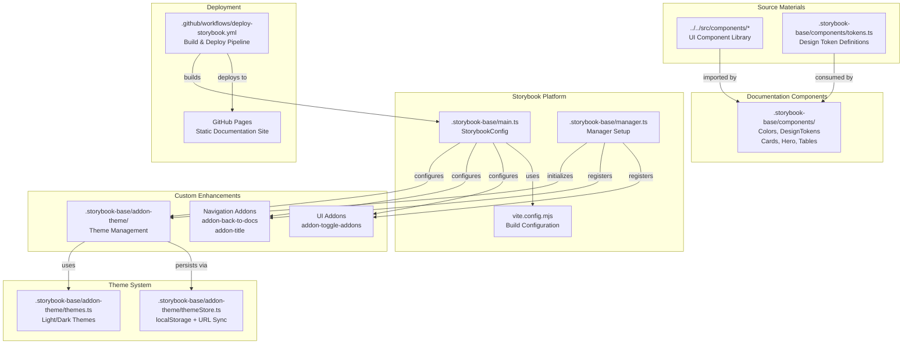
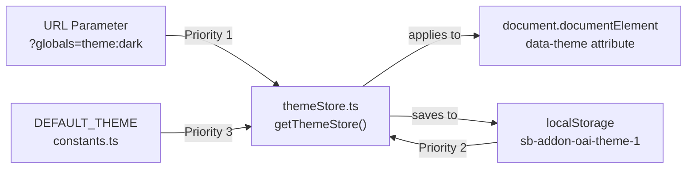
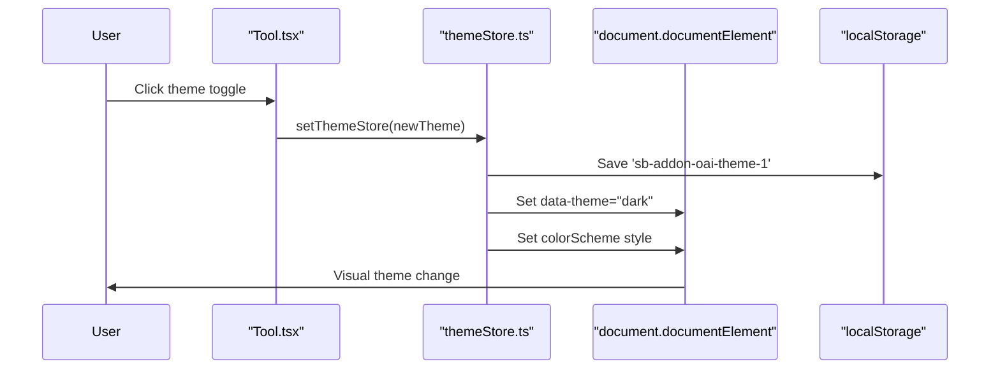

<!-- source: DeepWiki mcp.deepwiki.com · repo openai/apps-sdk-ui · page 1 Overview · fetched 2026-10-26 -->

# Overview

<details>
<summary>Relevant source files</summary>

The following files were used as context for generating this wiki page:

- [.github/workflows/deploy-storybook.yml](.github/workflows/deploy-storybook.yml)
- [.storybook-base/addon-theme/themes.ts](.storybook-base/addon-theme/themes.ts)
- [.storybook-base/components/tokens.ts](.storybook-base/components/tokens.ts)
- [.storybook-base/main.ts](.storybook-base/main.ts)
- [.storybook-base/manager.ts](.storybook-base/manager.ts)

</details>


This document provides an overview of the **apps-sdk-ui Storybook** repository, which serves as a documentation and component development platform for the OpenAI Apps SDK UI component library. This repository contains the Storybook configuration, custom addons, design system documentation, and automated deployment infrastructure for publishing component documentation to GitHub Pages.

For detailed information about specific subsystems, see:
- Storybook configuration details: [Storybook Configuration](#3)
- Custom addon implementations: [Custom Addons](#4)
- Design system tokens and themes: [Design System](#5)
- CI/CD pipeline specifics: [CI/CD & Deployment](#7)

## Purpose and Scope

The apps-sdk-ui Storybook repository is a specialized documentation platform built on top of Storybook that provides:

1. **Interactive component documentation** for React UI components from the main `apps-sdk-ui` library
2. **Custom Storybook addons** that enhance the documentation experience with theme switching, navigation helpers, and UI controls
3. **Comprehensive design system documentation** including design tokens, color palettes, typography, and motion guidelines
4. **Automated deployment** to GitHub Pages for public access to the documentation site

This repository does not contain the source code for the UI components themselves—it focuses exclusively on their documentation and presentation. The actual component implementations are imported from the parent `src/` directory.

## Technology Stack

| Technology | Purpose | Configuration |
|------------|---------|---------------|
| **Storybook 7.x** | Core documentation platform | [.storybook-base/main.ts:1-78]() |
| **React 18** | Component rendering framework | Used throughout components |
| **TypeScript** | Type-safe development | [.storybook-base/main.ts:36-43]() |
| **Vite** | Build tool and dev server | [.storybook-base/main.ts:44-76]() |
| **GitHub Actions** | CI/CD automation | [.github/workflows/deploy-storybook.yml:1-52]() |
| **GitHub Pages** | Static site hosting | [.github/workflows/deploy-storybook.yml:42-51]() |

Sources: [.storybook-base/main.ts:1-78](), [.github/workflows/deploy-storybook.yml:1-52]()

## System Architecture Overview



**Architecture Overview: Repository Components and Data Flow**

This diagram shows how the repository's major subsystems interact. Story and documentation files import UI components and design tokens, which are then rendered through Storybook's platform. Custom addons enhance the user experience, while the theme system manages light/dark mode preferences. The GitHub Actions pipeline automates the build and deployment process.

Sources: [.storybook-base/main.ts:1-78](), [.storybook-base/manager.ts:1-45](), [.github/workflows/deploy-storybook.yml:1-52](), [.storybook-base/addon-theme/themes.ts:1-68]()

## Key Features

### 1. Comprehensive Design System Documentation

The repository provides detailed documentation for the complete design system, including:

| Design Token Category | Count | Definition Location |
|----------------------|-------|---------------------|
| **Text Colors** | 4 base colors | [.storybook-base/components/tokens.ts:1-41]() |
| **Semantic Colors** | 200+ variants | [.storybook-base/components/tokens.ts:43-2207]() |
| **Border Radius** | 10 sizes | [.storybook-base/components/tokens.ts:2209-2260]() |
| **Typography** | 50+ tokens | [.storybook-base/components/tokens.ts:2262-2384]() |
| **Shadows** | 13 variants | [.storybook-base/components/tokens.ts:2386-2447]() |
| **Breakpoints** | 6 sizes | [.storybook-base/components/tokens.ts:2449-2480]() |
| **Motion** | 6 parameters | [.storybook-base/components/tokens.ts:2482-2492]() |

Sources: [.storybook-base/components/tokens.ts:1-2493]()

### 2. Custom Storybook Addons

Four custom-built addons enhance the documentation experience:

| Addon | Purpose | Implementation |
|-------|---------|----------------|
| **addon-theme** | Theme toggle (light/dark mode) with persistence | [.storybook-base/addon-theme/]() |
| **addon-back-to-docs** | Navigation button to return to docs view | [.storybook-base/addon-back-to-docs/]() |
| **addon-title** | Dynamic browser tab title updates | [.storybook-base/addon-title/]() |
| **addon-toggle-addons** | Show/hide addon panels control | [.storybook-base/addon-toggle-addons/]() |

Sources: [.storybook-base/manager.ts:1-45]()

### 3. Theme System with Persistence

The theme system supports both light and dark modes with multi-layer persistence:



**Theme Persistence Priority System**

The theme store checks three sources in order: URL parameters (highest priority), localStorage (medium priority), and default values (fallback). Changes are persisted to localStorage and applied to the DOM via data attributes.

Sources: [.storybook-base/addon-theme/themeStore.ts](), [.storybook-base/addon-theme/constants.ts]()

### 4. Automated CI/CD Pipeline

Every push to the `main` branch triggers an automated build and deployment:

| Stage | Action | Tool |
|-------|--------|------|
| **Build** | `npm ci` → `npm run build-storybook` | GitHub Actions + Node 20 |
| **Artifact** | Upload `storybook-static/` directory | `upload-pages-artifact@v3` |
| **Deploy** | Publish to GitHub Pages | `deploy-pages@v4` |
| **Access** | Public documentation site | `https://{org}.github.io/{repo}` |

Sources: [.github/workflows/deploy-storybook.yml:1-52]()

## Repository Structure and Code Entity Mapping

```mermaid
graph TB
    subgraph "Root Directory"
        WORKFLOW["..github/workflows/<br/>deploy-storybook.yml"]
        VITE_CONFIG["vite.config.mjs"]
        GITIGNORE[".gitignore"]
        PRETTIER[".prettierignore"]
    end
    
    subgraph ".storybook-base/ Directory"
        MAIN["main.ts<br/>StorybookConfig"]
        MANAGER["manager.ts<br/>addons.setConfig()"]
        MANAGER_HEAD["manager-head.html<br/>CSS Variables"]
        
        subgraph "addon-theme/"
            THEME_INDEX["index.tsx<br/>init()"]
            THEME_TOOL["Tool.tsx<br/>Theme Toggle UI"]
            THEME_STORE["themeStore.ts<br/>getThemeStore()"]
            THEME_DEFS["themes.ts<br/>THEMES Record"]
            THEME_CONST["constants.ts<br/>Theme type"]
        end
        
        subgraph "addon-back-to-docs/"
            BACK_INDEX["index.tsx"]
        end
        
        subgraph "addon-title/"
            TITLE_INDEX["index.tsx"]
        end
        
        subgraph "addon-toggle-addons/"
            TOGGLE_INDEX["index.tsx"]
        end
        
        subgraph "components/"
            TOKENS_FILE["tokens.ts<br/>TEXT_COLORS<br/>SEMANTIC_COLORS<br/>RADIUS, FONTS"]
            COLORS_COMP["Colors.tsx"]
            DESIGN_TOKENS_COMP["DesignTokens.tsx"]
            CARDS["Card.tsx<br/>FooterCard.tsx"]
            HERO_COMP["Hero.tsx"]
            TABLE_COMP["CustomTable.tsx"]
            ICON_GALLERY["CustomIconGallery.tsx"]
        end
        
        subgraph "StorybookApp/"
            APP_INDEX["index.tsx<br/>WithTheme decorator"]
            DOCS_CONTAINER["CustomDocsContainer.tsx"]
        end
    end
    
    subgraph "src/ Directory (Parent)"
        SRC_COMPONENTS["components/*<br/>Button, Icon, Tooltip, etc."]
        STORIES["**/*.stories.tsx<br/>**/*.mdx"]
    end
    
    MAIN -->|discovers| STORIES
    MAIN -->|configures addons| THEME_INDEX
    MAIN -->|viteFinal hook| VITE_CONFIG
    
    MANAGER -->|init()| THEME_INDEX
    MANAGER -->|registers| BACK_INDEX
    MANAGER -->|registers| TITLE_INDEX
    MANAGER -->|registers| TOGGLE_INDEX
    
    THEME_TOOL -->|uses| THEME_DEFS
    THEME_INDEX -->|persists via| THEME_STORE
    
    COLORS_COMP -->|imports| TOKENS_FILE
    DESIGN_TOKENS_COMP -->|imports| TOKENS_FILE
    ICON_GALLERY -->|imports| SRC_COMPONENTS
    
    STORIES -->|imports| SRC_COMPONENTS
    STORIES -->|imports| COLORS_COMP
    STORIES -->|imports| DESIGN_TOKENS_COMP
    
    WORKFLOW -->|builds| MAIN
    WORKFLOW -->|uses| VITE_CONFIG
```

**File Structure and Code Entity Relationships**

This diagram maps the repository's file structure to key code entities, showing how TypeScript modules, classes, and functions interconnect. Gray boxes represent directories, while white boxes show individual files with their primary exports.

Sources: [.storybook-base/main.ts:1-78](), [.storybook-base/manager.ts:1-45](), [.storybook-base/components/tokens.ts:1-2493](), [.github/workflows/deploy-storybook.yml:1-52]()

## How the System Works

### Development Workflow

1. **Component Development**: UI components are developed in the parent `src/` directory
2. **Story Creation**: Developers create `.stories.tsx` or `.mdx` files that import and showcase components
3. **Local Preview**: Run `npm run storybook` to preview documentation at `localhost:6006`
4. **Design Token Usage**: Documentation components reference tokens from [.storybook-base/components/tokens.ts:1-2493]()

### Build Process

The build process is orchestrated by [.storybook-base/main.ts:1-78]():

| Step | Configuration | Purpose |
|------|---------------|---------|
| **Story Discovery** | `stories: ["../src/**/*.mdx", "../src/**/*.stories.@(js\|jsx\|ts\|tsx)"]` | Locate all documentation files |
| **Addon Loading** | `addons: ["@storybook/addon-links", ...]` | Enable Storybook features |
| **TypeScript Setup** | `reactDocgen: "react-docgen-typescript"` | Generate prop tables from types |
| **Vite Configuration** | `viteFinal()` hook | Custom build settings |
| **Environment Variable** | `process.env.IS_STORYBOOK = "true"` | Runtime detection flag |

Sources: [.storybook-base/main.ts:1-78]()

### Theme Application

The theme system applies visual styling through multiple layers:



**Theme Toggle Sequence**

When a user clicks the theme toggle, the Tool component calls `setThemeStore()`, which persists the choice to localStorage and applies CSS classes to the document element, triggering visual changes via CSS variable overrides.

Sources: [.storybook-base/addon-theme/Tool.tsx](), [.storybook-base/addon-theme/themeStore.ts]()

### Deployment Pipeline

The deployment is fully automated via GitHub Actions:

1. **Trigger**: Push to `main` branch or manual `workflow_dispatch`
2. **Build Job** ([.github/workflows/deploy-storybook.yml:19-40]()):
   - Checkout code with `actions/checkout@v4`
   - Setup Node.js 20 with npm cache
   - Install dependencies: `npm ci`
   - Build static site: `npm run build-storybook --output-dir storybook-static`
   - Upload artifact to GitHub's artifact storage
3. **Deploy Job** ([.github/workflows/deploy-storybook.yml:42-51]()):
   - Download build artifact
   - Deploy to GitHub Pages using `actions/deploy-pages@v4`
   - Site becomes accessible at the GitHub Pages URL

Sources: [.github/workflows/deploy-storybook.yml:1-52]()

## Storybook Configuration Summary

### Main Configuration (`main.ts`)

The primary configuration file [.storybook-base/main.ts:1-78]() defines:

- **Story patterns**: `["../src/**/*.mdx", "../src/**/*.stories.@(js|jsx|ts|tsx)"]`
- **Enabled addons**: Links, toolbars, essentials (with disabled features), storysource
- **TypeScript integration**: `react-docgen-typescript` with prop extraction options
- **Vite customizations**: Module aliases, asset includes, TSConfig overrides
- **Static directory**: `["../public"]` for public assets

### Manager Configuration (`manager.ts`)

The manager configuration [.storybook-base/manager.ts:1-45]() sets:

- **Sidebar width**: `navSize: 230` pixels
- **Hidden toolbar items**: copy, eject, fullscreen, createStory
- **Sidebar behavior**: `showRoots: true`, `collapsedRoots: []`
- **Docs defaults**: `isCodeExpanded: true`, `source.state: "shown"`
- **Custom addon registration**: Theme, back-to-docs, title, toggle-addons
- **View mode tracking**: Sets `data-view-mode` attribute on document element

Sources: [.storybook-base/main.ts:1-78](), [.storybook-base/manager.ts:1-45]()

## Design System Highlights

The design system is built on a comprehensive token architecture defined in [.storybook-base/components/tokens.ts:1-2493](). Key characteristics:

### Color System Architecture

| Category | Variants | Theme Support |
|----------|----------|---------------|
| **Text Colors** | Base, Secondary, Tertiary, Inverse | Light/Dark values |
| **Primary Semantic** | Soft, Surface, Solid, Outline, Ghost + Ring | Full theme support |
| **Intent Colors** | Info, Warning, Caution, Danger, Success, Discovery | 40+ variants each |
| **State Colors** | Disabled, Hover, Active states | Cross-variant support |

### Typography Scale

The system defines a complete typographic scale:
- **Headings**: 5xl → xs (9 sizes) with size, line-height, weight, tracking
- **Text**: lg → 3xs (6 sizes) with full specifications
- **Font families**: Sans-serif and monospace stacks
- **Weights**: Normal (400), Medium (500), Semibold (600), Bold (700)
- **Tracking**: Wide (0em), Normal (-0.01em), Tight (-0.02em)

### Theme Definitions

Two themes are defined in [.storybook-base/addon-theme/themes.ts:1-68]():

**Light Theme** ([.storybook-base/addon-theme/themes.ts:4-32]()):
- Brand image: `logo-storybook.svg`
- Primary color: `#3A10E5`
- Background: `#ffffff`
- Border: `#ededed`
- Text: `#6e6e80`

**Dark Theme** ([.storybook-base/addon-theme/themes.ts:34-62]()):
- Brand image: `logo-storybook-dark.svg`
- Primary color: `#3A10E5` (same)
- Background: `#212121`
- Border: `#393939`
- Text: `#c1c1c1`

Sources: [.storybook-base/components/tokens.ts:1-2493](), [.storybook-base/addon-theme/themes.ts:1-68]()

## Next Steps

For in-depth information about specific subsystems:

- **Repository organization and file structure**: See [Repository Structure](#1.1)
- **Development environment setup**: See [Getting Started](#2)
- **Storybook configuration deep dive**: See [Storybook Configuration](#3)
- **Custom addon implementation details**: See [Custom Addons](#4)
- **Complete design token reference**: See [Design System](#5)
- **Documentation component usage**: See [Documentation Components](#6)
- **CI/CD pipeline details**: See [CI/CD & Deployment](#7)

---

