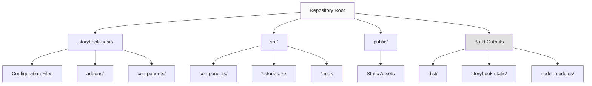
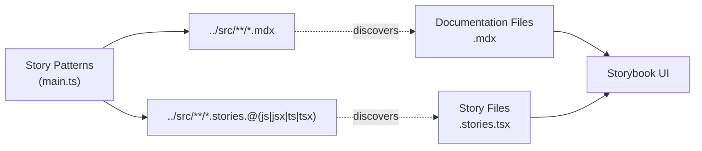
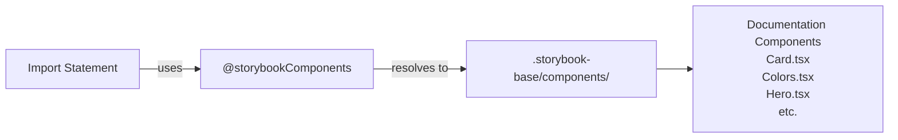
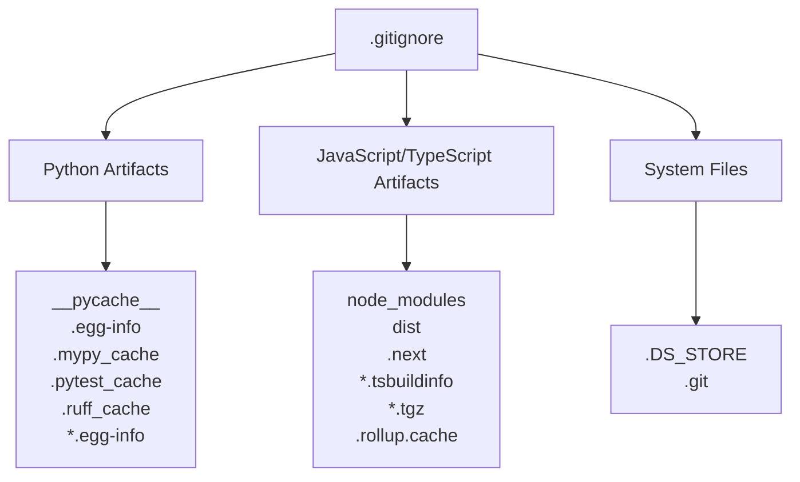
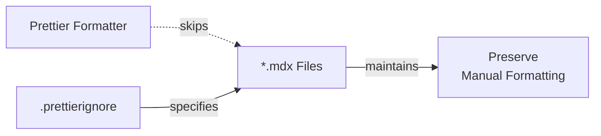
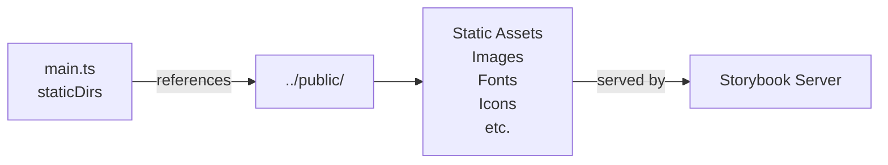
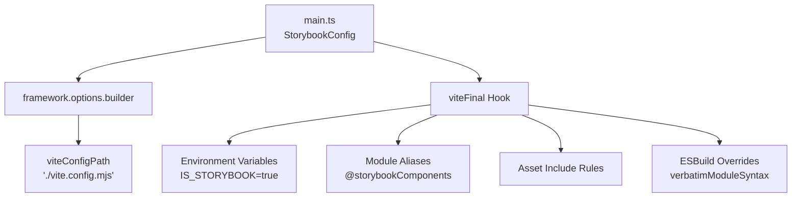

<!-- source: DeepWiki mcp.deepwiki.com · repo openai/apps-sdk-ui · page 1.1 Repository Structure · fetched 2026-10-26 -->

# Repository Structure

Relevant source files

The following files were used as context for generating this wiki page:

- [.gitignore](.gitignore)
- [.prettierignore](.prettierignore)
- [.storybook-base/main.ts](.storybook-base/main.ts)

## Purpose and Scope

This document describes the physical organization of the apps-sdk-ui repository, including its directory layout, file patterns, and version control configuration. It explains where components, stories, and documentation files are located, and which files are excluded from version control and formatting tools.

For information about how Storybook is configured to discover and display these files, see [Storybook Configuration](#3). For details on the CI/CD pipeline that builds and deploys this structure, see [CI/CD & Deployment](#7).

---

## Repository Layout

The repository follows a standard Storybook project structure with custom extensions for theme management and documentation components.

### Directory Organization

**Sources:** [.storybook-base/main.ts:1-78](), [.gitignore:1-17]()

### Key Directories

| Directory | Purpose | Tracked in Git |
|-----------|---------|----------------|
| `.storybook-base/` | Storybook configuration, custom addons, and documentation components | ✓ Yes |
| `src/` | Source components and their stories/documentation | ✓ Yes |
| `public/` | Static assets served by Storybook | ✓ Yes |
| `node_modules/` | Node.js dependencies | ✗ No |
| `dist/` | Build output for the component library | ✗ No |
| `storybook-static/` | Compiled Storybook site | ✗ No |

**Sources:** [.storybook-base/main.ts:52](), [.gitignore:15-16]()

---

## Story Discovery and Organization

Storybook discovers stories and documentation using glob patterns defined in the configuration. The system locates files in the `src/` directory based on specific file extensions.

### Story File Patterns

**Sources:** [.storybook-base/main.ts:5]()

The configuration defines two story patterns:

1. **MDX Documentation**: `../src/**/*.mdx` - Markdown files with embedded JSX for rich documentation pages
2. **Component Stories**: `../src/**/*.stories.@(js|jsx|ts|tsx)` - JavaScript/TypeScript files containing component examples and variations

These patterns use glob syntax where:
- `**` matches any number of directory levels
- `*` matches any characters within a filename
- `@(js|jsx|ts|tsx)` matches any of the specified extensions

**Sources:** [.storybook-base/main.ts:5]()

### Module Resolution Aliases

The build configuration establishes a module alias to simplify imports within documentation:

**Sources:** [.storybook-base/main.ts:56-61]()

This alias allows MDX files to import documentation components using `@storybookComponents/ComponentName` instead of relative paths like `../.storybook-base/components/ComponentName`.

**Sources:** [.storybook-base/main.ts:60]()

---

## Version Control Exclusions

The `.gitignore` file excludes build artifacts, dependencies, and system-generated files from version control. The repository supports both Python and JavaScript/TypeScript development workflows.

### Excluded File Categories

**Sources:** [.gitignore:1-17]()

### Detailed Exclusion Patterns

| Pattern | Type | Reason for Exclusion |
|---------|------|---------------------|
| `__pycache__` | Python | Compiled Python bytecode |
| `.egg-info` / `*.egg-info` | Python | Python package metadata |
| `.mypy_cache` | Python | Type checker cache |
| `.pytest_cache` | Python | Test framework cache |
| `.ruff_cache` | Python | Linter cache |
| `node_modules` | JavaScript | NPM dependencies (large, reproducible) |
| `dist` | JavaScript | Build output directory |
| `.next` | JavaScript | Next.js build cache |
| `*.tsbuildinfo` | TypeScript | Incremental compilation cache |
| `*.tgz` | Archive | Compressed package files |
| `.rollup.cache` | JavaScript | Rollup bundler cache |
| `.DS_STORE` | macOS | Finder metadata |
| `.git` | Git | Git internal directory |

**Sources:** [.gitignore:1-17]()

The presence of Python-related exclusions (lines 6-9, 13) indicates the repository may be part of a larger monorepo or have Python tooling integration, though the primary focus is the Storybook documentation system.

**Sources:** [.gitignore:6-13]()

---

## Code Formatting Exclusions

The `.prettierignore` file prevents the Prettier code formatter from processing specific file types that could be negatively affected by automatic formatting.

### Excluded Formats

**Sources:** [.prettierignore:1-2]()

### MDX File Exclusion

MDX files combine Markdown with JSX, and are excluded from Prettier formatting:

**Pattern**: `*.mdx`

**Rationale**: MDX files often contain carefully formatted documentation with specific line breaks, indentation, and spacing that contribute to readability. Automatic formatting could:
- Disrupt intentional line breaks in prose
- Alter the visual structure of embedded code examples
- Change the spacing around JSX components in ways that reduce clarity

Since these files are primarily authored by humans for human consumption, preserving the author's formatting choices is prioritized over automatic consistency.

**Sources:** [.prettierignore:1]()

---

## Static Asset Serving

The Storybook configuration specifies static directories that are served without processing during development and in the production build.

### Static Directory Configuration

**Sources:** [.storybook-base/main.ts:52]()

The `staticDirs` configuration points to `../public/`, making all files in this directory accessible at the root of the Storybook URL. For example, a file at `public/logo.svg` would be accessible at `/logo.svg` in the running Storybook instance.

**Sources:** [.storybook-base/main.ts:52]()

---

## Build Configuration Context

The repository uses Vite as its build tool, referenced through the Storybook framework configuration. The Vite configuration is located at `./vite.config.mjs` relative to the `.storybook-base/` directory.

### Build Configuration Flow

**Sources:** [.storybook-base/main.ts:44-76]()

### Vite Configuration Modifications

The `viteFinal` hook in the Storybook configuration applies several runtime modifications to the Vite build:

1. **Environment Variable**: Sets `IS_STORYBOOK=true` to allow conditional logic in source code ([.storybook-base/main.ts:54]())

2. **Module Alias**: Creates `@storybookComponents` alias for documentation component imports ([.storybook-base/main.ts:56-61]())

3. **Asset Include**: Adds `/sb-preview/runtime.js` to `assetsInclude` to work around Storybook issue #25256 ([.storybook-base/main.ts:64]())

4. **TypeScript Override**: Disables `verbatimModuleSyntax` compiler option for ESBuild to ensure Storybook compatibility ([.storybook-base/main.ts:68-73]())

**Sources:** [.storybook-base/main.ts:53-76]()

---

## Summary

The repository structure is organized into clearly defined areas:

- **Configuration**: `.storybook-base/` contains all Storybook setup and customizations
- **Source**: `src/` contains component source code and their stories
- **Assets**: `public/` holds static files served without processing
- **Build Artifacts**: Multiple directories (`dist/`, `storybook-static/`, `node_modules/`) are excluded from version control

Story discovery is automatic based on glob patterns, supporting both `.mdx` documentation files and `.stories.tsx` component examples throughout the `src/` directory tree. The build system uses Vite with custom modifications for Storybook compatibility, and both Git and Prettier are configured to ignore generated artifacts and preserve manual formatting where appropriate.

**Sources:** [.storybook-base/main.ts:1-78](), [.gitignore:1-17](), [.prettierignore:1-2]()

---

