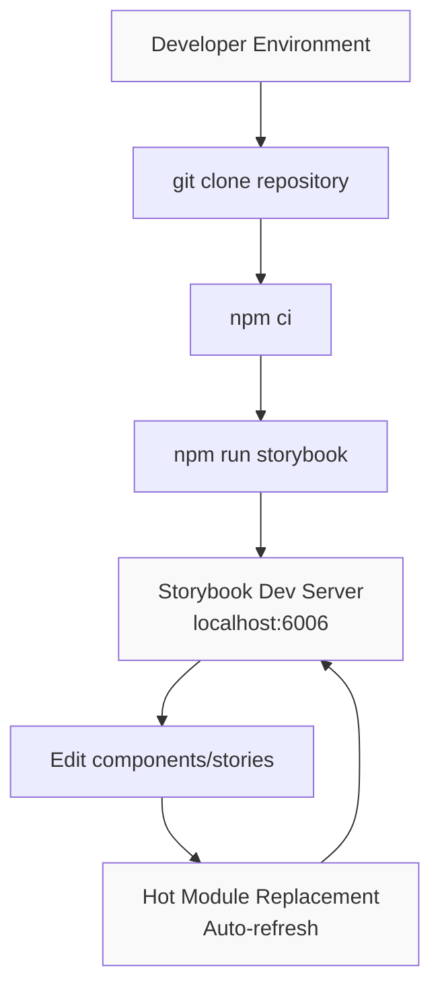
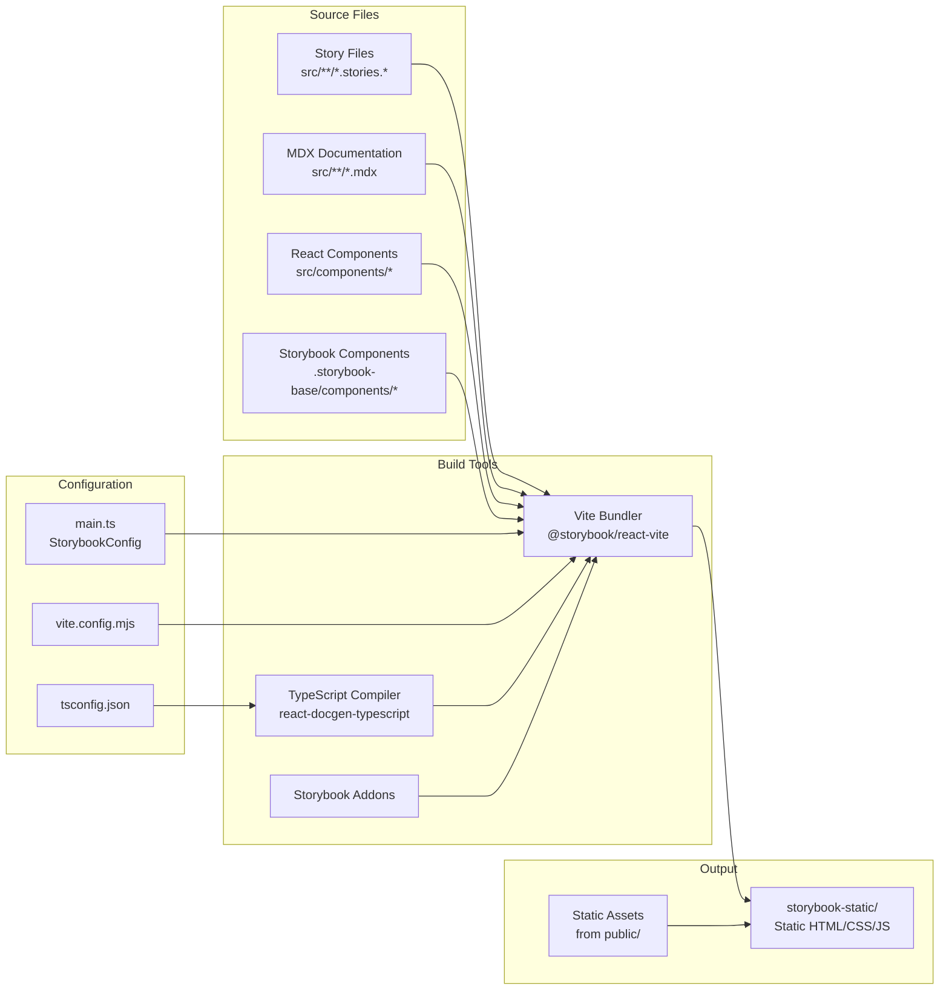
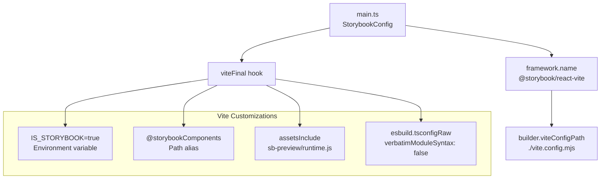

<!-- source: DeepWiki mcp.deepwiki.com · repo openai/apps-sdk-ui · page 2 Getting Started · fetched 2026-10-26 -->

# Getting Started

<details>
<summary>Relevant source files</summary>

The following files were used as context for generating this wiki page:

- [.github/workflows/deploy-storybook.yml](.github/workflows/deploy-storybook.yml)
- [.gitignore](.gitignore)
- [.storybook-base/main.ts](.storybook-base/main.ts)

</details>


This document provides instructions for setting up the development environment and running the Storybook documentation platform locally. It covers prerequisites, installation steps, available npm scripts, and the build process. For detailed information about Storybook configuration options, see [Storybook Configuration](#3). For deployment and CI/CD details, see [CI/CD & Deployment](#7).

## Prerequisites

The repository requires the following software to be installed:

| Software | Version | Purpose |
|----------|---------|---------|
| Node.js | 20 | Runtime environment for building and running Storybook |
| npm | Latest (bundled with Node.js) | Package manager for dependency installation |
| Git | Any recent version | Version control for cloning the repository |

The Node.js version requirement is specified in the GitHub Actions workflow at [.github/workflows/deploy-storybook.yml:28]().

**Sources:** `.github/workflows/deploy-storybook.yml`

## Installation

### Clone the Repository

```bash
git clone https://github.com/openai/apps-sdk-ui.git
cd apps-sdk-ui
```

### Install Dependencies

Install all required packages using npm:

```bash
npm ci
```

The `npm ci` command (clean install) is used instead of `npm install` to ensure reproducible builds by strictly following the `package-lock.json` file. This is the same approach used in the CI/CD pipeline at [.github/workflows/deploy-storybook.yml:32]().

**Sources:** `.github/workflows/deploy-storybook.yml`

## Development Workflow

### Development Workflow Overview



**Sources:** `.github/workflows/deploy-storybook.yml`, `.storybook-base/main.ts`

### Running Storybook Locally

To start the Storybook development server:

```bash
npm run storybook
```

This command launches a local development server with hot module replacement (HMR), typically accessible at `http://localhost:6006`. Changes to component files and stories are automatically reflected in the browser without requiring a full page reload.

### Building for Production

To build a static version of Storybook for deployment:

```bash
npm run build-storybook
```

This command generates static HTML, CSS, and JavaScript files in the `storybook-static` directory (configurable via the `--output-dir` flag). The build command is defined at [.github/workflows/deploy-storybook.yml:35]() and uses Vite as the bundler.

**Sources:** `.github/workflows/deploy-storybook.yml`, `.storybook-base/main.ts`

## Build Process Architecture

### Build Pipeline Stages



**Sources:** `.storybook-base/main.ts`, `.github/workflows/deploy-storybook.yml`

## File Structure Overview

After cloning and installing dependencies, the repository structure includes:

| Directory/File | Description | Version Control |
|----------------|-------------|-----------------|
| `.storybook-base/` | Storybook configuration and custom components | Tracked |
| `src/` | Source component files and stories | Tracked |
| `public/` | Static assets served by Storybook | Tracked |
| `node_modules/` | Installed npm dependencies | Ignored |
| `dist/` | Build output directory | Ignored |
| `storybook-static/` | Built Storybook static files | Ignored (generated) |
| `.next/` | Next.js build cache | Ignored |
| `__pycache__/` | Python cache files | Ignored |

Files and directories excluded from version control are defined in [.gitignore:1-17]().

**Sources:** `.gitignore`

## Story Discovery and Configuration

### Story Pattern Matching

Storybook automatically discovers story files using the patterns defined in [.storybook-base/main.ts:5]():

```
stories: ["../src/**/*.mdx", "../src/**/*.stories.@(js|jsx|ts|tsx)"]
```

This configuration matches:
- **MDX files**: Documentation pages with interactive examples
- **Story files**: Component stories in JavaScript or TypeScript

### Static Asset Serving

Static assets located in the `public/` directory are served by Storybook during development and included in production builds. This is configured via the `staticDirs` option at [.storybook-base/main.ts:52]().

**Sources:** `.storybook-base/main.ts`

## Build Configuration Details

### Vite Integration

The Storybook build process uses Vite as its bundler, configured through the `@storybook/react-vite` framework at [.storybook-base/main.ts:44-50]():



The `viteFinal` hook at [.storybook-base/main.ts:53-76]() applies several customizations:

1. **Environment Variable**: Sets `IS_STORYBOOK=true` to enable conditional logic in components
2. **Path Alias**: Creates `@storybookComponents` alias pointing to `.storybook-base/components/` for convenient imports in MDX files
3. **Asset Includes**: Adds `/sb-preview/runtime.js` to prevent build errors
4. **TypeScript Configuration**: Overrides `verbatimModuleSyntax` to `false` for Storybook compatibility

**Sources:** `.storybook-base/main.ts`

### TypeScript Configuration

TypeScript integration is configured at [.storybook-base/main.ts:36-43]() using `react-docgen-typescript` for automatic prop documentation generation:

| Option | Value | Purpose |
|--------|-------|---------|
| `reactDocgen` | `"react-docgen-typescript"` | Documentation generator |
| `savePropValueAsString` | `true` | Preserve prop values as strings for display |
| `shouldRemoveUndefinedFromOptional` | `true` | Clean up optional prop types |
| `shouldExtractLiteralValuesFromEnum` | `true` | Extract enum values for documentation |

**Sources:** `.storybook-base/main.ts`

## CI/CD Build Process

The automated build and deployment process is triggered by pushes to the `main` branch or manual workflow dispatch. The pipeline consists of two jobs:

### Build Job

The build job executes the following steps on `ubuntu-latest`:

1. **Checkout**: Retrieves the repository code using `actions/checkout@v4`
2. **Node Setup**: Installs Node.js 20 with npm cache using `actions/setup-node@v4`
3. **Dependencies**: Runs `npm ci` to install packages
4. **Build**: Executes `npm run build-storybook --output-dir storybook-static`
5. **Upload**: Uploads the `storybook-static` directory as a GitHub Pages artifact

### Deploy Job

The deploy job runs after the build job completes and publishes the artifact to GitHub Pages using `actions/deploy-pages@v4`.

For complete CI/CD documentation, see [GitHub Actions Workflow](#7.1).

**Sources:** `.github/workflows/deploy-storybook.yml`

## Next Steps

After successfully running Storybook locally, you can:

1. **Explore the Design System**: Review design tokens and themes in [Design System](#5)
2. **Customize Themes**: Understand theme configuration in [Theme System](#5.2)
3. **Create Documentation Components**: Learn about custom components in [Documentation Components](#6)
4. **Configure Addons**: Explore custom addons in [Custom Addons](#4)

**Sources:** `.storybook-base/main.ts`, `.github/workflows/deploy-storybook.yml`, `.gitignore`

---

