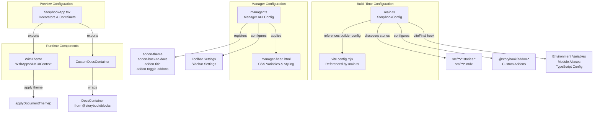
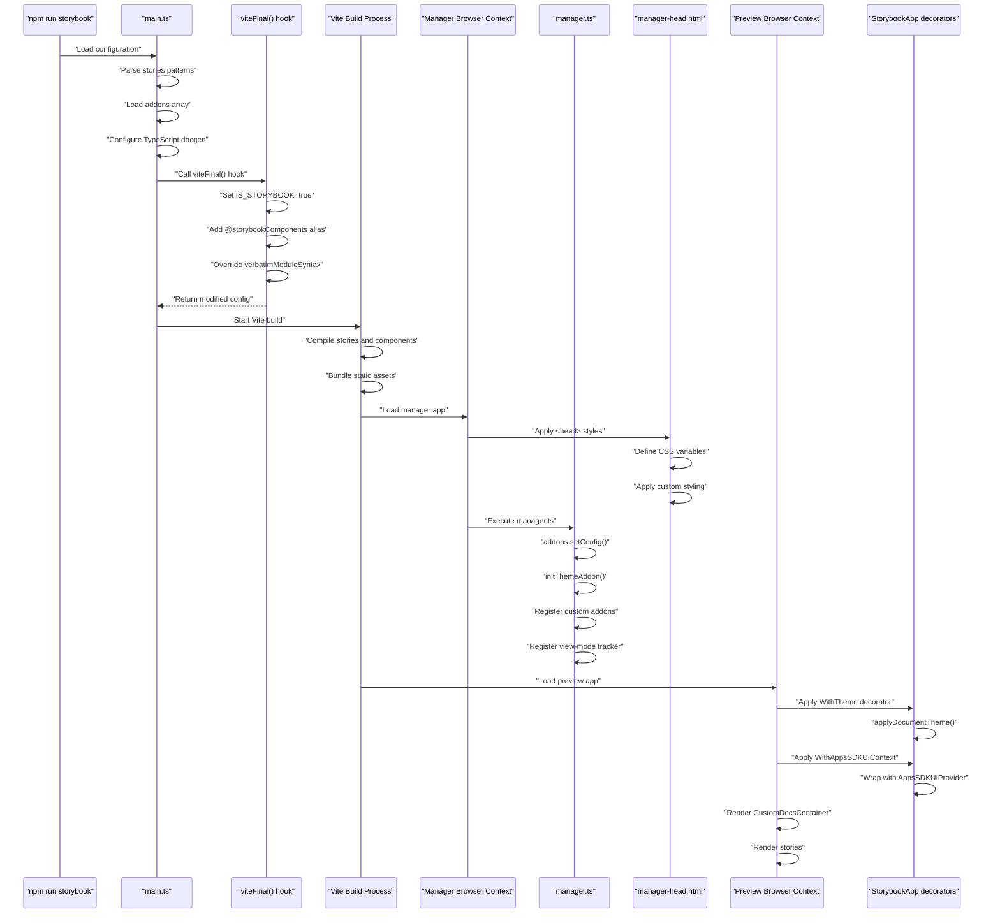
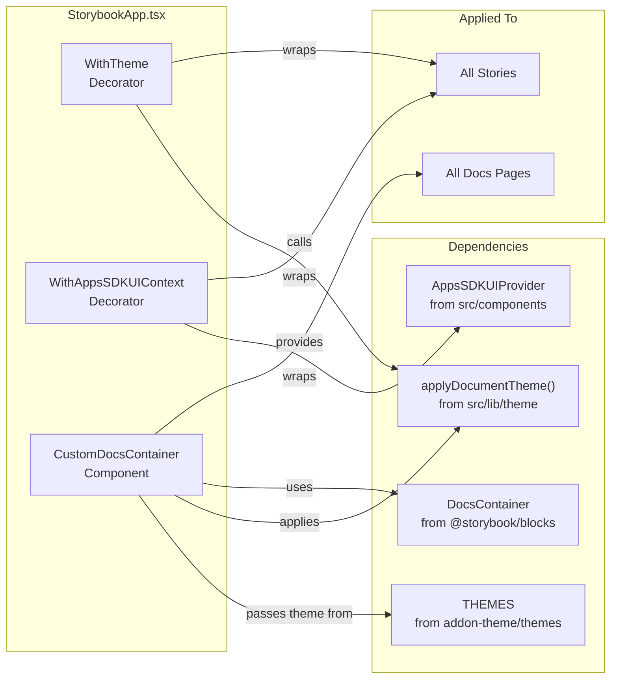
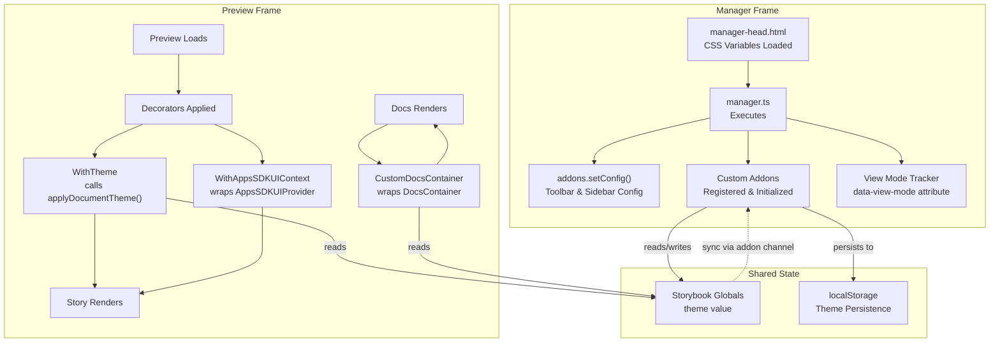

<!-- source: DeepWiki mcp.deepwiki.com · repo openai/apps-sdk-ui · page 3 Storybook Configuration · fetched 2026-10-26 -->

# Storybook Configuration

<details>
<summary>Relevant source files</summary>

The following files were used as context for generating this wiki page:

- [.storybook-base/components/StorybookApp.tsx](.storybook-base/components/StorybookApp.tsx)
- [.storybook-base/main.ts](.storybook-base/main.ts)
- [.storybook-base/manager-head.html](.storybook-base/manager-head.html)
- [.storybook-base/manager.ts](.storybook-base/manager.ts)

</details>


This document provides a comprehensive overview of how Storybook is configured in the apps-sdk-ui repository. It covers the main configuration files, manager setup, UI customizations, and component integrations that collectively define the Storybook development and documentation environment.

For detailed information about specific configuration areas, see:
- Main configuration file settings: [Main Configuration (main.ts)](#3.1)
- Manager toolbar and sidebar settings: [Manager Configuration (manager.ts)](#3.2)
- CSS-based UI customizations: [Manager UI Customization](#3.3)
- Theme decorators and context providers: [Storybook App Integration](#3.4)

For information about custom addons that extend Storybook's functionality, see [Custom Addons](#4).

---

## Configuration Architecture

The Storybook configuration is split across multiple files, each serving a distinct purpose in the system. The following diagram illustrates how these configuration files are organized and their primary responsibilities.

**Configuration File Structure**



**Sources:** [.storybook-base/main.ts:1-78](), [.storybook-base/manager.ts:1-44](), [.storybook-base/manager-head.html:1-387](), [.storybook-base/components/StorybookApp.tsx:1-87]()

---

## Configuration Files Overview

The Storybook configuration consists of four primary files:

| File | Purpose | Execution Context |
|------|---------|-------------------|
| `main.ts` | Defines story locations, addons, framework settings, and Vite customizations | Build time (Node.js) |
| `manager.ts` | Configures the Storybook manager UI (sidebar, toolbar) and registers custom addons | Browser (manager iframe) |
| `manager-head.html` | Provides CSS variables, custom styling, and UI theme definitions | Browser (manager iframe, loaded in `<head>`) |
| `StorybookApp.tsx` | Exports decorators and containers that wrap stories and documentation pages | Browser (preview iframe) |

**Sources:** [.storybook-base/main.ts:1-78](), [.storybook-base/manager.ts:1-44](), [.storybook-base/manager-head.html:1-387](), [.storybook-base/components/StorybookApp.tsx:1-87]()

---

## Build and Runtime Flow

The configuration files are applied at different stages of the Storybook lifecycle. Understanding when each configuration takes effect is crucial for troubleshooting and extending the system.

**Configuration Application Flow**



**Sources:** [.storybook-base/main.ts:53-76](), [.storybook-base/manager.ts:8-44](), [.storybook-base/manager-head.html:1-387](), [.storybook-base/components/StorybookApp.tsx:19-86]()

---

## Main Configuration Details

The `main.ts` file is the primary configuration entry point for Storybook. It defines:

### Story Discovery

Stories are discovered using glob patterns: `../src/**/*.mdx` and `../src/**/*.stories.@(js|jsx|ts|tsx)` as specified in [.storybook-base/main.ts:5]().

### Addon Configuration

The configuration includes several addons with customized options:

- **@storybook/addon-links** - Enables navigation between stories
- **@storybook/addon-toolbars** - Provides toolbar functionality
- **@storybook/addon-essentials** - Core features with several subfeatures disabled (actions, backgrounds, viewport, measure, outline, highlight) per [.storybook-base/main.ts:10-20]()
- **@storybook/addon-storysource** - Shows story source code with custom Prettier configuration [.storybook-base/main.ts:22-34]()

### TypeScript Integration

The configuration enables `react-docgen-typescript` with specific options:
- `savePropValueAsString: true`
- `shouldRemoveUndefinedFromOptional: true`
- `shouldExtractLiteralValuesFromEnum: true`

These settings are defined in [.storybook-base/main.ts:36-42]().

### Vite Customizations

The `viteFinal` hook [.storybook-base/main.ts:53-76]() applies critical customizations:

1. **Environment Variable**: Sets `IS_STORYBOOK=true` for conditional behavior
2. **Module Alias**: Creates `@storybookComponents` alias pointing to `./.storybook-base/components/`
3. **Asset Inclusion**: Adds `/sb-preview/runtime.js` to asset handling
4. **TypeScript Override**: Disables `verbatimModuleSyntax` to prevent build failures

**Sources:** [.storybook-base/main.ts:1-78]()

---

## Manager Configuration Details

The `manager.ts` file configures the Storybook manager UI and initializes custom addons.

### Manager API Configuration

The `addons.setConfig()` call [.storybook-base/manager.ts:8-26]() defines:

| Setting | Value | Purpose |
|---------|-------|---------|
| `navSize` | 230 | Fixed sidebar width in pixels |
| `toolbar.copy` | hidden | Hides the copy button |
| `toolbar.eject` | hidden | Hides the eject button |
| `toolbar.fullscreen` | hidden | Hides the fullscreen toggle |
| `toolbar.createStory` | hidden | Hides the create story button |
| `sidebar.showRoots` | true | Displays root-level categories |
| `sidebar.collapsedRoots` | [] | All roots expanded by default |
| `docs.isCodeExpanded` | true | Code blocks expanded by default |
| `docs.source.state` | "shown" | Source addon visible by default |

### Custom Addon Registration

Four custom addons are registered:
1. `addon-theme` - Initialized via `initThemeAddon()` [.storybook-base/manager.ts:29]()
2. `addon-back-to-docs` - Imported for side effects [.storybook-base/manager.ts:4]()
3. `addon-title` - Imported for side effects [.storybook-base/manager.ts:5]()
4. `addon-toggle-addons` - Imported for side effects [.storybook-base/manager.ts:6]()

### View Mode Tracking

A custom `view-mode` addon [.storybook-base/manager.ts:31-44]() tracks whether the user is viewing docs or stories, setting the `data-view-mode` attribute on `document.documentElement` for CSS targeting.

**Sources:** [.storybook-base/manager.ts:1-44]()

---

## Manager UI Customization

The `manager-head.html` file provides extensive CSS customizations to match the design system.

### CSS Variable Definitions

The file defines a comprehensive set of CSS variables using the `light-dark()` function for automatic theme adaptation [.storybook-base/manager-head.html:6-55]():

- **Gray Scale**: `--gray-0` through `--gray-1000` in 25-50 unit increments
- **Alpha Channels**: `--alpha-0` through `--alpha-50` using `color-mix()`
- **Semantic Colors**: `--color-text`, `--color-text-secondary`, `--color-surface`
- **Input States**: `--sb-input-border-color`, `--sb-input-border-hover-color`, `--sb-input-border-focus-color`

### UI Component Customizations

Key customizations include:

| Component | Customization | Location |
|-----------|---------------|----------|
| Sidebar Header | Margin adjustment, pointer-events disabled | [.storybook-base/manager-head.html:70-85]() |
| Search Field | Custom border, height, hover/focus states | [.storybook-base/manager-head.html:98-133]() |
| Search Results | Custom spacing, background, typography | [.storybook-base/manager-head.html:148-190]() |
| Sidebar Items | Custom padding, hover states, selection styling | [.storybook-base/manager-head.html:266-300]() |
| Sidebar Roots | Treated as static headers, not collapsible | [.storybook-base/manager-head.html:238-263]() |
| Toolbar | Position absolute in docs mode, static in story mode | [.storybook-base/manager-head.html:309-327]() |

### Visibility Control

The configuration hides the UI until theme initialization completes [.storybook-base/manager-head.html:58-62]() using:
```css
html:not([data-theme]),
[data-is-loaded="false"] {
  visibility: hidden;
}
```

**Sources:** [.storybook-base/manager-head.html:1-387]()

---

## StorybookApp Integration

The `StorybookApp.tsx` file provides React components that integrate with Storybook's preview environment.

### Component Exports

**Decorator and Container Mapping**



**Sources:** [.storybook-base/components/StorybookApp.tsx:1-87]()

### WithTheme Decorator

The `WithTheme` decorator [.storybook-base/components/StorybookApp.tsx:19-27]() applies theme changes to all stories:

1. Reads `theme` from `context.globals.theme`
2. Calls `applyDocumentTheme()` in `useLayoutEffect` to apply theme to the document
3. Defaults to `DEFAULT_THEME` if no theme is specified

### WithAppsSDKUIContext Decorator

The `WithAppsSDKUIContext` decorator [.storybook-base/components/StorybookApp.tsx:29-35]() wraps stories with the `AppsSDKUIProvider`:

- Provides React context for SDK components
- Accepts `linkComponent` from story parameters (defaults to `"a"`)

### CustomDocsContainer

The `CustomDocsContainer` [.storybook-base/components/StorybookApp.tsx:37-87]() wraps documentation pages with several enhancements:

1. **Theme Application**: Reads theme from globals and applies via `applyDocumentTheme()` [.storybook-base/components/StorybookApp.tsx:76-78]()
2. **Scroll Restoration**: Implements custom scroll position persistence across hot reloads [.storybook-base/components/StorybookApp.tsx:46-74]()
3. **Storybook Theme Integration**: Passes theme object to `DocsContainer` from `THEMES` map [.storybook-base/components/StorybookApp.tsx:82]()

The scroll restoration system:
- Saves scroll position to `sessionStorage` before Vite reloads
- Uses `ResizeObserver` to detect when content height exceeds saved position
- Restores scroll position once content is rendered

**Sources:** [.storybook-base/components/StorybookApp.tsx:1-87]()

---

## Configuration Integration Summary

The following diagram shows how all configuration elements work together at runtime:

**Runtime Configuration Integration**



**Sources:** [.storybook-base/main.ts:1-78](), [.storybook-base/manager.ts:1-44](), [.storybook-base/manager-head.html:1-387](), [.storybook-base/components/StorybookApp.tsx:1-87]()

---

## Configuration Files Reference

| File | Type | Key Exports/Configurations |
|------|------|----------------------------|
| `main.ts` | Build Config | `StorybookConfig` object with stories, addons, framework, viteFinal |
| `manager.ts` | Manager Config | `addons.setConfig()`, addon registrations, view mode tracker |
| `manager-head.html` | CSS/HTML | CSS variables, component styling, visibility rules |
| `StorybookApp.tsx` | React Components | `WithTheme`, `WithAppsSDKUIContext`, `CustomDocsContainer` |

**Sources:** [.storybook-base/main.ts:1-78](), [.storybook-base/manager.ts:1-44](), [.storybook-base/manager-head.html:1-387](), [.storybook-base/components/StorybookApp.tsx:1-87]()

---

