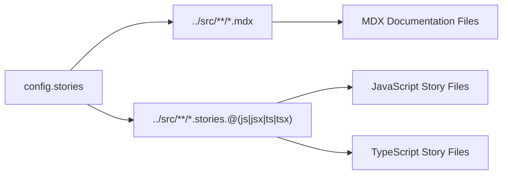
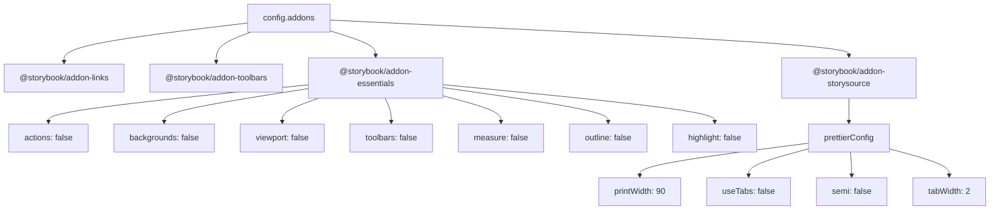
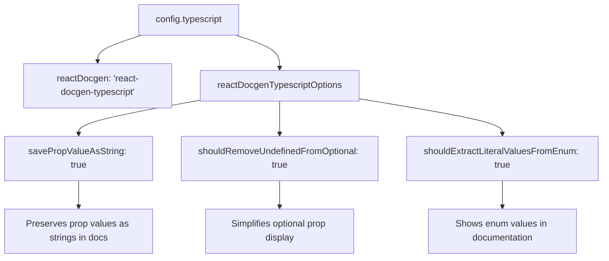
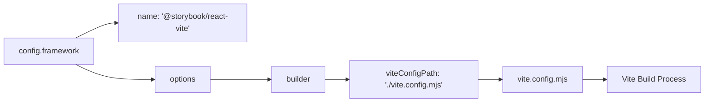
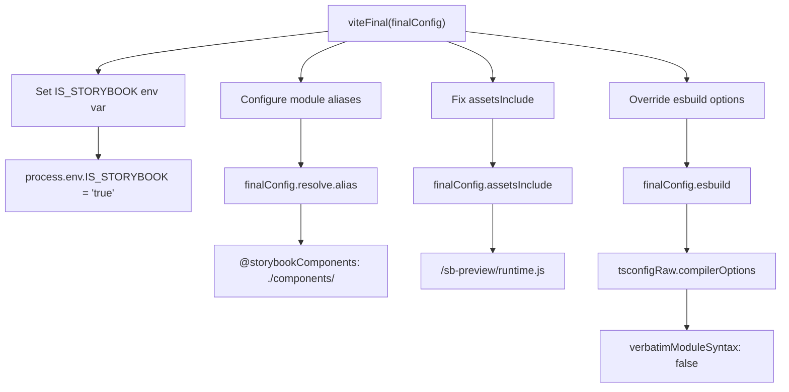
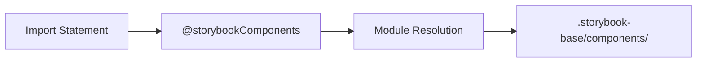
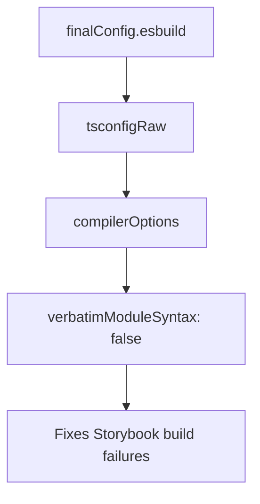
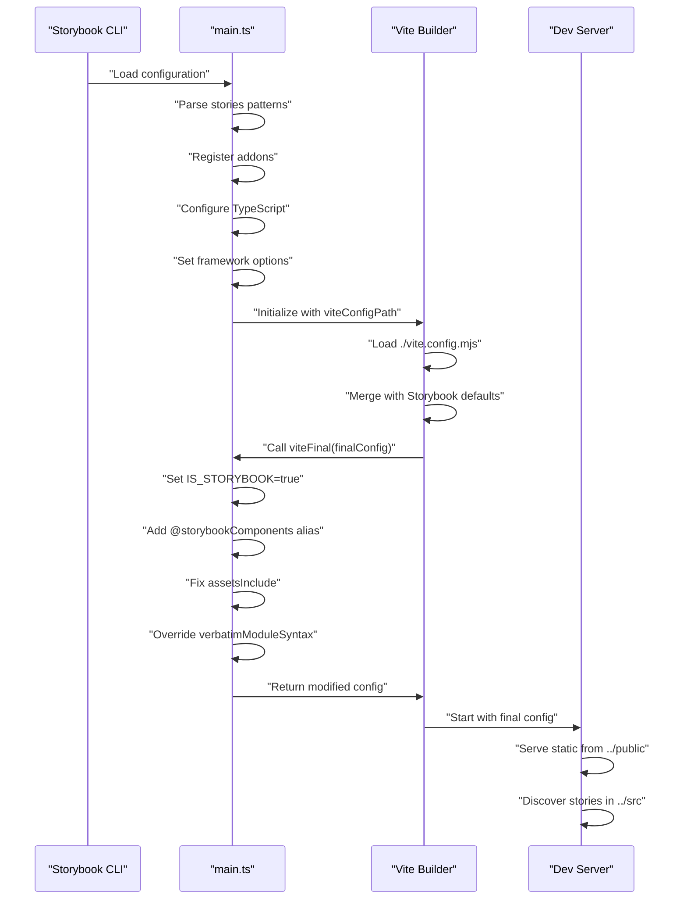

<!-- source: DeepWiki mcp.deepwiki.com · repo openai/apps-sdk-ui · page 3.1 Main Configuration (main.ts) · fetched 2026-10-26 -->

# Main Configuration (main.ts)

<details>
<summary>Relevant source files</summary>

The following files were used as context for generating this wiki page:

- [.storybook-base/main.ts](.storybook-base/main.ts)

</details>


The main configuration file defines core Storybook behavior including story discovery patterns, addon registration, TypeScript integration, framework setup, and build customizations. This file is the primary entry point for configuring the Storybook environment.

For manager-specific UI configuration, see [Manager Configuration (manager.ts)](#3.2). For custom addon implementations, see [Custom Addons](#4).

**Sources:** [.storybook-base/main.ts:1-79]()

---

## Configuration Overview

The configuration exports a `StorybookConfig` object typed as `StorybookConfig` from `@storybook/react-vite`. This type ensures type safety across all configuration properties.

```
StorybookConfig
├── stories: string[]
├── addons: (string | { name: string; options: object })[]
├── typescript: TypeScriptOptions
├── framework: FrameworkOptions
├── staticDirs: string[]
└── viteFinal: (config: ViteConfig) => Promise<ViteConfig>
```

The configuration is structured into six primary sections, each controlling a distinct aspect of Storybook's behavior.

**Sources:** [.storybook-base/main.ts:4-78]()

---

## Story Discovery Patterns

### Story File Pattern Configuration



**Story Discovery Pattern Configuration**

The `stories` array defines glob patterns that Storybook uses to discover story files. The configuration specifies two patterns:

| Pattern | Purpose | File Types |
|---------|---------|------------|
| `"../src/**/*.mdx"` | Documentation pages | MDX files containing narrative documentation |
| `"../src/**/*.stories.@(js|jsx|ts|tsx)"` | Component stories | Story files in JavaScript or TypeScript |

The patterns use `../src/**/*` to recursively search the entire `src` directory from the `.storybook-base` location. The `@(js|jsx|ts|tsx)` syntax is a glob pattern that matches any of the listed extensions.

**Sources:** [.storybook-base/main.ts:5]()

---

## Addon Configuration

### Registered Addons

The configuration registers four addons, each serving a specific purpose in the documentation workflow:



**Addon Dependency Structure**

### @storybook/addon-links

Registered as a simple string without additional configuration. This addon enables navigation between stories using the `linkTo` function.

**Sources:** [.storybook-base/main.ts:7]()

### @storybook/addon-toolbars

Registered as a simple string. This addon provides the toolbar API used by custom addons for rendering toolbar items.

**Sources:** [.storybook-base/main.ts:8]()

### @storybook/addon-essentials

Registered with extensive configuration to disable most built-in features. The configuration object at [.storybook-base/main.ts:10-21]() disables seven features:

| Feature | Status | Reason |
|---------|--------|--------|
| `actions` | `false` | Disabled - reduces noise in documentation workflow |
| `backgrounds` | `false` | Disabled - custom theme system handles this |
| `viewport` | `false` | Disabled - not needed for component documentation |
| `toolbars` | `false` | Disabled - custom toolbar addons provide required functionality |
| `measure` | `false` | Disabled - measurement tools create unnecessary UI clutter |
| `outline` | `false` | Disabled - outline visualization not needed |
| `highlight` | `false` | Disabled - element highlighting not required |

Despite these disabled features, the essentials addon still provides the docs and controls features which remain enabled by default.

**Sources:** [.storybook-base/main.ts:9-21]()

### @storybook/addon-storysource

Configured with custom Prettier formatting options to display story source code in the UI. The `loaderOptions.prettierConfig` object specifies:

| Option | Value | Purpose |
|--------|-------|---------|
| `printWidth` | `90` | Maximum line length before wrapping |
| `useTabs` | `false` | Use spaces for indentation |
| `semi` | `false` | Omit semicolons |
| `tabWidth` | `2` | Two spaces per indentation level |

**Sources:** [.storybook-base/main.ts:22-34]()

---

## TypeScript Integration

### React Docgen Configuration



**TypeScript Documentation Generation Pipeline**

The `typescript` configuration object specifies how component props are extracted and documented:

### reactDocgen

Set to `"react-docgen-typescript"` to use the TypeScript-based prop extraction tool. This analyzer parses TypeScript type definitions to generate component prop documentation.

**Sources:** [.storybook-base/main.ts:37]()

### reactDocgenTypescriptOptions

Three options control prop documentation generation:

| Option | Value | Effect |
|--------|-------|--------|
| `savePropValueAsString` | `true` | Preserves prop values as string representations in generated documentation |
| `shouldRemoveUndefinedFromOptional` | `true` | Removes `undefined` from union types for optional props, simplifying display |
| `shouldExtractLiteralValuesFromEnum` | `true` | Extracts literal values from enum types for documentation tables |

**Sources:** [.storybook-base/main.ts:38-42]()

---

## Framework Setup

### React-Vite Framework Configuration



**Framework and Builder Configuration**

The `framework` section specifies the Storybook framework adapter and build tool:

| Property | Value | Purpose |
|----------|-------|---------|
| `framework.name` | `"@storybook/react-vite"` | Configures Storybook for React with Vite as the build tool |
| `framework.options.builder.viteConfigPath` | `"./vite.config.mjs"` | References the base Vite configuration file to merge with Storybook's config |

The `viteConfigPath` reference ensures that the base Vite configuration at `./vite.config.mjs` is merged with Storybook's internal Vite configuration before the `viteFinal` hook is applied.

**Sources:** [.storybook-base/main.ts:44-51]()

---

## Static Asset Configuration

The `staticDirs` array specifies directories containing static assets that should be served by Storybook's development server:

```typescript
staticDirs: ["../public"]
```

This configuration maps the `../public` directory (relative to `.storybook-base`) to be served at the root of the Storybook server. Assets in this directory can be referenced in stories using root-relative paths like `/logo.svg`.

**Sources:** [.storybook-base/main.ts:52]()

---

## Vite Customizations (viteFinal)

### Overview

The `viteFinal` async function provides a hook to modify the Vite configuration after Storybook has constructed it. This function receives the final Vite configuration and returns a modified version.



**Vite Configuration Modification Pipeline**

**Sources:** [.storybook-base/main.ts:53-76]()

### Environment Variable Injection

```typescript
process.env.IS_STORYBOOK = "true"
```

Sets the `IS_STORYBOOK` environment variable to `"true"`. This variable can be checked in application code to conditionally enable Storybook-specific behavior.

**Sources:** [.storybook-base/main.ts:54]()

### Module Alias Configuration

The configuration creates a module alias to simplify imports in MDX files:



**Module Alias Resolution**

The alias configuration at [.storybook-base/main.ts:56-61]() adds `@storybookComponents` as an alias pointing to the `.storybook-base/components/` directory. This enables imports like:

```typescript
import { Card } from '@storybookComponents/Card'
```

Instead of requiring relative paths like:

```typescript
import { Card } from '../../../.storybook-base/components/Card'
```

**Sources:** [.storybook-base/main.ts:56-61]()

### Assets Include Fix

```typescript
finalConfig.assetsInclude = ["/sb-preview/runtime.js"]
```

This configuration addresses a known issue documented at GitHub issue #25256 in the Storybook repository. The `assetsInclude` setting explicitly includes the `/sb-preview/runtime.js` file to prevent build errors.

**Sources:** [.storybook-base/main.ts:63-64]()

### TypeScript Compiler Option Override

The esbuild configuration override addresses a compatibility issue with TypeScript's `verbatimModuleSyntax` compiler option:



**esbuild TypeScript Configuration Override**

The configuration at [.storybook-base/main.ts:68-73]() overrides the TypeScript compiler option specifically for the Storybook build:

| Configuration Path | Value | Purpose |
|-------------------|-------|---------|
| `finalConfig.esbuild` | `{}` or existing object | Ensures esbuild config object exists |
| `finalConfig.esbuild.tsconfigRaw` | Object | Raw TypeScript configuration override |
| `tsconfigRaw.compilerOptions.verbatimModuleSyntax` | `false` | Disables strict module syntax checking that causes Storybook build failures |

This override is necessary because Storybook's internal code is incompatible with `verbatimModuleSyntax: true`. The override only affects the Storybook build and does not modify the project's main TypeScript configuration.

**Sources:** [.storybook-base/main.ts:66-73]()

---

## Configuration Loading and Application



**Storybook Configuration Loading Sequence**

The configuration is loaded and applied in a specific order:

1. Storybook CLI loads `main.ts`
2. Story patterns are parsed to determine file discovery
3. Addons are registered with their specific options
4. TypeScript integration is configured
5. Framework and builder are initialized
6. Base Vite config is loaded from `./vite.config.mjs`
7. Storybook's default Vite config is merged
8. `viteFinal` hook applies final customizations
9. Development server starts with the final configuration

**Sources:** [.storybook-base/main.ts:1-79]()

---

