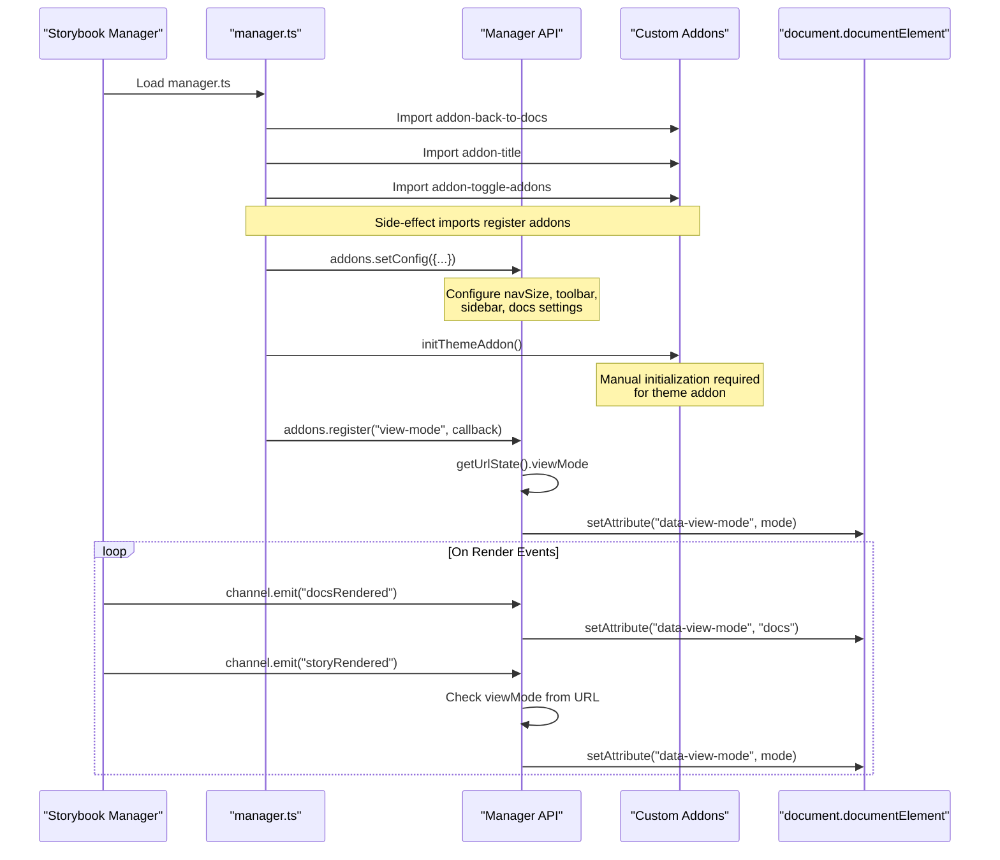
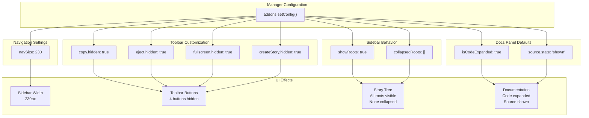
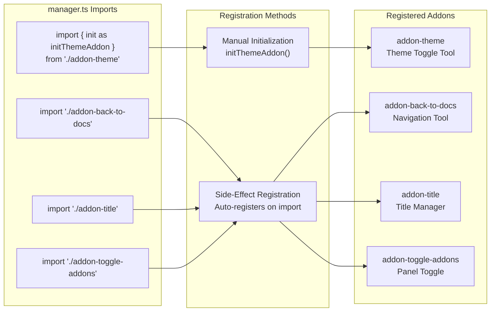
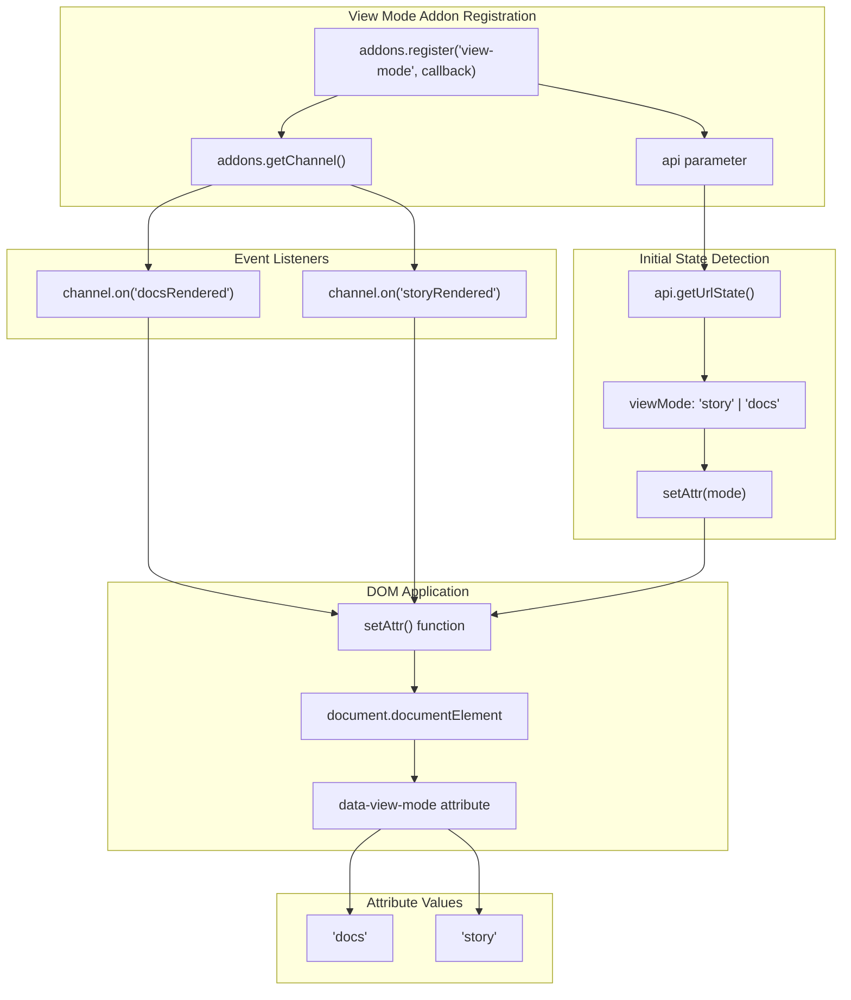

<!-- source: DeepWiki mcp.deepwiki.com · repo openai/apps-sdk-ui · page 3.2 Manager Configuration (manager.ts) · fetched 2026-10-26 -->

# Manager Configuration (manager.ts)

<details>
<summary>Relevant source files</summary>

The following files were used as context for generating this wiki page:

- [.storybook-base/manager.ts](.storybook-base/manager.ts)

</details>


## Purpose and Scope

The manager configuration file [.storybook-base/manager.ts]() serves as the entry point for customizing Storybook's manager application—the outer frame that contains the sidebar, toolbar, and navigation chrome. This file is distinct from the main configuration (see [Main Configuration](#3.1)), which configures the preview iframe where stories are rendered.

This document covers:
- Manager UI configuration including toolbar button visibility and sidebar behavior
- Registration and initialization of custom addons
- View mode tracking system for managing UI states

For information about the actual custom addon implementations, see [Custom Addons](#4). For UI styling customizations applied to the manager, see [Manager UI Customization](#3.3).

**Sources:** [.storybook-base/manager.ts:1-45]()

---

## Configuration Overview

The manager configuration performs three primary functions: configuring the Storybook manager UI, registering custom addons, and tracking view mode state. These operations occur when the Storybook manager application initializes, before any story content is loaded.

### Initialization Flow



**Sources:** [.storybook-base/manager.ts:1-44]()

---

## Manager Configuration Object

The `addons.setConfig()` call [.storybook-base/manager.ts:8-26]() configures the Storybook manager UI. This configuration controls the appearance and behavior of the manager application's chrome.

### Configuration Structure

| Configuration Path | Value | Effect |
|-------------------|-------|--------|
| `navSize` | `230` | Sets sidebar width to 230 pixels |
| `toolbar.copy.hidden` | `true` | Hides the "Copy Canvas Link" toolbar button |
| `toolbar.eject.hidden` | `true` | Hides the "Eject to Codesandbox" toolbar button |
| `toolbar.fullscreen.hidden` | `true` | Hides the fullscreen toggle button |
| `toolbar.createStory.hidden` | `true` | Hides the "Create Story" button |
| `sidebar.showRoots` | `true` | Displays root-level story groups in sidebar |
| `sidebar.collapsedRoots` | `[]` | No root groups collapsed by default |
| `docs.isCodeExpanded` | `true` | Code blocks in docs expanded by default |
| `docs.source.state` | `"shown"` | Source code visible in docs by default |



**Sources:** [.storybook-base/manager.ts:8-26]()

### Toolbar Customization

The toolbar configuration [.storybook-base/manager.ts:10-15]() hides four standard Storybook toolbar buttons. This creates a cleaner, more focused toolbar appropriate for this documentation-focused Storybook instance:

- **copy**: The "Copy Canvas Link" button is hidden as it's not essential for documentation browsing
- **eject**: The "Eject to Codesandbox" button is hidden since this Storybook is not intended for live editing
- **fullscreen**: The fullscreen toggle is hidden, likely because fullscreen mode is managed differently
- **createStory**: The "Create Story" button is hidden as this is a static documentation site

### Sidebar Configuration

The sidebar configuration [.storybook-base/manager.ts:16-19]() ensures all story groups are visible and accessible:

- **showRoots: true**: Root-level story groups appear in the sidebar tree
- **collapsedRoots: []**: No roots are collapsed by default, providing immediate visibility into all story categories

### Documentation Defaults

The docs configuration [.storybook-base/manager.ts:20-25]() sets default visibility for code elements in documentation pages:

- **isCodeExpanded: true**: Code blocks are expanded by default, making code immediately visible
- **source.state: "shown"**: Component source code is shown by default in documentation

**Sources:** [.storybook-base/manager.ts:8-26]()

---

## Addon Registration System

The manager file orchestrates the registration of four custom addons. Three use side-effect imports while one requires manual initialization.

### Addon Import Strategy



**Sources:** [.storybook-base/manager.ts:2-6,29]()

### Side-Effect Imports

Three addons are registered through side-effect imports [.storybook-base/manager.ts:4-6]():

```
import "./addon-back-to-docs"
import "./addon-title"
import "./addon-toggle-addons"
```

These imports execute the addon registration code at import time. Each addon file calls `addons.register()` internally, registering itself with Storybook's addon system automatically.

For details on each addon's functionality:
- [Back to Docs Addon](#4.2)
- [Title Addon](#4.3)
- [Toggle Addons Addon](#4.4)

### Manual Initialization

The theme addon requires manual initialization [.storybook-base/manager.ts:2,29]():

```
import { init as initThemeAddon } from "./addon-theme"
...
initThemeAddon()
```

This addon is imported as a named export (`init`) and called explicitly. This pattern is necessary because the theme addon needs to perform additional setup beyond simple registration, such as reading theme preferences from storage and applying the initial theme.

For complete details on the theme addon, see [Theme Addon](#4.1).

**Sources:** [.storybook-base/manager.ts:2-6,29]()

---

## View Mode Tracking

The manager file registers a custom addon called `"view-mode"` [.storybook-base/manager.ts:31-44]() that tracks whether the user is viewing a story or documentation page. This tracking is exposed through a `data-view-mode` attribute on the document root element.

### View Mode Tracking Mechanism



**Sources:** [.storybook-base/manager.ts:31-44]()

### Implementation Details

The view mode addon consists of three key components:

#### 1. Helper Function

The `setAttr()` function [.storybook-base/manager.ts:34-35]() encapsulates the DOM manipulation:

```
const setAttr = (mode: "story" | "docs") =>
  document.documentElement.setAttribute("data-view-mode", mode)
```

This function sets the `data-view-mode` attribute on `<html>` to either `"story"` or `"docs"`.

#### 2. Initial State

On registration, the addon immediately determines and applies the initial view mode [.storybook-base/manager.ts:37]():

```
setAttr(api.getUrlState().viewMode === "docs" ? "docs" : "story")
```

This reads the current view mode from Storybook's URL state and sets the attribute accordingly. Any view mode that is not explicitly `"docs"` is treated as `"story"`.

#### 3. Event Handlers

The addon listens to two Storybook channel events to track view mode changes:

**docsRendered Event** [.storybook-base/manager.ts:39]()
```
channel.on("docsRendered", () => setAttr("docs"))
```
When documentation is rendered, the attribute is set to `"docs"`.

**storyRendered Event** [.storybook-base/manager.ts:40-43]()
```
channel.on("storyRendered", () => {
  const { viewMode } = api.getUrlState()
  setAttr(viewMode === "docs" ? "docs" : "story")
})
```
When a story is rendered, the addon checks the URL state's `viewMode` property. This check is necessary because stories can be rendered in both story view and docs view (when embedded in documentation).

### Use Cases

The `data-view-mode` attribute enables CSS selectors to apply different styles based on the current view:

```css
html[data-view-mode="docs"] .sidebar { /* docs-specific styles */ }
html[data-view-mode="story"] .toolbar { /* story-specific styles */ }
```

This mechanism is leveraged by the manager UI customizations documented in [Manager UI Customization](#3.3).

**Sources:** [.storybook-base/manager.ts:31-44]()

---

## Integration with Other Systems

### Manager Head HTML

The manager configuration works in conjunction with custom CSS loaded through `manager-head.html`. The view mode tracking provides the `data-view-mode` attribute that CSS selectors can target. See [Manager UI Customization](#3.3) for details on the CSS customizations.

### Theme System

The manual initialization of the theme addon [.storybook-base/manager.ts:29]() is critical for the theme system to function. The theme addon reads preferences from storage, applies CSS classes to the document element, and registers the theme toggle toolbar button. See [Theme Addon](#4.1) for complete details.

### Storybook Manager API

The configuration uses several Storybook manager API methods:

| API Method | Usage | Location |
|------------|-------|----------|
| `addons.setConfig()` | Configure manager UI | Line 8 |
| `addons.register()` | Register custom addon | Line 31 |
| `addons.getChannel()` | Access event channel | Line 32 |
| `api.getUrlState()` | Read current URL state | Lines 37, 41 |

**Sources:** [.storybook-base/manager.ts:1-44]()

---

## Summary

The manager configuration file serves as the orchestration layer for Storybook's manager application. It:

1. **Configures UI elements** through `addons.setConfig()`, customizing toolbar buttons, sidebar behavior, and documentation defaults
2. **Registers custom addons** using both side-effect imports and manual initialization
3. **Tracks view mode** through a custom addon that maintains a `data-view-mode` attribute on the document root

This configuration is evaluated once when the Storybook manager loads, establishing the foundation for the entire documentation experience. The manager configuration works closely with the theme system, UI customizations, and custom addons to create a cohesive, branded Storybook instance.

**Sources:** [.storybook-base/manager.ts:1-45]()

---

